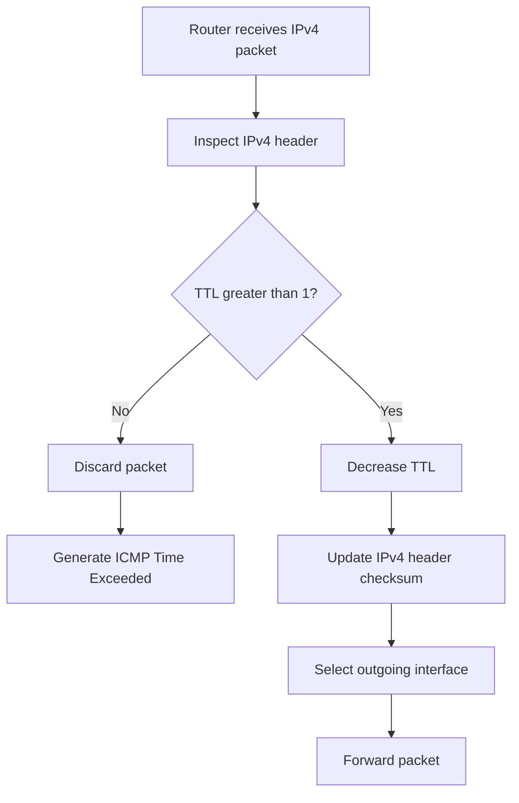
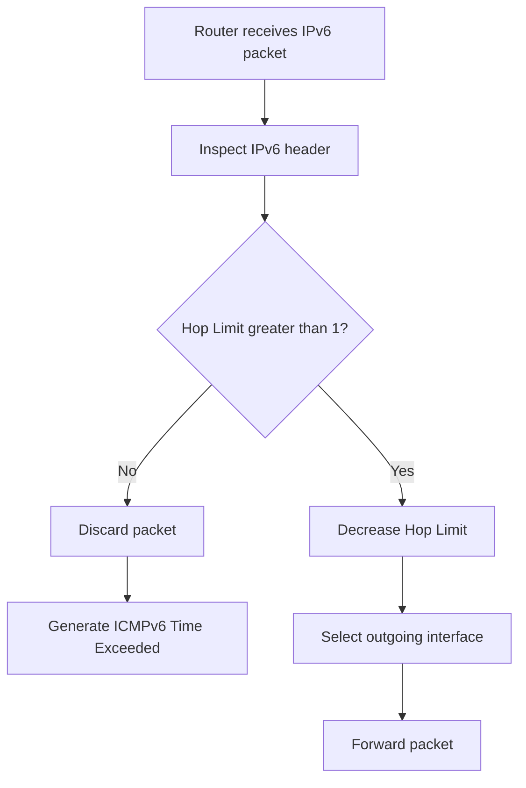
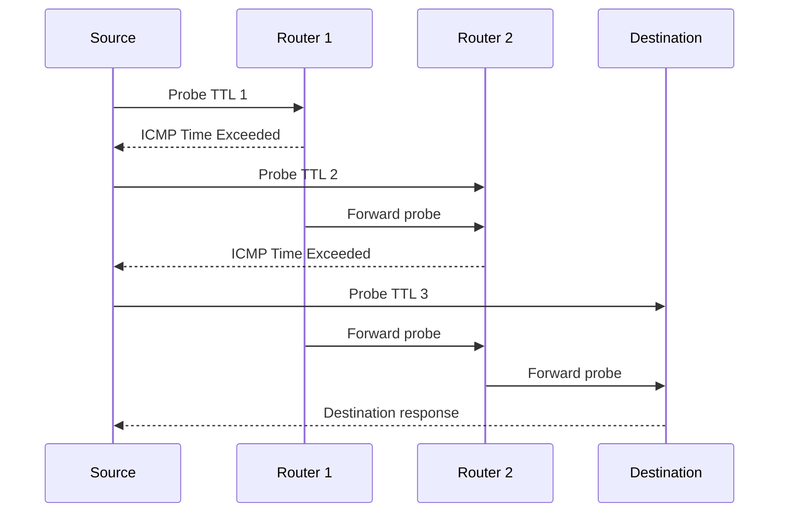

# TTL and Hop Limit

Time to Live (TTL) and Hop Limit are IP header fields that prevent packets from circulating indefinitely through a network.

* **TTL** is used by IPv4.
* **Hop Limit** is used by IPv6.

Despite their names, these fields primarily limit the number of Layer 3 forwarding hops a packet can traverse. Every router that forwards the packet decreases the value by at least one.

When the value reaches zero, the router discards the packet and normally generates an ICMP error message.

These mechanisms are essential for preventing routing loops from consuming network resources indefinitely. They are also fundamental to tools such as `ping`, `traceroute`, and `tracepath`.

# 🗁 TTL Fundamentals

TTL stands for **Time to Live**.

It is an IPv4 header field that limits how long a packet can remain in the network.

Historically, TTL was intended to represent a time limit. However, modern IP forwarding uses it as a hop counter.

Each router forwarding an IPv4 packet decreases its TTL by at least one.

IPv6 uses a similar mechanism called Hop Limit.

### 🖆 Why TTL Is Needed

Imagine a network with an incorrect routing configuration that creates a loop:

```text
Router A → Router B → Router C
    ↑                     |
    └─────────────────────┘
```

A packet could circulate between these routers indefinitely if there were no forwarding limit.

TTL and Hop Limit prevent this behavior.

For example:

```text
Initial TTL: 5

Router A: 5 → 4
Router B: 4 → 3
Router C: 3 → 2
Router A: 2 → 1
Router B: 1 → 0

Packet discarded
```

The packet cannot continue circulating forever.

### 🖆 TTL and Hop Limit Location

Both fields are part of their respective IP headers.

```text
IPv4 Header
├── Version
├── Header Length
├── Type of Service
├── Total Length
├── Identification
├── Flags
├── Fragment Offset
├── TTL
├── Protocol
├── Header Checksum
├── Source Address
└── Destination Address
```

IPv6 uses a different header structure:

```text
IPv6 Header
├── Version
├── Traffic Class
├── Flow Label
├── Payload Length
├── Next Header
├── Hop Limit
├── Source Address
└── Destination Address
```

---

# 🗁 IPv4 TTL

IPv4 TTL is an 8-bit field in the IPv4 header.

Its value ranges from:

```text
0 - 255
```

A sender selects an initial TTL value when creating an IPv4 packet.

Each router that forwards the packet decreases the TTL.

### 🖆 TTL Processing

Suppose a host sends a packet with:

```text
Initial TTL = 64
```

The packet travels through three routers:

| Device | TTL |
| --- | ---: |
| Source host | 64 |
| Router 1 | 63 |
| Router 2 | 62 |
| Router 3 | 61 |
| Destination | 61 |

The destination receives the packet with TTL 61.

The destination host does not decrement TTL merely because it receives the packet.

### 🖆 TTL Decrement Rule

An IPv4 router forwarding a packet must reduce TTL by at least one.

The IPv4 forwarding rules account for processing time. If processing takes longer than one second, the TTL reduction can be greater than one.

In ordinary modern networks, TTL is effectively decremented by one per forwarding hop.

### 🖆 TTL Reaching Zero

If a router receives a packet whose TTL is too small to forward, it discards the packet.

Normally, it sends an ICMP Time Exceeded message to the source.

The relevant ICMPv4 message is:

```text
Type: 11
Code: 0
Description: Time to Live exceeded in transit
```

The source can use this message to identify where the packet stopped.

---

# 🗁 IPv6 Hop Limit

IPv6 uses a field called Hop Limit instead of TTL.

Hop Limit is also an 8-bit field.

Its range is:

```text
0 - 255
```

It limits the number of forwarding hops an IPv6 packet can traverse.

### 🖆 Hop Limit Processing

Suppose a host sends an IPv6 packet with:

```text
Initial Hop Limit = 64
```

The packet crosses two routers:

| Device | Hop Limit |
| --- | ---: |
| Source host | 64 |
| Router 1 | 63 |
| Router 2 | 62 |
| Destination | 62 |

Each forwarding router decreases the Hop Limit by one.

### 🖆 Hop Limit Reaching Zero

If an IPv6 router cannot forward a packet because its Hop Limit has expired, it discards the packet.

Normally, it sends an ICMPv6 Time Exceeded message.

The relevant ICMPv6 message is:

```text
Type: 3
Code: 0
Description: Hop limit exceeded in transit
```

### 🖆 IPv6 Hop Limit and NDP

IPv6 Neighbor Discovery Protocol (NDP) has an additional validation rule.

NDP messages are sent with an IPv6 Hop Limit of 255.

A receiving node validates that the Hop Limit is 255.

Because routers decrement Hop Limit, a packet forwarded from another link cannot arrive with a value of 255.

This helps prevent certain off-link spoofing attacks against NDP.

This is a separate protocol requirement from the normal forwarding behavior of IPv6 packets.

---

# 🗁 TTL vs Hop Limit

TTL and Hop Limit perform similar functions, but belong to different IP versions.

| Feature | IPv4 TTL | IPv6 Hop Limit |
| --- | --- | --- |
| IP version | IPv4 | IPv6 |
| Header size | 8 bits | 8 bits |
| Initial value | Selected by sender | Selected by sender |
| Router behavior | Decrement | Decrement |
| Minimum forwarding value | Must remain positive | Must remain positive |
| Expiration message | ICMPv4 Time Exceeded | ICMPv6 Time Exceeded |
| ICMP type | 11 | 3 |
| Purpose | Limit forwarding lifetime | Limit forwarding hops |

### 🖆 Important Difference

The name TTL comes from the original time-based concept.

However, TTL is not normally a real-time clock or a measurement of milliseconds.

For practical networking, it is best understood as an IPv4 hop counter.

IPv6 uses the more accurate name Hop Limit.

---

# 🗁 How Routers Process TTL and Hop Limit

Routers inspect the IP header when forwarding packets.

The forwarding process includes checking the destination address, selecting a route, and updating the forwarding header.

### 🖆 IPv4 Forwarding Process

A simplified IPv4 forwarding process:



The IPv4 header checksum must be updated because TTL is part of the IPv4 header.

### 🖆 IPv6 Forwarding Process

A simplified IPv6 forwarding process:



IPv6 does not have an IPv4-style header checksum.

Therefore, decrementing the Hop Limit does not require updating an IPv6 header checksum.

### 🖆 Why IPv4 Requires Checksum Updates

The IPv4 header checksum protects the IPv4 header.

Since TTL changes during forwarding, the checksum must be recalculated or incrementally updated.

IPv6 removed the base-header checksum to simplify forwarding.

---

# 🗁 TTL Expiration and ICMP

When TTL or Hop Limit expires during forwarding, the router normally sends an ICMP Time Exceeded message.

This message informs the source that the packet could not continue because its forwarding limit expired.

### 🖆 IPv4 ICMP Time Exceeded

IPv4 uses:

```text
ICMP Type: 11
Code: 0
```

Example:

```text
Source:      192.168.1.10
Destination: 1.1.1.1
TTL:         1

Router receives packet
Router cannot forward it
Router discards packet
Router sends ICMP Time Exceeded
```

### 🖆 IPv6 ICMP Time Exceeded

IPv6 uses:

```text
ICMPv6 Type: 3
Code: 0
```

The message indicates that the Hop Limit expired during forwarding.

### 🖆 ICMP Error Message Contents

ICMP error messages generally include the original packet's IP header and enough of its payload to help the source identify the packet that caused the error.

The exact format and amount of quoted information depend on the IP version and ICMP specification.

### 🖆 When ICMP Time Exceeded Is Not Sent

ICMP error generation has restrictions.

For example, routers generally do not generate ICMP error messages in response to:

* Another ICMP error message.
* Packets sent to IPv4 broadcast or multicast destinations, subject to defined exceptions.
* Non-initial IPv4 fragments.
* Certain packets with special source or destination addresses.

ICMP errors may also be rate-limited.

Therefore, the absence of a Time Exceeded message does not always prove that a packet was successfully forwarded.

---

# 🗁 TTL and Routing Loops

Routing loops occur when packets repeatedly travel through routers because of incorrect or inconsistent routing information.

TTL and Hop Limit prevent packets from circulating indefinitely.

### 🖆 Example Routing Loop

Consider:

```text
Router A
   |
   v
Router B
   |
   v
Router C
   |
   └──────> Router A
```

A packet with TTL 4 may travel:

| Hop | Router | TTL |
| --- | --- | ---: |
| Initial | Source | 4 |
| First | Router A | 3 |
| Second | Router B | 2 |
| Third | Router C | 1 |
| Fourth | Router A | 0 |

Router A discards the packet instead of forwarding it again.

### 🖆 Does TTL Prevent Routing Loops?

TTL limits the damage caused by routing loops, but it does not prevent the routing loop itself.

Routing protocols and correct network design are responsible for avoiding routing loops.

TTL and Hop Limit provide a final safety mechanism.

### 🖆 Routing Loop Symptoms

Common symptoms include:

* Repeated packet loss.
* High latency.
* ICMP Time Exceeded messages.
* Traceroute showing repeated router addresses.
* Unexpected network congestion.
* Intermittent connectivity.

---

# 🗁 Initial TTL Values

The sender chooses the initial TTL value when creating an IPv4 packet.

Common operating systems and network devices use different default values.

Typical initial values include:

| Common Initial TTL | Example |
| ---: | --- |
| 64 | Linux and many Unix-like systems |
| 128 | Windows |
| 255 | Some network devices and specialized systems |

These are common defaults, not guaranteed values.

### 🖆 Why Initial TTL Values Matter

The initial TTL affects how many forwarding hops a packet can traverse before expiration.

For example:

```text
Initial TTL: 64
Received TTL: 58

Estimated Forwarding Hops:
64 - 58 = 6
```

This estimate is valid only if the initial TTL is known.

### 🖆 Can TTL Identify an Operating System?

TTL values are sometimes used as a rough operating-system fingerprint.

For example:

* A received TTL near 64 may suggest an initial TTL of 64.
* A received TTL near 128 may suggest an initial TTL of 128.
* A received TTL near 255 may suggest an initial TTL of 255.

However, this is not reliable identification.

Reasons include:

* Administrators can change initial TTL values.
* Firewalls and routers can modify TTL.
* Different operating systems may use the same initial value.
* Network paths can have different hop counts.
* Some systems use unusual configurations.

TTL should not be treated as definitive operating-system identification.

---

# 🗁 TTL and Traceroute

Traceroute is a network diagnostic tool that discovers the routers along a path to a destination.

It uses TTL expiration in IPv4 and Hop Limit expiration in IPv6.

### 🖆 How Traceroute Works

Traceroute sends probes with progressively increasing TTL or Hop Limit values.

The first probe starts with a value of 1.

The first router decreases it to zero and returns an ICMP Time Exceeded message.

The next probe uses a value of 2.

The second router returns an ICMP Time Exceeded message.

The process continues until the destination is reached or the maximum probe limit is reached.

### 🖆 Traceroute Example

```text
traceroute to 1.1.1.1

1  192.168.1.1
2  10.10.0.1
3  172.16.1.1
4  203.0.113.1
5  1.1.1.1
```

Each line represents a hop discovered through the probes.

### 🖆 Traceroute Flow



### 🖆 Different Traceroute Probe Methods

Traceroute implementations can use different probe types.

| Method | Probe Type | Typical Response |
| --- | --- | --- |
| Traditional Unix traceroute | UDP | ICMP Time Exceeded |
| ICMP traceroute | ICMP Echo | ICMP Time Exceeded |
| TCP traceroute | TCP SYN | ICMP Time Exceeded or TCP response |

Linux supports these methods.

UDP-based traceroute often uses high destination ports.

ICMP-based traceroute uses Echo Request probes.

TCP-based traceroute is useful when intermediate networks filter UDP or ICMP Echo traffic but allow TCP traffic.

### 🖆 Traceroute Does Not Always Show Every Router

Some routers:

* Do not respond to traceroute probes.
* Rate-limit ICMP messages.
* Filter certain probe types.
* Use load balancing that produces different paths.
* Return responses using addresses from different interfaces.

A `*` in traceroute output means that no response was received within the timeout. It does not necessarily mean that the router is down.

---

# 🗁 TTL and Hop Limit in Security

TTL and Hop Limit can contribute to network security and traffic validation.

They are not complete security mechanisms, but they provide useful controls.

### 🖆 Limiting Packet Lifetime

TTL and Hop Limit prevent packets from circulating indefinitely.

This helps limit the effects of routing loops and certain malformed traffic conditions.

### 🖆 TTL-Based Filtering

Some networks use TTL-based filtering to identify packets that appear to have traveled an unexpected number of hops.

For example, a network may reject packets arriving with an unusually small TTL.

However, TTL values can be manipulated, so TTL-based filtering should not be treated as strong authentication.

### 🖆 NDP Hop Limit Validation

IPv6 NDP messages require a Hop Limit of 255.

Receivers validate this value to help ensure that the messages originated on the local link rather than being forwarded from another network.

### 🖆 TTL and Hop Limit Are Not Encryption

Neither TTL nor Hop Limit provides:

* Confidentiality.
* Authentication.
* Data integrity.
* Protection against all spoofing attacks.

Security mechanisms such as IPsec, TLS, firewalls, and proper network access controls address different security requirements.

---

# 🗁 Linux TTL and Hop Limit Commands

Linux provides several commands for inspecting TTL and Hop Limit behavior.

### 🖆 Check IPv4 TTL with Ping

```bash
ping -4 -c 4 1.1.1.1
```

The ping output may show the TTL value received in the Echo Reply.

Example:

```text
64 bytes from 1.1.1.1: icmp_seq=1 ttl=57 time=25.4 ms
```

This is the TTL of the received reply packet, not the original request packet.

### 🖆 Check IPv6 Hop Limit with Ping

```bash
ping -6 -c 4 2606:4700:4700::1111
```

Linux may display the received IPv6 Hop Limit in the output, depending on the version and implementation.

### 🖆 Set IPv4 TTL for Ping

Use:

```bash
ping -4 -t 10 -c 4 1.1.1.1
```

This sends IPv4 Echo Requests with TTL 10.

### 🖆 Set IPv6 Hop Limit for Ping

Use:

```bash
ping -6 -t 10 -c 4 2606:4700:4700::1111
```

This sends IPv6 Echo Requests with Hop Limit 10.

### 🖆 Use Traceroute for IPv4

```bash
traceroute -4 1.1.1.1
```

### 🖆 Use Traceroute for IPv6

```bash
traceroute -6 2606:4700:4700::1111
```

### 🖆 Use ICMP Traceroute

```bash
traceroute -I 1.1.1.1
```

### 🖆 Use TCP Traceroute

```bash
traceroute -T -p 443 1.1.1.1
```

This uses TCP probes toward destination port 443.

### 🖆 Inspect Packets with tcpdump

Capture IPv4 ICMP traffic:

```bash
sudo tcpdump -ni eth0 icmp
```

Capture IPv6 ICMP traffic:

```bash
sudo tcpdump -ni eth0 icmp6
```

Capture both:

```bash
sudo tcpdump -vv -ni eth0 'icmp or icmp6'
```

To inspect IP header values, use verbose output or Wireshark.

---

# 🗁 Packet Analysis with Wireshark

Wireshark displays TTL and Hop Limit values in packet details.

### 🖆 IPv4 TTL Display Filter

```text
ip.ttl
```

Filter packets with TTL equal to 1:

```text
ip.ttl == 1
```

Filter packets with TTL less than or equal to 10:

```text
ip.ttl <= 10
```

### 🖆 IPv6 Hop Limit Display Filter

```text
ipv6.hlim
```

Filter packets with Hop Limit equal to 1:

```text
ipv6.hlim == 1
```

Filter packets with Hop Limit less than or equal to 10:

```text
ipv6.hlim <= 10
```

### 🖆 ICMP Time Exceeded Filters

IPv4 Time Exceeded:

```text
icmp.type == 11
```

IPv6 Time Exceeded:

```text
icmpv6.type == 3
```

### 🖆 What to Inspect

When analyzing TTL and Hop Limit, inspect:

* Initial TTL or Hop Limit.
* Received TTL or Hop Limit.
* Number of forwarding hops.
* ICMP Time Exceeded messages.
* Source address of the responding router.
* Whether TTL is being modified by network devices.
* Whether packets are being dropped because their forwarding limit expires.

---

# 🗁 Common Problems

### 🖆 TTL Expired

**Symptoms:**

* Ping fails with TTL exceeded.
* Traceroute reports repeated hops.
* Packets do not reach the destination.

**Possible causes:**

* Routing loop.
* Incorrect routing configuration.
* Initial TTL is too low.
* Unexpectedly long routing path.

**Troubleshooting:**

```bash
traceroute -4 1.1.1.1
```

Inspect the routing path and investigate repeated router addresses.

### 🖆 Traceroute Shows Asterisks

**Symptoms:**

```text
1  192.168.1.1
2  *
3  *
4  203.0.113.1
```

**Possible causes:**

* ICMP filtering.
* Rate limiting.
* Firewall restrictions.
* Routers not responding to probes.
* Probe type not supported by the network.

**Troubleshooting:**

Try different probe methods:

```bash
traceroute -I 1.1.1.1
traceroute -T -p 443 1.1.1.1
```

### 🖆 Unexpected TTL Values

**Symptoms:**

Received TTL values differ from expected values.

**Possible causes:**

* Different initial TTL defaults.
* Different routing paths.
* TTL modification by intermediate devices.
* Network address translation or firewall behavior.

**Troubleshooting:**

Capture packets near the source and destination and compare their TTL values.

### 🖆 IPv6 Hop Limit Expiration

**Symptoms:**

IPv6 packets fail with ICMPv6 Time Exceeded messages.

**Possible causes:**

* Routing loops.
* Incorrect IPv6 routing.
* Hop Limit configured too low.
* Unexpectedly long network path.

**Troubleshooting:**

```bash
traceroute -6 2606:4700:4700::1111
```

Inspect IPv6 routes:

```bash
ip -6 route show
```

---

# 🗁 Best Practices

* Understand the difference between IPv4 TTL and IPv6 Hop Limit.
* Remember that TTL is effectively a hop counter in modern IP forwarding.
* Use traceroute to investigate routing paths and loops.
* Do not assume a missing traceroute response means a router is down.
* Allow necessary ICMP error messages for effective troubleshooting.
* Avoid using TTL values as a replacement for proper security controls.
* Verify IPv6 NDP messages use the required Hop Limit of 255.
* Inspect actual packet headers instead of relying only on assumptions about operating-system defaults.
* Investigate repeated hops and unexpected Time Exceeded messages.
* Use both IPv4 and IPv6 traceroute when troubleshooting dual-stack networks.

---

# 🗁 Practical Exercises

### 🖆 Exercise: Inspect IPv4 TTL

Run:

```bash
ping -4 -c 4 1.1.1.1
```

Record the TTL values shown in the replies.

Determine whether the destination might have started with a TTL of 64, 128, or 255.

### 🖆 Exercise: Inspect IPv6 Hop Limit

Run:

```bash
ping -6 -c 4 2606:4700:4700::1111
```

Inspect the received Hop Limit value.

Compare IPv4 and IPv6 behavior.

### 🖆 Exercise: Generate TTL Expiration

Send a packet with a low TTL:

```bash
ping -4 -t 1 -c 1 1.1.1.1
```

Observe whether an ICMP Time Exceeded response is returned.

The result depends on the network and whether ICMP errors are permitted.

### 🖆 Exercise: Trace an IPv4 Route

Run:

```bash
traceroute -4 1.1.1.1
```

Identify the routers along the path.

### 🖆 Exercise: Trace an IPv6 Route

Run:

```bash
traceroute -6 2606:4700:4700::1111
```

Compare the IPv4 and IPv6 paths.

### 🖆 Exercise: Analyze TTL in Wireshark

Capture ping traffic and inspect:

* IPv4 TTL.
* IPv6 Hop Limit.
* ICMP Echo Request.
* ICMP Echo Reply.
* ICMP Time Exceeded.

Determine how these fields change across forwarding hops.

---

# 🗁 Interview Questions

### 🖆 Basic Questions

**What is TTL?**

TTL is an 8-bit IPv4 header field that limits how many forwarding hops a packet can traverse.

**What is Hop Limit?**

Hop Limit is the IPv6 equivalent of TTL. It limits the number of forwarding hops.

**What is the size of the TTL field?**

TTL is 8 bits and has a possible value range of 0 to 255.

**Does TTL represent actual time in modern networks?**

No. In modern IP forwarding, TTL effectively acts as a hop counter.

**What happens when TTL reaches zero?**

The router discards the packet and normally sends an ICMP Time Exceeded message.

### 🖆 Intermediate Questions

**What is the difference between TTL and Hop Limit?**

TTL belongs to IPv4, while Hop Limit belongs to IPv6. Both limit packet forwarding hops.

**Why do routers decrement TTL?**

To prevent packets from circulating indefinitely because of routing loops.

**Does TTL prevent routing loops?**

No. It limits how long packets can circulate, but routing protocols and correct configuration are responsible for preventing loops.

**What ICMP message is generated when IPv4 TTL expires?**

ICMP Time Exceeded, Type 11, Code 0.

**What ICMPv6 message is generated when IPv6 Hop Limit expires?**

ICMPv6 Time Exceeded, Type 3, Code 0.

### 🖆 Advanced Questions

**How does traceroute use TTL?**

Traceroute sends probes with progressively increasing TTL values. Each router where a probe expires normally returns an ICMP Time Exceeded message.

**Why does IPv4 require a header checksum update when TTL changes?**

Because TTL is part of the IPv4 header, which is protected by the IPv4 header checksum.

**Why does IPv6 not need a base-header checksum update?**

IPv6 does not include a base-header checksum.

**Why must IPv6 NDP messages use Hop Limit 255?**

Receivers validate this value to help ensure that NDP messages originated on the local link and were not forwarded by a router.

**Can TTL identify an operating system?**

It can provide a rough clue about the sender's initial TTL configuration, but it cannot reliably identify an operating system.

---

# 🗁 Summary

TTL and Hop Limit prevent IP packets from circulating indefinitely through networks.

Key concepts:

* IPv4 uses TTL.
* IPv6 uses Hop Limit.
* Both fields are 8 bits.
* Both limit the number of forwarding hops.
* Routers decrement the value when forwarding packets.
* Expired IPv4 TTL normally generates ICMP Time Exceeded.
* Expired IPv6 Hop Limit normally generates ICMPv6 Time Exceeded.
* TTL and Hop Limit limit the effects of routing loops but do not prevent the loops themselves.
* Traceroute uses progressively increasing TTL or Hop Limit values to discover network paths.
* Initial TTL values vary by operating system and device.
* IPv6 NDP requires a Hop Limit of 255.

Understanding these fields is essential for packet analysis, routing troubleshooting, and network diagnostics.

---

# 🗁 References

### 🖆 Official RFCs

* [RFC 791 — Internet Protocol](https://www.rfc-editor.org/rfc/rfc791)
* [RFC 1812 — Requirements for IP Version 4 Routers](https://www.rfc-editor.org/rfc/rfc1812)
* [RFC 8200 — Internet Protocol, Version 6 (IPv6) Specification](https://www.rfc-editor.org/rfc/rfc8200)
* [RFC 4443 — Internet Control Message Protocol (ICMPv6)](https://www.rfc-editor.org/rfc/rfc4443)
* [RFC 4861 — Neighbor Discovery for IP Version 6 (IPv6)](https://www.rfc-editor.org/rfc/rfc4861)

### 🖆 Linux Documentation

* [ping Manual](https://man7.org/linux/man-pages/man8/ping.8.html)
* [traceroute Manual](https://man7.org/linux/man-pages/man8/traceroute.8.html)
* [tracepath Manual](https://man7.org/linux/man-pages/man8/tracepath.8.html)
* [tcpdump Manual](https://www.tcpdump.org/manpages/tcpdump.1.html)
* [Wireshark Documentation](https://www.wireshark.org/docs/)
