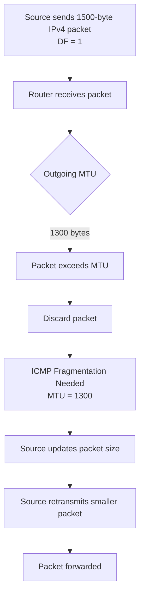
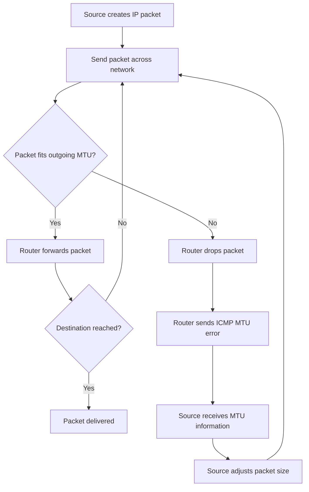
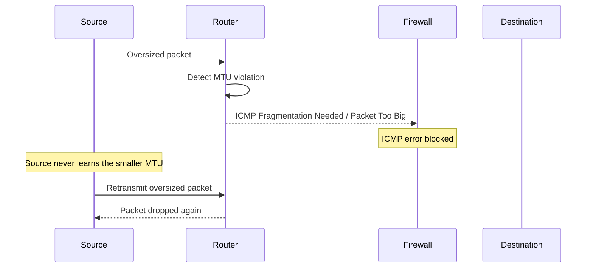

# Path MTU Discovery (PMTUD)

Path MTU Discovery (PMTUD) is a networking mechanism used to determine the maximum IP packet size that can travel from a source to a destination without requiring fragmentation.

A network path may contain multiple links with different MTU values. The smallest MTU along that path determines the maximum packet size that can pass through without fragmentation.

PMTUD helps hosts discover this limit and adjust packet sizes accordingly.

It is particularly important for:

* IPv4 networks using the Don't Fragment (DF) flag.
* IPv6 networks, where routers cannot fragment packets.
* VPNs and tunneling technologies.
* TCP connections and large data transfers.
* Diagnosing connectivity problems caused by blocked ICMP messages.

# 🗁 Path MTU Fundamentals

Path MTU (PMTU) is the smallest Maximum Transmission Unit among all links along a network path.

Consider this example:

```text
Host A
  |
  | MTU 1500
  |
Router A
  |
  | MTU 1400
  |
Router B
  |
  | MTU 1300
  |
Router C
  |
  | MTU 1500
  |
Host B
```

The MTUs along the path are:

* Link 1: 1500 bytes.
* Link 2: 1400 bytes.
* Link 3: 1300 bytes.
* Link 4: 1500 bytes.

The Path MTU is:

```text
PMTU = Minimum MTU Along the Path

PMTU = 1300 bytes
```

Even though both endpoints use a 1500-byte interface MTU, packets larger than 1300 bytes cannot traverse the complete path without fragmentation or another packet-size adjustment.

### 🖆 Interface MTU vs Path MTU

| Feature | Interface MTU | Path MTU |
| --- | --- | --- |
| Meaning | Maximum packet size supported by one interface link | Maximum packet size supported across an entire path |
| Scope | One network link | Multiple network links |
| Determined by | Interface and link configuration | Smallest MTU along the path |
| Can change by destination? | Usually interface-specific | Yes |
| Used by | Interface transmission | Packet-size adaptation |

### 🖆 Why the Smallest MTU Matters

A packet must satisfy the MTU requirements of every link it crosses.

For example:

```text
Source MTU:       1500
Router A MTU:     1400
Router B MTU:     1300
Destination MTU:  1500
```

A 1450-byte packet may leave the source successfully but cannot pass through the 1300-byte link without fragmentation or packet-size adjustment.

PMTUD helps the source discover this restriction.

---

# 🗁 Why PMTUD Is Necessary

Networks contain different technologies, encapsulation methods, and link configurations.

Not every link supports the same packet size.

For example:

* Ethernet commonly uses an IP MTU of 1500 bytes.
* PPPoE commonly reduces the IP MTU to 1492 bytes.
* VPN tunnels add encapsulation overhead.
* Some service-provider networks use smaller MTUs.
* Jumbo-frame networks may support larger packets.

A source host usually knows its local interface MTU, but it does not automatically know the MTU of every remote network link.

### 🖆 Problems Without PMTUD

Without an effective packet-size discovery mechanism:

* IPv4 routers may need to fragment packets.
* IPv4 packets with DF set may be discarded.
* IPv6 packets may be discarded by routers.
* TCP connections may stall if necessary ICMP feedback is lost.
* Large UDP datagrams may fail even when smaller ones succeed.

### 🖆 PMTUD Benefits

* Reduces unnecessary fragmentation.
* Helps avoid oversized packets.
* Improves transport efficiency.
* Supports reliable communication across heterogeneous networks.
* Helps diagnose tunnel and VPN MTU issues.
* Allows endpoints to adapt packet sizes to the network path.

---

# 🗁 IPv4 Path MTU Discovery

Traditional IPv4 PMTUD is defined in RFC 1191.

It uses the IPv4 Don't Fragment (DF) flag and ICMP Destination Unreachable messages.

### 🖆 IPv4 PMTUD Process

The source sends IPv4 packets with the DF flag enabled.

If a router encounters an outgoing interface whose MTU is smaller than the packet:

* The router cannot fragment the packet because DF is set.
* The router discards the packet.
* The router sends an ICMP Destination Unreachable message.
* The message indicates Fragmentation Needed and DF Set.
* The sender adjusts the packet size.

The sender can then retransmit using a smaller packet size.

### 🖆 IPv4 PMTUD Example

Assume:

```text
Source Interface MTU: 1500
Intermediate Link MTU: 1300
Destination MTU: 1500
```

The source sends a 1500-byte IPv4 packet with DF enabled.

The intermediate router receives it but cannot forward it over the 1300-byte link.

The router returns an ICMP error indicating the supported MTU.



### 🖆 IPv4 DF Flag

The Don't Fragment flag is part of the IPv4 header.

| DF Value | Meaning |
| --- | --- |
| 0 | Fragmentation is permitted |
| 1 | Fragmentation is prohibited |

Traditional IPv4 PMTUD sets DF so that routers provide MTU feedback instead of silently fragmenting packets.

### 🖆 IPv4 PMTUD Limitations

Traditional PMTUD depends on ICMP error messages reaching the source.

If an intermediate firewall blocks ICMP Fragmentation Needed messages, the sender may never discover the smaller MTU.

This can result in a PMTUD black hole.

---

# 🗁 IPv6 Path MTU Discovery

IPv6 PMTUD is defined in RFC 8201.

Unlike IPv4, IPv6 routers never fragment packets.

If an IPv6 packet exceeds the outgoing interface MTU:

* The router discards the packet.
* It sends an ICMPv6 Packet Too Big message.
* The message includes the supported MTU.
* The source adjusts the packet size or fragments it when appropriate.

### 🖆 IPv6 PMTUD Example

Assume:

```text
Source Interface MTU: 1500
Intermediate Link MTU: 1280
Destination MTU: 1500
```

The source sends a 1500-byte IPv6 packet.

The intermediate router cannot forward it over the 1280-byte link.

The router sends:

```text
ICMPv6 Type: 2
Packet Too Big
MTU: 1280
```

The source then reduces its packet size or uses IPv6 fragmentation if necessary.

### 🖆 IPv6 Minimum Link MTU

IPv6 requires every link to support an MTU of at least:

```text
1280 bytes
```

A link that cannot directly support IPv6 packets of this size must provide appropriate link-layer fragmentation and reassembly.

This minimum helps establish a baseline for IPv6 packet transmission.

### 🖆 IPv6 Source Fragmentation

IPv6 source hosts may fragment packets using a Fragment extension header.

However:

* Routers never fragment IPv6 packets.
* The source performs fragmentation.
* The destination performs reassembly.

In normal operation, PMTUD helps avoid fragmentation by selecting an appropriate packet size.

---

# 🗁 ICMP Messages Used by PMTUD

ICMP messages provide the feedback required by traditional PMTUD.

### 🖆 IPv4 Fragmentation Needed

The relevant IPv4 ICMP message is:

```text
ICMP Type: 3
ICMP Code: 4

Description:
Destination Unreachable
Fragmentation Needed and DF Set
```

It indicates that the packet could not be forwarded because it exceeded the outgoing MTU and fragmentation was prohibited.

The message can include the next-hop MTU information.

### 🖆 IPv6 Packet Too Big

IPv6 uses:

```text
ICMPv6 Type: 2
Code: 0

Description:
Packet Too Big
```

The message includes the MTU of the link that could not carry the packet.

### 🖆 Comparison

| Feature              | IPv4                                         | IPv6                           |
| -------------------- | -------------------------------------------- | ------------------------------ |
| ICMP message         | Destination Unreachable                      | Packet Too Big                 |
| Type                 | 3                                            | 2                              |
| Code                 | 4                                            | 0                              |
| Purpose              | Report fragmentation required but prohibited | Report packet exceeds link MTU |
| Router fragmentation | May be permitted                             | Never permitted                |
| MTU feedback         | Included in modern PMTUD signaling           | Included in message            |

### 🖆 Why ICMP Must Be Allowed

Traditional PMTUD depends on these ICMP messages reaching the source.

If they are blocked:

* The source may continue sending oversized packets.
* Routers may repeatedly discard them.
* Applications may experience stalls.
* Small packets may work while large transfers fail.

Allowing necessary ICMP error messages is therefore important for reliable networking.

---

# 🗁 PMTUD Process

The basic PMTUD process can be summarized as follows:



### 🖆 Important Details

* PMTUD is performed by the source, based on feedback from the network path.
* The path may contain multiple links with different MTUs.
* The smallest encountered MTU determines the usable path size.
* The discovered value can change if routing changes.
* ICMP feedback may be filtered, delayed, or lost.
* PMTUD behavior depends on the IP version and implementation.

---

# 🗁 Path MTU Cache

Operating systems can maintain Path MTU information for destinations or network paths.

This information helps avoid repeatedly sending packets that are known to exceed the path MTU.

### 🖆 Why a PMTU Cache Is Useful

Suppose a host discovers that the path MTU to a destination is 1300 bytes.

Instead of repeatedly transmitting 1500-byte packets and waiting for errors, the host can use the learned value to reduce packet sizes.

The discovered information may be cached and reused.

### 🖆 PMTU Cache Characteristics

* PMTU information is associated with destinations or routes.
* Cache entries may expire.
* Network route changes may invalidate previous assumptions.
* Different destinations can have different PMTU values.
* Operating-system implementations vary.

### 🖆 Linux Route MTU Information

Linux allows route-specific MTU information to be configured.

Example:

```bash
sudo ip route add 203.0.113.10/32 via 192.168.1.1 mtu 1400
```

This configures a route with an MTU of 1400 bytes.

Inspect the route:

```bash
ip route get 203.0.113.10
```

A route's configured MTU and dynamically discovered PMTU are related but are not necessarily the same thing.

---

# 🗁 PMTUD Black Holes

A PMTUD black hole occurs when packets exceed the path MTU and the ICMP feedback required to adjust their size does not reach the source.

This is one of the most important real-world MTU troubleshooting problems.

### 🖆 How a PMTUD Black Hole Happens

Consider:

```text
Source
  |
  | MTU 1500
  |
Firewall
  |
  | MTU 1300
  |
Destination
```

The source sends a 1500-byte packet.

The firewall or router cannot forward it over the 1300-byte link.

It sends an ICMP error indicating the smaller MTU.

However, another firewall blocks that ICMP message.

The source never receives the information.

The packet continues to be retransmitted or discarded.



### 🖆 Common Symptoms

* Websites partially load.
* HTTPS connections establish but large responses stall.
* SSH sessions work initially but freeze during larger transfers.
* Small ping packets succeed while large packets fail.
* VPN connections work for some applications but not others.
* Large UDP datagrams disappear.
* TCP retransmissions increase.

### 🖆 Why Small Packets Work

Small packets may fit within the path MTU.

For example:

```text
Small Packet:  500 bytes
Path MTU:     1300 bytes

Result: Packet passes
```

But:

```text
Large Packet: 1500 bytes
Path MTU:     1300 bytes

Result: Packet is dropped
```

This explains why basic connectivity tests can succeed even when large transfers fail.

### 🖆 Troubleshooting PMTUD Black Holes

Check:

* Whether ICMP Fragmentation Needed is allowed.
* Whether ICMPv6 Packet Too Big is allowed.
* Whether VPN encapsulation reduces the effective MTU.
* Whether TCP retransmissions occur.
* Whether small packets work but larger packets fail.
* Whether intermediate routers report the expected MTU.

---

# 🗁 Packetization Layer PMTUD

Packetization Layer Path MTU Discovery (PLPMTUD) is an alternative approach described in RFC 8899.

Traditional PMTUD depends on ICMP error messages.

PLPMTUD uses feedback from the packetization layer to determine a suitable packet size.

The packetization layer may be TCP, QUIC, or another protocol that can assess packet delivery.

### 🖆 Why PLPMTUD Was Introduced

Traditional PMTUD can fail when ICMP messages are filtered.

PLPMTUD helps reduce this dependency by testing packet sizes and observing whether the packets are successfully delivered.

### 🖆 How PLPMTUD Works

A simplified process:

* Begin with a known working packet size.
* Select a larger candidate size.
* Send a probe packet.
* Observe whether the packet is successfully delivered.
* Increase the usable size when probing succeeds.
* Reduce the size or retain a known working value when probing fails.

The exact behavior depends on the transport or packetization-layer implementation.

### 🖆 Traditional PMTUD vs PLPMTUD

| Feature | Traditional PMTUD | PLPMTUD |
| --- | --- | --- |
| Main feedback | ICMP errors | Packetization-layer feedback |
| Requires ICMP MTU errors | Normally yes | Not exclusively |
| Detects smaller paths | Yes | Yes |
| Uses probing | Not inherently in the classic method | Yes |
| Standard reference | RFC 1191 / RFC 8201 | RFC 8899 |

### 🖆 Important Distinction

PLPMTUD does not mean ICMP should be blocked.

ICMP remains important for network diagnostics, error reporting, and efficient packet-size discovery.

PLPMTUD provides an additional mechanism when traditional ICMP-based discovery does not work reliably.

---

# 🗁 PMTUD and TCP MSS

TCP MSS and PMTUD work together to control packet sizes.

MSS determines the maximum TCP data size a receiver is willing to accept in a segment.

PMTUD determines the maximum IP packet size that can traverse the path.

### 🖆 MSS Calculation

For a standard IPv4 MTU of 1500 bytes:

```text
IP MTU:        1500 bytes
IPv4 Header:     20 bytes
TCP Header:      20 bytes
------------------------
TCP MSS:       1460 bytes
```

For IPv6:

```text
IP MTU:        1500 bytes
IPv6 Header:     40 bytes
TCP Header:      20 bytes
------------------------
TCP MSS:       1440 bytes
```

These calculations assume base IP headers and a standard TCP header without options.

### 🖆 MSS Clamping

MSS clamping modifies the MSS value advertised in TCP SYN packets.

For example:

```text
Original MSS: 1460 bytes
Adjusted MSS: 1360 bytes
```

A router or firewall may use MSS clamping when a network has a reduced effective MTU.

This can help prevent oversized TCP packets.

### 🖆 MSS Clamping Limitations

MSS clamping:

* Applies to TCP.
* Does not directly solve UDP MTU problems.
* Does not replace proper PMTUD.
* Does not fix every tunnel encapsulation issue.
* Must account for the actual path MTU and header overhead.

---

# 🗁 PMTUD in VPNs and Tunnels

VPNs and tunnels add headers to packets.

This reduces the available space for the original inner packet.

### 🖆 Tunnel Overhead Example

Assume an underlay MTU of 1500 bytes.

A tunnel adds:

```text
Outer IPv4 Header: 20 bytes
UDP Header:         8 bytes
Tunnel Header:     32 bytes
--------------------------
Total Overhead:    60 bytes
```

The maximum inner packet size is:

```text
1500 - 60 = 1440 bytes
```

This is an illustrative example. Actual overhead depends on the tunnel protocol, IP version, encryption configuration, authentication tags, padding, and other encapsulation details.

### 🖆 Common VPN Technologies

| Technology | MTU Consideration |
| --- | --- |
| WireGuard | UDP and WireGuard encapsulation |
| OpenVPN | Tunnel framing and encryption overhead |
| IPsec | ESP headers, authentication, encryption, and optional encapsulation |
| GRE | GRE and outer IP headers |
| VXLAN | Outer Ethernet, IP, UDP, and VXLAN headers |

### 🖆 VPN PMTUD Problems

Common problems include:

* Inner packets exceed the tunnel MTU.
* Outer packets exceed the underlay MTU.
* ICMP errors do not reach the original source.
* MSS is too large for the effective tunnel path.
* Fragmentation occurs at an unexpected layer.

### 🖆 Recommended Troubleshooting

* Inspect the tunnel interface MTU.
* Calculate encapsulation overhead.
* Check the underlay MTU.
* Test the path with DF-enabled IPv4 probes.
* Inspect ICMPv6 Packet Too Big messages.
* Verify MSS negotiation.
* Capture packets on both tunnel endpoints.

---

# 🗁 PMTUD and Firewalls

Firewalls can significantly affect PMTUD.

A firewall may block ICMP error messages because of an overly restrictive policy.

This can break packet-size discovery.

### 🖆 Important ICMP Traffic

For IPv4, allow the required:

```text
ICMP Type 3, Code 4
Fragmentation Needed and DF Set
```

For IPv6, allow the required:

```text
ICMPv6 Type 2
Packet Too Big
```

### 🖆 Firewall Considerations

* Permit necessary ICMP error messages.
* Apply stateful inspection where appropriate.
* Avoid indiscriminately blocking ICMPv6.
* Validate that tunnel-related ICMP errors can reach the relevant endpoints.
* Test PMTUD after changing firewall policies.
* Consider how NAT and encapsulation affect ICMP error processing.

### 🖆 Why ICMPv6 Is Especially Important

IPv6 depends on ICMPv6 for several essential network functions.

These include:

* Neighbor Discovery.
* Router Discovery.
* Packet Too Big reporting.
* Time Exceeded reporting.
* Destination Unreachable reporting.

Blocking all ICMPv6 traffic can break IPv6 connectivity and Path MTU Discovery.

---

# 🗁 Linux PMTUD Commands

Ubuntu/Linux provides useful commands for testing path MTU and inspecting network behavior.

### 🖆 Inspect Interface MTU

```bash
ip link show
```

Inspect a specific interface:

```bash
ip link show dev eth0
```

### 🖆 Inspect the Route to a Destination

```bash
ip route get 1.1.1.1
```

For IPv6:

```bash
ip -6 route get 2606:4700:4700::1111
```

These commands help identify the route and outgoing interface selected by Linux.

### 🖆 Test IPv4 Path MTU

Use:

```bash
ping -4 -M do -s 1472 -c 4 1.1.1.1
```

The packet size is:

```text
ICMP Payload: 1472 bytes
ICMP Header:     8 bytes
IPv4 Header:    20 bytes
------------------------
Total:         1500 bytes
```

The `-M do` option requests that IPv4 packets not be fragmented.

### 🖆 Test a Smaller IPv4 Packet

```bash
ping -4 -M do -s 1300 -c 4 1.1.1.1
```

The complete IPv4 packet size is:

```text
1300 + 8 + 20 = 1328 bytes
```

### 🖆 Test IPv6 Packet Size

```bash
ping -6 -s 1452 -c 4 2606:4700:4700::1111
```

For a 1500-byte IPv6 packet:

```text
ICMPv6 Payload: 1452 bytes
ICMPv6 Header:     8 bytes
IPv6 Header:      40 bytes
-------------------------
Total:           1500 bytes
```

IPv6 does not use a DF flag. The behavior of oversized probes depends on the source host's implementation and socket settings.

### 🖆 Use tracepath

For IPv4:

```bash
tracepath -4 1.1.1.1
```

For IPv6:

```bash
tracepath -6 2606:4700:4700::1111
```

`tracepath` can report path MTU information when the network returns the required feedback.

### 🖆 Capture IPv4 MTU Errors

```bash
sudo tcpdump -ni eth0 'icmp and icmp[0] == 3 and icmp[1] == 4'
```

This captures IPv4 ICMP Fragmentation Needed messages.

### 🖆 Capture IPv6 Packet Too Big Messages

```bash
sudo tcpdump -ni eth0 'icmp6 and ip6[40] == 2'
```

This basic filter checks for ICMPv6 Packet Too Big messages immediately following the fixed 40-byte IPv6 header. It may not match packets with IPv6 extension headers.

A broader capture is:

```bash
sudo tcpdump -vv -ni eth0 icmp6
```

---

# 🗁 Practical PMTU Testing

A systematic MTU test helps identify the largest packet size that can pass through a network path.

### 🖆 Test Different Packet Sizes

Start with a 1500-byte IPv4 packet:

```bash
ping -4 -M do -s 1472 -c 4 1.1.1.1
```

Then test smaller sizes:

```bash
ping -4 -M do -s 1450 -c 4 1.1.1.1
ping -4 -M do -s 1400 -c 4 1.1.1.1
ping -4 -M do -s 1350 -c 4 1.1.1.1
ping -4 -M do -s 1300 -c 4 1.1.1.1
```

Compare the results.

A successful probe demonstrates that the tested packet size passed through the path and received a reply.

A failed probe may indicate an MTU problem, but ICMP filtering and rate limiting can also cause failures.

### 🖆 Binary Search for a Working Size

Instead of testing every possible size, use a binary-search approach.

For example:

```text
Known working size: 1200 bytes
Known failing size: 1500 bytes
```

Test a value between them.

```text
1350 bytes
```

If successful, test a larger value.

If unsuccessful, test a smaller value.

Continue until you identify the largest reliable size under the test conditions.

Remember to account for IP and ICMP headers when translating ping payload sizes into complete packet sizes.

### 🖆 Test IPv4 and IPv6 Separately

IPv4 and IPv6 may follow different routes or encounter different MTU constraints.

Test both:

```bash
ping -4 -M do -s 1472 -c 4 1.1.1.1
```

```bash
ping -6 -s 1452 -c 4 2606:4700:4700::1111
```

Do not assume that a successful IPv4 test proves IPv6 PMTUD is working.

---

# 🗁 Packet Analysis with Wireshark

Wireshark can identify MTU errors and help determine why PMTUD is failing.

### 🖆 IPv4 Fragmentation Needed Filter

```text
icmp.type == 3 && icmp.code == 4
```

This displays IPv4 ICMP Fragmentation Needed messages.

### 🖆 IPv6 Packet Too Big Filter

```text
icmpv6.type == 2
```

This displays ICMPv6 Packet Too Big messages.

### 🖆 IPv4 DF Filter

```text
ip.flags.df == 1
```

This displays IPv4 packets with the Don't Fragment flag set.

### 🖆 IPv4 Fragment Filter

```text
ip.flags.mf == 1 || ip.frag_offset > 0
```

This displays fragmented IPv4 traffic.

### 🖆 IPv6 Fragment Filter

```text
ipv6.fragment
```

This displays IPv6 packets containing a Fragment extension header.

### 🖆 What to Inspect

When analyzing PMTUD, inspect:

* Source and destination addresses.
* IP packet length.
* Interface and path MTU.
* IPv4 DF flag.
* ICMP Fragmentation Needed messages.
* ICMPv6 Packet Too Big messages.
* Advertised MTU values.
* TCP retransmissions.
* IPv6 Fragment extension headers.
* Whether ICMP feedback reaches the source.

---

# 🗁 Common PMTUD Problems

### 🖆 ICMP Fragmentation Needed Is Blocked

**Symptoms:**

* Small packets work.
* Large IPv4 packets fail.
* TCP transfers stall.
* Repeated oversized packets appear in packet captures.

**Possible cause:**

A firewall blocks ICMP Type 3, Code 4.

**Troubleshooting:**

```bash
sudo tcpdump -ni eth0 'icmp and icmp[0] == 3 and icmp[1] == 4'
```

Check firewall policies and allow the required ICMP error messages.

### 🖆 ICMPv6 Packet Too Big Is Blocked

**Symptoms:**

* IPv6 connectivity works for small packets.
* Large IPv6 transfers fail.
* TCP connections may stall.

**Possible cause:**

A firewall blocks ICMPv6 Packet Too Big messages.

**Troubleshooting:**

```bash
sudo tcpdump -vv -ni eth0 icmp6
```

Inspect ICMPv6 Type 2 messages and verify firewall policies.

### 🖆 Incorrect Tunnel MTU

**Symptoms:**

* VPN connects successfully.
* Small packets pass.
* Large transfers fail or stall.

**Possible cause:**

The tunnel MTU does not account for encapsulation overhead.

**Troubleshooting:**

* Inspect the tunnel interface MTU.
* Calculate encapsulation overhead.
* Test the underlay path MTU.
* Adjust tunnel MTU or TCP MSS when appropriate.

### 🖆 Incorrect MSS Configuration

**Symptoms:**

* TCP traffic experiences retransmissions.
* Some TCP applications work while others stall.
* VPN traffic behaves inconsistently.

**Possible cause:**

The advertised MSS is too large for the effective path MTU.

**Troubleshooting:**

* Inspect TCP SYN packets.
* Check the MSS option in Wireshark.
* Compare MSS against the effective path MTU.
* Review MSS clamping configuration.

### 🖆 Different IPv4 and IPv6 PMTU

**Symptoms:**

* IPv4 applications work normally.
* IPv6 applications experience stalls.
* Different packet sizes succeed over each protocol.

**Possible cause:**

IPv4 and IPv6 use different paths or firewall policies.

**Troubleshooting:**

Test both protocol versions separately and compare ICMP feedback.

---

# 🗁 Best Practices

* Understand the difference between interface MTU and Path MTU.
* Permit necessary ICMP Fragmentation Needed messages.
* Permit necessary ICMPv6 Packet Too Big messages.
* Do not indiscriminately block ICMPv6.
* Account for tunnel encapsulation overhead.
* Configure tunnel MTUs according to the actual underlay.
* Use MSS clamping where appropriate, particularly for TCP tunnel traffic.
* Test IPv4 and IPv6 separately.
* Use packet captures to verify PMTUD feedback.
* Investigate large-packet failures when small packets work.
* Consider PLPMTUD where supported.
* Revalidate PMTU after changing routing, VPN, or firewall configuration.

---

# 🗁 Practical Exercises

### 🖆 Exercise: Identify the Interface MTU

Run:

```bash
ip link show
```

Record the MTU of your active interface.

### 🖆 Exercise: Test IPv4 PMTU

Run:

```bash
ping -4 -M do -s 1472 -c 4 1.1.1.1
```

Then test a smaller packet:

```bash
ping -4 -M do -s 1300 -c 4 1.1.1.1
```

Compare the results.

### 🖆 Exercise: Test IPv6 PMTU

Run:

```bash
ping -6 -s 1452 -c 4 2606:4700:4700::1111
```

Inspect the result and compare it with IPv4 testing.

### 🖆 Exercise: Inspect ICMP MTU Errors

Start a packet capture:

```bash
sudo tcpdump -vv -ni eth0 'icmp or icmp6'
```

Generate MTU test traffic and look for:

* ICMP Type 3, Code 4.
* ICMPv6 Type 2.

### 🖆 Exercise: Investigate a Simulated PMTUD Black Hole

In a controlled lab:

* Configure two network segments with different MTUs.
* Send oversized packets with IPv4 DF enabled.
* Observe the ICMP Fragmentation Needed response.
* Apply a firewall rule that blocks the response.
* Repeat the test.
* Compare the behavior before and after allowing the ICMP message.

For IPv6, repeat the exercise using ICMPv6 Packet Too Big messages.

### 🖆 Exercise: Investigate VPN MTU

Create a VPN tunnel between two Linux systems.

* Inspect the tunnel MTU.
* Inspect the underlay MTU.
* Calculate the encapsulation overhead.
* Test different packet sizes.
* Observe whether MSS adjustment improves TCP connectivity.

---

# 🗁 Interview Questions

### 🖆 Basic Questions

**What is Path MTU Discovery?**

PMTUD is a mechanism that determines the maximum IP packet size that can travel across a network path without fragmentation.

**What is Path MTU?**

Path MTU is the smallest MTU among all links along a path between two endpoints.

**Why is PMTUD necessary?**

Because different network links can support different MTU values, and the source may not know the smallest MTU along the complete path.

**What ICMP message does IPv4 use for PMTUD?**

ICMP Destination Unreachable, Type 3, Code 4, indicating Fragmentation Needed and DF Set.

**What ICMPv6 message does IPv6 use for PMTUD?**

ICMPv6 Packet Too Big, Type 2, Code 0.

### 🖆 Intermediate Questions

**Why can IPv6 routers not fragment packets?**

IPv6 requires routers to discard oversized packets and return ICMPv6 Packet Too Big messages. The source host handles packet-size adjustment or fragmentation.

**What is a PMTUD black hole?**

It occurs when oversized packets are dropped but the ICMP messages needed to inform the source about the smaller MTU do not reach it.

**Why should firewalls allow ICMP Packet Too Big messages?**

These messages provide the source with MTU information needed to send packets that fit the path.

**What is MSS clamping?**

MSS clamping adjusts the TCP MSS advertised in SYN packets to help prevent TCP segments from exceeding the effective path MTU.

**Why can VPNs cause PMTUD problems?**

Tunnel encapsulation adds headers and reduces the available space for the original inner packet.

### 🖆 Advanced Questions

**What is the difference between PMTUD and PLPMTUD?**

Traditional PMTUD relies on ICMP MTU error messages. PLPMTUD uses packetization-layer feedback and probing to determine a usable packet size.

**Can successful ping tests guarantee PMTUD is working?**

No. Small ping packets may pass even when larger packets exceed the path MTU. ICMP filtering can also affect test results.

**Does MSS clamping solve UDP MTU problems?**

No. MSS clamping applies to TCP and does not directly adjust UDP datagram sizes.

**Can IPv4 and IPv6 have different Path MTUs?**

Yes. They may use different routes, link configurations, or tunnel paths.

**What happens if ICMPv6 Packet Too Big messages are blocked?**

IPv6 sources may fail to discover smaller path MTUs, causing oversized packets to be dropped and applications to stall.

---

# 🗁 Summary

Path MTU Discovery helps hosts determine the maximum packet size that can travel across a network path.

Key concepts:

* Path MTU is the smallest MTU along a complete network path.
* Interface MTU and Path MTU are not necessarily equal.
* Traditional IPv4 PMTUD uses the Don't Fragment flag and ICMP Fragmentation Needed messages.
* IPv6 routers never fragment packets.
* IPv6 PMTUD uses ICMPv6 Packet Too Big messages.
* Blocking necessary ICMP messages can create PMTUD black holes.
* PLPMTUD uses packetization-layer feedback and probing.
* TCP MSS helps control TCP segment sizes.
* MSS clamping can help TCP traffic across reduced-MTU paths.
* VPN and tunnel encapsulation reduce effective packet capacity.
* Linux tools such as `ping`, `tracepath`, `tcpdump`, and Wireshark help diagnose PMTU problems.

PMTUD is essential for reliable communication across networks with different MTU values, especially when VPNs, tunnels, and restrictive firewall policies are involved.

---

# 🗁 References

### 🖆 Official RFCs

* [RFC 1191 — Path MTU Discovery](https://www.rfc-editor.org/rfc/rfc1191)
* [RFC 8201 — Path MTU Discovery for IP Version 6](https://www.rfc-editor.org/rfc/rfc8201)
* [RFC 4821 — Packetization Layer Path MTU Discovery](https://www.rfc-editor.org/rfc/rfc4821)
* [RFC 8899 — Packetization Layer Path MTU Discovery for Datagram Transports](https://www.rfc-editor.org/rfc/rfc8899)
* [RFC 4443 — Internet Control Message Protocol (ICMPv6)](https://www.rfc-editor.org/rfc/rfc4443)
* [RFC 9293 — Transmission Control Protocol (TCP)](https://www.rfc-editor.org/rfc/rfc9293)

### 🖆 Linux Documentation

* [ping Manual](https://man7.org/linux/man-pages/man8/ping.8.html)
* [tracepath Manual](https://man7.org/linux/man-pages/man8/tracepath.8.html)
* [iproute2 Manual](https://man7.org/linux/man-pages/man8/ip.8.html)
* [tcpdump Manual](https://www.tcpdump.org/manpages/tcpdump.1.html)
* [Wireshark Documentation](https://www.wireshark.org/docs/)
