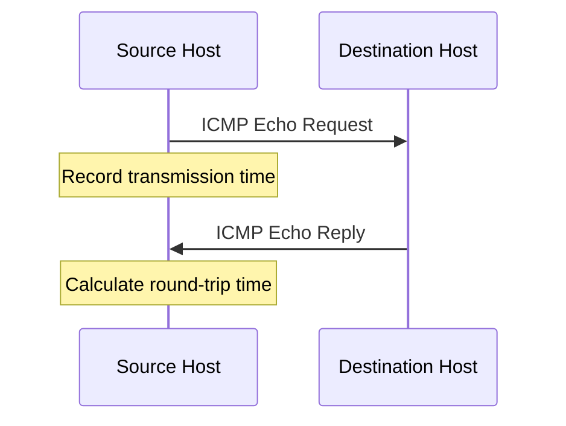
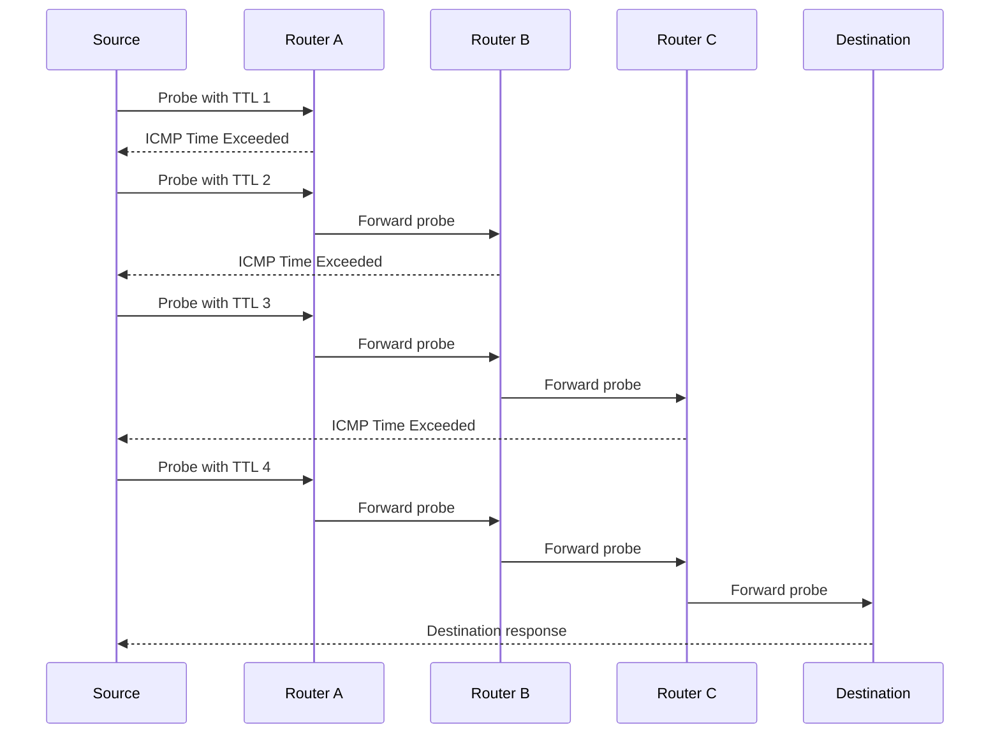

# 🗁 Ping and Traceroute

Ping and Traceroute are fundamental network diagnostic tools used to investigate connectivity, packet delivery, and network paths.

Although both tools commonly use ICMP, they serve different purposes:

* **Ping** tests whether a destination responds to network probes and measures round-trip time.
* **Traceroute** identifies the intermediate Layer 3 hops between a source and destination.

These tools help network engineers diagnose connectivity problems, packet loss, routing issues, latency, and firewall restrictions.

They are available on Linux, Windows, macOS, and many network devices, including MikroTik routers.

# 🗁 Ping Fundamentals

Ping is a network diagnostic utility that tests connectivity between a source and a destination.

It sends an ICMP Echo Request message and waits for an ICMP Echo Reply.

If a reply arrives, the source can calculate the round-trip time (RTT).

Ping is commonly used to investigate:

* Whether a destination responds to ICMP.
* Basic IP connectivity.
* Network latency.
* Packet loss.
* Intermittent connectivity.
* Differences between IPv4 and IPv6 reachability.

### 🖆 ICMP Echo Request

An ICMP Echo Request asks a destination to respond.

For IPv4:

```text
ICMP Type: 8
Code:      0
Message:   Echo Request
```

For IPv6:

```text
ICMPv6 Type: 128
Code:        0
Message:     Echo Request
```

### 🖆 ICMP Echo Reply

The destination responds with an Echo Reply when it accepts and processes the request.

For IPv4:

```text
ICMP Type: 0
Code:      0
Message:   Echo Reply
```

For IPv6:

```text
ICMPv6 Type: 129
Code:        0
Message:     Echo Reply
```

Ping does not use TCP or UDP ports. ICMP messages are carried directly inside IP packets.

---

# 🗁 How Ping Works

Ping follows a request-and-reply process.



### 🖆 Ping Process

* The source creates an ICMP Echo Request.
* The request is encapsulated inside an IP packet.
* Routers forward the packet toward the destination.
* The destination receives the request.
* If permitted, the destination generates an ICMP Echo Reply.
* The reply travels back toward the source.
* The source calculates the elapsed time.

### 🖆 Ping Identifiers and Sequence Numbers

ICMP Echo messages contain fields that help identify requests and match replies.

Important fields include:

| Field | Purpose |
| --- | --- |
| Type | Identifies Echo Request or Echo Reply |
| Code | Provides additional message information |
| Checksum | Detects corruption in the ICMP message |
| Identifier | Helps distinguish ping processes or sessions |
| Sequence Number | Identifies individual requests |
| Data | Optional payload carried by the message |

The source uses the identifier and sequence number to associate a reply with a request.

### 🖆 Round-Trip Time

Round-trip time measures the time between sending a request and receiving its corresponding reply.

```text
RTT = Reply Reception Time - Request Transmission Time
```

For example:

```text
Request sent:  10:00:00.000
Reply received: 10:00:00.025

RTT = 25 milliseconds
```

RTT includes the time taken for the request and reply to travel through their respective paths, plus processing and scheduling delays.

It does not reveal the exact one-way delay.

---

# 🗁 Ping Packet Structure

Ping uses ICMP messages carried inside IP packets.

### 🖆 IPv4 Ping Packet

```text
+-------------------------------+
| IPv4 Header                   |
+-------------------------------+
| ICMP Header                   |
| - Type                        |
| - Code                        |
| - Checksum                    |
| - Identifier                  |
| - Sequence Number             |
+-------------------------------+
| ICMP Payload                  |
+-------------------------------+
```

IPv4 uses IP Protocol number 1 for ICMP.

### 🖆 IPv6 Ping Packet

```text
+-------------------------------+
| IPv6 Header                   |
+-------------------------------+
| ICMPv6 Header                 |
| - Type                        |
| - Code                        |
| - Checksum                    |
| - Identifier                  |
| - Sequence Number             |
+-------------------------------+
| ICMPv6 Payload                |
+-------------------------------+
```

IPv6 uses Next Header value 58 for ICMPv6.

IPv6 extension headers may appear between the IPv6 base header and ICMPv6 message.

---

# 🗁 Ping Output

Consider this Linux command:

```bash
ping -c 4 1.1.1.1
```

Example output:

```text
PING 1.1.1.1 (1.1.1.1) 56(84) bytes of data.

64 bytes from 1.1.1.1: icmp_seq=1 ttl=57 time=24.2 ms
64 bytes from 1.1.1.1: icmp_seq=2 ttl=57 time=23.8 ms
64 bytes from 1.1.1.1: icmp_seq=3 ttl=57 time=24.5 ms
64 bytes from 1.1.1.1: icmp_seq=4 ttl=57 time=23.9 ms

--- 1.1.1.1 ping statistics ---
4 packets transmitted, 4 received, 0% packet loss, time 3004ms

rtt min/avg/max/mdev = 23.800/24.100/24.500/0.270 ms
```

### 🖆 Understanding the Output

| Field | Meaning |
| --- | --- |
| 64 bytes | Reported ICMP response size in this output |
| `icmp_seq` | Sequence number of the request |
| `ttl` | TTL remaining in the received IPv4 reply |
| `time` | Measured round-trip time |
| transmitted | Number of Echo Requests sent |
| received | Number of Echo Replies received |
| packet loss | Percentage of requests without matching replies |
| min | Minimum measured RTT |
| avg | Average measured RTT |
| max | Maximum measured RTT |
| mdev | Mean absolute deviation of RTT samples in Linux ping output |

The Linux output may show 56 bytes of ICMP payload and 64 bytes of ICMP message data including the 8-byte ICMP header. The displayed `64 bytes` does not include the IP header.

### 🖆 Interpreting TTL

The TTL shown in an IPv4 ping reply belongs to the received reply packet.

It is not the number of hops traveled by the original request.

For example:

```text
Reply TTL: 57
```

If the destination originally used an initial TTL of 64, the reply may have passed through approximately seven routers.

However, the original TTL is not guaranteed, so this is only an estimate.

For IPv6, the corresponding field is Hop Limit.

---

# 🗁 Important Ping Metrics

### 🖆 Latency

Latency describes the time required for data to travel between two points.

Ping reports RTT rather than one-way latency.

Example:

```text
RTT = 25 ms
```

A lower RTT generally indicates a shorter or less delayed communication path, although network conditions and processing overhead also affect the result.

### 🖆 Packet Loss

Packet loss occurs when transmitted packets do not arrive at their intended destination or their replies do not return successfully.

Example:

```text
10 packets transmitted
8 packets received

Packet Loss = 20%
```

Calculation:

```text
Packet Loss (%) =
((Transmitted - Received) / Transmitted) * 100
```

Packet loss may result from:

* Network congestion.
* Faulty cables or interfaces.
* Wireless interference.
* Routing problems.
* Firewall filtering.
* Device overload.
* ICMP rate limiting.

### 🖆 Jitter

Jitter describes variation in packet delay.

For example:

```text
Packet 1 RTT: 20 ms
Packet 2 RTT: 25 ms
Packet 3 RTT: 45 ms
Packet 4 RTT: 22 ms
```

The changing RTT values suggest variable delay.

Ping output can help observe RTT variation, but different tools use different formal jitter calculations.

### 🖆 Minimum, Average, and Maximum RTT

| Metric | Description |
| --- | --- |
| Minimum RTT | Lowest observed round-trip time |
| Average RTT | Mean of measured round-trip times |
| Maximum RTT | Highest observed round-trip time |

A large difference between minimum and maximum RTT may indicate variable network conditions.

---

# 🗁 Ping Commands in Linux

Ubuntu and other Linux distributions commonly use the `iputils-ping` package.

Install it if necessary:

```bash
sudo apt update
sudo apt install iputils-ping
```

### 🖆 Basic Ping

```bash
ping 1.1.1.1
```

By default, Linux ping generally continues until interrupted.

Stop it with:

```text
Ctrl + C
```

### 🖆 Send a Limited Number of Packets

```bash
ping -c 4 1.1.1.1
```

The `-c` option specifies the number of Echo Requests.

### 🖆 Set the Interval

```bash
ping -i 2 1.1.1.1
```

Sends requests approximately every two seconds.

### 🖆 Set Packet Size

```bash
ping -s 1000 1.1.1.1
```

The `-s` option specifies the ICMP payload size in bytes.

### 🖆 Set TTL

```bash
ping -t 10 1.1.1.1
```

Sets the outgoing IPv4 TTL to 10.

### 🖆 Set IPv4 Explicitly

```bash
ping -4 1.1.1.1
```

### 🖆 Set IPv6 Explicitly

```bash
ping -6 2606:4700:4700::1111
```

### 🖆 Set the Source Interface

```bash
ping -I eth0 1.1.1.1
```

This selects the source interface for the ping operation.

### 🖆 Set the Source Address

```bash
ping -I 192.168.1.10 1.1.1.1
```

This selects a local source address.

The address must be assigned and usable on the host.

### 🖆 Test Path MTU

For IPv4:

```bash
ping -4 -M do -s 1472 -c 4 1.1.1.1
```

This creates a 1500-byte IPv4 packet when using standard 20-byte IPv4 and 8-byte ICMP headers.

For more information, see `07-path-mtu-discovery.md`.

### 🖆 Resolve a Hostname

```bash
ping example.com
```

Ping resolves the hostname before sending packets.

If name resolution fails, investigate DNS separately.

### 🖆 Useful Ping Options

| Option | Description |
| --- | --- |
| `-c` | Number of packets |
| `-i` | Interval between packets |
| `-s` | ICMP payload size |
| `-t` | IPv4 TTL |
| `-4` | Force IPv4 |
| `-6` | Force IPv6 |
| `-I` | Select source interface or address |
| `-W` | Per-reply timeout |
| `-w` | Overall deadline |
| `-M` | IPv4 Path MTU discovery strategy |
| `-D` | Print timestamps |

---

# 🗁 Ping in Windows

Windows provides the built-in `ping` command.

### 🖆 Basic Ping

```powershell
ping 1.1.1.1
```

### 🖆 Send a Limited Number of Requests

```powershell
ping -n 4 1.1.1.1
```

### 🖆 Set Packet Size

```powershell
ping -l 1000 1.1.1.1
```

### 🖆 Set TTL

```powershell
ping -i 10 1.1.1.1
```

### 🖆 Set Don't Fragment

```powershell
ping -f -l 1472 1.1.1.1
```

This requests IPv4 packets with fragmentation prohibited.

### 🖆 Force IPv4

```powershell
ping -4 example.com
```

### 🖆 Force IPv6

```powershell
ping -6 example.com
```

### 🖆 Common Windows Options

| Option | Description |
| --- | --- |
| `-n` | Number of requests |
| `-l` | Send buffer size |
| `-i` | TTL |
| `-4` | Force IPv4 |
| `-6` | Force IPv6 |
| `-f` | Set Don't Fragment flag for IPv4 |
| `-t` | Ping continuously |
| `-w` | Timeout in milliseconds |

---

# 🗁 Traceroute Fundamentals

Traceroute is a network diagnostic utility that identifies intermediate routers along the path to a destination.

It helps determine:

* Which routers are forwarding traffic.
* Where a routing path changes.
* Where packet delivery stops receiving responses.
* Approximate RTT to intermediate hops.
* Whether different destinations follow different paths.

Traceroute uses the TTL field in IPv4 or Hop Limit field in IPv6.

When a router decrements the field to zero, it normally discards the packet and sends an ICMP Time Exceeded message.

Traceroute uses these responses to discover intermediate hops.

### 🖆 Why Traceroute Is Important

Consider a situation where a server cannot reach a remote destination.

Ping may indicate that the destination is unreachable, but it does not show which intermediate router is involved.

Traceroute provides visibility into the forwarding path.

---

# 🗁 How Traceroute Works

Traceroute sends probes with progressively increasing TTL or Hop Limit values.

The first probe uses a value of 1.

The second uses a value of 2.

The third uses a value of 3.

Each probe can reach one additional router before its TTL expires.

### 🖆 Traceroute Process

Assume this network:

```text
Source
  |
  | Router A
  |
  | Router B
  |
  | Router C
  |
Destination
```

Traceroute performs the following process:

* Send a probe with TTL 1.
* Router A decreases TTL to zero and returns ICMP Time Exceeded.
* Send a probe with TTL 2.
* Router B returns ICMP Time Exceeded.
* Send a probe with TTL 3.
* Router C returns ICMP Time Exceeded.
* Continue with increasing values until the destination is reached or the maximum hop limit is exceeded.

### 🖆 Traceroute Flow



### 🖆 Why TTL Increases Gradually

TTL controls how many router forwarding hops a packet can survive.

By increasing TTL one step at a time, Traceroute discovers the path progressively.

This technique does not require routers to provide their routing tables.

It relies on their normal TTL expiration behavior and ICMP responses.

---

# 🗁 Traceroute Methods

Traceroute implementations can use different probe protocols.

The most common methods are:

* UDP-based Traceroute.
* ICMP Echo-based Traceroute.
* TCP-based Traceroute.

### 🖆 UDP-Based Traceroute

Traditional Unix/Linux Traceroute commonly sends UDP probes to high destination port numbers.

Intermediate routers return ICMP Time Exceeded when TTL expires.

When a probe reaches the destination, the destination may return:

```text
ICMP Type: 3
Code:      3

Destination Unreachable
Port Unreachable
```

This indicates that the destination received the UDP probe but no application was listening on the selected port.

### 🖆 ICMP-Based Traceroute

ICMP-based Traceroute sends Echo Request probes.

Intermediate routers return ICMP Time Exceeded.

The destination may return ICMP Echo Reply.

Example:

```bash
traceroute -I 1.1.1.1
```

### 🖆 TCP-Based Traceroute

TCP-based Traceroute sends TCP probes, often targeting a commonly permitted service port such as 443.

Intermediate routers can still return ICMP Time Exceeded.

When the probe reaches the destination, possible responses include:

* TCP SYN-ACK if the destination port is open.
* TCP RST if the destination port is closed.
* No response if the destination or a firewall silently filters the probe.

Example:

```bash
traceroute -T -p 443 example.com
```

TCP-based Traceroute can be useful when UDP or ICMP probes are filtered.

### 🖆 Method Comparison

| Method | Probe | Intermediate Hop Response | Destination Response |
| --- | --- | --- | --- |
| UDP | UDP datagram | ICMP Time Exceeded | Often ICMP Port Unreachable |
| ICMP | Echo Request | ICMP Time Exceeded | ICMP Echo Reply |
| TCP | TCP probe | ICMP Time Exceeded | TCP SYN-ACK, RST, or no response |

The exact behavior depends on the implementation, network configuration, and firewall policies.

---

# 🗁 Traceroute Output

Example Linux output:

```text
traceroute to example.com (93.184.216.34), 30 hops max

 1  192.168.1.1       1.2 ms   1.0 ms   1.1 ms
 2  10.10.0.1         5.4 ms   5.2 ms   5.3 ms
 3  172.16.0.1       10.2 ms  10.5 ms  10.1 ms
 4  203.0.113.1      18.4 ms  18.2 ms  18.5 ms
 5  93.184.216.34    25.1 ms  24.9 ms  25.0 ms
```

### 🖆 Understanding the Output

| Field | Meaning |
| --- | --- |
| Hop number | Probe TTL or Hop Limit value |
| IP address | Address of the responding router or destination |
| Hostname | Resolved name of the responding address, if available |
| RTT values | Measured response times for individual probes |
| `*` | No response received before timeout |

### 🖆 Multiple RTT Values

Traceroute usually sends multiple probes for each hop.

For example:

```text
3  172.16.0.1  10.2 ms  10.5 ms  10.1 ms
```

These values represent the RTT measurements for separate probes.

Different values may result from:

* Queueing delays.
* Processing delays.
* Network congestion.
* Routing changes.
* ICMP rate limiting.

### 🖆 Meaning of Asterisks

Example:

```text
4  *  *  *
```

An asterisk means the probe did not receive a response within the configured timeout.

It does not necessarily mean the router is offline.

Possible explanations include:

* ICMP filtering.
* Firewall policies.
* Rate limiting.
* Router control-plane protection.
* Return-path problems.
* Probe packets being dropped.

Traffic may still pass through that router successfully.

### 🖆 Why a Later Hop May Respond

Example:

```text
1  192.168.1.1  1.0 ms
2  *  *  *
3  203.0.113.1  15 ms
4  93.184.216.34  25 ms
```

The second router may forward packets normally but not respond to traceroute probes.

The later routers and destination can still respond.

This is why traceroute output must be interpreted carefully.

---

# 🗁 Traceroute Commands in Linux

On Ubuntu, the traditional `traceroute` utility may need to be installed.

```bash
sudo apt update
sudo apt install traceroute
```

### 🖆 Basic Traceroute

```bash
traceroute example.com
```

### 🖆 Trace an IPv4 Destination

```bash
traceroute -4 1.1.1.1
```

### 🖆 Trace an IPv6 Destination

```bash
traceroute -6 2606:4700:4700::1111
```

### 🖆 Use ICMP Probes

```bash
traceroute -I 1.1.1.1
```

### 🖆 Use TCP Probes

```bash
traceroute -T -p 443 example.com
```

### 🖆 Set Maximum Hop Count

```bash
traceroute -m 20 example.com
```

### 🖆 Set Probe Count

```bash
traceroute -q 2 example.com
```

This sends two probes per TTL value.

### 🖆 Set Wait Time

```bash
traceroute -w 2 example.com
```

This sets the response wait time in seconds.

### 🖆 Disable Reverse DNS Resolution

```bash
traceroute -n 1.1.1.1
```

This displays IP addresses without attempting hostname resolution.

### 🖆 Useful Traceroute Options

| Option | Description |
| --- | --- |
| `-4` | Use IPv4 |
| `-6` | Use IPv6 |
| `-I` | Use ICMP Echo probes |
| `-T` | Use TCP probes |
| `-p` | Set destination port |
| `-m` | Set maximum TTL or Hop Limit |
| `-q` | Set probes per hop |
| `-w` | Set response timeout |
| `-n` | Disable hostname resolution |

---

# 🗁 Traceroute in Windows

Windows provides the built-in `tracert` command.

### 🖆 Basic Traceroute

```powershell
tracert example.com
```

### 🖆 Force IPv4

```powershell
tracert -4 example.com
```

### 🖆 Force IPv6

```powershell
tracert -6 example.com
```

### 🖆 Disable Reverse DNS Resolution

```powershell
tracert -d 1.1.1.1
```

### 🖆 Set Maximum Hops

```powershell
tracert -h 20 example.com
```

### 🖆 Set Timeout

```powershell
tracert -w 2000 example.com
```

The timeout value is specified in milliseconds.

### 🖆 Common Windows Options

| Option | Description |
| --- | --- |
| `-4` | Force IPv4 |
| `-6` | Force IPv6 |
| `-d` | Disable hostname resolution |
| `-h` | Maximum number of hops |
| `-w` | Timeout in milliseconds |

Windows `tracert` uses ICMP Echo Request probes by default. It does not provide the same built-in UDP/TCP probe selection as the common Linux `traceroute` utility.

---

# 🗁 IPv4 vs IPv6 Diagnostics

Ping and Traceroute support both IP versions, but the underlying protocols use different fields and ICMP message types.

### 🖆 Ping Comparison

| Feature | IPv4 | IPv6 |
| --- | --- | --- |
| Request | ICMP Type 8 | ICMPv6 Type 128 |
| Reply | ICMP Type 0 | ICMPv6 Type 129 |
| Header field | TTL | Hop Limit |
| IP protocol identifier | 1 | Next Header 58 |

### 🖆 Traceroute Comparison

| Feature | IPv4 | IPv6 |
| --- | --- | --- |
| Hop control | TTL | Hop Limit |
| Expiration message | ICMP Type 11 | ICMPv6 Type 3 |
| Code | 0 for TTL exceeded in transit | 0 for Hop Limit exceeded in transit |
| Destination response | Depends on probe method | Depends on probe method |

### 🖆 Linux IPv4 Diagnostics

```bash
ping -4 -c 4 1.1.1.1
traceroute -4 1.1.1.1
```

### 🖆 Linux IPv6 Diagnostics

```bash
ping -6 -c 4 2606:4700:4700::1111
traceroute -6 2606:4700:4700::1111
```

Always test the protocol version used by the application.

A working IPv4 path does not prove that IPv6 routing and connectivity are working correctly.

---

# 🗁 Ping vs Traceroute

Both tools are useful, but they answer different questions.

| Feature | Ping | Traceroute |
| --- | --- | --- |
| Primary purpose | Test destination response | Discover intermediate hops |
| Common protocol | ICMP / ICMPv6 | UDP, ICMP, or TCP probes |
| Measures RTT | Yes | Yes, per responding hop |
| Shows intermediate routers | No | Yes, when they respond |
| Helps identify path changes | Limited | Yes |
| Reports packet loss | Yes, for its probes | Shows missing probe responses |
| Uses TTL/Hop Limit progression | No, not for path discovery | Yes |

### 🖆 When to Use Ping

Use Ping when you need to investigate:

* Basic reachability.
* Packet loss.
* RTT.
* Intermittent response.
* IPv4 or IPv6 connectivity.

### 🖆 When to Use Traceroute

Use Traceroute when you need to investigate:

* Routing paths.
* Intermediate routers.
* Unexpected network paths.
* Where probe responses stop.
* Possible routing or filtering problems.

### 🖆 Using Both Together

A practical diagnostic sequence:

```bash
ping -c 4 1.1.1.1
traceroute -4 1.1.1.1
```

Ping checks destination responses.

Traceroute helps investigate the forwarding path.

Together, they provide more information than either tool alone.

---

# 🗁 Common Troubleshooting Scenarios

### 🖆 Destination Does Not Respond to Ping

**Possible causes:**

* Destination is offline.
* Destination blocks ICMP Echo Requests.
* Routing is incorrect.
* Firewall filters traffic.
* Return routing is broken.
* Network interface is unavailable.

**Troubleshooting:**

```bash
ip addr show
ip route show
ping -c 4 <gateway-ip>
ping -c 4 <destination-ip>
```

Test local gateway reachability before investigating remote connectivity.

### 🖆 Gateway Responds but Internet Destination Does Not

**Possible causes:**

* Default route is missing.
* Upstream router is unavailable.
* NAT is incorrectly configured.
* Firewall blocks outgoing traffic.
* ISP connectivity is interrupted.

**Troubleshooting:**

```bash
ip route
ping -c 4 1.1.1.1
traceroute -4 1.1.1.1
```

If IP connectivity works but hostnames fail, investigate DNS separately.

### 🖆 Ping Works but Websites Do Not Load

Ping tests ICMP Echo behavior, not application-layer connectivity.

Possible causes include:

* DNS resolution failure.
* TCP port 443 blocked.
* TLS negotiation failure.
* HTTP proxy configuration.
* Application server problems.
* MTU or PMTUD problems.

Test DNS:

```bash
dig example.com
```

Test HTTPS:

```bash
curl -Iv https://example.com
```

Test TCP connectivity:

```bash
nc -vz example.com 443
```

### 🖆 Traceroute Shows Asterisks

Possible causes:

* ICMP filtering.
* Rate limiting.
* Router control-plane protection.
* Return-path filtering.
* Probe protocol restrictions.

Try different probe methods:

```bash
traceroute -I example.com
traceroute -T -p 443 example.com
```

A missing response does not prove that a router is not forwarding traffic.

### 🖆 High RTT at a Specific Hop

Example:

```text
1  192.168.1.1    1 ms
2  10.10.0.1      5 ms
3  172.16.0.1   120 ms
4  203.0.113.1  125 ms
5  Destination  130 ms
```

The increase begins at hop 3 and remains visible afterward.

This may indicate congestion or delay around that part of the path.

However, intermediate routers may deprioritize diagnostic responses while forwarding transit traffic normally.

Compare later hops and repeat measurements before concluding that hop 3 is the source of the problem.

### 🖆 Packet Loss at One Hop

Example:

```text
1  192.168.1.1    0% loss
2  10.10.0.1     50% loss
3  172.16.0.1     0% loss
4  Destination    0% loss
```

This pattern suggests that hop 2 may be limiting or selectively dropping diagnostic responses.

It does not demonstrate that 50% of forwarded traffic is being lost.

Investigate persistent loss at the destination and subsequent hops.

### 🖆 Large Packets Fail but Small Packets Work

Possible cause:

* Path MTU problem.
* ICMP MTU feedback blocked.
* Tunnel overhead.
* Incorrect interface MTU.

Test IPv4 packet sizes:

```bash
ping -4 -M do -s 1472 -c 4 1.1.1.1
```

Then test smaller values.

Review `07-path-mtu-discovery.md` for a complete PMTUD troubleshooting procedure.

---

# 🗁 Packet Analysis with tcpdump and Wireshark

Packet captures help verify whether Ping and Traceroute probes are transmitted and whether responses return.

### 🖆 Capture ICMPv4

```bash
sudo tcpdump -ni eth0 icmp
```

### 🖆 Capture ICMPv6

```bash
sudo tcpdump -ni eth0 icmp6
```

### 🖆 Capture Both

```bash
sudo tcpdump -vv -ni any 'icmp or icmp6'
```

### 🖆 Capture UDP Traceroute Traffic

```bash
sudo tcpdump -ni eth0 udp
```

### 🖆 Capture TCP Traceroute Traffic

```bash
sudo tcpdump -ni eth0 'tcp port 443'
```

### 🖆 Useful Wireshark Filters

| Filter | Purpose |
| --- | --- |
| `icmp` | Display ICMPv4 traffic |
| `icmpv6` | Display ICMPv6 traffic |
| `icmp.type == 8` | IPv4 Echo Requests |
| `icmp.type == 0` | IPv4 Echo Replies |
| `icmp.type == 11` | IPv4 Time Exceeded |
| `icmpv6.type == 128` | IPv6 Echo Requests |
| `icmpv6.type == 129` | IPv6 Echo Replies |
| `icmpv6.type == 3` | IPv6 Time Exceeded |
| `udp` | UDP traffic |
| `tcp.port == 443` | TCP traffic using port 443 |

### 🖆 What to Inspect

When analyzing Ping:

* Echo Request and Echo Reply messages.
* Source and destination addresses.
* ICMP identifier and sequence number.
* Packet timestamps.
* TTL or Hop Limit.
* Missing replies.

When analyzing Traceroute:

* Probe TTL or Hop Limit.
* Intermediate router addresses.
* ICMP Time Exceeded messages.
* Destination response.
* Probe protocol and destination port.
* Response timing.

---

# 🗁 Limitations and Misconceptions

### 🖆 Ping Success Does Not Guarantee Application Connectivity

Ping tests ICMP Echo behavior.

A destination may respond to Ping while its web server, SSH service, or database is unavailable.

### 🖆 Ping Failure Does Not Guarantee a Host Is Offline

A firewall may block ICMP Echo Requests while allowing TCP and UDP traffic.

Always test the actual service when investigating application connectivity.

### 🖆 Traceroute Does Not Reveal Every Router

Some routers do not send diagnostic responses.

Others may filter, rate-limit, or deprioritize ICMP messages.

Therefore, a traceroute result may show only part of the actual forwarding path.

### 🖆 Traceroute RTT Is Not Link Latency

The RTT reported for an intermediate hop includes the probe's journey to that router and the response's journey back.

It is not a direct measurement of the latency of the link immediately before that router.

### 🖆 Forward and Return Paths May Differ

Network routing can be asymmetric.

The request and reply may travel through different routers.

Consequently, RTT measurements do not necessarily represent a symmetric path.

### 🖆 Asterisks Do Not Necessarily Mean Packet Loss

An asterisk indicates that a particular diagnostic probe did not receive a response within the timeout.

It does not prove that ordinary application traffic is being dropped.

### 🖆 Ping Does Not Measure Bandwidth

Ping measures response time and can help observe packet loss.

It does not directly measure available bandwidth or throughput.

Use appropriate throughput-testing tools when measuring network capacity.

---

# 🗁 Best Practices

* Start with the local interface and default gateway.
* Test IPv4 and IPv6 separately.
* Use a limited packet count during initial diagnostics.
* Compare minimum, average, and maximum RTT.
* Repeat tests when investigating intermittent problems.
* Use Traceroute to inspect intermediate network paths.
* Try UDP, ICMP, and TCP probes when one method is filtered.
* Do not assume missing traceroute responses indicate failed forwarding.
* Test the actual application service when Ping succeeds but applications fail.
* Use packet captures to verify request and response traffic.
* Investigate packet-size differences when large transfers fail.
* Consider asymmetric routing when interpreting RTT.
* Avoid drawing conclusions from a single traceroute result.

---

# 🗁 Practical Exercises

### 🖆 Exercise: Test Local Connectivity

Find your default gateway:

```bash
ip route show default
```

Ping the gateway:

```bash
ping -c 4 <gateway-ip>
```

Observe the RTT and packet loss.

### 🖆 Exercise: Test Public IPv4 Connectivity

```bash
ping -4 -c 4 1.1.1.1
```

Record:

* Packets transmitted.
* Packets received.
* Packet loss.
* Minimum RTT.
* Average RTT.
* Maximum RTT.

### 🖆 Exercise: Test IPv6 Connectivity

```bash
ping -6 -c 4 2606:4700:4700::1111
```

Compare IPv4 and IPv6 results.

### 🖆 Exercise: Discover the Network Path

```bash
traceroute -4 1.1.1.1
```

Identify:

* Your local gateway.
* Intermediate routers.
* Responding public IP addresses.
* The destination.
* Any hops that do not respond.

### 🖆 Exercise: Compare Traceroute Methods

Run:

```bash
traceroute 1.1.1.1
```

```bash
traceroute -I 1.1.1.1
```

```bash
traceroute -T -p 443 1.1.1.1
```

Compare the responding hops and RTT values.

### 🖆 Exercise: Capture ICMP Traffic

Run:

```bash
sudo tcpdump -ni any 'icmp or icmp6'
```

In another terminal:

```bash
ping -c 4 1.1.1.1
```

Observe the Echo Request and Echo Reply packets.

### 🖆 Exercise: Investigate a Connectivity Problem

Simulate a diagnostic scenario in a controlled network lab:

* Make a destination reachable through multiple routers.
* Test it using Ping.
* Run Traceroute.
* Introduce a firewall rule that blocks diagnostic responses.
* Repeat the tests.
* Compare the results.
* Verify whether application traffic still works.

---

# 🗁 Interview Questions

### 🖆 Basic Questions

**What is Ping?**

Ping is a diagnostic utility that sends ICMP Echo Requests and measures the round-trip time of corresponding Echo Replies.

**Which ICMP messages does Ping use?**

IPv4 Ping uses Echo Request Type 8 and Echo Reply Type 0. IPv6 Ping uses Echo Request Type 128 and Echo Reply Type 129.

**What is RTT?**

RTT is the elapsed time between sending a packet and receiving its corresponding response.

**What is packet loss?**

Packet loss is the percentage of transmitted packets for which no corresponding successful response is received during the measurement.

**What is Traceroute?**

Traceroute is a diagnostic utility that discovers intermediate network hops by sending probes with progressively increasing TTL or Hop Limit values.

### 🖆 Intermediate Questions

**How does Traceroute discover routers?**

It sends probes with increasing TTL or Hop Limit values. When a router decrements the value to zero, it normally discards the probe and sends an ICMP Time Exceeded message.

**What does an asterisk mean in Traceroute?**

It means a probe did not receive a response within the configured timeout. It does not necessarily mean the router is offline.

**What is the difference between Ping and Traceroute?**

Ping tests destination response and measures RTT. Traceroute identifies intermediate responding routers along a network path.

**Why might Ping fail while TCP connectivity works?**

The destination or an intermediate firewall may block ICMP Echo Requests while permitting TCP traffic.

**What is TCP-based Traceroute?**

It sends TCP probes, often toward a service port such as 443, to discover a path when other probe methods are filtered.

### 🖆 Advanced Questions

**Why does Traceroute send multiple probes per hop?**

Multiple probes provide separate response measurements and help reveal variation in RTT or response behavior.

**Can Traceroute identify the exact location of network congestion?**

Not necessarily. High RTT at an intermediate router may reflect delayed diagnostic responses rather than congestion affecting forwarded traffic. Correlating later hops and application measurements is important.

**Can the forward and return paths be different?**

Yes. Routing can be asymmetric, so request and response traffic may follow different paths.

**Why can a router forward traffic without responding to Traceroute?**

Routers may filter, rate-limit, or deprioritize diagnostic traffic while continuing to forward ordinary packets.

**Does Ping measure bandwidth?**

No. Ping measures response time and can observe packet loss. Bandwidth requires separate throughput-testing methods.

---

# 🗁 Summary

Ping and Traceroute are essential tools for network troubleshooting.

Key concepts:

* Ping uses ICMP Echo Request and Echo Reply messages.
* Ping measures RTT and helps identify packet loss.
* IPv4 Ping uses ICMP Types 8 and 0.
* IPv6 Ping uses ICMPv6 Types 128 and 129.
* Traceroute discovers intermediate hops using TTL or Hop Limit.
* Expired probes normally generate ICMP Time Exceeded messages.
* Traceroute can use UDP, ICMP, or TCP probes.
* Asterisks indicate missing diagnostic responses, not necessarily failed forwarding.
* Ping success does not guarantee application connectivity.
* Ping and Traceroute should be combined with packet captures and application-level tests.

Together, Ping and Traceroute provide a practical foundation for diagnosing connectivity, latency, packet loss, and routing problems.

---

# 🗁 References

### 🖆 Official RFCs

* [RFC 792 — Internet Control Message Protocol](https://www.rfc-editor.org/rfc/rfc792)
* [RFC 4443 — Internet Control Message Protocol (ICMPv6)](https://www.rfc-editor.org/rfc/rfc4443)
* [RFC 1812 — Requirements for IPv4 Routers](https://www.rfc-editor.org/rfc/rfc1812)
* [RFC 8200 — Internet Protocol, Version 6 (IPv6) Specification](https://www.rfc-editor.org/rfc/rfc8200)

### 🖆 Linux Documentation

* [ping Manual](https://man7.org/linux/man-pages/man8/ping.8.html)
* [traceroute Manual](https://man7.org/linux/man-pages/man8/traceroute.8.html)
* [tcpdump Manual](https://www.tcpdump.org/manpages/tcpdump.1.html)
* [Wireshark Documentation](https://www.wireshark.org/docs/)

### 🖆 Windows Documentation

* [Microsoft — ping](https://learn.microsoft.com/en-us/windows-server/administration/windows-commands/ping)
* [Microsoft — tracert](https://learn.microsoft.com/en-us/windows-server/administration/windows-commands/tracert)
