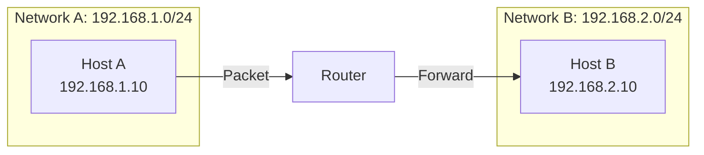
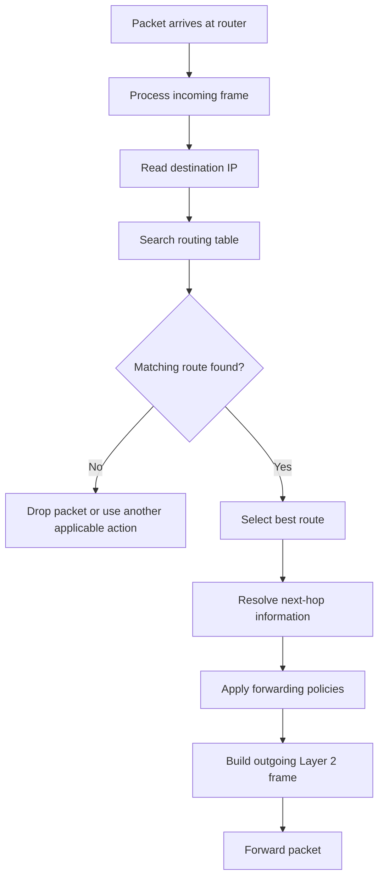

# Routing Fundamentals

Routing is the process of selecting a path for network traffic to travel from a source network to a destination network. Routers use routing information to determine where packets should be forwarded next.

Routing enables communication between different IP networks, such as:

* A home network communicating with the internet.
* Two office networks communicating across separate locations.
* Multiple VLANs communicating through a Layer 3 device.
* An ISP forwarding traffic between customer networks and upstream providers.

Routing operates primarily at the **Network Layer (Layer 3)** of the OSI model.

This document introduces routing fundamentals, router operation, routing decisions, routing domains, and the distinction between the control plane and data plane.

# 🗁 What Is Routing?

Routing is the process of determining how an IP packet should travel from its source network toward its destination network.

A router examines the destination IP address of an incoming packet and consults its routing table to determine the appropriate forwarding action.

The routing decision typically identifies:

* The destination network or prefix.
* The next-hop router, if required.
* The outgoing network interface.
* The routing information used to select the route.

For example, consider two separate networks:

| Network | Address |
| --- | --- |
| Network A | `192.168.1.0/24` |
| Network B | `192.168.2.0/24` |

A device in Network A wants to communicate with a device in Network B.

Because these devices belong to different IP networks, communication requires a Layer 3 forwarding device, such as a router.

The router receives the packet, examines its destination IP address, finds a matching route, and forwards it toward Network B.

### 🖆 Simple Routing Diagram



Routing makes communication possible between different IP networks.

# 🗁 Why Routing Is Necessary

An IP network can contain many separate subnets.

A device can communicate directly with devices on its local network using the appropriate link-layer mechanisms. However, communication with devices on another IP network requires forwarding through a router.

Without routing, separate IP networks would not have a mechanism to exchange packets through Layer 3.

Routing provides several important capabilities.

### 🖆 Communication Between Networks

Routing allows devices in different subnets to communicate.

Example:

```text
192.168.10.0/24
       |
       |
    Router
       |
       |
192.168.20.0/24
```

### 🖆 Internet Connectivity

A home router forwards traffic from a private LAN toward an ISP.

```text
Computer
   |
   |
Home Router
   |
   |
ISP Router
   |
   |
Internet
```

The home router commonly uses a default route pointing toward the ISP.

### 🖆 Network Segmentation

Organizations separate their networks into different subnets or VLANs.

For example:

| Department | Network |
| --- | --- |
| Administration | `10.10.10.0/24` |
| Development | `10.10.20.0/24` |
| Finance | `10.10.30.0/24` |
| Guest | `10.10.40.0/24` |

A Layer 3 device can route traffic between these networks.

Firewall rules and access-control policies can restrict which networks are allowed to communicate.

### 🖆 Redundancy and Failover

Routing protocols can provide alternative paths when a network link or router becomes unavailable.

For example:

```text
          Router A
         /        \
        /          \
     Router B ---- Router C
```

If one path becomes unavailable, routing mechanisms may select another available path, depending on the routing protocol and configuration.

### 🖆 Large-Scale Network Connectivity

Routing enables communication across large infrastructures, including:

* Enterprise networks.
* Data centers.
* Internet service providers.
* Cloud networks.
* The global internet.

# 🗁 What Is a Router?

A router is a network device that forwards IP packets between different networks.

It operates primarily at Layer 3 of the OSI model.

A router uses routing information to determine where packets should be forwarded.

### 🖆 Main Functions of a Router

**Route selection**

Determines which route should be used for a destination IP address.

**Packet forwarding**

Transfers packets from an incoming interface to an appropriate outgoing interface.

**Network interconnection**

Connects different IP networks and subnets.

**Traffic filtering**

Can apply firewall rules, access-control lists, and other security policies.

**Network services**

Depending on the platform, a router may also provide:

* NAT and PAT.
* DHCP server and relay.
* DNS forwarding.
* VPN services.
* QoS.
* Traffic monitoring.
* Dynamic routing protocols.

These additional functions are not required for the basic definition of a router.

### 🖆 Router Interfaces

A router commonly has multiple network interfaces.

Each interface can connect to a different network.

Example:

| Interface | IP Address | Connected Network |
| --- | --- | --- |
| `eth0` | `192.168.1.1/24` | `192.168.1.0/24` |
| `eth1` | `192.168.2.1/24` | `192.168.2.0/24` |
| `eth2` | `203.0.113.2/30` | `203.0.113.0/30` |

The router can route packets between these connected networks, provided routing and forwarding policies permit it.

### 🖆 Router vs Layer 3 Switch

A traditional router is commonly designed for routing between networks and connecting different network environments.

A Layer 3 switch combines Ethernet switching with Layer 3 routing capabilities.

Both can route IP packets. Their hardware architecture, feature sets, and intended deployment environments vary by product.

# 🗁 How Routing Works

Routing follows a sequence of operations whenever a router receives an IP packet.

Consider this topology:

```text
Network A                  Network B
192.168.1.0/24             192.168.2.0/24

Host A                     Host B
192.168.1.10               192.168.2.10
     |                          |
     |                          |
     +------ Router R1 ---------+
            .1       .1
```

Assume:

* Host A: `192.168.1.10/24`
* Host A default gateway: `192.168.1.1`
* Router R1 interface A: `192.168.1.1/24`
* Router R1 interface B: `192.168.2.1/24`
* Host B: `192.168.2.10/24`
* Host B default gateway: `192.168.2.1`

Host A wants to send an IP packet to Host B.

### 🖆 Packet Forwarding Process

**Host determines whether the destination is local or remote**

Host A compares the destination IP address with its own subnet.

Its address is `192.168.1.10/24`, while the destination is `192.168.2.10`.

Because the destination belongs to a different subnet, Host A sends the packet to its default gateway.

**Host resolves the gateway's MAC address**

Host A uses ARP to discover the MAC address of `192.168.1.1`.

**Host sends an Ethernet frame to the router**

The frame contains:

| Field | Value |
| --- | --- |
| Source MAC | Host A's MAC |
| Destination MAC | Router R1's Network A interface MAC |
| Source IP | `192.168.1.10` |
| Destination IP | `192.168.2.10` |

The Ethernet destination is the router, but the IP destination remains Host B.

**Router receives the frame**

Router R1 processes the Ethernet frame and examines the destination IP address in the IP packet.

**Router performs a route lookup**

The router searches its routing table for a route matching `192.168.2.10`.

It finds the directly connected route:

```text
192.168.2.0/24
```

**Router forwards the packet**

The router sends the packet through its Network B interface.

It constructs a new Layer 2 frame for the outgoing network.

The new frame contains:

| Field | Value |
| --- | --- |
| Source MAC | Router R1's Network B interface MAC |
| Destination MAC | Host B's MAC |
| Source IP | `192.168.1.10` |
| Destination IP | `192.168.2.10` |

The source and destination MAC addresses change when the packet is forwarded onto the new link.

The source and destination IP addresses normally remain unchanged unless a feature such as NAT modifies them.

**Host B receives the packet**

Host B receives the Ethernet frame, processes the IP packet, and delivers the data to the appropriate upper-layer protocol.

### 🖆 Routing Process Diagram



Actual forwarding behavior also depends on firewall rules, routing policies, neighbor resolution, interface state, and platform-specific features.

# 🗁 Routing vs Switching

Routing and switching are different networking operations.

Switching primarily forwards Ethernet frames within a Layer 2 network.

Routing forwards IP packets between Layer 3 networks.

### 🖆 Comparison

| Feature | Switching | Routing |
| --- | --- | --- |
| OSI Layer | Layer 2 primarily | Layer 3 |
| Main PDU | Frame | Packet |
| Main address | MAC address | IP address |
| Forwarding information | MAC address table | Routing table |
| Typical device | Layer 2 switch | Router |
| Primary purpose | Forward frames within a Layer 2 domain | Forward packets between IP networks |
| Broadcast handling | Broadcasts are forwarded within the VLAN according to switching behavior | Routers do not normally forward Layer 2 broadcasts between interfaces |
| Common protocols | Ethernet, STP, VLAN | IPv4, IPv6, OSPF, BGP |

### 🖆 Switching Example

Two devices belong to the same VLAN and IP subnet:

```text
PC A                         PC B
192.168.1.10                 192.168.1.20
    |                            |
    +-------- Switch ------------+
```

The switch forwards Ethernet frames based on its MAC address table.

A router is not required for ordinary communication between these devices.

### 🖆 Routing Example

Two devices belong to different IP networks:

```text
Network A                    Network B
192.168.1.0/24               192.168.2.0/24
     |                            |
     +---------- Router ----------+
```

The router forwards packets between the networks.

### 🖆 Important Distinction

A Layer 2 switch can connect devices in multiple VLANs, but each VLAN remains a separate Layer 2 broadcast domain.

Communication between different VLANs requires Layer 3 routing, commonly provided by:

* A router-on-a-stick configuration.
* A Layer 3 switch using switched virtual interfaces.
* A router with separate VLAN interfaces.

# 🗁 Directly Connected and Remote Networks

Routers learn about networks through different sources.

Two fundamental route categories are directly connected routes and remote routes.

### 🖆 Directly Connected Networks

A directly connected network is a network attached to an active router interface with an assigned IP address and prefix.

Example:

```text
Router R1

eth0: 192.168.1.1/24
eth1: 192.168.2.1/24
```

The router has two directly connected networks:

```text
192.168.1.0/24
192.168.2.0/24
```

These routes are normally installed automatically when the relevant interfaces and addresses are configured and operational.

Example routing table:

```text
Destination       Interface
192.168.1.0/24    eth0
192.168.2.0/24    eth1
```

### 🖆 Remote Networks

A remote network is not directly attached to the router.

The router must reach it through another router or forwarding path.

Example:

```text
LAN A              Router R1           Router R2             LAN B
192.168.1.0/24 ---- 10.0.0.1/30 ------- 10.0.0.2/30 ---- 192.168.2.0/24
```

R1 does not have a direct interface in `192.168.2.0/24`.

It must use a route through R2.

A possible routing entry on R1 is:

```text
Destination: 192.168.2.0/24
Next hop:    10.0.0.2
```

Remote routes can be learned through:

* Static routing.
* Default routing.
* Dynamic routing protocols.
* Other supported routing mechanisms.

### 🖆 Connected vs Remote Routes

| Feature | Connected Route | Remote Route |
| --- | --- | --- |
| Network directly attached | Yes | No |
| Learned from interface configuration | Normally yes | Not necessarily |
| Next-hop router required | Usually no | Usually yes |
| Example | `192.168.1.0/24` | `192.168.3.0/24` |
| Common route sources | Connected | Static, OSPF, BGP, RIP |

# 🗁 Important Routing Terminology

Understanding routing terminology is essential before studying routing tables and routing protocols.

### 🖆 Destination Network

The destination network is the IP prefix that a route describes.

Example:

```text
192.168.10.0/24
```

A route for this prefix can match destination addresses from:

```text
192.168.10.0
to
192.168.10.255
```

### 🖆 Next Hop

The next hop is the IP address of the next router to which a packet should be forwarded.

Example:

```text
Destination: 192.168.20.0/24
Next hop:    10.0.0.2
```

The router forwards matching packets toward `10.0.0.2`.

A next hop is commonly used for remote networks. A route can also specify an outgoing interface directly, or use a combination of interface and next-hop information.

### 🖆 Outgoing Interface

The outgoing interface is the local router interface used to transmit a packet.

Example:

```text
Destination: 192.168.20.0/24
Interface:   eth1
```

### 🖆 Default Gateway

A default gateway is the router that a host uses to send traffic outside its local IP subnet.

For a router, the equivalent concept is commonly represented by a default route.

IPv4 default route:

```text
0.0.0.0/0
```

IPv6 default route:

```text
::/0
```

### 🖆 Routing Table

A routing table contains destination prefixes and associated forwarding information.

Example:

| Destination | Next Hop | Interface |
| --- | --- | --- |
| `192.168.1.0/24` | Direct | `eth0` |
| `192.168.2.0/24` | Direct | `eth1` |
| `10.10.0.0/16` | `192.168.1.254` | `eth0` |
| `0.0.0.0/0` | `192.168.1.254` | `eth0` |

### 🖆 Metric

A metric is a value used by a routing protocol or routing mechanism to compare candidate routes.

Examples include:

* Hop count.
* Interface cost.
* Bandwidth-derived cost.
* Delay.
* Composite path metrics.

Metric interpretation depends on the routing protocol.

### 🖆 Administrative Distance

Administrative distance is a vendor-specific concept used by some routing platforms to compare route sources when multiple sources provide routes to the same destination prefix.

For example, a router might learn the same prefix through a static route and OSPF.

The platform's route preference determines which route is selected for installation, subject to its routing architecture.

Administrative distance is not a universal property of IP routing and is not the same as a routing protocol metric.

### 🖆 Route Prefix

A route prefix identifies a network using an IP address and prefix length.

Examples:

```text
192.168.1.0/24
10.0.0.0/8
172.16.0.0/12
2001:db8:100::/48
```

The prefix length determines how many leading bits identify the network.

# 🗁 Routing Decisions

A router may have multiple routes that match a packet's destination.

It must select the most appropriate route according to its routing architecture and forwarding rules.

The selection process generally involves:

* Identifying routes that match the destination.
* Applying the longest-prefix-match rule.
* Resolving route preferences and metrics when applicable.
* Selecting a next hop and outgoing interface.
* Applying forwarding policies and other relevant checks.

### 🖆 Example Routing Table

Consider the following entries:

| Destination Prefix | Next Hop | Interface |
| --- | --- | --- |
| `192.168.1.0/24` | Direct | `eth0` |
| `192.168.0.0/16` | `10.0.0.2` | `eth1` |
| `10.0.0.0/8` | `10.0.0.3` | `eth2` |
| `0.0.0.0/0` | `10.0.0.1` | `eth1` |

Suppose a packet arrives with:

```text
Destination IP: 192.168.1.50
```

Several entries match this destination:

* `192.168.1.0/24`
* `192.168.0.0/16`
* `0.0.0.0/0`

The router selects `192.168.1.0/24` because it is the most specific matching prefix.

### 🖆 Route Lookup Failure

If no route matches a destination and no applicable default route exists, the router normally drops the packet.

Depending on the protocol, configuration, and policy, it may generate an ICMP Destination Unreachable message.

# 🗁 Longest Prefix Match

Longest Prefix Match (LPM) is the fundamental rule used by IP routers to select the most specific matching route for a destination address.

The router compares the destination IP address against available routing prefixes.

Among matching routes, the route with the greatest prefix length is preferred.

### 🖆 Understanding Prefix Length

Consider these IPv4 prefixes:

| Prefix | Meaning |
| --- | --- |
| `10.0.0.0/8` | First 8 bits identify the network |
| `10.10.0.0/16` | First 16 bits identify the network |
| `10.10.20.0/24` | First 24 bits identify the network |
| `10.10.20.128/25` | First 25 bits identify the network |

A longer prefix represents a smaller, more specific address range.

### 🖆 LPM Example

Routing table:

| Destination Prefix | Next Hop |
| --- | --- |
| `10.0.0.0/8` | Router A |
| `10.10.0.0/16` | Router B |
| `10.10.20.0/24` | Router C |
| `10.10.20.128/25` | Router D |
| `0.0.0.0/0` | Router E |

Destination:

```text
10.10.20.150
```

This address matches all five prefixes.

The router selects:

```text
10.10.20.128/25
```

Because `/25` is the longest matching prefix.

Therefore, the packet is forwarded toward Router D.

### 🖆 LPM Example With Different Destinations

| Destination IP | Selected Prefix | Next Hop |
| --- | --- | --- |
| `10.5.1.10` | `10.0.0.0/8` | Router A |
| `10.10.5.10` | `10.10.0.0/16` | Router B |
| `10.10.20.50` | `10.10.20.0/24` | Router C |
| `10.10.20.150` | `10.10.20.128/25` | Router D |
| `8.8.8.8` | `0.0.0.0/0` | Router E |

### 🖆 Important Notes

* Longest Prefix Match is based on prefix specificity, not simply the lowest metric.
* A more specific matching prefix generally takes precedence over a less specific prefix.
* Administrative distance and metrics help determine which routes are selected or installed when competing route sources or paths exist.
* The default route has prefix length zero, making it the least specific route.
* LPM applies to both IPv4 and IPv6 routing.

# 🗁 Control Plane and Data Plane

Routers perform two major categories of operations: control-plane operations and data-plane operations.

Understanding their differences helps explain how routing information is learned and how packets are forwarded.

### 🖆 Control Plane

The control plane is responsible for learning, processing, and maintaining routing information.

It determines which routes should be available for forwarding.

Control-plane functions include:

* Running routing protocols.
* Discovering neighboring routers.
* Exchanging routing information.
* Calculating routes.
* Selecting preferred routes.
* Maintaining routing information bases.

Examples of control-plane protocols and mechanisms:

* OSPF.
* BGP.
* RIP.
* Static route configuration.
* IPv6 Router Advertisement processing.

The control plane is primarily concerned with deciding where traffic should go.

### 🖆 Data Plane

The data plane is responsible for forwarding packets according to the installed forwarding information.

Its operations include:

* Receiving packets.
* Examining packet headers.
* Performing forwarding lookups.
* Applying relevant forwarding policies.
* Decrementing TTL or Hop Limit.
* Updating required header fields.
* Transmitting packets through outgoing interfaces.

The data plane is primarily concerned with moving traffic.

### 🖆 Routing Information Base and Forwarding Information Base

Two important structures are commonly associated with routing and forwarding.

**Routing Information Base (RIB)**

The RIB contains routing information learned from connected networks, static routes, and routing protocols.

It is used to determine which routes should be selected.

**Forwarding Information Base (FIB)**

The FIB contains forwarding information used for packet forwarding.

It is generally optimized for efficient lookup and may be implemented in specialized hardware.

The RIB and FIB are related but are not necessarily identical.

### 🖆 Control Plane vs Data Plane

| Feature | Control Plane | Data Plane |
| --- | --- | --- |
| Main responsibility | Route learning and selection | Packet forwarding |
| Primary operation | Calculates and maintains routes | Forwards packets |
| Common components | Routing protocols, RIB | FIB, forwarding hardware |
| Example | OSPF calculates a path | Router forwards an IP packet |
| Typical processing | Routing updates and decisions | High-volume packet processing |

### 🖆 Example

Suppose Router R1 runs OSPF and learns a route to `192.168.50.0/24`.

The control plane processes the OSPF information and selects an appropriate route.

The selected forwarding information is then made available to the data plane.

When a packet destined for `192.168.50.10` arrives, the data plane uses the forwarding information to transmit it toward the next hop.

# 🗁 Routing Domains

Routing can be discussed at different administrative and architectural levels.

A routing domain is a collection of networks and routers managed under a common routing policy or administrative authority.

Two major categories of routing protocols are Interior Gateway Protocols and Exterior Gateway Protocols.

### 🖆 Interior Gateway Protocol (IGP)

An Interior Gateway Protocol is used to exchange routing information within an autonomous system.

Common IGPs include:

* RIP.
* OSPF.
* IS-IS.
* EIGRP.

IGPs are commonly used inside enterprise networks, data centers, and ISP internal networks.

### 🖆 Exterior Gateway Protocol (EGP)

An Exterior Gateway Protocol exchanges routing information between autonomous systems.

The primary protocol used for inter-domain internet routing is BGP.

BGP enables independently administered networks to exchange reachability information and apply routing policies.

### 🖆 Autonomous System (AS)

An Autonomous System is a collection of IP networks operated under a common routing administration and policy, identified by an Autonomous System Number (ASN).

Examples include:

* An internet service provider.
* A large enterprise network.
* A cloud service provider.
* A university network.

ASNs are used by BGP to identify autonomous systems.

### 🖆 IGP vs EGP

| Feature | IGP | EGP |
| --- | --- | --- |
| Purpose | Routing within an autonomous system | Routing between autonomous systems |
| Scope | Internal routing domain | Inter-domain routing |
| Examples | OSPF, IS-IS, RIP, EIGRP | BGP |
| Common use | Enterprise and ISP internal networks | ISP peering and internet routing |
| Primary considerations | Internal topology and path cost | Routing policy and reachability |

# 🗁 Routing in Linux

Linux provides a powerful networking stack with built-in IP routing capabilities.

The `ip` command from the `iproute2` package is the primary tool for inspecting and managing Linux routing configuration.

### 🖆 Display IPv4 Routing Table

```bash
ip route show
```

Example output:

```text
default via 192.168.1.1 dev enp3s0
192.168.1.0/24 dev enp3s0 proto kernel scope link src 192.168.1.100
```

Explanation:

| Entry | Meaning |
| --- | --- |
| `default` | Default route |
| `via 192.168.1.1` | Next-hop router |
| `dev enp3s0` | Outgoing interface |
| `192.168.1.0/24` | Directly connected network |
| `proto kernel` | Route installed by the kernel |
| `scope link` | Destination is directly reachable on the link |
| `src 192.168.1.100` | Preferred source address for this route |

### 🖆 Display IPv6 Routing Table

```bash
ip -6 route show
```

### 🖆 Display Routing Decision

Use `ip route get` to ask the Linux kernel how it would route traffic toward a destination.

```bash
ip route get 8.8.8.8
```

Example:

```text
8.8.8.8 via 192.168.1.1 dev enp3s0 src 192.168.1.100
```

This indicates that the packet would be sent through `enp3s0`, toward next hop `192.168.1.1`, using source address `192.168.1.100`.

### 🖆 Display Network Interfaces

```bash
ip link show
```

### 🖆 Display Interface IP Addresses

```bash
ip address show
```

### 🖆 Display Neighbor Information

```bash
ip neigh show
```

This displays neighbor-cache entries, such as IPv4 ARP and IPv6 neighbor-discovery information.

### 🖆 Enable IPv4 Forwarding

Linux must have IPv4 forwarding enabled to route packets between interfaces.

Check the current setting:

```bash
sysctl net.ipv4.ip_forward
```

Enable temporarily:

```bash
sudo sysctl -w net.ipv4.ip_forward=1
```

Enable persistently by creating a configuration file:

```bash
sudo nano /etc/sysctl.d/99-ip-forwarding.conf
```

Add:

```ini
net.ipv4.ip_forward = 1
```

Apply the configuration:

```bash
sudo sysctl --system
```

IPv6 forwarding is controlled separately:

```bash
sudo sysctl -w net.ipv6.conf.all.forwarding=1
```

### 🖆 Important Linux Routing Commands

| Command | Purpose |
| --- | --- |
| `ip route show` | Display IPv4 routes |
| `ip -6 route show` | Display IPv6 routes |
| `ip route get 8.8.8.8` | Show selected IPv4 route |
| `ip -6 route get 2606:4700:4700::1111` | Show selected IPv6 route |
| `ip address show` | Display IP addresses |
| `ip link show` | Display interfaces |
| `ip neigh show` | Display neighbor entries |
| `ip rule show` | Display policy routing rules |
| `ip route show table all` | Display routes from all routing tables |
| `sysctl net.ipv4.ip_forward` | Check IPv4 forwarding state |

# 🗁 Routing in MikroTik RouterOS

MikroTik RouterOS provides routing capabilities for home networks, enterprise networks, and ISP infrastructures.

RouterOS supports static routing, dynamic routing protocols, policy routing, and multiple routing tables.

RouterOS v7 is the primary reference for the examples in this knowledge base.

### 🖆 Display the Routing Table

Use:

```routeros
/ip route print
```

This displays installed IPv4 route information.

For IPv6:

```routeros
/ipv6 route print
```

### 🖆 Display Interface Addresses

```routeros
/ip address print
```

### 🖆 Example Network

Assume Router R1 has two interfaces:

| Interface | IP Address |
| --- | --- |
| `ether1` | `192.168.1.1/24` |
| `ether2` | `192.168.2.1/24` |

Configure the addresses:

```routeros
/ip address add address=192.168.1.1/24 interface=ether1

/ip address add address=192.168.2.1/24 interface=ether2
```

RouterOS normally installs the corresponding connected routes when the addresses and interfaces are operational.

### 🖆 Display Active Routes

```routeros
/ip route print where active
```

### 🖆 Display Routing Rules

```routeros
/routing rule print
```

### 🖆 Important RouterOS Routing Concepts

* Connected routes are generated from configured interface addresses.
* Static routes are configured manually.
* Dynamic routes are learned through routing protocols.
* Routing tables can separate forwarding decisions.
* Routing rules and routing marks can influence route lookup.
* Route flags and properties provide information about route state and source.

RouterOS v7 uses a routing architecture that includes explicit routing tables and routing rules. Older RouterOS v6 configurations may use different syntax and routing behavior in some areas.

# 🗁 Common Routing Mistakes

Understanding common mistakes makes routing configuration and troubleshooting easier.

### 🖆 Incorrect Subnet Mask

A wrong subnet mask can cause a host to incorrectly classify a destination as local or remote.

For example:

```text
Host IP:      192.168.1.10/24
Destination:  192.168.2.10
```

The destination is remote.

If the host is configured with an incorrect `/16` prefix, it may incorrectly treat the destination as local and attempt neighbor resolution instead of sending traffic to its gateway.

### 🖆 Missing Default Gateway

A host without a valid default gateway may communicate with local devices but fail to reach remote networks.

### 🖆 Missing Return Route

Routing must work in both directions.

A packet may reach its destination successfully, but the response may fail if the destination network has no route back to the source network.

### 🖆 Incorrect Next Hop

A route may point to an unreachable or incorrect next-hop address.

The router must be able to resolve and reach the next hop through an appropriate forwarding path.

### 🖆 Overlapping or Incorrect Prefixes

Incorrect route prefixes can cause traffic to follow an unintended path.

For example, an unnecessarily broad route may capture traffic that should use a more specific network path.

### 🖆 Confusing Routing With NAT

Routing and NAT are different operations.

* Routing determines where packets should be forwarded.
* NAT modifies selected IP addresses and sometimes transport-layer ports.

A network can route traffic without NAT, and NAT does not replace the need for routing.

### 🖆 Blocking Required ICMP Traffic

ICMP is important for network diagnostics and certain routing-related behaviors, including Path MTU Discovery.

Overly restrictive filtering can cause connectivity problems even when basic routing appears correct.

### 🖆 Assuming a Route Guarantees Connectivity

A route in the routing table does not guarantee successful end-to-end communication.

Connectivity can also depend on:

* Interface status.
* Next-hop reachability.
* Neighbor resolution.
* Firewall rules.
* Return routing.
* NAT configuration.
* MTU compatibility.
* Application and transport-layer behavior.

# 🗁 Practical Exercises

Use Linux network namespaces, virtual machines, or MikroTik CHR to practice routing fundamentals.

### 🖆 Exercise: Inspect Your Linux Routing Table

Display the IPv4 routing table:

```bash
ip route show
```

Display the IPv6 routing table:

```bash
ip -6 route show
```

Identify:

* The default route.
* The default gateway.
* Directly connected networks.
* The outgoing interface used for internet traffic.

### 🖆 Exercise: Inspect a Routing Decision

Run:

```bash
ip route get 1.1.1.1
```

Then run:

```bash
ip route get 192.168.1.50
```

Compare the selected next hop, interface, and source address.

Explain why the routing decisions may differ.

### 🖆 Exercise: Build a Two-Network Routing Lab

Create the following topology:

```text
PC1                  Router R1                  PC2
192.168.10.10        .1       .1                192.168.20.10
      |                |       |                       |
      +----------------+       +-----------------------+

Network A: 192.168.10.0/24
Network B: 192.168.20.0/24
```

Configure:

| Device | Interface | IP Address |
| --- | --- | --- |
| PC1 | LAN | `192.168.10.10/24` |
| R1 | Interface A | `192.168.10.1/24` |
| R1 | Interface B | `192.168.20.1/24` |
| PC2 | LAN | `192.168.20.10/24` |

Set the default gateways:

```text
PC1: 192.168.10.1
PC2: 192.168.20.1
```

Verify connectivity:

```bash
ping 192.168.20.10
```

Inspect the router's routing table and identify the two connected routes.

### 🖆 Exercise: Understand Longest Prefix Match

Assume a router has these routes:

```text
10.0.0.0/8       via 192.168.1.1
10.10.0.0/16     via 192.168.1.2
10.10.20.0/24    via 192.168.1.3
10.10.20.128/25 via 192.168.1.4
0.0.0.0/0        via 192.168.1.254
```

Determine the selected route for each destination:

```text
10.5.10.10
10.10.5.10
10.10.20.50
10.10.20.150
8.8.8.8
```

Explain why each route is selected.

# 🗁 Interview Questions

### 🖆 Fundamental Questions

**What is routing?**

Routing is the process of selecting a path and forwarding IP packets between different networks.

**Why do we need routers?**

Routers connect separate IP networks and forward packets between them.

**At which OSI layer does routing operate?**

Routing primarily operates at Layer 3, the Network Layer.

**What is the difference between routing and switching?**

Switching primarily forwards Ethernet frames using MAC addresses within a Layer 2 network. Routing forwards IP packets between Layer 3 networks using destination IP addresses.

**What is a directly connected route?**

A route representing a network directly attached to an active router interface.

**What is a remote route?**

A route representing a network that is reachable through another router or forwarding path.

**What is a next hop?**

The IP address of the next router to which a packet should be forwarded.

**What is a default route?**

A route used when no more specific matching route is available. IPv4 uses `0.0.0.0/0`, while IPv6 uses `::/0`.

### 🖆 Intermediate Questions

**What is Longest Prefix Match?**

The process of selecting the most specific matching route for a destination IP address.

**What happens when a router does not find a matching route?**

If there is no applicable route or default route, the router normally drops the packet and may generate an ICMP Destination Unreachable message.

**Can two different networks use the same IP subnet?**

They can use the same address range in isolated routing domains, but overlapping prefixes create ambiguity when those networks must be routed together without mechanisms such as VRFs or address translation.

**What is the difference between the control plane and data plane?**

The control plane learns and selects routes. The data plane uses forwarding information to move packets.

**What is the difference between an IGP and an EGP?**

An IGP exchanges routing information within an autonomous system. An EGP exchanges routing information between autonomous systems. BGP is the primary EGP used on the internet.

**Does a router change source and destination IP addresses when forwarding a packet?**

Normally, no. It changes the Layer 2 encapsulation and decrements TTL or Hop Limit. NAT, tunneling, and other features can modify packet addressing.

**Does a route guarantee that a destination is reachable?**

No. Successful communication also depends on interface state, next-hop reachability, firewall policies, return routing, and other network conditions.

# 🗁 Summary

Routing is a fundamental networking process that enables communication between different IP networks.

Important concepts covered in this document:

* Routing selects forwarding paths for IP packets.
* Routers operate primarily at Layer 3.
* Switching forwards Ethernet frames, while routing forwards IP packets between networks.
* Directly connected networks are attached to router interfaces.
* Remote networks require an appropriate forwarding path.
* A next hop identifies the next router in a packet's path.
* Routing tables contain destination prefixes and forwarding information.
* Longest Prefix Match selects the most specific matching route.
* The control plane learns and selects routes.
* The data plane forwards packets using forwarding information.
* IGPs operate within autonomous systems, while BGP is used for inter-domain routing.
* Linux and MikroTik RouterOS provide commands to inspect and manage routing information.

These fundamentals provide the foundation for understanding routing tables, static routes, default routes, dynamic routing protocols, and advanced routing techniques.

# 🗁 References

* [RFC 1812 — Requirements for IP Version 4 Routers](https://www.rfc-editor.org/rfc/rfc1812)
* [RFC 4632 — Classless Inter-domain Routing (CIDR)](https://www.rfc-editor.org/rfc/rfc4632)
* [RFC 4271 — A Border Gateway Protocol 4 (BGP-4)](https://www.rfc-editor.org/rfc/rfc4271)
* [RFC 2328 — OSPF Version 2](https://www.rfc-editor.org/rfc/rfc2328)
* [RFC 8200 — Internet Protocol, Version 6 (IPv6) Specification](https://www.rfc-editor.org/rfc/rfc8200)
* [Linux iproute2 Documentation](https://www.kernel.org/doc/html/latest/networking/)
* [MikroTik RouterOS Routing Documentation](https://help.mikrotik.com/docs/)
