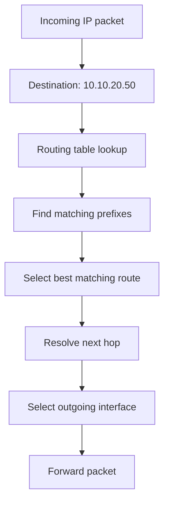
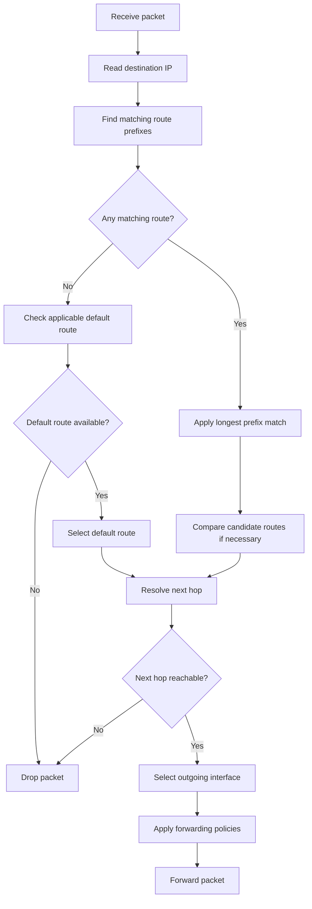

# Routing Table

A routing table is a data structure maintained by a network device that contains information about available IP networks and how to reach them.

Routers use routing tables to determine where packets should be forwarded based on their destination IP addresses.

A routing table can contain information about:

* Destination network prefixes.
* Next-hop IP addresses.
* Outgoing interfaces.
* Route sources.
* Route preferences and metrics.
* Routing table identifiers.
* Route status and attributes.

Routing tables are essential to both static and dynamic routing.

This document explains routing table structure, route types, route selection, longest prefix matching, route installation, and practical routing table inspection in Ubuntu/Linux and MikroTik RouterOS v7.

# 🗁 What Is a Routing Table?

A routing table is a collection of routes that describes how a router or host can reach different destination IP networks.

Each route provides information that helps the networking stack determine the appropriate forwarding action for a packet.

For example, a routing table might contain:

| Destination | Next Hop | Interface |
| --- | --- | --- |
| `192.168.1.0/24` | Direct | `eth0` |
| `192.168.2.0/24` | Direct | `eth1` |
| `10.10.0.0/16` | `192.168.1.254` | `eth0` |
| `0.0.0.0/0` | `192.168.1.254` | `eth0` |

Suppose a router receives a packet destined for:

```text
10.10.20.50
```

It examines its routing information, identifies matching prefixes, and selects the most specific applicable route.

The selected route determines the next forwarding action.

### 🖆 Routing Table Example



A routing table does not necessarily describe the complete end-to-end path. It describes the forwarding decision available at the current device.

# 🗁 Why Routing Tables Are Necessary

A router can connect multiple networks, but it needs forwarding information to determine where packets should go.

The routing table provides that information.

### 🖆 Reaching Directly Connected Networks

A router automatically learns routes for its directly connected networks when interfaces are configured and operational.

Example:

```text
eth0: 192.168.1.1/24
eth1: 192.168.2.1/24
```

The router can install:

```text
192.168.1.0/24 dev eth0
192.168.2.0/24 dev eth1
```

These entries allow the router to forward packets toward either network.

### 🖆 Reaching Remote Networks

A router also needs routes to networks that are not directly connected.

For example:

```text
LAN A                  R1                 R2                 LAN B
192.168.1.0/24 ---- 10.0.0.1/30 ---- 10.0.0.2/30 ---- 192.168.2.0/24
```

R1 needs a route to `192.168.2.0/24` through R2.

A possible route is:

```text
192.168.2.0/24 via 10.0.0.2
```

### 🖆 Reaching Unknown Networks

A router may use a default route when no more specific route matches a destination.

IPv4 default route:

```text
0.0.0.0/0
```

IPv6 default route:

```text
::/0
```

For example, a home router commonly forwards internet-bound traffic toward its ISP using a default route.

### 🖆 Supporting Multiple Routing Paths

A routing table can contain multiple candidate routes to the same destination prefix.

Depending on route preference and metrics, the router may select one route or install multiple equal-cost routes.

This supports:

* Primary and backup paths.
* Multiple internet connections.
* Equal-Cost Multi-Path routing.
* Dynamic route selection.
* Policy-based routing.

# 🗁 Routing Table Structure

A routing table consists of individual route entries.

Each entry describes a destination prefix and the forwarding information associated with it.

A simplified routing table looks like this:

| Destination | Gateway | Interface | Source |
| --- | --- | --- | --- |
| `192.168.1.0/24` | Direct | `eth0` | Connected |
| `192.168.2.0/24` | Direct | `eth1` | Connected |
| `10.10.0.0/16` | `192.168.1.254` | `eth0` | Static |
| `172.16.0.0/16` | `192.168.2.254` | `eth1` | OSPF |
| `0.0.0.0/0` | `192.168.1.254` | `eth0` | Static |

This is a conceptual representation. Actual routing table formats differ between operating systems and router platforms.

### 🖆 Destination Prefix

The destination prefix identifies the network or address range that a route matches.

Examples:

```text
192.168.1.0/24
10.0.0.0/8
172.16.0.0/12
2001:db8:100::/48
```

A destination prefix consists of:

* A network address.
* A prefix length.

The prefix length identifies how many leading bits belong to the network portion.

### 🖆 Gateway or Next Hop

The gateway identifies the next router to which a packet should be forwarded.

Example:

```text
Destination: 10.10.0.0/16
Gateway:     192.168.1.254
```

The next-hop address must be resolvable through an appropriate forwarding path.

Some routes do not require a separate next-hop gateway because the destination is directly connected.

### 🖆 Outgoing Interface

The outgoing interface identifies the local interface used to transmit packets.

Example:

```text
Destination: 10.10.0.0/16
Gateway:     192.168.1.254
Interface:   eth0
```

The interface may be specified explicitly or determined through next-hop resolution.

### 🖆 Route Source

The route source identifies how the route was learned or configured.

Common route sources include:

| Source | Description |
| --- | --- |
| Connected | Learned from a directly connected interface |
| Static | Configured manually |
| Default | A route matching all destinations not matched by a more specific route |
| OSPF | Learned through OSPF |
| BGP | Learned through BGP |
| RIP | Learned through RIP |
| Kernel | Installed or maintained by the operating system kernel |

A default route is a route prefix and forwarding behavior, not necessarily a separate protocol. It can be configured statically or learned dynamically.

### 🖆 Metric

A metric is a value used to compare candidate routes according to the rules of a routing protocol or platform.

Examples include:

* Hop count.
* OSPF cost.
* Bandwidth-derived values.
* Delay.
* Composite metrics.

Lower or higher values may be preferred depending on the protocol.

For example, OSPF prefers the path with the lowest total cost.

### 🖆 Administrative Distance or Route Preference

Some platforms use administrative distance or route preference to compare routes learned from different sources.

For example, the same destination prefix may be learned through:

* A static route.
* OSPF.
* BGP.

The platform uses its route-selection rules to determine which route source should be preferred.

Administrative distance is vendor-specific. It is not a universal IP routing field.

### 🖆 Route Status

A route can have different operational states.

Examples include:

* Active or installed.
* Inactive.
* Unreachable.
* Disabled.
* Unresolved.
* Blackhole.
* Reject.

Exact status terminology depends on the routing platform.

An inactive route may remain configured but not be selected for forwarding.

# 🗁 Components of a Route

Consider the following route:

```text
Destination: 192.168.50.0/24
Gateway:     10.0.0.2
Interface:   eth1
Metric:      100
Protocol:    static
```

Each field has a specific purpose.

| Field | Value | Meaning |
| --- | --- | --- |
| Destination | `192.168.50.0/24` | Network to reach |
| Gateway | `10.0.0.2` | Next-hop router |
| Interface | `eth1` | Outgoing interface |
| Metric | `100` | Route comparison value |
| Protocol | `static` | Route source |

### 🖆 Directly Connected Route

Example:

```text
Destination: 192.168.1.0/24
Gateway:     Direct
Interface:   eth0
Protocol:    connected
```

The router can reach devices in this network through `eth0` without forwarding to another router.

It still needs link-layer neighbor resolution to transmit an Ethernet frame to a destination host.

### 🖆 Gateway Route

Example:

```text
Destination: 192.168.50.0/24
Gateway:     10.0.0.2
Interface:   eth1
```

The router forwards matching packets toward the next-hop address `10.0.0.2`.

The next-hop address itself must be reachable through a valid route.

### 🖆 Interface-Only Route

Some routes specify an outgoing interface without an explicit next-hop address.

Example:

```text
192.168.100.0/24 dev eth2
```

This is common for directly connected networks.

Interface-only routes can also be used for point-to-point links or other specialized configurations.

On multi-access Ethernet networks, an interface-only route to a remote subnet may cause the router to attempt neighbor resolution for destination addresses directly. This is usually not the intended behavior unless the network design supports it.

### 🖆 Blackhole and Reject Routes

Some routing platforms support special routes that intentionally prevent forwarding.

**Blackhole route**

Silently discards matching packets.

Example in Linux:

```bash
sudo ip route add blackhole 198.51.100.0/24
```

**Unreachable or reject route**

Discards matching packets and may generate an error response.

Example in Linux:

```bash
sudo ip route add unreachable 203.0.113.0/24
```

These routes can be useful for traffic filtering, route aggregation, and preventing routing loops.

# 🗁 Types of Routes

Routing tables can contain routes learned or configured through different mechanisms.

### 🖆 Connected Routes

Connected routes represent networks directly attached to router interfaces.

Example:

```text
192.168.1.0/24 dev eth0
```

They are normally installed automatically when the interface has a valid address and is operational.

### 🖆 Static Routes

Static routes are manually configured by an administrator.

Example:

```text
Destination: 192.168.10.0/24
Gateway:     10.0.0.2
```

They are commonly used for:

* Small networks.
* Stub networks.
* Specific forwarding requirements.
* Backup paths.
* Default routes.

### 🖆 Default Routes

A default route matches any destination that does not have a more specific applicable route.

IPv4:

```text
0.0.0.0/0
```

IPv6:

```text
::/0
```

Default routes are commonly used to forward internet-bound traffic toward an upstream router.

### 🖆 Dynamic Routes

Dynamic routes are learned through routing protocols.

Examples include:

| Protocol | Routing Type | Common Use |
| --- | --- | --- |
| OSPF | Link-state IGP | Enterprise and ISP internal routing |
| BGP | Path-vector | Inter-domain routing and policy |
| RIP | Distance-vector IGP | Small or legacy networks |
| IS-IS | Link-state IGP | Large service-provider networks |

Dynamic routing protocols exchange information and update routes when network conditions change.

### 🖆 Summary Routes

A summary route represents multiple smaller network prefixes using a larger aggregated prefix.

For example, these four networks:

```text
192.168.0.0/24
192.168.1.0/24
192.168.2.0/24
192.168.3.0/24
```

Can be represented by:

```text
192.168.0.0/22
```

This is an exact aggregate because the networks are contiguous and correctly aligned.

Route summarization reduces routing table size and can improve routing scalability.

### 🖆 Floating Static Routes

A floating static route is a backup static route configured with a less-preferred route preference than the primary route.

It becomes active when the preferred route is no longer selected, assuming the platform's route-resolution and failover conditions are satisfied.

Floating static routes are useful for backup connectivity.

### 🖆 Special-Purpose Routes

Routing platforms may also support special routes, including:

* Blackhole routes.
* Unreachable routes.
* Prohibit routes.
* Local host routes.
* Broadcast routes.
* Multicast routes.

These route types support specialized forwarding and network-control behavior.

# 🗁 Routing Table Selection Process

When a router receives an IP packet, it must determine the appropriate forwarding action.

The selection process involves several stages.

### 🖆 Destination Lookup

The router examines the packet's destination IP address.

Example:

```text
Destination IP: 192.168.20.50
```

### 🖆 Find Matching Prefixes

The router identifies all routes whose destination prefixes contain the destination address.

Example routing entries:

```text
192.168.0.0/16
192.168.20.0/24
192.168.20.0/25
0.0.0.0/0
```

All four routes match `192.168.20.50`.

### 🖆 Apply Longest Prefix Match

The router selects the most specific matching prefix.

For this example:

```text
192.168.20.0/25
```

is more specific than `/24`, `/16`, and `/0`.

### 🖆 Resolve Competing Routes

When multiple candidate routes have the same destination prefix, route-source preferences, metrics, and platform-specific selection rules determine which route or routes are selected.

For example, a router may learn the same prefix through static routing and OSPF.

The platform's administrative distance or route preference may determine which source is preferred.

### 🖆 Resolve the Next Hop

The router determines how to reach the selected next hop.

This may require another route lookup.

This process is called recursive next-hop resolution.

For example:

```text
Route A:
Destination: 192.168.50.0/24
Next hop:    10.0.0.2

Route B:
Destination: 10.0.0.0/24
Interface:   eth1
```

Route B establishes how to reach `10.0.0.2`.

### 🖆 Forward the Packet

After resolving the forwarding information, the router:

* Selects the outgoing interface.
* Resolves the outgoing link-layer destination when necessary.
* Applies applicable forwarding policies.
* Updates fields such as TTL or Hop Limit.
* Transmits the packet.

If no usable forwarding route exists, the packet is normally dropped.

### 🖆 Route Selection Flowchart



# 🗁 Longest Prefix Match

Longest Prefix Match (LPM) is the primary mechanism used to select the most specific route for a destination IP address.

The router compares the destination address against available route prefixes.

The matching route with the longest prefix length is selected.

### 🖆 Example Routing Table

| Destination Prefix | Next Hop |
| --- | --- |
| `10.0.0.0/8` | Router A |
| `10.10.0.0/16` | Router B |
| `10.10.20.0/24` | Router C |
| `10.10.20.128/25` | Router D |
| `0.0.0.0/0` | Router E |

Consider these destinations:

| Destination IP | Selected Prefix | Next Hop |
| --- | --- | --- |
| `10.5.10.10` | `10.0.0.0/8` | Router A |
| `10.10.5.10` | `10.10.0.0/16` | Router B |
| `10.10.20.50` | `10.10.20.0/24` | Router C |
| `10.10.20.150` | `10.10.20.128/25` | Router D |
| `8.8.8.8` | `0.0.0.0/0` | Router E |

### 🖆 Important Rules

* A longer prefix is more specific.
* A more specific matching route generally takes precedence over a less specific route.
* A default route is the least specific possible IPv4 or IPv6 route.
* Route metrics do not normally allow a less-specific route to override a more-specific matching route.
* Route preference and metrics matter when comparing competing routes for the same prefix or otherwise equivalent candidates.

LPM applies to both IPv4 and IPv6.

# 🗁 RIB and FIB

Modern routing systems commonly distinguish between the Routing Information Base and the Forwarding Information Base.

These structures serve related but different purposes.

### 🖆 Routing Information Base (RIB)

The RIB stores routing information learned from different sources.

These sources may include:

* Connected interfaces.
* Static route configuration.
* OSPF.
* BGP.
* RIP.
* Other routing mechanisms.

The routing process evaluates candidate routes and selects routes according to applicable rules.

The RIB can contain multiple candidate routes for a destination prefix, even when only one route source is preferred for forwarding.

### 🖆 Forwarding Information Base (FIB)

The FIB contains the forwarding information used to make packet-forwarding decisions.

It is generally optimized for efficient destination lookups.

A FIB entry commonly contains:

* Destination prefix.
* Next-hop information.
* Outgoing interface.
* Forwarding action.

Some routers use specialized hardware such as TCAM or other lookup structures to accelerate forwarding.

### 🖆 RIB vs FIB

| Feature | RIB | FIB |
| --- | --- | --- |
| Full name | Routing Information Base | Forwarding Information Base |
| Purpose | Maintain and evaluate routing information | Forward packets |
| Main user | Routing/control-plane processes | Forwarding/data plane |
| Route sources | Connected, static, dynamic | Selected forwarding information |
| Structure | Routing-oriented | Forwarding-optimized |
| Packet forwarding | Not normally the direct forwarding lookup structure | Used for forwarding decisions |

### 🖆 Example

Suppose a router learns the same destination prefix through three sources:

```text
Destination: 192.168.50.0/24

Static route
OSPF route
BGP route
```

The routing process evaluates the available candidates and selects the preferred route according to platform-specific rules.

The selected forwarding information is then programmed into the FIB.

The data plane uses that forwarding information to forward matching packets.

The exact RIB/FIB implementation and relationship vary between operating systems and router platforms.

# 🗁 Multiple Routing Tables

A routing system can maintain multiple routing tables instead of using only one global table.

Multiple routing tables allow different traffic classes or network contexts to use different forwarding paths.

This is particularly useful for:

* Multi-WAN routing.
* Policy-based routing.
* VPN separation.
* Network virtualization.
* Customer isolation.
* Traffic engineering.

### 🖆 Linux Routing Tables

Linux supports multiple routing tables.

Common built-in tables include:

| Table | ID | Purpose |
| --- | ---: | --- |
| `local` | 255 | Local and broadcast routes |
| `main` | 254 | Main routing table |
| `default` | 253 | Default table |
| `unspec` | 0 | Unspecified table |

Additional tables can be defined in:

```text
/etc/iproute2/rt_tables
```

Example:

```text
100 wan1
200 wan2
```

Inspect routing rules:

```bash
ip rule show
```

Inspect all routing tables:

```bash
ip route show table all
```

Inspect a specific table:

```bash
ip route show table wan1
```

### 🖆 MikroTik Routing Tables

RouterOS v7 supports multiple routing tables.

Display configured routing tables:

```routeros
/routing table print
```

Create a routing table:

```routeros
/routing table add name=to-wan2 fib
```

The `fib` property makes the table available for forwarding lookups.

Routing rules and routing marks can direct selected traffic toward specific routing tables.

Example:

```routeros
/routing rule add src-address=192.168.20.0/24 action=lookup-only-in-table table=to-wan2
```

This rule directs matching source traffic to the specified routing table and does not fall back to another table if lookup fails.

The table must contain a usable route for the intended traffic.

# 🗁 Routing Table in Linux

Linux uses the `ip` command from the `iproute2` package to inspect and configure routing information.

### 🖆 Display the Main IPv4 Routing Table

```bash
ip route show
```

Short form:

```bash
ip route
```

Example output:

```text
default via 192.168.1.1 dev enp3s0 proto dhcp metric 100
192.168.1.0/24 dev enp3s0 proto kernel scope link src 192.168.1.100 metric 100
```

Explanation:

| Field | Meaning |
| --- | --- |
| `default` | Default route |
| `via 192.168.1.1` | Next-hop gateway |
| `dev enp3s0` | Outgoing interface |
| `proto dhcp` | Route installed through DHCP |
| `proto kernel` | Route installed by the kernel |
| `scope link` | Destination is directly reachable on the link |
| `src 192.168.1.100` | Preferred source address |
| `metric 100` | Route metric |

### 🖆 Display the IPv6 Routing Table

```bash
ip -6 route show
```

Example:

```text
default via fe80::1 dev enp3s0 proto ra metric 100
2001:db8:100::/64 dev enp3s0 proto kernel metric 256
fe80::/64 dev enp3s0 proto kernel metric 256
```

### 🖆 Display the Route to a Destination

```bash
ip route get 8.8.8.8
```

Example:

```text
8.8.8.8 via 192.168.1.1 dev enp3s0 src 192.168.1.100
```

This shows the route selected by the Linux kernel for that lookup.

For IPv6:

```bash
ip -6 route get 2606:4700:4700::1111
```

### 🖆 Display All Routing Tables

```bash
ip route show table all
```

For IPv6:

```bash
ip -6 route show table all
```

### 🖆 Add a Static Route

Add a route to `192.168.50.0/24` through `192.168.1.254`:

```bash
sudo ip route add 192.168.50.0/24 via 192.168.1.254
```

Specify an outgoing interface:

```bash
sudo ip route add 192.168.60.0/24 via 192.168.1.254 dev enp3s0
```

These commands create runtime routes. They are not automatically persistent across reboot.

### 🖆 Add a Default Route

```bash
sudo ip route add default via 192.168.1.1
```

### 🖆 Replace a Route

```bash
sudo ip route replace 192.168.50.0/24 via 192.168.1.253
```

`replace` adds the route if it does not exist or replaces the matching route when appropriate.

### 🖆 Delete a Route

```bash
sudo ip route del 192.168.50.0/24
```

### 🖆 Configure a Route in a Custom Table

Create a custom routing table name:

```bash
echo "100 wan1" | sudo tee -a /etc/iproute2/rt_tables
```

Add a route:

```bash
sudo ip route add default via 192.168.1.1 dev enp3s0 table wan1
```

Inspect it:

```bash
ip route show table wan1
```

### 🖆 Add a Policy Routing Rule

Direct traffic from a specific source subnet to table `wan1`:

```bash
sudo ip rule add from 192.168.10.0/24 table wan1
```

Inspect the rules:

```bash
ip rule show
```

The routing rule determines which table is consulted for matching traffic.

### 🖆 Important Linux Routing Commands

| Command | Purpose |
| --- | --- |
| `ip route show` | Display IPv4 routes |
| `ip -6 route show` | Display IPv6 routes |
| `ip route get <destination>` | Display selected IPv4 route |
| `ip -6 route get <destination>` | Display selected IPv6 route |
| `ip route show table all` | Display all IPv4 routing tables |
| `ip rule show` | Display IPv4 policy rules |
| `ip -6 rule show` | Display IPv6 policy rules |
| `ip route add` | Add a route |
| `ip route replace` | Add or replace a route |
| `ip route del` | Delete a route |
| `ip neigh show` | Display neighbor entries |

# 🗁 Routing Table in MikroTik RouterOS

MikroTik RouterOS provides a routing subsystem for connected, static, and dynamic routes.

RouterOS v7 includes support for multiple routing tables, routing rules, and routing protocol integration.

### 🖆 Display IPv4 Routes

```routeros
/ip route print
```

This displays the configured and installed IPv4 route entries.

### 🖆 Display Active Routes

```routeros
/ip route print where active
```

Active routes are available for forwarding according to the current routing state.

### 🖆 Display Detailed Route Information

```routeros
/ip route print detail
```

This provides additional route attributes, including gateway and route-selection information.

### 🖆 Display IPv6 Routes

```routeros
/ipv6 route print
```

### 🖆 Display Configured IP Addresses

```routeros
/ip address print
```

### 🖆 Add a Static Route

Example:

```text
Destination: 192.168.50.0/24
Gateway:     10.0.0.2
```

Configure:

```routeros
/ip route add dst-address=192.168.50.0/24 gateway=10.0.0.2
```

The next-hop address must be resolvable through an appropriate route.

### 🖆 Add a Default Route

```routeros
/ip route add dst-address=0.0.0.0/0 gateway=192.168.1.1
```

### 🖆 Add a Backup Static Route

A less-preferred static route can be configured by using a higher distance value than the primary route.

Example:

```routeros
/ip route add dst-address=0.0.0.0/0 gateway=192.168.1.1 distance=1

/ip route add dst-address=0.0.0.0/0 gateway=10.0.0.1 distance=10
```

The second route is less preferred when both routes are valid and eligible for selection.

This is a basic example. Reliable failover may also require gateway monitoring or other reachability mechanisms.

### 🖆 Display Routing Tables

```routeros
/routing table print
```

### 🖆 Display Routing Rules

```routeros
/routing rule print
```

### 🖆 Display Routing Protocol Information

For OSPF:

```routeros
/routing ospf neighbor print
```

For BGP:

```routeros
/routing bgp session print
```

These commands help investigate dynamic routing information that may contribute routes to the routing table.

### 🖆 Important RouterOS Commands

| Command | Purpose |
| --- | --- |
| `/ip route print` | Display IPv4 routes |
| `/ip route print where active` | Display active IPv4 routes |
| `/ip route print detail` | Display detailed route information |
| `/ipv6 route print` | Display IPv6 routes |
| `/ip address print` | Display IPv4 addresses |
| `/routing table print` | Display routing tables |
| `/routing rule print` | Display routing rules |
| `/routing ospf neighbor print` | Display OSPF neighbors |
| `/routing bgp session print` | Display BGP sessions |

# 🗁 Common Routing Table Problems

A route may appear in a configuration but still fail to provide the expected connectivity.

Understanding common routing table problems is important for network troubleshooting.

### 🖆 Missing Route

A router does not have an entry for the destination network.

Example:

```text
Destination: 192.168.50.0/24
```

If no matching route or default route exists, the router normally drops the packet.

**Troubleshooting:**

```bash
ip route show
```

Or:

```routeros
/ip route print
```

### 🖆 Incorrect Next Hop

A route points to an incorrect or unreachable gateway.

Example:

```text
192.168.50.0/24 via 10.0.0.10
```

But the actual next-hop router is `10.0.0.2`.

The route cannot provide the intended forwarding behavior.

**Troubleshooting:**

```bash
ip route get 192.168.50.10
```

Check the next-hop address and its reachability.

### 🖆 Unresolved Next Hop

A route may reference a gateway that cannot be resolved through another route.

For example:

```text
192.168.50.0/24 via 10.0.0.2
```

If the router has no valid path to `10.0.0.2`, the route may not become usable.

**Troubleshooting:**

* Verify the next-hop address.
* Check connected routes.
* Check interface state.
* Verify neighbor resolution.
* Inspect recursive route resolution.

### 🖆 Incorrect Prefix Length

An incorrect prefix can cause a route to match too many or too few destinations.

Example:

```text
Intended: 192.168.10.0/24
Configured: 192.168.0.0/16
```

The broader prefix may capture traffic that should follow another route.

**Troubleshooting:**

Check the destination prefix and its subnet mask.

### 🖆 Unexpected More-Specific Route

A more-specific route may override the expected route through Longest Prefix Match.

Example:

```text
10.0.0.0/8 via 192.168.1.1
10.10.0.0/16 via 192.168.1.2
```

Traffic destined for `10.10.5.10` uses the `/16` route.

**Troubleshooting:**

Inspect all matching prefixes, not just the default route or broad network route.

### 🖆 Inactive Route

A configured route may not be installed for forwarding because:

* Its gateway is unreachable.
* Its interface is unavailable.
* A more-preferred route is selected.
* Its routing table is not used by the traffic.
* The route is disabled.
* Route-resolution requirements are not satisfied.

**Troubleshooting:**

Inspect route status and detailed route information.

### 🖆 Missing Return Route

The destination network may receive the packet but lack a route back to the source network.

This creates one-way connectivity.

**Troubleshooting:**

Check the routing table in both directions.

### 🖆 Policy Routing Mismatch

A packet may be directed to a different routing table because of source addresses, firewall marks, routing rules, or other policy selectors.

**Troubleshooting:**

Linux:

```bash
ip rule show
ip route show table all
```

MikroTik:

```routeros
/routing rule print
/ip firewall mangle print
```

Inspect the rules and routing marks that influence the packet's route lookup.

# 🗁 Practical Exercises

Use Ubuntu/Linux network namespaces, virtual machines, or MikroTik CHR to practice routing table operations.

### 🖆 Exercise: Inspect the Local Routing Table

Run:

```bash
ip route show
```

Identify:

* The default route.
* The default gateway.
* Directly connected networks.
* Route metrics.
* Preferred source addresses.

Then inspect IPv6:

```bash
ip -6 route show
```

### 🖆 Exercise: Inspect a Destination Route

Run:

```bash
ip route get 8.8.8.8
```

Then run:

```bash
ip route get 192.168.1.50
```

Compare:

* Selected gateway.
* Outgoing interface.
* Source address.

Explain why the kernel chooses different forwarding information.

### 🖆 Exercise: Configure a Static Route

Assume your router has:

```text
Router R1:
192.168.1.1/24
10.0.0.1/30

Router R2:
10.0.0.2/30
192.168.2.1/24
```

Configure a route on R1:

```bash
sudo ip route add 192.168.2.0/24 via 10.0.0.2
```

Inspect the route:

```bash
ip route show
```

Remove it:

```bash
sudo ip route del 192.168.2.0/24
```

### 🖆 Exercise: Understand Longest Prefix Match

Use this routing table:

```text
192.168.0.0/16    via 10.0.0.1
192.168.10.0/24  via 10.0.0.2
192.168.10.128/25 via 10.0.0.3
0.0.0.0/0         via 10.0.0.254
```

Determine the selected route for:

```text
192.168.5.10
192.168.10.50
192.168.10.200
8.8.8.8
```

Explain why each route is selected.

### 🖆 Exercise: Explore Multiple Routing Tables

Create a custom Linux routing table:

```bash
echo "100 labwan" | sudo tee -a /etc/iproute2/rt_tables
```

Add a route:

```bash
sudo ip route add 198.51.100.0/24 dev enp3s0 table labwan
```

Inspect it:

```bash
ip route show table labwan
```

Remove the route:

```bash
sudo ip route del 198.51.100.0/24 table labwan
```

Remember that runtime route configuration is not automatically persistent across reboot.

### 🖆 Exercise: MikroTik Routing Table Inspection

On MikroTik RouterOS v7, run:

```routeros
/ip route print
```

Then:

```routeros
/ip route print detail
```

Identify:

* Connected routes.
* Static routes.
* Default routes.
* Active and inactive routes.
* Gateway information.
* Route distance.

# 🗁 Interview Questions

### 🖆 Fundamental Questions

**What is a routing table?**

A routing table is a collection of route entries that describes how a network device can reach different destination IP networks.

**Why does a router need a routing table?**

It needs forwarding information to determine the appropriate next hop and outgoing interface for destination IP addresses.

**What information does a routing table contain?**

Common information includes destination prefixes, next hops, outgoing interfaces, route sources, metrics, and route status.

**What is a connected route?**

A route representing a network directly attached to an active router interface.

**What is a static route?**

A route manually configured by an administrator.

**What is a dynamic route?**

A route learned through a routing protocol such as OSPF, BGP, or RIP.

**What is a default route?**

A route used when no more-specific applicable route matches the destination.

### 🖆 Intermediate Questions

**What is Longest Prefix Match?**

The process of selecting the most specific matching route for a destination IP address.

**What happens when no route matches a destination?**

The router checks for an applicable default route. If none exists, it normally drops the packet and may generate an ICMP error.

**What is the difference between a next hop and an outgoing interface?**

The next hop identifies the neighboring router toward the destination. The outgoing interface identifies the local interface used to transmit the packet.

**What is recursive next-hop resolution?**

It is the process of looking up how to reach a route's next-hop address using other routing information.

**What is the difference between RIB and FIB?**

The RIB maintains and evaluates routing information. The FIB contains forwarding information used by the data plane.

**What is a floating static route?**

A backup static route configured with a lower preference than the primary route so it can be selected when the primary route becomes unavailable.

**Can a routing table contain multiple routes to the same destination?**

Yes. Multiple candidate routes may exist. The routing system applies route-selection rules and may install one preferred route or multiple equal-cost routes.

**What is a blackhole route?**

A route that intentionally discards matching packets without forwarding them.

### 🖆 Advanced Questions

**Does a route with a lower metric always win?**

No. Metric interpretation depends on the routing protocol and platform. Route preference and longest-prefix matching must also be considered.

**Can a more-specific route override a route with a better metric?**

Yes. Longest Prefix Match generally selects the more-specific matching prefix before comparing competing routes for the same prefix.

**What is policy-based routing?**

Policy-based routing uses conditions such as source address, destination address, incoming interface, or packet marks to influence route lookup.

**Why might a route be configured but not active?**

The next hop may be unresolved, the interface may be unavailable, another route may be preferred, or the route may be disabled or otherwise ineligible.

**Can Linux maintain multiple routing tables?**

Yes. Linux supports multiple routing tables and policy-routing rules through `iproute2`.

# 🗁 Summary

A routing table is one of the most important components of an IP networking system.

It provides the forwarding information needed to reach local and remote networks.

Key concepts covered:

* A routing table contains destination prefixes and forwarding information.
* Route entries commonly include a destination, next hop, interface, source, and metric.
* Connected routes represent directly attached networks.
* Static routes are configured manually.
* Dynamic routes are learned through routing protocols.
* Default routes handle destinations without a more-specific matching route.
* Longest Prefix Match selects the most specific matching destination prefix.
* Route preference and metrics help resolve competing candidate routes.
* The RIB maintains routing information, while the FIB supports packet forwarding.
* Linux and MikroTik RouterOS support multiple routing tables and policy-routing mechanisms.
* A configured route does not automatically guarantee end-to-end connectivity.

Understanding routing tables is essential before working with static routing, default routing, dynamic routing protocols, and advanced routing policies.

# 🗁 References

* [RFC 1812 — Requirements for IP Version 4 Routers](https://www.rfc-editor.org/rfc/rfc1812)
* [RFC 4632 — Classless Inter-domain Routing (CIDR)](https://www.rfc-editor.org/rfc/rfc4632)
* [Linux iproute2 Documentation](https://www.kernel.org/doc/html/latest/networking/)
* [Linux Advanced Routing and Traffic Control](https://lartc.org/)
* [MikroTik RouterOS Routing Documentation](https://help.mikrotik.com/docs/)
* [MikroTik RouterOS IP Routing](https://help.mikrotik.com/docs/spaces/ROS/pages/328084/IP+Routing)
