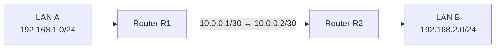

# Static Routing

Static routing is a routing method in which network administrators manually configure routes instead of relying on dynamic routing protocols to learn them automatically.

A static route tells a router how to reach a specific destination network by specifying a next-hop address, an outgoing interface, or both.

Static routing is commonly used in:

* Small and simple networks.
* Networks with predictable topologies.
* Stub networks with a single upstream connection.
* Default gateway configurations.
* Backup routing paths.
* Specific traffic-engineering requirements.

Static routes are straightforward to configure and do not require routing protocol exchanges. However, they do not automatically adapt to topology changes unless additional tracking or failover mechanisms are configured.

# 🗁 What Is Static Routing?

Static routing is the process of manually configuring routes in a router's routing system.

A static route defines how traffic should reach a particular destination network.

For example, suppose Router R1 needs to reach `192.168.2.0/24` through Router R2.

The administrator configures:

```text
Destination: 192.168.2.0/24
Next Hop:    10.0.0.2
```

This tells R1 to forward packets destined for `192.168.2.0/24` toward `10.0.0.2`.

### 🖆 Static Routing Diagram



R1 needs a static route to LAN B, and R2 needs a return route to LAN A.

Static routes are stored in the router's routing configuration and become available for forwarding when their route-selection and next-hop resolution conditions are satisfied.

# 🗁 Why Use Static Routing?

Static routing provides direct administrative control over network paths.

### 🖆 Simple Network Configuration

Static routes are easy to understand and configure in small networks.

For example, a router connected to one LAN and one upstream router may only need a default route.

### 🖆 Predictable Forwarding

Administrators can explicitly define which next hop should be used for a destination network.

This makes static routing useful when a network has a stable and predictable topology.

### 🖆 Reduced Routing Protocol Overhead

Static routes do not require periodic routing updates or dynamic neighbor relationships.

They therefore avoid the routing protocol processing and control traffic associated with dynamic routing.

### 🖆 Backup Connectivity

Static routes can provide backup paths when the primary route becomes unavailable.

A floating static route can be configured with a lower preference than the primary route.

### 🖆 Route Control

Administrators can use static routes to control selected forwarding paths.

Examples include:

* Sending a specific subnet through a particular gateway.
* Directing traffic toward a firewall.
* Creating routes to remote office networks.
* Configuring routes for VPN-connected networks.
* Preventing traffic from following an unintended path.

# 🗁 How Static Routing Works

Consider a network containing two routers and two LANs.

```text
LAN A                  R1              R2                  LAN B
192.168.1.0/24     10.0.0.1/30    10.0.0.2/30        192.168.2.0/24
     |                  |              |                   |
     +------------------+--------------+-------------------+
```

IP addressing:

| Device | Interface | IP Address |
| --- | --- | --- |
| R1 | LAN interface | `192.168.1.1/24` |
| R1 | WAN interface | `10.0.0.1/30` |
| R2 | WAN interface | `10.0.0.2/30` |
| R2 | LAN interface | `192.168.2.1/24` |
| PC-A | LAN | `192.168.1.10/24` |
| PC-B | LAN | `192.168.2.10/24` |

### 🖆 Configure the Route on R1

R1 needs to reach `192.168.2.0/24` through R2.

```text
Destination: 192.168.2.0/24
Next Hop:    10.0.0.2
```

### 🖆 Configure the Return Route on R2

R2 needs to reach `192.168.1.0/24` through R1.

```text
Destination: 192.168.1.0/24
Next Hop:    10.0.0.1
```

### 🖆 Packet Forwarding Process

When PC-A sends a packet to PC-B:

* PC-A determines that `192.168.2.10` is outside its local subnet.
* PC-A sends the packet to its default gateway, `192.168.1.1`.
* R1 receives the packet and checks its routing table.
* R1 finds the static route to `192.168.2.0/24`.
* R1 forwards the packet toward `10.0.0.2`.
* R2 receives the packet and forwards it to its directly connected LAN.
* PC-B receives the packet.
* The reply follows the return route configured on R2.

### 🖆 Important Point

A static route must be configured in the appropriate direction.

Configuring a route on R1 does not automatically create a return route on R2.

Successful communication generally requires valid forwarding paths in both directions.

# 🗁 Static Route Components

A static route contains information describing the destination and how to reach it.

### 🖆 Destination Prefix

The destination prefix identifies the network or address range that the route matches.

Example:

```text
192.168.2.0/24
```

### 🖆 Next-Hop Address

The next hop is the IP address of the neighboring router toward the destination.

Example:

```text
10.0.0.2
```

The next hop must be reachable through an appropriate forwarding path.

### 🖆 Outgoing Interface

The outgoing interface identifies the local interface used to transmit packets.

Example:

```text
eth1
```

### 🖆 Administrative Distance or Route Preference

Some platforms allow an administrator to configure a route preference or administrative distance.

This value helps determine which route source is preferred when competing routes exist for the same destination prefix.

The terminology and selection behavior vary between platforms.

### 🖆 Metric

A platform may also support route metrics for comparing candidate routes.

The meaning and preference direction of the metric depend on the operating system or routing implementation.

### 🖆 Example Static Route

```text
Destination: 192.168.50.0/24
Next Hop:    10.0.0.2
Interface:   eth1
Preference:  Platform-dependent
```

This route directs traffic for `192.168.50.0/24` toward the next-hop router at `10.0.0.2` through `eth1`.

# 🗁 Types of Static Routes

Static routes can be categorized according to their forwarding behavior and purpose.

### 🖆 Standard Static Route

A standard static route specifies how to reach a particular destination network.

Example:

```text
Destination: 192.168.20.0/24
Next Hop:    10.0.0.2
```

It is commonly used to connect remote LANs and subnets.

### 🖆 Default Static Route

A default static route is used when no more-specific matching route is available.

IPv4:

```text
0.0.0.0/0
```

IPv6:

```text
::/0
```

Example:

```text
0.0.0.0/0 via 203.0.113.1
```

A home or branch router commonly uses a default static route to forward internet-bound traffic toward its ISP.

### 🖆 Floating Static Route

A floating static route is a backup route configured with a lower preference than the primary route.

It becomes selected when the primary route is no longer eligible for forwarding and the backup route is valid.

Example:

```text
Primary:
0.0.0.0/0 via 192.168.1.1 preference 1

Backup:
0.0.0.0/0 via 10.0.0.1 preference 10
```

The exact preference configuration differs by platform.

### 🖆 Host Static Route

A host route describes a route to a single IP address.

IPv4 example:

```text
192.168.1.100/32
```

IPv6 example:

```text
2001:db8::100/128
```

Host routes are useful when a specific destination requires a forwarding path different from the rest of its network.

### 🖆 Blackhole Static Route

A blackhole route silently discards packets matching its destination prefix.

Example:

```text
198.51.100.0/24 → Blackhole
```

It can be used to prevent traffic from reaching a destination or to support route aggregation and traffic-control designs.

### 🖆 Unreachable or Reject Static Route

An unreachable or reject route discards matching packets and may generate an error response.

The exact behavior depends on the platform.

These routes are useful when an administrator wants to prevent traffic from following an unintended path while providing an explicit failure response.

# 🗁 Next-Hop and Interface-Based Routing

Static routes can specify a next-hop address, an outgoing interface, or both.

The correct configuration depends on the network topology and interface type.

### 🖆 Next-Hop-Based Static Route

A next-hop-based route specifies the IP address of the next router.

Example:

```text
192.168.20.0/24 via 10.0.0.2
```

Linux command:

```bash
sudo ip route add 192.168.20.0/24 via 10.0.0.2
```

This is common on Ethernet networks where multiple devices share a link.

The router resolves the next-hop MAC address using ARP for IPv4 or Neighbor Discovery for IPv6.

### 🖆 Interface-Based Static Route

An interface-based route specifies the outgoing interface.

Example:

```text
192.168.20.0/24 dev eth1
```

Linux command:

```bash
sudo ip route add 192.168.20.0/24 dev eth1
```

This is appropriate for directly connected destinations and certain point-to-point links.

On a multi-access Ethernet network, using an interface-only route for a remote subnet can cause the router to attempt neighbor resolution for each destination address. Use a next-hop address when forwarding through another router on Ethernet.

### 🖆 Next Hop and Interface Together

A route can specify both the gateway and outgoing interface.

```bash
sudo ip route add 192.168.20.0/24 via 10.0.0.2 dev eth1
```

This explicitly identifies the next-hop router and the interface used to reach it.

### 🖆 Comparison

| Configuration | Description | Common Use |
| --- | --- | --- |
| Next hop only | Specifies gateway address | Ethernet networks with resolvable gateway |
| Interface only | Specifies outgoing interface | Directly connected or point-to-point links |
| Next hop and interface | Specifies both | Explicit forwarding control |

# 🗁 Recursive Next-Hop Resolution

Recursive next-hop resolution occurs when a router must perform another route lookup to determine how to reach the next-hop address specified by a route.

Consider this configuration:

```text
Route A:
Destination: 192.168.50.0/24
Next Hop:    10.0.0.2

Route B:
Destination: 10.0.0.0/24
Interface:   eth1
```

Route A describes how to reach `192.168.50.0/24`.

However, the router must also determine how to reach `10.0.0.2`.

It looks up `10.0.0.2` in its routing information and finds Route B.

The resulting forwarding path is:

```text
192.168.50.0/24
       |
       | Next hop: 10.0.0.2
       |
10.0.0.0/24
       |
       | Directly connected
       |
     eth1
```

### 🖆 Recursive Lookup Process

* The router identifies the route for the destination network.
* The route specifies a next-hop address.
* The router looks up the next-hop address.
* It finds another route that explains how to reach that next hop.
* It resolves the outgoing interface and required neighbor information.
* It forwards the packet if the resulting path is valid.

### 🖆 Why Recursive Resolution Matters

Recursive resolution is important in:

* Static routing.
* BGP next-hop resolution.
* Routing through intermediate networks.
* Multi-hop network designs.
* Complex ISP infrastructures.

A route whose next hop cannot be resolved may remain inactive or unusable.

# 🗁 Floating Static Routes

A floating static route provides a backup path when the preferred route is unavailable.

It is configured with a less-preferred route preference than the primary route.

### 🖆 Example Topology

```text
                  Primary WAN
               +---------------+
               |               |
LAN -------- Router            ISP 1
               |
               |
               +---------------+
                  Backup WAN
                       |
                      ISP 2
```

Assume the router has two upstream gateways:

```text
Primary gateway: 192.168.1.1
Backup gateway:  10.0.0.1
```

The router has two default routes:

| Route | Gateway | Preference |
| --- | --- | ---: |
| Primary | `192.168.1.1` | 1 |
| Backup | `10.0.0.1` | 10 |

The primary route is preferred while it remains valid.

If the primary route is removed or becomes ineligible, the backup route can be selected.

### 🖆 Linux Example

Add a primary default route:

```bash
sudo ip route add default via 192.168.1.1 metric 100
```

Add a backup default route:

```bash
sudo ip route add default via 10.0.0.1 metric 200
```

When both routes are valid and otherwise comparable, Linux normally prefers the lower metric.

Inspect:

```bash
ip route show
```

### 🖆 MikroTik RouterOS Example

Primary route:

```routeros
/ip route add dst-address=0.0.0.0/0 gateway=192.168.1.1 distance=1
```

Backup route:

```routeros
/ip route add dst-address=0.0.0.0/0 gateway=10.0.0.1 distance=10
```

RouterOS uses route distance to compare these routes.

### 🖆 Important Failover Consideration

A floating static route does not automatically guarantee internet failover.

A router may still be able to reach its immediate gateway even when the upstream internet connection is unavailable.

For example:

```text
Router → ISP Gateway → Upstream Network → Internet
```

If only the ISP gateway is checked, the router may incorrectly consider the primary route healthy.

More reliable failover may require:

* Gateway reachability monitoring.
* Recursive routing.
* Netwatch or other monitoring mechanisms.
* Multiple independent probe targets.
* Routing-table and policy validation.

The monitoring method should verify the actual connectivity condition that matters to the network.

# 🗁 IPv4 Static Routing

IPv4 static routes use IPv4 destination prefixes and IPv4 next-hop addresses.

### 🖆 Example Network

```text
LAN A                 R1                R2                LAN B
192.168.10.0/24    10.0.0.1/30    10.0.0.2/30       192.168.20.0/24
```

Configure the following routes:

On R1:

```text
192.168.20.0/24 via 10.0.0.2
```

On R2:

```text
192.168.10.0/24 via 10.0.0.1
```

### 🖆 IPv4 Default Route

A default route uses the prefix:

```text
0.0.0.0/0
```

Example:

```text
0.0.0.0/0 via 192.168.1.1
```

It matches every IPv4 destination that does not have a more-specific applicable route.

### 🖆 IPv4 Host Route

A host route uses `/32`:

```text
203.0.113.10/32
```

It matches only one IPv4 destination address.

# 🗁 IPv6 Static Routing

IPv6 static routing works similarly to IPv4 static routing, but it uses IPv6 addresses and prefixes.

An IPv6 router can use:

* A global unicast next-hop address.
* A link-local next-hop address.
* An outgoing interface.
* A combination of interface and next-hop information.

### 🖆 Example IPv6 Network

```text
LAN A                 R1                R2                 LAN B
2001:db8:1::/64   2001:db8:12::1/64  2001:db8:12::2/64  2001:db8:2::/64
```

R1 needs a route to:

```text
2001:db8:2::/64
```

through:

```text
2001:db8:12::2
```

R2 needs a return route to:

```text
2001:db8:1::/64
```

through:

```text
2001:db8:12::1
```

### 🖆 IPv6 Default Route

The IPv6 default route is:

```text
::/0
```

Example:

```text
::/0 via 2001:db8:12::2
```

### 🖆 Link-Local Next-Hop Addresses

IPv6 routers commonly use link-local addresses for next-hop forwarding.

Example:

```text
fe80::2
```

Because a link-local address is only meaningful within its local link, the outgoing interface must also be identified.

Linux example:

```bash
sudo ip -6 route add 2001:db8:2::/64 via fe80::2 dev eth1
```

### 🖆 IPv6 Static Routing Considerations

* IPv6 next-hop addresses must be reachable.
* Link-local gateways require an interface scope.
* IPv6 forwarding must be enabled when Linux is acting as a router.
* Neighbor Discovery is used instead of ARP.
* IPv6 routers do not fragment packets.
* ICMPv6 Packet Too Big messages are important for Path MTU Discovery.

# 🗁 Static Routing in Linux

Ubuntu and other Linux distributions use the `ip` command from the `iproute2` package to manage routing tables.

The examples below use runtime route configuration.

Runtime routes normally disappear after reboot unless configured through a persistent networking system.

### 🖆 Display the Routing Table

```bash
ip route show
```

Display IPv6 routes:

```bash
ip -6 route show
```

### 🖆 Add a Static Route

Add a route to `192.168.20.0/24` through `10.0.0.2`:

```bash
sudo ip route add 192.168.20.0/24 via 10.0.0.2
```

### 🖆 Add a Route With an Interface

```bash
sudo ip route add 192.168.20.0/24 via 10.0.0.2 dev eth1
```

### 🖆 Add a Default Route

```bash
sudo ip route add default via 192.168.1.1
```

### 🖆 Add a Host Route

```bash
sudo ip route add 203.0.113.10/32 via 192.168.1.1
```

### 🖆 Add a Blackhole Route

```bash
sudo ip route add blackhole 198.51.100.0/24
```

### 🖆 Add an Unreachable Route

```bash
sudo ip route add unreachable 203.0.113.0/24
```

### 🖆 Replace a Static Route

```bash
sudo ip route replace 192.168.20.0/24 via 10.0.0.3
```

### 🖆 Delete a Static Route

```bash
sudo ip route del 192.168.20.0/24
```

### 🖆 Configure an IPv6 Static Route

```bash
sudo ip -6 route add 2001:db8:2::/64 via 2001:db8:12::2
```

Using a link-local gateway:

```bash
sudo ip -6 route add 2001:db8:2::/64 via fe80::2 dev eth1
```

### 🖆 Verify the Route

```bash
ip route show
```

Check the selected route:

```bash
ip route get 192.168.20.10
```

For IPv6:

```bash
ip -6 route get 2001:db8:2::10
```

### 🖆 Useful Linux Commands

| Command | Purpose |
| --- | --- |
| `ip route show` | Display IPv4 routes |
| `ip -6 route show` | Display IPv6 routes |
| `ip route add` | Add an IPv4 route |
| `ip -6 route add` | Add an IPv6 route |
| `ip route replace` | Add or replace a route |
| `ip route del` | Delete a route |
| `ip route get <IP>` | Display the selected IPv4 route |
| `ip -6 route get <IP>` | Display the selected IPv6 route |
| `ip neigh show` | Display IPv4 and IPv6 neighbor information |
| `ip rule show` | Display IPv4 policy-routing rules |

# 🗁 Persistent Static Routes in Ubuntu

The `ip route` command changes runtime routing state. For persistent configuration, use the networking system responsible for managing the interface.

Ubuntu commonly uses Netplan, which generates configuration for either `systemd-networkd` or NetworkManager.

### 🖆 Netplan Static Route Example

Assume the interface is:

```text
enp3s0
```

Its IP address is:

```text
192.168.1.100/24
```

The gateway is:

```text
192.168.1.1
```

Create or edit a Netplan configuration file:

```bash
sudo nano /etc/netplan/01-network.yaml
```

Example configuration:

```yaml
network:
  version: 2
  ethernets:
    enp3s0:
      dhcp4: false
      addresses:
        - 192.168.1.100/24
      routes:
        - to: 192.168.20.0/24
          via: 192.168.1.254
        - to: default
          via: 192.168.1.1
```

Validate the configuration:

```bash
sudo netplan generate
```

Apply the configuration:

```bash
sudo netplan apply
```

Inspect the resulting routes:

```bash
ip route show
```

### 🖆 Netplan IPv6 Static Route Example

Add an IPv6 route under the interface configuration:

```yaml
network:
  version: 2
  ethernets:
    enp3s0:
      addresses:
        - 2001:db8:1::10/64
      routes:
        - to: 2001:db8:2::/64
          via: 2001:db8:1::1
```

For a link-local next hop, specify the appropriate interface scope using the Netplan configuration supported by the installed version and backend.

### 🖆 Important Notes

* Use the correct interface name.
* Validate YAML indentation carefully.
* Avoid conflicting configurations managed by multiple networking systems.
* Check the generated configuration before applying it.
* On remote systems, use an appropriate recovery method when changing network settings.
* The exact persistent configuration depends on whether Netplan uses `systemd-networkd` or NetworkManager.

# 🗁 Static Routing in MikroTik RouterOS

MikroTik RouterOS v7 supports IPv4 and IPv6 static routing through its routing subsystem.

Static routes are configured using the `/ip route` and `/ipv6 route` menus.

### 🖆 Display Existing Routes

IPv4:

```routeros
/ip route print
```

IPv6:

```routeros
/ipv6 route print
```

### 🖆 Example Network

```text
LAN A                  R1                R2                 LAN B
192.168.10.0/24     10.0.0.1/30     10.0.0.2/30       192.168.20.0/24
```

Assume R1 and R2 have their interface addresses configured.

### 🖆 Configure a Static Route on R1

```routeros
/ip route add dst-address=192.168.20.0/24 gateway=10.0.0.2
```

This tells R1 to forward traffic for `192.168.20.0/24` toward R2.

### 🖆 Configure a Static Route on R2

```routeros
/ip route add dst-address=192.168.10.0/24 gateway=10.0.0.1
```

This provides the return path toward LAN A.

### 🖆 Configure a Default Route

```routeros
/ip route add dst-address=0.0.0.0/0 gateway=192.168.1.1
```

### 🖆 Configure a Floating Static Route

Primary route:

```routeros
/ip route add dst-address=0.0.0.0/0 gateway=192.168.1.1 distance=1
```

Backup route:

```routeros
/ip route add dst-address=0.0.0.0/0 gateway=10.0.0.1 distance=10
```

The route with the lower distance is preferred when both routes are valid and otherwise comparable.

### 🖆 Configure an IPv6 Static Route

```routeros
/ipv6 route add dst-address=2001:db8:2::/64 gateway=2001:db8:12::2
```

A link-local gateway can be specified with the appropriate interface:

```routeros
/ipv6 route add dst-address=2001:db8:2::/64 gateway=fe80::2%ether1
```

The interface scope is important because link-local addresses are not globally unique.

### 🖆 Inspect a Specific Route

```routeros
/ip route print detail where dst-address=192.168.20.0/24
```

### 🖆 Remove a Static Route

First inspect the route:

```routeros
/ip route print
```

Then remove it using its internal ID:

```routeros
/ip route remove numbers=0
```

The route number is only an example. Confirm the correct entry before removing it.

### 🖆 RouterOS v7 Static Routing Notes

* Connected routes are normally generated from interface addresses.
* Static routes are configured manually.
* Route distance influences route preference.
* A gateway must be resolvable for the route to become active.
* Multiple routing tables can be used for separate forwarding contexts.
* Recursive gateway resolution is supported.
* RouterOS v6 and v7 have differences in routing architecture and configuration.

# 🗁 Static Routing Best Practices

Well-designed static routing configurations are easier to maintain and troubleshoot.

### 🖆 Use Clear Addressing Plans

Plan network prefixes and point-to-point links before configuring routes.

Document:

* Network addresses.
* Prefix lengths.
* Router interface addresses.
* Next-hop addresses.
* Default gateways.
* Backup paths.

### 🖆 Configure Return Routes

Always verify that the destination network has a valid route back to the source network.

A one-way route is not sufficient for most two-way communication.

### 🖆 Prefer Specific Routes When Necessary

Use precise destination prefixes to avoid unintentionally capturing unrelated traffic.

Avoid overly broad routes unless aggregation or a specific design requirement justifies them.

### 🖆 Validate Next-Hop Reachability

A static route should point to a reachable next hop.

Check interface state, connected routes, and neighbor resolution.

### 🖆 Use Floating Routes for Backup Paths

Configure backup routes with a lower preference than primary routes.

For reliable failover, verify the actual upstream connectivity rather than only checking whether the local gateway responds.

### 🖆 Document Static Routes

Maintain a record of:

* Destination prefix.
* Next-hop address.
* Outgoing interface.
* Route purpose.
* Preference or metric.
* Primary or backup role.
* Responsible network segment.

### 🖆 Avoid Unnecessary Static Routes

A large network with frequent topology changes may become difficult to manage using only static routes.

Dynamic routing protocols are often more appropriate for large and interconnected environments.

# 🗁 Common Static Routing Problems

Static routing problems can result from incorrect configuration, unresolved gateways, missing return routes, or forwarding restrictions.

### 🖆 Missing Static Route

A router has no route to the destination network.

**Symptoms:**

* Remote network is unreachable.
* Packets are dropped.
* The router may return an ICMP Destination Unreachable message.

**Troubleshooting:**

```bash
ip route show
```

Verify that the destination prefix or an applicable default route exists.

### 🖆 Incorrect Next-Hop Address

The route points to the wrong gateway.

**Symptoms:**

* Traffic follows an unexpected path.
* The gateway cannot be reached.
* The route may remain inactive.

**Troubleshooting:**

```bash
ip route get 192.168.20.10
```

Verify the next-hop address and its reachability.

### 🖆 Missing Return Route

R1 can reach LAN B, but R2 does not have a route back to LAN A.

**Symptoms:**

* Requests reach the destination.
* Replies cannot reach the source.
* Communication fails or times out.

**Troubleshooting:**

Inspect the routing tables on both routers.

### 🖆 Incorrect Prefix Length

An incorrect subnet prefix can cause traffic to match the wrong route.

**Symptoms:**

* Some destinations work while others fail.
* Traffic follows an unexpected gateway.
* A broad route captures unrelated destinations.

**Troubleshooting:**

Verify the destination prefix and compare it with the intended network design.

### 🖆 Unresolved Recursive Gateway

The static route references a next hop that cannot be resolved.

**Symptoms:**

* Route is configured but inactive.
* Packets cannot be forwarded.
* Gateway resolution fails.

**Troubleshooting:**

* Check the route to the next-hop address.
* Verify the connected network.
* Check the outgoing interface.
* Inspect neighbor information.

Linux:

```bash
ip route get 10.0.0.2
ip neigh show
```

### 🖆 Firewall Blocking Forwarded Traffic

A route may be correct while a firewall blocks packets.

**Symptoms:**

* The router can reach both networks individually.
* Hosts on separate networks cannot communicate.
* Packet forwarding is blocked.

**Troubleshooting:**

Check:

* Firewall forward rules.
* Access-control lists.
* Connection tracking.
* Host firewalls.
* NAT configuration.

### 🖆 IP Forwarding Disabled

A Linux machine configured with multiple interfaces may not forward packets if IP forwarding is disabled.

Check IPv4 forwarding:

```bash
sysctl net.ipv4.ip_forward
```

Enable it:

```bash
sudo sysctl -w net.ipv4.ip_forward=1
```

### 🖆 Primary Route Fails Without Backup Activation

A floating static route may not activate because the primary route remains installed while its upstream connectivity is broken.

**Troubleshooting:**

Verify:

* What condition determines primary-route availability.
* Whether gateway monitoring is enabled.
* Whether the probe target is reachable through the intended WAN.
* Whether the backup route is resolvable.
* Whether policy routing affects the traffic.

# 🗁 Practical Labs

Use Ubuntu/Linux network namespaces, virtual machines, or MikroTik CHR to practice static routing.

### 🖆 Lab: Configure Static Routing Between Two LANs

**Topology**

```text
PC1                 Router R1             Router R2                PC2
192.168.10.10       10.0.0.1/30           10.0.0.2/30          192.168.20.10
     |                   |                     |                      |
     +-------------------+---------------------+----------------------+

LAN A: 192.168.10.0/24
LAN B: 192.168.20.0/24
```

**Addressing plan**

| Device | Interface | IP Address |
| --- | --- | --- |
| PC1 | LAN | `192.168.10.10/24` |
| R1 | LAN | `192.168.10.1/24` |
| R1 | WAN | `10.0.0.1/30` |
| R2 | WAN | `10.0.0.2/30` |
| R2 | LAN | `192.168.20.1/24` |
| PC2 | LAN | `192.168.20.10/24` |

**Configure default gateways**

```text
PC1: 192.168.10.1
PC2: 192.168.20.1
```

**Configure R1**

```bash
sudo ip route add 192.168.20.0/24 via 10.0.0.2
```

**Configure R2**

```bash
sudo ip route add 192.168.10.0/24 via 10.0.0.1
```

**Verify connectivity**

From PC1:

```bash
ping 192.168.20.10
```

From PC2:

```bash
ping 192.168.10.10
```

Inspect both routing tables:

```bash
ip route show
```

**Expected result**

Both PCs should communicate if interface addressing, forwarding, firewall policies, and return routing are correctly configured.

### 🖆 Lab: Configure a Default Static Route

Create a router connected to a LAN and an upstream router.

Configure:

```text
Default gateway: 10.0.0.1
```

Linux:

```bash
sudo ip route add default via 10.0.0.1
```

Verify:

```bash
ip route show default
```

Test:

```bash
ip route get 8.8.8.8
```

### 🖆 Lab: Configure a Floating Static Route

Assume two upstream gateways:

```text
Primary: 192.168.1.1
Backup:  10.0.0.1
```

Configure:

```bash
sudo ip route add default via 192.168.1.1 metric 100
sudo ip route add default via 10.0.0.1 metric 200
```

Inspect:

```bash
ip route show
```

Test the route-selection behavior by making the primary route unavailable in a controlled lab environment.

Observe whether the backup route becomes selected.

### 🖆 Lab: Configure IPv6 Static Routing

Configure two IPv6 routers with:

```text
R1: 2001:db8:12::1/64
R2: 2001:db8:12::2/64
```

Remote LANs:

```text
LAN A: 2001:db8:1::/64
LAN B: 2001:db8:2::/64
```

On R1:

```bash
sudo ip -6 route add 2001:db8:2::/64 via 2001:db8:12::2
```

On R2:

```bash
sudo ip -6 route add 2001:db8:1::/64 via 2001:db8:12::1
```

Verify:

```bash
ip -6 route show
```

Test connectivity between hosts on the two LANs.

### 🖆 Lab: Troubleshoot a Missing Return Route

Configure a valid route from R1 to LAN B but intentionally omit the return route on R2.

Test connectivity.

Investigate:

* Whether the request reaches LAN B.
* Whether the reply is generated.
* Whether R2 has a route to LAN A.
* What happens when the return route is added.

This lab demonstrates why routing must be verified in both directions.

# 🗁 Interview Questions

### 🖆 Fundamental Questions

**What is static routing?**

Static routing is a method of manually configuring routes to destination networks instead of learning them through dynamic routing protocols.

**Why is static routing used?**

It provides simple, predictable forwarding control and is useful for small networks, stub networks, default routes, and backup paths.

**What is a static route?**

A manually configured route that specifies how to reach a destination prefix.

**What is a default static route?**

A static route that matches destinations without a more-specific applicable route. IPv4 uses `0.0.0.0/0`, while IPv6 uses `::/0`.

**What is a floating static route?**

A backup static route configured with a lower preference than the primary route.

**What is a host route?**

A route to a single IP address, represented by `/32` in IPv4 or `/128` in IPv6.

### 🖆 Intermediate Questions

**What is the difference between a next-hop route and an interface-based route?**

A next-hop route identifies the neighboring router, while an interface-based route specifies the outgoing interface. Both can also be specified together.

**What is recursive next-hop resolution?**

It is the process of performing another route lookup to determine how to reach the next-hop address specified by a route.

**Does configuring a static route guarantee connectivity?**

No. The next hop must be reachable, forwarding must be enabled, firewall policies must permit the traffic, and the destination must have a valid return path.

**Why do we need a return route?**

Because communication generally requires the destination to send response packets back to the source network.

**What is the difference between static and dynamic routing?**

Static routes are manually configured. Dynamic routes are learned and updated through routing protocols.

**Can static routing support failover?**

Yes. Floating static routes and gateway-monitoring mechanisms can provide backup connectivity.

### 🖆 Advanced Questions

**What happens if a static route has an unreachable next hop?**

The route may remain inactive or unusable because the router cannot resolve the forwarding path.

**Can a router have multiple static routes to the same destination?**

Yes. They may be used as primary and backup routes or as equal-cost paths, depending on route-selection rules and configuration.

**Does a floating static route automatically detect internet failure?**

Not necessarily. If the router only checks the immediate gateway, it may not detect an upstream failure. Additional monitoring or recursive route tracking may be required.

**Can static routes use IPv6 link-local next hops?**

Yes. The outgoing interface must also be specified because link-local addresses are scoped to a local link.

**When should static routing be replaced with dynamic routing?**

When the network becomes large, topology changes frequently, or manually maintaining routes becomes difficult and error-prone.

# 🗁 Summary

Static routing is a fundamental method of configuring network paths manually.

Important concepts covered:

* Static routes are manually configured by network administrators.
* A route identifies a destination prefix and forwarding information.
* Routes can specify a next hop, an outgoing interface, or both.
* Recursive next-hop resolution determines how to reach a specified gateway.
* Default routes provide forwarding for destinations without more-specific matches.
* Floating static routes provide backup paths.
* Host routes identify individual IP addresses.
* Blackhole and unreachable routes provide special forwarding behavior.
* IPv4 and IPv6 support static routing.
* Linux uses `ip route` and `ip -6 route` for route management.
* Ubuntu can maintain persistent routes through Netplan.
* MikroTik RouterOS v7 supports static routes, route distances, and multiple routing tables.
* Correct return routing is essential for two-way communication.
* Static routing is suitable for stable and relatively simple network topologies.

Static routing provides the foundation for understanding default routing, dynamic routing, route preferences, and advanced routing designs.

# 🗁 References

* [RFC 1812 — Requirements for IP Version 4 Routers](https://www.rfc-editor.org/rfc/rfc1812)
* [RFC 8200 — Internet Protocol, Version 6 (IPv6) Specification](https://www.rfc-editor.org/rfc/rfc8200)
* [Linux iproute2 Documentation](https://www.kernel.org/doc/html/latest/networking/)
* [Linux Advanced Routing and Traffic Control](https://lartc.org/)
* [Netplan Documentation](https://netplan.readthedocs.io/)
* [MikroTik RouterOS IP Routing](https://help.mikrotik.com/docs/spaces/ROS/pages/328084/IP+Routing)
* [MikroTik RouterOS Documentation](https://help.mikrotik.com/docs/)
