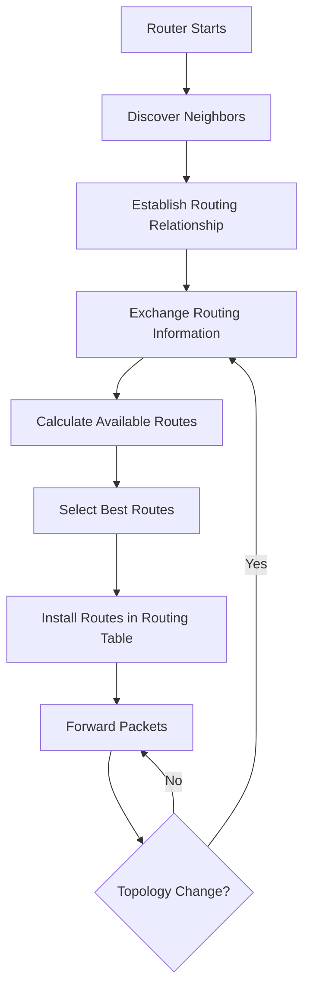
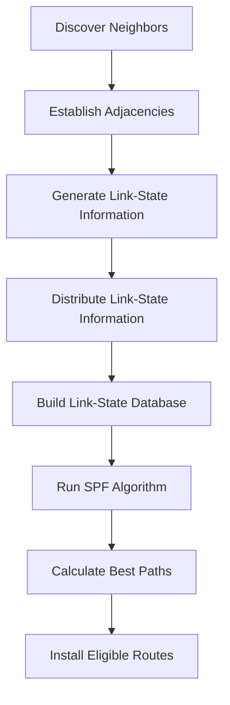

# Dynamic Routing

Dynamic routing is the process of automatically learning, exchanging, selecting, and updating network routes through routing protocols.

Instead of manually configuring every route, routers communicate with other routers to discover available networks and determine suitable forwarding paths.

Dynamic routing is commonly used in:

* Enterprise networks.
* ISP and service-provider networks.
* Large campus networks.
* Data centers.
* Multi-site corporate networks.
* Networks with redundant links and multiple paths.

Routing protocols allow routers to adapt when network topology changes. If a link fails or a new network becomes available, routers can exchange routing information and update their routing tables.

Dynamic routing is essential for building scalable networks that can respond to changing network conditions.

# 🗁 What Is Dynamic Routing?

Dynamic routing allows routers to automatically learn routes from other routers using routing protocols.

A routing protocol defines how routers exchange information about network reachability and determine which routes should be used.

For example, consider three routers connected in a network:

```text
             Router A
             /      \
            /        \
       Router B ---- Router C
```

Suppose Router A learns about a network connected to Router C.

A routing protocol can distribute that network information through the topology so Router B can also learn how to reach it.

When a network path changes, participating routers can exchange updated information and recalculate their routes.

### 🖆 Example

Consider the following topology:

```text
LAN A              LAN B              LAN C
  |                  |                  |
  |                  |                  |
Router A -------- Router B -------- Router C
```

Networks:

| Network | Connected Router |
| --- | --- |
| `192.168.10.0/24` | Router A |
| `192.168.20.0/24` | Router B |
| `192.168.30.0/24` | Router C |

With dynamic routing, Router A can learn how to reach `192.168.30.0/24` through Router B.

The administrator does not need to manually configure every remote network on every router.

# 🗁 Why Dynamic Routing Is Important

### 🖆 Automatic Route Discovery

Routers can learn remote networks from neighboring routers.

This reduces the need to manually configure routes throughout a network.

### 🖆 Automatic Network Adaptation

When network topology changes, routing protocols can distribute updated information.

For example, if a link fails, routers can recalculate available paths.

### 🖆 Scalability

Dynamic routing is suitable for networks containing many routers and remote networks.

It reduces the administrative effort associated with maintaining large routing tables.

### 🖆 Redundancy and Failover

A network can have multiple paths between routers.

Dynamic routing protocols can select an alternative path when the preferred path becomes unavailable.

### 🖆 Route Optimization

Routing protocols use metrics and protocol-specific selection rules to choose preferred paths.

The best path depends on the protocol and its configuration.

### 🖆 Reduced Manual Configuration

Administrators can configure routing relationships and policies rather than manually maintaining every remote destination route.

# 🗁 How Dynamic Routing Works

Dynamic routing involves several activities:

* Discovering neighboring routers.
* Establishing routing relationships.
* Exchanging routing information.
* Calculating available paths.
* Selecting preferred routes.
* Installing eligible routes into the routing table.
* Detecting topology changes.
* Distributing updated information.

### 🖆 General Dynamic Routing Process



The exact process differs between routing protocols.

For example:

* RIP exchanges routing information using periodic and triggered updates.
* OSPF discovers neighbors and exchanges link-state information.
* BGP establishes sessions between peers and exchanges network reachability information with path attributes.

### 🖆 Routing Protocol vs Routed Protocol

These terms describe different functions.

| Routing Protocol | Routed Protocol |
| --- | --- |
| Exchanges routing information | Carries user traffic |
| Helps routers discover paths | Provides network-layer addressing and packet forwarding |
| Examples: OSPF, BGP, RIP | Examples: IPv4 and IPv6 |
| Builds or influences routing information | Uses the selected forwarding path |

OSPF, BGP, and RIP are routing protocols. IPv4 and IPv6 are routed network-layer protocols.

# 🗁 Static Routing vs Dynamic Routing

Static routing and dynamic routing are two different approaches to maintaining routing information.

### 🖆 Static Routing

Static routes are manually configured by an administrator.

Example:

```text
Destination: 192.168.30.0/24
Next Hop:    10.0.0.2
```

The administrator explicitly defines the forwarding path.

### 🖆 Dynamic Routing

Dynamic routes are learned through routing protocols.

Routers exchange information and determine available paths automatically.

### 🖆 Comparison

| Feature | Static Routing | Dynamic Routing |
| --- | --- | --- |
| Configuration | Manual | Protocol-based |
| Route discovery | Manual | Automatic |
| Topology adaptation | Requires administrative changes or tracking | Protocol-driven |
| Scalability | Limited for large changing networks | Suitable for larger networks |
| Resource usage | Generally low | Requires protocol processing |
| Complexity | Simple for small networks | Requires protocol design and configuration |
| Redundancy | Must be designed and maintained | Can calculate alternative paths |
| Predictability | Usually straightforward | Depends on protocol and policy |
| Common use | Small and stable networks | Medium and large networks |

### 🖆 When to Use Static Routing

Static routing is suitable when:

* The network is small.
* The topology rarely changes.
* There is a single upstream router.
* A specific route must be manually controlled.
* A default route is sufficient.
* A predictable forwarding path is required.

### 🖆 When to Use Dynamic Routing

Dynamic routing is suitable when:

* The network contains many routers.
* Multiple paths exist.
* Network topology changes frequently.
* Automatic route discovery is required.
* Redundancy and convergence are important.
* Routing information must be exchanged between networks.

Static and dynamic routing can coexist in the same network.

# 🗁 Routing Protocol Classification

Routing protocols can be classified according to the routing domain in which they operate and the algorithms they use.

### 🖆 Classification by Routing Domain

```text
Routing Protocols
       |
       +------------------------+
       |                        |
      IGP                      EGP
       |                        |
  Inside an AS             Between ASes
       |                        |
  OSPF, RIP, IS-IS             BGP
```

* IGP: Interior Gateway Protocol.
* EGP: Exterior Gateway Protocol.

### 🖆 Classification by Algorithm

```text
Routing Protocol Algorithms
           |
           +-------------------------+
           |            |            |
      Distance-Vector  Link-State  Path-Vector
           |            |            |
          RIP          OSPF          BGP
```

This is a simplified classification of common protocols. IS-IS is also a link-state protocol.

# 🗁 Interior Gateway Protocols

An Interior Gateway Protocol operates within an Autonomous System.

An Autonomous System (AS) is a collection of IP networks and routers administered under a common routing policy and identified by an Autonomous System Number.

IGPs are commonly used for routing inside:

* Enterprise networks.
* ISP internal networks.
* Campus networks.
* Data-center networks.
* Large private infrastructures.

### 🖆 Common IGPs

| Protocol | Routing Algorithm | Main Characteristics |
| --- | --- | --- |
| RIP | Distance-vector | Uses hop count |
| OSPF | Link-state | Uses cost and SPF calculation |
| IS-IS | Link-state | Uses link-state information and SPF calculation |
| EIGRP | Advanced distance-vector | Uses the DUAL algorithm |

### 🖆 Example

An organization operates an internal network with multiple routers:

```text
              Router A
                 |
              Router B
              /      \
         Router C   Router D
              \      /
               Router E
```

An IGP can distribute internal network reachability information between these routers.

Each router maintains the information required by its routing protocol and installs eligible routes into its routing table.

# 🗁 Exterior Gateway Protocols

Exterior Gateway Protocols are used to exchange routing information between Autonomous Systems.

The main inter-domain routing protocol used on the internet is Border Gateway Protocol (BGP).

### 🖆 Autonomous Systems

An Autonomous System is identified by an ASN.

Example:

```text
       AS 65001
           |
         Router
           |
         eBGP
           |
         Router
           |
       AS 65002
```

The routers exchange routing information across the AS boundary using external BGP.

### 🖆 Common BGP Applications

* ISP peering.
* Internet transit.
* Multi-homed organizations.
* Data-center interconnection.
* Traffic engineering.
* Internet route distribution.

BGP uses path attributes and routing policies rather than simply selecting routes based on the shortest number of hops.

# 🗁 Distance-Vector Routing

Distance-vector routing is a routing approach in which routers exchange information about reachable networks and their associated distances.

Each router maintains information about destinations and the distance required to reach them.

A router generally learns routes from its neighbors and calculates route costs using the protocol's rules.

### 🖆 How Distance-Vector Routing Works

Consider:

```text
Router A -------- Router B -------- Router C
```

Router C has a directly connected network:

```text
192.168.30.0/24
```

Router B learns this network from Router C.

Router A can then learn the network from Router B.

In a hop-count-based protocol, Router A may calculate a distance of two hops to the destination network.

### 🖆 Routing Information

A simplified distance-vector update can contain:

| Destination | Distance |
| --- | ---: |
| `192.168.10.0/24` | 1 |
| `192.168.20.0/24` | 1 |
| `192.168.30.0/24` | 2 |

Actual protocol updates and route calculations vary.

### 🖆 Distance-Vector Characteristics

* Routers exchange routing information with neighbors.
* Routers do not necessarily maintain a complete topology map.
* Route selection is based on protocol-defined distance calculations.
* Periodic or triggered updates may be used.
* Routing loops can occur during topology changes.
* Loop-prevention techniques help reduce routing problems.

### 🖆 Common Distance-Vector Techniques

**Split Horizon**

A router does not advertise a learned route back through the interface from which it learned that route, subject to protocol-specific rules.

**Route Poisoning**

A failed route is advertised with an unreachable metric.

**Poison Reverse**

A router explicitly advertises a route back to the neighbor from which it was learned as unreachable.

**Hold-Down Mechanisms**

A router temporarily suppresses certain route changes to reduce instability caused by incorrect or inconsistent updates.

**Triggered Updates**

A router sends an update when relevant routing information changes instead of waiting only for the next periodic update.

### 🖆 Advantages

* Relatively simple operation.
* Suitable for smaller routing domains.
* Lower topology-information requirements than link-state protocols.
* Straightforward configuration in basic environments.

### 🖆 Limitations

* Some protocols converge slowly in certain failure scenarios.
* Routing loops may occur.
* Limited scalability in traditional implementations.
* Route selection may use relatively simple metrics.

### 🖆 Common Protocol

RIP is a traditional distance-vector routing protocol.

# 🗁 Link-State Routing

Link-state routing is a routing approach in which routers distribute information about their local links and network topology.

Routers use the collected information to build a topology database and calculate shortest paths.

OSPF and IS-IS are common link-state routing protocols.

### 🖆 How Link-State Routing Works

Consider:

```text
             Router A
             /      \
            /        \
       Router B ---- Router C
```

Each router discovers its neighbors and generates information about its connected links.

The routers distribute link-state information throughout the relevant routing area or domain.

Each router builds a link-state database representing the topology.

The router then runs the Shortest Path First algorithm to calculate the best paths.

### 🖆 Link-State Routing Process



### 🖆 Link-State Database

The Link-State Database (LSDB) contains topology information distributed by the routing protocol.

Routers within the same OSPF area maintain synchronized representations of that area's LSDB.

Different OSPF areas have different area-scoped link-state databases, with specific LSA types having broader flooding scopes.

### 🖆 Shortest Path First Algorithm

OSPF uses Dijkstra's Shortest Path First algorithm to calculate the shortest-path tree from the router's perspective.

The calculation uses the topology information and configured link costs.

### 🖆 Link-State Characteristics

* Routers discover neighboring routers.
* Link-state information is distributed through flooding.
* Routers build topology databases.
* SPF calculations determine paths.
* Changes can trigger new topology information and recalculation.
* Hierarchical design helps improve scalability.

### 🖆 Advantages

* Detailed topology awareness.
* Efficient path calculation.
* Generally fast convergence when properly designed.
* Supports hierarchical network design.
* Suitable for medium and large internal networks.

### 🖆 Limitations

* Requires more planning than basic static routing.
* Uses memory and CPU for topology databases and calculations.
* Configuration can become complex in large environments.
* Incorrect area or adjacency design can cause routing problems.

### 🖆 Common Protocols

* OSPF.
* IS-IS.

# 🗁 Path-Vector Routing

Path-vector routing is a routing approach in which routers exchange destination reachability information along with path attributes describing the route.

BGP is the principal path-vector routing protocol used on the internet.

Unlike traditional distance-vector protocols, BGP advertises path information that allows routers to apply routing policies and avoid certain routing loops.

### 🖆 How Path-Vector Routing Works

Consider three Autonomous Systems:

```text
AS 65001 -------- AS 65002 -------- AS 65003
```

AS 65003 advertises a network to AS 65002.

AS 65002 can advertise that network to AS 65001 while including the AS path:

```text
65002 65003
```

AS 65001 can use this path information when evaluating the route.

### 🖆 AS_PATH Attribute

The AS_PATH attribute records the sequence of AS numbers through which a route has passed.

It helps prevent routing loops between Autonomous Systems.

If a BGP router receives a route containing its own AS number in the AS_PATH, it normally rejects that route under standard loop-prevention behavior.

### 🖆 Path-Vector Characteristics

* Exchanges destination reachability information.
* Includes path attributes.
* Supports routing policies.
* Uses AS_PATH for inter-AS loop prevention.
* Supports multiple routing and address families.
* Does not rely on a simple hop-count metric.

### 🖆 Advantages

* Highly scalable inter-domain routing.
* Supports complex routing policies.
* Provides AS-level path information.
* Enables ISP peering and internet routing.
* Supports traffic engineering through route attributes and policies.

### 🖆 Limitations

* Complex configuration and policy management.
* Convergence behavior can be slower than some IGPs.
* Incorrect filtering can cause routing leaks.
* Requires careful security and operational controls.

# 🗁 Routing Metrics

A routing metric is a value used by a routing protocol or routing system to evaluate and compare available paths.

Different routing protocols use different metrics.

### 🖆 Common Routing Metrics

| Metric | Description |
| --- | --- |
| Hop Count | Number of routers crossed |
| Cost | Protocol-defined path cost |
| Bandwidth | Link capacity or a value derived from it |
| Delay | Estimated path delay |
| Reliability | Link reliability measurement |
| Load | Network or interface load |
| MTU | Maximum transmission unit consideration |
| Composite Metric | Combination of multiple factors |

Not every routing protocol uses every metric.

### 🖆 Hop Count

Hop count measures the number of router hops toward a destination.

RIP uses hop count as its routing metric.

A lower hop count is preferred.

RIP considers 16 hops unreachable, so its maximum usable route distance is 15 hops.

### 🖆 Cost

OSPF uses cost as its path metric.

The total OSPF path cost is calculated by adding the costs of the links along the path.

A lower total cost is preferred.

OSPF interface cost can be configured manually. The default reference-bandwidth calculation depends on the implementation and configuration.

### 🖆 Bandwidth

Some routing protocols use bandwidth as part of their path calculation.

A higher-bandwidth link may receive a more favorable metric, depending on the protocol.

### 🖆 Delay

Delay represents an estimate of the time required for traffic to traverse a link or path.

Some routing protocols use delay as part of a composite metric.

### 🖆 Composite Metric

EIGRP uses a composite metric. Its calculation can consider bandwidth and delay, with other factors available depending on configuration.

### 🖆 BGP Path Selection

BGP does not use a simple numerical shortest-path metric.

It evaluates path attributes and configured policies.

Common BGP attributes include:

* LOCAL_PREF.
* AS_PATH.
* ORIGIN.
* MED.
* NEXT_HOP.
* Communities.

The exact best-path decision sequence depends on the BGP implementation and configuration.

# 🗁 Routing Updates

Routing updates communicate network reachability and topology information between routing devices.

The update mechanism depends on the routing protocol.

### 🖆 Periodic Updates

Some protocols send updates at regular intervals.

For example, RIP periodically sends routing information to its neighbors.

### 🖆 Triggered Updates

A router can send an update when a significant routing change occurs.

This allows other routers to learn about changes without waiting for the next periodic update.

### 🖆 Incremental or Event-Driven Updates

Some protocols distribute information when topology or reachability changes rather than continuously sending their entire routing information.

OSPF floods link-state advertisements when relevant information changes and also performs periodic refresh functions.

### 🖆 BGP Updates

BGP exchanges route information through messages such as:

* OPEN.
* UPDATE.
* KEEPALIVE.
* NOTIFICATION.

BGP UPDATE messages advertise or withdraw network reachability information and associated path attributes.

### 🖆 Routing Update Comparison

| Protocol | Information Exchange |
| --- | --- |
| RIP | Periodic and triggered routing updates |
| OSPF | Link-state advertisement flooding |
| IS-IS | Link-state information flooding |
| BGP | UPDATE and withdrawal messages over established sessions |
| EIGRP | Neighbor-based routing updates using its protocol mechanisms |

# 🗁 Routing Convergence

Routing convergence is the process through which routers reach a consistent routing state after a network topology or reachability change.

For example, when a router link fails, routing information must be updated and affected routers must recalculate their available paths.

### 🖆 Example

Initial topology:

```text
Router A -------- Router B
   |                 |
   |                 |
Router C -------- Router D
```

Suppose Router A reaches Router D through Router B.

If the link between Router B and Router D fails, the routing protocol may discover an alternative path through Router C.

```text
Router A -------- Router B
   |                 X
   |                 |
Router C -------- Router D
```

After the required updates and calculations, routers can use the alternative path.

### 🖆 Convergence Time

Convergence time is the period required for the routing system to respond to a change and reach a stable forwarding state.

It can depend on:

* Routing protocol.
* Network topology.
* Neighbor detection timers.
* Failure detection mechanisms.
* Update propagation.
* Route calculation.
* CPU and memory resources.
* Network size.
* Protocol configuration.

### 🖆 Fast Convergence

Fast convergence reduces the time during which traffic may be lost or forwarded along an invalid path after a failure.

Techniques include:

* Appropriate hello and dead timers.
* Bidirectional Forwarding Detection (BFD), where supported.
* Efficient topology design.
* Fast failure detection.
* Proper routing protocol configuration.
* Redundant paths.

### 🖆 Convergence and Route Stability

Aggressive timers do not automatically produce a better network.

Very short detection intervals can increase CPU usage and cause false failure detection during congestion or transient packet loss.

Timer selection should balance responsiveness and stability.

# 🗁 Dynamic Routing Protocol Comparison

The following table summarizes common routing protocols.

| Protocol | Classification | Algorithm | Metric or Selection |
| --- | --- | --- | --- |
| RIP | IGP | Distance-vector | Hop count |
| OSPF | IGP | Link-state | Cost |
| IS-IS | IGP | Link-state | Cost |
| EIGRP | IGP | Advanced distance-vector | Composite metric |
| BGP | EGP | Path-vector | Path attributes and policy |

### 🖆 RIP

* Simple distance-vector routing.
* Uses hop count.
* Maximum usable distance is 15 hops.
* Suitable for small or educational environments.
* Available as RIPv2 for IPv4 and RIPng for IPv6.

### 🖆 OSPF

* Link-state routing protocol.
* Uses SPF calculations.
* Supports hierarchical areas.
* Commonly used in enterprise and ISP internal networks.
* OSPFv2 supports IPv4; OSPFv3 was originally designed for IPv6 and has extensions for other address families.

### 🖆 IS-IS

* Link-state routing protocol.
* Uses a hierarchical Level 1 and Level 2 design.
* Common in large service-provider networks.
* Supports IPv4 and IPv6 through protocol extensions.

### 🖆 EIGRP

* Advanced distance-vector routing protocol.
* Uses the Diffusing Update Algorithm (DUAL).
* Supports rapid recalculation under appropriate conditions.
* Primarily associated with Cisco networking environments, although implementation availability varies.

### 🖆 BGP

* Path-vector routing protocol.
* Used for inter-AS routing.
* Supports routing policy and traffic engineering.
* Essential for internet routing and ISP peering.

# 🗁 Dynamic Routing in Linux

Linux provides routing and forwarding capabilities through the kernel.

Dynamic routing protocols are commonly implemented using routing software such as FRRouting (FRR).

FRR supports protocols including:

* BGP.
* OSPF.
* OSPFv3.
* RIP.
* IS-IS.
* PIM.

Protocol availability and supported features depend on the installed FRR version and build.

### 🖆 Install FRRouting on Ubuntu

Update package information:

```bash
sudo apt update
```

Install FRRouting:

```bash
sudo apt install frr frr-pythontools
```

### 🖆 Enable Routing Protocol Daemons

Edit:

```bash
sudo nano /etc/frr/daemons
```

Enable the required daemon, for example:

```text
zebra=yes
ospfd=yes
bgpd=yes
```

Enable and restart the service:

```bash
sudo systemctl enable frr
sudo systemctl restart frr
```

### 🖆 Enter the FRR CLI

```bash
sudo vtysh
```

Display the running configuration:

```text
show running-config
```

Display routing information:

```text
show ip route
```

Display IPv6 routing information:

```text
show ipv6 route
```

### 🖆 Verify FRR Service

```bash
systemctl status frr
```

Inspect logs:

```bash
sudo journalctl -u frr
```

FRR is a routing software suite. It does not replace the Linux kernel forwarding plane; it communicates routing information and programs routes into the kernel.

# 🗁 Dynamic Routing in MikroTik RouterOS

MikroTik RouterOS v7 supports several dynamic routing protocols.

Common protocols include:

* OSPF.
* BGP.
* RIP.
* IS-IS support depends on RouterOS version and platform capabilities.

RouterOS v7 uses routing tables, routing filters, and routing protocol configuration structures that differ in important ways from RouterOS v6.

### 🖆 Display Routing Information

IPv4:

```routeros
/ip route print
```

IPv6:

```routeros
/ipv6 route print
```

### 🖆 Display OSPF Configuration

```routeros
/routing ospf instance print
/routing ospf area print
/routing ospf interface-template print
```

### 🖆 Display OSPF Neighbors

```routeros
/routing ospf neighbor print
```

### 🖆 Display BGP Connections

```routeros
/routing bgp connection print
```

### 🖆 Display BGP Sessions

```routeros
/routing bgp session print
```

### 🖆 Display Routing Protocol Information

```routeros
/routing protocol print
```

### 🖆 Important Considerations

* RouterOS v7 uses the newer routing configuration architecture.
* OSPF and BGP require correct interface, addressing, and routing configuration.
* Routing filters should be used to control which routes are accepted and advertised.
* Route distance and routing tables influence route selection.
* Firewall rules must permit the required routing protocol traffic.
* Dynamic routing does not automatically configure NAT or internet access.

# 🗁 Best Practices

### 🖆 Select the Appropriate Routing Protocol

Choose a routing protocol according to network size, topology, operational requirements, and interoperability needs.

### 🖆 Design a Clear Routing Architecture

Define routing domains, areas, Autonomous Systems, and routing boundaries before deployment.

### 🖆 Use Route Filtering

Accept and advertise only the routes that should be exchanged.

This is particularly important for BGP and networks with multiple routing domains.

### 🖆 Control Route Redistribution

Redistribution between routing protocols can introduce routing loops and suboptimal paths.

Use route filters, tags, and carefully defined policies.

### 🖆 Monitor Routing Neighbors

Monitor adjacency states, BGP sessions, routing updates, and route changes.

### 🖆 Plan for Redundancy

Provide alternate paths where availability requirements justify them.

Verify that failover works under realistic failure conditions.

### 🖆 Protect Routing Protocols

Use authentication where supported, restrict neighbor relationships, and apply control-plane filtering.

For BGP, apply appropriate prefix filtering and routing policies.

### 🖆 Document Routing Information

Maintain records of:

* Router IDs.
* Interface addresses.
* Routing protocol configuration.
* OSPF areas.
* Autonomous System Numbers.
* Neighbor relationships.
* Route filters.
* Redistribution policies.
* Routing metrics.
* Failover behavior.

# 🗁 Common Problems and Troubleshooting

### 🖆 Routing Neighbor Not Established

**Possible causes:**

* Incorrect IP addressing.
* Interface down.
* Firewall blocking routing traffic.
* Mismatched protocol settings.
* Incorrect area or AS configuration.
* Authentication mismatch.
* Hello or dead timer mismatch where applicable.

Inspect interfaces:

```bash
ip link show
ip addr show
```

Inspect FRR:

```text
show ip ospf neighbor
show bgp summary
```

### 🖆 Expected Route Is Missing

**Possible causes:**

* Route not advertised.
* Neighbor relationship not established.
* Route filtering.
* Incorrect network configuration.
* Next hop unreachable.
* Route rejected by protocol selection rules.

Inspect:

```text
show ip route
show ip ospf database
show bgp ipv4 unicast
```

The exact commands available depend on the protocol and FRR version.

### 🖆 Routing Loop

**Possible causes:**

* Incorrect route redistribution.
* Inconsistent routing information.
* Missing route filtering.
* Poorly designed static and dynamic route interaction.

Investigate route advertisements and forwarding paths.

Use:

```bash
traceroute 8.8.8.8
```

### 🖆 Slow Convergence

**Possible causes:**

* Long failure detection timers.
* Slow update propagation.
* Large topology.
* CPU overload.
* Unstable links.
* Incorrect protocol design.

Inspect routing logs and neighbor states.

### 🖆 Route Exists but Traffic Cannot Reach the Destination

A route in the routing table does not guarantee end-to-end connectivity.

Check:

* Next-hop reachability.
* Outgoing interface state.
* Firewall policies.
* NAT behavior.
* Return routes.
* MTU and packet-size issues.

Inspect the selected route:

```bash
ip route get 8.8.8.8
```

Capture traffic:

```bash
sudo tcpdump -ni any
```

### 🖆 Unexpected Route Selected

**Possible causes:**

* More-specific route.
* Administrative distance or route preference.
* Metric.
* Policy-routing rules.
* Multiple routing tables.
* ECMP configuration.

Inspect:

```bash
ip route show
ip rule show
```

For MikroTik:

```routeros
/ip route print detail
/routing rule print
```

# 🗁 Practical Labs

### 🖆 Lab: Understand Dynamic Routing With Three Routers

Build the following topology in GNS3, EVE-NG, or another network simulator.

```text
LAN A              LAN B              LAN C
  |                  |                  |
Router A -------- Router B -------- Router C
```

Addressing plan:

| Device | Interface | IP Address |
| --- | --- | --- |
| Router A | LAN | `192.168.10.1/24` |
| Router A | Link to B | `10.0.12.1/30` |
| Router B | Link to A | `10.0.12.2/30` |
| Router B | LAN | `192.168.20.1/24` |
| Router B | Link to C | `10.0.23.1/30` |
| Router C | Link to B | `10.0.23.2/30` |
| Router C | LAN | `192.168.30.1/24` |

Objectives:

* Configure interface addresses.
* Enable IP forwarding.
* Establish routing relationships.
* Exchange network reachability information.
* Verify remote routes.
* Test communication between LAN A and LAN C.

### 🖆 Lab: Compare Static and Dynamic Routing

Create the same three-router topology.

First, configure static routes manually.

Then remove the static routes and configure a dynamic routing protocol.

Compare:

* Configuration effort.
* Route discovery.
* Routing table contents.
* Behavior after a link failure.
* Time required to restore connectivity.

### 🖆 Lab: Observe Route Changes

Build a topology with two paths between routers.

```text
       Router A
        /    \
       /      \
 Router B    Router C
       \      /
        \    /
       Router D
```

Objectives:

* Configure a dynamic routing protocol.
* Verify the preferred path.
* Disable one link.
* Observe routing updates.
* Inspect the new selected path.
* Restore the failed link.
* Observe route recovery.

### 🖆 Lab: Install FRR on Ubuntu

Objectives:

* Install FRR.
* Enable the required routing daemon.
* Access the FRR CLI.
* Inspect routing tables.
* View protocol neighbors.
* Examine service logs.

Useful commands:

```bash
sudo apt install frr frr-pythontools
sudo systemctl status frr
sudo vtysh
```

### 🖆 Lab: Dynamic Routing With MikroTik

Objectives:

* Connect two or three RouterOS routers.
* Assign IP addresses.
* Configure OSPF or another supported routing protocol.
* Establish neighbor relationships.
* Advertise connected networks.
* Inspect learned routes.
* Disable a link and observe route changes.

# 🗁 Interview Questions

### 🖆 Fundamental Questions

**What is dynamic routing?**

Dynamic routing is the process of automatically learning and exchanging network routes using routing protocols.

**Why do networks use dynamic routing?**

It reduces manual route configuration and allows routers to adapt when network topology changes.

**What is a routing protocol?**

A routing protocol defines how routers exchange reachability information and determine available paths.

**What is an IGP?**

An Interior Gateway Protocol exchanges routing information within an Autonomous System.

**What is an EGP?**

An Exterior Gateway Protocol exchanges routing information between Autonomous Systems. BGP is the principal protocol used for internet inter-domain routing.

### 🖆 Intermediate Questions

**What is the difference between static and dynamic routing?**

Static routes are manually configured. Dynamic routes are learned through routing protocols.

**What is distance-vector routing?**

It is a routing approach in which routers exchange destination reachability and distance information with neighboring routers.

**What is link-state routing?**

It is a routing approach in which routers distribute link-state information, build topology databases, and calculate shortest paths.

**What is path-vector routing?**

It is a routing approach that exchanges destination reachability information along with path attributes. BGP is the main example.

**What is routing convergence?**

It is the process through which routers update their routing information and reach a stable forwarding state after a network change.

**What is a routing metric?**

A routing metric is a value used to evaluate and compare available paths according to a routing protocol's rules.

### 🖆 Advanced Questions

**What is the difference between IGP and EGP?**

IGPs operate within an Autonomous System, while EGPs exchange routing information between Autonomous Systems.

**Why does OSPF use a link-state database?**

The LSDB provides topology information used by OSPF routers to calculate shortest paths.

**Why does BGP use AS_PATH?**

AS_PATH records the Autonomous Systems traversed by a route and helps prevent inter-AS routing loops.

**What is the difference between routing convergence and failover?**

Convergence is the process of updating routing information after a change. Failover is the transition of traffic to an alternative path when the preferred path becomes unavailable.

**Can static and dynamic routing coexist?**

Yes. A router can use static routes and dynamically learned routes simultaneously. Route selection determines which eligible route is used.

**Why is route filtering important?**

It controls which routes are accepted and advertised, helping prevent routing leaks, unwanted reachability, and routing instability.

# 🗁 Summary

Dynamic routing enables routers to exchange routing information and automatically adapt to network changes.

Key concepts:

* Dynamic routing uses routing protocols to learn and maintain routes.
* IGPs operate within an Autonomous System.
* EGPs exchange routing information between Autonomous Systems.
* Distance-vector protocols exchange destination and distance information.
* Link-state protocols distribute topology information and calculate shortest paths.
* Path-vector protocols exchange reachability information with path attributes.
* RIP, OSPF, IS-IS, EIGRP, and BGP are important routing protocols.
* Routing metrics help protocols evaluate paths.
* Routing convergence allows routers to respond to topology changes.
* FRR provides dynamic routing capabilities on Linux.
* MikroTik RouterOS v7 supports dynamic routing protocols such as OSPF, BGP, and RIP.

Dynamic routing is fundamental to scalable enterprise networks, service-provider infrastructure, and internet connectivity.

# 🗁 References

* [RFC 2453 — RIP Version 2](https://www.rfc-editor.org/rfc/rfc2453)
* [RFC 2328 — OSPF Version 2](https://www.rfc-editor.org/rfc/rfc2328)
* [RFC 5340 — OSPF for IPv6](https://www.rfc-editor.org/rfc/rfc5340)
* [RFC 4271 — Border Gateway Protocol 4](https://www.rfc-editor.org/rfc/rfc4271)
* [RFC 1195 — Use of IS-IS for Routing in TCP/IP and Dual Environments](https://www.rfc-editor.org/rfc/rfc1195)
* [RFC 7868 — Cisco's Enhanced Interior Gateway Routing Protocol](https://www.rfc-editor.org/rfc/rfc7868)
* [FRRouting Documentation](https://docs.frrouting.org/)
* [MikroTik RouterOS Documentation](https://help.mikrotik.com/docs/)
