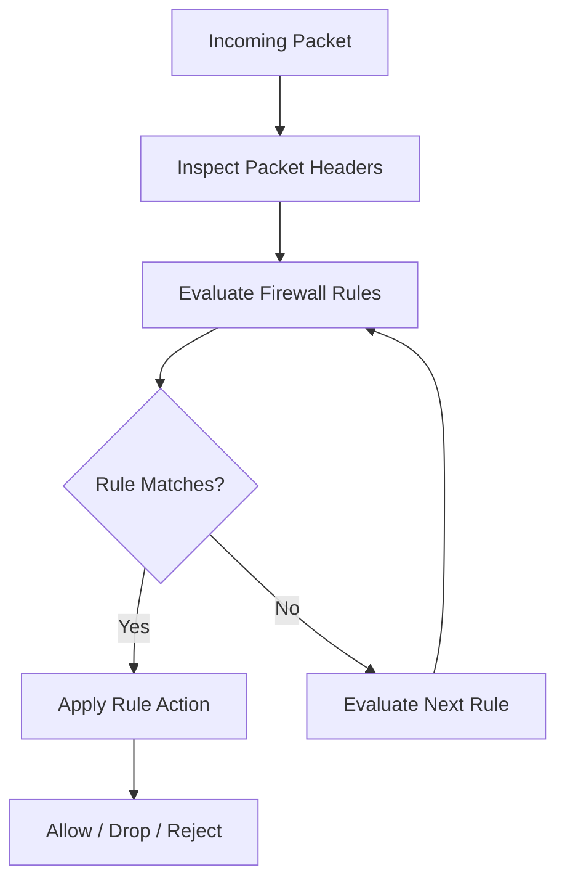

# Packet Filtering

Packet filtering is a firewall technique that examines network packets and applies security rules to decide whether traffic should be allowed, dropped, or rejected.

A packet-filtering firewall evaluates packet attributes such as source IP address, destination IP address, protocol, port numbers, network interfaces, and traffic direction.

Packet filtering is a fundamental component of network security. It is used in Linux firewalls, routers, switches with access-control capabilities, and dedicated firewall appliances.

# 🗁 Overview

Every network packet contains information that can be used to make filtering decisions.

For example, a firewall might allow HTTPS traffic to a web server while blocking Telnet traffic.

| Traffic | Protocol | Port | Firewall Decision |
| --- | --- | ---: | --- |
| HTTPS | TCP | 443 | Allow |
| HTTP | TCP | 80 | Allow |
| SSH | TCP | 22 | Allow from trusted networks |
| Telnet | TCP | 23 | Deny |
| DNS | UDP/TCP | 53 | Allow to approved resolvers |
| RDP | TCP | 3389 | Deny from untrusted networks |

A packet-filtering firewall can enforce these decisions by examining packet headers and matching them against configured rules.

# 🗁 How Packet Filtering Works

Packet filtering follows a rule-based process.



The firewall generally performs the following operations:

* Receives a network packet.
* Inspects relevant packet-header information.
* Compares the packet against firewall rules.
* Applies the action associated with the matching rule.
* Continues forwarding or processing the packet if permitted.

The exact processing order depends on the firewall implementation and its rule-processing architecture.

# 🗁 Packet Filtering Criteria

A firewall can use multiple packet attributes to identify traffic.

**Source IP Address**

Identifies the originating IP address.

Example:

```text
Allow packets from 192.168.10.0/24
```

**Destination IP Address**

Identifies the destination IP address.

Example:

```text
Allow packets destined for 203.0.113.10
```

**Protocol**

Identifies the network or transport protocol.

Common examples:

| Protocol | IP Protocol Number |
| --- | ---: |
| ICMP | 1 |
| TCP | 6 |
| UDP | 17 |
| IPv6 ICMP | 58 |

**Source Port**

Identifies the transport-layer source port.

Example:

```text
Allow TCP traffic originating from source port 443
```

**Destination Port**

Identifies the transport-layer destination port.

Example:

```text
Allow TCP traffic destined for port 443
```

**Network Interface**

Identifies the interface through which a packet enters or leaves the firewall.

Examples:

* `eth0`
* `ens33`
* `wlan0`
* `pppoe-out1`

**Traffic Direction**

Identifies whether traffic is entering the firewall, passing through it, or leaving it.

**TCP Flags**

A firewall may inspect TCP flags to identify connection behavior.

Common TCP flags include:

| Flag | Meaning |
| --- | --- |
| SYN | Initiates a TCP connection |
| ACK | Acknowledges received data |
| FIN | Initiates an orderly connection termination |
| RST | Resets a TCP connection |
| PSH | Requests prompt delivery of buffered data |
| URG | Indicates urgent data |

**ICMP Type and Code**

Firewall rules can inspect ICMP message types and codes.

Examples include:

* Echo Request
* Echo Reply
* Destination Unreachable
* Time Exceeded
* Packet Too Big in IPv6

**Connection State**

Stateful firewalls can additionally inspect connection-tracking information.

Common states include:

* NEW
* ESTABLISHED
* RELATED
* INVALID

Connection-state filtering is discussed further in the stateful firewall documentation.

# 🗁 Packet Direction and Firewall Chains

Firewall systems organize packet processing according to traffic direction and destination.

The terminology differs between firewall implementations.

**Linux Netfilter**

Linux Netfilter uses hooks and firewall chains to process packets.

| Chain | Purpose |
| --- | --- |
| INPUT | Packets destined for the local system |
| FORWARD | Packets routed through the system |
| OUTPUT | Packets generated by the local system |

Example:

```text
Internet
   |
   v
Linux Firewall
   |
   +---- INPUT
   |       |
   |       +---- Traffic destined for Linux
   |
   +---- FORWARD
   |       |
   |       +---- Traffic routed through Linux
   |
   +---- OUTPUT
           |
           +---- Traffic generated by Linux
```

**MikroTik RouterOS**

RouterOS uses firewall filter chains with similar purposes.

| Chain | Purpose |
| --- | --- |
| input | Packets destined for the router |
| forward | Packets passing through the router |
| output | Packets generated by the router |

Example:

```text
Internet
   |
   v
MikroTik Router
   |
   +---- input
   |       |
   |       +---- Traffic destined for the router
   |
   +---- forward
   |       |
   |       +---- Traffic passing through the router
   |
   +---- output
           |
           +---- Traffic generated by the router
```

**Important distinction:** Linux Netfilter and RouterOS use different packet-processing architectures. Their chain names are similar, but their configuration syntax and processing details are not interchangeable.

# 🗁 Firewall Rule Evaluation

Firewall rules are evaluated according to the implementation's processing order.

Many traditional firewall rule lists use first-match behavior:

* The firewall examines the first rule.
* If the packet matches, the configured action is applied.
* If it does not match, the firewall evaluates the next rule.
* Processing continues until a matching rule or the applicable default policy is reached.

Example:

| Priority | Rule | Action |
| ---: | --- | --- |
| 1 | Allow SSH from `192.168.10.0/24` | Accept |
| 2 | Allow HTTPS | Accept |
| 3 | Block Telnet | Drop |
| 4 | Block all remaining traffic | Drop |

A packet matching an earlier rule may never reach a later rule.

However, not every firewall uses a simple first-match list. Chain jumps, returns, base-chain priorities, and other processing mechanisms can affect evaluation.

**Rule ordering example**

Incorrect ordering:

```text
1. Drop all traffic
2. Allow HTTPS
3. Allow SSH
```

The later allow rules cannot be reached when the first rule matches all traffic.

Correct ordering:

```text
1. Allow established connections
2. Allow SSH from trusted networks
3. Allow HTTPS
4. Drop remaining traffic
```

# 🗁 Firewall Actions

Firewall rules commonly support several actions.

| Action | Description |
| --- | --- |
| Accept | Allow the packet to continue through the applicable processing path |
| Drop | Silently discard the packet |
| Reject | Discard the packet and return an appropriate error response |
| Log | Record information about matching traffic |
| Jump | Transfer processing to another chain |
| Return | Return from a user-defined chain to its caller |

**Accept**

Allows matching traffic to continue through the firewall processing path.

**Drop**

Silently discards matching packets.

The sender generally receives no immediate response from the firewall.

**Reject**

Discards matching packets and sends an error response when appropriate.

For example, a firewall may return an ICMP destination-unreachable message or a TCP reset.

**Log**

Records information about matching packets for monitoring and troubleshooting.

Logging should be controlled carefully because excessive logging can consume storage and system resources.

# 🗁 Default-Allow and Default-Deny Policies

A firewall must define what happens to traffic that does not match an explicit rule.

Two common approaches are default-allow and default-deny.

**Default-Allow**

Traffic is permitted unless a rule explicitly blocks it.

```text
Default Policy: ACCEPT

Rule 1: Block Telnet
Rule 2: Block unwanted traffic
```

This approach is easier to configure but can unintentionally expose services.

**Default-Deny**

Traffic is blocked unless a rule explicitly permits it.

```text
Default Policy: DROP

Rule 1: Allow established connections
Rule 2: Allow trusted SSH access
Rule 3: Allow HTTPS
Rule 4: Allow required DNS
```

Default-deny is generally preferred for security-sensitive systems because it follows the principle of least privilege.

# 🗁 Stateless Packet Filtering

Stateless packet filtering evaluates each packet independently.

It does not maintain connection state between packets.

For example, a stateless firewall may allow TCP packets destined for port 443 based on their headers without knowing whether they belong to an existing connection.

Characteristics:

* Each packet is evaluated independently.
* No connection table is required for the filtering decision.
* Rules are generally based on packet-header information.
* Return traffic may require separate rules.
* It can be efficient for straightforward filtering requirements.

Example:

```text
Allow TCP packets to destination port 443
Allow TCP packets from source port 443
Drop other traffic
```

This example demonstrates why stateless filtering can require carefully designed rules for both traffic directions.

# 🗁 Stateful Filtering Overview

Stateful packet filtering uses connection-tracking information to determine whether a packet belongs to a known connection or related traffic.

For example, when a client establishes a TCP connection to a web server, a stateful firewall can track the connection and permit its return traffic.

Example policy:

```text
Allow new HTTPS connections
Allow established and related traffic
Drop invalid traffic
```

Stateful filtering reduces the need to create separate rules for every return packet.

A detailed comparison of stateful and stateless filtering is covered in:

`04-stateful-vs-stateless.md`

# 🗁 Packet Filtering on Linux

Ubuntu and other modern Linux distributions commonly use `nftables` as the firewall configuration framework.

`nftables` replaces the older `iptables` framework for most new Linux firewall configurations.

It provides filtering, NAT, connection tracking integration, and other packet-processing capabilities.

**Check nftables installation**

```bash
sudo apt update
sudo apt install nftables
```

Check the service:

```bash
sudo systemctl status nftables
```

Enable it at startup:

```bash
sudo systemctl enable nftables
```

**Inspect the current firewall ruleset**

```bash
sudo nft list ruleset
```

**Create a basic filtering ruleset**

The following example creates an IPv4 and IPv6 filtering configuration using the `inet` family.

The `inet` family allows rules to apply to both IPv4 and IPv6 traffic.

```bash
sudo nft add table inet filter
```

Create the input chain:

```bash
sudo nft add chain inet filter input '{ type filter hook input priority 0; policy drop; }'
```

Create the forward chain:

```bash
sudo nft add chain inet filter forward '{ type filter hook forward priority 0; policy drop; }'
```

Create the output chain:

```bash
sudo nft add chain inet filter output '{ type filter hook output priority 0; policy accept; }'
```

These base chains attach to Netfilter hooks and define their default policies.

**Allow loopback traffic**

Loopback traffic is used for local communication between processes.

```bash
sudo nft add rule inet filter input iifname "lo" accept
```

**Allow established and related connections**

```bash
sudo nft add rule inet filter input ct state established,related accept
```

This permits packets associated with tracked connections and related traffic.

**Drop invalid packets**

```bash
sudo nft add rule inet filter input ct state invalid drop
```

**Allow SSH from a trusted network**

Assume the trusted management subnet is `192.168.10.0/24`.

```bash
sudo nft add rule inet filter input ip saddr 192.168.10.0/24 tcp dport 22 accept
```

This rule permits SSH connections originating from the specified IPv4 subnet.

**Allow HTTP and HTTPS**

```bash
sudo nft add rule inet filter input tcp dport '{ 80, 443 }' accept
```

**Allow essential ICMP traffic**

ICMP is important for network diagnostics and error reporting.

For IPv4:

```bash
sudo nft add rule inet filter input ip protocol icmp accept
```

For IPv6:

```bash
sudo nft add rule inet filter input meta l4proto ipv6-icmp accept
```

These examples allow ICMP broadly. Production environments may use more selective policies, but must preserve the ICMP messages required for normal network operation.

**Inspect the configured rules**

```bash
sudo nft list ruleset
```

**Save the configuration**

On Ubuntu, rules can be stored in:

```text
/etc/nftables.conf
```

The configuration can be loaded with:

```bash
sudo nft -f /etc/nftables.conf
```

The example is a starting point, not a complete production policy. Before applying a default-drop policy remotely, ensure that the management connection is permitted and that you have a recovery method.

**Useful nftables commands**

| Command | Purpose |
| --- | --- |
| `sudo nft list ruleset` | Display all firewall rules |
| `sudo nft list tables` | List firewall tables |
| `sudo nft list table inet filter` | Display a specific table |
| `sudo nft flush ruleset` | Remove the entire ruleset |
| `sudo nft monitor` | Monitor nftables events |
| `sudo nft monitor trace` | Monitor packet tracing events |

Use `flush ruleset` carefully because it removes all configured nftables tables, chains, and rules.

# 🗁 Packet Filtering with MikroTik RouterOS

MikroTik RouterOS provides packet filtering through its firewall filter rules.

The primary filter chains are:

* `input`
* `forward`
* `output`

**Inspect existing firewall rules**

```routeros
/ip firewall filter print
```

**Allow established and related connections**

```routeros
/ip firewall filter add chain=input connection-state=established,related action=accept
```

**Drop invalid connections**

```routeros
/ip firewall filter add chain=input connection-state=invalid action=drop
```

**Allow management access from a trusted network**

```routeros
/ip firewall filter add chain=input src-address=192.168.10.0/24 protocol=tcp dst-port=22 action=accept
```

**Allow ICMP traffic**

```routeros
/ip firewall filter add chain=input protocol=icmp action=accept
```

**Allow HTTPS access to the router**

```routeros
/ip firewall filter add chain=input protocol=tcp dst-port=443 action=accept
```

**Drop other incoming traffic**

```routeros
/ip firewall filter add chain=input action=drop
```

These rules illustrate the basic structure of an input policy. They should be placed in a deliberate order and adapted to the services the router actually needs.

**Use interface lists**

RouterOS supports interface lists, which simplify rules that apply to multiple WAN or LAN interfaces.

Example:

```routeros
/interface list add name=WAN
/interface list add name=LAN
```

Add interfaces:

```routeros
/interface list member add list=WAN interface=ether1
/interface list member add list=LAN interface=bridge
```

Drop new connections arriving from WAN that are destined for the router:

```routeros
/ip firewall filter add chain=input in-interface-list=WAN connection-state=new action=drop
```

This example is intentionally broad. A real policy should include explicit exceptions for required services, such as VPN endpoints or permitted remote management.

**Important RouterOS considerations**

* The `input` chain protects the router itself.
* The `forward` chain controls traffic routed through the router.
* The `output` chain controls traffic generated by the router.
* Firewall rules are evaluated in their configured order within the applicable chain.
* Existing default configurations may already contain important rules.
* RouterOS v7 is the primary reference for this documentation; some syntax and behavior may differ across older releases.

# 🗁 Packet Filtering with Cisco ACLs

Cisco devices use Access Control Lists (ACLs) to identify and permit or deny network traffic.

ACLs are commonly applied to router interfaces to control traffic entering or leaving an interface.

Two important ACL categories are standard and extended ACLs.

**Standard ACL**

A standard IPv4 ACL primarily matches the source IP address.

Example:

```cisco
access-list 10 permit 192.168.10.0 0.0.0.255
access-list 10 deny any
```

This permits traffic from `192.168.10.0/24` and denies other source addresses.

**Extended ACL**

An extended ACL can match:

* Source IP address
* Destination IP address
* Protocol
* Source port
* Destination port

Example:

```cisco
access-list 110 permit tcp 192.168.10.0 0.0.0.255 any eq 443
access-list 110 deny ip any any
```

This permits HTTPS traffic from the specified subnet and denies other IP traffic matched by this ACL.

**Apply an ACL to an interface**

```cisco
interface GigabitEthernet0/0
 ip access-group 110 in
```

The `in` keyword applies the ACL to traffic entering the interface.

Use `out` to apply an ACL to traffic leaving the interface.

**Important ACL behavior**

Cisco IOS ACLs are evaluated sequentially.

An implicit deny exists at the end of an ACL. Traffic that does not match an explicit permit statement is denied.

For production configurations, carefully verify the ACL direction, interface, and existing policy before applying changes.

# 🗁 Common Packet Filtering Scenarios

**Allow HTTPS to a Web Server**

```text
Source: Any
Destination: Web Server
Protocol: TCP
Destination Port: 443
Action: Allow
```

**Restrict SSH Access**

```text
Source: 192.168.10.0/24
Destination: Firewall
Protocol: TCP
Destination Port: 22
Action: Allow
```

All other SSH traffic can be denied.

**Block Telnet**

```text
Protocol: TCP
Destination Port: 23
Action: Drop
```

**Allow DNS to an Approved Resolver**

```text
Source: Internal Network
Destination: Approved DNS Resolver
Protocol: UDP/TCP
Destination Port: 53
Action: Allow
```

Both UDP and TCP are relevant to DNS.

**Restrict Guest VLAN Access**

A guest network might be allowed to access the internet but denied access to internal management and server networks.

```text
Guest VLAN -> Internet       Allow
Guest VLAN -> Internal LAN   Deny
Guest VLAN -> Management     Deny
Guest VLAN -> DNS Resolver   Allow
```

These policies should be implemented with explicit exceptions for services that guests legitimately need.

# 🗁 IPv6 Packet Filtering

IPv6 requires its own packet-filtering considerations.

A firewall must protect both IPv4 and IPv6 traffic when both protocols are enabled.

Using an IPv4-only firewall policy can leave IPv6 traffic insufficiently protected.

Important ICMPv6 messages include:

| ICMPv6 Message | Type | Purpose |
| --- | ---: | --- |
| Destination Unreachable | 1 | Reports delivery failure |
| Packet Too Big | 2 | Supports IPv6 Path MTU Discovery |
| Time Exceeded | 3 | Reports hop-limit expiration |
| Echo Request | 128 | Used by ping |
| Echo Reply | 129 | Responds to ping |
| Router Solicitation | 133 | Requests router advertisements |
| Router Advertisement | 134 | Provides IPv6 router and prefix information |
| Neighbor Solicitation | 135 | Supports address resolution and DAD |
| Neighbor Advertisement | 136 | Provides neighbor information |

Blocking essential ICMPv6 traffic can break:

* Neighbor Discovery Protocol (NDP).
* Duplicate Address Detection (DAD).
* Router Discovery.
* Path MTU Discovery.
* IPv6 error reporting.

A correct IPv6 firewall policy should permit the ICMPv6 messages required by the network design.

# 🗁 Troubleshooting

Packet-filtering problems can cause connectivity failures, service timeouts, and unexpected connection resets.

A systematic troubleshooting process helps identify whether firewall rules are responsible.

**Inspect firewall rules**

```bash
sudo nft list ruleset
```

**Check listening services**

```bash
sudo ss -tulpen
```

This helps determine whether the expected application is listening on the required port.

**Test connectivity**

```bash
ping 192.168.10.1
```

**Test a TCP port**

```bash
nc -vz 192.168.10.10 443
```

**Capture network traffic**

```bash
sudo tcpdump -ni any host 192.168.10.10
```

Capture HTTPS traffic:

```bash
sudo tcpdump -ni any tcp port 443
```

**Inspect routing**

```bash
ip route
```

**Inspect connection tracking**

```bash
sudo conntrack -L
```

Install the utility if needed:

```bash
sudo apt install conntrack
```

**Trace nftables packet processing**

For detailed rule tracing, enable tracing on selected packets and monitor the trace.

Example:

```bash
sudo nft add chain inet filter trace_input '{ type filter hook prerouting priority -301; policy accept; }'
```

Enable tracing for a selected source address:

```bash
sudo nft add rule inet filter trace_input ip saddr 192.168.10.50 meta nftrace set 1
```

Monitor the trace:

```bash
sudo nft monitor trace
```

Remove the temporary tracing chain after troubleshooting:

```bash
sudo nft delete chain inet filter trace_input
```

**Common troubleshooting checklist**

* Verify the source and destination IP addresses.
* Verify the protocol and destination port.
* Check the interface and traffic direction.
* Inspect firewall rule order.
* Check whether an earlier rule is matching the packet.
* Inspect counters and logs.
* Verify that the application is listening.
* Confirm that routing and return paths are correct.
* Check IPv4 and IPv6 policies separately.
* Capture packets to determine where traffic stops.

# 🗁 Best Practices

* Apply a default-deny policy where practical.
* Follow the principle of least privilege.
* Allow only required protocols and ports.
* Restrict management services to trusted networks.
* Place specific rules before broader rules when the firewall uses sequential matching.
* Use connection tracking where appropriate.
* Avoid unnecessarily exposing router management services.
* Keep IPv4 and IPv6 policies consistent with the intended security design.
* Preserve essential ICMP and ICMPv6 functionality.
* Log important security events without generating excessive logs.
* Document the purpose of each rule.
* Review and remove obsolete rules.
* Back up firewall configurations before major changes.
* Test firewall changes before deploying them to production.

# 🗁 Common Mistakes

| Mistake | Consequence |
| --- | --- |
| Allowing all incoming traffic | Unnecessary exposure of services |
| Incorrect rule order | Intended rules may never match |
| Blocking all ICMP | Network diagnostics and error handling may fail |
| Ignoring IPv6 | IPv6 traffic may bypass intended security controls |
| Applying rules to the wrong chain | Traffic may not be filtered as expected |
| Forgetting return traffic in stateless rules | Connections may fail |
| Allowing SSH from anywhere | Increased management-plane exposure |
| Using overly broad source networks | Unauthorized hosts may gain access |
| Logging every packet | Excessive resource consumption |
| Applying a default-drop policy without testing | Remote administration may become inaccessible |

# 🗁 Summary

Packet filtering is a fundamental firewall mechanism that controls network traffic by examining packet-header information and applying security rules.

Key concepts:

* Packet filtering evaluates packet attributes such as IP addresses, protocols, ports, and interfaces.
* Firewall chains organize packet processing according to traffic direction and destination.
* Firewall rules define which traffic is accepted, dropped, rejected, or logged.
* Rule ordering is important because many firewall implementations use sequential matching.
* Default-deny policies provide a stronger security baseline.
* Stateless filtering evaluates packets independently.
* Stateful filtering uses connection-tracking information.
* Linux uses Netfilter and nftables for packet filtering.
* MikroTik RouterOS provides `input`, `forward`, and `output` filter chains.
* Cisco ACLs provide standard and extended traffic-filtering capabilities.
* IPv6 firewall policies must preserve essential ICMPv6 functionality.

Packet filtering provides the foundation for controlling network access and enforcing firewall security policies.

# 🗁 References

* [Netfilter Project](https://www.netfilter.org/)
* [nftables Documentation](https://wiki.nftables.org/)
* [Linux Kernel Netfilter Documentation](https://docs.kernel.org/networking/netfilter.html)
* [MikroTik RouterOS Firewall Documentation](https://help.mikrotik.com/docs/)
* [Cisco Access Control Lists Configuration Guide](https://www.cisco.com/)
* [NIST SP 800-41 Rev. 1 — Guidelines on Firewalls and Firewall Policy](https://csrc.nist.gov/pubs/sp/800/41/r1/final)
* [RFC 4443 — Internet Control Message Protocol (ICMPv6)](https://www.rfc-editor.org/rfc/rfc4443)
* [RFC 4890 — Recommendations for Filtering ICMPv6 Messages](https://www.rfc-editor.org/rfc/rfc4890)
