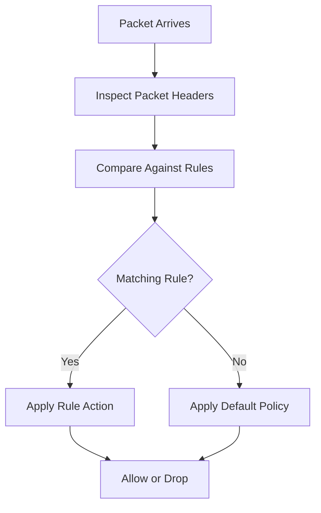
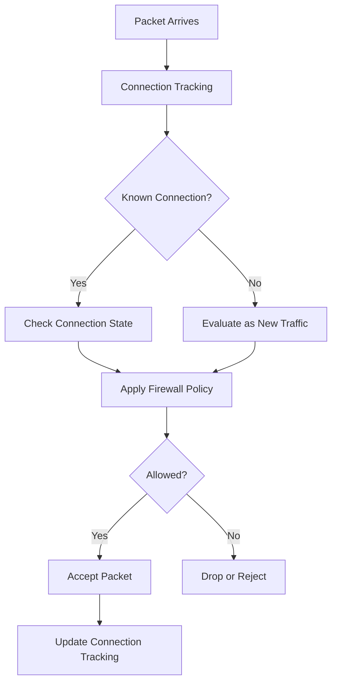

# Stateful vs Stateless Firewall Filtering

Firewalls control network traffic by evaluating packets against security rules. Two major approaches to packet filtering are **stateful filtering** and **stateless filtering**.

The primary difference is how a firewall handles connection information.

* **Stateless filtering** evaluates each packet independently.
* **Stateful filtering** tracks active connections and evaluates packets using connection-state information.

Understanding these approaches is essential when designing firewall policies, securing networks, troubleshooting connectivity, and configuring routers.

# 🗁 Overview

Consider a client accessing an HTTPS web server.

```text
Client                         Web Server
192.168.10.10                  203.0.113.10
     |                              |
     |------ TCP SYN -------------->|
     |                              |
     |<----- TCP SYN-ACK -----------|
     |                              |
     |------ TCP ACK -------------->|
     |                              |
     |====== HTTPS Data ============|
```

The client initiates the connection using a TCP SYN packet. The server responds with SYN-ACK, and the client completes the handshake with ACK.

The firewall must allow legitimate communication in both directions.

A stateless firewall evaluates each packet using its own filtering rules. A stateful firewall can recognize that the server's response belongs to a connection previously initiated by the client.

This difference changes how firewall rules are designed and maintained.

# 🗁 Stateless Firewall Filtering

A stateless firewall evaluates every packet independently without maintaining a connection table.

It makes filtering decisions using packet-header information, such as:

* Source IP address.
* Destination IP address.
* Source port.
* Destination port.
* IP protocol.
* Incoming interface.
* Outgoing interface.
* TCP flags.
* ICMP type and code.

The firewall does not remember whether a previous packet established a connection.

**Example**

Suppose a client accesses an HTTPS server.

```text
Client:
192.168.10.10:51500

Server:
203.0.113.10:443
```

The initial request has:

```text
Source IP:       192.168.10.10
Source Port:     51500
Destination IP:  203.0.113.10
Destination Port: 443
Protocol:        TCP
```

The server's response has:

```text
Source IP:       203.0.113.10
Source Port:     443
Destination IP:  192.168.10.10
Destination Port: 51500
Protocol:        TCP
```

A stateless firewall must have rules that permit both directions when both directions cross its filtering point.

It does not automatically recognize the response as belonging to the original request.

# 🗁 How Stateless Filtering Works



Each packet follows the same independent evaluation process.

For example:

| Packet | Matching Rule | Decision |
| --- | --- | --- |
| Client to server TCP 443 | Allow destination port 443 | Accept |
| Server to client TCP traffic | Allow source port 443 | Accept |
| Unapproved TCP traffic | No matching allow rule | Drop |

The firewall does not maintain the relationship between these packets.

# 🗁 Stateful Firewall Filtering

A stateful firewall monitors active connections and maintains information about their communication.

It uses connection tracking to identify packets belonging to existing connections.

When a client initiates a connection, the firewall records relevant connection information. Subsequent packets can be evaluated against this connection-tracking information.

A stateful firewall can recognize:

* New connection attempts.
* Packets belonging to established connections.
* Related connections.
* Invalid or unexpected packets.

**Example**

A client initiates an HTTPS connection to a server.

```text
Client                         Firewall                       Server
   |                               |                              |
   |-------- TCP SYN ------------>|----------------------------->|
   |                               |                              |
   |                               | Create connection entry      |
   |                               |                              |
   |<------- TCP SYN-ACK ----------|<-----------------------------|
   |                               |                              |
   |                               | Recognize return traffic     |
   |                               |                              |
   |-------- TCP ACK ------------>|----------------------------->|
   |                               |                              |
   |<======= HTTPS Data ===========|<=============================|
```

The firewall remembers the connection and permits matching return traffic according to its policy.

A typical firewall policy can therefore allow new outbound connections and automatically permit their established return traffic.

# 🗁 How Stateful Filtering Works

Stateful filtering generally follows this process:

* A packet arrives at the firewall.
* The firewall checks whether it belongs to an existing tracked connection.
* If a matching connection exists, the packet is evaluated using its connection state.
* If no matching connection exists, the firewall evaluates it as a potential new connection.
* The firewall applies the configured policy.
* Connection information is created or updated when appropriate.



The exact implementation differs between firewall platforms and protocols.

# 🗁 Connection Tracking

Connection tracking is the mechanism that allows a stateful firewall to maintain information about network communication.

It records information about packet flows so that subsequent packets can be associated with the same communication.

A connection-tracking entry commonly contains:

* Source IP address.
* Destination IP address.
* Source port.
* Destination port.
* Transport protocol.
* Connection state.
* Timeout information.
* NAT translation information, where applicable.

A simplified TCP connection-tracking entry might look like this:

```text
Protocol: TCP

Original Direction:
192.168.10.10:51500 -> 203.0.113.10:443

Reply Direction:
203.0.113.10:443 -> 192.168.10.10:51500

State: ESTABLISHED
```

The firewall uses this information to recognize packets belonging to the same connection.

**Connection Tracking and NAT**

Connection tracking is also important for NAT.

When a router translates an internal address and port, it records the translation so that return packets can be associated with the original connection.

For example:

```text
Internal Client:
192.168.10.10:51500

Public Address:
198.51.100.10:40001

Remote Server:
203.0.113.10:443
```

The router can maintain a translation relationship:

```text
192.168.10.10:51500
          |
          v
198.51.100.10:40001
          |
          v
203.0.113.10:443
```

When response traffic arrives, the router uses the connection-tracking and NAT information to reverse the translation.

# 🗁 Connection States

Stateful firewalls classify packets according to their relationship with tracked connections.

Common Linux Netfilter connection states include:

| State | Description |
| --- | --- |
| NEW | Packet is associated with a connection that has not yet been established in the tracker, or is initiating a new flow |
| ESTABLISHED | Packet belongs to a connection for which traffic has been seen in both directions |
| RELATED | Packet is associated with an existing connection but belongs to a related flow |
| INVALID | Packet cannot be associated with a valid tracked connection |

**NEW**

A packet is classified as NEW when it is associated with a new connection or a connection that has not yet reached the established state.

For TCP, an initial SYN packet is commonly classified as NEW.

**ESTABLISHED**

Traffic is classified as ESTABLISHED when the connection tracker recognizes it as belonging to a connection with traffic observed in both directions.

**RELATED**

Traffic is classified as RELATED when it is associated with another tracked connection.

Examples can include certain FTP data connections and ICMP error messages associated with existing traffic.

The exact behavior depends on the protocol and available connection-tracking helpers.

**INVALID**

Traffic is classified as INVALID when the connection tracker cannot associate it with a valid connection.

Such packets are commonly dropped.

**Important distinction**

These are Netfilter connection-tracking states. They are not identical to the TCP protocol's own states, such as `SYN-SENT`, `ESTABLISHED`, `FIN-WAIT-1`, or `TIME-WAIT`.

# 🗁 Stateful vs Stateless Comparison

| Feature | Stateless Firewall | Stateful Firewall |
| --- | --- | --- |
| Connection tracking | No | Yes |
| Packet evaluation | Independent | Connection-aware |
| Connection table | Not required | Required |
| Return traffic | Usually requires explicit rules | Can be permitted using connection state |
| Context awareness | Limited | Greater |
| Configuration | Can require more directional rules | Often simpler for bidirectional sessions |
| Resource usage | Generally lower | Requires tracking resources |
| NAT integration | Platform-dependent | Commonly integrated with connection tracking |
| Protocol awareness | Primarily packet-header based | Tracks communication relationships |
| Typical use | Simple ACLs and filtering | Enterprise firewalls and network routers |

Neither approach is universally better.

The appropriate choice depends on the network architecture, security requirements, traffic volume, and available firewall capabilities.

# 🗁 Packet Flow Examples

**Stateless Filtering Example**

Suppose a firewall must allow an HTTPS connection from an internal client to an external server.

```text
Client: 192.168.10.10
Server: 203.0.113.10
Service: TCP 443
```

A stateless policy needs to account for both directions.

```text
Rule 1:
Source: 192.168.10.0/24
Destination: Any
Protocol: TCP
Destination Port: 443
Action: ACCEPT

Rule 2:
Source: Any
Destination: 192.168.10.0/24
Protocol: TCP
Source Port: 443
Action: ACCEPT
```

This is a simplified example. A production policy must account for ephemeral ports, connection initiation, TCP flags, and the exact location of the firewall.

**Stateful Filtering Example**

A stateful firewall can use a simpler policy:

```text
Rule 1:
Allow ESTABLISHED and RELATED traffic.

Rule 2:
Allow NEW outbound HTTPS connections.

Rule 3:
Drop other unauthorized traffic.
```

The firewall tracks the connection and recognizes its return packets.

# 🗁 Stateful Filtering on Linux

Linux uses Netfilter connection tracking, commonly referred to as `conntrack`.

The `nftables` framework can inspect connection states through the `ct state` expression.

**Create a filtering table**

```bash
sudo nft add table inet filter
```

**Create an input chain**

```bash
sudo nft add chain inet filter input '{ type filter hook input priority 0; policy drop; }'
```

**Allow loopback traffic**

```bash
sudo nft add rule inet filter input iifname "lo" accept
```

**Allow established and related traffic**

```bash
sudo nft add rule inet filter input ct state established,related accept
```

This permits traffic belonging to tracked connections and related flows.

**Drop invalid traffic**

```bash
sudo nft add rule inet filter input ct state invalid drop
```

**Allow SSH from a trusted subnet**

```bash
sudo nft add rule inet filter input ip saddr 192.168.10.0/24 tcp dport 22 ct state new accept
```

**Allow new HTTPS connections**

```bash
sudo nft add rule inet filter input tcp dport 443 ct state new accept
```

**Inspect connection-tracking information**

Install the conntrack utility:

```bash
sudo apt install conntrack
```

List tracked connections:

```bash
sudo conntrack -L
```

Monitor connection events:

```bash
sudo conntrack -E
```

Inspect the current connection-tracking limits:

```bash
sudo sysctl net.netfilter.nf_conntrack_max
```

Inspect the number of tracked connections:

```bash
sudo sysctl net.netfilter.nf_conntrack_count
```

These commands help diagnose connection-tracking behavior and resource usage.

# 🗁 Stateful Filtering with MikroTik RouterOS

MikroTik RouterOS provides connection tracking as part of its firewall functionality.

Connection tracking allows RouterOS to identify connection states and support stateful firewall policies.

**Inspect connection-tracking configuration**

```routeros
/ip firewall connection tracking print
```

**Inspect active connections**

```routeros
/ip firewall connection print
```

**Allow established and related traffic**

```routeros
/ip firewall filter add chain=input connection-state=established,related action=accept
```

**Drop invalid traffic**

```routeros
/ip firewall filter add chain=input connection-state=invalid action=drop
```

**Allow new SSH connections from a trusted network**

```routeros
/ip firewall filter add chain=input src-address=192.168.10.0/24 protocol=tcp dst-port=22 connection-state=new action=accept
```

**Allow new HTTPS connections**

```routeros
/ip firewall filter add chain=input protocol=tcp dst-port=443 connection-state=new action=accept
```

**Drop unauthorized new incoming WAN connections**

```routeros
/ip firewall filter add chain=input in-interface-list=WAN connection-state=new action=drop
```

The example assumes the `WAN` interface list exists and that required WAN-facing services have already been explicitly permitted.

**Typical RouterOS firewall rule order**

```text
1. Accept established and related connections.
2. Drop invalid connections.
3. Accept trusted management traffic.
4. Accept required router services.
5. Accept required ICMP traffic.
6. Drop unauthorized incoming traffic.
```

For transit traffic, implement the corresponding policy in the `forward` chain rather than relying only on `input`.

# 🗁 Stateless Filtering Examples

Stateless filtering is commonly implemented through traditional access-control lists.

**Linux nftables example**

A rule that allows TCP traffic destined for port 443 without checking connection state:

```bash
sudo nft add rule inet filter input tcp dport 443 accept
```

This rule does not explicitly require a tracked connection state.

**Cisco extended ACL example**

```cisco
access-list 110 permit tcp 192.168.10.0 0.0.0.255 any eq 443
access-list 110 deny ip any any
```

This ACL permits matching HTTPS traffic based on its packet attributes.

Traditional ACLs do not automatically provide the same connection-tracking behavior as a stateful firewall.

# 🗁 Advantages and Disadvantages

**Stateless Firewall**

Advantages:

* Simple packet-level filtering.
* No connection table required.
* Generally lower connection-tracking overhead.
* Suitable for straightforward access-control policies.
* Useful for filtering at high-speed network boundaries.

Disadvantages:

* Does not understand connection relationships.
* Return traffic often requires additional rules.
* Complex bidirectional policies can become difficult to maintain.
* Limited ability to distinguish legitimate response traffic from unrelated packets.

**Stateful Firewall**

Advantages:

* Tracks active communication.
* Automatically recognizes legitimate return traffic.
* Simplifies many bidirectional firewall policies.
* Supports connection-aware security decisions.
* Integrates naturally with many NAT implementations.

Disadvantages:

* Requires memory for connection tracking.
* Introduces additional processing overhead.
* Can be affected by connection-table exhaustion.
* Asymmetric routing can interfere with connection tracking.
* Some protocols require additional handling for related flows.

# 🗁 Performance Considerations

Stateful filtering requires resources to maintain connection information.

Important performance factors include:

**Connection Table Size**

Each tracked connection consumes memory.

A firewall with many simultaneous connections must have sufficient connection-tracking capacity.

**Connection Timeouts**

Inactive connections are eventually removed from the connection table.

Timeout values influence how long connection entries remain allocated.

**Connection-Tracking Exhaustion**

When the connection table reaches its configured capacity, new connections may fail to be tracked.

On Linux, inspect:

```bash
sudo sysctl net.netfilter.nf_conntrack_count
sudo sysctl net.netfilter.nf_conntrack_max
```

**Asymmetric Routing**

Stateful firewalls expect to observe enough of a connection's traffic to track it correctly.

If the forward and return paths pass through different firewalls, one firewall may see only part of the communication.

This can cause packets to be classified as invalid or otherwise fail the configured policy.

**Hardware Acceleration**

Some routers use hardware offloading or fast-path mechanisms to improve forwarding performance.

However, certain traffic inspection and connection-tracking features may affect whether traffic can use those acceleration paths.

The behavior is platform-specific.

# 🗁 Common Use Cases

| Scenario | Suitable Approach |
| --- | --- |
| Simple router ACL | Stateless |
| Internal network segmentation | Stateful or stateless, depending on requirements |
| Home router internet access | Stateful |
| Enterprise perimeter firewall | Stateful |
| High-speed packet filtering | Stateless or hardware-accelerated filtering |
| NAT-based internet sharing | Stateful connection tracking commonly used |
| Basic management-plane restrictions | Either |
| Complex bidirectional application policies | Stateful |

Many real-world networks combine both approaches.

For example, a router may use stateless ACLs for basic interface restrictions while a stateful firewall handles connection-aware traffic filtering.

# 🗁 Troubleshooting

**Check Linux connection-tracking entries**

```bash
sudo conntrack -L
```

**Monitor connection events**

```bash
sudo conntrack -E
```

**Check connection-tracking capacity**

```bash
sudo sysctl net.netfilter.nf_conntrack_count
sudo sysctl net.netfilter.nf_conntrack_max
```

**Inspect nftables rules**

```bash
sudo nft list ruleset
```

**Inspect network connections**

```bash
sudo ss -tan
```

**Inspect RouterOS connection entries**

```routeros
/ip firewall connection print
```

**Inspect RouterOS filter rules**

```routeros
/ip firewall filter print stats
```

**Common problems**

| Problem | Possible Cause |
| --- | --- |
| Return traffic is dropped | Missing established/related rule |
| Connections fail intermittently | Connection-tracking resource exhaustion |
| Asymmetric traffic fails | Firewall does not observe both traffic directions |
| Unexpected INVALID state | Malformed packets or incomplete tracking |
| NAT connections fail | Incorrect NAT rules or connection-tracking behavior |
| Old sessions continue using previous behavior | Existing connection entries retain previous tracking information |

When changing NAT or connection-tracking policies, remember that existing tracked connections may continue using previously established translation information until their entries expire or are cleared.

# 🗁 Best Practices

* Use stateful filtering where connection-aware policies are required.
* Allow established and related traffic explicitly where appropriate.
* Drop invalid traffic according to the network's security policy.
* Restrict new inbound connections to approved services.
* Monitor connection-table usage.
* Review connection-tracking timeout settings.
* Avoid unnecessary connection-tracking overhead for traffic that does not require it, where the platform supports safe exceptions.
* Design routing paths carefully to avoid problematic asymmetry.
* Use stateless ACLs for simple filtering requirements where appropriate.
* Test firewall policies before deploying them in production.
* Document the expected traffic flows and connection states.

# 🗁 Common Mistakes

| Mistake                                                       | Explanation                                                                                          |
| ------------------------------------------------------------- | ---------------------------------------------------------------------------------------------------- |
| Assuming stateless firewalls remember connections             | Stateless filtering evaluates packets independently                                                  |
| Confusing TCP states with conntrack states                    | They represent different state models                                                                |
| Allowing established traffic without understanding the policy | Existing tracked sessions may receive broader access than intended                                   |
| Ignoring connection-table capacity                            | New connections may fail when tracking resources are exhausted                                       |
| Assuming RELATED means every secondary connection is allowed  | Related-flow recognition depends on protocol and tracking support                                    |
| Ignoring asymmetric routing                                   | Stateful inspection may not see the complete connection                                              |
| Assuming NAT and stateful filtering are identical             | NAT translates addresses and ports; stateful filtering controls traffic using connection information |
| Forgetting existing connection entries                        | Policy changes may not immediately affect existing tracked flows                                     |

# 🗁 Summary

Stateful and stateless filtering are two fundamental firewall approaches.

**Stateless filtering:**

* Evaluates packets independently.
* Does not maintain connection information.
* Often requires explicit rules for both traffic directions.
* Is useful for simple packet-level filtering.

**Stateful filtering:**

* Tracks active connections.
* Uses connection states to make filtering decisions.
* Can automatically recognize legitimate return traffic.
* Commonly integrates with NAT and connection tracking.

The key distinction is that stateless filtering makes decisions based on individual packets, while stateful filtering also considers the communication context.

Understanding both approaches helps build effective firewall policies for Linux servers, MikroTik routers, enterprise networks, and ISP infrastructure.

# 🗁 References

* [Netfilter Connection Tracking](https://www.netfilter.org/)
* [Linux Kernel Netfilter Documentation](https://docs.kernel.org/networking/netfilter.html)
* [nftables Wiki](https://wiki.nftables.org/)
* [conntrack-tools Documentation](https://conntrack-tools.netfilter.org/)
* [MikroTik RouterOS Connection Tracking](https://help.mikrotik.com/docs/)
* [Cisco Access Control Lists](https://www.cisco.com/)
* [NIST SP 800-41 Rev. 1 — Guidelines on Firewalls and Firewall Policy](https://csrc.nist.gov/pubs/sp/800/41/r1/final)
