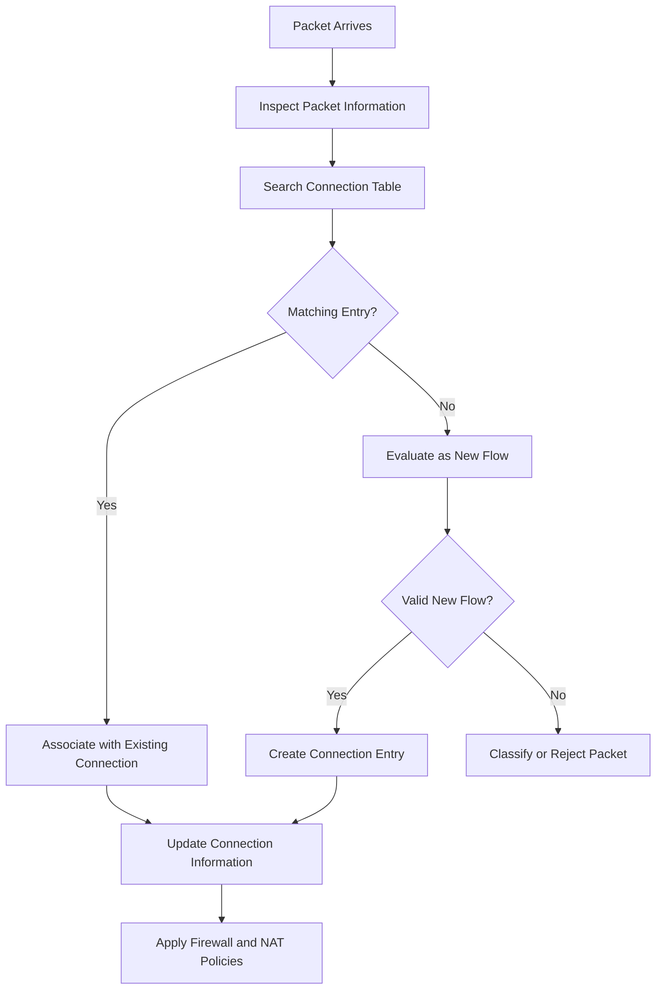

# Connection Tracking

Connection tracking is a firewall mechanism that monitors network communication and maintains information about active connections or flows.

It allows a firewall or router to identify packets belonging to existing communication sessions instead of evaluating every packet independently.

Connection tracking is a fundamental component of stateful firewalls and plays an important role in Network Address Translation (NAT), packet filtering, and network security.

Linux Netfilter and MikroTik RouterOS use connection tracking to support stateful firewall policies and NAT operations.

# 🗁 Overview

Network communication often involves multiple packets traveling in both directions.

Consider a client connecting to a web server:

```text
Client                         Server
192.168.10.10                  203.0.113.10
     |                              |
     |------ TCP SYN -------------->|
     |                              |
     |<----- TCP SYN-ACK -----------|
     |                              |
     |------ TCP ACK -------------->|
     |                              |
     |<======= HTTPS Data =========>|
```

A connection-tracking firewall observes this communication and maintains an entry describing the connection.

When subsequent packets arrive, the firewall checks its connection table to determine whether they belong to an existing flow.

This allows the firewall to recognize legitimate return traffic and apply connection-aware filtering policies.

# 🗁 Why Connection Tracking Is Needed

Without connection tracking, a firewall would need to evaluate packets independently.

For bidirectional communication, administrators may need to create separate rules for outgoing and returning traffic.

Connection tracking simplifies this process.

**Without connection tracking**

```text
Client -> Server: Allow TCP destination port 443
Server -> Client: Create a separate return-traffic rule
```

**With connection tracking**

```text
Client -> Server: Allow new HTTPS connection
Server -> Client: Allow established return traffic
```

Connection tracking provides several important capabilities:

* Recognizes packets belonging to existing connections.
* Supports stateful firewall filtering.
* Helps process NAT translations.
* Identifies related network traffic.
* Tracks communication timeouts.
* Provides connection information for monitoring and troubleshooting.

# 🗁 How Connection Tracking Works

Connection tracking generally follows this process:

* A packet arrives at the firewall or router.
* The connection-tracking subsystem examines its network and transport information.
* It searches for an existing connection entry.
* If a matching entry exists, the packet is associated with that connection.
* If no entry exists, the packet may create a new connection-tracking entry.
* The entry is updated as communication continues.
* The entry is eventually removed when the connection expires or is closed.



The exact processing sequence depends on the platform and its packet-processing architecture.

# 🗁 Connection Identification

Connection tracking identifies communication using information from packet headers.

A typical TCP or UDP flow is identified using a five-tuple:

| Field | Description |
| --- | --- |
| Source IP | Originating IP address |
| Destination IP | Target IP address |
| Source Port | Originating transport port |
| Destination Port | Target transport port |
| Protocol | TCP, UDP, or another tracked protocol |

Example:

```text
Source IP:        192.168.10.10
Source Port:      51500
Destination IP:   203.0.113.10
Destination Port: 443
Protocol:         TCP
```

The reverse direction has the opposite source and destination information:

```text
Source IP:        203.0.113.10
Source Port:      443
Destination IP:   192.168.10.10
Destination Port: 51500
Protocol:         TCP
```

A connection tracker recognizes both directions as belonging to the same communication.

For protocols without TCP or UDP ports, such as ICMP, the tracking mechanism uses protocol-specific information.

# 🗁 Connection Tracking Entries

A connection-tracking table stores information about tracked network flows.

A simplified entry might contain:

```text
Protocol: TCP

Original Direction:
192.168.10.10:51500 -> 203.0.113.10:443

Reply Direction:
203.0.113.10:443 -> 192.168.10.10:51500

Status: ESTABLISHED
Timeout: 120 seconds
```

This is a conceptual representation, not the exact output format of every connection-tracking implementation.

A connection entry can contain:

* Original source and destination addresses.
* Original source and destination ports.
* Reply-direction tuple.
* Protocol information.
* Connection state.
* NAT information.
* Timeout information.
* Protocol-specific tracking details.

The connection table is updated as packets belonging to the flow are observed.

# 🗁 Connection States

Linux Netfilter connection tracking classifies traffic into several important states.

| State | Description |
| --- | --- |
| NEW | Associated with a connection that has not yet been established in the tracker, or is initiating a new flow |
| ESTABLISHED | Belongs to a connection for which traffic has been observed in both directions |
| RELATED | Associated with an existing connection but belongs to a related flow |
| INVALID | Cannot be associated with a valid tracked connection |
| UNTRACKED | Explicitly excluded from connection tracking |

**NEW**

The packet is associated with a new connection or a connection that has not yet become established in the connection tracker.

Example: An initial TCP SYN packet.

**ESTABLISHED**

Traffic belongs to a connection for which the tracker has observed communication in both directions.

Example: Subsequent packets in an established HTTPS session.

**RELATED**

Traffic is associated with an existing tracked connection but represents a related flow.

Examples can include:

* Certain FTP data connections.
* ICMP error messages associated with an existing connection.

Related-flow recognition depends on protocol support and, where needed, connection-tracking helpers.

**INVALID**

The packet cannot be associated with a valid tracked connection.

Possible causes include malformed packets, unexpected protocol behavior, or incomplete connection tracking.

**UNTRACKED**

Traffic has been explicitly excluded from connection tracking.

For example, Linux nftables supports a `notrack` action in the raw-priority processing path.

**Important:** These are connection-tracking classifications, not the same as TCP protocol states such as `SYN-SENT`, `ESTABLISHED`, or `TIME-WAIT`.

# 🗁 TCP Connection Tracking

TCP is connection-oriented, so connection tracking can observe its handshake and termination behavior.

A normal TCP connection begins with a three-way handshake.

```text
Client                         Server
  |                               |
  |----------- SYN -------------->|
  |                               |
  |<---------- SYN-ACK ------------|
  |                               |
  |----------- ACK -------------->|
  |                               |
  |======= Connection Data =======|
```

The tracker observes packet exchanges and updates the connection information.

TCP termination commonly involves FIN and ACK packets:

```text
Client                         Server
  |                               |
  |----------- FIN -------------->|
  |<---------- ACK ----------------|
  |<---------- FIN ----------------|
  |----------- ACK -------------->|
  |                               |
  Connection Terminated
```

Connection tracking does not simply mirror the complete TCP state machine. It maintains its own protocol-specific tracking state.

**TCP retransmissions**

TCP may retransmit packets when acknowledgments are not received.

Connection tracking generally recognizes retransmissions as traffic belonging to the existing connection.

**TCP resets**

A TCP RST packet can indicate that a connection is being reset.

The tracker processes such packets according to its TCP tracking logic and timeout behavior.

# 🗁 UDP Connection Tracking

UDP is connectionless at the transport-protocol level.

It does not establish sessions using a TCP-style handshake.

However, connection tracking can still identify UDP communication using source and destination addresses, ports, and protocol information.

Example:

```text
Client:
192.168.10.10:53000

DNS Server:
203.0.113.53:53
```

The client sends a DNS request:

```text
192.168.10.10:53000 -> 203.0.113.53:53
```

The DNS server sends a response:

```text
203.0.113.53:53 -> 192.168.10.10:53000
```

The connection tracker can associate the response with the original UDP flow.

UDP tracking relies on timeouts because UDP itself does not provide connection establishment or termination.

A UDP connection-tracking entry is therefore temporary.

# 🗁 ICMP Connection Tracking

ICMP does not use TCP or UDP ports.

Connection tracking handles ICMP using protocol-specific information.

For example, an ICMP Echo Request and its corresponding Echo Reply can be associated with the same tracked exchange.

```text
Client                         Server
  |                               |
  |------ ICMP Echo Request ----->|
  |                               |
  |<----- ICMP Echo Reply --------|
```

ICMP error messages can also be classified as RELATED when they correspond to tracked communication.

Examples include:

* Destination Unreachable.
* Time Exceeded.
* Packet Too Big in IPv6.

These messages are important for diagnostics and Path MTU Discovery.

# 🗁 Connection Tracking and NAT

Connection tracking plays an important role in many NAT implementations.

When a router translates an internal address or port, it must remember the translation so that response packets can be mapped back to the original internal host.

Consider this example:

```text
Internal Client:
192.168.10.10:51500

Router Public IP:
198.51.100.10

External Web Server:
203.0.113.10:443
```

The router performs source NAT with port translation:

```text
Before NAT:
192.168.10.10:51500 -> 203.0.113.10:443

After NAT:
198.51.100.10:40001 -> 203.0.113.10:443
```

The connection tracker maintains the relationship between the original and translated traffic.

When the response arrives:

```text
203.0.113.10:443 -> 198.51.100.10:40001
```

The router reverses the translation:

```text
203.0.113.10:443 -> 192.168.10.10:51500
```

The response reaches the original internal client.

This is how connection tracking supports many implementations of PAT/NAPT.

**Important distinction:**

* NAT modifies IP addresses and, when applicable, transport ports.
* Connection tracking maintains information about the communication and its translation.
* Firewall filtering determines whether traffic is permitted.

These mechanisms work together but serve different purposes.

# 🗁 Connection Tracking on Linux

Linux provides connection tracking through Netfilter.

The `conntrack` utility allows administrators to inspect and monitor tracked connections.

**Install conntrack**

```bash
sudo apt update
sudo apt install conntrack
```

**List all tracked connections**

```bash
sudo conntrack -L
```

**Display connection counts**

```bash
sudo conntrack -C
```

**Monitor connection events**

```bash
sudo conntrack -E
```

**Display TCP connections**

```bash
sudo conntrack -L -p tcp
```

**Display UDP connections**

```bash
sudo conntrack -L -p udp
```

**Display connections for a specific destination**

```bash
sudo conntrack -L -d 203.0.113.10
```

**Display connections for a specific source**

```bash
sudo conntrack -L -s 192.168.10.10
```

**Display connection-tracking statistics**

```bash
sudo conntrack -S
```

These commands are useful when investigating firewall behavior, NAT translations, and connection-table utilization.

# 🗁 Connection Tracking with nftables

The nftables framework provides access to connection-tracking information through the `ct` expression.

**Allow established and related traffic**

```bash
sudo nft add rule inet filter input ct state established,related accept
```

**Drop invalid packets**

```bash
sudo nft add rule inet filter input ct state invalid drop
```

**Allow new SSH connections from a trusted network**

```bash
sudo nft add rule inet filter input ip saddr 192.168.10.0/24 tcp dport 22 ct state new accept
```

**Allow new HTTPS connections**

```bash
sudo nft add rule inet filter input tcp dport 443 ct state new accept
```

**Match established connections**

```bash
sudo nft add rule inet filter input ct state established accept
```

**Exclude selected traffic from connection tracking**

The `notrack` statement can be used in an appropriate raw-priority chain before normal connection tracking.

Example:

```bash
sudo nft add table inet raw
sudo nft add chain inet raw prerouting '{ type filter hook prerouting priority raw; policy accept; }'
sudo nft add rule inet raw prerouting ip saddr 192.168.50.0/24 notrack
```

Traffic excluded this way will not have ordinary connection-tracking state available to later rules.

Do not apply `notrack` indiscriminately. It can affect stateful filtering and NAT behavior.

# 🗁 Connection Tracking with MikroTik RouterOS

MikroTik RouterOS provides built-in connection tracking.

It is used by firewall filtering, NAT, and other connection-aware features.

**Inspect connection-tracking configuration**

```routeros
/ip firewall connection tracking print
```

**List active connections**

```routeros
/ip firewall connection print
```

**Display connection details**

```routeros
/ip firewall connection print detail
```

**Filter connections by protocol**

```routeros
/ip firewall connection print where protocol=tcp
```

**Filter connections by destination address**

```routeros
/ip firewall connection print where dst-address~"203.0.113.10"
```

**Inspect connection counters**

```routeros
/ip firewall connection print stats
```

**Example stateful firewall rules**

Allow established and related traffic:

```routeros
/ip firewall filter add chain=input connection-state=established,related action=accept
```

Drop invalid traffic:

```routeros
/ip firewall filter add chain=input connection-state=invalid action=drop
```

Allow new SSH connections from a trusted subnet:

```routeros
/ip firewall filter add chain=input src-address=192.168.10.0/24 protocol=tcp dst-port=22 connection-state=new action=accept
```

The same connection-state principles can be applied to the `forward` chain when controlling traffic passing through the router.

# 🗁 Connection Tracking Timeouts

Connection-tracking entries do not remain in memory forever.

Each entry has a timeout that determines how long it can remain without qualifying traffic or another relevant state transition.

Different protocols and connection states can have different timeout values.

Examples:

| Traffic Type | Timeout Behavior |
| --- | --- |
| TCP established | Typically longer |
| TCP closing | Depends on termination state |
| TCP SYN sent | Usually shorter than established |
| UDP | Usually relatively short |
| ICMP | Usually relatively short |
| Unreplied traffic | May expire sooner |

Exact values depend on the operating system, configuration, protocol, and connection state.

**Inspect Linux conntrack settings**

```bash
sudo sysctl -a | grep nf_conntrack
```

**Inspect selected timeout settings**

```bash
sudo sysctl net.netfilter.nf_conntrack_tcp_timeout_established
sudo sysctl net.netfilter.nf_conntrack_udp_timeout
sudo sysctl net.netfilter.nf_conntrack_icmp_timeout
```

**Inspect RouterOS connection tracking**

```routeros
/ip firewall connection tracking print
```

Adjusting timeouts requires care.

Very short timeouts can interrupt legitimate communication, while unnecessarily long timeouts can retain inactive entries and consume memory.

# 🗁 Connection Table and Resource Usage

Connection tracking consumes system resources.

Every tracked flow requires memory for its entry and associated metadata.

A router handling thousands or millions of simultaneous connections must have sufficient memory and processing capacity.

Important metrics include:

* Current tracked connection count.
* Maximum connection-table capacity.
* Connection creation rate.
* Connection expiration rate.
* Connection-tracking memory consumption.
* Packet-processing performance.

**Inspect Linux connection count**

```bash
sudo sysctl net.netfilter.nf_conntrack_count
```

**Inspect maximum capacity**

```bash
sudo sysctl net.netfilter.nf_conntrack_max
```

**Inspect connection statistics**

```bash
sudo conntrack -S
```

**Increase the configured maximum**

For example:

```bash
sudo sysctl -w net.netfilter.nf_conntrack_max=262144
```

To make the setting persistent, create a configuration file:

```text
/etc/sysctl.d/99-conntrack.conf
```

Add:

```text
net.netfilter.nf_conntrack_max = 262144
```

Apply the configuration:

```bash
sudo sysctl --system
```

The value `262144` is only an example. Choose a suitable limit based on available memory, workload, and connection patterns.

Increasing the maximum does not automatically solve performance or memory problems.

# 🗁 Connection Tracking and Asymmetric Routing

Asymmetric routing occurs when traffic travels through different paths in each direction.

Example:

```text
             Forward Path
Client ------------------------> Router A
                                    |
                                    v
                                 Server

             Return Path
Client <------------------------ Router B
                                    |
                                    v
                                 Server
```

If Router A sees the outgoing traffic but Router B sees the return traffic, neither router may have the complete connection information.

This can cause stateful firewall rules to reject legitimate packets.

Possible solutions include:

* Ensure both traffic directions pass through the same stateful firewall.
* Use a properly synchronized firewall cluster when supported.
* Design routing paths to preserve connection symmetry.
* Use stateless filtering only where its security implications are acceptable.

Asymmetric routing is particularly important in environments with multiple WAN links, ECMP, policy-based routing, and redundant firewalls.

# 🗁 Troubleshooting

Connection-tracking problems can cause NAT failures, dropped packets, and unexpected connection behavior.

**Inspect current tracked connections**

```bash
sudo conntrack -L
```

**Monitor new connection events**

```bash
sudo conntrack -E
```

**Check connection-table usage**

```bash
sudo sysctl net.netfilter.nf_conntrack_count
sudo sysctl net.netfilter.nf_conntrack_max
```

**Inspect kernel messages**

```bash
sudo journalctl -k
```

Look for messages indicating connection-tracking table exhaustion or related networking errors.

**Capture traffic**

```bash
sudo tcpdump -ni any host 192.168.10.10
```

**Inspect firewall rules**

```bash
sudo nft list ruleset
```

**Inspect RouterOS connections**

```routeros
/ip firewall connection print detail
```

**Inspect RouterOS firewall counters**

```routeros
/ip firewall filter print stats
```

**Common symptoms and causes**

| Symptom | Possible Cause |
| --- | --- |
| New connections fail | Connection table exhaustion |
| NAT response does not reach client | Missing or incorrect connection tracking or NAT behavior |
| Return packets are dropped | Asymmetric routing or incorrect state policy |
| Connections disappear unexpectedly | Timeout or connection-table cleanup |
| Router performance decreases | High connection rate or tracking resource pressure |
| Packets classified as INVALID | Malformed packets, unexpected flow, or incomplete tracking |

When troubleshooting, examine both the connection table and packet captures. A connection entry alone does not prove that the application is functioning correctly.

# 🗁 Best Practices

* Monitor connection-table utilization.
* Configure connection limits according to available resources.
* Use appropriate timeout values.
* Allow established and related traffic deliberately.
* Drop invalid traffic where appropriate.
* Avoid disabling connection tracking without understanding its effects.
* Preserve symmetric routing through stateful firewalls where possible.
* Use connection tracking when implementing NAT.
* Monitor connection creation rates on high-traffic routers.
* Document firewall and NAT dependencies.
* Test changes in a controlled environment before production deployment.

# 🗁 Common Mistakes

| Mistake | Explanation |
| --- | --- |
| Confusing connection tracking with NAT | Tracking maintains flow information; NAT translates addresses and ports |
| Assuming UDP has no connection tracking | UDP is connectionless, but firewalls can track UDP flows |
| Confusing TCP states with conntrack states | They are separate state models |
| Ignoring connection-table capacity | Excessive tracked flows can exhaust resources |
| Setting extremely short timeouts | Legitimate sessions may expire prematurely |
| Disabling tracking on NAT traffic | NAT generally depends on connection tracking in common Linux and RouterOS implementations |
| Ignoring asymmetric routing | Return packets may reach a firewall without matching connection information |
| Assuming every RELATED flow is automatically safe | Related-flow recognition does not replace security policy |

# 🗁 Summary

Connection tracking is the mechanism used by stateful firewalls and routers to maintain information about network communication.

Key concepts:

* Connection tracking identifies communication using packet information such as IP addresses, ports, and protocols.
* TCP, UDP, and ICMP can all be tracked.
* Connection states include NEW, ESTABLISHED, RELATED, INVALID, and UNTRACKED in Linux Netfilter.
* Connection tracking supports stateful firewall filtering.
* NAT commonly relies on connection-tracking information to maintain translations.
* Connection entries use timeouts and consume memory.
* High connection volumes can exhaust tracking resources.
* Asymmetric routing can interfere with stateful inspection.
* Linux provides `conntrack` and nftables tools for inspection.
* MikroTik RouterOS provides connection-tracking configuration and connection-table inspection.

Connection tracking is essential for understanding how modern stateful firewalls and NAT systems manage network communication.

# 🗁 References

* [Netfilter Project](https://www.netfilter.org/)
* [Linux Kernel Netfilter Documentation](https://docs.kernel.org/networking/netfilter.html)
* [nftables Wiki](https://wiki.nftables.org/)
* [conntrack-tools Documentation](https://conntrack-tools.netfilter.org/)
* [MikroTik RouterOS Documentation](https://help.mikrotik.com/docs/)
* [RFC 3022 — Traditional IP Network Address Translator](https://www.rfc-editor.org/rfc/rfc3022)
* [RFC 4787 — Network Address Translation Behavioral Requirements for Unicast UDP](https://www.rfc-editor.org/rfc/rfc4787)
