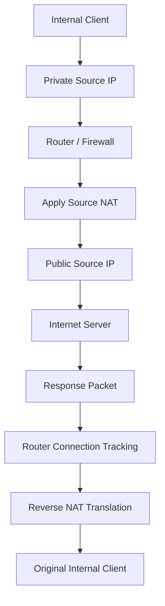

# Source NAT (SNAT)

Source Network Address Translation (SNAT) is a NAT technique that modifies the source IP address of packets as they pass through a router or firewall.

SNAT is commonly used when internal devices communicate with external networks, such as the internet.

For example, a computer inside a private network may use a private IP address that cannot be routed across the public internet. A router translates the packet's private source IP address into a public IP address before forwarding it.

Source NAT is fundamental to internet connectivity in home networks, enterprise networks, and Internet Service Provider (ISP) environments.

# 🗁 Overview

Source NAT changes the source address of an IP packet.

Consider a private network with the following configuration:

| Device | IP Address |
| --- | --- |
| Client | `192.168.10.10` |
| Router LAN Interface | `192.168.10.1` |
| Router WAN Interface | `198.51.100.10` |
| Internet Server | `203.0.113.10` |

The client sends a packet to an internet server.

Before translation:

```text
Source IP:      192.168.10.10
Destination IP: 203.0.113.10
```

After source NAT:

```text
Source IP:      198.51.100.10
Destination IP: 203.0.113.10
```

The destination remains unchanged, while the source IP address is translated.

`198.51.100.0/24` is reserved for documentation examples. A real network would use its assigned public address.

# 🗁 Why Source NAT Is Needed

Private IPv4 addresses are not globally routable on the public internet.

The private IPv4 ranges defined by RFC 1918 are:

| Private Network | Address Range |
| --- | --- |
| `10.0.0.0/8` | `10.0.0.0` – `10.255.255.255` |
| `172.16.0.0/12` | `172.16.0.0` – `172.31.255.255` |
| `192.168.0.0/16` | `192.168.0.0` – `192.168.255.255` |

Internet routers generally do not forward these private addresses across the public internet.

Source NAT allows internal devices to communicate with external networks by translating their private source addresses into addresses that can be routed in the external network.

Common purposes include:

* Providing internet access to private IPv4 networks.
* Sharing public IPv4 addresses among multiple internal devices.
* Translating internal addresses into public addresses.
* Connecting overlapping or privately addressed network environments in controlled designs.
* Supporting outbound connectivity in enterprise and ISP networks.

# 🗁 How Source NAT Works

Source NAT modifies the source IP address of packets before they leave the translating network boundary.

Consider this communication:

```text
Internal Client:
192.168.10.10

Gateway:
192.168.10.1

Public IP:
198.51.100.10

Internet Server:
203.0.113.10
```

The packet travels through the router.

```text
Client                  Router                  Internet Server
   |                       |                           |
   |                       |                           |
   |--- Source: 192.168.10.10 ------------------------>|
   |                       |                           |
   |                       | Translate source IP      |
   |                       |                           |
   |                       |--- Source: 198.51.100.10 ->|
   |                       |                           |
```

The router changes the source address and forwards the packet.

When the response returns, the router uses its connection-tracking and NAT information to restore the original internal destination.

# 🗁 Source NAT Packet Flow

A complete source NAT communication involves outbound translation and reverse translation.



Example packet transformation:

| Stage | Source IP | Destination IP |
| --- | --- | --- |
| Before NAT | `192.168.10.10` | `203.0.113.10` |
| After SNAT | `198.51.100.10` | `203.0.113.10` |
| Response before reverse NAT | `203.0.113.10` | `198.51.100.10` |
| Response after reverse NAT | `203.0.113.10` | `192.168.10.10` |

The router remembers the translation so that response packets can reach the correct internal device.

# 🗁 Source NAT and PAT

Source NAT and Port Address Translation (PAT) are closely related, but they are not identical.

**Source NAT**

Source NAT changes the source IP address.

Example:

```text
Before:
192.168.10.10 -> 203.0.113.10

After:
198.51.100.10 -> 203.0.113.10
```

**Port Address Translation**

PAT changes the source IP address and may also change the source transport port.

Example:

```text
Before:
192.168.10.10:51500 -> 203.0.113.10:443

After:
198.51.100.10:40001 -> 203.0.113.10:443
```

PAT allows multiple internal devices to share a public IPv4 address by using different translated source ports when necessary.

Example:

| Internal Device | Original Source | Translated Source |
| --- | --- | --- |
| Client A | `192.168.10.10:51500` | `198.51.100.10:40001` |
| Client B | `192.168.10.11:51500` | `198.51.100.10:40002` |
| Client C | `192.168.10.12:51500` | `198.51.100.10:40003` |

The external server sees connections originating from the shared public address but with distinguishable transport ports.

PAT is also commonly called NAPT (Network Address and Port Translation).

# 🗁 Types of Source NAT

Source NAT can be implemented in different ways depending on the address-assignment model.

Common approaches include:

* Static source NAT.
* Dynamic source NAT.
* Source NAT with port translation.
* Masquerading.

The distinction is based on how the translated source address is selected and whether the address is fixed or dynamically determined.

Masquerading is covered separately in `08-masquerade.md`.

# 🗁 Static Source NAT

Static source NAT uses a fixed mapping between an internal source address and an external translated address.

For example:

```text
Internal Address:
192.168.10.10

Translated Address:
198.51.100.20
```

The mapping remains fixed.

```text
192.168.10.10
       |
       | Static Source NAT
       v
198.51.100.20
```

This is useful when an internal server or device must consistently appear under a particular external address.

Example use cases:

* Enterprise systems requiring a dedicated public source IP.
* Servers that must use a specific outbound public address.
* Networks with multiple public IP addresses.
* Applications that depend on source-IP allowlists at external services.

A static source NAT mapping does not automatically make an internal device reachable from the internet. Inbound connectivity requires appropriate routing, firewall policies, and potentially destination NAT.

# 🗁 Dynamic Source NAT

Dynamic source NAT selects a translated source address from an available public IP address pool.

For example:

```text
Public IP Pool:
198.51.100.20 - 198.51.100.30
```

An internal client may receive one of the available addresses when establishing outbound communication.

```text
192.168.10.10
       |
       v
Dynamic NAT Pool
       |
       v
198.51.100.20
```

The selected address depends on the implementation and available pool resources.

Dynamic source NAT is useful when an organization has multiple public addresses but does not need a permanently assigned public address for every internal device.

If all available addresses are allocated, new translations may fail until an address becomes available.

# 🗁 Source NAT and Connection Tracking

Source NAT commonly relies on connection tracking to maintain translation information.

When the router translates a packet, it records the original and translated flow information.

Example:

```text
Original Connection:
192.168.10.10:51500 -> 203.0.113.10:443

Translated Connection:
198.51.100.10:40001 -> 203.0.113.10:443
```

When response traffic arrives:

```text
203.0.113.10:443 -> 198.51.100.10:40001
```

The router identifies the tracked connection and performs reverse translation:

```text
203.0.113.10:443 -> 192.168.10.10:51500
```

This ensures that the response reaches the original client.

Connection tracking also allows the firewall to recognize the return packets as belonging to an existing communication flow.

# 🗁 Source NAT on Linux

Linux provides source NAT through Netfilter.

Modern Linux systems commonly use `nftables` for firewall and NAT configuration.

Source NAT rules are generally evaluated in the `postrouting` hook, where the outgoing packet's source address can be translated.

The following examples assume:

```text
LAN Interface: ens33
WAN Interface: ens34

LAN Network:
192.168.10.0/24

WAN Public IP:
198.51.100.10
```

**Enable IPv4 forwarding**

```bash
sudo sysctl -w net.ipv4.ip_forward=1
```

Verify:

```bash
sysctl net.ipv4.ip_forward
```

For persistent configuration, create or edit:

```text
/etc/sysctl.d/99-ip-forwarding.conf
```

Add:

```text
net.ipv4.ip_forward = 1
```

Apply:

```bash
sudo sysctl --system
```

# 🗁 Source NAT with nftables

**Create a NAT table**

```bash
sudo nft add table ip nat
```

**Create a postrouting chain**

```bash
sudo nft add chain ip nat postrouting '{ type nat hook postrouting priority srcnat; policy accept; }'
```

**Configure static source NAT**

```bash
sudo nft add rule ip nat postrouting ip saddr 192.168.10.10 oifname "ens34" snat to 198.51.100.20
```

This translates traffic originating from `192.168.10.10` into `198.51.100.20` when it leaves through `ens34`.

**Configure dynamic source NAT using an address range**

```bash
sudo nft add rule ip nat postrouting ip saddr 192.168.10.0/24 oifname "ens34" snat to 198.51.100.20-198.51.100.30
```

This selects a translated address from the configured range.

**Configure source NAT with a single public address**

```bash
sudo nft add rule ip nat postrouting ip saddr 192.168.10.0/24 oifname "ens34" snat to 198.51.100.10
```

This translates matching source addresses to the specified public address. When multiple internal clients need simultaneous connections, the NAT implementation can use transport-port translation to distinguish flows where necessary.

**Inspect NAT rules**

```bash
sudo nft list table ip nat
```

**Important:** An SNAT rule alone does not configure a complete internet gateway. You also need IP forwarding, appropriate routing, and firewall filter rules that permit the intended forwarded traffic.

# 🗁 Source NAT with MikroTik RouterOS

MikroTik RouterOS provides source NAT through the firewall NAT table.

The `srcnat` chain is used for source address translation.

Assume this network:

```text
LAN Interface: bridge
WAN Interface: ether1

LAN Network:
192.168.10.0/24

Public IP:
198.51.100.10
```

**Inspect existing NAT rules**

```routeros
/ip firewall nat print
```

**Configure static source NAT**

```routeros
/ip firewall nat add chain=srcnat src-address=192.168.10.10 out-interface=ether1 action=src-nat to-addresses=198.51.100.20
```

This translates the source address of the specified internal device.

**Configure source NAT for an internal subnet**

```routeros
/ip firewall nat add chain=srcnat src-address=192.168.10.0/24 out-interface=ether1 action=src-nat to-addresses=198.51.100.10
```

This translates traffic from the internal subnet to the specified public address.

**Configure source NAT using a public address pool**

```routeros
/ip firewall nat add chain=srcnat src-address=192.168.10.0/24 out-interface=ether1 action=src-nat to-addresses=198.51.100.20-198.51.100.30
```

This allows RouterOS to select an address from the configured range.

**Inspect connection tracking**

```routeros
/ip firewall connection print
```

**Inspect NAT rule counters**

```routeros
/ip firewall nat print stats
```

**Important RouterOS considerations**

* `srcnat` is used for source address translation.
* `src-address` matches the original source address.
* `out-interface` restricts translation to traffic leaving through a specified interface.
* `action=src-nat` performs explicit source address translation.
* Existing connections may retain their previous NAT mapping until their connection-tracking entries expire or are removed.
* Rule order matters when multiple NAT rules could match the same traffic.

# 🗁 Source NAT with Cisco

Cisco IOS supports source NAT through NAT configuration commands.

The following example demonstrates static source NAT.

Assume:

```text
Internal Server:
192.168.10.10

Public Address:
198.51.100.20

Inside Interface:
GigabitEthernet0/0

Outside Interface:
GigabitEthernet0/1
```

Configure the interfaces:

```cisco
interface GigabitEthernet0/0
 ip nat inside

interface GigabitEthernet0/1
 ip nat outside
```

Configure static source NAT:

```cisco
ip nat inside source static 192.168.10.10 198.51.100.20
```

For dynamic source NAT, define an address pool and an access list.

```cisco
ip nat pool PUBLIC_POOL 198.51.100.20 198.51.100.30 netmask 255.255.255.0

access-list 10 permit 192.168.10.0 0.0.0.255

ip nat inside source list 10 pool PUBLIC_POOL
```

Verify translations:

```cisco
show ip nat translations
```

Verify NAT statistics:

```cisco
show ip nat statistics
```

Cisco syntax and supported NAT features can vary by platform and software release.

# 🗁 Source NAT in ISP Networks

Source NAT is especially important in ISP environments where many subscribers share a limited pool of public IPv4 addresses.

An ISP may provide private IPv4 addresses to customers and translate their traffic using NAT.

Example:

```text
Subscriber A:
100.64.1.10

Subscriber B:
100.64.1.11

Subscriber C:
100.64.1.12
       |
       v
ISP NAT Gateway
       |
       v
Public IPv4 Address
198.51.100.10
       |
       v
Internet
```

The `100.64.0.0/10` range is reserved for shared address space under RFC 6598. It is commonly used between subscribers and ISP-grade NAT systems.

It is not an RFC 1918 private address range.

**Carrier-Grade NAT**

Carrier-Grade NAT (CGNAT) allows an ISP to share public IPv4 addresses among multiple subscribers.

The ISP may translate subscriber addresses and transport ports into a shared public address space.

For example:

| Subscriber | Internal Source | Translated Source |
| --- | --- | --- |
| A | `100.64.1.10:51000` | `198.51.100.10:40001` |
| B | `100.64.1.11:51000` | `198.51.100.10:40002` |
| C | `100.64.1.12:51000` | `198.51.100.10:40003` |

The translated source ports distinguish simultaneous connections.

**ISP considerations**

* Public IPv4 address utilization.
* Port allocation and exhaustion.
* Subscriber identification.
* Connection and translation logging.
* Abuse investigation.
* CGNAT capacity planning.
* Subscriber privacy.
* Port-block allocation strategies.

CGNAT introduces operational complexity because many subscribers can appear to originate from the same public IPv4 address.

# 🗁 Source NAT vs Destination NAT

Source NAT and Destination NAT modify different parts of the IP packet.

| Feature | Source NAT | Destination NAT |
| --- | --- | --- |
| Full Name | Source Network Address Translation | Destination Network Address Translation |
| Modified Field | Source IP address | Destination IP address |
| Common Direction | Outbound traffic | Inbound traffic |
| Common Purpose | Allow internal devices to access external networks | Publish internal services |
| Typical NAT Chain | `srcnat` | `dstnat` |
| Common Linux Hook | POSTROUTING | PREROUTING |

**Source NAT example**

```text
Before:
192.168.10.10 -> 203.0.113.10

After:
198.51.100.10 -> 203.0.113.10
```

**Destination NAT example**

```text
Before:
203.0.113.50 -> 198.51.100.10

After:
203.0.113.50 -> 192.168.10.20
```

Source NAT changes where traffic appears to originate.

Destination NAT changes where traffic is delivered.

Destination NAT is covered in `07-destination-nat.md`.

# 🗁 Troubleshooting

Source NAT problems can prevent internal devices from accessing external networks.

A systematic approach helps identify configuration and connectivity issues.

**Inspect Linux NAT configuration**

```bash
sudo nft list ruleset
```

**Check IP forwarding**

```bash
sysctl net.ipv4.ip_forward
```

**Inspect routing**

```bash
ip route
```

**Inspect network interfaces**

```bash
ip addr show
```

**Inspect connection tracking**

```bash
sudo conntrack -L
```

**Capture packets on the LAN interface**

```bash
sudo tcpdump -ni ens33
```

**Capture packets on the WAN interface**

```bash
sudo tcpdump -ni ens34
```

Compare the source IP address on both interfaces.

For a successful source NAT operation, the outbound packet should show the translated source address on the WAN side.

**Inspect MikroTik NAT rules**

```routeros
/ip firewall nat print stats
```

**Inspect MikroTik connection entries**

```routeros
/ip firewall connection print detail
```

**Inspect Cisco NAT translations**

```cisco
show ip nat translations
```

**Common problems**

| Problem | Possible Cause |
| --- | --- |
| Internal clients cannot access the internet | Missing source NAT rule |
| NAT rule counter remains zero | Incorrect match conditions or wrong interface |
| Packets leave with private source addresses | Translation rule not matching |
| Return packets do not reach clients | Incorrect NAT mapping, routing, or firewall policy |
| Only some clients can access the internet | Incorrect source subnet or address pool |
| New connections fail | Public address or port resource exhaustion |
| NAT changes do not affect existing sessions | Existing connection-tracking entries retain previous mappings |

# 🗁 Best Practices

* Translate only the networks that require source NAT.
* Use explicit source and outgoing-interface matching conditions.
* Keep NAT rules organized and documented.
* Monitor NAT counters and connection-tracking entries.
* Use dedicated public addresses where applications require predictable outbound source addresses.
* Plan public address pools carefully.
* Monitor port utilization in PAT and CGNAT environments.
* Avoid unnecessary NAT between internal networks.
* Verify IPv4 forwarding and routing.
* Maintain firewall filtering independently from NAT configuration.
* Consider IPv6 connectivity where end-to-end addressing is appropriate.
* Test NAT behavior using packet captures on both sides of the router.

# 🗁 Common Mistakes

| Mistake | Explanation |
| --- | --- |
| Confusing SNAT with DNAT | They modify different packet-header fields |
| Assuming NAT automatically allows traffic | Firewall filtering and routing are separate concerns |
| Forgetting IP forwarding | The Linux router may not forward traffic |
| Using the wrong outgoing interface | The NAT rule may not match packets |
| Applying NAT to the wrong subnet | Some clients may not receive translation |
| Ignoring connection tracking | Existing translations may remain active |
| Using an incorrect public address pool | Translation or return routing may fail |
| Assuming every SNAT rule performs PAT | Address translation and port translation are related but distinct operations |
| Overusing NAT internally | It can complicate troubleshooting and end-to-end connectivity |

# 🗁 Summary

Source NAT modifies the source IP address of packets as they pass through a router or firewall.

Key concepts:

* SNAT changes the source IP address.
* It is commonly used for outbound internet connectivity.
* Static SNAT uses a fixed address mapping.
* Dynamic SNAT selects translated addresses from an address pool.
* PAT additionally translates transport-layer ports when needed.
* Connection tracking maintains translation information and supports reverse translation.
* Linux nftables implements source NAT through the `postrouting` hook.
* MikroTik RouterOS uses the `srcnat` chain.
* Cisco IOS supports static and dynamic source NAT.
* ISP networks use source NAT and CGNAT to conserve public IPv4 addresses.

Source NAT is an essential technology for IPv4 address translation and shared internet connectivity.

# 🗁 References

* [RFC 3022 — Traditional IP Network Address Translator](https://www.rfc-editor.org/rfc/rfc3022)
* [RFC 1918 — Address Allocation for Private Internets](https://www.rfc-editor.org/rfc/rfc1918)
* [RFC 6598 — IANA-Reserved IPv4 Prefix for Shared Address Space](https://www.rfc-editor.org/rfc/rfc6598)
* [RFC 4787 — NAT Behavioral Requirements for Unicast UDP](https://www.rfc-editor.org/rfc/rfc4787)
* [Netfilter Project](https://www.netfilter.org/)
* [nftables Documentation](https://wiki.nftables.org/)
* [MikroTik RouterOS Documentation](https://help.mikrotik.com/docs/)
* [Cisco NAT Configuration Documentation](https://www.cisco.com/)
