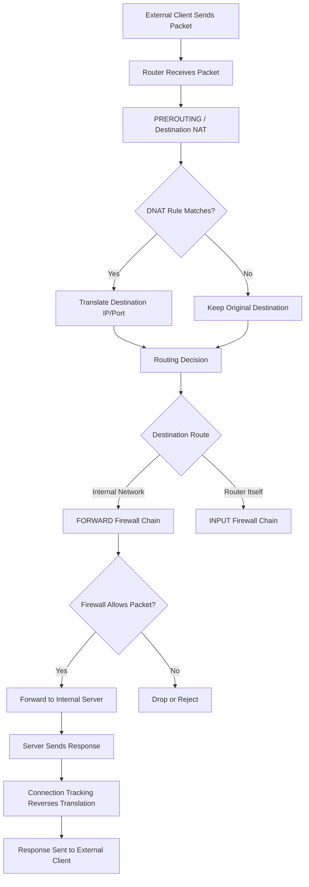

# Destination NAT (DNAT)

Destination Network Address Translation (DNAT) is a NAT technique that modifies the destination IP address of packets as they pass through a router or firewall.

DNAT is commonly used to make services running on private networks accessible through a public IP address. It allows external clients to connect to an address and port on a router, which then forwards the traffic to an internal server.

For example, an organization may have a web server with the private IP address `192.168.10.20`. The router receives connections on its public IP address and translates their destination to the internal server.

```text
External Client
      |
      | TCP connection to 198.51.100.10:443
      |
      v
+--------------------------+
|       Router/Firewall    |
|                          |
|  Public IP:              |
|  198.51.100.10           |
|                          |
|  DNAT Rule:              |
|  198.51.100.10:443       |
|          |               |
|          v               |
|  192.168.10.20:443       |
+--------------------------+
      |
      | Translated packet
      |
      v
+--------------------------+
|     Internal Web Server  |
|                          |
|  IP: 192.168.10.20       |
|  Port: 443               |
+--------------------------+
```

DNAT is primarily associated with inbound traffic, although it can also be used for traffic redirection inside a network.

# 🗁 What Is DNAT?

Destination Network Address Translation changes the destination address of an IP packet.

Depending on the NAT rule, DNAT can modify:

* Destination IPv4 address.
* Destination TCP or UDP port.
* Both destination IP address and transport-layer port.

Consider an incoming packet:

```text
Before DNAT:

Source IP:      203.0.113.50
Source Port:    52000
Destination IP: 198.51.100.10
Destination Port: 443
```

A DNAT rule translates the destination:

```text
After DNAT:

Source IP:      203.0.113.50
Source Port:    52000
Destination IP: 192.168.10.20
Destination Port: 443
```

The source address remains unchanged in this example.

The internal server receives the packet with its own private IP address as the destination.

### 🖆 DNAT vs SNAT

DNAT and SNAT modify different parts of an IP packet.

| Feature | DNAT | SNAT |
| --- | --- | --- |
| Full name | Destination NAT | Source NAT |
| Modified field | Destination IP | Source IP |
| Common direction | Incoming traffic | Outgoing traffic |
| Typical purpose | Publish internal services | Provide outbound connectivity |
| Common use case | Port forwarding | Internet access |
| Linux nftables chain | PREROUTING | POSTROUTING |

Both techniques can operate together when a network requires more complex NAT behavior.

# 🗁 How DNAT Works

DNAT is normally applied before the router makes its forwarding decision.

The router receives an IP packet, checks the destination NAT rules, translates the destination address when a matching rule exists, and then performs routing using the translated destination.

### 🖆 Packet Processing Flow



### 🖆 Linux Netfilter Processing

In Linux, destination NAT is commonly performed in the `PREROUTING` chain.

The general packet-processing path is:

```text
Incoming Packet
      |
      v
PREROUTING
      |
      v
Destination NAT
      |
      v
Routing Decision
      |
      v
FORWARD
      |
      v
POSTROUTING
      |
      v
Outgoing Interface
```

For traffic addressed to the Linux machine itself, the routing decision sends the packet through `INPUT` rather than `FORWARD`.

DNAT does not automatically permit the translated traffic. Firewall filtering must separately authorize packets that are being forwarded.

### 🖆 Why DNAT Happens Before Routing

Imagine a router receives a packet addressed to:

```text
198.51.100.10:443
```

The router owns this public IP address.

Without DNAT, the destination is the router itself.

With DNAT:

```text
198.51.100.10:443
        |
        v
192.168.10.20:443
```

The router performs the routing decision using the translated destination and forwards the packet toward the internal server.

# 🗁 Common DNAT Use Cases

### 🖆 Publishing Internal Web Servers

An organization can host a web server inside a private network and make it accessible through a public IP address.

```text
Public Address:
198.51.100.10:443

Internal Server:
192.168.10.20:443
```

External clients connect to the public address, and the router translates the destination to the private server.

### 🖆 Publishing Multiple Services

A single public IP can expose multiple internal services through different destination ports.

| Public Address | Internal Destination | Service |
| --- | --- | --- |
| 198.51.100.10:80 | 192.168.10.20:80 | HTTP |
| 198.51.100.10:443 | 192.168.10.20:443 | HTTPS |
| 198.51.100.10:2222 | 192.168.10.30:22 | SSH |

The router uses destination IP, protocol, port, and optionally other matching criteria to select the correct translation.

### 🖆 Port Redirection

DNAT can translate an external port to a different internal port.

For example:

```text
External:
198.51.100.10:8443

Internal:
192.168.10.20:443
```

The external client connects to TCP port `8443`, while the internal server receives the connection on TCP port `443`.

### 🖆 Transparent Traffic Redirection

DNAT can redirect traffic to another destination without requiring the client to change its configured destination.

Examples include:

* Redirecting HTTP traffic to an internal proxy.
* Redirecting selected DNS requests to an approved resolver.
* Redirecting traffic between internal services.
* Enforcing network-level service redirection.

The actual implementation depends on the network architecture and firewall policy.

### 🖆 Service Publishing and Load Balancing

DNAT can be used as part of a service-publishing or load-balancing design.

A router or load balancer can translate incoming traffic to an internal service address.

However, simple DNAT rules generally select a configured destination. Advanced load balancing may require connection distribution, health checks, persistence, or a dedicated load balancer.

# 🗁 Types of DNAT

### 🖆 Static Destination NAT

Static DNAT consistently translates a particular destination address to a specific internal address.

Example:

```text
Public IP:   198.51.100.10
Private IP:  192.168.10.20
```

Conceptual mapping:

```text
198.51.100.10
       |
       v
192.168.10.20
```

The mapping remains configured until the administrator changes or removes it.

Static destination mapping is useful when a service must be consistently reachable through a particular public address.

### 🖆 Port-Specific DNAT

Port-specific DNAT matches a transport protocol and destination port.

Example:

```text
Public IP:   198.51.100.10
Public Port: TCP 8443

Private IP:  192.168.10.20
Private Port: TCP 443
```

Only matching TCP traffic is translated.

Other protocols and ports are unaffected unless additional rules match them.

### 🖆 DNAT with Additional Conditions

DNAT rules can match more than the destination address and port.

Possible matching conditions include:

* Incoming interface.
* Destination address.
* TCP or UDP protocol.
* Destination port.
* Source IP address or subnet.
* Connection state.
* Address lists.

For example, an administrator may allow destination translation only for traffic arriving through the WAN interface and originating from an approved remote subnet.

# 🗁 DNAT and Connection Tracking

Connection tracking is essential to normal stateful NAT operation.

When the first packet of a connection matches a DNAT rule, the NAT system records the translation in connection-tracking state.

Subsequent packets belonging to that connection use the established translation.

The return traffic is translated in the opposite direction so that the external client sees the expected public destination address.

### 🖆 Example Connection

An external client connects to:

```text
203.0.113.50:52000
        |
        v
198.51.100.10:443
```

The router translates the destination:

```text
203.0.113.50:52000
        |
        v
192.168.10.20:443
```

The server replies:

```text
192.168.10.20:443
        |
        v
203.0.113.50:52000
```

The router performs the reverse translation:

```text
198.51.100.10:443
        |
        v
203.0.113.50:52000
```

The external client sees the response as coming from the public address to which it originally connected.

### 🖆 Important Connection-Tracking Behavior

For typical stateful NAT implementations:

* NAT rules are evaluated for the first packet of a connection.
* The resulting translation is stored in connection-tracking state.
* Subsequent packets use the established translation.
* Reply packets receive the corresponding reverse translation.
* Changing a NAT rule generally does not alter existing tracked connections immediately.

This explains why an administrator may need to wait for existing connections to expire or selectively remove their connection-tracking entries after changing a NAT configuration.

# 🗁 DNAT vs Port Forwarding

DNAT and port forwarding are closely related, but they are not identical terms.

**DNAT** is the general technique of modifying a packet's destination address or port.

**Port forwarding** is a common application of DNAT in which traffic arriving at a particular public IP address and port is forwarded to an internal host and port.

Example:

```text
Public TCP 8443
       |
       v
192.168.10.20:443
```

Port forwarding is therefore one practical use case of destination NAT.

A dedicated discussion of port forwarding, including multiple services, hairpin NAT, and practical deployment scenarios, is covered in:

`09-port-forwarding.md`

# 🗁 DNAT with Linux nftables

Linux nftables provides a modern framework for configuring packet filtering and NAT.

Destination NAT is commonly configured in a NAT table with a `prerouting` chain.

### 🖆 Enable IPv4 Forwarding

A Linux router must have IPv4 forwarding enabled to route packets between interfaces.

Check the current value:

```bash
sysctl net.ipv4.ip_forward
```

Enable forwarding temporarily:

```bash
sudo sysctl -w net.ipv4.ip_forward=1
```

To make it persistent, create a configuration file:

```bash
sudo nano /etc/sysctl.d/99-ip-forwarding.conf
```

Add:

```ini
net.ipv4.ip_forward = 1
```

Apply the configuration:

```bash
sudo sysctl --system
```

### 🖆 Create a NAT Table

Create an IPv4 NAT table:

```bash
sudo nft add table ip nat
```

Create the `prerouting` NAT chain:

```bash
sudo nft 'add chain ip nat prerouting {
    type nat hook prerouting priority dstnat;
    policy accept;
}'
```

This chain processes incoming packets before the routing decision.

### 🖆 Configure Basic DNAT

Assume the following network:

| Component | Address |
| --- | --- |
| Public IP | 198.51.100.10 |
| Internal server | 192.168.10.20 |
| Public port | TCP 443 |
| Internal port | TCP 443 |

Add the DNAT rule:

```bash
sudo nft add rule ip nat prerouting \
    ip daddr 198.51.100.10 \
    tcp dport 443 \
    dnat to 192.168.10.20:443
```

The rule translates incoming TCP connections addressed to the public IP and port 443 into connections addressed to the internal server.

### 🖆 Configure Port Remapping

Assume external clients connect to TCP port `8443`, but the internal server listens on TCP port `443`.

```bash
sudo nft add rule ip nat prerouting \
    ip daddr 198.51.100.10 \
    tcp dport 8443 \
    dnat to 192.168.10.20:443
```

The translation is:

```text
198.51.100.10:8443
        |
        v
192.168.10.20:443
```

### 🖆 Restrict DNAT by Source Network

Suppose only clients from `203.0.113.0/24` should be translated to the internal server.

```bash
sudo nft add rule ip nat prerouting \
    ip saddr 203.0.113.0/24 \
    ip daddr 198.51.100.10 \
    tcp dport 443 \
    dnat to 192.168.10.20:443
```

This limits the translation rule to the specified source subnet.

Remember that the forwarding firewall policy must also permit the intended traffic.

### 🖆 Restrict DNAT by Incoming Interface

Suppose the WAN interface is named `eth0`.

```bash
sudo nft add rule ip nat prerouting \
    iifname "eth0" \
    ip daddr 198.51.100.10 \
    tcp dport 443 \
    dnat to 192.168.10.20:443
```

The incoming-interface condition helps prevent the rule from matching traffic arriving through unrelated interfaces.

### 🖆 Allow Forwarded Traffic

DNAT only changes the packet destination. It does not automatically authorize the packet through the firewall.

Create a filter table and forward chain if they do not already exist:

```bash
sudo nft add table inet filter

sudo nft 'add chain inet filter forward {
    type filter hook forward priority filter;
    policy drop;
}'
```

Allow established and related traffic:

```bash
sudo nft add rule inet filter forward \
    ct state established,related \
    accept
```

Allow new connections that have been destination-translated:

```bash
sudo nft add rule inet filter forward \
    iifname "eth0" \
    oifname "eth1" \
    ip daddr 192.168.10.20 \
    tcp dport 443 \
    ct state new \
    ct status dnat \
    accept
```

This example assumes:

* `eth0` is the WAN interface.
* `eth1` is the internal interface.
* The server address is `192.168.10.20`.
* The server listens on TCP port `443`.

Adapt interface names and firewall rules to the actual network.

### 🖆 Important: Return Traffic and SNAT

For the connection to work correctly, the internal server must return traffic through the router that performed DNAT.

Usually, this is achieved by configuring the router as the server's default gateway or by installing an appropriate route on the server's network.

If the server replies through another gateway, the return traffic may bypass the NAT router and the connection can fail.

SNAT may sometimes be used to force return traffic through the NAT device, but this changes the source address visible to the server. Use it only when the routing design requires it.

### 🖆 Verify nftables Configuration

Display the complete ruleset:

```bash
sudo nft list ruleset
```

Display the NAT table:

```bash
sudo nft list table ip nat
```

Inspect connection tracking:

```bash
sudo conntrack -L
```

Monitor traffic on the WAN interface:

```bash
sudo tcpdump -ni eth0 'tcp port 443'
```

Monitor traffic on the LAN interface:

```bash
sudo tcpdump -ni eth1 'host 192.168.10.20 and tcp port 443'
```

These commands help determine whether traffic reaches the router, is translated, and is forwarded toward the internal server.

# 🗁 DNAT with MikroTik RouterOS

MikroTik RouterOS provides destination NAT through the `dstnat` chain in the IP firewall NAT facility.

The following examples use RouterOS v7 syntax.

### 🖆 Example Network

```text
Internet
   |
   |
Public IP: 198.51.100.10
   |
+----------------------+
| MikroTik Router      |
|                      |
| WAN: ether1          |
| LAN: bridge          |
+----------------------+
   |
   |
192.168.10.0/24
   |
   |
Web Server:
192.168.10.20
```

### 🖆 Publish an Internal HTTPS Server

Forward incoming TCP port `443` to the internal web server:

```routeros
/ip firewall nat add \
    chain=dstnat \
    in-interface-list=WAN \
    protocol=tcp \
    dst-port=443 \
    action=dst-nat \
    to-addresses=192.168.10.20 \
    to-ports=443 \
    comment="DNAT HTTPS to internal web server"
```

This rule:

* Matches traffic arriving through the WAN interface list.
* Matches TCP connections addressed to port 443.
* Changes the destination address to `192.168.10.20`.
* Preserves the destination port as `443`.

The `WAN` interface list must exist and contain the appropriate WAN interface.

### 🖆 Forward an External Port to a Different Internal Port

Suppose external clients use TCP port `8443`, while the internal server listens on TCP port `443`.

```routeros
/ip firewall nat add \
    chain=dstnat \
    in-interface-list=WAN \
    protocol=tcp \
    dst-port=8443 \
    action=dst-nat \
    to-addresses=192.168.10.20 \
    to-ports=443 \
    comment="Forward TCP 8443 to internal HTTPS"
```

The resulting translation is:

```text
Public TCP 8443
       |
       v
192.168.10.20:443
```

### 🖆 Restrict DNAT by Source Address

Suppose only clients from `203.0.113.0/24` should access the published server.

```routeros
/ip firewall nat add \
    chain=dstnat \
    in-interface-list=WAN \
    src-address=203.0.113.0/24 \
    protocol=tcp \
    dst-port=443 \
    action=dst-nat \
    to-addresses=192.168.10.20 \
    to-ports=443
```

Only matching source addresses are translated by this rule.

### 🖆 Allow DNAT Traffic Through the Firewall

A destination NAT rule does not automatically permit forwarding through the RouterOS firewall filter.

A typical forward-chain policy includes an established and related rule:

```routeros
/ip firewall filter add \
    chain=forward \
    connection-state=established,related \
    action=accept \
    comment="Allow established and related connections"
```

Then allow new destination-NAT connections:

```routeros
/ip firewall filter add \
    chain=forward \
    in-interface-list=WAN \
    connection-state=new \
    connection-nat-state=dstnat \
    protocol=tcp \
    dst-address=192.168.10.20 \
    dst-port=443 \
    action=accept \
    comment="Allow DNAT HTTPS to internal server"
```

Place the rules appropriately in the forward chain, before any rule that drops the matching traffic.

Do not blindly duplicate existing firewall rules. Review the current policy and adapt the rules to the network's interface lists, address lists, and security requirements.

### 🖆 Inspect NAT Rules

Display configured NAT rules:

```routeros
/ip firewall nat print
```

Display NAT rules with counters:

```routeros
/ip firewall nat print stats
```

Display active connection tracking entries:

```routeros
/ip firewall connection print
```

Inspect traffic:

```routeros
/tool torch interface=ether1
```

RouterOS also provides packet-sniffer functionality for more detailed packet analysis.

# 🗁 DNAT with Cisco IOS

Cisco IOS supports destination translation through static NAT and static PAT configurations.

The exact syntax and capabilities depend on the platform and software release.

### 🖆 Static Destination NAT

Assume:

```text
Public IP:  198.51.100.10
Private IP: 192.168.10.20
```

A conceptual static NAT configuration is:

```cisco
interface GigabitEthernet0/0
 ip nat outside

interface GigabitEthernet0/1
 ip nat inside

ip nat inside source static 192.168.10.20 198.51.100.10
```

This example uses Cisco's inside/outside NAT terminology. It creates a persistent address mapping and is not equivalent to a port-specific forwarding rule.

### 🖆 Static PAT

To map a public TCP port to a different internal TCP port:

```cisco
ip nat inside source static tcp 192.168.10.20 443 198.51.100.10 8443
```

This maps:

```text
198.51.100.10:8443
        |
        v
192.168.10.20:443
```

The inside and outside interfaces must be configured correctly, and routing and security policies must allow the traffic.

### 🖆 Verify Cisco NAT

```cisco
show ip nat translations
show ip nat statistics
show running-config | include ip nat
```

These commands help inspect active translations, NAT statistics, and configured NAT statements.

# 🗁 Requirements for Successful DNAT

A correct DNAT rule is only one part of a working service-publishing configuration.

Several network conditions must be satisfied.

### 🖆 Reachable Public IP Address

The router must receive traffic addressed to the public IP.

The address may be:

* Configured directly on the WAN interface.
* Routed to the router by an upstream provider.
* Delivered through a suitable upstream NAT arrangement.

An address behind carrier-grade NAT may not accept unsolicited inbound connections through the provider's network.

### 🖆 Correct Upstream Routing

The upstream network must know how to deliver traffic to the public IP address.

If the public address is routed to the router, the router must correctly receive and process that traffic.

### 🖆 IP Forwarding

The router must be capable of forwarding packets between the WAN and internal interfaces.

Linux requires appropriate IP forwarding configuration. RouterOS and Cisco routing behavior depends on their configured interfaces and routing.

### 🖆 Firewall Permission

The forwarding firewall must permit the translated traffic.

A matching DNAT rule does not automatically bypass filter rules.

### 🖆 Correct Internal Routing

The internal server must have a valid return route.

In many small networks, the router performing DNAT is also the server's default gateway.

If another gateway is used, return routing must be designed accordingly.

### 🖆 Service Availability

The internal server must:

* Have the expected IP address.
* Be reachable through the internal network.
* Have the required service running.
* Listen on the translated destination port.
* Permit the connection through its host firewall.

### 🖆 Complete Network Path

A successful DNAT connection requires all of these elements to work together:

```text
External Client
      |
      v
Public Internet
      |
      v
Upstream Routing
      |
      v
NAT Router
      |
      v
DNAT Translation
      |
      v
Firewall Forward Permission
      |
      v
Internal Routing
      |
      v
Server Firewall
      |
      v
Listening Application
```

# 🗁 Hairpin NAT

Hairpin NAT, also called NAT loopback, allows an internal client to access an internal server using the same public address that external clients use.

Consider:

```text
Public IP:
198.51.100.10

Internal Web Server:
192.168.10.20
```

An internal client attempts to access:

```text
https://198.51.100.10
```

The router must handle the traffic so that the internal client can reach the internal server through the public address.

Depending on the network's routing and NAT configuration, this may require both DNAT and SNAT.

Hairpin NAT is particularly useful when internal and external users need to access a service through the same public hostname.

A dedicated implementation belongs in the port-forwarding and practical NAT lab documentation.

# 🗁 DNAT and IPv6

Traditional DNAT is commonly associated with IPv4 because private IPv4 networks frequently use NAT to publish internal services.

IPv6 generally uses globally routable addresses for devices, so publishing an internal service usually requires appropriate routing and firewall permissions rather than address translation.

For example:

```text
IPv6 Client
     |
     v
IPv6 Internet
     |
     v
IPv6 Firewall
     |
     v
Global IPv6 Address
     |
     v
Internal Server
```

The firewall controls which incoming connections are permitted.

NAT66 is possible, but it is not the default design for ordinary IPv6 networks.

For IPv6 service publishing, prioritize:

* Correct IPv6 routing.
* Global unicast address assignment.
* Firewall policies.
* ICMPv6 functionality.
* Correct DNS AAAA records.
* Return-path routing.

# 🗁 Troubleshooting DNAT

When a DNAT configuration fails, troubleshoot the complete packet path rather than assuming the NAT rule is the only problem.

### 🖆 Verify the Public Address

Check whether the router has the expected public IP or receives traffic routed to it.

A private WAN address or provider-side CGNAT can prevent direct inbound access.

### 🖆 Verify the NAT Rule

Linux:

```bash
sudo nft list ruleset
```

MikroTik:

```routeros
/ip firewall nat print stats
```

Cisco:

```cisco
show ip nat translations
show ip nat statistics
```

Confirm that the rule matches the correct protocol, destination address, destination port, and incoming interface.

### 🖆 Verify IP Forwarding

On Linux:

```bash
sysctl net.ipv4.ip_forward
```

The expected value for an IPv4 router is:

```text
net.ipv4.ip_forward = 1
```

### 🖆 Verify Firewall Rules

Check whether the forwarding firewall permits the translated traffic.

Linux:

```bash
sudo nft list ruleset
```

MikroTik:

```routeros
/ip firewall filter print stats
```

Cisco:

```cisco
show access-lists
```

### 🖆 Verify the Internal Server

Check connectivity to the server:

```bash
ping -c 4 192.168.10.20
```

Check whether the expected TCP service is listening on the server:

```bash
sudo ss -lntp
```

Test the service from the router or another internal host:

```bash
nc -vz 192.168.10.20 443
```

A successful TCP connection confirms that the destination service is reachable from the testing host, but it does not prove that the external DNAT path is correct.

### 🖆 Capture Traffic on Both Interfaces

Capture incoming traffic on the WAN interface:

```bash
sudo tcpdump -ni eth0 'tcp port 443'
```

Capture translated traffic on the LAN interface:

```bash
sudo tcpdump -ni eth1 'host 192.168.10.20 and tcp port 443'
```

Interpret the results:

| Observation | Possible Cause |
| --- | --- |
| No traffic on WAN | Upstream routing, public IP, or provider filtering |
| Traffic on WAN but no translated traffic on LAN | DNAT rule mismatch or routing problem |
| Traffic reaches LAN but server does not respond | Server firewall, service, or host configuration |
| Server responds but client receives no reply | Return route, firewall, or connection-tracking problem |
| Connection works internally but not externally | WAN policy, upstream NAT, or public reachability |

### 🖆 Check Connection Tracking

On Linux:

```bash
sudo conntrack -L
```

On MikroTik:

```routeros
/ip firewall connection print
```

Connection tracking can reveal whether the router has created an entry for the expected connection and whether the translation is being applied.

### 🖆 Check the Server's Return Route

The server's replies should normally return through the router performing DNAT.

If replies use another gateway, asymmetric routing may prevent the connection from completing.

# 🗁 Best Practices

* Publish only services that must be reachable externally.
* Use explicit destination IP, protocol, and port matching.
* Restrict access by source address when possible.
* Keep the forwarding firewall policy separate from NAT configuration.
* Use established and related connection-state rules where appropriate.
* Ensure the internal server has a correct return route.
* Use a stable internal IP address or DHCP reservation for published servers.
* Avoid exposing administrative interfaces directly to the internet.
* Prefer VPN access for private management services.
* Use TLS for services that require encrypted communication.
* Monitor NAT and firewall counters.
* Keep router and server software updated.
* Document every published service, its public endpoint, internal destination, and owner.
* Test access from an external network rather than relying only on internal tests.

# 🗁 Common Mistakes

| Mistake | Explanation |
| --- | --- |
| Assuming DNAT allows traffic automatically | Firewall forwarding rules must separately permit the connection |
| Using the wrong destination port | The server may listen on a different port |
| Missing IP forwarding | The router cannot forward packets between interfaces |
| Incorrect incoming interface | The DNAT rule never matches the packet |
| Server uses another default gateway | Return traffic may bypass the NAT router |
| Public IP is behind CGNAT | Unsolicited inbound traffic may not reach the router |
| Server firewall blocks the connection | DNAT does not change the server's local firewall policy |
| Testing only from the LAN | Internal testing may not verify the actual WAN path |
| Expecting NAT changes to affect existing connections | Existing connection-tracking entries can retain their original translation |
| Exposing unnecessary services | Every published service increases the attack surface |

# 🗁 Summary

Destination NAT changes the destination IP address and optionally the destination transport port of packets.

It is commonly used to publish internal services, redirect traffic, and implement port forwarding.

Important concepts:

* DNAT modifies packet destination information.
* Linux commonly performs DNAT in the Netfilter `PREROUTING` hook.
* MikroTik RouterOS uses the `dstnat` chain.
* Cisco IOS supports destination translation through static NAT and PAT configurations.
* Connection tracking maintains translations and handles reverse translation.
* DNAT does not automatically permit traffic through the firewall.
* Correct routing, forwarding, server availability, and return-path routing are essential.
* IPv6 service publishing generally relies on routing and firewall policies rather than traditional NAT.

DNAT is a fundamental technique for controlling how external traffic reaches services hosted inside private networks.

# 🗁 References

* [The nftables Project](https://www.netfilter.org/projects/nftables/)
* [Netfilter Project](https://www.netfilter.org/)
* [MikroTik RouterOS NAT Documentation](https://help.mikrotik.com/docs/)
* [Cisco IP Addressing and Services Configuration Guide](https://www.cisco.com/c/en/us/support/ios-nx-os-software/ios-15-0m-t/products-installation-and-configuration-guides-list.html)
* [RFC 3022 - Traditional IP Network Address Translator](https://www.rfc-editor.org/rfc/rfc3022)
* [RFC 4787 - Network Address Translation Behavioral Requirements for Unicast UDP](https://www.rfc-editor.org/rfc/rfc4787)
* [NIST SP 800-41 Rev. 1 - Guidelines on Firewalls and Firewall Policy](https://csrc.nist.gov/pubs/sp/800/41/r1/final)
