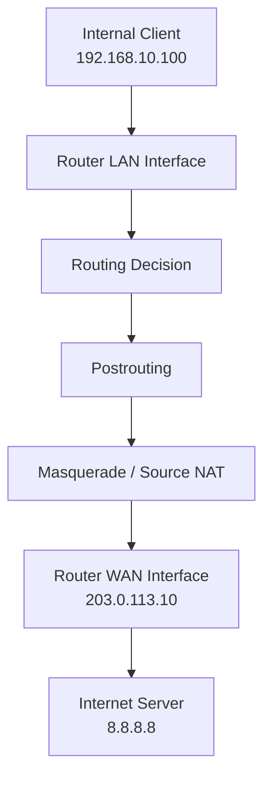

# Masquerade

Masquerade is a form of Source Network Address Translation (SNAT) that automatically replaces the source IP address of outgoing packets with the IP address assigned to the outgoing network interface.

It is commonly used when a network connects to the internet through a dynamically assigned public IP address.

Masquerade is particularly useful for home networks, small offices, and ISP environments where the external interface address may change.

# 🗁 Overview

Masquerade is a specialized form of Source NAT.

When an internal device sends traffic to an external network, its private source IP address is replaced with the IP address of the router's outgoing interface.

For example:

| Component | IP address |
| --- | --- |
| Internal client | `192.168.10.100` |
| Router LAN interface | `192.168.10.1` |
| Router WAN interface | `203.0.113.10` |
| Internet destination | `8.8.8.8` |

The router translates the outgoing packet:

```text
Before NAT:
Source IP:      192.168.10.100
Destination IP: 8.8.8.8

After Masquerade:
Source IP:      203.0.113.10
Destination IP: 8.8.8.8
```

The destination server sees the router's WAN address instead of the client's private address.

# 🗁 How Masquerade Works

Masquerade operates through the Source NAT processing stage.

When a packet leaves the internal network:

* The router receives the packet from the LAN.
* The router performs its routing decision.
* The packet reaches the postrouting stage.
* The masquerade rule identifies the outgoing interface.
* The source address is replaced with the interface's current IP address.
* Connection tracking records the translation.
* The translated packet leaves through the WAN interface.

When the response returns, connection tracking applies the corresponding reverse translation and forwards the response to the original internal client.

# 🗁 Masquerade and Source NAT

Source NAT changes the source address of outgoing packets.

Masquerade performs Source NAT using the IP address assigned to the outgoing interface.

| Feature | Source NAT | Masquerade |
| --- | --- | --- |
| Translation | Changes source IP | Changes source IP |
| Address selection | Explicitly configured | Automatically uses outgoing interface address |
| Dynamic WAN address | Requires additional management | Automatically adapts to interface address changes |
| Static WAN address | Suitable | Also works |
| Typical use | Servers and stable public IPs | Dynamic WAN connections |

Masquerade is therefore a convenient SNAT method when the external IP address is not guaranteed to remain the same.

# 🗁 Packet Flow

A typical internet connection using masquerade follows this path:



The outgoing source address is translated from `192.168.10.100` to `203.0.113.10`.

The response follows the reverse translation using connection tracking.

# 🗁 Masquerade in Linux

Linux implements NAT through Netfilter.

Masquerade is a Source NAT operation performed in the postrouting hook.

The relevant processing path is:

```text
LAN Interface
     |
     v
Routing Decision
     |
     v
POSTROUTING Hook
     |
     v
Masquerade Rule
     |
     v
WAN Interface
```

Before configuring masquerade, IP forwarding must be enabled.

Check the current setting:

```bash
sysctl net.ipv4.ip_forward
```

Enable IPv4 forwarding temporarily:

```bash
sudo sysctl -w net.ipv4.ip_forward=1
```

Enable it persistently:

```bash
echo "net.ipv4.ip_forward=1" | sudo tee /etc/sysctl.d/99-ip-forward.conf
```

Apply the configuration:

```bash
sudo sysctl --system
```

# 🗁 Masquerade with nftables

`nftables` is the modern Linux packet-filtering and NAT framework.

Create an IPv4 NAT table:

```bash
sudo nft add table ip nat
```

Create a postrouting NAT chain:

```bash
sudo nft add chain ip nat postrouting '{ type nat hook postrouting priority srcnat; policy accept; }'
```

Add a masquerade rule for the WAN interface:

```bash
sudo nft add rule ip nat postrouting oifname "eth0" masquerade
```

In this example:

* `ip nat` identifies the NAT table.
* `postrouting` identifies the chain.
* `hook postrouting` attaches the chain to the postrouting hook.
* `priority srcnat` places the chain at the source NAT priority.
* `oifname "eth0"` matches packets leaving through `eth0`.
* `masquerade` performs source address translation.

To inspect the configuration:

```bash
sudo nft list ruleset
```

To inspect the NAT table:

```bash
sudo nft list table ip nat
```

To save the configuration, use the distribution's nftables configuration file, commonly:

```text
/etc/nftables.conf
```

Example persistent configuration:

```nft
table ip nat {
    chain postrouting {
        type nat hook postrouting priority srcnat; policy accept;

        oifname "eth0" masquerade
    }
}
```

Load the configuration:

```bash
sudo nft -f /etc/nftables.conf
```

Validate a configuration file before applying it:

```bash
sudo nft -c -f /etc/nftables.conf
```

Replace `eth0` with the actual WAN interface name.

# 🗁 Masquerade with iptables

`iptables` is the traditional Linux firewall administration interface.

A basic masquerade rule is:

```bash
sudo iptables -t nat -A POSTROUTING -o eth0 -j MASQUERADE
```

Explanation:

| Option | Description |
| --- | --- |
| `-t nat` | Selects the NAT table |
| `-A POSTROUTING` | Appends a rule to the POSTROUTING chain |
| `-o eth0` | Matches packets leaving through `eth0` |
| `-j MASQUERADE` | Performs masquerading |

Inspect NAT rules:

```bash
sudo iptables -t nat -L -n -v
```

Remove the rule:

```bash
sudo iptables -t nat -D POSTROUTING -o eth0 -j MASQUERADE
```

On modern Ubuntu systems, the `iptables` command may use the nftables compatibility backend. Prefer managing new configurations with `nftables` unless an existing system requires iptables.

# 🗁 Masquerade in MikroTik RouterOS

MikroTik RouterOS provides masquerading through its IP Firewall NAT facility.

A typical rule for a router with a dynamic WAN address is:

```routeros
/ip firewall nat add \
    chain=srcnat \
    out-interface=ether1 \
    action=masquerade \
    comment="Masquerade LAN traffic to WAN"
```

Explanation:

| Parameter | Description |
| --- | --- |
| `chain=srcnat` | Selects the source NAT chain |
| `out-interface=ether1` | Matches traffic leaving through the WAN interface |
| `action=masquerade` | Replaces the source address with the outgoing interface address |
| `comment` | Describes the purpose of the rule |

If the WAN interface belongs to an interface list, use:

```routeros
/ip firewall nat add \
    chain=srcnat \
    out-interface-list=WAN \
    action=masquerade \
    comment="Masquerade WAN traffic"
```

Inspect NAT rules:

```routeros
/ip firewall nat print
```

Display rule counters:

```routeros
/ip firewall nat print stats
```

Remove a rule by its item number:

```routeros
/ip firewall nat remove [find comment="Masquerade WAN traffic"]
```

The interface or interface list must match the actual WAN configuration.

# 🗁 Masquerade vs Static SNAT

Both masquerade and static SNAT perform source address translation, but they are designed for different address-management situations.

**Masquerade example:**

```bash
sudo nft add rule ip nat postrouting oifname "eth0" masquerade
```

The source address is selected automatically from the outgoing interface.

**Static SNAT example:**

```bash
sudo nft add rule ip nat postrouting oifname "eth0" snat to 203.0.113.10
```

The source address is explicitly configured.

| Scenario | Recommended method |
| --- | --- |
| Dynamic residential WAN | Masquerade |
| DHCP-assigned WAN address | Masquerade |
| PPPoE dynamic address | Masquerade |
| Static public IP address | Static SNAT |
| Dedicated public IP for a server | Static SNAT |
| Multiple public IP addresses | Explicit SNAT rules as required |

When an interface has a stable public IP address, static SNAT is generally preferable because it avoids dynamically determining the translation address.

# 🗁 Connection Tracking

Masquerade relies on connection tracking to maintain NAT mappings.

For a new connection:

* The first packet matches the NAT rule.
* The router selects the outgoing interface address.
* The source address is translated.
* Connection tracking stores the NAT mapping.
* Subsequent packets use the existing connection mapping.

For response traffic:

* The response reaches the router.
* Connection tracking identifies the existing connection.
* Reverse NAT restores the original destination address.
* The packet is forwarded to the internal client.

This allows multiple internal devices to share one public IP address.

For example:

| Internal client | Translated public address |
| --- | --- |
| `192.168.10.100` | `203.0.113.10` |
| `192.168.10.101` | `203.0.113.10` |
| `192.168.10.102` | `203.0.113.10` |

Connection tracking and transport-layer port information distinguish individual connections.

# 🗁 Common Use Cases

Masquerade is commonly used in the following environments:

**Home networks**

Multiple devices access the internet through one dynamically assigned public IP address.

**Small office networks**

Internal workstations and servers share the organization's WAN connection.

**PPPoE connections**

The public IP address assigned to a PPPoE interface may change when the connection is re-established.

**Dynamic DHCP WAN connections**

A router receives its WAN address automatically from an upstream DHCP server.

**Virtualized environments**

Linux hosts and virtual routers provide internet connectivity to private virtual networks.

# 🗁 Best Practices

* Apply masquerade only to the intended outgoing WAN interface or interface list.
* Enable IP forwarding when the Linux system must route IPv4 traffic.
* Configure appropriate firewall forwarding rules separately.
* Use static SNAT when the public source address is stable.
* Keep NAT rules organized and documented.
* Monitor connection tracking when troubleshooting large networks.
* Avoid applying masquerade unnecessarily to internal traffic.
* Use interface lists in RouterOS when managing multiple WAN interfaces.
* Remember that NAT does not replace firewall security policies.
* Consider IPv6 separately; normal IPv6 connectivity generally uses globally routable addresses and firewall filtering rather than NAT66.

# 🗁 Common Mistakes

| Mistake | Result |
| --- | --- |
| Wrong outgoing interface | Traffic does not match the masquerade rule |
| IP forwarding disabled | Linux does not route packets between interfaces |
| Missing forwarding firewall rule | NAT may occur, but forwarded traffic is blocked |
| Incorrect default route | Packets cannot reach the intended WAN |
| Missing return route | Responses cannot reach the original network |
| Unnecessary masquerade on internal traffic | Original source addresses are hidden |
| Expecting NAT to open inbound ports | Incoming connections still require appropriate DNAT and firewall rules |
| Using masquerade unnecessarily with static addresses | Less explicit and potentially less efficient than static SNAT |

# 🗁 Troubleshooting

Start by checking the routing configuration:

```bash
ip route
```

Check interface addresses:

```bash
ip addr show
```

Check whether IPv4 forwarding is enabled:

```bash
sysctl net.ipv4.ip_forward
```

Inspect nftables rules:

```bash
sudo nft list ruleset
```

Inspect iptables NAT rules:

```bash
sudo iptables -t nat -L -n -v
```

Inspect active connection tracking entries:

```bash
sudo conntrack -L
```

Capture outgoing traffic:

```bash
sudo tcpdump -ni eth0
```

Capture traffic on the LAN interface:

```bash
sudo tcpdump -ni eth1
```

Useful troubleshooting checks:

* Verify that the client has the correct default gateway.
* Confirm that the router has a working default route.
* Confirm that the masquerade rule matches the WAN interface.
* Verify that the firewall permits forwarded traffic.
* Check whether connection tracking is functioning.
* Inspect packet captures on both LAN and WAN interfaces.
* Confirm that the upstream network provides working internet connectivity.

# 🗁 Summary

Masquerade is a form of Source NAT that automatically uses the outgoing interface's IP address as the translated source address.

It is especially useful for networks with dynamically assigned WAN addresses, including DHCP and PPPoE connections.

Linux supports masquerading through Netfilter using nftables or iptables, while MikroTik RouterOS provides it through the `srcnat` chain with `action=masquerade`.

Remember these key points:

* Masquerade is a type of Source NAT.
* It normally operates in the postrouting stage.
* It automatically uses the outgoing interface address.
* Connection tracking maintains NAT mappings.
* It is well suited to dynamic WAN addresses.
* Static SNAT is generally preferable for stable public addresses.
* NAT and firewall filtering are separate functions.

# 🗁 References

* [Netfilter Documentation](https://www.netfilter.org/documentation/)
* [nftables Documentation](https://netfilter.org/projects/nftables/manpage.html)
* [Ubuntu Server Documentation — Firewall](https://documentation.ubuntu.com/server/how-to/security/firewalls/)
* [MikroTik RouterOS — NAT](https://help.mikrotik.com/docs/spaces/ROS/pages/3211299/NAT)
* [Linux IP Sysctl Documentation](https://docs.kernel.org/networking/ip-sysctl.html)
