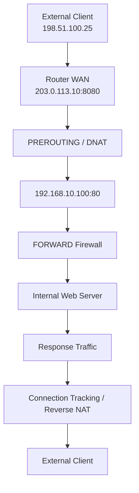

# Port Forwarding

Port forwarding is a networking technique that allows incoming connections from an external network to reach a specific device or service inside a private network.

It is commonly implemented using Destination Network Address Translation (DNAT), where a router or firewall translates the destination IP address and, optionally, the destination port of incoming packets.

Port forwarding is frequently used to expose services such as web servers, SSH servers, game servers, remote-access services, and application servers to external networks.

# 🗁 Overview

A private network commonly uses RFC 1918 addresses that are not directly routable across the public internet.

For example:

| Device | IP address |
| --- | --- |
| Router WAN | `203.0.113.10` |
| Router LAN | `192.168.10.1` |
| Internal web server | `192.168.10.100` |
| Internal SSH server | `192.168.10.101` |
| External client | `198.51.100.25` |

Suppose a web server inside the private network listens on TCP port `80`.

An external client cannot normally connect directly to `192.168.10.100` because that address is private.

Port forwarding allows the external client to connect to the router's public address and a designated port:

```text
Public IP:       203.0.113.10
External Port:   8080

Internal Server: 192.168.10.100
Internal Port:   80
Protocol:        TCP
```

The router translates the incoming connection:

```text
203.0.113.10:8080
        |
        v
192.168.10.100:80
```

The internal server receives the connection on TCP port `80`, even though the external client connected to port `8080`.

# 🗁 How Port Forwarding Works

Port forwarding generally follows these steps:

* An external client initiates a connection to the router's public IP address and a specific port.
* The router receives the incoming packet through its WAN interface.
* The router checks its destination NAT rules.
* A matching rule changes the packet's destination IP address and, if configured, its destination port.
* The router performs a routing decision using the translated destination.
* The firewall evaluates whether forwarding is permitted.
* The packet is forwarded to the internal server.
* The server processes the request and sends a response.
* Connection tracking maintains the NAT mapping so that the response is translated correctly on its way back.

For example:

```text
External Client
198.51.100.25:50000
        |
        | TCP connection
        v
Router Public IP
203.0.113.10:8080
        |
        | DNAT
        v
Internal Web Server
192.168.10.100:80
```

The router maintains the connection state and performs the corresponding reverse translation for response packets.

# 🗁 Port Forwarding and DNAT

Port forwarding is commonly implemented using Destination NAT.

DNAT modifies the destination address of a packet.

It can modify:

* Destination IPv4 address.
* Destination TCP or UDP port.
* Both destination address and destination port.

Example:

```text
Before DNAT:

Source:      198.51.100.25:50000
Destination: 203.0.113.10:8080

After DNAT:

Source:      198.51.100.25:50000
Destination: 192.168.10.100:80
```

The destination address changes from the router's public IP to the internal server's private IP.

The destination port changes from `8080` to `80`.

**Important distinction:** DNAT translates the destination address, but it does not automatically authorize the packet through the firewall. A separate firewall forwarding rule may be required.

# 🗁 Network Requirements

A working port-forwarding configuration requires several components.

| Requirement | Description |
| --- | --- |
| Public reachability | The router must be reachable through the address used by external clients |
| DNAT rule | Translates the incoming destination to the internal server |
| Firewall forwarding rule | Permits the translated connection |
| IP forwarding | The router must forward packets between interfaces |
| Server listener | The internal service must listen on the expected address and port |
| Host firewall | The server firewall must permit the connection |
| Return path | Responses must travel back through the router performing NAT |

A port-forwarding rule alone is not sufficient.

If the ISP places the router behind Carrier-Grade NAT (CGNAT), inbound connections may not reach the router. The ISP must provide a reachable public address or another suitable connectivity method.

The shared address range commonly used for CGNAT is:

```text
100.64.0.0/10
```

This range is not part of the RFC 1918 private address ranges.

# 🗁 Packet Flow

The incoming packet normally follows the Netfilter forwarding path:

```text
WAN Interface
     |
     v
PREROUTING
     |
     v
Destination NAT
     |
     v
Routing Decision
     |
     v
FORWARD Chain
     |
     v
POSTROUTING
     |
     v
LAN Interface
     |
     v
Internal Server
```

For the return traffic, connection tracking applies the reverse translation.

The response packet follows the corresponding routing and NAT processing stages.



# 🗁 Types of Port Forwarding

Port forwarding can be configured in several ways depending on the service and network requirements.

**Single-port forwarding**

Forwards one external port to one internal service.

Example:

```text
203.0.113.10:8080
        |
        v
192.168.10.100:80
```

**Port remapping**

Uses a different external port and internal port.

Example:

```text
External TCP Port: 8443
Internal TCP Port: 443
Internal Server:   192.168.10.100
```

**Port range forwarding**

Forwards a range of ports to an internal device.

Example:

```text
External Ports: 5000-5100
Internal Ports: 5000-5100
Server:         192.168.10.100
```

**Protocol-specific forwarding**

A forwarding rule can match TCP, UDP, or both when the service requires them.

TCP and UDP are separate transport protocols. A TCP forwarding rule does not automatically forward UDP traffic on the same port.

# 🗁 Port Forwarding with nftables

`nftables` is the modern Linux packet-filtering and NAT framework.

Assume the following network:

| Component | Value |
| --- | --- |
| WAN interface | `eth0` |
| LAN interface | `eth1` |
| Router public IP | `203.0.113.10` |
| Internal server | `192.168.10.100` |
| External port | TCP `8080` |
| Internal port | TCP `80` |

Create a NAT table:

```bash
sudo nft add table ip nat
```

Create a prerouting NAT chain:

```bash
sudo nft add chain ip nat prerouting '{ type nat hook prerouting priority dstnat; policy accept; }'
```

Add the destination NAT rule:

```bash
sudo nft add rule ip nat prerouting \
    iifname "eth0" \
    tcp dport 8080 \
    dnat to 192.168.10.100:80
```

This rule translates incoming TCP connections arriving through `eth0` on port `8080` to `192.168.10.100:80`.

**Allow forwarded traffic**

A separate filter rule is needed to authorize the forwarded connection.

Create a filter table:

```bash
sudo nft add table inet filter
```

Create a forward chain:

```bash
sudo nft add chain inet filter forward '{ type filter hook forward priority filter; policy drop; }'
```

Add rules for established connections and the forwarded service:

```bash
sudo nft add rule inet filter forward \
    ct state established,related accept
```

```bash
sudo nft add rule inet filter forward \
    iifname "eth0" \
    oifname "eth1" \
    ip daddr 192.168.10.100 \
    tcp dport 80 \
    ct state new accept
```

These rules allow established traffic and new TCP connections to the internal web server.

A production firewall must also include appropriate rules for other required traffic, such as LAN-originated forwarding and ICMP error handling.

Inspect the ruleset:

```bash
sudo nft list ruleset
```

Validate a configuration file before loading it:

```bash
sudo nft -c -f /etc/nftables.conf
```

Apply a configuration file:

```bash
sudo nft -f /etc/nftables.conf
```

When using a default-drop firewall, ensure that management access and existing connection handling are configured before applying changes remotely.

# 🗁 Port Forwarding with iptables

`iptables` provides another way to configure port forwarding through Netfilter.

Add a DNAT rule:

```bash
sudo iptables -t nat -A PREROUTING \
    -i eth0 \
    -p tcp \
    --dport 8080 \
    -j DNAT \
    --to-destination 192.168.10.100:80
```

Allow established and related connections:

```bash
sudo iptables -A FORWARD \
    -m conntrack \
    --ctstate ESTABLISHED,RELATED \
    -j ACCEPT
```

Allow new connections to the internal server:

```bash
sudo iptables -A FORWARD \
    -i eth0 \
    -o eth1 \
    -p tcp \
    -d 192.168.10.100 \
    --dport 80 \
    -m conntrack \
    --ctstate NEW \
    -j ACCEPT
```

Explanation:

| Option | Description |
| --- | --- |
| `-t nat` | Selects the NAT table |
| `PREROUTING` | Processes incoming packets before routing |
| `-i eth0` | Matches the WAN interface |
| `-p tcp` | Matches TCP packets |
| `--dport 8080` | Matches external destination port `8080` |
| `-j DNAT` | Performs destination NAT |
| `--to-destination` | Specifies the internal destination |

Enable IPv4 forwarding:

```bash
sudo sysctl -w net.ipv4.ip_forward=1
```

Inspect the NAT rules:

```bash
sudo iptables -t nat -L -n -v
```

Inspect forwarding rules:

```bash
sudo iptables -L FORWARD -n -v
```

Remove the DNAT rule:

```bash
sudo iptables -t nat -D PREROUTING \
    -i eth0 \
    -p tcp \
    --dport 8080 \
    -j DNAT \
    --to-destination 192.168.10.100:80
```

For new Linux firewall configurations, prefer nftables unless compatibility with an existing iptables-based environment is required.

# 🗁 Port Forwarding in MikroTik RouterOS

MikroTik RouterOS provides port forwarding through the IP Firewall NAT facility.

Assume the following configuration:

| Component | Value |
| --- | --- |
| WAN interface | `ether1` |
| LAN interface | `bridge` |
| Public IP | `203.0.113.10` |
| Internal server | `192.168.10.100` |
| External TCP port | `8080` |
| Internal TCP port | `80` |

**Create the destination NAT rule**

```routeros
/ip firewall nat add \
    chain=dstnat \
    in-interface=ether1 \
    protocol=tcp \
    dst-port=8080 \
    action=dst-nat \
    to-addresses=192.168.10.100 \
    to-ports=80 \
    comment="Forward HTTP to internal web server"
```

Explanation:

| Parameter | Description |
| --- | --- |
| `chain=dstnat` | Selects the destination NAT chain |
| `in-interface=ether1` | Matches incoming traffic from the WAN |
| `protocol=tcp` | Matches TCP traffic |
| `dst-port=8080` | Matches the external destination port |
| `action=dst-nat` | Performs destination NAT |
| `to-addresses` | Specifies the internal server IP |
| `to-ports` | Specifies the internal service port |

**Allow the forwarded connection**

The following is an example filter rule for a firewall whose forward chain uses a default-drop policy:

```routeros
/ip firewall filter add \
    chain=forward \
    connection-state=established,related \
    action=accept \
    comment="Allow established and related connections"
```

```routeros
/ip firewall filter add \
    chain=forward \
    connection-state=new \
    in-interface=ether1 \
    protocol=tcp \
    dst-address=192.168.10.100 \
    dst-port=80 \
    action=accept \
    comment="Allow forwarded web traffic"
```

Rule ordering matters. Place the established/related rule before general invalid-state and drop rules, and ensure the new-connection rule appears before a catch-all forward drop rule.

Do not duplicate existing rules unnecessarily. Integrate the rules into the router's existing firewall policy.

**Inspect NAT rules**

```routeros
/ip firewall nat print
```

Display NAT rule counters:

```routeros
/ip firewall nat print stats
```

Inspect filter rules:

```routeros
/ip firewall filter print
```

Display filter counters:

```routeros
/ip firewall filter print stats
```

**Remove the forwarding rule**

```routeros
/ip firewall nat remove [find comment="Forward HTTP to internal web server"]
```

RouterOS uses `dstnat` for destination NAT and `srcnat` for source NAT.

# 🗁 Port Forwarding with Multiple Services

A router can forward multiple external ports to different internal servers.

Example network:

| Service | External Port | Internal Server | Internal Port |
| --- | ---: | --- | ---: |
| Web server | TCP 8080 | `192.168.10.100` | TCP 80 |
| HTTPS server | TCP 8443 | `192.168.10.100` | TCP 443 |
| SSH server | TCP 2222 | `192.168.10.101` | TCP 22 |
| Game server | UDP 27015 | `192.168.10.102` | UDP 27015 |

Example nftables rules:

```bash
sudo nft add rule ip nat prerouting \
    iifname "eth0" tcp dport 8080 \
    dnat to 192.168.10.100:80
```

```bash
sudo nft add rule ip nat prerouting \
    iifname "eth0" tcp dport 8443 \
    dnat to 192.168.10.100:443
```

```bash
sudo nft add rule ip nat prerouting \
    iifname "eth0" tcp dport 2222 \
    dnat to 192.168.10.101:22
```

```bash
sudo nft add rule ip nat prerouting \
    iifname "eth0" udp dport 27015 \
    dnat to 192.168.10.102:27015
```

Each forwarded service also requires an appropriate firewall forwarding rule.

Avoid exposing administrative services such as SSH directly to the internet unless there is a clear operational requirement and suitable access restrictions.

# 🗁 Hairpin NAT

Hairpin NAT, also called NAT loopback, allows an internal client to access an internal server using the router's public IP address.

Consider this network:

```text
Router Public IP: 203.0.113.10
Web Server:       192.168.10.100
Internal Client:  192.168.10.50
```

The internal client accesses:

```text
http://203.0.113.10:8080
```

The router performs DNAT and redirects the connection to:

```text
192.168.10.100:80
```

However, if the server replies directly to the internal client, the return path may bypass the router's NAT processing.

Hairpin SNAT can ensure that the server sends its response back through the router.

Example RouterOS configuration:

```routeros
/ip firewall nat add \
    chain=srcnat \
    src-address=192.168.10.0/24 \
    dst-address=192.168.10.100 \
    out-interface=bridge \
    protocol=tcp \
    dst-port=80 \
    action=masquerade \
    comment="Hairpin NAT"
```

This is an illustrative rule for a network using the specified LAN subnet and bridge interface. Its placement and matching conditions must be adapted to the actual DNAT configuration.

An alternative is split-horizon DNS, where internal clients resolve the service hostname directly to the internal server address.

# 🗁 Port Forwarding vs Port Triggering

Port forwarding and port triggering are different techniques.

| Feature | Port Forwarding | Port Triggering |
| --- | --- | --- |
| Rule behavior | Persistent mapping | Temporary mapping |
| Activation | Configured in advance | Activated by outbound traffic |
| Internal destination | Usually fixed | Often dynamically selected |
| Use case | Web, SSH, and application servers | Certain legacy games and applications |
| Availability | Common router feature | Router-dependent feature |

Port forwarding keeps a configured external-to-internal mapping available.

Port triggering dynamically opens an inbound mapping after a client initiates traffic through a configured outbound trigger.

# 🗁 Security Considerations

Port forwarding exposes an internal service to external networks. The security of the forwarded service becomes part of the network's external attack surface.

Follow these practices:

* Forward only the ports that are necessary.
* Restrict source IP addresses when practical.
* Keep exposed applications and operating systems updated.
* Use strong authentication.
* Prefer VPN access for administrative services.
* Avoid exposing database services directly to the public internet.
* Use HTTPS for web applications.
* Monitor firewall logs and connection attempts.
* Apply rate limits where appropriate.
* Keep internal servers isolated from sensitive network segments.
* Use a reverse proxy or application gateway when it provides useful access control and TLS termination.
* Remove unused forwarding rules.

For SSH administration, consider allowing connections only from trusted management addresses or requiring VPN access.

Port forwarding is not an authentication mechanism and does not make an exposed service secure by itself.

# 🗁 Common Mistakes

| Mistake | Result |
| --- | --- |
| Incorrect internal server IP | Traffic reaches the wrong device or fails |
| Incorrect external port | The DNAT rule does not match |
| Incorrect internal port | The application does not receive traffic on its listening port |
| Missing forwarding rule | DNAT occurs, but the firewall drops the packet |
| Missing server firewall permission | The server rejects or drops the connection |
| IP forwarding disabled | The router cannot forward IPv4 packets |
| Incorrect return route | Response traffic cannot complete the connection |
| ISP CGNAT | Incoming traffic cannot reach the router directly |
| Service not listening | No application accepts the connection |
| Wrong protocol | TCP and UDP traffic do not match the intended rule |
| Double NAT | Additional forwarding may be required on the upstream router |
| Testing from inside without hairpin support | Internal clients cannot reach the service through the public address |

# 🗁 Troubleshooting

Troubleshoot port forwarding systematically, starting from the external connection and following the packet path.

**Check the server's listening ports**

```bash
sudo ss -tulpen
```

Check a specific TCP port:

```bash
sudo ss -ltnp 'sport = :80'
```

**Check local firewall rules**

On Ubuntu systems using UFW:

```bash
sudo ufw status verbose
```

Check nftables:

```bash
sudo nft list ruleset
```

**Check router NAT rules**

```bash
sudo nft list table ip nat
```

For RouterOS:

```routeros
/ip firewall nat print stats
```

**Check firewall forwarding rules**

```bash
sudo nft list chain inet filter forward
```

For RouterOS:

```routeros
/ip firewall filter print stats
```

**Capture packets on the WAN interface**

```bash
sudo tcpdump -ni eth0 'tcp port 8080'
```

**Capture packets on the LAN interface**

```bash
sudo tcpdump -ni eth1 'host 192.168.10.100 and tcp port 80'
```

**Test the service from an external network**

```bash
nc -vz 203.0.113.10 8080
```

For an HTTP service:

```bash
curl -v http://203.0.113.10:8080
```

Testing from a genuinely external network is important. Testing from the same LAN may depend on hairpin NAT or split-horizon DNS.

**Troubleshooting checklist**

* Confirm the public IP address is reachable.
* Check whether the ISP uses CGNAT.
* Confirm the WAN interface receives the expected traffic.
* Verify the DNAT rule matches the incoming interface, protocol, and port.
* Confirm the translated destination address and port.
* Verify the firewall permits forwarding.
* Confirm the internal server is listening.
* Check the server's host firewall.
* Verify the return route.
* Inspect packet captures on both WAN and LAN interfaces.
* Check for an upstream router or additional NAT device.

# 🗁 Practical Example

Build a small network where an external client accesses an internal web server through a router.

**Network topology**

```text
External Client
198.51.100.25
      |
      |
Internet
      |
      |
Router WAN
203.0.113.10
      |
      |
Router LAN
192.168.10.1
      |
      |
Internal Web Server
192.168.10.100
TCP Port 80
```

**Requirements**

| Component | Configuration |
| --- | --- |
| Router WAN | `203.0.113.10` |
| Router LAN | `192.168.10.1` |
| Server IP | `192.168.10.100` |
| Server service | HTTP |
| Server port | TCP 80 |
| External port | TCP 8080 |
| Forwarding method | DNAT |

**Configure the web server**

On an Ubuntu server, install Nginx:

```bash
sudo apt update
sudo apt install nginx
```

Check the service:

```bash
sudo systemctl status nginx
```

Verify the listening port:

```bash
sudo ss -ltnp 'sport = :80'
```

**Configure port forwarding**

On the router, create a DNAT rule that translates:

```text
203.0.113.10:8080
        |
        v
192.168.10.100:80
```

Add the corresponding firewall forwarding permission.

**Test from an external network**

```bash
curl -v http://203.0.113.10:8080
```

If the configuration is correct, the external client should receive the web server's HTTP response.

**Expected result**

```text
External Client
      |
      | HTTP Request
      v
203.0.113.10:8080
      |
      | DNAT
      v
192.168.10.100:80
      |
      | HTTP Response
      v
External Client
```

# 🗁 Summary

Port forwarding allows external clients to access selected services inside a private network.

It is commonly implemented through Destination NAT, which changes the destination IP address and optionally the destination port of incoming packets.

Remember these key points:

* Port forwarding commonly uses DNAT.
* DNAT is generally performed in the PREROUTING stage for incoming connections.
* The firewall must separately permit forwarded traffic.
* Connection tracking maintains NAT mappings and reverse translation.
* The internal server must have a reachable return path.
* TCP and UDP forwarding rules must match the service protocol.
* Hairpin NAT allows internal clients to access internal services through the public address.
* CGNAT and double NAT can prevent direct inbound connectivity.
* Exposing a service requires appropriate security controls.

# 🗁 References

* [Netfilter Documentation](https://www.netfilter.org/documentation/)
* [nftables Manual](https://netfilter.org/projects/nftables/manpage.html)
* [Ubuntu Server Documentation — Firewall](https://documentation.ubuntu.com/server/how-to/security/firewalls/)
* [MikroTik RouterOS — NAT](https://help.mikrotik.com/docs/spaces/ROS/pages/3211299/NAT)
* [RFC 1918 — Address Allocation for Private Internets](https://www.rfc-editor.org/rfc/rfc1918)
* [RFC 6598 — Shared Address Space](https://www.rfc-editor.org/rfc/rfc6598)
