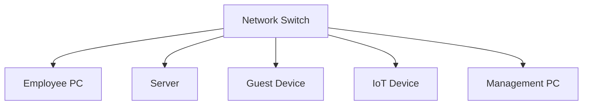
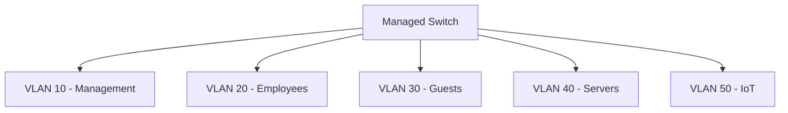
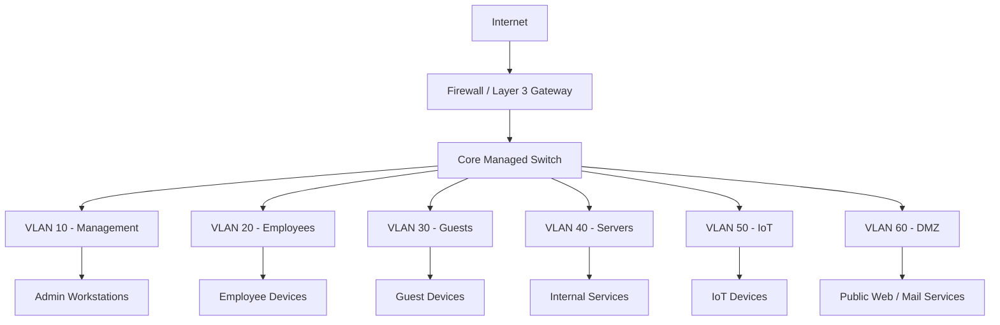
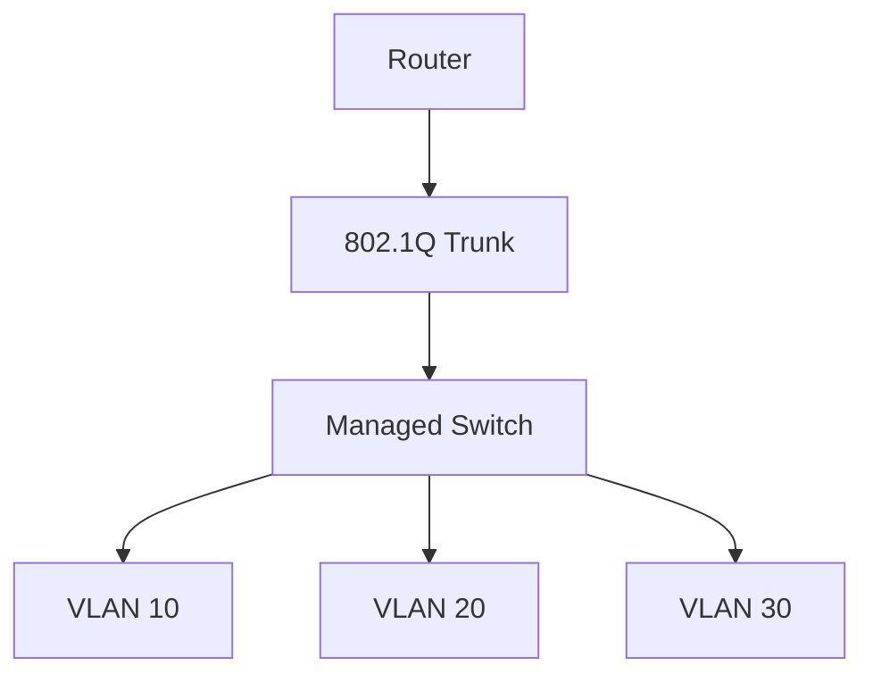
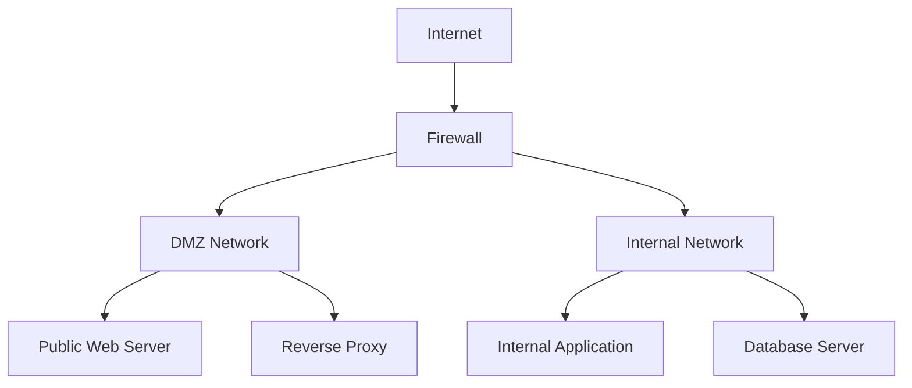
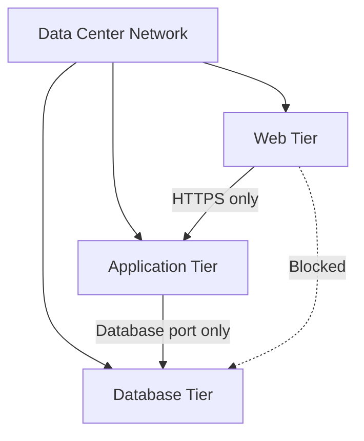
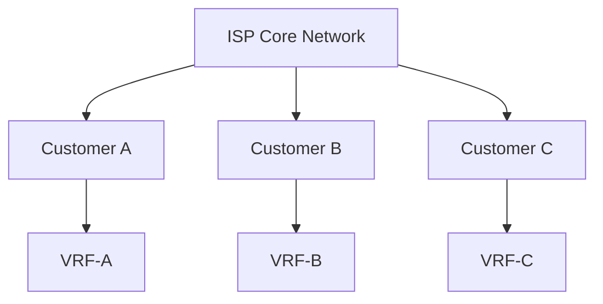
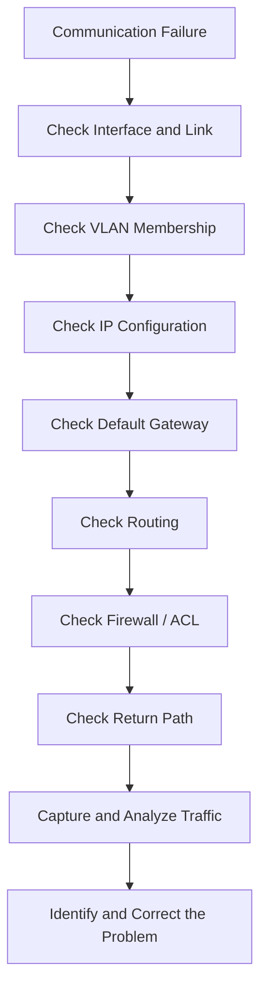

# Network Segmentation

Network segmentation is the practice of dividing a computer network into smaller, logically or physically isolated sections called **network segments**.

Each segment contains devices, systems, or services that share similar security requirements, operational responsibilities, or communication needs.

Segmentation controls how traffic moves between these sections. It helps reduce the attack surface, limit unauthorized access, improve network performance, and prevent security incidents from spreading across an entire network.

For example, an organization might separate its network into the following segments:

* Management network
* Employee network
* Server network
* Guest network
* IoT network
* DMZ network

Devices within a segment can communicate according to its policies, while communication between different segments is controlled through routing, access control lists (ACLs), and firewall rules.

# 🗁 Network Segmentation Objectives

Network segmentation provides several important benefits.

**Security isolation**

Separates systems with different security requirements and reduces unnecessary communication between them.

**Attack surface reduction**

Limits the number of systems and services that an attacker can reach after compromising a device.

**Lateral movement prevention**

Restricts an attacker from moving freely between computers, servers, and other network resources.

**Broadcast-domain control**

Divides large Layer 2 networks into smaller broadcast domains using VLANs or separate physical networks.

**Performance improvement**

Reduces unnecessary broadcast traffic and allows network resources to be organized more efficiently.

**Fault isolation**

Limits the impact of network failures, misconfigurations, and broadcast storms.

**Compliance**

Helps enforce separation requirements for sensitive systems, payment environments, customer data, and administrative resources.

**Tenant isolation**

Prevents one customer, department, or organization from accessing another tenant's network resources.

# 🗁 Network Segmentation Components

Network segmentation can be implemented using multiple technologies and at different network layers.

| Technology | Layer / Scope | Purpose |
| --- | --- | --- |
| Physical segmentation | Physical infrastructure | Separates networks using independent hardware and connections |
| VLAN | Layer 2 | Creates separate broadcast domains |
| Subnet | Layer 3 | Divides IP address space into logical networks |
| Routing | Layer 3 | Controls communication between IP networks |
| ACL | Layer 3 / Layer 4 | Filters traffic based on defined rules |
| Firewall zones | Network security | Controls communication between security zones |
| VRF | Layer 3 | Maintains separate routing tables |
| Microsegmentation | Host / Workload | Controls communication between individual workloads |
| SDN | Software-defined networking | Applies programmable network policies |
| Wireless SSID | Wireless access | Separates wireless users and devices |
| Cloud VPC / VNet | Cloud networking | Provides isolated virtual network environments |

# 🗁 Important Differences: VLAN vs Subnet vs Security Zone vs VRF

These concepts are related but are not interchangeable.

| Concept | Main Function | Example |
| --- | --- | --- |
| VLAN | Separates Layer 2 broadcast domains | VLAN 20 |
| Subnet | Defines an IP network | `192.168.20.0/24` |
| Security Zone | Groups interfaces or networks under a security policy | Guest zone |
| VRF | Separates routing tables | `VRF-CUSTOMER-A` |

A common network design uses one VLAN per IP subnet and assigns each VLAN to a security zone. A VRF can provide an additional routing separation layer.

However, these relationships are design choices rather than mandatory requirements.

For example:

* A VLAN does not automatically prevent communication through a router.
* A subnet does not automatically provide security isolation.
* A security zone does not necessarily create a separate broadcast domain.
* A VRF separates routing tables but does not automatically filter traffic between connected interfaces or VRFs.

# 🗁 Segmentation Models

Different segmentation models provide different levels of isolation and control.

**Flat Network**

A flat network places most devices within the same Layer 2 network or broadly accessible IP network.



Characteristics:

* Simple network design.
* Minimal configuration.
* Large broadcast domain.
* Limited security isolation.
* Greater lateral movement opportunities.
* Difficult to enforce granular access policies.

**VLAN-Based Segmentation**

VLANs divide a switched network into separate Layer 2 broadcast domains.



Characteristics:

* Logical Layer 2 isolation.
* Smaller broadcast domains.
* Flexible network organization.
* Requires Layer 3 routing for communication between VLANs.
* Requires ACLs or firewall policies to enforce access restrictions.

**Routed Segmentation**

Each segment uses a separate IP subnet. A router or Layer 3 switch routes traffic between those subnets.

Characteristics:

* Separates IP networks.
* Enables routing policies.
* Supports ACL-based filtering.
* Provides better control over inter-network communication.

**Zone-Based Segmentation**

Networks are grouped into security zones based on their trust levels and responsibilities.

Example zones:

* Trusted
* Internal
* Guest
* DMZ
* Management
* Untrusted

A firewall controls traffic between zones according to security policies.

**Microsegmentation**

Microsegmentation applies security controls to individual workloads, hosts, applications, or identities rather than relying only on large network boundaries.

**Zero Trust Segmentation**

Zero Trust-based segmentation applies identity, device posture, context, and least-privilege policies to communication between resources.

# 🗁 Example Network Architecture

Consider an organization that needs separate networks for employees, servers, guests, IoT devices, management, and public-facing services.

The following architecture provides logical separation using VLANs and controlled routing through a firewall.



The firewall controls communication between these networks.

For example:

* Management devices can access approved infrastructure interfaces.
* Employees can access required internal applications.
* Guests can access the internet but not internal resources.
* IoT devices can communicate only with approved services.
* Public internet traffic can reach explicitly published DMZ services.
* DMZ systems cannot freely access internal networks.

# 🗁 Example IP Addressing Plan

A consistent IP addressing plan makes segmentation easier to manage.

| VLAN ID | Network Segment | Subnet | Default Gateway |
| --- | --- | --- | --- |
| 10 | Management | `192.168.10.0/24` | `192.168.10.1` |
| 20 | Employees | `192.168.20.0/24` | `192.168.20.1` |
| 30 | Guests | `192.168.30.0/24` | `192.168.30.1` |
| 40 | Servers | `192.168.40.0/24` | `192.168.40.1` |
| 50 | IoT | `192.168.50.0/24` | `192.168.50.1` |
| 60 | DMZ | `192.168.60.0/24` | `192.168.60.1` |

These example addresses belong to the RFC 1918 private IPv4 address space.

The `/24` prefix provides 256 total addresses, of which 254 are traditionally usable host addresses in a conventional IPv4 subnet.

The subnet size should be selected according to the number of devices, growth expectations, and network requirements.

# 🗁 VLAN-Based Segmentation

A Virtual Local Area Network (VLAN) allows a physical switch infrastructure to carry multiple logically separated Layer 2 networks.

Each VLAN represents a separate broadcast domain.

Example:

| VLAN | Name | Purpose |
| --- | --- | --- |
| 10 | MANAGEMENT | Network administration |
| 20 | EMPLOYEES | Employee workstations |
| 30 | GUEST | Guest wireless and wired access |
| 40 | SERVERS | Internal application servers |
| 50 | IOT | Cameras, sensors, and smart devices |
| 60 | DMZ | Public-facing services |

**Access Ports**

An access port normally connects an endpoint to one VLAN.

Example:

```text
Switch Port: Gi0/1
Port Mode: Access
Access VLAN: 20
Connected Device: Employee PC
```

**Trunk Ports**

A trunk carries traffic for multiple VLANs between network devices.

Example:

```text
Switch Port: Gi0/24
Port Mode: Trunk
Allowed VLANs: 10,20,30,40,50,60
```

**PVID and Native VLAN**

The Port VLAN ID (PVID) determines the VLAN assigned to incoming untagged frames on platforms that use this concept.

A native VLAN is commonly associated with untagged traffic on an 802.1Q trunk. Exact behavior depends on the platform and configuration.

Use consistent trunk configuration on both ends.

**VLAN Security Considerations**

* Avoid using VLAN 1 for ordinary user access where practical.
* Restrict allowed VLANs on trunks.
* Avoid unnecessary VLANs on switch ports.
* Disable unused switch ports or place them in an isolated VLAN.
* Use explicit VLAN membership.
* Apply appropriate management-plane protections.
* Prevent unauthorized trunk negotiation where supported.
* Do not assume VLANs alone provide complete security isolation.

# 🗁 Inter-VLAN Routing

Devices in different VLANs cannot communicate directly at Layer 2.

Communication between their IP subnets requires Layer 3 routing.

There are several common approaches.

**Router-on-a-Stick**

A router connects to a managed switch using an 802.1Q trunk.

The router creates logical subinterfaces for individual VLANs.



Example Cisco IOS configuration:

```cisco
interface GigabitEthernet0/0
 no shutdown

interface GigabitEthernet0/0.10
 encapsulation dot1Q 10
 ip address 192.168.10.1 255.255.255.0

interface GigabitEthernet0/0.20
 encapsulation dot1Q 20
 ip address 192.168.20.1 255.255.255.0

interface GigabitEthernet0/0.30
 encapsulation dot1Q 30
 ip address 192.168.30.1 255.255.255.0
```

**Layer 3 Switch**

A Layer 3 switch creates Switched Virtual Interfaces (SVIs) and performs routing between VLANs.

Example:

```cisco
ip routing

vlan 10
 name MANAGEMENT

vlan 20
 name EMPLOYEES

interface vlan 10
 ip address 192.168.10.1 255.255.255.0
 no shutdown

interface vlan 20
 ip address 192.168.20.1 255.255.255.0
 no shutdown
```

**Firewall-Based Routing**

A firewall can provide Layer 3 interfaces or VLAN subinterfaces and apply security policies between networks.

This approach is useful when inter-segment communication requires detailed inspection and filtering.

# 🗁 Firewall Policies Between Segments

Creating VLANs and IP subnets is only part of network segmentation.

A secure design must also control traffic between those segments.

A firewall or ACL can enforce policies based on:

* Source IP address.
* Destination IP address.
* Protocol.
* Source and destination ports.
* Connection state.
* Application identity.
* User or device identity, where supported.

**Example Firewall Policy Matrix**

| Source Segment | Destination Segment | Policy | Reason |
| --- | --- | --- | --- |
| Management | Network Devices | Allow selected management ports | Infrastructure administration |
| Employees | Servers | Allow required application ports | Business applications |
| Employees | Management | Deny | Protect management systems |
| Guests | Internal Networks | Deny | Guest isolation |
| Guests | Internet | Allow | Internet access |
| IoT | Approved Services | Allow selected traffic | Device operation |
| IoT | Management | Deny by default | Restrict device access |
| Internet | DMZ | Allow published services | Public application access |
| DMZ | Internal Networks | Deny by default | Protect internal systems |

**Default-Deny Policy**

A common security approach is:

1. Deny inter-segment traffic by default.
2. Identify required communication flows.
3. Allow only necessary traffic.
4. Permit established return traffic where stateful inspection is used.
5. Log important denied traffic.
6. Review and maintain policies regularly.

For example, employees may need HTTPS access to an internal application server on TCP port 443, but they do not necessarily need unrestricted access to every server port.

**Example nftables Policy**

The following example illustrates filtering forwarded traffic between two interfaces representing separate network segments.

```bash
sudo nft add table inet segmentation

sudo nft 'add chain inet segmentation forward {
    type filter hook forward priority filter;
    policy drop;
}'

sudo nft add rule inet segmentation forward \
    ct state established,related accept

sudo nft add rule inet segmentation forward \
    iifname "vlan20" oifname "vlan40" \
    ip saddr 192.168.20.0/24 \
    ip daddr 192.168.40.10 \
    tcp dport 443 accept
```

This example:

* Uses a default-drop forwarding policy.
* Allows established and related traffic.
* Permits employee traffic to reach one server over HTTPS.
* Does not automatically allow unrelated traffic between the segments.

This is an illustrative ruleset. Production configurations should also account for required ICMP, DNS, DHCP relay, IPv6, management, logging, and other explicitly required services.

# 🗁 DMZ Segmentation

A Demilitarized Zone (DMZ) is a separate network segment used to host services that must be reachable from less-trusted networks, especially the public internet.

Common DMZ services include:

* Public web servers.
* Reverse proxies.
* Mail gateways.
* Public DNS servers.
* Application gateways.
* VPN gateways.

A DMZ separates publicly accessible services from internal resources.



**DMZ Security Policies**

* Allow only required inbound public services.
* Restrict DMZ-to-internal communication.
* Avoid direct database access from the public internet.
* Allow specific application-to-database flows only when required.
* Restrict administrative access to trusted management networks.
* Monitor inbound and outbound DMZ traffic.
* Keep public-facing systems patched and hardened.

A DMZ is not automatically secure simply because it uses a separate VLAN. Firewall policies and host-level controls are essential.

# 🗁 Guest and IoT Segmentation

Guest and IoT devices often have different trust levels from corporate computers and servers.

They should generally be placed in dedicated network segments.

**Guest Network**

A guest network provides internet access to visitors without exposing internal resources.

Recommended policies:

* Allow internet access.
* Deny access to employee networks.
* Deny access to management networks.
* Deny access to internal servers unless explicitly required.
* Enable wireless client isolation where appropriate.
* Apply bandwidth limits if necessary.
* Use appropriate DNS and DHCP services.

**IoT Network**

IoT devices include:

* IP cameras.
* Smart televisions.
* Sensors.
* Printers.
* Access control systems.
* Smart appliances.
* Industrial monitoring devices.

IoT devices may have limited security capabilities and may receive infrequent firmware updates.

Recommended policies:

* Place IoT devices in dedicated VLANs or security zones.
* Restrict outbound connections.
* Permit only required DNS and NTP services.
* Restrict management access to approved administrators.
* Prevent unnecessary communication with employee systems.
* Isolate cameras and recording systems where appropriate.
* Monitor unusual network activity.

# 🗁 Management Network Segmentation

Management networks contain interfaces and systems used to administer network infrastructure.

Examples include:

* Routers.
* Switches.
* Firewalls.
* Wireless controllers.
* Hypervisors.
* Storage systems.
* Servers.
* Monitoring systems.

Administrative protocols may include:

| Protocol | Port | Purpose |
| --- | --- | --- |
| SSH | TCP 22 | Secure command-line administration |
| HTTPS | TCP 443 | Web-based administration |
| SNMP | UDP 161 | Network monitoring and management |
| WinBox | TCP 8291 | MikroTik RouterOS administration |
| RDP | TCP 3389 | Windows remote administration |

Recommended practices:

* Use a dedicated management VLAN or subnet.
* Restrict administrative access to approved devices.
* Use strong authentication and MFA where supported.
* Prefer SSH and HTTPS over insecure management protocols.
* Restrict SNMP access and use SNMPv3 where supported.
* Avoid exposing management interfaces to the public internet.
* Consider out-of-band management for critical infrastructure.

# 🗁 VRF-Based Segmentation

A Virtual Routing and Forwarding (VRF) instance maintains a separate routing table within a router or Layer 3 switch.

Multiple VRFs can operate on the same physical device while maintaining separate routing information.

Example:

```text
Router
│
├── VRF-MANAGEMENT
│   └── 192.168.10.0/24
│
├── VRF-EMPLOYEES
│   └── 192.168.20.0/24
│
└── VRF-CUSTOMER
    └── 192.168.30.0/24
```

**VRF Characteristics**

* Separate routing tables.
* Overlapping IP address spaces can be used in different VRFs.
* Routes are not automatically shared between VRFs.
* Route leaking can selectively exchange routes.
* Multiple tenants can share physical routing infrastructure.

**Important Security Consideration**

VRFs provide routing separation, but they are not a complete replacement for firewall policies.

If traffic is intentionally connected between VRFs, the design must enforce appropriate security controls.

VRF implementations and route-leaking behavior vary by platform.

# 🗁 Microsegmentation

Microsegmentation applies security policies at a more granular level than traditional VLAN-based segmentation.

Instead of trusting every device within a subnet, policies can control communication between individual workloads.

Example:



Example policy:

| Source Workload | Destination Workload | Allowed Traffic |
| --- | --- | --- |
| Web Server | Application Server | TCP 443 |
| Application Server | Database | TCP 5432 |
| Web Server | Database | Deny |
| Employee Workstation | Database | Deny |
| Management System | Approved Workloads | Selected administration ports |

Microsegmentation can be implemented through:

* Host-based firewalls.
* Hypervisor security controls.
* Software-defined networking.
* Workload identity policies.
* Cloud security policies.
* Endpoint security agents.

**East-West Traffic**

East-west traffic is communication between systems inside a data center, cloud environment, or internal network.

Microsegmentation helps control this traffic rather than relying only on perimeter firewalls.

# 🗁 Zero Trust and Network Segmentation

Zero Trust is a security architecture based on the principle that access should not be automatically trusted simply because a device is connected to an internal network.

Its core ideas include:

* Verify explicitly.
* Apply least-privilege access.
* Evaluate user and device identity.
* Consider device health and context.
* Continuously monitor access.
* Assume that a breach may occur.

Network segmentation supports Zero Trust by limiting which resources can communicate with one another.

However, segmentation alone does not create a complete Zero Trust architecture.

For example, placing employees in a separate VLAN does not establish whether a particular employee should access a sensitive database.

A Zero Trust policy may consider:

* User identity.
* Device identity.
* Authentication strength.
* Device security posture.
* Application identity.
* Requested resource.
* Network context.
* Risk level.

# 🗁 Cloud Network Segmentation

Cloud platforms provide virtual networking features that support network isolation and traffic control.

Common cloud networking components include:

| Component | Purpose |
| --- | --- |
| VPC / VNet | Isolated virtual network |
| Subnet | Divides a virtual network into smaller networks |
| Route Table | Controls network traffic paths |
| Security Group | Applies workload or interface-level traffic rules |
| Network ACL | Filters traffic at the subnet boundary |
| Private Endpoint | Provides private connectivity to supported services |
| NAT Gateway | Provides outbound connectivity through address translation |
| Peering | Connects separate virtual networks |

**AWS**

Amazon Web Services provides:

* Amazon VPC.
* Public and private subnets.
* Route tables.
* Security groups.
* Network ACLs.
* VPC endpoints.
* Transit Gateway.

Security groups are stateful. Network ACLs are stateless.

**Microsoft Azure**

Azure provides:

* Virtual Networks (VNets).
* Subnets.
* Network Security Groups (NSGs).
* Application Security Groups.
* User-defined routes.
* Azure Firewall.
* Private Endpoints.
* Virtual Network Peering.

**Google Cloud**

Google Cloud provides:

* Virtual Private Cloud networks.
* Subnets.
* Firewall rules.
* Hierarchical firewall policies.
* Routes.
* Shared VPC.
* Private Service Connect.

Cloud providers implement these features differently. Their rule evaluation, state tracking, and network boundaries should be understood from the relevant provider documentation.

# 🗁 Container and Kubernetes Segmentation

Container platforms introduce additional network segmentation requirements.

Containers may communicate across:

* Containers within the same host.
* Pods within a Kubernetes cluster.
* Different namespaces.
* Different nodes.
* External networks.

Kubernetes provides NetworkPolicy resources to define permitted pod ingress and egress traffic.

Example:

```yaml
apiVersion: networking.k8s.io/v1
kind: NetworkPolicy
metadata:
  name: allow-app-to-database
  namespace: production
spec:
  podSelector:
    matchLabels:
      role: database
  policyTypes:
    - Ingress
  ingress:
    - from:
        - podSelector:
            matchLabels:
              role: application
      ports:
        - protocol: TCP
          port: 5432
```

This policy permits selected application pods in the same namespace to connect to database pods on TCP port 5432.

Important considerations:

* NetworkPolicy enforcement requires a supporting network plugin (CNI).
* A namespace is an organizational boundary, not a complete security boundary by itself.
* Policies should explicitly control ingress and egress where required.
* Default-deny policies help prevent unintended communication.
* Service meshes can provide additional application-layer controls.

# 🗁 ISP and Multi-Tenant Segmentation

Internet Service Providers (ISPs) and enterprise service providers must isolate traffic belonging to different customers.

Common technologies include:

**VLAN Segmentation**

Assigns separate VLANs to different customers or service types.

**QinQ**

Uses VLAN stacking to transport customer VLANs across a service-provider network.

**PPPoE**

Creates individual point-to-point sessions for subscribers, supporting authentication, session management, and accounting.

**VRF**

Provides separate routing tables for different customers or services.

**CGNAT**

Allows multiple subscribers to share public IPv4 addresses while maintaining translation and connection state.

**Subscriber Isolation**

Prevents one subscriber from directly accessing another subscriber's devices or private network.

Example:



The exact design depends on the ISP's access technology, service model, routing architecture, and customer requirements.

# 🗁 IPv6 Network Segmentation

Network segmentation must apply to IPv6 as well as IPv4.

A network that filters IPv4 traffic but leaves IPv6 unrestricted can unintentionally bypass its security policies.

Important considerations:

* Assign appropriate IPv6 prefixes to each segment.
* Apply IPv6 firewall rules.
* Restrict unnecessary inter-segment communication.
* Monitor IPv6 traffic.
* Configure Router Advertisement policies.
* Use RA Guard where supported.
* Use DHCPv6 Guard where supported.
* Account for ICMPv6 requirements.
* Apply equivalent security policies to IPv4 and IPv6.

Example IPv6 addressing plan:

| Segment | Example IPv6 Prefix |
| --- | --- |
| Management | `2001:db8:100:10::/64` |
| Employees | `2001:db8:100:20::/64` |
| Guests | `2001:db8:100:30::/64` |
| Servers | `2001:db8:100:40::/64` |
| IoT | `2001:db8:100:50::/64` |
| DMZ | `2001:db8:100:60::/64` |

The `2001:db8::/32` prefix is reserved for documentation and examples. It should not be used as a real production public address allocation.

# 🗁 Network Segmentation Implementation

A structured implementation process helps prevent unnecessary complexity and security gaps.

**Requirements and Planning**

Identify:

* Network devices.
* Users and departments.
* Servers and applications.
* IoT devices.
* Guest access requirements.
* Administrative systems.
* External connectivity requirements.
* Compliance and security requirements.

**Network Inventory**

Document existing devices, IP addresses, VLANs, subnets, routing paths, and communication dependencies.

**Define Security Zones**

Group resources according to trust level and business requirements.

For example:

```text
Management
Employees
Servers
Guests
IoT
DMZ
External
```

**Design the IP Addressing Plan**

Allocate appropriate subnets and gateways for each segment.

Avoid overlapping networks unless the architecture intentionally uses separate routing contexts such as VRFs.

**Design VLANs and Switch Connectivity**

Define:

* VLAN IDs.
* VLAN names.
* Access ports.
* Trunk ports.
* Allowed VLAN lists.
* PVID and native VLAN behavior.
* Switch management access.

**Configure Routing**

Choose the appropriate routing architecture:

* Router-on-a-stick.
* Layer 3 switch SVIs.
* Firewall interfaces or subinterfaces.
* VRF-based routing.

**Implement Security Policies**

Define which segments can communicate and which protocols are required.

Use default-deny policies where practical, then allow specific business-required traffic.

**Enable Monitoring and Logging**

Monitor:

* Inter-segment traffic.
* Firewall denies.
* Unexpected connections.
* Routing changes.
* Broadcast traffic.
* Network device health.

**Test and Validate**

Verify both permitted and prohibited communication paths.

**Document and Maintain**

Keep network diagrams, VLAN tables, IP plans, firewall policies, and change records updated.

# 🗁 Linux Network Segmentation Commands

Linux provides several commands for inspecting VLANs, interfaces, routes, and firewall policies.

**Display Network Interfaces**

```bash
ip -br link
```

**Display IP Addresses**

```bash
ip -br addr
```

**Display Routing Table**

```bash
ip route
```

**Display Policy Routing Rules**

```bash
ip rule
```

**Display Bridge VLAN Information**

```bash
bridge vlan show
```

**Display Bridge Ports**

```bash
bridge link
```

**Display nftables Rules**

```bash
sudo nft list ruleset
```

**Capture Traffic on a VLAN Interface**

```bash
sudo tcpdump -i vlan20
```

**Capture Traffic Between Two Hosts**

```bash
sudo tcpdump -i any host 192.168.20.10
```

**Test Connectivity**

```bash
ping 192.168.40.10
```

**Trace the Network Path**

```bash
traceroute 192.168.40.10
```

**Inspect Path MTU**

```bash
tracepath 192.168.40.10
```

These commands help identify whether a problem is related to interface configuration, VLAN membership, routing, filtering, or connectivity.

# 🗁 MikroTik RouterOS Segmentation

MikroTik RouterOS supports network segmentation using:

* Bridge VLAN filtering.
* VLAN interfaces.
* Interface lists.
* Firewall filter rules.
* VRF.
* IP addressing and routing.

The following example demonstrates a basic VLAN-based design using RouterOS v7.

**Example Network**

| VLAN | Name | Subnet |
| --- | --- | --- |
| 10 | MANAGEMENT | `192.168.10.0/24` |
| 20 | EMPLOYEES | `192.168.20.0/24` |
| 30 | GUEST | `192.168.30.0/24` |

Assume:

* `ether1` is the WAN interface.
* `ether2` is a trunk to a managed switch.
* `bridge1` is the VLAN-aware bridge.

**Create the Bridge**

```routeros
/interface bridge
add name=bridge1 vlan-filtering=no
```

**Add the Trunk Interface**

```routeros
/interface bridge port
add bridge=bridge1 interface=ether2
```

**Create VLAN Interfaces**

```routeros
/interface vlan
add name=vlan10-management interface=bridge1 vlan-id=10
add name=vlan20-employees interface=bridge1 vlan-id=20
add name=vlan30-guest interface=bridge1 vlan-id=30
```

**Assign IP Addresses**

```routeros
/ip address
add address=192.168.10.1/24 interface=vlan10-management
add address=192.168.20.1/24 interface=vlan20-employees
add address=192.168.30.1/24 interface=vlan30-guest
```

**Configure the Bridge VLAN Table**

```routeros
/interface bridge vlan
add bridge=bridge1 vlan-ids=10 tagged=bridge1,ether2
add bridge=bridge1 vlan-ids=20 tagged=bridge1,ether2
add bridge=bridge1 vlan-ids=30 tagged=bridge1,ether2
```

The bridge interface itself is included as a tagged member because the router needs access to those VLANs through its CPU-facing bridge interface for the VLAN interfaces to function.

Enable VLAN filtering after the VLAN membership, port configuration, and management access have been verified:

```routeros
/interface bridge
set bridge1 vlan-filtering=yes
```

This example assumes all three VLANs are tagged on the trunk. If access ports are added, configure their PVID and untagged VLAN membership explicitly.

**Create Interface Lists**

```routeros
/interface list
add name=LAN
add name=WAN

/interface list member
add interface=vlan10-management list=LAN
add interface=vlan20-employees list=LAN
add interface=vlan30-guest list=LAN
add interface=ether1 list=WAN
```

**Example Forwarding Policy**

The following rules illustrate a basic policy that permits established connections, blocks guest access to the internal management and employee networks, and allows guest internet forwarding.

```routeros
/ip firewall filter
add chain=forward action=accept \
    connection-state=established,related

add chain=forward action=drop \
    connection-state=invalid

add chain=forward action=drop \
    src-address=192.168.30.0/24 \
    dst-address=192.168.10.0/24

add chain=forward action=drop \
    src-address=192.168.30.0/24 \
    dst-address=192.168.20.0/24

add chain=forward action=accept \
    src-address=192.168.30.0/24 \
    out-interface-list=WAN

add chain=forward action=drop
```

These rules are an illustrative starting point, not a complete production firewall. Place them in the correct order within an existing ruleset and account for required LAN, WAN, DNS, DHCP, ICMP, IPv6, and other traffic.

**Verify VLAN Configuration**

```routeros
/interface bridge vlan print
```

**Verify VLAN Interfaces**

```routeros
/interface vlan print
```

**Verify IP Addresses**

```routeros
/ip address print
```

**Inspect Firewall Rules**

```routeros
/ip firewall filter print
```

**RouterOS v6 and v7**

The bridge VLAN filtering approach is available in RouterOS v6 and v7, but some routing and firewall features differ between versions. This document uses RouterOS v7 as its primary reference.

# 🗁 Cisco Network Segmentation

Cisco switches and routers support VLANs, trunks, SVIs, routing, and ACL-based segmentation.

**Create VLANs**

```cisco
configure terminal

vlan 10
 name MANAGEMENT

vlan 20
 name EMPLOYEES

vlan 30
 name GUEST

vlan 40
 name SERVERS
```

**Configure an Access Port**

```cisco
interface GigabitEthernet0/1
 switchport mode access
 switchport access vlan 20
 spanning-tree portfast
```

**Configure a Trunk Port**

```cisco
interface GigabitEthernet0/24
 switchport mode trunk
 switchport trunk allowed vlan 10,20,30,40
```

**Configure an SVI**

```cisco
interface vlan 20
 ip address 192.168.20.1 255.255.255.0
 no shutdown
```

**Configure an ACL**

```cisco
ip access-list extended GUEST-FILTER
 deny ip 192.168.30.0 0.0.0.255 192.168.10.0 0.0.0.255
 deny ip 192.168.30.0 0.0.0.255 192.168.20.0 0.0.0.255
 permit ip 192.168.30.0 0.0.0.255 any
```

Apply the ACL to the appropriate Layer 3 interface:

```cisco
interface vlan 30
 ip access-group GUEST-FILTER in
```

The final permit allows guest traffic to other destinations, subject to routing and any additional security policies. In a production network, explicitly account for internal address ranges, IPv6, and required services.

**Verification Commands**

```cisco
show vlan brief
show interfaces trunk
show ip interface brief
show ip route
show access-lists
```

Command availability and syntax can vary between Cisco platforms and software versions.

# 🗁 Network Segmentation Best Practices

* Design segments according to security and operational requirements.
* Use separate VLANs for networks with different trust levels.
* Assign an appropriate IP subnet to each routed segment.
* Control inter-segment communication using ACLs or firewalls.
* Apply default-deny policies where practical.
* Permit only necessary traffic.
* Keep management interfaces isolated.
* Restrict guest and IoT access.
* Place public-facing services in a DMZ.
* Use VRFs when separate routing contexts are required.
* Consider microsegmentation for sensitive workloads.
* Apply equivalent IPv4 and IPv6 security policies.
* Monitor traffic between segments.
* Document VLAN IDs, subnets, gateways, and policies.
* Regularly review access rules and remove unnecessary permissions.
* Test segmentation after network changes.
* Maintain redundancy and avoid creating unnecessary single points of failure.

# 🗁 Common Network Segmentation Mistakes

| Mistake | Consequence |
| --- | --- |
| Creating VLANs without firewall rules | Inter-VLAN traffic may remain unrestricted |
| Using one large flat network | Increased broadcast traffic and lateral movement |
| Allowing unrestricted trunk VLANs | Unnecessary VLAN exposure |
| Exposing management interfaces | Increased infrastructure compromise risk |
| Allowing unrestricted DMZ access to LAN | Public-facing compromise may affect internal systems |
| Ignoring IPv6 | Security policies may be bypassed over IPv6 |
| Overusing broad ACL permits | Excessive network access |
| Misconfiguring PVID or native VLAN | Unexpected VLAN assignment or connectivity issues |
| Ignoring return traffic | Stateful or asymmetric communication failures |
| Assuming VRF provides firewall protection | Traffic may be insufficiently filtered when routing is connected |
| Treating a Kubernetes namespace as complete isolation | Workloads may still communicate without network policies |
| Failing to document dependencies | Application connectivity may break after segmentation |

# 🗁 Troubleshooting Network Segmentation

When a device cannot communicate with another segment, troubleshoot systematically.

**Check VLAN Membership**

Confirm that the endpoint is connected to the correct access VLAN.

**Check Trunk Configuration**

Verify that the required VLAN is allowed across every relevant trunk.

**Check PVID and Native VLAN**

Ensure that untagged traffic is assigned to the intended VLAN and both ends agree on trunk behavior.

**Check Spanning Tree**

Verify that the required switch ports are forwarding and not blocked because of a topology issue.

**Check IP Configuration**

Confirm:

* IP address.
* Subnet mask or prefix.
* Default gateway.
* DNS configuration.

**Check DHCP Relay**

If DHCP servers are in another subnet, verify that DHCP relay or helper configuration is correct.

**Check Routing**

Inspect the routing table and confirm that the source and destination networks have valid routes.

**Check Firewall and ACL Rules**

Inspect rule order, counters, connection state, and matching source and destination addresses.

**Check Return Routing**

A forward path without a valid return path can cause communication failures.

**Check ARP and NDP**

Confirm that devices can resolve the Layer 2 address of their local next hop.

**Check MTU**

Investigate packet fragmentation, Path MTU Discovery, and oversized packets if small packets work but larger traffic fails.

**Capture Traffic**

Use packet captures to determine whether traffic reaches the expected interface and where it is dropped.

Example:

```bash
sudo tcpdump -ni any host 192.168.40.10
```

A useful troubleshooting sequence is:



# 🗁 Practical Labs

**Lab: Basic VLAN Segmentation**

Objective:

Create separate VLANs for management, employees, and guests.

Tasks:

* Create VLAN 10, VLAN 20, and VLAN 30.
* Assign switch access ports.
* Configure an 802.1Q trunk.
* Assign IP subnets to each VLAN.
* Verify that devices in the same VLAN can communicate.

**Lab: Inter-VLAN Routing**

Objective:

Enable communication between selected VLANs.

Tasks:

* Configure router-on-a-stick or Layer 3 switch SVIs.
* Assign default gateways.
* Verify connected routes.
* Test communication between VLANs.
* Inspect the routing table.

**Lab: Guest Network Isolation**

Objective:

Allow guest devices to access the internet without accessing internal networks.

Tasks:

* Create a guest VLAN.
* Configure its gateway.
* Apply firewall or ACL rules.
* Allow DNS and internet access.
* Block access to management, employee, and server networks.
* Verify both allowed and denied traffic.

**Lab: DMZ Architecture**

Objective:

Create a separate network for a public-facing web server.

Tasks:

* Create a DMZ subnet.
* Configure firewall interfaces.
* Permit inbound HTTPS traffic to the public service.
* Restrict DMZ access to internal networks.
* Permit only explicitly required application flows.
* Test access from external and internal networks.

**Lab: MikroTik RouterOS VLAN Segmentation**

Objective:

Implement VLAN-based segmentation on a MikroTik router.

Tasks:

* Create a VLAN-aware bridge.
* Configure a trunk port.
* Configure access ports with correct PVIDs.
* Create VLAN interfaces.
* Add gateway addresses.
* Configure firewall policies.
* Verify bridge VLAN membership.
* Test inter-VLAN access restrictions.

**Lab: VRF Segmentation**

Objective:

Separate routing tables for different network tenants.

Tasks:

* Create two VRF instances.
* Assign interfaces to the appropriate VRFs.
* Configure separate routing information.
* Verify route isolation.
* Investigate controlled route leaking.

**Lab: Microsegmentation**

Objective:

Restrict communication between individual application workloads.

Tasks:

* Create a web, application, and database tier.
* Permit only required application flows.
* Block direct web-to-database access.
* Test host firewall or workload-level policies.
* Inspect allowed and denied traffic.

**Lab: Network Segmentation Troubleshooting**

Objective:

Diagnose common segmentation failures.

Tasks:

* Intentionally misconfigure a VLAN.
* Remove a VLAN from a trunk's allowed list.
* Configure an incorrect PVID.
* Add a blocking firewall rule.
* Introduce an incorrect gateway.
* Use packet captures and routing tools to identify each issue.

# 🗁 Summary

Network segmentation divides a network into smaller logical or physical sections to improve security, performance, manageability, and fault isolation.

Important concepts include:

* VLANs provide Layer 2 separation.
* Subnets divide IP address space into Layer 3 networks.
* Routing enables communication between IP networks.
* ACLs and firewalls control traffic between segments.
* Security zones organize networks according to trust levels.
* DMZs isolate public-facing services.
* VRFs provide separate routing tables.
* Microsegmentation applies granular workload-level controls.
* Zero Trust uses identity, context, and least-privilege policies.
* Cloud and container platforms provide additional segmentation mechanisms.

**Key principle:** Network segmentation is effective only when the boundaries are supported by appropriate routing controls, firewall policies, monitoring, and access restrictions.

# 🗁 References

* [RFC 1918 - Address Allocation for Private Internets](https://www.rfc-editor.org/rfc/rfc1918)
* [RFC 4364 - BGP/MPLS IP Virtual Private Networks](https://www.rfc-editor.org/rfc/rfc4364)
* [NIST SP 800-207 - Zero Trust Architecture](https://csrc.nist.gov/pubs/sp/800/207/final)
* [NIST SP 800-41 Rev. 1 - Guidelines on Firewalls and Firewall Policy](https://csrc.nist.gov/pubs/sp/800/41/r1/final)
* [Cisco - VLAN Configuration Guide](https://www.cisco.com/)
* [MikroTik - Bridge VLAN Table](https://help.mikrotik.com/docs/)
* [Kubernetes - Network Policies](https://kubernetes.io/docs/concepts/services-networking/network-policies/)
* [AWS - Amazon VPC Documentation](https://docs.aws.amazon.com/vpc/)
* [Microsoft Azure - Virtual Network Documentation](https://learn.microsoft.com/en-us/azure/virtual-network/)
* [Google Cloud - VPC Documentation](https://cloud.google.com/vpc/docs)
