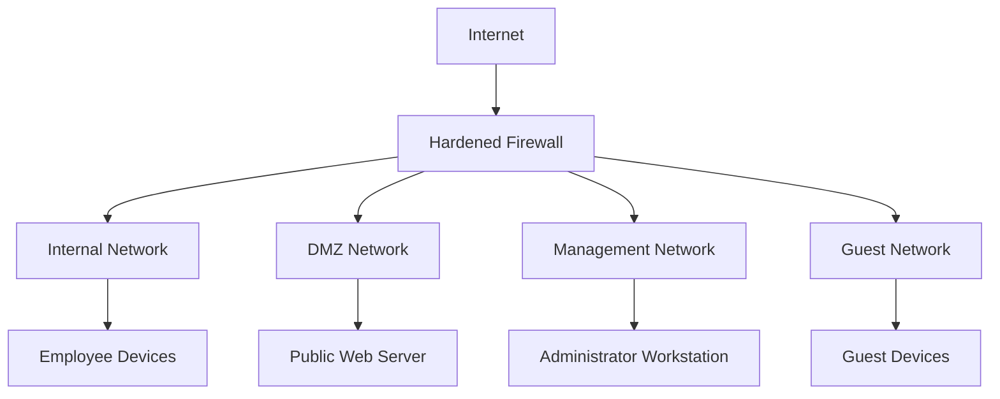

# Firewall Hardening

Firewall hardening is the process of configuring, securing, and maintaining firewall systems to reduce security risks and prevent unauthorized network access.

A firewall monitors and controls network traffic according to defined security policies. However, simply deploying a firewall does not guarantee network security. Its configuration, rule ordering, management access, logging, software updates, and ongoing maintenance are equally important.

A properly hardened firewall should:

* Allow only explicitly required network traffic.
* Block unauthorized connections.
* Restrict access to management interfaces.
* Protect internal networks from external threats.
* Prevent unnecessary communication between network segments.
* Detect and log suspicious traffic.
* Apply equivalent security controls to IPv4 and IPv6.
* Maintain reliable operation during failures and configuration changes.

Firewall hardening applies to dedicated hardware firewalls, Linux firewalls, cloud firewalls, routers, and host-based firewall systems.

# 🗁 Firewall Hardening Objectives

Firewall hardening focuses on reducing the number of opportunities an attacker can exploit.

**Prevent Unauthorized Access**

Restrict incoming and outgoing connections according to approved security policies.

**Reduce Attack Surface**

Disable unnecessary services, close unused ports, and remove obsolete firewall rules.

**Protect Internal Networks**

Prevent external networks and untrusted segments from accessing private resources without authorization.

**Limit Lateral Movement**

Restrict communication between internal systems so that compromising one device does not automatically expose the entire network.

**Protect Firewall Management**

Ensure that only authorized administrators can access firewall configuration interfaces.

**Detect Suspicious Activity**

Use logging and monitoring to identify unexpected connections, scanning activity, and policy violations.

**Maintain Availability**

Protect firewall resources from excessive traffic, resource exhaustion, and configuration failures.

# 🗁 Firewall Security Principles

A strong firewall configuration follows several fundamental security principles.

**Least Privilege**

Allow only the traffic required for a specific business or operational purpose.

For example, a web server may need inbound TCP port 443, but it should not automatically expose SSH, database, or file-sharing services to the internet.

**Default Deny**

Traffic should be denied unless an explicit rule permits it.

**Defense in Depth**

Use multiple security layers rather than relying on one firewall.

Examples:

* Network firewall.
* Host-based firewall.
* Application security controls.
* Endpoint protection.
* Network segmentation.
* Authentication and access control.

**Explicit Access Control**

Define exactly which source networks, destination networks, protocols, and ports are permitted.

**Secure Management**

Separate firewall administration from ordinary user traffic.

**Continuous Monitoring**

Review firewall logs, configuration changes, and traffic patterns regularly.

**Fail Securely**

When a firewall cannot make a valid security decision, its behavior should follow a deliberate security policy rather than accidentally allowing traffic.

For security-sensitive network boundaries, an explicit deny policy is generally appropriate.

# 🗁 Secure Firewall Architecture

A firewall should be positioned and configured according to the network's security requirements.

A typical organization may use separate interfaces or zones for:

* WAN: External internet connectivity.
* LAN: Internal users and systems.
* DMZ: Public-facing services.
* MANAGEMENT: Administrative access.
* GUEST: Untrusted visitor devices.
* IOT: Connected devices with limited trust.

Example architecture:



The firewall should apply separate policies to each security zone.

For example:

| Source Zone | Destination Zone | Policy |
| --- | --- | --- |
| WAN | LAN | Deny by default |
| WAN | DMZ | Allow explicitly published services |
| WAN | MANAGEMENT | Deny |
| LAN | Internet | Allow required outbound traffic |
| LAN | MANAGEMENT | Deny except authorized administrators |
| GUEST | LAN | Deny |
| GUEST | Internet | Allow |
| DMZ | LAN | Deny by default |
| MANAGEMENT | Firewall | Allow approved administration |

# 🗁 Default-Deny Security Policy

A default-deny policy blocks traffic unless an explicit rule allows it.

This is one of the most important firewall hardening practices.

Example:

```text
Firewall Policy

Allow:
- Established and related connections
- Required DNS traffic
- Required DHCP traffic
- Approved application connections
- Authorized management traffic

Deny:
- Unsolicited inbound connections
- Unauthorized inter-segment traffic
- Unnecessary outbound connections
- Invalid connection states
- All other traffic by default
```

**Example nftables Forwarding Policy**

```bash
sudo nft add table inet filter

sudo nft 'add chain inet filter forward {
    type filter hook forward priority filter;
    policy drop;
}'

sudo nft add rule inet filter forward \
    ct state established,related accept

sudo nft add rule inet filter forward \
    ct state invalid drop
```

This creates a forwarding chain with a default-drop policy.

The established and related rule permits return traffic for connections that have already been allowed elsewhere.

The invalid rule rejects packets that connection tracking considers invalid.

This is only a starting policy. Required forwarding rules must be added before the default-drop policy can support normal network operation.

**Important:** Input, output, and forward traffic are different firewall paths.

| Chain | Traffic |
| --- | --- |
| INPUT | Traffic destined for the firewall itself |
| OUTPUT | Traffic generated by the firewall |
| FORWARD | Traffic routed through the firewall |

A firewall can have a secure forwarding policy while still exposing vulnerable services through its input chain.

# 🗁 Firewall Rule Hardening

Firewall rules should be precise, understandable, and limited to necessary communication.

A well-designed rule should define:

* Source address or network.
* Destination address or network.
* Protocol.
* Destination port.
* Connection state, where appropriate.
* Incoming and outgoing interfaces or zones.
* Logging requirements.
* Business purpose.

**Example of an Overly Permissive Rule**

```text
Allow:
Source: Any
Destination: Any
Protocol: Any
Port: Any
Action: Accept
```

This rule provides almost no meaningful access restriction.

**Improved Rule**

```text
Allow:
Source: 192.168.20.0/24
Destination: 192.168.40.10
Protocol: TCP
Destination Port: 443
Action: Accept
Purpose: Employee access to internal HTTPS application
```

**Rule Ordering**

Many firewalls evaluate rules in order.

For example:

```text
Rule 1: Allow established and related connections
Rule 2: Allow approved employee HTTPS traffic
Rule 3: Deny guest access to internal networks
Rule 4: Deny unauthorized management access
Rule 5: Drop remaining traffic
```

The actual order must account for the firewall platform, chain behavior, zones, and specific policy requirements.

**Remove Unnecessary Rules**

Regularly review and remove:

* Unused rules.
* Temporary testing rules.
* Duplicate rules.
* Obsolete address objects.
* Broad permit rules.
* Rules for retired servers.
* Unused port-forwarding entries.

**Use Address Groups**

Group related IP addresses and networks into reusable objects.

For example:

```text
EMPLOYEE_NETWORKS
192.168.20.0/24
192.168.21.0/24

APPROVED_DNS_SERVERS
192.168.40.53
192.168.40.54

MANAGEMENT_HOSTS
192.168.10.10
192.168.10.11
```

Address groups make policies easier to maintain and audit.

# 🗁 Ingress and Egress Filtering

Ingress filtering controls traffic entering a network or interface.

Egress filtering controls traffic leaving a network or interface.

Both are important for firewall hardening.

**Ingress Filtering**

Typical ingress policies include:

* Block unsolicited inbound connections.
* Allow only published public services.
* Reject invalid traffic.
* Block spoofed source addresses.
* Restrict access to management services.
* Apply rate limits where appropriate.

**Egress Filtering**

Typical egress policies include:

* Allow required DNS traffic to approved resolvers.
* Permit approved web access.
* Restrict unnecessary outbound connections.
* Block unauthorized access to sensitive external services.
* Monitor unusual outbound traffic.
* Restrict direct SMTP connections where not required.

Egress filtering can help detect compromised systems communicating with external command-and-control infrastructure.

Example policy:

| Source | Destination | Service | Action |
| --- | --- | --- | --- |
| Employee LAN | Approved DNS | UDP/TCP 53 | Allow |
| Employee LAN | Internet | TCP 443 | Allow |
| Guest LAN | Internal networks | Any | Deny |
| IoT LAN | Approved NTP | UDP 123 | Allow |
| IoT LAN | Internet | Any | Restrict according to requirements |

# 🗁 Anti-Spoofing Protection

IP spoofing occurs when a packet uses a forged source IP address.

An attacker may attempt to make traffic appear as though it originates from a trusted internal network.

Anti-spoofing rules validate whether source addresses are appropriate for the interface or network from which packets arrive.

**Example**

If the WAN interface receives a packet with a source address belonging to the internal LAN, that packet is generally suspicious.

```text
WAN Interface:
Expected source:
- Public IP addresses assigned to external networks

Suspicious source:
- 192.168.0.0/16
- 10.0.0.0/8
- 172.16.0.0/12
```

These RFC 1918 addresses are not valid public internet source addresses.

Other source ranges may also be inappropriate depending on the network and deployment.

**Linux Reverse Path Filtering**

Linux supports Reverse Path Filtering through the `rp_filter` setting.

Inspect its configuration:

```bash
sysctl net.ipv4.conf.all.rp_filter
sysctl net.ipv4.conf.default.rp_filter
```

Possible values:

| Value | Meaning |
| --- | --- |
| `0` | Disabled |
| `1` | Strict reverse-path validation |
| `2` | Loose reverse-path validation |

Enable strict mode where the routing architecture supports symmetric paths:

```bash
sudo sysctl -w net.ipv4.conf.all.rp_filter=1
```

For persistent configuration, use an appropriate file under `/etc/sysctl.d/`.

Strict reverse-path filtering can interfere with asymmetric routing, policy-based routing, and some multi-homed designs. Select the mode according to the actual routing architecture.

**Ingress Filtering Standard**

BCP 38 describes network ingress filtering practices that help prevent source-address spoofing.

# 🗁 Management Plane Protection

The management plane contains interfaces and services used to configure and administer network infrastructure.

Examples:

* SSH.
* HTTPS administration.
* WinBox.
* SNMP.
* RDP.
* Firewall management APIs.
* VPN administration interfaces.

An attacker who gains administrative access to a firewall may gain control over the entire network boundary.

Recommended practices:

**Use a Dedicated Management Network**

Allow administration only from an approved management subnet.

Example:

```text
Management Subnet:
192.168.10.0/24

Authorized Administrator:
192.168.10.10

Firewall Management:
192.168.10.1
```

**Restrict Administrative Source Addresses**

Do not expose SSH, HTTPS, WinBox, or other management services to unrestricted internet access.

**Use Strong Authentication**

* Use unique administrator accounts.
* Use strong passwords.
* Enable MFA where supported.
* Use SSH keys where appropriate.
* Remove unused accounts.
* Apply role-based permissions.

**Disable Unnecessary Services**

If a management protocol is not required, disable it.

**Use Secure Protocols**

Prefer:

* SSH instead of Telnet.
* HTTPS instead of HTTP.
* SNMPv3 instead of SNMPv1 or SNMPv2c.
* Encrypted VPN access for remote administration.

**Protect Administrative Sessions**

Use session timeouts, access logging, and controlled administrative access.

# 🗁 Service and Port Hardening

A firewall should expose only the network services required by its role.

Unnecessary open ports increase the attack surface.

Common services and their ports:

| Service | Protocol | Port | Recommendation |
| --- | --- | ---: | --- |
| SSH | TCP | 22 | Restrict to administrators |
| Telnet | TCP | 23 | Disable |
| DNS | UDP/TCP | 53 | Restrict according to resolver role |
| HTTP | TCP | 80 | Avoid exposing administration over HTTP |
| HTTPS | TCP | 443 | Use for secure web access |
| RDP | TCP | 3389 | Restrict to authorized systems or VPN |
| SNMP | UDP | 161 | Restrict to monitoring systems |
| SNMP Trap | UDP | 162 | Restrict to monitoring destinations |
| WinBox | TCP | 8291 | Restrict to management networks |
| Syslog over TLS | TCP | 6514 | Use for encrypted remote logging |

**Inspect Listening Services on Linux**

```bash
sudo ss -tulpn
```

This command displays listening TCP and UDP sockets and associated processes where permissions allow.

**Check a Specific Port**

```bash
sudo ss -tulpn | grep ':22'
```

A listening service should be evaluated separately from its network firewall exposure. Closing a firewall port does not stop the service itself from running.

# 🗁 Connection Tracking Protection

Stateful firewalls maintain information about active connections.

Connection tracking helps identify whether packets belong to:

* New connections.
* Established connections.
* Related connections.
* Invalid or unrecognized connections.

Common connection states:

| State | Meaning |
| --- | --- |
| NEW | Packet starting a connection or otherwise not yet established |
| ESTABLISHED | Packet associated with an established connection |
| RELATED | Packet associated with an existing connection |
| INVALID | Packet that cannot be associated with a valid tracked connection |
| UNTRACKED | Packet explicitly excluded from connection tracking |

Recommended practices:

* Accept established and related traffic where appropriate.
* Drop invalid traffic.
* Restrict new inbound connections.
* Monitor connection table usage.
* Investigate unexpected connection growth.
* Configure timeouts appropriate to the network.
* Avoid unnecessarily tracking traffic that does not require stateful inspection.

Connection tracking is useful, but excessive connection volume can consume memory and processing resources.

# 🗁 DoS and DDoS Protection

A Denial of Service (DoS) attack attempts to make a service or network unavailable.

A Distributed Denial of Service (DDoS) attack uses multiple sources to generate excessive traffic or requests.

Common attack categories include:

* SYN floods.
* UDP floods.
* ICMP floods.
* DNS amplification.
* Reflection attacks.
* HTTP request floods.
* Connection exhaustion.
* Application-layer resource exhaustion.

Firewall hardening can reduce exposure to some attacks.

**Basic Protection Techniques**

* Apply appropriate connection limits.
* Use rate limiting where suitable.
* Reject malformed or invalid traffic.
* Restrict unnecessary services.
* Monitor connection tracking usage.
* Use upstream filtering for large attacks.
* Apply provider-level DDoS protection when available.
* Use application-layer protection for HTTP services.

**Important Consideration**

A firewall alone cannot reliably stop every volumetric DDoS attack.

If attack traffic saturates the internet connection before reaching the firewall, local firewall rules cannot restore the unavailable bandwidth.

Large-scale DDoS protection may require:

* ISP filtering.
* Upstream traffic scrubbing.
* Anycast infrastructure.
* Content delivery networks.
* Specialized DDoS mitigation services.

# 🗁 Logging and Monitoring

Firewall logging provides visibility into network activity and security events.

Important events include:

* Blocked inbound connections.
* Unauthorized management attempts.
* Unexpected outbound traffic.
* Invalid connection states.
* Port scanning.
* Repeated authentication failures.
* Configuration changes.
* Firewall resource exhaustion.

**Linux nftables Logging Example**

```bash
sudo nft add rule inet filter input \
    ct state invalid \
    limit rate 5/second \
    log prefix "INVALID INPUT: " \
    drop
```

This logs invalid packets at a limited rate before dropping them.

**Inspect System Logs**

```bash
sudo journalctl -u nftables
```

Depending on the Linux distribution and logging configuration, packet logs may also be available through the kernel journal or system logging service.

**Remote Logging**

Forward security logs to a centralized logging system where possible.

Common solutions include:

* rsyslog.
* Syslog servers.
* SIEM platforms.
* Network monitoring systems.

**Avoid Excessive Logging**

Logging every dropped packet can overwhelm storage and monitoring systems.

Use rate limits, targeted rules, and meaningful log messages.

# 🗁 IPv6 Firewall Hardening

IPv6 security must be treated as part of the firewall's primary security policy.

A firewall that filters IPv4 but permits unrestricted IPv6 may expose internal systems through an unintended path.

Important IPv6 security practices:

* Apply input, output, and forwarding policies to IPv6.
* Restrict unsolicited inbound connections.
* Control inter-segment IPv6 traffic.
* Protect management services.
* Monitor IPv6 connections.
* Use appropriate source-address validation.
* Permit necessary ICMPv6 messages.
* Protect Router Advertisement behavior.
* Use RA Guard where supported.
* Review DHCPv6-related controls where applicable.

**Do Not Block All ICMPv6**

ICMPv6 supports essential IPv6 functions, including:

* Neighbor Discovery.
* Router Discovery.
* Packet Too Big messages.
* Destination Unreachable messages.
* Time Exceeded messages.
* Path MTU Discovery.

Blocking all ICMPv6 traffic can cause connectivity and network discovery problems.

**Inspect IPv6 Firewall Rules**

```bash
sudo nft list ruleset
```

An nftables `inet` family table can contain both IPv4 and IPv6 rules. Verify that the actual rule expressions handle both address families as intended.

# 🗁 Firewall Updates and Maintenance

Firewall software and firmware must be maintained to reduce vulnerabilities and operational risks.

Recommended practices:

**Update Firmware and Software**

Install security updates from trusted vendors and repositories.

**Review Security Advisories**

Monitor vendor advisories for vulnerabilities affecting firewall software, firmware, and exposed services.

**Disable Unused Features**

Remove unnecessary services, packages, management interfaces, and protocols.

**Review Administrator Accounts**

Remove inactive accounts and periodically verify administrator privileges.

**Review Firewall Policies**

Remove obsolete rules and verify that existing permissions remain necessary.

**Monitor Resource Usage**

Inspect:

* CPU utilization.
* Memory usage.
* Connection tracking table usage.
* Interface bandwidth.
* Packet drops.
* Interface errors.
* Disk usage for logs.

**Use Change Management**

Before changing firewall policies:

* Identify the business requirement.
* Review the impact.
* Record the current configuration.
* Prepare a rollback plan.
* Apply the change.
* Verify expected connectivity.
* Record the final configuration.

# 🗁 Backup and Recovery

Firewall configuration backups are essential for recovering from configuration errors, hardware failure, and unexpected incidents.

A backup should include relevant configuration data such as:

* Interface configuration.
* IP addressing.
* VLAN configuration.
* Routing configuration.
* Firewall rules.
* NAT rules.
* VPN settings.
* Administrator configuration.
* Relevant certificates and keys, handled securely.

Recommended practices:

* Create backups before major changes.
* Store backups in a protected location.
* Encrypt sensitive configuration files.
* Restrict backup access.
* Maintain versioned backups.
* Test restoration procedures.
* Keep recovery documentation.
* Store copies separately from the firewall itself.

A backup that has never been tested should not be considered a verified recovery solution.

# 🗁 Linux Firewall Hardening

Linux systems commonly use nftables as their packet filtering framework.

The following examples illustrate a basic host firewall configuration.

**Inspect Existing Rules**

```bash
sudo nft list ruleset
```

**Create a Firewall Table**

```bash
sudo nft add table inet firewall
```

**Create an Input Chain**

```bash
sudo nft 'add chain inet firewall input {
    type filter hook input priority filter;
    policy drop;
}'
```

**Create an Output Chain**

```bash
sudo nft 'add chain inet firewall output {
    type filter hook output priority filter;
    policy accept;
}'
```

**Create a Forward Chain**

```bash
sudo nft 'add chain inet firewall forward {
    type filter hook forward priority filter;
    policy drop;
}'
```

**Allow Loopback Traffic**

```bash
sudo nft add rule inet firewall input \
    iifname "lo" accept
```

**Allow Established and Related Connections**

```bash
sudo nft add rule inet firewall input \
    ct state established,related accept
```

**Drop Invalid Connections**

```bash
sudo nft add rule inet firewall input \
    ct state invalid drop
```

**Allow SSH From the Management Network**

```bash
sudo nft add rule inet firewall input \
    ip saddr 192.168.10.0/24 \
    tcp dport 22 accept
```

**Allow ICMPv4 Echo Requests With Rate Limiting**

```bash
sudo nft add rule inet firewall input \
    ip protocol icmp \
    icmp type echo-request \
    limit rate 5/second accept
```

**Allow Required ICMPv6 Traffic**

IPv6 requires more than simply allowing echo requests. A production firewall should explicitly permit the ICMPv6 messages required by its role, including appropriate Neighbor Discovery and Path MTU Discovery traffic.

**Inspect the Ruleset**

```bash
sudo nft list ruleset
```

**Persistent Configuration**

Save the intended ruleset in the distribution's nftables configuration file, commonly:

```text
/etc/nftables.conf
```

Then enable the service where supported:

```bash
sudo systemctl enable --now nftables
```

**Important Configuration Note**

The commands above illustrate individual rule operations, not a complete production-ready firewall configuration. They should be tested in a controlled environment before deployment.

A production configuration must account for DHCP, DNS, ICMPv6, required application services, remote administration, and the system's actual network role.

If you administer a remote server, verify that SSH access is permitted before applying a default-drop input policy. Otherwise, you may lose administrative access.

# 🗁 MikroTik RouterOS Firewall Hardening

MikroTik RouterOS provides firewall filter rules, connection tracking, address lists, interface lists, and service restrictions.

The following examples use RouterOS v7.

**Inspect Firewall Rules**

```routeros
/ip firewall filter print
```

**Inspect NAT Rules**

```routeros
/ip firewall nat print
```

**Inspect Connection Tracking**

```routeros
/ip firewall connection print
```

**Create Interface Lists**

```routeros
/interface list
add name=WAN
add name=LAN
```

Add the appropriate interfaces:

```routeros
/interface list member
add interface=ether1 list=WAN
add interface=bridge1 list=LAN
```

Adjust the interface names according to the actual router configuration.

**Example Input Chain Protection**

The following is an illustrative rule sequence for a router with a dedicated management subnet.

```routeros
/ip firewall filter
add chain=input action=accept \
    connection-state=established,related

add chain=input action=drop \
    connection-state=invalid

add chain=input action=accept \
    protocol=icmp

add chain=input action=accept \
    in-interface-list=LAN \
    src-address=192.168.10.0/24 \
    protocol=tcp dst-port=22,8291

add chain=input action=drop \
    in-interface-list=WAN

add chain=input action=drop
```

This example:

* Allows established and related traffic.
* Drops invalid traffic.
* Allows ICMP to the router.
* Permits SSH and WinBox from the specified management subnet arriving through the LAN interface list.
* Blocks unsolicited WAN access to the router.
* Drops remaining input traffic.

The example assumes that required DHCP, DNS, VPN, routing, and other router services have been accounted for. ICMP should be refined according to the network's requirements.

**Example Forward Chain Protection**

```routeros
/ip firewall filter
add chain=forward action=accept \
    connection-state=established,related

add chain=forward action=drop \
    connection-state=invalid

add chain=forward action=drop \
    in-interface-list=WAN \
    connection-state=new \
    connection-nat-state=!dstnat

add chain=forward action=drop
```

This is a restrictive starting point, not a complete internet gateway configuration. Explicitly add approved LAN-to-WAN, inter-VLAN, VPN, and published-service rules before the final drop rule.

**Restrict RouterOS Management Services**

Inspect available services:

```routeros
/ip service print
```

Disable unused services:

```routeros
/ip service
disable telnet
disable ftp
disable www
disable api
disable api-ssl
```

Do not disable a service that is required by your current management architecture.

Restrict SSH and WinBox to approved addresses:

```routeros
/ip service
set ssh address=192.168.10.0/24
set winbox address=192.168.10.0/24
```

These service restrictions provide an additional management access control layer. Firewall filtering should also enforce the intended policy.

**Restrict MAC-Based Management**

MAC-based management can bypass ordinary IP-based firewall assumptions at Layer 2.

Review and restrict MAC server access:

```routeros
/tool mac-server
set allowed-interface-list=LAN

/tool mac-server mac-winbox
set allowed-interface-list=LAN
```

Review neighbor discovery as well:

```routeros
/ip neighbor discovery-settings
set discover-interface-list=LAN
```

**Disable Neighbor Discovery on Untrusted Interfaces**

Do not expose unnecessary discovery information on WAN-facing or untrusted interfaces.

**Verify Firewall Configuration**

```routeros
/ip firewall filter print stats
/ip firewall nat print
/ip service print
/interface list member print
```

**RouterOS v6 and v7**

The examples use RouterOS v7 syntax and concepts. Verify service names, interface configuration, and firewall behavior against the installed version before deployment.

# 🗁 Cisco Firewall Hardening

Cisco network devices support multiple security mechanisms depending on the platform and operating system.

Common hardening features include:

* ACLs.
* Control Plane Policing.
* Secure management access.
* SSH.
* AAA.
* Logging.
* SNMPv3.
* Secure routing protocols.
* Zone-based firewall policies on supported platforms.

**Disable Unused Services**

Example Cisco IOS configuration:

```cisco
configure terminal

no ip http server
no ip http secure-server
no service pad
```

Only disable HTTP or HTTPS management services when they are not required.

**Enable SSH**

```cisco
configure terminal

hostname R1
ip domain-name example.local

crypto key generate rsa modulus 2048

ip ssh version 2
```

**Create an Administrative ACL**

```cisco
ip access-list standard MANAGEMENT-ACCESS
 permit 192.168.10.0 0.0.0.255
 deny any log
```

Apply it to the VTY lines:

```cisco
line vty 0 4
 transport input ssh
 access-class MANAGEMENT-ACCESS in
 login local
```

The device must also have an appropriate local or AAA authentication configuration.

**Enable Logging**

```cisco
service timestamps log datetime msec
logging buffered 16384 warnings
```

**Verify Configuration**

```cisco
show ip ssh
show access-lists
show logging
show running-config
```

Cisco configuration syntax and supported features vary across IOS, IOS XE, ASA, and other platforms.

# 🗁 Cloud Firewall Hardening

Cloud environments provide network security controls that should be configured according to the application's architecture.

Important controls include:

* Restrict inbound traffic.
* Restrict unnecessary outbound traffic.
* Use separate public and private subnets.
* Avoid exposing administrative services.
* Apply least-privilege security groups.
* Restrict subnet-level network ACLs.
* Protect management access.
* Use private endpoints where appropriate.
* Enable flow logs.
* Review public IP assignments.
* Monitor security group changes.

**Example Cloud Security Policy**

| Workload | Inbound Access | Outbound Access |
| --- | --- | --- |
| Public Web Server | TCP 443 from approved public sources | Required application services |
| Application Server | TCP 443 from web tier | Database and approved services |
| Database Server | Database port from application tier | Required internal services |
| Management Host | Approved administrator access | Management and monitoring services |

Cloud security groups are commonly stateful, while subnet-level network ACLs may be stateless. Verify the behavior and evaluation model of the specific cloud provider.

# 🗁 Firewall Security Testing

Firewall configurations must be tested to verify that their policies work as intended.

Testing should cover both allowed and denied traffic.

**Inspect Listening Ports**

On Linux:

```bash
sudo ss -tulpn
```

**Scan an Authorized Test Host**

Using Nmap:

```bash
nmap -sT -sV 192.168.20.10
```

This checks TCP ports and attempts service-version detection.

**Check a Specific Port**

```bash
nc -vz 192.168.40.10 443
```

**Test DNS Resolution**

```bash
dig example.com
```

**Inspect Firewall Logs**

```bash
sudo journalctl -k
```

**Capture Packets**

```bash
sudo tcpdump -ni any host 192.168.40.10
```

**Test Cases**

| Test | Expected Result |
| --- | --- |
| Authorized administrator connects through SSH | Allowed |
| Unauthorized guest connects to management interface | Blocked |
| Employee accesses approved HTTPS application | Allowed |
| Guest accesses employee network | Blocked |
| External user accesses unpublished internal service | Blocked |
| Public user accesses published HTTPS service | Allowed |
| Invalid traffic reaches firewall | Dropped according to policy |

Only perform security scans and penetration tests on systems you own or are explicitly authorized to assess.

# 🗁 Common Firewall Hardening Mistakes

| Mistake | Security Impact |
| --- | --- |
| Allowing all traffic by default | Unauthorized access |
| Exposing management interfaces to the internet | Increased risk of firewall compromise |
| Using weak administrator credentials | Unauthorized configuration changes |
| Leaving unused services enabled | Increased attack surface |
| Ignoring IPv6 | Potential security policy bypass |
| Using overly broad firewall rules | Excessive network access |
| Allowing unrestricted outbound traffic | Increased malware communication opportunities |
| Blocking all ICMPv6 | IPv6 connectivity and discovery problems |
| Logging every packet without limits | Log flooding and resource exhaustion |
| Failing to update firmware | Exposure to known vulnerabilities |
| Not maintaining configuration backups | Difficult recovery |
| Applying rules without testing | Unexpected service outages |
| Ignoring firewall input traffic | Firewall services may remain exposed |
| Trusting internal networks completely | Increased lateral movement risk |
| Failing to review old rules | Accumulation of unnecessary permissions |

# 🗁 Firewall Hardening Checklist

Use this checklist when reviewing a firewall configuration.

**Access Control**

* [ ] Default-deny policy is configured where appropriate.
* [ ] Only required services and ports are allowed.
* [ ] Unnecessary firewall rules have been removed.
* [ ] Inter-segment communication is restricted.
* [ ] Inbound traffic is filtered.
* [ ] Outbound traffic is controlled according to requirements.
* [ ] Invalid connection states are handled.

**Management Security**

* [ ] Management access uses a dedicated network or approved access path.
* [ ] Administrative access is restricted by source address.
* [ ] Strong authentication is enabled.
* [ ] Unused management services are disabled.
* [ ] Secure protocols are used.
* [ ] Administrative access attempts are monitored.

**Network Protection**

* [ ] Anti-spoofing controls are implemented where appropriate.
* [ ] DMZ policies are configured.
* [ ] Guest and IoT networks are isolated.
* [ ] IPv4 and IPv6 policies are reviewed.
* [ ] Required ICMP and ICMPv6 traffic is permitted.
* [ ] Connection tracking resources are monitored.
* [ ] DDoS protection requirements are evaluated.

**Monitoring and Maintenance**

* [ ] Firewall logging is enabled.
* [ ] Important logs are forwarded to a central system.
* [ ] Security updates are applied.
* [ ] Administrator accounts are reviewed.
* [ ] Configuration backups are maintained.
* [ ] Backup restoration is tested.
* [ ] Firewall rules are reviewed periodically.
* [ ] Changes are documented and tested.

# 🗁 Practical Labs

**Lab: Linux nftables Firewall Hardening**

Objective:

Configure a Linux firewall using nftables.

Tasks:

* Inspect the existing firewall rules.
* Create an `inet` firewall table.
* Configure input, output, and forward chains.
* Set appropriate default policies.
* Allow loopback traffic.
* Permit established and related connections.
* Allow SSH from a management subnet.
* Drop invalid traffic.
* Test connectivity.
* Save a persistent configuration.

**Lab: Management Access Restriction**

Objective:

Allow firewall administration only from an authorized management network.

Tasks:

* Create a management subnet.
* Restrict SSH and HTTPS access.
* Block management access from guest and WAN interfaces.
* Test authorized access.
* Test unauthorized access.
* Review firewall logs.

**Lab: Anti-Spoofing Protection**

Objective:

Prevent inappropriate source addresses from entering through an external interface.

Tasks:

* Identify trusted and untrusted interfaces.
* Define invalid source-address ranges.
* Configure ingress filtering.
* Inspect packet counters.
* Verify expected traffic.
* Evaluate the effect of reverse-path filtering.

**Lab: Guest Network Protection**

Objective:

Prevent guest devices from accessing internal networks.

Tasks:

* Create a guest VLAN.
* Assign an IP subnet.
* Configure firewall rules.
* Permit required internet access.
* Block access to management and employee networks.
* Verify DNS and internet connectivity.
* Review denied traffic logs.

**Lab: MikroTik RouterOS Hardening**

Objective:

Secure a MikroTik router using RouterOS v7.

Tasks:

* Create WAN and LAN interface lists.
* Configure input-chain protection.
* Configure forward-chain protection.
* Restrict SSH and WinBox access.
* Disable unused management services.
* Restrict MAC server access.
* Configure logging.
* Verify firewall counters.
* Export and back up the configuration.

**Lab: Firewall Rule Review**

Objective:

Audit an existing firewall configuration.

Tasks:

* Identify overly permissive rules.
* Find duplicate and unused rules.
* Check rule ordering.
* Identify exposed management services.
* Review IPv4 and IPv6 policies.
* Document recommended changes.
* Test the revised policy.

**Lab: Firewall Recovery**

Objective:

Practice recovering from a firewall configuration failure.

Tasks:

* Create a configuration backup.
* Record the current management access path.
* Introduce a controlled test configuration change.
* Restore the previous configuration.
* Verify network connectivity.
* Document the recovery process.

# 🗁 Summary

Firewall hardening strengthens network security by reducing unnecessary access and protecting critical network resources.

Important practices include:

* Apply least-privilege access policies.
* Use default-deny rules where appropriate.
* Restrict inbound and outbound traffic.
* Protect firewall management interfaces.
* Disable unnecessary services.
* Implement anti-spoofing controls.
* Monitor connection tracking and resource usage.
* Apply suitable DoS and DDoS protections.
* Configure IPv4 and IPv6 security policies.
* Enable useful logging and monitoring.
* Maintain software updates and configuration backups.
* Test firewall policies regularly.

**Key principle:** A secure firewall should permit only the communication required by the network's operational needs while denying everything else by default where practical.

# 🗁 References

* [NIST SP 800-41 Rev. 1 - Guidelines on Firewalls and Firewall Policy](https://csrc.nist.gov/pubs/sp/800/41/r1/final)
* [NIST SP 800-53 - Security and Privacy Controls for Information Systems and Organizations](https://csrc.nist.gov/pubs/sp/800/53/r5/upd1/final)
* [RFC 2827 - Network Ingress Filtering](https://www.rfc-editor.org/rfc/rfc2827)
* [RFC 3704 - Ingress Filtering for Multihomed Networks](https://www.rfc-editor.org/rfc/rfc3704)
* [RFC 4890 - Recommendations for Filtering ICMPv6 Messages](https://www.rfc-editor.org/rfc/rfc4890)
* [Netfilter - Linux Firewall Framework](https://www.netfilter.org/)
* [nftables Documentation](https://wiki.nftables.org/)
* [MikroTik - RouterOS Firewall](https://help.mikrotik.com/docs/)
* [Cisco - Security Configuration Guides](https://www.cisco.com/)
* [AWS - Security Groups](https://docs.aws.amazon.com/vpc/latest/userguide/vpc-security-groups.html)
* [Microsoft Azure - Network Security Groups](https://learn.microsoft.com/en-us/azure/virtual-network/network-security-groups-overview)
