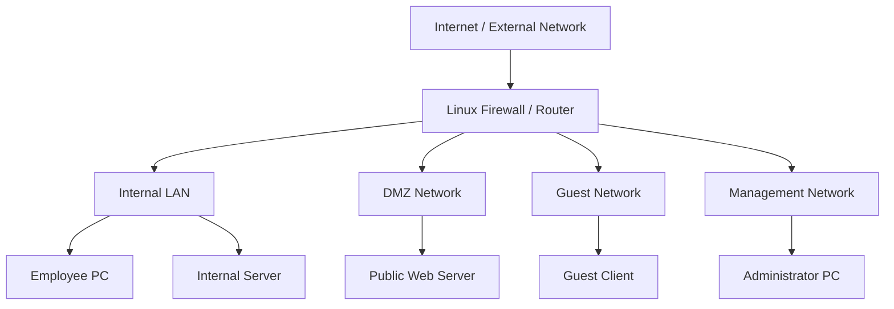
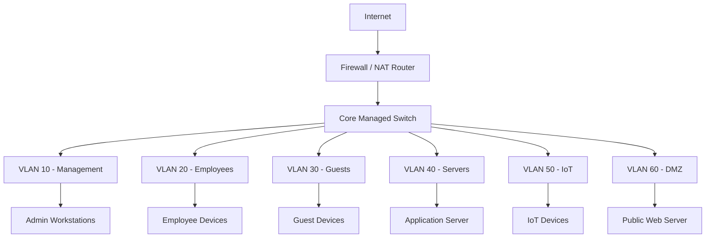

# Firewall Labs and Practical Exercises

Firewall labs provide hands-on experience with network address translation (NAT), packet filtering, connection tracking, access control lists (ACLs), firewall chains, and network security policies.

The purpose of these exercises is to understand how firewalls process packets, how NAT modifies packet addresses, and how security policies control communication between different networks.

This section focuses on practical implementations using:

* Ubuntu Linux and nftables.
* MikroTik RouterOS v7.
* Cisco IOS ACLs.
* Virtual machines and network simulation tools.
* Packet analysis with tcpdump and Wireshark.

The labs progress from basic firewall configuration to advanced network security scenarios.

# 🗁 Lab Environment

You can perform these labs using physical network devices, virtual machines, or network simulation platforms.

**Recommended Software**

| Software | Purpose |
| --- | --- |
| Ubuntu Server | Linux firewall |
| nftables | Linux packet filtering and NAT |
| MikroTik CHR | RouterOS firewall and routing |
| Cisco Packet Tracer | Cisco ACL and routing practice |
| GNS3 | Advanced network simulation |
| EVE-NG | Multi-vendor network labs |
| VirtualBox | Virtual machine environment |
| Wireshark | Packet analysis |
| tcpdump | Command-line packet capture |
| Nmap | Authorized network scanning |
| iproute2 | Linux network configuration |

**Recommended Linux Packages**

```bash
sudo apt update

sudo apt install -y \
    nftables \
    iproute2 \
    iputils-ping \
    traceroute \
    tcpdump \
    nmap \
    netcat-openbsd \
    curl \
    dnsutils
```

Check the installed nftables version:

```bash
nft --version
```

Check network interfaces:

```bash
ip -br link
```

Check IP addresses:

```bash
ip -br addr
```

# 🗁 Network Topology

The following topology will be used as the foundation for several labs.



**Example IP Addressing Plan**

| Device / Network | Interface | IP Address |
| --- | --- | --- |
| Firewall WAN | `wan0` | `198.51.100.2/24` |
| External Gateway | External network | `198.51.100.1` |
| Firewall LAN | `lan0` | `192.168.20.1/24` |
| Employee PC | LAN | `192.168.20.10/24` |
| Internal Server | LAN | `192.168.20.20/24` |
| Firewall DMZ | `dmz0` | `192.168.60.1/24` |
| Web Server | DMZ | `192.168.60.10/24` |
| Firewall Guest | `guest0` | `192.168.30.1/24` |
| Guest Client | Guest | `192.168.30.10/24` |
| Firewall Management | `mgmt0` | `192.168.10.1/24` |
| Administrator PC | Management | `192.168.10.10/24` |

The WAN addresses use documentation-only address space. Replace interface names and addresses according to your actual lab environment.

For Linux virtual machines, interfaces can be connected using internal networks, host-only networks, or virtual switches.

# 🗁 Lab: Basic Firewall Configuration

<text>Objective</text>

Configure a basic Linux firewall using nftables.

**Requirements**

* Ubuntu Server.
* nftables installed.
* At least one network interface.

**Inspect the Existing Firewall**

```bash
sudo nft list ruleset
```

**Create a Firewall Table**

```bash
sudo nft add table inet filter
```

The `inet` family supports both IPv4 and IPv6 traffic.

**Create an Input Chain**

```bash
sudo nft 'add chain inet filter input {
    type filter hook input priority filter;
    policy drop;
}'
```

**Create an Output Chain**

```bash
sudo nft 'add chain inet filter output {
    type filter hook output priority filter;
    policy accept;
}'
```

**Allow Loopback Traffic**

```bash
sudo nft add rule inet filter input \
    iifname "lo" accept
```

**Allow Established and Related Connections**

```bash
sudo nft add rule inet filter input \
    ct state established,related accept
```

**Drop Invalid Connections**

```bash
sudo nft add rule inet filter input \
    ct state invalid drop
```

**Allow SSH From the Management Network**

```bash
sudo nft add rule inet filter input \
    ip saddr 192.168.10.0/24 \
    tcp dport 22 accept
```

**Allow ICMPv4 Echo Requests**

```bash
sudo nft add rule inet filter input \
    ip protocol icmp \
    icmp type echo-request accept
```

**Verify the Rules**

```bash
sudo nft list ruleset
```

**Expected Result**

* Loopback traffic is allowed.
* Established and related traffic is allowed.
* Invalid traffic is dropped.
* SSH is allowed from the management subnet.
* Other incoming traffic is dropped unless explicitly permitted.

The example is a basic host input policy. Add required DHCP, DNS, IPv6 control traffic, and other services according to the machine's role.

If administering the machine remotely, verify the SSH rule and management path before enabling a default-drop policy.

# 🗁 Lab: Stateful Firewall

<text>Objective</text>

Understand how a stateful firewall tracks connections and allows return traffic.

**Create a Test Ruleset**

```bash
sudo nft add table inet stateful
```

```bash
sudo nft 'add chain inet stateful input {
    type filter hook input priority filter;
    policy drop;
}'
```

**Allow Established and Related Traffic**

```bash
sudo nft add rule inet stateful input \
    ct state established,related accept
```

**Allow New SSH Connections From the Management Network**

```bash
sudo nft add rule inet stateful input \
    ip saddr 192.168.10.0/24 \
    tcp dport 22 \
    ct state new accept
```

**Inspect Connection Tracking**

```bash
sudo conntrack -L
```

If the command is unavailable:

```bash
sudo apt install conntrack
```

**Test the Connection**

From an authorized client:

```bash
ssh username@192.168.10.1
```

Observe the connection tracking entries:

```bash
sudo conntrack -L -p tcp
```

**Expected Result**

The firewall allows new SSH connections from the management subnet. Once a connection is established, return packets are accepted by the established-state rule.

**Exercise**

* Remove the established and related rule.
* Test an existing SSH connection.
* Restore the rule.
* Compare the behavior.

# 🗁 Lab: Packet Filtering

<text>Objective</text>

Allow and deny network traffic based on IP addresses, protocols, and ports.

**Scenario**

An internal network contains:

| Device | IP Address | Requirement |
| --- | --- | --- |
| Employee PC | `192.168.20.10` | Access HTTPS |
| Application Server | `192.168.40.10` | Accept HTTPS |
| Database Server | `192.168.40.20` | Accept PostgreSQL |
| Guest Client | `192.168.30.10` | No internal access |

**Create a Forward Chain**

```bash
sudo nft add table inet packet_filter
```

```bash
sudo nft 'add chain inet packet_filter forward {
    type filter hook forward priority filter;
    policy drop;
}'
```

**Allow Established and Related Traffic**

```bash
sudo nft add rule inet packet_filter forward \
    ct state established,related accept
```

**Allow Employee HTTPS Access**

```bash
sudo nft add rule inet packet_filter forward \
    ip saddr 192.168.20.0/24 \
    ip daddr 192.168.40.10 \
    tcp dport 443 accept
```

**Allow Application-to-Database Traffic**

```bash
sudo nft add rule inet packet_filter forward \
    ip saddr 192.168.40.10 \
    ip daddr 192.168.40.20 \
    tcp dport 5432 accept
```

**Block Guest Access to Internal Networks**

```bash
sudo nft add rule inet packet_filter forward \
    ip saddr 192.168.30.0/24 \
    ip daddr 192.168.0.0/16 drop
```

**Verify Rules**

```bash
sudo nft list table inet packet_filter
```

**Expected Result**

* Employee devices can access the approved HTTPS application.
* The application server can reach the database on TCP 5432.
* Guest devices cannot access the specified internal address range.
* Other forwarded traffic is denied by the chain's default policy.

These rules assume the relevant packets traverse this firewall. A production ruleset must also account for routing, IPv6, DNS, DHCP, and required network services.

# 🗁 Lab: Source NAT

<text>Objective</text>

Configure Source NAT (SNAT) to translate private source addresses into a public address.

**Scenario**

An internal host uses:

```text
Private IP: 192.168.20.10
Public IP:  198.51.100.2
```

The firewall should translate the source address of outbound connections.

**Create a NAT Table**

```bash
sudo nft add table ip nat
```

**Create a Postrouting Chain**

```bash
sudo nft 'add chain ip nat postrouting {
    type nat hook postrouting priority srcnat;
    policy accept;
}'
```

**Configure SNAT**

```bash
sudo nft add rule ip nat postrouting \
    ip saddr 192.168.20.0/24 \
    oifname "wan0" \
    snat to 198.51.100.2
```

**Verify the NAT Rule**

```bash
sudo nft list table ip nat
```

**Inspect Traffic**

```bash
sudo tcpdump -ni wan0
```

**Expected Result**

An outbound packet originally using:

```text
Source IP: 192.168.20.10
```

leaves the WAN interface using:

```text
Source IP: 198.51.100.2
```

The firewall's connection tracking maintains the translation information so that return traffic can be translated back to the internal host.

**Exercise**

* Configure SNAT for a single internal host.
* Expand the rule to cover the entire LAN subnet.
* Verify that unrelated source networks are not translated.

# 🗁 Lab: Masquerade

<text>Objective</text>

Configure dynamic source NAT using masquerading.

Masquerade is useful when the outgoing interface receives its IP address dynamically.

**Scenario**

```text
LAN Network: 192.168.20.0/24
WAN Interface: wan0
WAN Address: Dynamic
```

**Create a NAT Table**

```bash
sudo nft add table ip nat
```

**Create a Postrouting Chain**

```bash
sudo nft 'add chain ip nat postrouting {
    type nat hook postrouting priority srcnat;
    policy accept;
}'
```

**Configure Masquerading**

```bash
sudo nft add rule ip nat postrouting \
    ip saddr 192.168.20.0/24 \
    oifname "wan0" masquerade
```

**Verify the Rule**

```bash
sudo nft list table ip nat
```

**Expected Result**

Internal clients use the current IP address of the WAN interface for outbound connections.

**Compare SNAT and Masquerade**

| Feature | SNAT | Masquerade |
| --- | --- | --- |
| Address | Explicitly specified | Automatically uses outgoing interface address |
| Typical use | Static public IP | Dynamic public IP |
| Configuration | `snat to` | `masquerade` |
| Address changes | Requires appropriate rule updates | Adapts to interface address changes |

# 🗁 Lab: Destination NAT and Port Forwarding

<text>Objective</text>

Publish an internal web server through a public-facing firewall address.

**Scenario**

```text
Public IP: 198.51.100.2
Web Server: 192.168.60.10
Public Port: 443
Internal Port: 443
WAN Interface: wan0
```

**Create the NAT Table**

```bash
sudo nft add table ip nat
```

**Create a Prerouting Chain**

```bash
sudo nft 'add chain ip nat prerouting {
    type nat hook prerouting priority dstnat;
    policy accept;
}'
```

**Create a Postrouting Chain**

```bash
sudo nft 'add chain ip nat postrouting {
    type nat hook postrouting priority srcnat;
    policy accept;
}'
```

**Configure Destination NAT**

```bash
sudo nft add rule ip nat prerouting \
    iifname "wan0" \
    ip daddr 198.51.100.2 \
    tcp dport 443 \
    dnat to 192.168.60.10:443
```

**Allow Forwarded Traffic**

```bash
sudo nft add table inet filter
```

```bash
sudo nft 'add chain inet filter forward {
    type filter hook forward priority filter;
    policy drop;
}'
```

```bash
sudo nft add rule inet filter forward \
    ct state established,related accept
```

```bash
sudo nft add rule inet filter forward \
    iifname "wan0" \
    oifname "dmz0" \
    ip daddr 192.168.60.10 \
    tcp dport 443 \
    ct status dnat accept
```

**Verify NAT Rules**

```bash
sudo nft list table ip nat
```

**Verify Forwarding Rules**

```bash
sudo nft list table inet filter
```

**Test the Service**

From an external test network:

```bash
curl -kI https://198.51.100.2
```

The `-k` option skips certificate verification and should only be used for controlled testing. For a properly configured public HTTPS service, use a trusted certificate and normal certificate verification.

**Expected Result**

External clients can reach the internal web server through the firewall's public address on TCP port 443.

**Important Requirements**

* IP forwarding must be enabled.
* The public address must be reachable.
* The upstream network must route traffic correctly.
* The web server must listen on TCP port 443.
* The server's host firewall must allow the connection.
* Return traffic must use the correct routing path.
* The firewall must permit the DNATed forwarded connection.

Destination NAT changes the destination address, but it does not automatically authorize forwarding.

# 🗁 Lab: Firewall Chains

<text>Objective</text>

Understand how input, output, and forward chains process packets.

**Create a Firewall Table**

```bash
sudo nft add table inet chains
```

**Create the Input Chain**

```bash
sudo nft 'add chain inet chains input {
    type filter hook input priority filter;
    policy drop;
}'
```

**Create the Output Chain**

```bash
sudo nft 'add chain inet chains output {
    type filter hook output priority filter;
    policy accept;
}'
```

**Create the Forward Chain**

```bash
sudo nft 'add chain inet chains forward {
    type filter hook forward priority filter;
    policy drop;
}'
```

**Allow Loopback Traffic**

```bash
sudo nft add rule inet chains input \
    iifname "lo" accept
```

**Allow Established Connections**

```bash
sudo nft add rule inet chains input \
    ct state established,related accept
```

**Allow SSH**

```bash
sudo nft add rule inet chains input \
    tcp dport 22 accept
```

**Inspect Chain Configuration**

```bash
sudo nft list table inet chains
```

**Exercise**

Identify which chain processes each packet:

| Scenario | Chain |
| --- | --- |
| An SSH connection to the firewall | INPUT |
| A DNS query generated by the firewall | OUTPUT |
| A client accessing a server through the firewall | FORWARD |
| A web server response generated by the firewall itself | OUTPUT |
| A packet addressed to the firewall's own IP | INPUT |

# 🗁 Lab: Access Control Lists

<text>Objective</text>

Implement ACL-based traffic filtering on a Cisco router or Layer 3 switch.

**Scenario**

```text
Employee Network: 192.168.20.0/24
Guest Network:    192.168.30.0/24
Server Network:   192.168.40.0/24
Web Server:       192.168.40.10
```

Requirements:

* Employees can access the web server over HTTPS.
* Guests cannot access employee or server networks.
* Guests can access other destinations.
* Unmatched traffic follows the ACL's implicit deny behavior.

**Create an Extended ACL**

```cisco
configure terminal

ip access-list extended GUEST-FILTER
 deny ip 192.168.30.0 0.0.0.255 192.168.20.0 0.0.0.255
 deny ip 192.168.30.0 0.0.0.255 192.168.40.0 0.0.0.255
 permit ip 192.168.30.0 0.0.0.255 any
```

**Apply the ACL**

```cisco
interface vlan 30
 ip access-group GUEST-FILTER in
```

**Create an Employee ACL**

```cisco
ip access-list extended EMPLOYEE-FILTER
 permit tcp 192.168.20.0 0.0.0.255 host 192.168.40.10 eq 443
```

The employee ACL contains only the HTTPS permit. Cisco ACLs have an implicit deny at the end, so other traffic from this source network will also be blocked if the ACL is applied as written. Add other required services before applying it to a production interface.

**Verify ACLs**

```cisco
show access-lists
show ip interface vlan 30
```

**Expected Result**

Guest traffic to employee and server networks is blocked. Employees can access the approved web server when the employee ACL is applied and the necessary return traffic and routing are correctly configured.

# 🗁 Lab: Network Segmentation

<text>Objective</text>

Build separate network segments and control communication between them.

**Network Design**

| VLAN | Name | Subnet |
| --- | --- | --- |
| 10 | MANAGEMENT | `192.168.10.0/24` |
| 20 | EMPLOYEES | `192.168.20.0/24` |
| 30 | GUEST | `192.168.30.0/24` |
| 40 | SERVERS | `192.168.40.0/24` |
| 50 | IOT | `192.168.50.0/24` |
| 60 | DMZ | `192.168.60.0/24` |

**Requirements**

* Management devices can administer network infrastructure.
* Employees can access approved internal applications.
* Guests can access the internet only.
* IoT devices can access approved services only.
* Public users can reach published DMZ services.
* DMZ systems cannot freely access internal networks.

**Tasks**

* Create the required VLANs.
* Configure access and trunk ports.
* Assign IP subnets and default gateways.
* Configure inter-VLAN routing.
* Configure firewall zones or ACLs.
* Apply default-deny inter-segment policies.
* Test allowed and denied communication.
* Document the final design.

**Expected Result**

Each segment operates as a separate network, and only explicitly permitted traffic can cross security boundaries.

# 🗁 Lab: Guest Network Isolation

<text>Objective</text>

Configure a guest network with internet access but no access to internal networks.

**Scenario**

```text
Guest Subnet:      192.168.30.0/24
Employee Subnet:   192.168.20.0/24
Management Subnet: 192.168.10.0/24
Server Subnet:     192.168.40.0/24
```

**Example nftables Rules**

```bash
sudo nft add table inet guest
```

```bash
sudo nft 'add chain inet guest forward {
    type filter hook forward priority filter;
    policy drop;
}'
```

Allow established and related traffic:

```bash
sudo nft add rule inet guest forward \
    ct state established,related accept
```

Block guest access to internal private networks:

```bash
sudo nft add rule inet guest forward \
    ip saddr 192.168.30.0/24 \
    ip daddr 192.168.0.0/16 drop
```

Allow guest internet access:

```bash
sudo nft add rule inet guest forward \
    ip saddr 192.168.30.0/24 \
    oifname "wan0" accept
```

**Testing**

From the guest client:

```bash
ping 192.168.20.10
```

Expected: blocked.

Test access to an approved external destination:

```bash
curl -I https://example.com
```

Expected: allowed, assuming DNS, NAT, routing, and upstream connectivity are configured.

This lab uses IPv4 private address space. Apply corresponding IPv6 restrictions if the guest network has IPv6 connectivity.

# 🗁 Lab: DMZ Firewall

<text>Objective</text>

Protect internal systems while publishing a public-facing service.

**Scenario**

```text
WAN:             198.51.100.2
DMZ Gateway:     192.168.60.1
Web Server:      192.168.60.10
Internal LAN:    192.168.20.0/24
Internal App:    192.168.20.20
```

**Requirements**

* Allow public HTTPS access to the web server.
* Deny direct internet access to internal systems.
* Deny unrestricted DMZ-to-LAN communication.
* Permit only explicitly required DMZ-to-application traffic.

**Example Policy Matrix**

| Source | Destination | Port | Action |
| --- | --- | ---: | --- |
| Internet | DMZ Web Server | TCP 443 | Allow |
| Internet | Internal LAN | Any | Deny |
| DMZ Web Server | Internal App | TCP 8443 | Allow if required |
| DMZ Web Server | Internal LAN | Any other | Deny |
| Management | DMZ Web Server | TCP 22 | Allow from approved administrators |

**Tasks**

* Configure the DMZ subnet.
* Configure firewall interfaces.
* Publish the web server through DNAT.
* Configure forward-chain filtering.
* Restrict DMZ-to-LAN traffic.
* Configure management access.
* Test public and internal connectivity.
* Review firewall logs.

**Expected Result**

The web server is publicly reachable through the approved service, while other internal resources remain protected.

# 🗁 Lab: Connection Tracking

<text>Objective</text>

Observe connection tracking and understand how NAT and stateful filtering work together.

**Install Connection Tracking Tools**

```bash
sudo apt install conntrack
```

**Display All Tracked Connections**

```bash
sudo conntrack -L
```

**Display TCP Connections**

```bash
sudo conntrack -L -p tcp
```

**Display Connection Tracking Statistics**

```bash
sudo conntrack -S
```

**Monitor Connection Events**

```bash
sudo conntrack -E
```

**Tasks**

* Generate an SSH connection.
* Generate an HTTP or HTTPS connection.
* Observe connection states.
* Configure a NAT rule.
* Observe the translated connection.
* Close the application connection.
* Observe how the connection entry changes or expires.

**Expected Result**

You should be able to identify connection-tracking entries and understand how a firewall maintains connection state.

# 🗁 Lab: Firewall Logging and Monitoring

<text>Objective</text>

Enable firewall logging and monitor blocked traffic.

**Create a Logging Table**

```bash
sudo nft add table inet logging
```

**Create an Input Chain**

```bash
sudo nft 'add chain inet logging input {
    type filter hook input priority filter;
    policy drop;
}'
```

**Allow Established Traffic**

```bash
sudo nft add rule inet logging input \
    ct state established,related accept
```

**Log New SSH Attempts**

```bash
sudo nft add rule inet logging input \
    tcp dport 22 \
    ct state new \
    limit rate 5/second \
    log prefix "SSH ATTEMPT: "
```

**Allow SSH From the Management Subnet**

```bash
sudo nft add rule inet logging input \
    ip saddr 192.168.10.0/24 \
    tcp dport 22 accept
```

**Log and Drop Remaining Traffic**

```bash
sudo nft add rule inet logging input \
    limit rate 5/second \
    log prefix "BLOCKED INPUT: "

sudo nft add rule inet logging input drop
```

**Monitor Kernel Logs**

```bash
sudo journalctl -k -f
```

**Tasks**

* Generate allowed SSH traffic.
* Generate unauthorized connection attempts from a test machine.
* Observe the logs.
* Compare allowed and blocked traffic.
* Investigate log rate limiting.
* Forward logs to a centralized logging server if available.

**Expected Result**

The firewall records selected traffic events while avoiding unlimited packet logging.

# 🗁 Lab: Anti-Spoofing Protection

<text>Objective</text>

Understand source-address validation and prevent inappropriate private source addresses from entering through the WAN interface.

**Scenario**

The WAN interface should not receive packets claiming to originate from the organization's private LAN address space.

**Example nftables Rules**

```bash
sudo nft add table inet anti_spoof
```

```bash
sudo nft 'add chain inet anti_spoof input {
    type filter hook input priority filter;
    policy accept;
}'
```

```bash
sudo nft add rule inet anti_spoof input \
    iifname "wan0" \
    ip saddr 10.0.0.0/8 drop
```

```bash
sudo nft add rule inet anti_spoof input \
    iifname "wan0" \
    ip saddr 172.16.0.0/12 drop
```

```bash
sudo nft add rule inet anti_spoof input \
    iifname "wan0" \
    ip saddr 192.168.0.0/16 drop
```

These rules demonstrate source filtering for traffic addressed to the firewall itself. A production implementation must also consider forwarded traffic, additional reserved and inappropriate source ranges, legitimate provider configurations, and IPv6.

**Tasks**

* Identify valid source networks for each interface.
* Configure anti-spoofing rules.
* Generate test traffic in an isolated lab.
* Inspect rule counters.
* Verify that legitimate traffic remains functional.

# 🗁 Lab: MikroTik RouterOS Firewall

<text>Objective</text>

Build a basic RouterOS v7 firewall with secure input and forwarding policies.

**Example Topology**

```text
WAN:  ether1
LAN:  bridge1
LAN:  192.168.20.0/24
Router: 192.168.20.1
```

**Create Interface Lists**

```routeros
/interface list
add name=WAN
add name=LAN
```

**Assign Interfaces**

```routeros
/interface list member
add interface=ether1 list=WAN
add interface=bridge1 list=LAN
```

**Configure Input Chain**

```routeros
/ip firewall filter
add chain=input action=accept \
    connection-state=established,related

add chain=input action=drop \
    connection-state=invalid

add chain=input action=accept \
    protocol=icmp

add chain=input action=accept \
    in-interface-list=LAN \
    src-address=192.168.10.0/24 \
    protocol=tcp dst-port=22,8291

add chain=input action=drop \
    in-interface-list=WAN

add chain=input action=drop
```

The management subnet in this example is `192.168.10.0/24`. Configure the management interface and routing accordingly before applying the rules.

**Configure Forward Chain**

```routeros
/ip firewall filter
add chain=forward action=accept \
    connection-state=established,related

add chain=forward action=drop \
    connection-state=invalid

add chain=forward action=drop \
    in-interface-list=WAN \
    connection-state=new \
    connection-nat-state=!dstnat

add chain=forward action=accept \
    in-interface-list=LAN \
    out-interface-list=WAN

add chain=forward action=drop
```

This is an illustrative baseline. Add explicit rules for required inter-VLAN communication, VPNs, DNS, DHCP, and published services before the final drop rule.

**Configure Masquerade**

```routeros
/ip firewall nat
add chain=srcnat \
    out-interface-list=WAN \
    action=masquerade
```

**Inspect Firewall Rules**

```routeros
/ip firewall filter print stats
```

**Inspect NAT Rules**

```routeros
/ip firewall nat print
```

**Inspect Connections**

```routeros
/ip firewall connection print
```

**Tasks**

* Configure WAN and LAN interfaces.
* Create interface lists.
* Apply input-chain protection.
* Apply forward-chain protection.
* Configure NAT.
* Restrict management access.
* Test LAN internet connectivity.
* Test unsolicited WAN access.
* Inspect firewall counters.

**Expected Result**

LAN devices can access the internet through NAT, while unauthorized external connections to the router and forwarded internal networks are blocked according to the configured policy.

# 🗁 Lab: Cisco ACL Configuration

<text>Objective</text>

Implement standard and extended ACLs on a Cisco router or Layer 3 switch.

**Scenario**

```text
Employee Network: 192.168.20.0/24
Guest Network:    192.168.30.0/24
Server Network:   192.168.40.0/24
Web Server:       192.168.40.10
```

**Create a Standard ACL**

```cisco
configure terminal

access-list 10 permit 192.168.10.0 0.0.0.255
```

This permits the management subnet as a source in the ACL.

**Create an Extended ACL**

```cisco
ip access-list extended EMPLOYEE-ACCESS
 permit tcp 192.168.20.0 0.0.0.255 host 192.168.40.10 eq 443
 deny ip 192.168.20.0 0.0.0.255 192.168.40.0 0.0.0.255
 permit ip 192.168.20.0 0.0.0.255 any
```

**Apply the ACL**

```cisco
interface vlan 20
 ip access-group EMPLOYEE-ACCESS in
```

**Verify Configuration**

```cisco
show access-lists
show ip interface vlan 20
```

**Tasks**

* Create standard and extended ACLs.
* Permit selected application traffic.
* Block unauthorized server access.
* Apply ACLs to the correct interfaces.
* Verify rule counters.
* Test allowed and denied traffic.

# 🗁 Lab: Firewall Troubleshooting

<text>Objective</text>

Identify and resolve common firewall and NAT problems.

**Scenario**

An internal client cannot access an external web service.

Example:

```text
Client: 192.168.20.10
Gateway: 192.168.20.1
Firewall WAN: 198.51.100.2
External Gateway: 198.51.100.1
```

**Check the Client IP Configuration**

```bash
ip -br addr
ip route
```

**Check Gateway Connectivity**

```bash
ping 192.168.20.1
```

**Check External Gateway Connectivity**

```bash
ping 198.51.100.1
```

**Check Routing**

```bash
ip route get 1.1.1.1
```

**Check Firewall Rules**

```bash
sudo nft list ruleset
```

**Check NAT Configuration**

```bash
sudo nft list table ip nat
```

**Check Connection Tracking**

```bash
sudo conntrack -L
```

**Capture Packets on LAN**

```bash
sudo tcpdump -ni lan0
```

**Capture Packets on WAN**

```bash
sudo tcpdump -ni wan0
```

**Test DNS**

```bash
dig example.com
```

**Test HTTPS**

```bash
curl -I https://example.com
```

**Common Problems**

| Problem | Possible Cause |
| --- | --- |
| Client cannot reach gateway | Incorrect IP, VLAN, or interface configuration |
| Client reaches gateway but not internet | Missing route or firewall rule |
| Outbound packet leaves with private source IP | Missing or incorrect NAT rule |
| Return packet does not reach client | Missing state tracking, routing issue, or asymmetric path |
| DNS fails but IP connectivity works | DNS configuration or filtering issue |
| Port forwarding fails | Incorrect DNAT, forwarding policy, or server configuration |
| Small packets work but large transfers fail | MTU or Path MTU Discovery issue |
| SSH works locally but not remotely | Firewall policy, routing, or service binding issue |

**Expected Result**

You should be able to identify the failing network layer and distinguish between routing, NAT, firewall filtering, DNS, and server-side problems.

# 🗁 Capstone Project: Complete Firewall Deployment

<badge color="success">Final practical project</badge>

<text>Objective</text>

Design, configure, test, and document a complete firewall architecture for a small organization.

**Scenario**

An organization requires a secure network with separate management, employee, server, guest, IoT, and DMZ networks.

**Network Requirements**

| Segment | VLAN | Subnet | Purpose |
| --- | ---: | --- | --- |
| Management | 10 | `192.168.10.0/24` | Network administration |
| Employees | 20 | `192.168.20.0/24` | Employee devices |
| Guests | 30 | `192.168.30.0/24` | Visitor internet access |
| Servers | 40 | `192.168.40.0/24` | Internal applications |
| IoT | 50 | `192.168.50.0/24` | Cameras and smart devices |
| DMZ | 60 | `192.168.60.0/24` | Public-facing services |

**Required Architecture**



**Required Firewall Policies**

| Source | Destination | Required Policy |
| --- | --- | --- |
| Management | Network Devices | Allow approved administration |
| Employees | Internal Applications | Allow required application ports |
| Employees | Management | Deny by default |
| Guests | Internal Networks | Deny |
| Guests | Internet | Allow |
| IoT | Approved Services | Allow selected traffic |
| IoT | Management | Deny |
| Internet | DMZ | Allow published services only |
| Internet | Internal Networks | Deny |
| DMZ | Internal Networks | Deny by default |
| Firewall | Approved DNS and NTP | Allow as required |

**Project Tasks**

**Network Design**

* Create a network diagram.
* Define VLAN IDs and names.
* Create an IP addressing plan.
* Identify security zones.
* Define routing requirements.

**Switching Configuration**

* Create VLANs.
* Configure access ports.
* Configure trunk ports.
* Restrict allowed VLANs.
* Verify VLAN membership.

**Routing Configuration**

* Configure inter-VLAN routing.
* Assign default gateways.
* Verify routing tables.
* Confirm return paths.

**Firewall Configuration**

* Configure input, output, and forward policies.
* Apply default-deny policies where appropriate.
* Permit established and related traffic.
* Drop invalid traffic.
* Configure required service permissions.
* Restrict management access.

**NAT Configuration**

* Configure masquerading or SNAT for outbound internet access.
* Configure DNAT for approved public services.
* Verify connection tracking.
* Confirm return traffic.

**Security Hardening**

* Restrict administrative access.
* Disable unused management services.
* Configure anti-spoofing protections.
* Apply IPv4 and IPv6 security policies.
* Enable logging.
* Configure backup procedures.

**Testing and Validation**

* Verify internet access.
* Verify internal application access.
* Verify guest isolation.
* Verify IoT restrictions.
* Verify DMZ access.
* Verify management restrictions.
* Verify port forwarding.
* Test both allowed and denied traffic.

**Documentation**

Prepare:

* Network topology diagram.
* VLAN table.
* IP addressing plan.
* Routing table summary.
* Firewall rule matrix.
* NAT configuration.
* Management access policy.
* Troubleshooting notes.
* Backup and recovery procedure.

**Expected Deliverables**

A working segmented network with a documented firewall configuration, tested NAT rules, restricted management access, and verified security policies.

# 🗁 Troubleshooting Reference

Use this table as a quick reference during practical exercises.

| Task | Command |
| --- | --- |
| Show network interfaces | `ip -br link` |
| Show IP addresses | `ip -br addr` |
| Show routing table | `ip route` |
| Show policy routing | `ip rule` |
| Show firewall rules | `sudo nft list ruleset` |
| Show NAT table | `sudo nft list table ip nat` |
| Show connection tracking | `sudo conntrack -L` |
| Monitor connection events | `sudo conntrack -E` |
| Capture packets | `sudo tcpdump -ni any` |
| Test connectivity | `ping <destination>` |
| Test a TCP port | `nc -vz <host> <port>` |
| Inspect listening services | `sudo ss -tulpn` |
| Test DNS | `dig <domain>` |
| Test HTTP / HTTPS | `curl -I <url>` |
| Trace network path | `traceroute <destination>` |
| Inspect system logs | `sudo journalctl -k` |

# 🗁 Practical Assessment

Use the following questions to evaluate your understanding of NAT, firewall configuration, and network security.

**Conceptual Questions**

* What is the primary purpose of a firewall?
* What is the difference between packet filtering and stateful inspection?
* What is the difference between SNAT and DNAT?
* What is masquerading?
* What is connection tracking?
* What is the difference between INPUT and FORWARD chains?
* Why is a default-deny policy important?
* Why should management interfaces be isolated?
* What is the purpose of a DMZ?
* Why should guest and IoT networks be segmented?
* Why does DNAT not automatically authorize forwarded traffic?
* Why must IPv6 firewall policies be configured separately or explicitly accounted for?

**Practical Questions**

* Configure a Linux firewall that permits SSH only from a management subnet.
* Create a NAT rule for an internal subnet.
* Configure port forwarding for an internal web server.
* Block guest access to private internal networks.
* Permit only HTTPS access to an application server.
* Configure stateful return traffic.
* Restrict RouterOS management services.
* Create an extended Cisco ACL.
* Capture and analyze a blocked connection.
* Identify a missing NAT or routing rule from packet captures.

**Advanced Questions**

* How does connection tracking maintain NAT translations?
* Why can asymmetric routing break stateful firewall behavior?
* What is the difference between firewall filtering and routing?
* How can a firewall protect against source IP spoofing?
* What is the purpose of egress filtering?
* How does a firewall handle related connections?
* What is the difference between a network firewall and a host-based firewall?
* How would you design a firewall policy for a multi-tenant ISP?
* How would you troubleshoot a port-forwarding rule that works internally but not externally?
* How would you protect an exposed DMZ web server?

# 🗁 Summary

These labs provide practical experience with the major concepts covered in the NAT and firewall section.

You have practiced:

* Firewall fundamentals.
* Packet filtering.
* Stateful and stateless filtering.
* Connection tracking.
* Source NAT and destination NAT.
* Masquerading.
* Port forwarding.
* Firewall chains.
* Access control lists.
* Network segmentation.
* Guest isolation.
* DMZ protection.
* Firewall logging and monitoring.
* Anti-spoofing protection.
* Linux nftables.
* MikroTik RouterOS.
* Cisco ACLs.
* Firewall troubleshooting.

**Key principle:** A properly configured firewall is not simply a device that blocks traffic. It is a security enforcement point that controls communication according to the network's architecture, operational requirements, and security policies.

# 🗁 References

* [Netfilter - Linux Firewall Framework](https://www.netfilter.org/)
* [nftables Wiki](https://wiki.nftables.org/)
* [nftables Manual](https://www.netfilter.org/projects/nftables/manpage.html)
* [MikroTik - RouterOS Firewall](https://help.mikrotik.com/docs/)
* [Cisco - Access Control Lists Configuration](https://www.cisco.com/)
* [NIST SP 800-41 Rev. 1 - Guidelines on Firewalls and Firewall Policy](https://csrc.nist.gov/pubs/sp/800/41/r1/final)
* [RFC 3022 - Traditional IP Network Address Translator](https://www.rfc-editor.org/rfc/rfc3022)
* [RFC 1918 - Address Allocation for Private Internets](https://www.rfc-editor.org/rfc/rfc1918)
* [RFC 3704 - Ingress Filtering for Multihomed Networks](https://www.rfc-editor.org/rfc/rfc3704)
* [tcpdump Documentation](https://www.tcpdump.org/)
* [Wireshark Documentation](https://www.wireshark.org/docs/)
* [Nmap Reference Guide](https://nmap.org/book/man.html)
