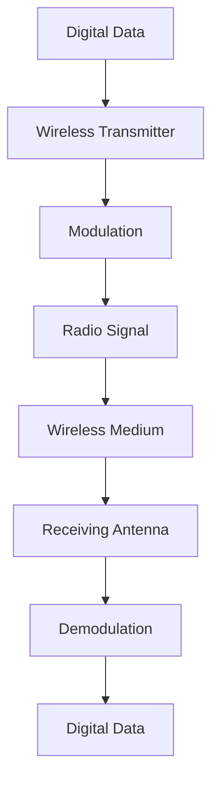
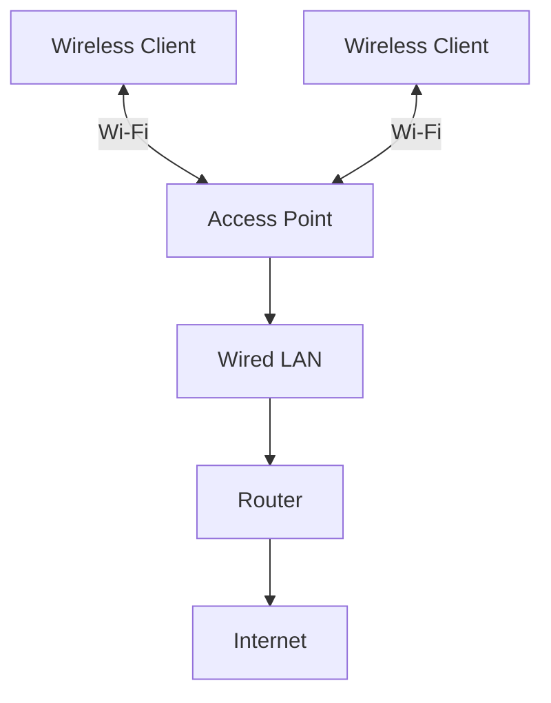
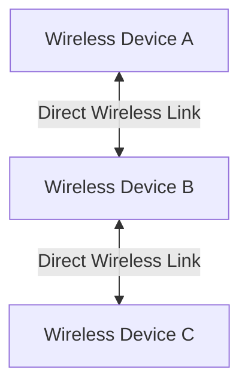

# Wireless Networking Fundamentals

Wireless networking is a communication method that allows devices to exchange data without using physical cables. Instead of electrical signals traveling through copper cables or light signals traveling through fiber-optic cables, wireless networks use electromagnetic waves, typically radio-frequency (RF) signals.

Wireless networking is widely used in homes, offices, enterprises, campuses, public hotspots, and Internet Service Provider (ISP) networks.

Wi-Fi is the most common technology used to provide wireless connectivity in local area networks (WLANs). It operates primarily under the IEEE 802.11 family of standards.

# 🗁 What Is Wireless Networking?

Wireless networking enables devices to communicate through a shared wireless medium.

A wireless device uses a radio transmitter and receiver to send and receive data through radio waves. An access point (AP) commonly connects wireless clients to a wired network.

For example:

* A laptop connects to an office Wi-Fi network.
* A smartphone communicates with a wireless access point.
* The access point forwards traffic to the wired LAN.
* A router forwards traffic between the LAN and the internet.

# 🗁 How Wireless Communication Works

Wireless communication uses radio-frequency signals to transmit information through the air.

A simplified communication process:

* A sender generates digital data.
* A wireless adapter converts the data into a radio signal using a modulation scheme.
* An antenna transmits the signal.
* A receiving antenna captures the signal.
* The receiver demodulates the signal and reconstructs the transmitted data.



Both the transmitter and receiver must use compatible wireless technologies, supported frequency bands, and appropriate channel configurations to communicate.

# 🗁 Wireless Network Components

| Component | Description |
| --- | --- |
| Wireless Client | A device that connects to a wireless network |
| Wireless Adapter | Hardware that provides wireless communication capabilities |
| Access Point (AP) | Provides wireless connectivity and bridges wireless clients to a network |
| Wireless Router | Combines wireless access point, routing, and usually switching functionality |
| Antenna | Transmits and receives radio-frequency signals |
| Wireless Controller | Centrally manages multiple wireless access points |
| Wireless Bridge | Connects network segments over a wireless link |

# 🗁 Wireless Network Types

Wireless networks can be classified according to their coverage area, architecture, and purpose.

| Type | Full Form | Description |
| --- | --- | --- |
| WPAN | Wireless Personal Area Network | Short-range communication between personal devices |
| WLAN | Wireless Local Area Network | Wireless connectivity within a home, office, or building |
| WMAN | Wireless Metropolitan Area Network | Wireless connectivity across a metropolitan area |
| WWAN | Wireless Wide Area Network | Wide-area wireless connectivity, commonly through cellular networks |

Examples:

* WPAN: Bluetooth connections between a phone and headphones.
* WLAN: Wi-Fi connectivity in an office.
* WMAN: Metropolitan wireless broadband infrastructure.
* WWAN: Cellular networks such as 4G LTE and 5G.

# 🗁 Wireless Network Operating Modes

Wireless networks can operate using different communication architectures.

**Infrastructure Mode**

Wireless clients communicate through an access point. The access point coordinates wireless communication and provides connectivity to the distribution system or wired network.



**Ad Hoc Mode**

Wireless devices communicate directly with one another without requiring a traditional access point.



**Mesh Networking**

Multiple wireless nodes cooperate to provide coverage. Depending on the implementation, nodes can forward traffic for other nodes, creating multiple possible paths through the network.

# 🗁 Wireless Frequency

Wireless networks use electromagnetic frequencies to transmit data.

Common Wi-Fi frequency bands include:

| Frequency Band | General Characteristics |
| --- | --- |
| 2.4 GHz | Longer range and better propagation through obstacles, but often more interference |
| 5 GHz | More available channels and generally higher throughput, with shorter range than 2.4 GHz under comparable conditions |
| 6 GHz | Additional spectrum for newer Wi-Fi technologies, subject to regional regulations and device support |

Actual coverage and performance depend on transmit power, antenna design, channel width, obstacles, interference, and receiver capabilities.

# 🗁 Wireless Communication Terminologies

| Term | Description |
| --- | --- |
| RF | Radio Frequency; the electromagnetic frequency range used for wireless communication |
| WLAN | Wireless Local Area Network |
| Wi-Fi | A family of wireless networking technologies based on IEEE 802.11 |
| SSID | Service Set Identifier; the wireless network name |
| BSSID | Basic Service Set Identifier; identifies a particular wireless basic service set, commonly represented by an AP radio's MAC address |
| AP | Access Point |
| RSSI | Received Signal Strength Indicator |
| SNR | Signal-to-Noise Ratio |
| Channel | A defined portion of radio-frequency spectrum used for communication |
| Bandwidth | The width of the frequency spectrum allocated to a wireless channel |
| Roaming | The process of a wireless client moving between access points while maintaining network connectivity |
| Interference | Unwanted RF energy or competing transmissions that affect wireless communication |

# 🗁 Advantages of Wireless Networking

* Mobility: Users can connect while moving within the coverage area.
* Flexibility: Devices can connect without installing individual network cables.
* Scalability: Additional wireless clients can often join without requiring new access cabling.
* Cost Efficiency: Wireless connectivity can reduce cabling and installation requirements.
* Convenience: Supports laptops, smartphones, tablets, and IoT devices.

# 🗁 Limitations of Wireless Networking

* Interference: Other wireless devices and environmental sources can affect performance.
* Shared Medium: Multiple devices compete for available wireless airtime.
* Coverage Limitations: Walls, floors, distance, and building materials weaken signals.
* Security Requirements: Wireless networks require appropriate authentication and encryption.
* Variable Performance: Throughput and latency can change with signal quality, congestion, and interference.
* Capacity Constraints: An access point has finite radio resources and cannot provide unlimited simultaneous high-throughput connections.

# 🗁 Wireless Networking vs Wired Networking

| Feature | Wireless Networking | Wired Networking |
| --- | --- | --- |
| Medium | Radio waves | Copper or fiber-optic cables |
| Mobility | High | Limited by cable connection |
| Installation | Often easier to deploy | Requires physical cabling |
| Interference | More susceptible to RF interference | Generally less susceptible to external RF interference |
| Performance | Varies with signal and airtime conditions | Generally more predictable |
| Security | Requires wireless authentication and encryption | Requires physical and network access controls |
| Latency | Can vary with contention and signal conditions | Generally more consistent |
| Coverage | Depends on radio propagation | Depends on cable distance and infrastructure |

# 🗁 Basic Wireless Networking Commands in Linux

**Identify Wireless Interfaces**

```bash
iw dev
```

Displays wireless network interfaces and their associated information.

**Display Wireless Interface Information**

```bash
ip link show
```

Displays available network interfaces and their states.

**Display Wireless Link Information**

```bash
iw dev wlan0 link
```

Displays the current wireless connection information for `wlan0`.

**Scan for Available Wireless Networks**

```bash
sudo iw dev wlan0 scan
```

Scans for nearby wireless networks. The interface and wireless driver must support scanning.

**Display Wireless Radio Information**

```bash
iw phy
```

Displays wireless physical device capabilities, supported bands, and related information.

**Check Wireless Radio Blocking**

```bash
rfkill list
```

Displays whether wireless devices are blocked by software or hardware.

# 🗁 Key Takeaways

* Wireless networking transmits data using electromagnetic waves.
* Wi-Fi is based on the IEEE 802.11 family of standards.
* An access point provides wireless connectivity to client devices.
* WLAN is commonly used for local wireless communication.
* Wireless networks use radio-frequency bands such as 2.4 GHz, 5 GHz, and 6 GHz.
* Signal strength, interference, channel utilization, and obstacles affect wireless performance.
* Wireless security requires appropriate authentication, encryption, and access controls.
* Wireless and wired networking can work together to build reliable network infrastructure.
