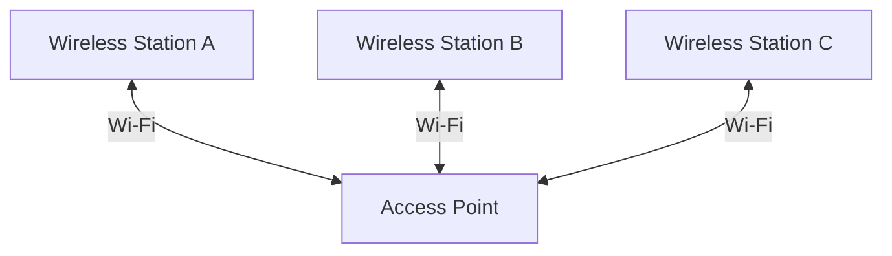
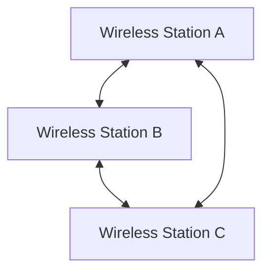
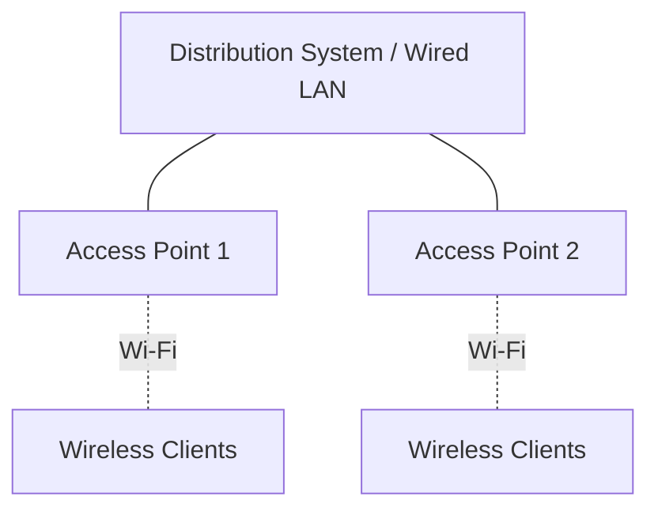
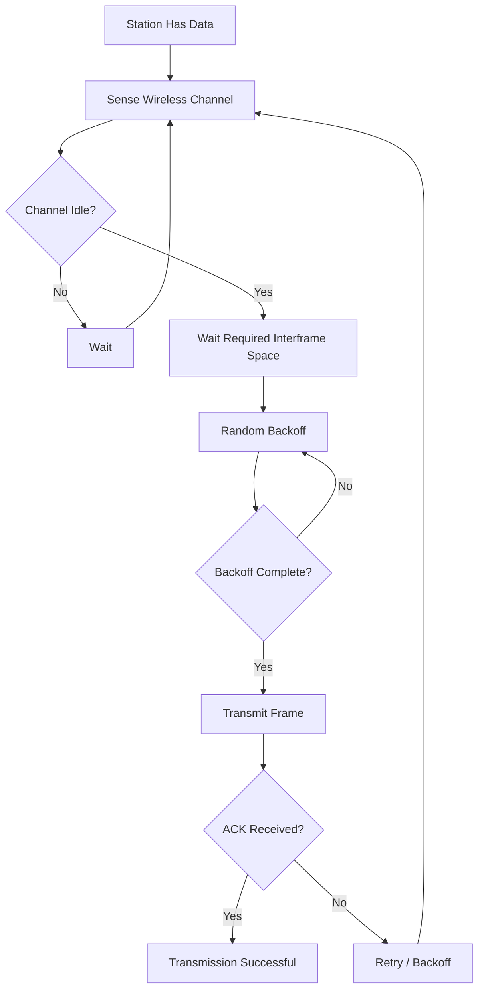
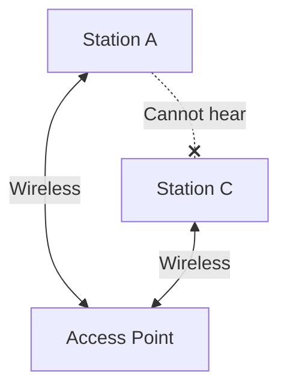
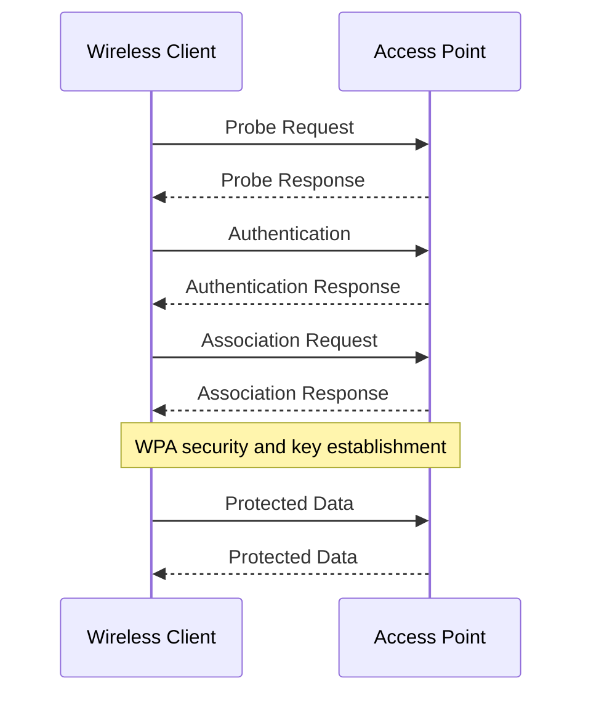

# IEEE 802.11 Standards and Architecture

IEEE 802.11 is a family of standards developed by the Institute of Electrical and Electronics Engineers (IEEE) for Wireless Local Area Networks (WLANs).

These standards define how wireless devices communicate over radio-frequency (RF) signals, including the physical transmission of data and the mechanisms used to access the wireless medium.

Wi-Fi technology is primarily based on the IEEE 802.11 family of standards.

# 🗁 What Is IEEE 802.11?

IEEE 802.11 defines the specifications for wireless LAN communication.

It covers two major areas:

* **Physical Layer (PHY):** Defines radio frequencies, channels, modulation, coding, transmission rates, and other physical communication characteristics.
* **Medium Access Control (MAC) Layer:** Defines how wireless devices access the shared radio medium, identify networks, establish connections, and exchange wireless frames.

IEEE 802.11 operates within the IEEE 802 architecture and provides wireless connectivity at the Data Link and Physical layers of the OSI model.

# 🗁 IEEE 802.11 Architecture

The IEEE 802.11 architecture consists of several logical components that define how wireless devices communicate.

| Component | Full Form | Description |
| --- | --- | --- |
| STA | Station | A device with an IEEE 802.11 wireless interface |
| AP | Access Point | A station that provides access to a wireless distribution system |
| BSS | Basic Service Set | A group of stations communicating within a basic wireless network |
| IBSS | Independent Basic Service Set | A wireless network operating without an access point |
| ESS | Extended Service Set | Multiple interconnected BSSs that provide an extended wireless network |
| DS | Distribution System | Connects multiple access points and supports communication between BSSs |
| Portal | Portal | Connects an IEEE 802.11 distribution system to another network, such as a wired LAN |

# 🗁 Station (STA)

A Station (STA) is any device equipped with an IEEE 802.11 wireless interface.

Examples include:

* Laptops
* Smartphones
* Tablets
* Wireless printers
* IoT devices
* Wireless access points

A station can communicate with other stations through an access point or directly in supported wireless operating modes.

# 🗁 Access Point (AP)

An Access Point is a station that provides wireless connectivity to client devices and connects them to a distribution system.

An AP commonly bridges wireless client traffic to a wired Ethernet network.

Its responsibilities include:

* Advertising wireless network information.
* Transmitting beacon frames.
* Handling authentication and association.
* Coordinating wireless medium access.
* Forwarding traffic between wireless clients and the distribution system.

# 🗁 Basic Service Set (BSS)

A Basic Service Set is the fundamental building block of an IEEE 802.11 wireless LAN.

It represents a group of wireless stations communicating within a particular wireless network structure.

There are two commonly discussed BSS types.

**Infrastructure BSS**

An Infrastructure BSS contains an access point and associated wireless stations.

The AP coordinates communication and provides access to the distribution system.

**Independent BSS (IBSS)**

An Independent Basic Service Set operates without an access point.

Stations communicate directly with one another in an ad hoc wireless network.

# 🗁 Extended Service Set (ESS)

An Extended Service Set consists of multiple interconnected infrastructure BSSs connected through a Distribution System.

An ESS allows wireless clients to move between access points while remaining within the same extended wireless network.

Multiple access points can advertise the same SSID while using different BSSIDs.

For example, an office may deploy multiple access points with the same SSID to provide wireless coverage across different floors.

# 🗁 Distribution System (DS)

A Distribution System connects multiple access points and allows communication between different BSSs.

In typical deployments, the distribution system uses Ethernet switching infrastructure.

Its responsibilities include:

* Connecting multiple access points.
* Forwarding traffic between wireless network segments.
* Supporting communication between stations associated with different APs.
* Providing connectivity to other network infrastructure.

The IEEE 802.11 architecture does not require every distribution system to use Ethernet. Its implementation can vary.

# 🗁 IEEE 802.11 MAC Layer

The MAC layer controls how wireless stations access and share the radio medium.

Unlike traditional switched Ethernet, Wi-Fi uses a shared wireless medium where multiple devices may compete to transmit.

Important MAC responsibilities include:

* Medium access control.
* Frame addressing.
* Frame delivery and acknowledgment.
* Authentication and association management.
* Retransmission handling.
* Power management.
* Wireless security mechanisms.

# 🗁 Wireless Medium Access: CSMA/CA

IEEE 802.11 traditionally uses Carrier Sense Multiple Access with Collision Avoidance (CSMA/CA).

Wireless devices listen to the channel before transmitting. If the medium is busy, they wait. When the medium becomes available, they use a random backoff process to reduce the probability of simultaneous transmissions.

A simplified process:

* A station checks whether the wireless channel is busy.
* If the channel is busy, it waits.
* If the channel is idle for the required interval, it begins or continues its backoff procedure.
* When the backoff counter reaches zero, it transmits.
* The receiver normally sends an acknowledgment if the frame is received successfully.
* If the sender does not receive the expected acknowledgment, it may retransmit the frame.

CSMA/CA attempts to avoid collisions rather than detect them after transmission.

# 🗁 Hidden Node Problem

The hidden node problem occurs when two wireless stations cannot hear each other but can both communicate with the same access point.

Both stations may assume that the channel is idle and transmit simultaneously, causing a collision at the access point.

**RTS/CTS Solution**

Request to Send (RTS) and Clear to Send (CTS) are optional mechanisms that can help reduce collisions caused by hidden nodes.

* The sender transmits an RTS frame.
* The receiver responds with a CTS frame.
* Other stations hearing the CTS defer transmission for the indicated duration.
* The sender transmits its data frame.

RTS/CTS introduces additional overhead, so it is generally used selectively.

# 🗁 IEEE 802.11 Frame Types

IEEE 802.11 defines three major frame categories.

| Frame Type | Purpose | Examples |
| --- | --- | --- |
| Management | Establishes and maintains wireless network connections | Beacon, Probe Request, Probe Response, Authentication, Association |
| Control | Coordinates access to the wireless medium and supports reliable delivery | RTS, CTS, ACK, Block ACK |
| Data | Carries user data and higher-layer network traffic | Data, QoS Data |

**Management Frames**

Management frames support wireless network discovery and connection management.

Common examples:

* Beacon: Advertises wireless network information.
* Probe Request: Searches for nearby wireless networks.
* Probe Response: Responds to a probe request.
* Authentication: Performs an 802.11 authentication exchange.
* Association Request: Requests connection to an access point.
* Association Response: Reports whether association was accepted.

**Control Frames**

Control frames help coordinate communication and medium access.

Common examples:

* RTS: Request to Send.
* CTS: Clear to Send.
* ACK: Acknowledges successful frame reception.
* Block ACK: Acknowledges multiple frames using a block acknowledgment mechanism.

**Data Frames**

Data frames carry network traffic between wireless stations and the distribution system.

They can transport higher-layer protocols such as IPv4, IPv6, ARP, and other network traffic.

# 🗁 Wireless Authentication and Association

Before a wireless client can exchange normal data traffic through an infrastructure access point, it generally performs network discovery, authentication, and association.

A simplified connection sequence:

* The client discovers an available wireless network.
* The client performs the required 802.11 authentication exchange.
* The client sends an association request.
* The access point responds with an association response.
* The client completes the required security procedures, such as the WPA2 or WPA3 authentication and key establishment process.
* The client can exchange protected data frames.

The exact security exchange depends on the configured authentication method.

# 🗁 IEEE 802.11 vs Ethernet

IEEE 802.11 and IEEE 802.3 both provide LAN communication but use different physical media and medium access mechanisms.

| Feature | IEEE 802.11 | IEEE 802.3 |
| --- | --- | --- |
| Technology | Wireless LAN | Wired Ethernet |
| Medium | Radio frequency | Copper or fiber |
| Access Method | CSMA/CA and related mechanisms | Full-duplex switched Ethernet; legacy shared Ethernet used CSMA/CD |
| Mobility | Supports wireless mobility | Requires a physical connection |
| Interference | Susceptible to RF interference | Generally less susceptible to external RF interference |
| Transmission | Shared radio medium | Dedicated switched links in typical modern networks |
| Security | Wireless authentication and encryption | Physical and network access controls |

# 🗁 Important IEEE 802.11 Concepts

| Concept | Meaning |
| --- | --- |
| IEEE 802.11 | Wireless LAN standards family |
| PHY | Physical Layer |
| MAC | Medium Access Control |
| STA | Wireless Station |
| AP | Access Point |
| BSS | Basic Service Set |
| IBSS | Independent Basic Service Set |
| ESS | Extended Service Set |
| DS | Distribution System |
| SSID | Service Set Identifier |
| BSSID | Basic Service Set Identifier |
| CSMA/CA | Carrier Sense Multiple Access with Collision Avoidance |
| RTS | Request to Send |
| CTS | Clear to Send |
| ACK | Acknowledgment |

# 🗁 Key Takeaways

* IEEE 802.11 defines the standards used by wireless LAN technologies.
* Its specifications cover both the Physical Layer and MAC Layer.
* A station is any device equipped with an IEEE 802.11 wireless interface.
* A BSS is a fundamental wireless network building block.
* An IBSS operates without an access point.
* An ESS connects multiple infrastructure BSSs through a distribution system.
* CSMA/CA coordinates access to the shared wireless medium.
* Management, Control, and Data are the three major IEEE 802.11 frame categories.
* Authentication and association establish a client's connection to an access point.
* RTS/CTS can help mitigate hidden node problems.
