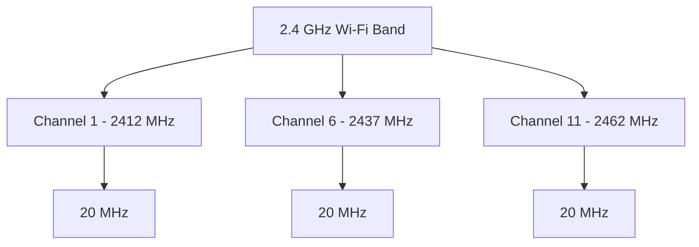
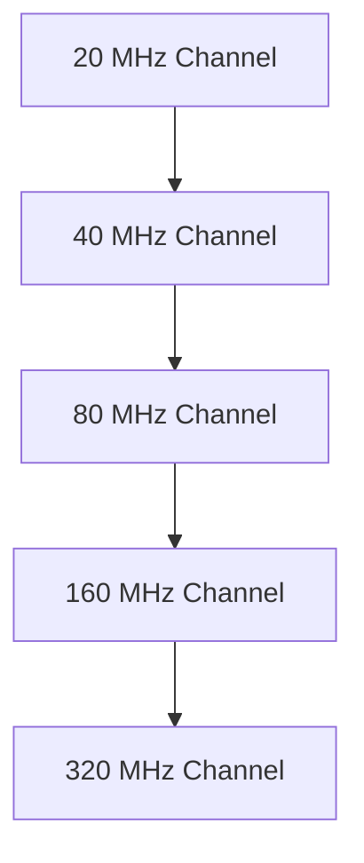

# Wireless Channels and Channel Bandwidth

Wireless channels are specific portions of radio-frequency spectrum used by wireless devices to communicate.

Wi-Fi networks divide their supported frequency bands into channels. Access points and wireless clients use these channels to transmit and receive data.

Channel selection and channel bandwidth directly affect wireless network capacity, interference, coverage, and performance.

# 🗁 What Is a Wireless Channel?

A wireless channel is a defined frequency range within a wireless frequency band.

Each channel has a center frequency and occupies a certain amount of spectrum.

For example, in the 2.4 GHz band:

* Channel 1 has a center frequency of 2412 MHz.
* Channel 6 has a center frequency of 2437 MHz.
* Channel 11 has a center frequency of 2462 MHz.

The center frequency identifies the middle of the channel's allocated spectrum.

# 🗁 2.4 GHz Channel Allocation

The 2.4 GHz Wi-Fi band provides a limited number of channels.

In many regulatory domains, channels are spaced 5 MHz apart, while a typical 20 MHz Wi-Fi channel occupies approximately 20 MHz of spectrum.

Because the channel spacing is smaller than the channel width, neighboring channels overlap.

Common 20 MHz channel assignments include:

| Channel | Center Frequency |
| --- | ---: |
| 1 | 2412 MHz |
| 2 | 2417 MHz |
| 3 | 2422 MHz |
| 4 | 2427 MHz |
| 5 | 2432 MHz |
| 6 | 2437 MHz |
| 7 | 2442 MHz |
| 8 | 2447 MHz |
| 9 | 2452 MHz |
| 10 | 2457 MHz |
| 11 | 2462 MHz |
| 12 | 2467 MHz |
| 13 | 2472 MHz |

Channel availability depends on the regulatory domain and device configuration.

**Common Non-Overlapping Channels**

Channels 1, 6, and 11 are commonly used for 20 MHz deployments in regions where all three are available.



Using these channels helps reduce adjacent-channel overlap in dense wireless environments.

# 🗁 5 GHz Channel Allocation

The 5 GHz band provides more channel options than 2.4 GHz in many regulatory domains.

Its channel allocation includes several groups of channels with different regulatory requirements.

Examples of commonly encountered 5 GHz channels include:

| Channel | Center Frequency |
| --- | ---: |
| 36 | 5180 MHz |
| 40 | 5200 MHz |
| 44 | 5220 MHz |
| 48 | 5240 MHz |
| 52 | 5260 MHz |
| 56 | 5280 MHz |
| 60 | 5300 MHz |
| 64 | 5320 MHz |
| 100 | 5500 MHz |
| 104 | 5520 MHz |
| 108 | 5540 MHz |
| 112 | 5560 MHz |
| 116 | 5580 MHz |
| 120 | 5600 MHz |
| 124 | 5620 MHz |
| 128 | 5640 MHz |
| 132 | 5660 MHz |
| 136 | 5680 MHz |
| 140 | 5700 MHz |
| 149 | 5745 MHz |
| 153 | 5765 MHz |
| 157 | 5785 MHz |
| 161 | 5805 MHz |
| 165 | 5825 MHz |

These are illustrative channel assignments. The actual permitted channels depend on the country, regulatory domain, hardware, and access point configuration.

Some 5 GHz channels require Dynamic Frequency Selection (DFS).

# 🗁 6 GHz Channel Allocation

The 6 GHz band provides additional spectrum for modern Wi-Fi networks.

It supports a large number of channels, depending on regional spectrum allocations and channel width.

Wi-Fi 6E and Wi-Fi 7 devices can use this band where permitted.

Important characteristics:

* Additional spectrum for wireless communication.
* Supports wider channel configurations.
* Reduces competition with legacy 2.4 GHz and 5 GHz devices.
* Requires compatible access points and wireless clients.
* Availability depends on national regulations.

# 🗁 What Is Channel Bandwidth?

Channel bandwidth describes the amount of radio-frequency spectrum occupied by a wireless channel.

A wider channel can carry more data under suitable conditions because it provides more spectrum for transmission.

Common Wi-Fi channel widths include:

| Channel Width | Description |
| --- | --- |
| 20 MHz | Narrower channel, commonly used for 2.4 GHz |
| 40 MHz | Combines two adjacent 20 MHz channels |
| 80 MHz | Combines four adjacent 20 MHz channels |
| 160 MHz | Combines eight adjacent 20 MHz channels |
| 320 MHz | Supported by Wi-Fi 7 in the 6 GHz band where permitted |

The available channel widths depend on the Wi-Fi generation, frequency band, regulatory domain, and hardware capabilities.

# 🗁 Channel Bonding

Channel bonding combines adjacent 20 MHz channels to create a wider channel.

For example:

* 40 MHz = 2 × 20 MHz
* 80 MHz = 4 × 20 MHz
* 160 MHz = 8 × 20 MHz
* 320 MHz = 16 × 20 MHz



Channel bonding can increase potential throughput, but it also consumes more spectrum.

# 🗁 Channel Width and Performance

Wider channels do not always provide better real-world performance.

| Factor | Narrower Channels | Wider Channels |
| --- | --- | --- |
| Spectrum Usage | Lower | Higher |
| Potential Throughput | Lower | Higher |
| Available Independent Channels | More | Fewer |
| Co-Channel Competition | Can be reduced through careful planning | Can increase when spectrum is limited |
| Deployment in Dense Environments | Often preferable | Requires careful planning |
| Sensitivity to Available Spectrum | Lower | Higher |

A 20 MHz channel may perform better than an 80 MHz channel in a congested environment.

The optimal channel width depends on network density, interference, client capabilities, and throughput requirements.

# 🗁 Channel Overlap and Interference

Wireless interference can occur when nearby wireless transmissions occupy overlapping or identical frequency ranges.

There are two important concepts.

**Co-Channel Interference**

Co-channel interference occurs when multiple access points use the same channel within overlapping coverage areas.

Devices must share the available airtime, which can reduce effective throughput.

**Adjacent-Channel Interference**

Adjacent-channel interference occurs when transmissions use overlapping channel frequencies.

It can cause unwanted interference because the transmissions are not necessarily coordinated through the same channel access mechanisms.

For 2.4 GHz networks, using 20 MHz channels and carefully selecting channels 1, 6, and 11 where permitted helps avoid adjacent-channel overlap.

# 🗁 Channel Selection

Selecting the correct channel is important for wireless network performance.

Consider these factors:

* Nearby access point channel usage.
* Signal strength of competing wireless networks.
* Channel utilization.
* Client device capabilities.
* Available regulatory channels.
* Required channel bandwidth.
* Physical distance between access points.
* DFS requirements.

**Example: Small Office**

A small office with several nearby wireless networks may use:

| Access Point | Frequency Band | Channel | Width |
| --- | --- | --- | --- |
| AP-01 | 2.4 GHz | 1 | 20 MHz |
| AP-02 | 2.4 GHz | 6 | 20 MHz |
| AP-03 | 2.4 GHz | 11 | 20 MHz |

This arrangement reduces overlapping 2.4 GHz channel assignments between nearby access points.

Actual channel reuse should be based on RF measurements and coverage overlap.

# 🗁 Wireless Channel Planning

Wireless channel planning is the process of assigning channels to access points to reduce interference and improve network capacity.

A basic planning approach:

* Identify the available frequency bands.
* Measure nearby wireless networks.
* Inspect channel utilization and signal levels.
* Select suitable channel widths.
* Assign channels to nearby access points.
* Avoid unnecessary channel overlap.
* Test wireless performance after deployment.

In larger environments, channel planning should also consider access point transmit power, antenna orientation, client density, roaming behavior, and radio-resource management.

# 🗁 Inspect Wireless Channels in Linux

Linux provides several tools for inspecting wireless frequency and channel information.

**List Wireless Interfaces**

```bash
iw dev
```

**Display Supported Frequencies and Channels**

```bash
iw phy
```

**Display Current Wireless Connection**

```bash
iw dev wlan0 link
```

**Scan Nearby Wireless Networks**

```bash
sudo iw dev wlan0 scan
```

**Display Wireless Regulatory Domain**

```bash
iw reg get
```

The regulatory domain determines which frequency ranges and channels the device is permitted to use.

Do not configure a false regulatory domain to access restricted channels.

# 🗁 Wireless Channel Planning Best Practices

* Use 20 MHz channels for most 2.4 GHz deployments.
* Use channels 1, 6, and 11 where permitted and appropriate.
* Select 5 GHz channels based on local interference and regulatory requirements.
* Use DFS channels only when supported and appropriate for the environment.
* Use wider channels when sufficient clean spectrum is available.
* Avoid assigning overlapping channels to nearby access points unnecessarily.
* Measure real-world channel utilization instead of relying only on signal strength.
* Consider client compatibility before deploying 6 GHz or 320 MHz channels.
* Reassess channel assignments as the wireless environment changes.

# 🗁 Key Takeaways

* A wireless channel is a defined portion of radio-frequency spectrum.
* Every channel has a center frequency and occupies a certain bandwidth.
* The 2.4 GHz band has limited channel availability and significant channel overlap.
* Channels 1, 6, and 11 are commonly used for 20 MHz deployments where permitted.
* The 5 GHz and 6 GHz bands provide additional channel options.
* Channel bonding combines adjacent channels to create wider channels.
* Wider channels can increase potential throughput but consume more spectrum.
* Co-channel and adjacent-channel interference affect wireless performance differently.
* Channel planning is essential for reliable wireless deployments.
* Regulatory domain settings determine which channels a device may legally use.
