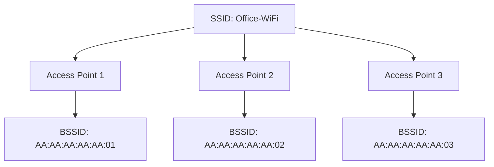
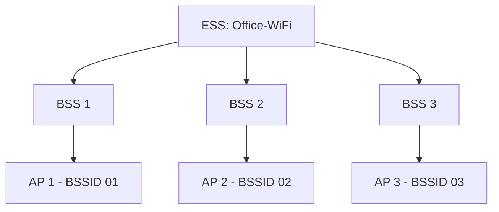
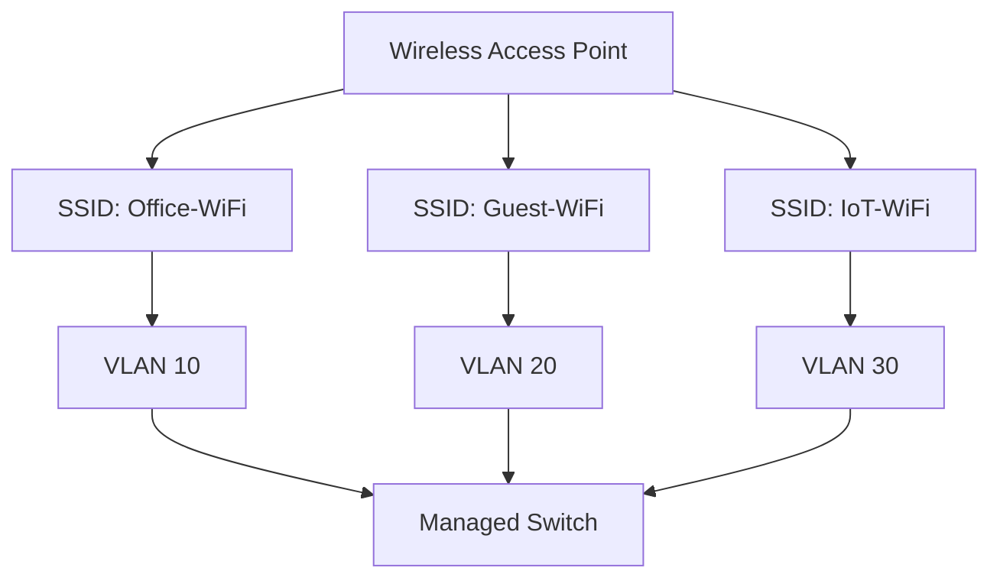

# SSID and BSSID

SSID and BSSID are two important identifiers used in IEEE 802.11 wireless networks.

They help wireless clients discover, identify, and connect to wireless networks.

Although both are associated with wireless network identification, they serve different purposes.

* **SSID (Service Set Identifier):** Identifies a wireless network by its network name.
* **BSSID (Basic Service Set Identifier):** Identifies a specific Basic Service Set, commonly using the MAC address of an access point's wireless interface.

Understanding these identifiers is important when configuring access points, designing enterprise WLANs, troubleshooting connectivity, and managing multiple wireless networks.

# 🗁 What Is SSID?

SSID stands for Service Set Identifier.

It is the name used to identify a wireless network to users and wireless client devices.

For example, when searching for available Wi-Fi networks, you might see:

* Home-WiFi
* Office-Network
* Guest-WiFi
* Network-Lab

These names are SSIDs.

An SSID can contain up to 32 octets.

**Example:**

```text
SSID: Office-Network
SSID: Guest-WiFi
SSID: Home-WiFi
```

Wireless clients use the SSID when discovering and selecting a wireless network.

# 🗁 What Is BSSID?

BSSID stands for Basic Service Set Identifier.

It identifies a particular Basic Service Set within an IEEE 802.11 wireless network.

In a typical infrastructure WLAN, the BSSID is the MAC address associated with the access point's wireless interface for that BSS.

**Example:**

```text
SSID: Office-Network
BSSID: 00:11:22:33:44:55
```

A wireless access point can use multiple BSSIDs to advertise different wireless networks.

For example, an access point may advertise:

| SSID | BSSID |
| --- | --- |
| Office-WiFi | 00:11:22:33:44:55 |
| Guest-WiFi | 00:11:22:33:44:56 |
| IoT-WiFi | 00:11:22:33:44:57 |

These BSSIDs are illustrative examples.

# 🗁 SSID vs BSSID

| Feature | SSID | BSSID |
| --- | --- | --- |
| Full Form | Service Set Identifier | Basic Service Set Identifier |
| Purpose | Identifies the wireless network name | Identifies a particular BSS |
| Format | Up to 32 octets | Normally a 48-bit MAC address in infrastructure WLANs |
| Visibility | Commonly displayed to users | Usually displayed in wireless diagnostic tools |
| Example | Office-WiFi | 00:11:22:33:44:55 |
| Uniqueness | Multiple APs can share an SSID | Identifies a particular BSS |
| Main Use | Network discovery and selection | Identifying a specific wireless cell |

# 🗁 Relationship Between SSID and BSSID

Multiple access points can advertise the same SSID while using different BSSIDs.

This arrangement is commonly used in enterprise wireless networks.

For example, an office may deploy three access points with the same SSID to provide coverage across different areas.



The client sees one wireless network name but may detect multiple BSSIDs.

# 🗁 Service Set Types

IEEE 802.11 defines different service set structures.

**Basic Service Set (BSS)**

A BSS is a group of stations communicating within a basic wireless network.

In infrastructure mode, the BSS contains an access point and associated wireless clients.

**Independent Basic Service Set (IBSS)**

An IBSS is an ad hoc wireless network in which stations communicate directly without an access point.

**Extended Service Set (ESS)**

An ESS consists of multiple interconnected infrastructure BSSs connected through a Distribution System.

An ESS commonly uses the same SSID across multiple access points to provide broader wireless coverage.



# 🗁 Multiple SSIDs on One Access Point

A single physical access point can advertise multiple SSIDs.

Each SSID can represent a different wireless network or access policy.

For example:

| SSID | Purpose | Network |
| --- | --- | --- |
| Office-WiFi | Employee access | VLAN 10 |
| Guest-WiFi | Visitor access | VLAN 20 |
| IoT-WiFi | IoT devices | VLAN 30 |

The access point can map each SSID to a separate VLAN when supported by its configuration and the wired network.

This allows traffic separation between employees, guests, and IoT devices.



Using multiple SSIDs can increase management flexibility, but excessive SSIDs may introduce additional management-frame and airtime overhead.

# 🗁 Hidden SSID

A hidden SSID is a wireless network configured not to include its network name in ordinary beacon advertisements.

Some access points provide an option called:

* Hide SSID
* Disable SSID Broadcast
* Hidden Wireless Network

However, hiding an SSID does not provide meaningful wireless security.

The SSID can still appear in other wireless management exchanges, and monitoring tools may identify the network.

**Important:** Use WPA2 or WPA3 security, strong authentication, and appropriate network access controls instead of relying on hidden SSIDs.

# 🗁 Wireless Beacon Frames

A beacon frame is an IEEE 802.11 management frame periodically transmitted by an access point.

It advertises information about the wireless network.

Common beacon information includes:

* SSID, when included in the beacon.
* BSSID.
* Supported data rates.
* Channel and operating information.
* Security capabilities.
* Beacon interval.
* Other wireless capabilities.

Wireless clients use beacon information to discover available wireless networks.

# 🗁 SSID and BSSID During Roaming

Roaming occurs when a wireless client moves from one access point to another while maintaining connectivity to the same wireless network.

In an ESS, multiple access points commonly advertise the same SSID but have different BSSIDs.

For example:

```text
Wireless Network: Office-WiFi

Access Point 1:
BSSID: AA:AA:AA:AA:AA:01

Access Point 2:
BSSID: AA:AA:AA:AA:AA:02

Access Point 3:
BSSID: AA:AA:AA:AA:AA:03
```

As a client moves through the building, it may select another suitable BSSID associated with the same SSID.

The client generally makes roaming decisions based on signal quality, network configuration, and roaming support.

The same SSID alone does not guarantee seamless roaming. Security configuration, network connectivity, and client behavior must also be compatible.

# 🗁 Inspect SSID and BSSID in Linux

Linux provides wireless utilities for inspecting nearby wireless networks and the current connection.

**Display Wireless Interfaces**

```bash
iw dev
```

**Display Current Wireless Connection**

```bash
iw dev wlan0 link
```

This command can display:

* Connected BSSID.
* SSID.
* Frequency.
* Signal strength.
* Transmit and receive bitrate.

**Scan Nearby Wireless Networks**

```bash
sudo iw dev wlan0 scan
```

The scan output may include:

```text
BSS 00:11:22:33:44:55(on wlan0)
    freq: 2412
    SSID: Office-WiFi
    signal: -45.00 dBm
```

**Display Available Wi-Fi Networks with NetworkManager**

```bash
nmcli device wifi list
```

This command displays available wireless networks and may include their SSID, BSSID, frequency, channel, signal strength, and security information.

# 🗁 Wireless Network Configuration Example

Consider an office wireless deployment with three logical networks.

| SSID | BSSID | VLAN | Purpose |
| --- | --- | --- | --- |
| Office-WiFi | AP radio address 1 | 10 | Employees |
| Guest-WiFi | AP radio address 2 | 20 | Visitors |
| IoT-WiFi | AP radio address 3 | 30 | IoT devices |

A managed access point can advertise all three SSIDs and map their client traffic to the corresponding VLANs.

The wired switch must also be configured to transport the required VLANs between the access point and the router or network gateway.

# 🗁 Key Takeaways

* SSID identifies a wireless network by its name.
* BSSID identifies a particular Basic Service Set.
* A typical infrastructure BSSID uses the MAC address of the AP radio associated with that BSS.
* Multiple access points can advertise the same SSID.
* Each BSS normally has its own BSSID.
* One access point can advertise multiple SSIDs.
* Multiple SSIDs can be mapped to separate VLANs.
* Hidden SSIDs do not provide meaningful wireless security.
* Beacon frames advertise wireless network information.
* Wireless clients use SSID and BSSID information when discovering and selecting networks.
* Roaming commonly involves moving between BSSIDs within the same ESS.
