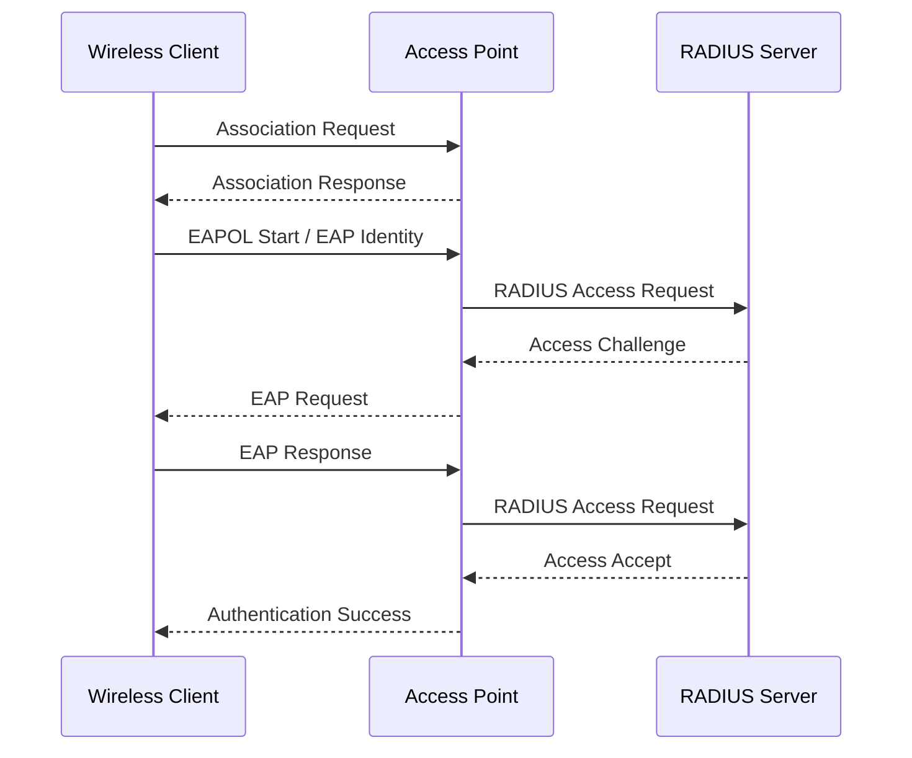
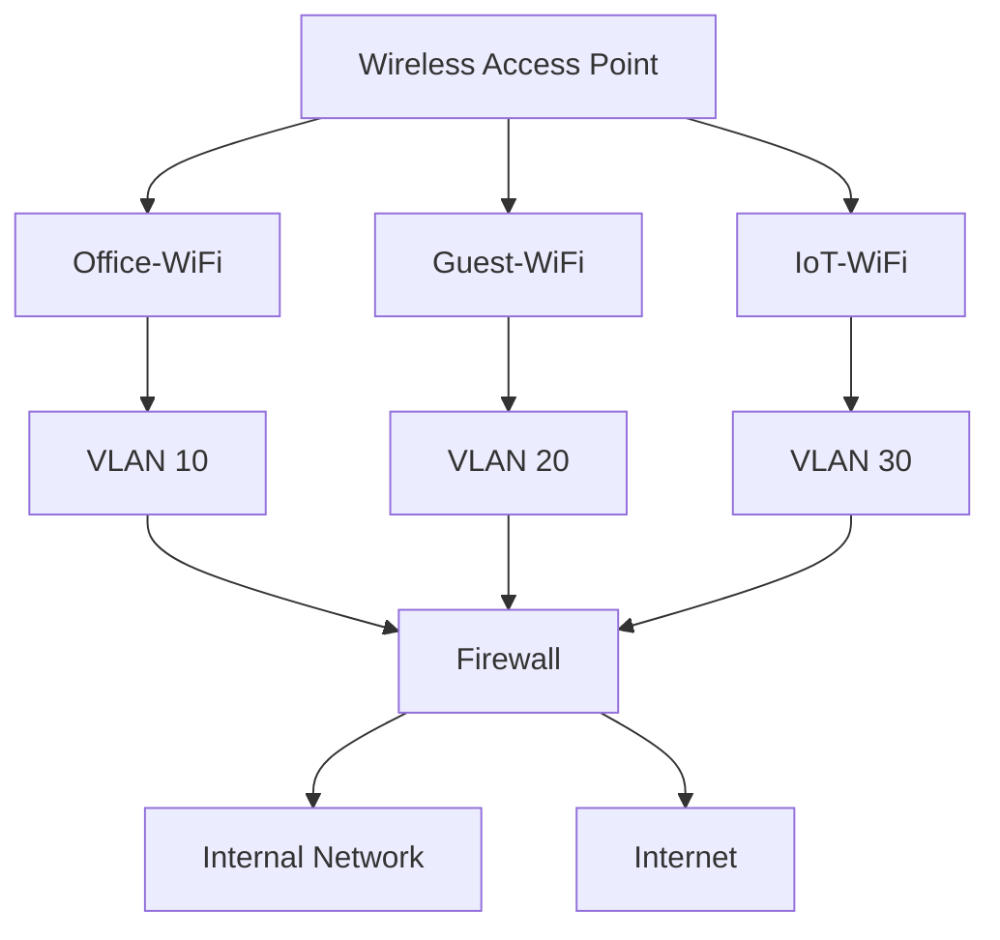

# Wireless Network Security

Wireless network security protects Wi-Fi networks, connected devices, and transmitted data from unauthorized access, interception, manipulation, and other security threats.

Unlike wired networks, wireless communication travels through the air. Anyone within radio range may be able to detect wireless transmissions, making appropriate authentication, encryption, and access controls essential.

Wireless security is particularly important in home networks, enterprise environments, public hotspots, and ISP infrastructure.

# 🗁 Objectives of Wireless Security

A secure wireless network should provide the following protections:

| Security Objective | Description |
| --- | --- |
| Confidentiality | Prevents unauthorized parties from reading transmitted data |
| Integrity | Protects data against unauthorized modification |
| Authentication | Verifies the identity of users or devices |
| Authorization | Controls which network resources authenticated users can access |
| Availability | Helps maintain reliable wireless network services |
| Accountability | Records network activity for monitoring and auditing |

# 🗁 Common Wireless Security Threats

Wireless networks face several types of attacks.

**Unauthorized Access**

Unauthorized access occurs when an individual connects to a wireless network without permission.

Common causes include:

* Weak Wi-Fi passwords.
* Open wireless networks.
* Shared credentials.
* Poor access control.
* Misconfigured access points.

**Packet Sniffing**

Packet sniffing involves capturing network traffic for analysis.

An attacker within wireless range may capture transmitted frames and inspect information that is not adequately protected.

Encryption helps protect the confidentiality of wireless communications.

**Evil Twin Attack**

An evil twin attack uses a malicious access point that imitates a legitimate wireless network.

For example:

```text
Legitimate Network:
SSID: Office-WiFi

Malicious Network:
SSID: Office-WiFi
```

A user may mistakenly connect to the malicious access point.

This can expose the user to credential theft, traffic interception, and other attacks.

**Rogue Access Point**

A rogue access point is an unauthorized wireless access point connected to an organization's network.

It may be installed intentionally by an attacker or unintentionally by an employee.

Rogue access points can bypass established network security controls.

**Deauthentication Attack**

A deauthentication attack abuses 802.11 management frames to disconnect wireless clients from an access point.

Protected Management Frames (PMF), defined by IEEE 802.11w and incorporated into modern Wi-Fi security implementations, help protect certain robust management frames.

**Man-in-the-Middle Attack**

A Man-in-the-Middle (MITM) attack occurs when an attacker positions themselves between communicating devices to intercept or manipulate traffic.

An attacker may use a malicious access point, DNS manipulation, or other techniques.

Strong wireless encryption, certificate validation, and secure application protocols help reduce these risks.

**Password-Based Attacks**

Attackers may attempt to obtain wireless credentials through:

* Password guessing.
* Brute-force attacks.
* Dictionary attacks.
* Social engineering.
* Captured authentication exchanges.

Strong credentials and modern authentication mechanisms help reduce the risk.

# 🗁 Wireless Authentication

Authentication verifies whether a user or device is permitted to connect to a wireless network.

Common wireless authentication approaches include:

| Method | Description |
| --- | --- |
| Open Authentication | Allows association without a traditional shared Wi-Fi password |
| WPA2-Personal | Uses a pre-shared key or passphrase |
| WPA3-Personal | Uses Simultaneous Authentication of Equals (SAE) |
| WPA2-Enterprise | Uses IEEE 802.1X authentication, commonly with a RADIUS server |
| WPA3-Enterprise | Provides enterprise authentication with stronger security options |

Open authentication does not automatically mean wireless traffic is encrypted. Modern enhanced open networks can use Opportunistic Wireless Encryption (OWE).

# 🗁 Wireless Encryption

Encryption protects wireless data from being read by unauthorized parties.

Important Wi-Fi encryption technologies include:

| Technology | Description | Security Status |
| --- | --- | --- |
| WEP | Uses the RC4 cipher with weak initialization-vector handling | Insecure |
| WPA | Introduced TKIP as a transitional security mechanism | Deprecated |
| WPA2 | Uses AES-based CCMP for modern secure operation | Widely supported |
| WPA3 | Introduces stronger authentication and security improvements | Preferred for compatible devices |

WEP and legacy WPA/TKIP should not be used in modern deployments.

# 🗁 Wi-Fi Protected Access (WPA)

Wi-Fi Protected Access was introduced as an improvement over WEP.

It introduced TKIP to improve the security of existing wireless hardware.

However, WPA and TKIP are now considered obsolete for secure network deployments.

# 🗁 WPA2 Security

WPA2 is based on IEEE 802.11i security mechanisms.

It commonly uses AES-based Counter Mode with Cipher Block Chaining Message Authentication Code Protocol (CCMP).

WPA2 supports two major operating modes:

* WPA2-Personal
* WPA2-Enterprise

WPA2-Personal uses a shared passphrase, while WPA2-Enterprise uses an authentication infrastructure such as IEEE 802.1X and RADIUS.

# 🗁 WPA3 Security

WPA3 introduces improvements to wireless authentication and protection.

Important features include:

* Simultaneous Authentication of Equals (SAE) for WPA3-Personal.
* Improved resistance to offline password-guessing attacks.
* Protected Management Frames support.
* Stronger security requirements for enterprise deployments.
* Enhanced Open through Opportunistic Wireless Encryption (OWE) in applicable deployments.

WPA3-Personal replaces the traditional WPA2-Personal PSK handshake with SAE.

# 🗁 Personal vs Enterprise Security

Wireless networks commonly use either Personal or Enterprise security.

| Feature | Personal Security | Enterprise Security |
| --- | --- | --- |
| Authentication | Shared password or passphrase | Individual user or device authentication |
| Infrastructure | Usually no external authentication server required | Commonly uses RADIUS |
| Credential Management | Shared among users | Managed individually |
| Access Control | Generally less granular | Supports centralized access policies |
| Typical Use | Homes and small offices | Enterprises and large organizations |

**Personal Security**

A home wireless network commonly uses a shared password.

All authorized users connect using the same credentials.

**Enterprise Security**

Enterprise wireless networks commonly use IEEE 802.1X with an Extensible Authentication Protocol (EAP) method and a RADIUS authentication server.

This allows individual users or devices to authenticate with centrally managed credentials.

# 🗁 IEEE 802.1X Authentication

IEEE 802.1X provides port-based network access control.

In enterprise Wi-Fi, it is used with EAP to authenticate wireless clients.

The main components are:

| Component | Description |
| --- | --- |
| Supplicant | The wireless client requesting network access |
| Authenticator | The access point controlling network access |
| Authentication Server | Usually a RADIUS server that validates authentication requests |

A simplified authentication process:



The actual EAP exchange depends on the selected authentication method.

# 🗁 Protected Management Frames (PMF)

Protected Management Frames provide protection for certain IEEE 802.11 management frames.

PMF is defined by IEEE 802.11w and incorporated into modern Wi-Fi security implementations.

It helps protect against attacks involving forged management frames, including certain deauthentication and disassociation attacks.

PMF operating modes commonly include:

* Disabled: PMF is not used.
* Optional: Compatible clients may use PMF.
* Required: Clients must support PMF to connect.

WPA3 requires PMF support.

# 🗁 Opportunistic Wireless Encryption (OWE)

Opportunistic Wireless Encryption provides encryption for open wireless networks without requiring users to enter a shared password.

It is commonly marketed as Enhanced Open.

OWE protects wireless traffic between an individual client and the access point, but it does not authenticate the network as a trusted network.

Users should still validate the identity of websites and applications through secure protocols such as HTTPS.

# 🗁 Wireless Security Best Practices

**Use Modern Encryption**

* Prefer WPA3-Personal or WPA3-Enterprise where supported.
* Use WPA2-AES/CCMP when WPA3 is unavailable.
* Disable WEP, WPA, and TKIP.

**Use Strong Authentication**

* Use long, unique Wi-Fi passphrases.
* Avoid predictable passwords.
* Use individual credentials in enterprise networks.
* Implement RADIUS-based authentication where appropriate.

**Secure Access Point Management**

* Change default administrator credentials.
* Use HTTPS or SSH for management where supported.
* Disable unnecessary management services.
* Restrict management access to trusted networks.
* Keep access point firmware updated.

**Separate Wireless Networks**

Use separate SSIDs and VLANs for different categories of devices.

For example:

| SSID | VLAN | Purpose |
| --- | ---: | --- |
| Office-WiFi | 10 | Employees |
| Guest-WiFi | 20 | Visitors |
| IoT-WiFi | 30 | IoT devices |
| Management-WiFi | 40 | Network administrators |

Apply firewall rules to restrict communication between these networks.

**Monitor Wireless Activity**

* Identify unauthorized access points.
* Review wireless authentication logs.
* Monitor connected clients.
* Investigate unusual traffic patterns.
* Use wireless intrusion detection capabilities where available.

# 🗁 Linux Wireless Security Inspection

Linux provides tools for inspecting wireless network security information.

**Scan Nearby Wireless Networks**

```bash
sudo iw dev wlan0 scan
```

The scan output may contain:

* SSID.
* BSSID.
* Frequency.
* Signal strength.
* Supported security capabilities.

**Display Available Networks**

```bash
nmcli device wifi list
```

**Display Current Wireless Connection**

```bash
iw dev wlan0 link
```

**Inspect NetworkManager Connection Profiles**

```bash
nmcli connection show
```

These commands help inspect wireless connectivity and configuration. They do not replace a full security audit.

# 🗁 Wireless Security Deployment Example

Consider an office network with employees, guests, and IoT devices.



Suggested security policies:

| Network | Access Policy |
| --- | --- |
| Office-WiFi | Permit authorized access to internal business resources |
| Guest-WiFi | Permit internet access and block internal network access |
| IoT-WiFi | Permit only required application and infrastructure communication |

This architecture reduces unnecessary communication between different device categories.

# 🗁 Key Takeaways

* Wireless security protects wireless networks, devices, and transmitted information.
* Wireless networks face threats such as unauthorized access, packet sniffing, evil twin attacks, and deauthentication attacks.
* Authentication verifies users or devices before granting access.
* Encryption protects the confidentiality of wireless communications.
* WEP and legacy WPA/TKIP are insecure and should not be used.
* WPA2 commonly uses AES-based CCMP.
* WPA3-Personal uses SAE for authentication.
* WPA2-Enterprise and WPA3-Enterprise support centralized authentication through IEEE 802.1X.
* RADIUS commonly provides centralized enterprise authentication.
* Protected Management Frames help protect certain wireless management frames.
* VLANs and firewall policies help isolate wireless client groups.
* Firmware updates, strong credentials, secure management, and monitoring are essential wireless security practices.
