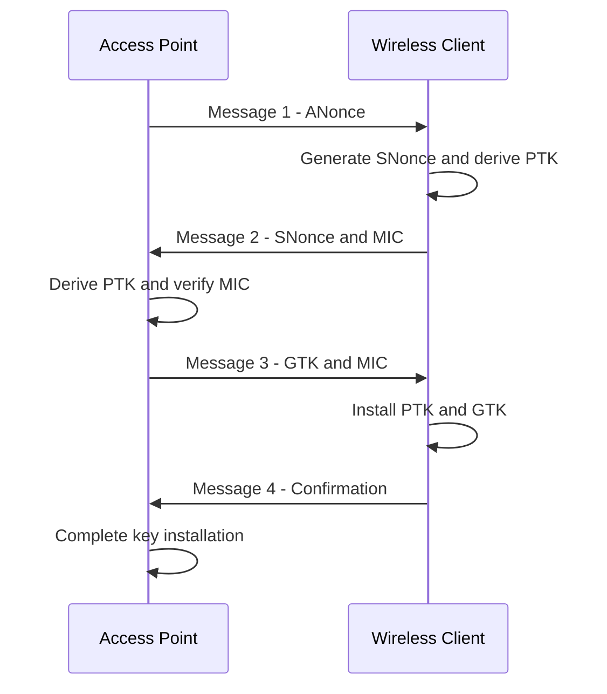
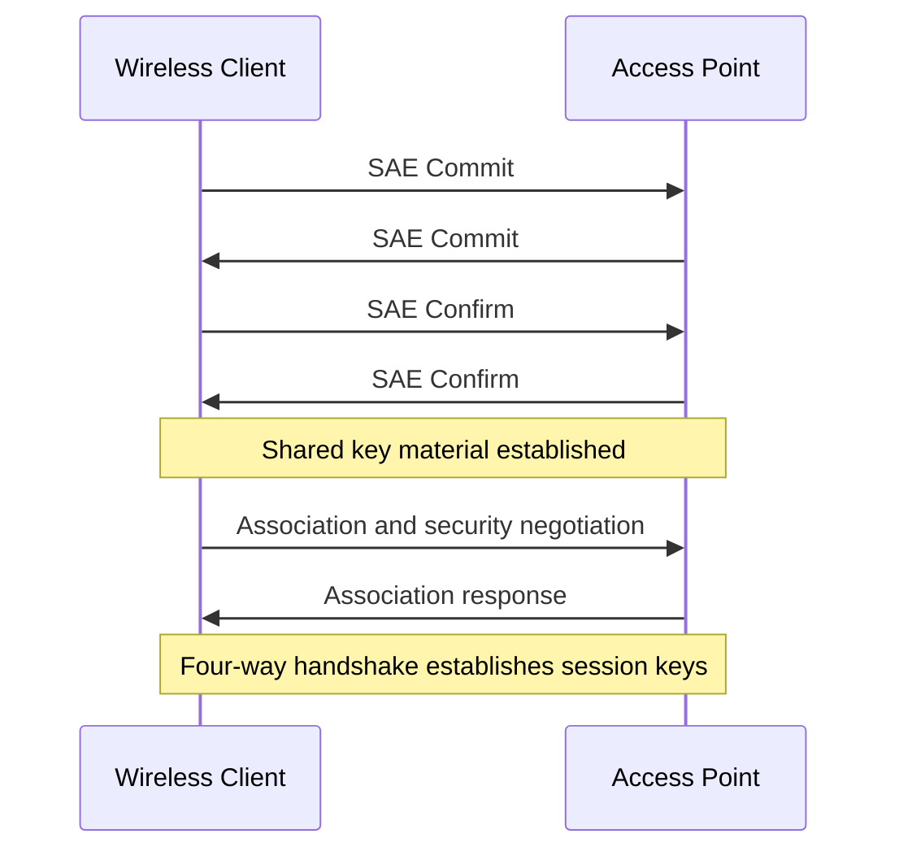

# WPA2 and WPA3

WPA2 and WPA3 are wireless security standards developed by the Wi-Fi Alliance to protect Wi-Fi networks against unauthorized access, data interception, and other security threats.

Both standards provide authentication and encryption mechanisms, but WPA3 introduces improvements to password-based authentication, management-frame protection, and enterprise security.

Understanding their differences is important when configuring wireless access points, designing enterprise Wi-Fi networks, and securing wireless infrastructure.

# 🗁 WPA2 Overview

Wi-Fi Protected Access 2 (WPA2) is based on the IEEE 802.11i security amendment.

It introduced stronger security mechanisms than the original WPA standard and commonly uses AES-based CCMP for wireless data protection.

WPA2 supports two authentication modes:

| Mode | Authentication | Typical Environment |
| --- | --- | --- |
| WPA2-Personal | Pre-Shared Key (PSK) | Home and small office networks |
| WPA2-Enterprise | IEEE 802.1X and EAP | Enterprise networks |

**WPA2-Personal**

WPA2-Personal uses a shared passphrase to authenticate users.

All authorized users typically use the same wireless password.

**WPA2-Enterprise**

WPA2-Enterprise uses IEEE 802.1X and an Extensible Authentication Protocol (EAP) method.

Authentication is commonly handled by a RADIUS server, allowing individual users or devices to authenticate with centrally managed credentials.

# 🗁 WPA2-Personal Authentication

WPA2-Personal uses a Pre-Shared Key (PSK).

The passphrase is converted into a Pairwise Master Key (PMK) using PBKDF2 with HMAC-SHA1.

The derivation process uses:

* Passphrase: 8–63 characters.
* SSID: Used as the derivation salt.
* Iterations: 4096.
* Output: 256-bit PMK.

Conceptually:

```text
PMK = PBKDF2(
    Passphrase,
    SSID,
    4096 iterations,
    256 bits
)
```

The PMK is used during the four-way handshake to establish session-specific encryption keys.

# 🗁 WPA2 Four-Way Handshake

The WPA2 four-way handshake establishes encryption keys between a wireless client and an access point.

It verifies that both devices possess the required PMK without transmitting the PMK directly over the wireless connection.

The handshake involves four EAPOL-Key messages.



Important handshake components:

| Component | Description |
| --- | --- |
| PMK | Pairwise Master Key used as the foundation for key derivation |
| ANonce | Random value generated by the access point |
| SNonce | Random value generated by the wireless client |
| PTK | Pairwise Transient Key used for unicast protection |
| GTK | Group Temporal Key used for group-addressed traffic |
| MIC | Message Integrity Code used to verify message integrity |

The PTK is derived using the PMK, both device addresses, and the two nonces.

For CCMP, the PTK contains key material used for encryption and integrity protection.

The GTK protects group-addressed wireless traffic, such as broadcast and multicast frames.

# 🗁 WPA2 Encryption

WPA2 commonly uses AES-based Counter Mode with Cipher Block Chaining Message Authentication Code Protocol (CCMP).

CCMP provides:

* Data confidentiality.
* Data integrity.
* Data origin authentication.
* Replay protection.

CCMP uses AES with a 128-bit key.

TKIP was supported as a transitional compatibility mechanism in older WPA/WPA2 deployments, but it is obsolete and should not be used.

# 🗁 WPA3 Overview

Wi-Fi Protected Access 3 (WPA3) introduces improvements over WPA2.

Its major security enhancements include:

* Simultaneous Authentication of Equals (SAE) for WPA3-Personal.
* Better resistance to offline password-guessing attacks.
* Protected Management Frames (PMF) support.
* Stronger enterprise security options.
* Enhanced Open through Opportunistic Wireless Encryption (OWE).

WPA3 supports Personal and Enterprise operating modes.

# 🗁 WPA3-Personal and SAE

WPA3-Personal replaces the traditional WPA2-Personal PSK authentication exchange with Simultaneous Authentication of Equals (SAE).

SAE is based on a password-authenticated key exchange mechanism.

Both the wireless client and access point participate in establishing shared key material without transmitting the password directly.

SAE improves resistance to offline dictionary attacks because a captured authentication exchange does not provide the same offline password-verification opportunity as a traditional WPA2-PSK four-way handshake capture.

SAE does not eliminate weak-password risks. Strong, unique passphrases remain important.

# 🗁 SAE Authentication Process

A simplified SAE authentication process:



The main SAE stages are:

| Stage | Description |
| --- | --- |
| Commit | Both parties exchange cryptographic commit values |
| Confirm | Both parties verify the authentication exchange |
| Key Derivation | Shared key material is established |
| Four-Way Handshake | Session-specific encryption keys are installed |

The exact cryptographic exchange depends on the SAE implementation and negotiated parameters.

# 🗁 WPA3 Encryption

WPA3-Personal commonly uses AES-based CCMP-128.

WPA3 can also support stronger cryptographic suites, including GCMP-256, depending on the operating mode and negotiated capabilities.

WPA3-Enterprise provides stronger security options for organizations that require higher assurance.

WPA3-Enterprise 192-bit security mode uses a defined set of stronger cryptographic algorithms and authentication requirements.

It is intended for environments with stricter security requirements.

# 🗁 WPA2-Enterprise and WPA3-Enterprise

Enterprise wireless security uses centralized authentication rather than relying on one shared password for every user.

The main components are:

| Component | Role |
| --- | --- |
| Supplicant | Wireless client requesting access |
| Authenticator | Access point controlling wireless access |
| Authentication Server | RADIUS server validating authentication |
| EAP | Framework for exchanging authentication information |

Common EAP methods include:

* EAP-TLS
* PEAP
* EAP-TTLS

EAP-TLS uses client and server certificates and provides mutual authentication when configured correctly.

Enterprise deployments should validate the authentication server certificate to reduce the risk of connecting to a malicious authentication server.

# 🗁 WPA2 vs WPA3 Comparison

| Feature | WPA2-Personal | WPA3-Personal |
| --- | --- | --- |
| Authentication | PSK | SAE |
| Key Establishment | PSK-based handshake | SAE exchange |
| Offline Dictionary Attack Resistance | More exposed to offline guessing when a handshake is captured | Improved resistance through SAE |
| Encryption | Commonly AES-CCMP | Commonly AES-CCMP |
| PMF | Optional | Required |
| Password Requirement | Strong passphrase recommended | Strong passphrase recommended |
| Compatibility | Very broad | Requires WPA3-compatible devices or transition support |

# 🗁 WPA2/WPA3 Transition Mode

Transition mode allows an access point to support WPA2-Personal and WPA3-Personal clients on the same wireless network.

This is useful when an environment contains both modern and older devices.

```text
                    Wireless Access Point
                              |
                    WPA2/WPA3 Transition
                              |
                 +------------+------------+
                 |                         |
            WPA2 Client               WPA3 Client
                 |                         |
             PSK-based                    SAE
          Authentication             Authentication
                 |                         |
                 +------------+------------+
                              |
                       Wireless Network
```

Important considerations:

* Older clients may connect using WPA2.
* Compatible clients may use WPA3.
* Security depends on the negotiated mode.
* Transition mode may retain some compatibility-related weaknesses.
* Separate SSIDs may be preferable when stronger security isolation is required.

# 🗁 Protected Management Frames

Protected Management Frames (PMF) protect certain robust management frames.

PMF helps defend against forged deauthentication and disassociation frames.

Common configuration modes:

| Mode | Description |
| --- | --- |
| Disabled | PMF is not enabled |
| Optional | PMF is used when supported by the client |
| Required | Clients must support PMF |

WPA3 requires PMF support.

# 🗁 Enhanced Open and OWE

Opportunistic Wireless Encryption (OWE) provides encryption for open wireless networks without requiring a shared password.

It is commonly known as Enhanced Open.

OWE establishes individual encryption keys between a client and an access point.

It protects wireless traffic from passive interception by other nearby clients, but it does not authenticate the access point as a trusted network.

OWE is different from WPA3-Personal:

| Feature | WPA3-Personal | Enhanced Open |
| --- | --- | --- |
| Password Required | Yes | No |
| Authentication | SAE | No password-based authentication |
| Encryption | Yes | Yes |
| Typical Use | Private wireless networks | Public or guest wireless networks |

# 🗁 Wireless Security Configuration

When configuring an access point, use the following general security preferences:

**Home and Small Office**

* Prefer WPA3-Personal.
* Use WPA2-AES/CCMP only when WPA3 is unavailable.
* Configure a strong, unique passphrase.
* Enable PMF where supported.
* Disable WEP, WPA, and TKIP.

**Enterprise**

* Prefer WPA3-Enterprise where supported.
* Use IEEE 802.1X with a properly configured RADIUS server.
* Select an appropriate EAP method.
* Validate server certificates.
* Use individual user or device credentials.
* Apply VLAN assignment and access policies where appropriate.

**Guest Networks**

* Use a separate SSID.
* Isolate guest clients from internal resources.
* Apply firewall restrictions.
* Consider Enhanced Open where supported and appropriate.

# 🗁 Troubleshooting WPA2 and WPA3

Common wireless security problems include:

| Problem | Possible Cause | Investigation |
| --- | --- | --- |
| Authentication failure | Incorrect passphrase or authentication credentials | Verify credentials and authentication logs |
| WPA3 connection failure | Client does not support WPA3 or required PMF | Check client and access point capabilities |
| Enterprise authentication failure | RADIUS or EAP configuration problem | Inspect RADIUS and client logs |
| Frequent disconnections | Driver, signal, or compatibility issue | Inspect wireless logs and signal quality |
| Guest access failure | Incorrect VLAN or firewall configuration | Verify VLAN assignment and firewall rules |

Useful Linux commands:

**Inspect Nearby Wireless Security Capabilities**

```bash
sudo iw dev wlan0 scan
```

**Display Available Wireless Networks**

```bash
nmcli device wifi list
```

**Inspect Current Wireless Connection**

```bash
iw dev wlan0 link
```

**Review NetworkManager Logs**

```bash
sudo journalctl -u NetworkManager
```

**Capture Wireless-Related System Logs**

```bash
sudo journalctl -b | grep -iE 'wifi|wlan|wpa|802.11'
```

The available diagnostic information depends on the wireless adapter, driver, and NetworkManager configuration.

# 🗁 Key Takeaways

* WPA2 and WPA3 provide authentication and encryption for Wi-Fi networks.
* WPA2-Personal uses a Pre-Shared Key.
* WPA2 commonly uses AES-based CCMP.
* WPA3-Personal uses Simultaneous Authentication of Equals.
* SAE improves resistance to offline password-guessing attacks.
* WPA2 and WPA3 Enterprise commonly use IEEE 802.1X, EAP, and RADIUS.
* WPA3 requires Protected Management Frames support.
* Enhanced Open uses OWE to encrypt open wireless connections without a shared password.
* Transition mode supports WPA2 and WPA3 clients but may retain compatibility-related security limitations.
* WPA3 is preferred for new deployments when client and access point compatibility allows it.
