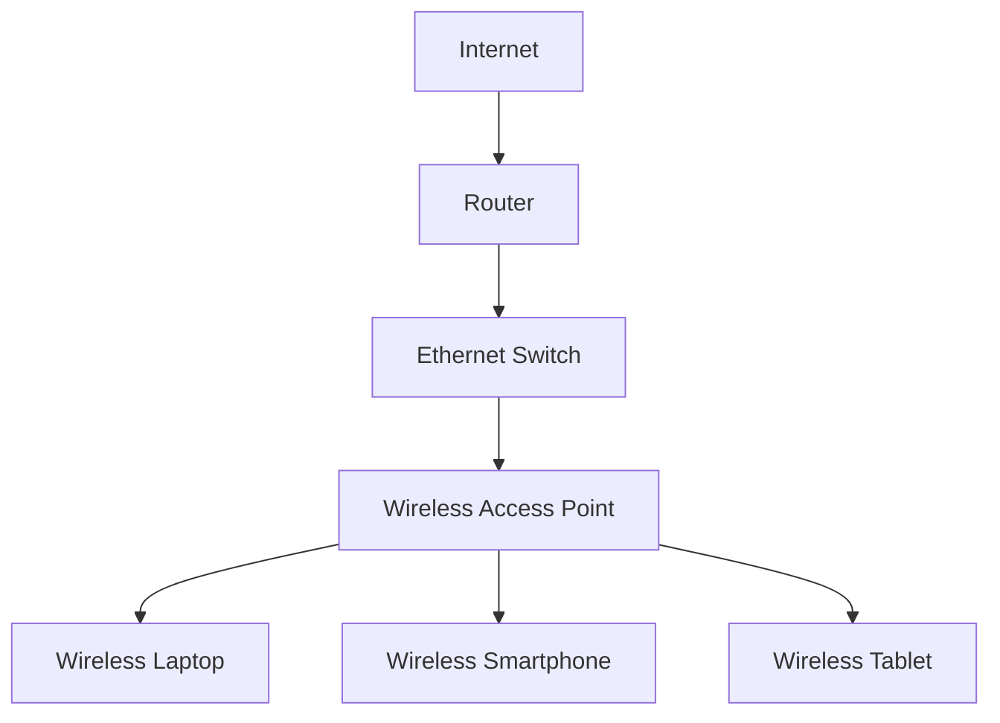
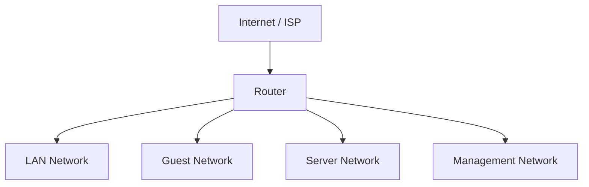
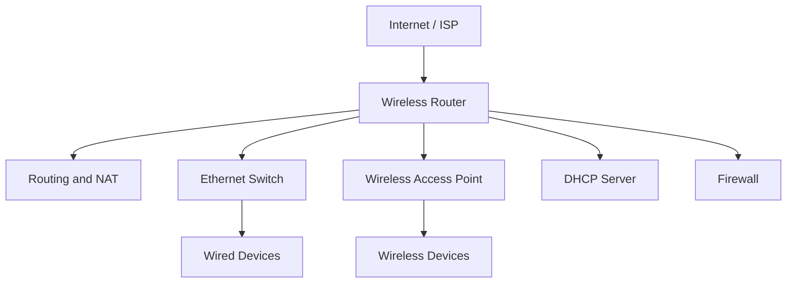
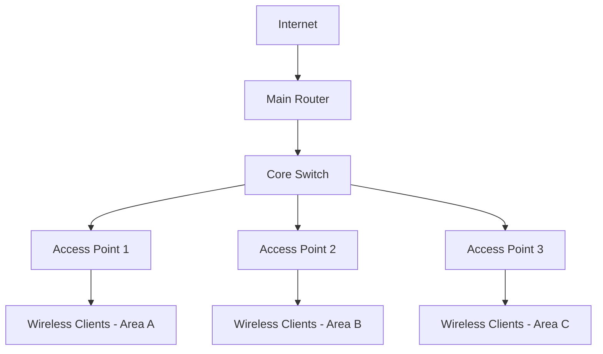
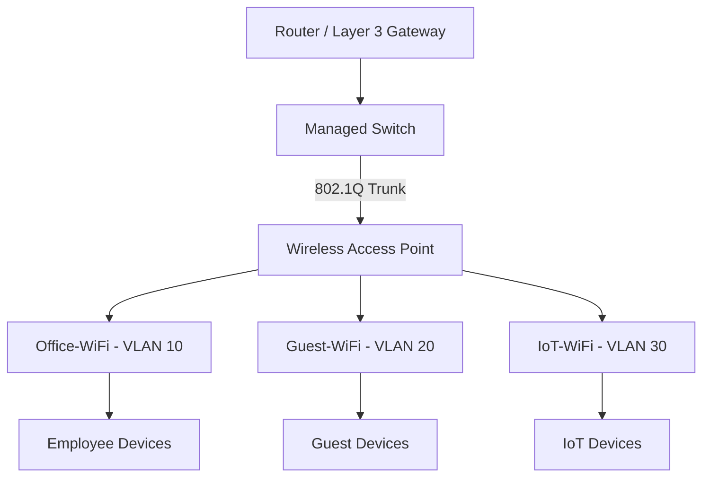

# Access Point vs Router

An access point (AP) and a router are two different networking devices that perform different functions.

An access point provides wireless connectivity to a network, while a router forwards packets between different IP networks.

Although many home networking devices combine both functions into one physical device, understanding their differences is essential when designing, configuring, and troubleshooting wireless networks.

# 🗁 What Is an Access Point?

A wireless access point is a networking device that allows wireless clients to connect to an existing wired or bridged network.

It provides Wi-Fi connectivity by connecting wireless devices to the network infrastructure.

Typical access point functions include:

* Broadcasting wireless networks (SSIDs).
* Allowing wireless clients to associate.
* Managing wireless authentication and encryption.
* Bridging wireless traffic to a wired network.
* Supporting multiple wireless clients.
* Providing VLAN-aware wireless connectivity when supported.

An access point generally operates at Layer 2 of the OSI model when bridging wireless clients to an Ethernet network.

**Basic Access Point Architecture**



The access point connects wireless devices to the existing network. The router remains responsible for routing traffic between IP networks.

# 🗁 What Is a Router?

A router is a networking device that forwards IP packets between different networks.

It examines destination IP addresses and uses its routing table to select the appropriate next hop and outgoing interface.

Typical router functions include:

* IP routing.
* Routing table management.
* Static and dynamic routing.
* Default gateway services.
* Network Address Translation (NAT).
* Firewall and packet filtering.
* DHCP services, when configured.
* VPN and network segmentation.

A router primarily operates at Layer 3 of the OSI model.

**Basic Router Architecture**



The router provides communication between different IP networks according to its routing and firewall policies.

# 🗁 Access Point vs Router

| Feature | Access Point | Router |
| --- | --- | --- |
| Primary Function | Provides wireless connectivity | Routes packets between networks |
| Main OSI Layer | Layer 2 when bridging | Layer 3 |
| Wireless Connectivity | Usually provided | Optional |
| IP Routing | Usually not performed in AP mode | Core function |
| NAT | Usually not performed | Commonly supported |
| DHCP Server | Usually not required | Commonly supported |
| Firewall | May provide limited wireless security controls | Commonly provides network firewalling |
| SSID Broadcasting | Yes | Only if wireless functionality is included |
| Default Gateway | Usually not | Commonly provides the LAN default gateway |

# 🗁 Wireless Router

A wireless router combines multiple networking functions into one physical device.

A typical home wireless router includes:

* Router.
* Ethernet switch.
* Wireless access point.
* NAT functionality.
* DHCP server.
* Firewall.



This integration makes wireless routers convenient for home and small-office networks.

However, these functions are logically separate even when implemented inside one device.

# 🗁 Access Point Mode vs Router Mode

Many consumer networking devices support both access point mode and router mode.

The operating mode determines how the device handles network traffic.

**Router Mode**

In router mode, the device creates and manages a separate IP network.

Typical responsibilities include:

* Routing between WAN and LAN.
* Providing DHCP services.
* Performing NAT.
* Applying firewall rules.
* Managing wireless connectivity if supported.

Example:

```text
Internet
   |
ISP Router
   |
WAN Interface
   |
Wireless Router
   |
192.168.20.0/24
   |
Wireless and Wired Clients
```

**Access Point Mode**

In access point mode, the device connects wireless clients to an existing LAN.

It generally disables its own routing, NAT, and DHCP server functions.

Example:

```text
Internet
   |
Main Router
   |
192.168.10.0/24
   |
Ethernet Switch
   |
Access Point
   |
Wireless Clients
```

In this architecture, the main router provides the default gateway and DHCP services.

The access point bridges wireless client traffic into the existing LAN.

# 🗁 Understanding Double NAT

Double NAT occurs when traffic passes through two devices performing network address translation.

A common example is connecting a wireless router in router mode behind an ISP router that is already performing NAT.

```text
Internet
   |
ISP Router
   |
NAT: 192.168.1.0/24
   |
Wireless Router
   |
NAT: 192.168.20.0/24
   |
Client Devices
```

This creates two translation boundaries.

Potential problems include:

* Complicated port forwarding.
* Difficulty establishing some VPN connections.
* Inbound connectivity problems.
* More complicated network troubleshooting.
* Additional routing and firewall configuration.

Using access point mode can eliminate the second NAT boundary when the existing router should remain responsible for routing.

Double NAT is not inherently broken, but it should be an intentional network design decision.

# 🗁 Multiple Access Points in One Network

Large buildings, offices, campuses, and warehouses often require multiple access points to provide wireless coverage.

All access points can connect to the same LAN infrastructure while broadcasting the same SSID and using compatible security settings.



Multiple access points can improve:

* Wireless coverage.
* Client capacity.
* Network scalability.
* Performance in high-density environments.
* Roaming between coverage areas.

However, deploying additional access points does not automatically improve wireless performance. Channel planning, transmit power, interference, backhaul capacity, and client distribution must also be considered.

# 🗁 Wireless Roaming

Wireless roaming occurs when a wireless client moves from one access point to another within the same network.

For example, a user may move from an office room covered by AP1 to a meeting room covered by AP2.

The client may reassociate with the new access point while maintaining its network connectivity.

Important IEEE 802.11 roaming enhancements include:

| Standard | Function |
| --- | --- |
| 802.11k | Provides information about nearby access points |
| 802.11v | Helps clients make better roaming decisions |
| 802.11r | Supports Fast BSS Transition to reduce roaming authentication delay |

These standards improve roaming behavior, but the client ultimately plays an important role in deciding when to roam.

# 🗁 VLAN Support on Access Points

Enterprise access points can map wireless SSIDs to different VLANs.

This allows one physical access point to provide multiple logically separated wireless networks.

Example:

| SSID | VLAN ID | Network | Purpose |
| --- | ---: | --- | --- |
| Office-WiFi | 10 | 192.168.10.0/24 | Employees |
| Guest-WiFi | 20 | 192.168.20.0/24 | Visitors |
| IoT-WiFi | 30 | 192.168.30.0/24 | IoT devices |
| Management | 99 | 192.168.99.0/24 | Network administration |

Example architecture:



The switch must carry the required VLANs to the access point.

The router or Layer 3 switch provides inter-VLAN routing and applies the required firewall policies.

# 🗁 MikroTik Access Point Configuration

MikroTik RouterOS can configure a device to operate as a wireless access point.

The following is a simplified RouterOS v7 example using a wireless interface named `wlan1`.

**Configure the wireless security profile**

```routeros
/interface wifi security
add name=wifi-security authentication-types=wpa2-psk,wpa3-psk passphrase="Replace-With-A-Strong-Password"
```

**Configure the wireless interface**

```routeros
/interface wifi
set [find default-name=wifi1] \
    configuration.mode=ap \
    configuration.ssid="Office-WiFi" \
    security=wifi-security
```

**Add the wireless interface to an existing bridge**

```routeros
/interface bridge port
add bridge=bridge interface=wifi1
```

The interface names and supported configuration properties depend on the MikroTik wireless package and device model. RouterOS v7 WiFi and legacy wireless packages use different configuration menus.

The example assumes the bridge and required LAN connectivity already exist. DHCP, routing, and firewall services should remain on the main router when the device is operating as a dedicated access point.

# 🗁 Choosing Between an Access Point and a Router

| Requirement | Recommended Device |
| --- | --- |
| Provide Wi-Fi connectivity to an existing LAN | Access Point |
| Connect multiple IP networks | Router |
| Provide internet connectivity for a home network | Wireless Router |
| Expand Wi-Fi coverage in an existing building | Additional Access Points |
| Create separate routed networks | Router or Layer 3 Switch |
| Provide enterprise Wi-Fi across multiple floors | Multiple Managed Access Points |
| Avoid unnecessary additional NAT | Access Point Mode |

# 🗁 Key Takeaways

* An access point provides wireless connectivity to an existing network.
* A router forwards packets between different IP networks.
* A wireless router combines routing, switching, and wireless access point functions.
* Access point mode generally disables the device's own routing, NAT, and DHCP services.
* Router mode can create a separate network and introduce double NAT when connected behind another NAT router.
* Multiple access points improve coverage and client capacity when properly designed.
* Wireless roaming allows clients to move between access points.
* Enterprise access points can map different SSIDs to separate VLANs.
* VLAN separation requires compatible switch, router, and access point configurations.
