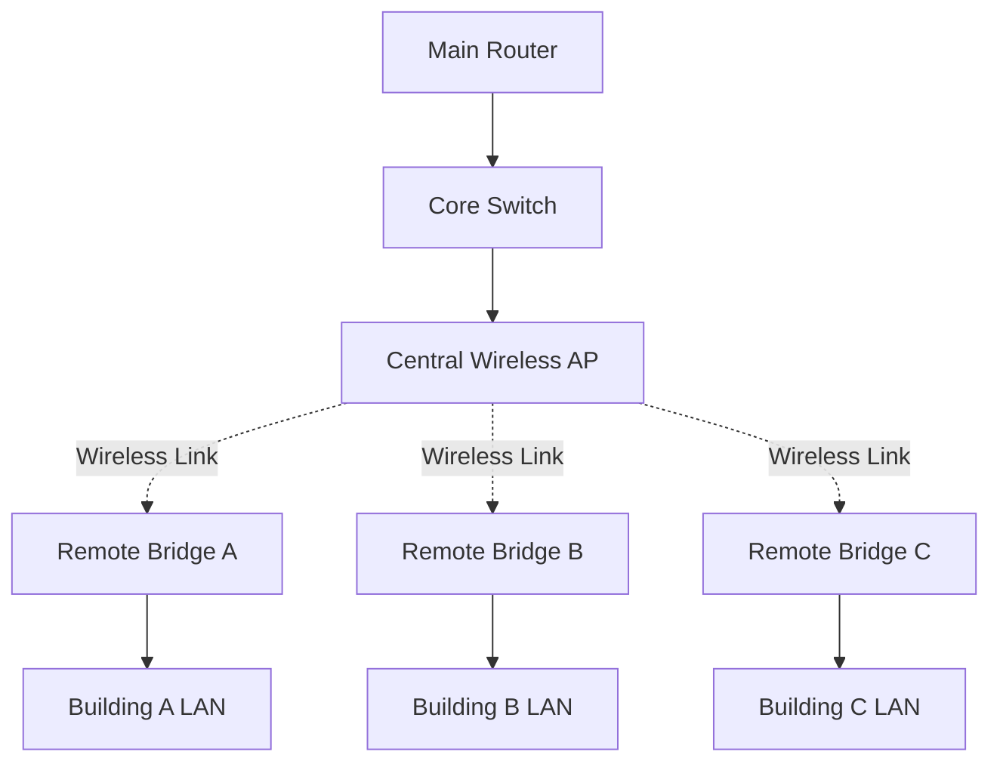
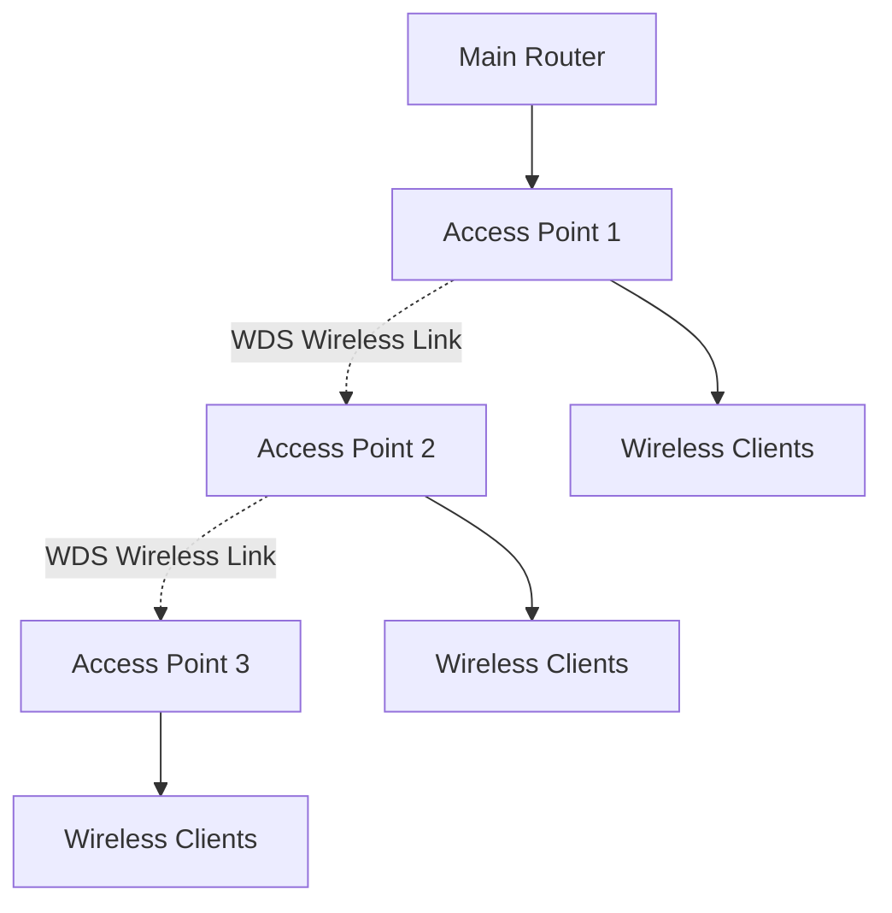
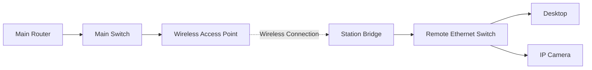

# Wireless Bridging

Wireless bridging is a networking technique that connects two or more network segments through a wireless link instead of using a physical Ethernet cable.

It allows devices connected to separate wired LAN segments to communicate through a wireless connection.

Wireless bridging is commonly used to connect buildings, extend network infrastructure, and provide connectivity in locations where installing Ethernet or fiber-optic cables is difficult or expensive.

# 🗁 What Is Wireless Bridging?

A wireless bridge connects network segments at Layer 2 of the OSI model.

It forwards Ethernet frames between connected network segments, allowing devices to communicate as if they were connected through a compatible Layer 2 infrastructure.

A wireless bridge does not necessarily perform IP routing or NAT.

**Basic Wireless Bridge Architecture**


In this architecture:

* Wireless Bridge A connects to LAN A.
* Wireless Bridge B connects to LAN B.
* Both bridges establish a wireless link.
* Ethernet frames are forwarded between the two LAN segments.

# 🗁 Wireless Bridge vs Wireless Router

A wireless bridge and a wireless router perform different networking functions.

| Feature | Wireless Bridge | Wireless Router |
| --- | --- | --- |
| Primary Function | Connects network segments | Routes traffic between IP networks |
| Main Operation | Layer 2 bridging | Layer 3 routing |
| IP Routing | Not required | Core function |
| NAT | Not normally required | Commonly supported |
| Network Segmentation | Extends an existing Layer 2 network | Creates or connects different IP networks |
| Typical Use | Connecting distant LANs | Internet access and inter-network communication |

A wireless bridge extends a Layer 2 network, while a router connects different IP networks.

# 🗁 Common Wireless Bridging Modes

Different wireless technologies support different bridging modes.

Common modes include:

| Mode | Description |
| --- | --- |
| Point-to-Point Bridge | Connects two network locations |
| Point-to-Multipoint Bridge | Connects one central location to multiple remote locations |
| Wireless Distribution System (WDS) | Allows compatible access points to connect wirelessly |
| Station Bridge | Connects a wireless station to an access point while bridging Ethernet traffic |
| Mesh Networking | Uses multiple wireless nodes to provide interconnected network paths |

The available modes and their behavior depend on the wireless standard, hardware, and vendor implementation.

# 🗁 Point-to-Point Wireless Bridge

A point-to-point (PtP) wireless bridge connects two locations using a dedicated wireless link.

It is commonly used to connect buildings, offices, warehouses, or remote network locations.

**Architecture**


Typical applications:

* Connecting two office buildings.
* Extending an ISP network.
* Connecting a remote CCTV installation.
* Providing network access to a warehouse.
* Connecting remote industrial facilities.

A directional antenna is commonly used at each endpoint to establish a focused wireless link.

# 🗁 Point-to-Multipoint Wireless Bridge

Point-to-multipoint (PtMP) connects one central wireless location to multiple remote locations.

The central device acts as the access point, while remote devices connect as wireless stations or bridges.

**Architecture**



Typical applications:

* ISP distribution networks.
* Connecting multiple buildings.
* Campus networks.
* CCTV distribution.
* Wireless connectivity for remote customers.

The central access point must handle the combined traffic and airtime requirements of its connected stations.

# 🗁 Wireless Distribution System (WDS)

Wireless Distribution System (WDS) allows compatible wireless access points to connect through wireless links.

It can extend wireless network coverage without requiring a wired connection between every access point.

A WDS link can be used to forward traffic between access points while maintaining Layer 2 connectivity.

**Example Architecture**



Important considerations:

* WDS compatibility varies between vendors.
* Both access points must support compatible WDS implementations.
* Wireless backhaul consumes airtime.
* Wireless security settings must be compatible.
* Additional wireless hops can increase latency and reduce available throughput.

WDS is not a universal guarantee of interoperability between different vendors.

# 🗁 Wireless Station Bridge

A wireless station bridge connects a remote Ethernet network to an existing wireless access point.

The remote device operates as a wireless station while forwarding traffic from its Ethernet-connected devices.

**Architecture**



This configuration is useful when multiple wired devices need network access through a wireless connection.

However, a standard Wi-Fi station connection does not automatically provide transparent Layer 2 bridging for multiple downstream MAC addresses.

The wireless implementation must support an appropriate bridging mechanism, such as WDS, four-address mode, or a vendor-specific equivalent.

# 🗁 Four-Address Wireless Bridging

Traditional infrastructure Wi-Fi frames commonly use three MAC addresses.

Transparent Layer 2 bridging may require four-address frames so that the wireless system can preserve both the original source and destination MAC addresses across the wireless link.

The four-address format includes:

| Address | Purpose |
| --- | --- |
| Address 1 | Receiver Address (RA) |
| Address 2 | Transmitter Address (TA) |
| Address 3 | Destination or source address, depending on frame direction |
| Address 4 | Additional source or destination address, depending on frame direction |

Four-address mode is commonly associated with WDS and compatible wireless bridging implementations.

Not every access point or wireless client supports it.

# 🗁 Wireless Bridge Design Considerations

A reliable wireless bridge requires careful planning.

**Line of Sight**

The antennas should have a clear path between the two locations.

Physical obstacles such as buildings, trees, and terrain can weaken or block the wireless signal.

**Fresnel Zone**

The Fresnel zone is an ellipsoidal region around the direct radio path.

Obstacles inside this region can cause diffraction and reduce signal quality even when the antennas appear to have visual line of sight.

A common planning target is to keep at least 60% of the first Fresnel zone clear.

**Frequency Selection**

Choose a frequency band based on:

* Distance.
* Regulatory requirements.
* Available channels.
* Interference.
* Equipment capabilities.
* Required throughput.

**Antenna Alignment**

Directional antennas must be accurately aligned to maintain a stable wireless link.

**Channel Width**

Wider channels can provide higher theoretical throughput but consume more spectrum and may experience greater interference.

**Security**

Use modern wireless security, strong credentials, and appropriate management access controls.

**Power and Cabling**

Outdoor wireless equipment should use suitable weather-resistant installation practices and compatible power arrangements.

# 🗁 Wireless Bridge Performance

Wireless bridge performance depends on several factors:

* Signal strength.
* Signal-to-noise ratio (SNR).
* Channel utilization.
* Modulation and coding scheme (MCS).
* Channel width.
* Antenna gain and alignment.
* Interference.
* Distance and propagation conditions.
* Hardware processing capacity.

A high negotiated PHY rate does not guarantee the same application throughput.

Wireless links use shared airtime, and protocol overhead, retransmissions, and environmental conditions reduce usable throughput.

# 🗁 Wireless Bridge vs Mesh Networking

Wireless bridging and mesh networking can both connect network locations, but their architectures differ.

| Feature | Wireless Bridge | Mesh Networking |
| --- | --- | --- |
| Typical Architecture | Dedicated link between network segments | Multiple interconnected wireless nodes |
| Main Purpose | Extend Layer 2 connectivity | Provide distributed wireless connectivity |
| Topology | Point-to-point or point-to-multipoint | Mesh or multi-node topology |
| Path Selection | Often fixed or centrally configured | May support dynamic path selection |
| Typical Use | Building-to-building connectivity | Campus and large-area wireless coverage |

Some mesh systems use Layer 2 bridging, while others route traffic between nodes. Mesh networking does not inherently mean transparent Layer 2 bridging.

# 🗁 MikroTik Wireless Bridging

MikroTik RouterOS supports several wireless connection modes.

Available modes depend on the wireless package, device hardware, and RouterOS version.

Common concepts include:

* `bridge`
* `station-bridge`
* `station`
* `wds`
* `ap-bridge`

The legacy wireless package and the newer RouterOS WiFi package have different configuration interfaces and feature support.

For RouterOS v7, verify the installed wireless package and the supported modes before choosing a bridging architecture.

**Example: Inspect Wireless Interfaces**

```routeros
/interface print
```

**Inspect Wireless Registration**

```routeros
/interface wireless registration-table print
```

This command applies to devices using the legacy wireless package.

**Inspect Bridge Ports**

```routeros
/interface bridge port print
```

**Inspect Bridge Host Table**

```routeros
/interface bridge host print
```

**Inspect Wireless Interfaces Using the WiFi Package**

```routeros
/interface wifi print
```

The exact configuration depends on whether the selected hardware uses the legacy wireless package or the newer WiFi package.

# 🗁 Troubleshooting Wireless Bridges

Common wireless bridge problems include:

| Problem | Possible Cause | Investigation |
| --- | --- | --- |
| Wireless link does not establish | Incorrect frequency, security, or connection mode | Verify wireless configuration on both endpoints |
| Weak signal | Poor antenna alignment or physical obstruction | Inspect signal level and antenna alignment |
| Low throughput | Interference, retransmissions, or narrow channel capacity | Inspect wireless link quality and channel utilization |
| Remote LAN devices cannot communicate | Incorrect bridging or VLAN configuration | Inspect bridge ports and VLAN membership |
| Intermittent connectivity | Unstable signal or interference | Review signal quality and wireless logs |
| High latency | Congestion, retransmissions, or multiple wireless hops | Measure latency and inspect airtime utilization |

Useful Linux commands:

**Inspect Wireless Link Information**

```bash
iw dev wlan0 link
```

**Inspect Wireless Interface Statistics**

```bash
iw dev wlan0 station dump
```

**Inspect Interface Statistics**

```bash
ip -s link show wlan0
```

**Test Connectivity to the Remote Network**

```bash
ping -c 10 192.168.10.1
```

**Trace the Network Path**

```bash
traceroute 192.168.10.1
```

A Layer 2 bridge may not appear as an additional hop in traceroute because it does not decrement the IP TTL.

# 🗁 Key Takeaways

* Wireless bridging connects network segments through wireless links.
* A transparent wireless bridge operates primarily at Layer 2.
* Point-to-point links connect two locations.
* Point-to-multipoint links connect multiple remote locations to a central site.
* WDS allows compatible access points to establish wireless distribution links.
* Four-address wireless frames can support transparent Layer 2 bridging.
* Standard Wi-Fi station mode does not automatically support transparent bridging of multiple downstream MAC addresses.
* Line of sight, Fresnel zone clearance, antenna alignment, and interference affect link reliability.
* Wireless mesh networking and wireless bridging are related but different architectures.
* MikroTik bridging capabilities depend on the installed wireless package and hardware.
