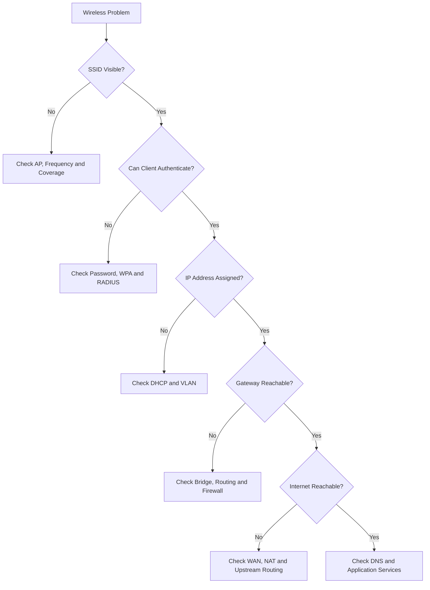

# Wireless Troubleshooting

Wireless troubleshooting is the process of identifying, diagnosing, and resolving problems affecting Wi-Fi connectivity, performance, authentication, and network availability.

Wireless problems can originate from different parts of the network, including client devices, access points, radio-frequency conditions, authentication systems, VLANs, DHCP services, routing, and firewalls.

A systematic troubleshooting approach helps identify the actual cause instead of making random configuration changes.

# 🗁 Common Wireless Problems

Common Wi-Fi problems include:

| Problem | Possible Cause |
| --- | --- |
| Cannot find an SSID | Access point unavailable, hidden SSID, or unsupported frequency |
| Cannot connect to Wi-Fi | Incorrect password or security incompatibility |
| Connected but no internet | Gateway, DNS, routing, or firewall problem |
| Slow Wi-Fi | Interference, congestion, weak signal, or limited backhaul |
| Frequent disconnections | Signal instability, roaming, or driver issues |
| IP address unavailable | DHCP server or VLAN configuration problem |
| Authentication failure | WPA configuration, credentials, or RADIUS problem |
| High latency | Airtime congestion, retransmissions, or upstream network problems |
| Some websites do not load | DNS, MTU, or connectivity issue |

# 🗁 Wireless Troubleshooting Methodology

Troubleshoot wireless problems systematically, starting with the client and moving toward the network infrastructure.



# 🗁 Check Wireless Interface Status

Start by confirming that the wireless adapter is enabled and operational.

**Display wireless interfaces**

```bash
iw dev
```

**Display all network interfaces**

```bash
ip link show
```

**Check wireless interface status**

```bash
ip link show wlan0
```

**Enable the wireless interface**

```bash
sudo ip link set wlan0 up
```

Replace `wlan0` with the actual wireless interface name.

# 🗁 Check Available Wi-Fi Networks

If the SSID is not visible, inspect nearby wireless networks.

**List available networks**

```bash
nmcli device wifi list
```

**Scan using iw**

```bash
sudo iw dev wlan0 scan
```

Inspect the following information:

* SSID.
* BSSID.
* Frequency.
* Signal level.
* Supported security capabilities.
* Channel information.

Possible causes of an invisible SSID include:

* Access point is powered off.
* Wireless interface is disabled.
* Incorrect frequency configuration.
* Client does not support the configured band.
* Access point is out of range.
* SSID broadcasting is disabled.
* Regulatory-domain restrictions.

# 🗁 Check Wireless Signal Strength

Weak signal strength can cause low throughput, retransmissions, and connection instability.

**Inspect the current wireless connection**

```bash
iw dev wlan0 link
```

Example output:

```text
Connected to aa:bb:cc:dd:ee:ff
SSID: Office-WiFi
freq: 5180
signal: -65 dBm
tx bitrate: 433.3 MBit/s
```

Check:

* Signal strength.
* Frequency.
* Transmit bitrate.
* Access point BSSID.

A weak signal may indicate excessive distance, physical obstructions, poor antenna placement, or interference.

# 🗁 Check Wi-Fi Authentication

Authentication problems commonly occur when the client and access point cannot agree on the wireless security configuration.

Possible causes:

* Incorrect passphrase.
* WPA2/WPA3 incompatibility.
* Unsupported encryption settings.
* PMF compatibility problems.
* Incorrect enterprise credentials.
* RADIUS server failure.
* Invalid or untrusted EAP certificates.

**Inspect NetworkManager connections**

```bash
nmcli connection show
```

**Inspect NetworkManager logs**

```bash
sudo journalctl -u NetworkManager -b
```

**Inspect wireless-related system logs**

```bash
sudo journalctl -b | grep -iE 'wpa|wifi|wlan|802.11|authentication'
```

For enterprise networks, also investigate the RADIUS server and EAP authentication logs.

# 🗁 Check IP Address Configuration

A wireless client can successfully associate with an access point but fail to obtain an IP address.

This usually indicates a DHCP, VLAN, or network configuration problem.

**Display assigned IP addresses**

```bash
ip addr show wlan0
```

**Display routing table**

```bash
ip route
```

**Inspect DHCP-related NetworkManager information**

```bash
nmcli device show wlan0
```

Check whether:

* The client has a valid IP address.
* The subnet mask or prefix is correct.
* The default gateway is present.
* DNS servers are assigned.
* The DHCP lease is valid.

An IPv4 address in `169.254.0.0/16` may indicate that the client configured an IPv4 link-local address after failing to obtain a DHCP lease.

# 🗁 Check Default Gateway Connectivity

After obtaining an IP address, test communication with the default gateway.

**Display the default gateway**

```bash
ip route | grep default
```

**Test gateway connectivity**

```bash
ping -c 4 192.168.10.1
```

Replace the example address with the actual gateway.

If the gateway is unreachable, investigate:

* Incorrect IP configuration.
* Wireless client isolation.
* VLAN assignment.
* Access point bridge configuration.
* Switch port configuration.
* Gateway firewall policies.

A failed ping alone does not prove the gateway is unavailable because ICMP traffic may be filtered.

# 🗁 Check Internet Connectivity

If the gateway is reachable, test connectivity to an external IP address.

```bash
ping -c 4 1.1.1.1
```

If external IP connectivity fails, investigate:

* Router WAN connectivity.
* Default routing.
* NAT configuration.
* Firewall rules.
* Upstream ISP connectivity.

If external IP connectivity works but domain names fail, investigate DNS resolution.

# 🗁 Check DNS Resolution

DNS problems can make an internet connection appear unavailable even when IP connectivity is working.

**Display configured DNS servers**

```bash
resolvectl status
```

**Test DNS resolution**

```bash
dig example.com
```

**Query a specific DNS server**

```bash
dig @1.1.1.1 example.com
```

**Test system name resolution**

```bash
getent hosts example.com
```

Possible causes include:

* Incorrect DNS server configuration.
* DNS server unavailable.
* Firewall blocking DNS traffic.
* Incorrect DHCP DNS options.
* DNS filtering or proxy configuration.

# 🗁 Check Wireless Performance

A connected wireless client may experience slow performance because of weak signals, interference, channel congestion, or retransmissions.

Inspect:

* RSSI.
* SNR.
* Channel utilization.
* Negotiated PHY rate.
* Retransmission statistics.
* Number of connected clients.
* Channel width.
* Backhaul capacity.

**Inspect wireless link information**

```bash
iw dev wlan0 link
```

**Inspect wireless station statistics**

```bash
iw dev wlan0 station dump
```

**Inspect interface packet statistics**

```bash
ip -s link show wlan0
```

A negotiated PHY rate is not the same as actual application throughput.

For performance testing, use `iperf3` between two controlled endpoints.

**Start an iperf3 server**

```bash
iperf3 -s
```

**Run a client test**

```bash
iperf3 -c 192.168.10.100
```

**Test reverse-direction throughput**

```bash
iperf3 -c 192.168.10.100 -R
```

# 🗁 Check Channel Interference

Nearby wireless networks may compete for available airtime or create adjacent-channel interference.

**List nearby wireless networks**

```bash
nmcli device wifi list
```

**Scan wireless frequencies**

```bash
sudo iw dev wlan0 scan
```

Investigate:

* Number of nearby access points.
* Channel overlap.
* Channel utilization.
* Signal levels of competing networks.
* Non-Wi-Fi interference.
* Channel width.

Possible solutions include selecting a less congested channel, adjusting channel width, repositioning access points, and distributing clients across access points.

# 🗁 Check Wireless Roaming

Wireless clients may experience disconnections or performance changes when moving between access points.

Possible causes include:

* Poor coverage overlap.
* Incorrect transmit power.
* Incompatible security settings.
* Client roaming behavior.
* Authentication delays.
* Missing or inconsistent 802.11k, 802.11v, or 802.11r support.

Inspect the connected BSSID:

```bash
iw dev wlan0 link
```

Compare the BSSID before and after moving between coverage areas.

Remember that roaming decisions are generally made by the client, even when access points provide roaming assistance.

# 🗁 Packet Capture and Wireless Analysis

Packet capture helps identify communication failures that are not obvious from configuration inspection.

**Capture DHCP traffic**

```bash
sudo tcpdump -i wlan0 -n 'udp port 67 or udp port 68'
```

**Capture DNS traffic**

```bash
sudo tcpdump -i wlan0 -n 'port 53'
```

**Capture ICMP traffic**

```bash
sudo tcpdump -i wlan0 -n 'icmp'
```

**Capture traffic to a specific host**

```bash
sudo tcpdump -i wlan0 -n host 192.168.10.1
```

**Save captured traffic**

```bash
sudo tcpdump -i wlan0 -w wireless-capture.pcap
```

The resulting capture can be inspected using Wireshark.

For detailed 802.11 management-frame and radio analysis, a compatible wireless adapter operating in monitor mode is generally required.

# 🗁 MikroTik Wireless Troubleshooting

MikroTik RouterOS provides tools for inspecting wireless interfaces, connected clients, bridge configuration, and network traffic.

**Inspect wireless interfaces**

```routeros
/interface wifi print
```

**Monitor a WiFi interface**

```routeros
/interface wifi monitor wifi1
```

**Inspect connected clients**

```routeros
/interface wifi registration-table print
```

**Inspect bridge ports**

```routeros
/interface bridge port print
```

**Inspect bridge hosts**

```routeros
/interface bridge host print
```

**Inspect IP addresses**

```routeros
/ip address print
```

**Inspect DHCP leases**

```routeros
/ip dhcp-server lease print
```

**Inspect routing table**

```routeros
/ip route print
```

**Inspect firewall rules**

```routeros
/ip firewall filter print
```

**Inspect NAT rules**

```routeros
/ip firewall nat print
```

For devices using the legacy wireless package, wireless monitoring commands use the `/interface wireless` menu instead of `/interface wifi`.

# 🗁 Common Wireless Troubleshooting Scenarios

**Scenario: Connected to Wi-Fi but No Internet**

Possible investigation:

```bash
ip addr show wlan0
ip route
ping -c 4 192.168.10.1
ping -c 4 1.1.1.1
dig example.com
```

Interpretation:

* No IP address: investigate DHCP.
* No default route: investigate network configuration.
* Gateway unreachable: investigate local connectivity.
* External IP unreachable: investigate routing, NAT, firewall, or ISP.
* External IP reachable but DNS fails: investigate DNS.

**Scenario: Wi-Fi Is Connected but Slow**

Possible investigation:

```bash
iw dev wlan0 link
iw dev wlan0 station dump
nmcli device wifi list
```

Investigate signal strength, channel congestion, retransmissions, negotiated rates, and access point capacity.

**Scenario: Client Cannot Connect to WPA3**

Possible investigation:

* Verify WPA3 support on the client.
* Verify access point security configuration.
* Check PMF requirements.
* Inspect authentication logs.
* Test compatibility using an appropriate WPA2/WPA3 transition configuration.

**Scenario: Wireless Client Does Not Receive an IP Address**

Possible investigation:

* Check DHCP server availability.
* Verify SSID-to-VLAN mapping.
* Inspect trunk VLAN membership.
* Check DHCP relay configuration when used.
* Verify the DHCP address pool has available addresses.

# 🗁 Wireless Troubleshooting Checklist

* [ ] Confirm the access point is powered on.
* [ ] Confirm the wireless interface is enabled.
* [ ] Verify that the SSID is visible.
* [ ] Check signal strength and connection stability.
* [ ] Verify wireless authentication and encryption settings.
* [ ] Confirm the client receives a valid IP address.
* [ ] Verify the default gateway.
* [ ] Test external IP connectivity.
* [ ] Verify DNS resolution.
* [ ] Inspect channel interference and utilization.
* [ ] Check VLAN and bridge configuration.
* [ ] Inspect routing, NAT, and firewall rules.
* [ ] Review access point and client logs.

# 🗁 Key Takeaways

* Wireless troubleshooting should follow a systematic, layer-by-layer process.
* SSID visibility, authentication, DHCP, routing, and DNS are separate troubleshooting stages.
* A successful wireless association does not guarantee internet connectivity.
* Signal strength and signal quality are different measurements.
* Channel congestion and interference can reduce throughput.
* Packet captures help identify DHCP, DNS, and connectivity problems.
* VLAN, bridge, routing, and firewall configurations must be checked when wireless clients cannot reach network resources.
* MikroTik RouterOS provides wireless, bridge, DHCP, routing, and firewall inspection tools.
