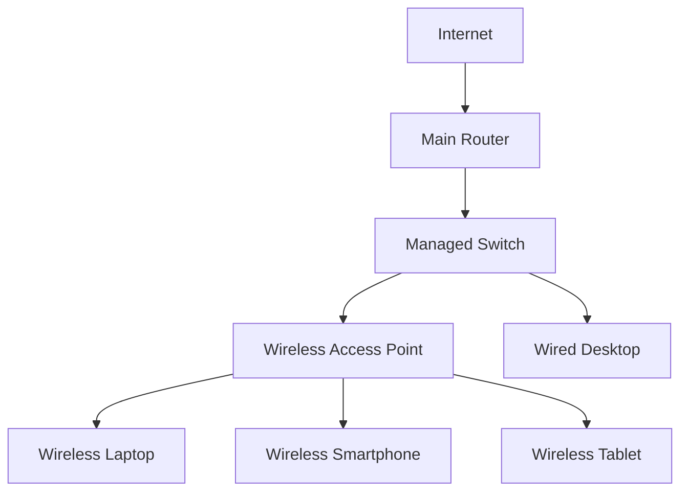
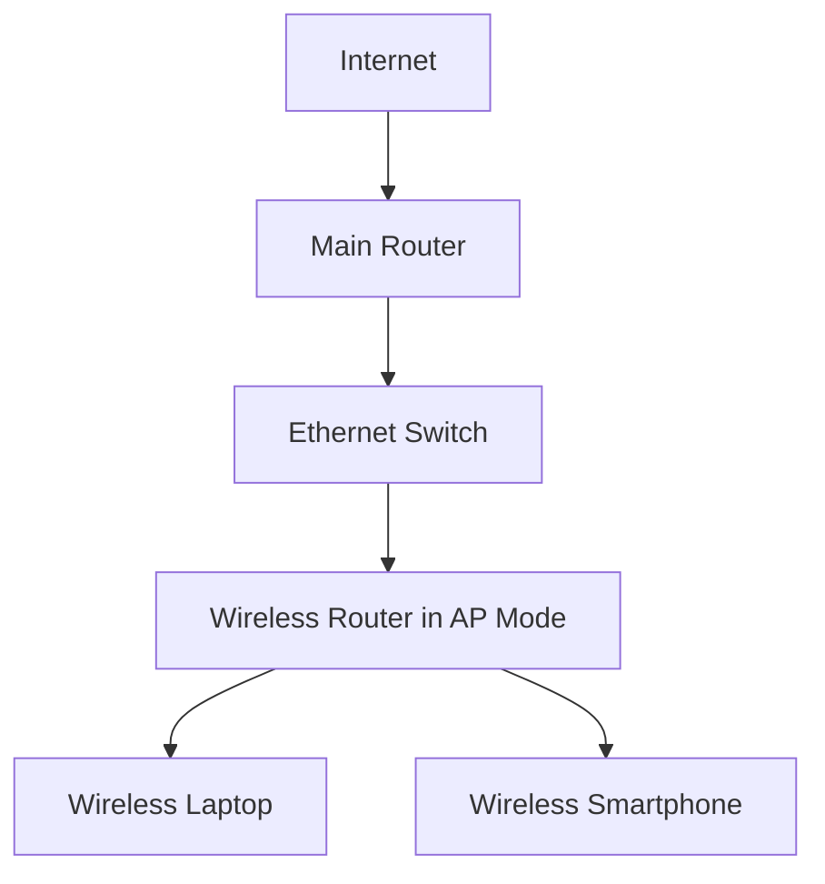
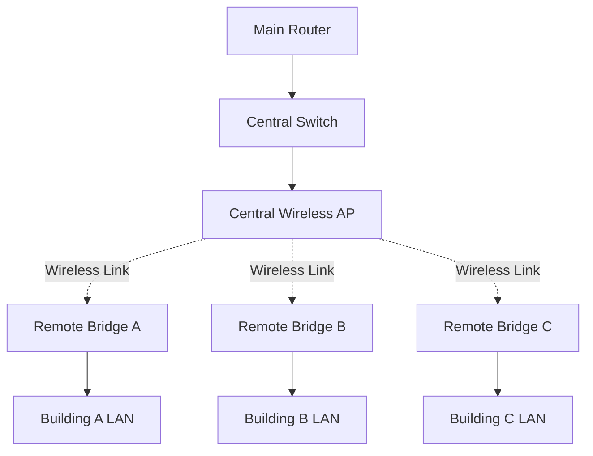
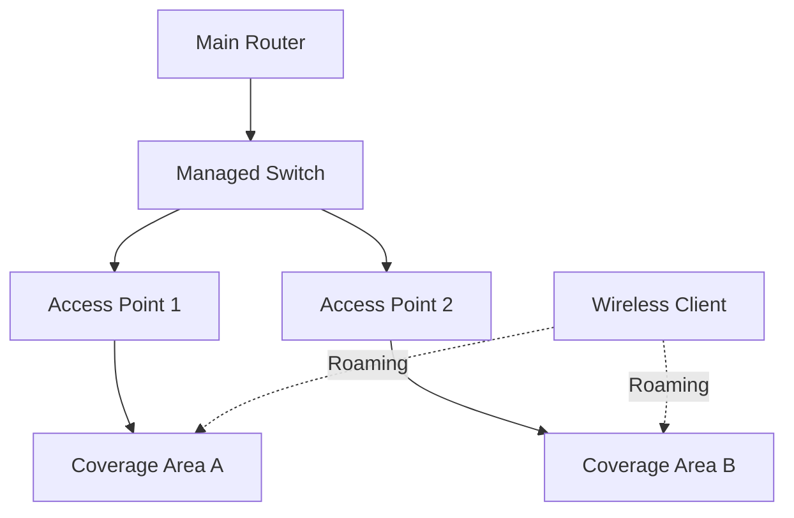
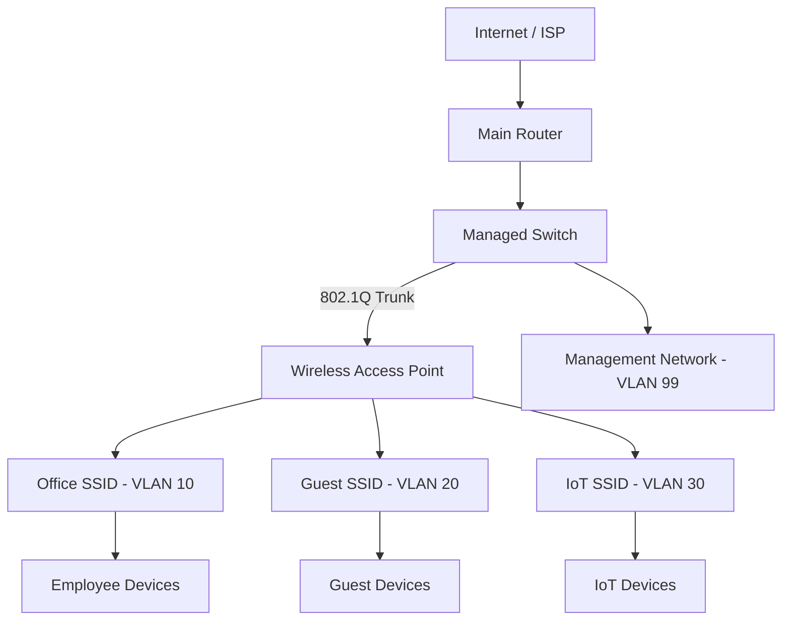

# Wireless Networking Labs

Wireless networking labs provide practical experience with Wi-Fi configuration, access point deployment, wireless security, bridging, VLAN integration, and troubleshooting.

These exercises help develop the skills required to configure and maintain wireless networks in home, office, enterprise, and ISP environments.

# 🗁 Lab Environment

You can perform these labs using physical wireless routers, access points, MikroTik devices, or a combination of virtual machines and wireless hardware.

**Required Equipment**

| Equipment | Purpose |
| --- | --- |
| Wireless Router | Provides routing and wireless connectivity |
| Wireless Access Point | Provides Wi-Fi access |
| MikroTik Router | RouterOS wireless configuration |
| Managed Switch | VLAN and trunk configuration |
| Laptop or Desktop | Wireless client and testing |
| Ethernet Cables | Wired network connectivity |
| Internet Connection | External connectivity testing |

**Recommended Software**

| Software | Purpose |
| --- | --- |
| MikroTik WinBox | RouterOS graphical configuration |
| MikroTik CHR | Virtual RouterOS environment |
| Ubuntu Linux | Wireless client and network testing |
| Wireshark | Packet capture and analysis |
| iperf3 | Throughput testing |
| NetworkManager | Linux wireless connection management |

# 🗁 Lab Topology

The following topology represents a small wireless network with a router, switch, access point, and wireless clients.



Example network addressing:

| Device | IP Address | Role |
| --- | --- | --- |
| Main Router | 192.168.10.1/24 | Default Gateway |
| Access Point | 192.168.10.2/24 | Management |
| Wired Desktop | DHCP | Wired Client |
| Wireless Laptop | DHCP | Wireless Client |
| Wireless Smartphone | DHCP | Wireless Client |

The main router provides DHCP, routing, NAT, and firewall services. The access point bridges wireless clients into the existing LAN.

# 🗁 Lab: Configure a Wireless Network

**Objective**

Create a basic wireless network using an access point.

**Configuration**

* SSID: `Office-WiFi`
* Security: WPA2-Personal or WPA3-Personal
* Management IP: `192.168.10.2/24`
* Default Gateway: `192.168.10.1`
* DHCP Server: Main Router

**Tasks**

* Configure the wireless SSID.
* Select an appropriate frequency band.
* Configure wireless security.
* Connect a laptop to the wireless network.
* Verify that the client receives an IP address.
* Test communication with the default gateway.
* Test internet connectivity.

**Verification**

```bash
nmcli device wifi list
```

```bash
iw dev wlan0 link
```

```bash
ip addr show wlan0
```

```bash
ping -c 4 192.168.10.1
```

# 🗁 Lab: Configure WPA2 and WPA3 Security

**Objective**

Understand wireless authentication and encryption by configuring different Wi-Fi security modes.

**Tasks**

* Configure WPA2-Personal.
* Connect a compatible wireless client.
* Change the access point to WPA3-Personal.
* Test WPA3 connectivity.
* Inspect PMF configuration.
* Compare WPA2 and WPA3 client compatibility.
* Test transition mode if supported.

**Verification**

Inspect the available wireless security capabilities:

```bash
sudo iw dev wlan0 scan
```

Review connection information:

```bash
iw dev wlan0 link
```

**Expected Result**

The wireless client should authenticate successfully using the selected security mode.

# 🗁 Lab: Configure Multiple SSIDs

**Objective**

Create multiple wireless networks for different user groups.

Example configuration:

| SSID | VLAN ID | Purpose |
| --- | ---: | --- |
| Office-WiFi | 10 | Employees |
| Guest-WiFi | 20 | Visitors |
| IoT-WiFi | 30 | IoT Devices |

**Tasks**

* Create three wireless SSIDs.
* Assign each SSID to its corresponding VLAN.
* Configure the access point's Ethernet uplink as a VLAN trunk.
* Configure the managed switch to carry VLANs 10, 20, and 30.
* Configure the router or Layer 3 switch with the corresponding VLAN gateways.
* Configure DHCP services for each network.
* Test client connectivity.

**Expected Result**

Each wireless SSID should place its clients into the correct VLAN and IP subnet.

# 🗁 Lab: Configure a Wireless Access Point

**Objective**

Convert a wireless router into a dedicated access point.

**Topology**



**Tasks**

* Enable access point mode if supported.
* Disable the secondary DHCP server.
* Disable unnecessary NAT and routing services.
* Assign a management IP address in the existing LAN subnet.
* Connect the access point to the main LAN.
* Configure the wireless SSID and security.
* Verify that clients receive DHCP addresses from the main router.

**Expected Result**

Wireless clients should communicate with the main LAN without creating an unnecessary second routed network.

# 🗁 Lab: Configure a Point-to-Point Wireless Bridge

**Objective**

Connect two remote LAN segments using a wireless link.

**Topology**


Example addressing:

| Device | IP Address |
| --- | --- |
| Main Router | 192.168.10.1/24 |
| Bridge A Management | 192.168.10.2/24 |
| Bridge B Management | 192.168.10.3/24 |
| Remote Desktop | DHCP |

**Tasks**

* Configure the first wireless device as the central bridge endpoint.
* Configure the second device as a compatible remote bridge.
* Select a suitable frequency and channel width.
* Configure matching wireless security.
* Align directional antennas if using outdoor equipment.
* Connect both bridges to their respective Ethernet LANs.
* Verify Layer 2 connectivity.

**Verification**

```bash
ping -c 4 192.168.10.1
```

```bash
ip neigh
```

**Expected Result**

Devices at both locations should communicate through the wireless bridge while remaining in the same Layer 2 network.

# 🗁 Lab: Configure a Point-to-Multipoint Wireless Network

**Objective**

Connect multiple remote locations to a central wireless access point.

**Topology**



**Tasks**

* Configure the central wireless access point.
* Configure three remote wireless stations or bridges.
* Establish compatible wireless links.
* Verify each remote connection.
* Measure signal strength and link quality.
* Test communication between remote LANs where permitted.
* Monitor aggregate traffic on the central access point.

**Expected Result**

All remote locations should establish wireless connectivity through the central device.

# 🗁 Lab: Configure Wireless Roaming

**Objective**

Understand how wireless clients move between access points.

**Topology**



**Tasks**

* Configure two access points.
* Use the same SSID and security configuration.
* Connect both access points to the same LAN.
* Configure suitable channels.
* Establish overlapping coverage areas.
* Move a wireless client between the coverage areas.
* Observe BSSID changes.
* Compare roaming behavior with 802.11k, 802.11v, and 802.11r where supported.

**Verification**

```bash
iw dev wlan0 link
```

Run the command at different physical locations and observe the connected BSSID.

**Expected Result**

The client should be able to reassociate with the other access point while maintaining access to the network.

# 🗁 Lab: Measure Wireless Signal Strength

**Objective**

Measure wireless signal strength at different distances and locations.

**Tasks**

* Connect a laptop to an access point.
* Record signal strength near the access point.
* Move farther away.
* Measure signal strength in different rooms.
* Observe the effects of walls and physical obstacles.
* Compare 2.4 GHz and 5 GHz performance.
* Record the results.

**Verification**

```bash
iw dev wlan0 link
```

**Results Table**

| Location | Distance | Signal Strength | Observation |
| --- | ---: | --- | --- |
| Near AP | 2 m | Record result | Reference |
| Room A | 5 m | Record result | Compare |
| Room B | 10 m | Record result | Compare |
| Behind Wall | 8 m | Record result | Obstruction |
| Outdoor | 15 m | Record result | Environmental effects |

**Expected Result**

Understand how distance, frequency, and physical obstacles influence wireless signal strength.

# 🗁 Lab: Measure Wireless Throughput

**Objective**

Measure actual wireless network throughput using iperf3.

**Tasks**

* Install iperf3 on two devices.
* Connect both devices to the same network.
* Start an iperf3 server on one device.
* Run a client test from the other device.
* Test both transmission directions.
* Repeat at different signal strengths.
* Compare throughput results.

**Install iperf3 on Ubuntu**

```bash
sudo apt update
sudo apt install iperf3
```

**Start the Server**

```bash
iperf3 -s
```

**Run a Client Test**

```bash
iperf3 -c 192.168.10.100
```

**Run a Reverse Test**

```bash
iperf3 -c 192.168.10.100 -R
```

**Expected Result**

Understand the difference between negotiated wireless PHY rates and actual application throughput.

# 🗁 Lab: Wireless Interference Investigation

**Objective**

Investigate how nearby wireless networks affect Wi-Fi performance.

**Tasks**

* Scan available wireless networks.
* Record nearby SSIDs and channels.
* Identify overlapping channel assignments.
* Measure channel utilization using supported monitoring tools.
* Compare throughput under different channel conditions.
* Change the access point channel where appropriate.
* Repeat the throughput test.

**Verification**

```bash
nmcli device wifi list
```

```bash
sudo iw dev wlan0 scan
```

**Expected Result**

Understand co-channel interference, adjacent-channel interference, and the importance of channel planning.

# 🗁 Lab: Wireless Network Troubleshooting

**Objective**

Practice identifying common wireless connectivity problems.

Perform the following exercises:

| Exercise | Simulated Problem | Investigation |
| --- | --- | --- |
| SSID unavailable | Disable wireless interface on AP | Check AP and radio status |
| Authentication failure | Configure an incorrect passphrase | Inspect authentication logs |
| No IP address | Disable DHCP service | Inspect DHCP configuration |
| Gateway unreachable | Configure an incorrect VLAN | Inspect bridge and VLAN settings |
| No internet | Disable WAN connectivity | Inspect routing and NAT |
| DNS failure | Configure an invalid DNS server | Test DNS resolution |
| Slow connection | Introduce channel congestion | Inspect signal and airtime utilization |

**Troubleshooting Commands**

```bash
iw dev wlan0 link
```

```bash
ip addr show wlan0
```

```bash
ip route
```

```bash
ping -c 4 192.168.10.1
```

```bash
ping -c 4 1.1.1.1
```

```bash
dig example.com
```

**Expected Result**

Identify the failing network component and apply the appropriate correction.

# 🗁 Lab: Packet Capture and Wi-Fi Analysis

**Objective**

Capture and inspect network traffic generated by wireless clients.

**Tasks**

* Install Wireshark and tcpdump.
* Capture DHCP traffic.
* Capture DNS requests.
* Capture ICMP packets.
* Inspect TCP connections.
* Identify client and server IP addresses.
* Analyze packet timing and retransmissions.

**Install Tools**

```bash
sudo apt update
sudo apt install wireshark tcpdump
```

**Capture DHCP Traffic**

```bash
sudo tcpdump -i wlan0 -n 'udp port 67 or udp port 68'
```

**Capture DNS Traffic**

```bash
sudo tcpdump -i wlan0 -n 'port 53'
```

**Save a Packet Capture**

```bash
sudo tcpdump -i wlan0 -w wireless-lab.pcap
```

**Expected Result**

Understand how packet captures help diagnose wireless client connectivity and application problems.

# 🗁 Lab: Complete Wireless Network Deployment

**Objective**

Design and deploy a small wireless network that includes routing, switching, wireless access, security, and network segmentation.

**Network Requirements**

| Network | VLAN | Subnet | Purpose |
| --- | ---: | --- | --- |
| Management | 99 | 192.168.99.0/24 | Network management |
| Office | 10 | 192.168.10.0/24 | Employees |
| Guest | 20 | 192.168.20.0/24 | Visitors |
| IoT | 30 | 192.168.30.0/24 | IoT devices |

**Topology**



**Implementation Tasks**

* Configure router interfaces and VLAN gateways.
* Configure the managed switch.
* Configure the access point uplink as a VLAN trunk.
* Create the required SSIDs.
* Map each SSID to the correct VLAN.
* Configure WPA2 or WPA3 security.
* Configure DHCP services for each network.
* Configure firewall rules between VLANs.
* Restrict guest access to internal resources.
* Allow management access only from the management network.
* Verify client connectivity and network isolation.
* Monitor wireless performance and connected clients.

**Expected Result**

Deploy a functional wireless network with separate employee, guest, IoT, and management networks.

# 🗁 Lab Completion Checklist

* [ ] Configure a basic wireless network.
* [ ] Configure WPA2 and WPA3 security.
* [ ] Create multiple SSIDs.
* [ ] Configure an access point.
* [ ] Establish a point-to-point wireless bridge.
* [ ] Configure a point-to-multipoint wireless network.
* [ ] Test wireless roaming.
* [ ] Measure signal strength.
* [ ] Measure wireless throughput.
* [ ] Investigate wireless interference.
* [ ] Troubleshoot common wireless problems.
* [ ] Capture and analyze network traffic.
* [ ] Deploy a complete segmented wireless network.

# 🗁 Key Takeaways

* Practical wireless labs develop real-world Wi-Fi configuration and troubleshooting skills.
* Access points provide wireless connectivity to existing network infrastructure.
* WPA2 and WPA3 protect wireless communication.
* Multiple SSIDs can provide separate wireless networks through VLAN mapping.
* Wireless bridges connect geographically separated LAN segments.
* Roaming improves wireless mobility across multiple access points.
* Signal strength, interference, and channel utilization affect performance.
* iperf3 measures application-level network throughput.
* Wireshark and tcpdump help investigate network traffic.
* A complete wireless deployment requires coordinated routing, switching, VLAN, DHCP, firewall, and wireless configurations.
