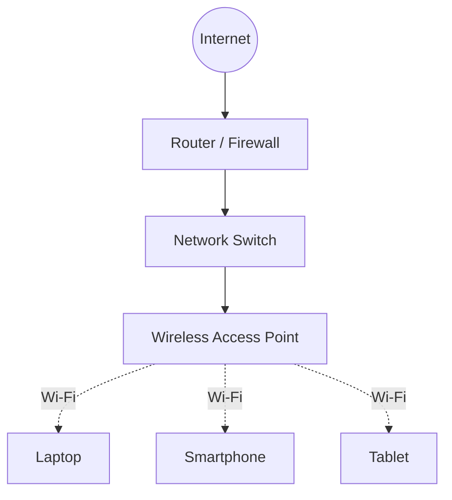

# Wireless Networking

Wireless networking enables devices to communicate and exchange data without physical cable connections. It uses radio-frequency (RF) signals to transmit information between wireless devices.

Wireless networking is widely used in homes, offices, enterprises, campuses, public hotspots, and Internet Service Provider (ISP) infrastructure.

Wi-Fi is the most common technology for Wireless Local Area Networks (WLANs). It is based on the IEEE 802.11 family of standards.

# 🗁 Learning Objectives

This section covers the fundamental concepts, standards, technologies, configuration methods, security mechanisms, and troubleshooting techniques used in wireless networking.

After completing this section, you should understand how wireless networks operate, configure wireless access points, identify wireless performance issues, and implement basic wireless network infrastructure.

# 🗁 Topics Covered

| File                                     | Topic                                   |
| ---------------------------------------- | --------------------------------------- |
| `01-wireless-fundamentals.md`            | Wireless Networking Fundamentals        |
| `02-ieee-802-11.md`                      | IEEE 802.11 Standards and Architecture  |
| `03-frequency-bands.md`                  | Wireless Frequency Bands                |
| `04-channels-and-bandwidth.md`           | Wireless Channels and Channel Bandwidth |
| `05-wifi-standards.md`                   | Wi-Fi Standards and Generations         |
| `06-ssid-and-bssid.md`                   | SSID and BSSID                          |
| `07-wireless-security.md`                | Wireless Network Security               |
| `08-wpa2-and-wpa3.md`                    | WPA2 and WPA3                           |
| `09-access-point-vs-router.md`           | Access Point vs Wireless Router         |
| `10-wireless-bridging.md`                | Wireless Bridging                       |
| `11-signal-strength-and-interference.md` | Signal Strength and Interference        |
| `12-wireless-troubleshooting.md`         | Wireless Network Troubleshooting        |
| `13-wireless-labs.md`                    | Wireless Networking Labs                |

# 🗁 Wireless Network Architecture

A typical wireless network connects wireless clients through an access point. The access point provides wireless connectivity and bridges client traffic to the wired network.

# 🗁 Wireless Networking Components

| Component | Description |
| --- | --- |
| Wireless Client | A device that connects to a wireless network |
| Wireless Adapter | Hardware that enables wireless communication |
| Access Point (AP) | Provides wireless connectivity to client devices |
| Wireless Router | Combines routing, switching, and wireless access point functionality |
| Antenna | Transmits and receives radio-frequency signals |
| Wireless Controller | Centrally manages multiple wireless access points |
| Wireless Bridge | Connects network segments through a wireless link |
| SSID | Identifies a wireless network by its network name |

# 🗁 Wireless Frequency Bands

Wi-Fi operates in several frequency bands, depending on regional regulations and device capabilities.

| Frequency Band | General Characteristics                                                                              |
| -------------- | ---------------------------------------------------------------------------------------------------- |
| 2.4 GHz        | Longer propagation range, but typically more interference and fewer non-overlapping channels         |
| 5 GHz          | More channel options and generally higher throughput, with shorter range under comparable conditions |
| 6 GHz          | Additional spectrum for newer Wi-Fi technologies, subject to regulatory and device support           |

# 🗁 Wireless Networking Applications

* Home and office Wi-Fi networks
* Enterprise wireless LANs
* Campus wireless infrastructure
* Public Wi-Fi hotspots
* Wireless Internet Service Provider (WISP) networks
* Point-to-point wireless connections
* Point-to-multipoint wireless connections
* Wireless mesh networks

# 🗁 Practical Tools

| Tool | Purpose |
| --- | --- |
| `iw` | Inspect and configure Linux wireless interfaces |
| `nmcli` | Manage wireless connections through NetworkManager |
| `rfkill` | Inspect and control wireless radio blocking |
| `iwconfig` | Legacy wireless interface configuration |
| Wireshark | Capture and analyze network traffic |
| MikroTik RouterOS | Configure and manage supported wireless infrastructure |
| WinBox | Graphically manage MikroTik devices |

# 🗁 Practical Learning Environment

The following environments and tools can be used for hands-on wireless networking practice:

* Ubuntu Linux for wireless interface inspection and management.
* Wi-Fi-enabled laptops and smartphones for client testing.
* Wireless routers and access points for configuration practice.
* MikroTik RouterOS for supported wireless configurations.
* Wireshark for packet analysis and troubleshooting.

# 🗁 References

* [IEEE 802.11 Working Group](https://www.ieee802.org/11/)
* [Wi-Fi Alliance](https://www.wi-fi.org/)
* [Linux Wireless Documentation](https://wireless.docs.kernel.org/)
* [MikroTik Documentation](https://help.mikrotik.com/docs/)
