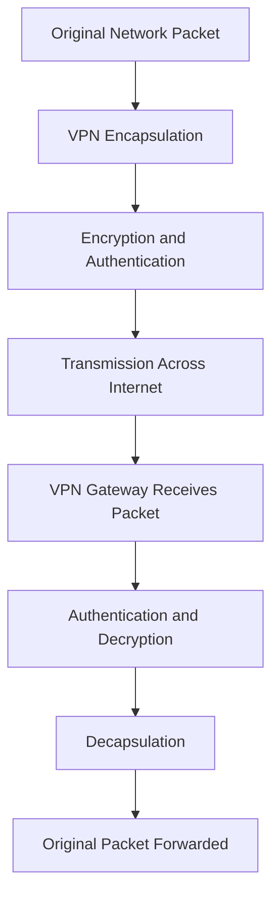
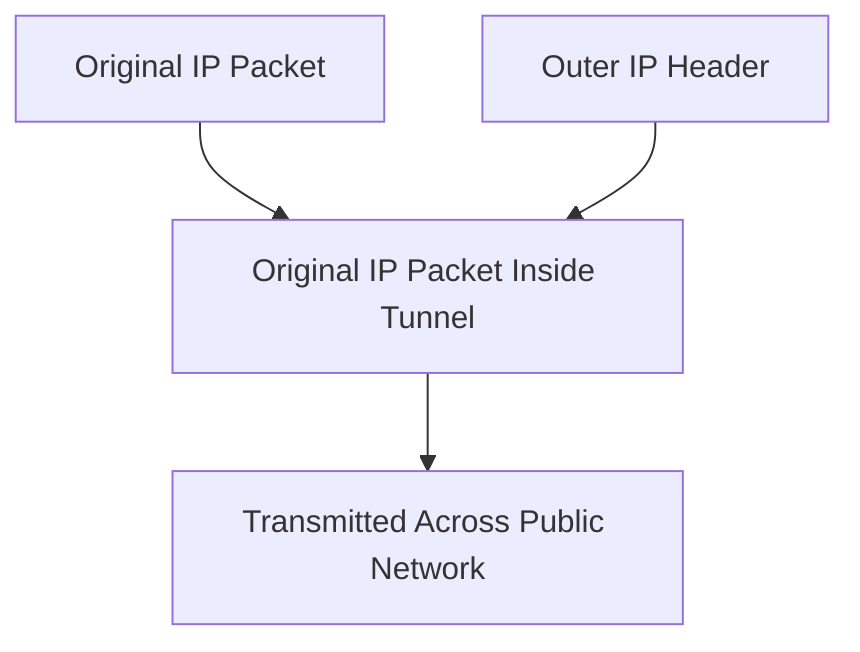
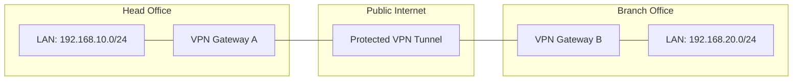

# VPN Fundamentals

A Virtual Private Network (VPN) is a technology that creates a private logical communication channel across an existing network infrastructure, such as the public internet.

VPNs allow users, offices, and remote networks to communicate securely over shared or untrusted networks.

They commonly use tunneling, encryption, authentication, and integrity protection to protect network communication.

# 🗁 What Is a VPN?

A VPN establishes a logical connection between two or more network endpoints.

Instead of sending traffic directly across an untrusted network, VPN technology encapsulates the original traffic and transports it through a protected connection.

For example, an employee working remotely can connect to an organization's private network through a VPN.


The VPN gateway authenticates the remote user and establishes the VPN connection according to the configured security protocol.

# 🗁 Why Do We Need a VPN?

A VPN is useful when communication must travel across networks that are not fully trusted.

Common reasons include:

* Secure communication over public networks.
* Remote access to private network resources.
* Connecting geographically separated office networks.
* Protecting traffic against interception and modification.
* Extending private network connectivity across the internet.
* Connecting cloud infrastructure with on-premises networks.
* Providing secure administrative access to network devices.

# 🗁 How Does a VPN Work?

A VPN generally uses tunneling to transport traffic between VPN endpoints.

The original packet is encapsulated inside another packet. Depending on the VPN protocol, the encapsulated traffic may also be encrypted and authenticated.

The receiving VPN endpoint processes the outer packet, verifies and decrypts the protected data when applicable, removes the tunnel encapsulation, and forwards the original packet.



The exact processing sequence depends on the VPN protocol and its configuration.

# 🗁 VPN Components

A typical VPN deployment contains several important components.

| Component | Description |
| --- | --- |
| VPN Client | Software or device that initiates a VPN connection |
| VPN Server | Endpoint that accepts and manages VPN connections |
| VPN Gateway | Network device that terminates VPN tunnels and forwards traffic |
| Tunnel | Logical communication path between VPN endpoints |
| Authentication | Process of verifying the identity of a user or device |
| Encryption | Process of protecting data confidentiality |
| VPN Protocol | Defines how the VPN connection is established and maintained |
| Routing | Determines how traffic travels through the VPN |

# 🗁 VPN Tunneling

Tunneling is the process of encapsulating one network protocol inside another protocol.

A VPN tunnel allows private network traffic to travel through an existing network, such as the internet.

For example, an original IP packet can be encapsulated inside another IP packet before being transmitted across the public network.



Tunneling provides a logical path between endpoints, but tunneling alone does not necessarily provide encryption or authentication.

The security capabilities depend on the protocol being used.

# 🗁 Encryption and Authentication

VPN security commonly relies on several mechanisms.

| Mechanism | Purpose |
| --- | --- |
| Encryption | Protects data confidentiality |
| Authentication | Verifies the identity of communicating endpoints |
| Integrity Protection | Detects unauthorized modification of data |
| Anti-Replay Protection | Prevents attackers from successfully reusing captured packets |
| Key Exchange | Establishes cryptographic keys for secure communication |

Not every tunneling protocol provides all these security features.

For example, GRE provides encapsulation but does not provide encryption or authentication by itself. IPsec can provide cryptographic protection for network traffic.

# 🗁 VPN Protocols

Different VPN technologies are designed for different networking requirements.

| Protocol / Technology | Primary Purpose |
| --- | --- |
| IPsec | Network-layer security and encrypted VPN tunnels |
| WireGuard | Modern, lightweight VPN tunneling |
| OpenVPN | TLS-based VPN connectivity |
| GRE | Generic network protocol encapsulation |
| L2TP | Layer 2 tunneling |
| PPP | Point-to-point communication and authentication |
| VXLAN | Layer 2 overlay networking over Layer 3 infrastructure |

**Important:** VXLAN and GRE are tunneling technologies, but they do not inherently provide the cryptographic security expected from a VPN. They can be combined with security technologies when protection is required.

# 🗁 VPN Deployment Models

VPNs are commonly deployed using different network architectures.

**Remote Access VPN**

Allows an individual user or device to connect to a private network from a remote location.

**Site-to-Site VPN**

Connects two or more geographically separated networks through VPN gateways.

**Client-to-Site VPN**

Connects individual VPN clients to an organization's private network. This is commonly used for employee and administrator access.

# 🗁 VPN Network Topology

A VPN can connect multiple private networks through public infrastructure.

Example of a site-to-site VPN:



The VPN gateways establish a tunnel so that devices in the two private networks can communicate through the public internet.

# 🗁 VPN Advantages

* **Confidentiality:** Encryption can protect transmitted data from unauthorized observation.
* **Secure Remote Access:** Users can access internal resources from remote locations.
* **Network Connectivity:** Separate offices can communicate through logical private connections.
* **Authentication:** VPN endpoints can verify users and devices.
* **Traffic Integrity:** Cryptographic integrity protection can detect packet modification.
* **Centralized Access Control:** Organizations can manage VPN access through gateways and authentication systems.

# 🗁 VPN Limitations

* **Performance Overhead:** Encryption and encapsulation require additional processing.
* **Additional Latency:** Traffic may travel through an additional VPN endpoint.
* **MTU Reduction:** Tunnel headers reduce the available payload size.
* **Configuration Complexity:** Routing, firewall, NAT, and cryptographic settings must work together.
* **Availability Dependency:** VPN connectivity depends on internet access and VPN endpoint availability.
* **Security Misconfiguration:** Weak authentication, exposed services, or incorrect access policies can compromise a VPN deployment.

# 🗁 VPN vs Proxy

VPNs and proxy servers can both influence how network traffic reaches its destination, but they operate differently.

| Feature | VPN | Proxy |
| --- | --- | --- |
| Primary Purpose | Creates a protected network connection | Forwards traffic on behalf of a client |
| Traffic Coverage | Can protect traffic from an entire device or selected routes | Usually handles specific application or protocol traffic |
| Encryption | Depends on the VPN protocol; secure VPNs provide encryption | Depends on the proxy protocol and transport security |
| Network Layer | Commonly operates at Layer 3, depending on technology | Usually operates at the application layer or transport layer |
| Routing | Can install routes through a virtual interface | Usually does not provide general IP routing |
| Common Use | Remote access and site-to-site connectivity | Web access control, filtering, caching, and forwarding |

# 🗁 VPN vs Tunneling

VPN and tunneling are related concepts, but they are not identical.

| Feature | VPN | Tunneling |
| --- | --- | --- |
| Meaning | A private logical network connection | Encapsulation of one protocol inside another |
| Encryption | Commonly provides encryption | Not inherently encrypted |
| Authentication | Commonly supports authentication | Not inherently authenticated |
| Purpose | Secure private communication | Transport traffic across another network |
| Examples | IPsec, WireGuard, OpenVPN | GRE, IP-in-IP, VXLAN |

A VPN may use tunneling, but not every tunnel is a VPN.

# 🗁 Common VPN Use Cases

**Remote Workforce**

Employees connect to internal applications, file servers, and other private resources from outside the organization.

**Branch Office Connectivity**

Organizations connect headquarters and branch offices using site-to-site VPN tunnels.

**Cloud Connectivity**

Private cloud networks can communicate with on-premises infrastructure through VPN gateways.

**Network Administration**

Administrators securely access routers, switches, servers, and internal management systems.

**ISP and Enterprise Networks**

Network operators use VPN technologies to provide private connectivity between infrastructure locations and customer networks.

# 🗁 Practical Commands

Linux provides several tools for inspecting network interfaces, routes, and VPN-related connectivity.

Check network interfaces:

```bash
ip addr
```

Display routing tables:

```bash
ip route
```

Display routing information for a destination:

```bash
ip route get 192.168.20.10
```

Display network interfaces and link state:

```bash
ip link
```

Check active listening sockets:

```bash
ss -tulpen
```

Inspect WireGuard interfaces:

```bash
sudo wg show
```

Inspect IPsec security associations using strongSwan:

```bash
sudo ipsec statusall
```

These commands are diagnostic tools. They do not automatically establish a VPN connection.

# 🗁 Key Takeaways

* VPN stands for Virtual Private Network.
* A VPN creates a private logical connection over an existing network.
* Tunneling transports packets by encapsulating them inside another protocol.
* Encryption protects confidentiality.
* Authentication verifies communicating identities.
* Integrity protection detects unauthorized packet modification.
* Site-to-site VPN connects private networks.
* Remote-access VPN connects individual users or devices.
* IPsec, WireGuard, and OpenVPN are common VPN technologies.
* GRE and VXLAN provide tunneling or overlay functionality but do not inherently encrypt traffic.
* Routing, firewall rules, NAT, and MTU are important parts of VPN operation.
