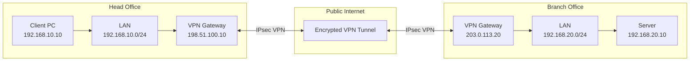
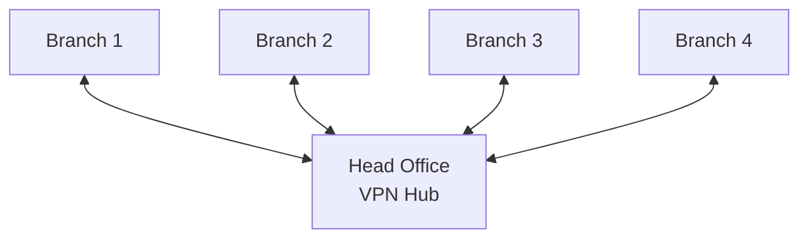
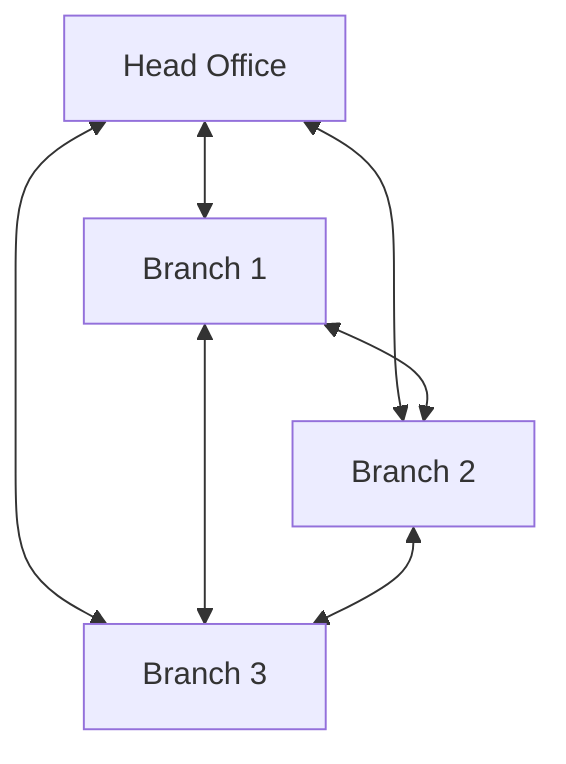

# Site-to-Site VPN

A **Site-to-Site VPN** connects two or more geographically separated networks through an encrypted tunnel over an untrusted network, such as the public internet.

It allows devices in different locations to communicate as if they were connected to the same private network, without requiring individual VPN connections on every endpoint.

For example, an organization can securely connect its Head Office and Branch Office so employees at both locations can access shared servers, applications, and internal resources.

# 🗁 How Site-to-Site VPN Works

A Site-to-Site VPN establishes a secure tunnel between VPN gateways, usually routers or firewalls.

Each gateway encrypts outgoing traffic before transmitting it across the internet. The receiving gateway authenticates and decrypts the traffic before forwarding it to the destination network.

The VPN gateways handle the encryption and decryption, so individual computers and servers generally do not need VPN client software.

# 🗁 Basic Site-to-Site VPN Topology

Consider an organization with two locations:

| Component | Head Office | Branch Office |
| --- | --- | --- |
| LAN network | `192.168.10.0/24` | `192.168.20.0/24` |
| VPN gateway | HQ Router | Branch Router |
| Public IP | `198.51.100.10` | `203.0.113.20` |
| Default gateway | HQ Router LAN IP | Branch Router LAN IP |

The public IP addresses above are documentation examples, not real service endpoints.



The VPN tunnel connects the two gateways, allowing traffic to travel securely between their private networks.

# 🗁 Site-to-Site VPN Packet Flow

Suppose a computer at the Head Office wants to communicate with a server at the Branch Office.

Source:

```text
192.168.10.10
```

Destination:

```text
192.168.20.10
```

The communication process follows this sequence:

* The source computer checks whether the destination belongs to its local network.
* Because the destination is outside its local subnet, the computer forwards the packet to its default gateway.
* The Head Office VPN gateway checks its routing table or VPN policies.
* The gateway identifies the destination network as reachable through the VPN tunnel.
* The original packet is encapsulated and encrypted.
* The encrypted packet travels across the public internet to the Branch Office VPN gateway.
* The Branch Office gateway authenticates and decrypts the packet.
* The original packet is forwarded to the Branch Office LAN.
* The destination server receives the packet.
* The response follows the reverse path through the VPN tunnel.

# 🗁 VPN Tunnel Encapsulation

A Site-to-Site VPN commonly uses IPsec tunnel mode to protect traffic between networks.

The original IP packet is encapsulated inside another IP packet. The outer packet contains the public IP addresses of the VPN gateways, while the protected inner packet retains the original private source and destination addresses.

Example:

**Original packet:**

```text
Source IP:      192.168.10.10
Destination IP: 192.168.20.10
```

**Encrypted outer packet:**

```text
Source IP:      198.51.100.10
Destination IP: 203.0.113.20
Protocol:       ESP (IP Protocol 50)
```

The original packet is protected while crossing the untrusted network.

# 🗁 Types of Site-to-Site VPN Topologies

Site-to-Site VPN deployments can use different topologies depending on the number of locations and network requirements.

**Point-to-Point VPN**

Connects two locations directly through one VPN tunnel.


Commonly used when an organization has only two locations.

**Hub-and-Spoke VPN**

Connects multiple branch locations to a central Head Office or data center.



Characteristics:

* Centralized VPN management.
* Branch-to-branch communication can be routed through the hub.
* Easier to manage than a full mesh for many locations.
* The hub can become a bottleneck or single point of failure.

**Full-Mesh VPN**

Every location establishes a direct VPN tunnel with every other location.



Characteristics:

* Direct communication between locations.
* Reduced dependence on a central hub for inter-branch traffic.
* More VPN tunnels to configure and maintain.
* Tunnel count increases rapidly as locations are added.

For a full mesh with \(n\) locations, the number of required tunnels is:

\[
\text{Tunnels} = \frac{n(n-1)}{2}
\]

For example, four locations require:

\[
\frac{4(4-1)}{2} = 6
\]

# 🗁 Policy-Based VPN vs Route-Based VPN

Site-to-Site IPsec VPNs can be implemented using policy-based or route-based configurations.

**Policy-Based VPN**

A policy-based VPN uses traffic selectors or encryption policies to determine which traffic should enter the VPN tunnel.

Example:

```text
Local Network:  192.168.10.0/24
Remote Network: 192.168.20.0/24
```

Traffic between these networks is selected for encryption.

Characteristics:

* Uses security policies or traffic selectors.
* Common in traditional IPsec implementations.
* Suitable for straightforward network-to-network connections.
* Multiple networks or complex routing can require additional policies.

**Route-Based VPN**

A route-based VPN uses a virtual tunnel interface to carry traffic between networks.

The router forwards traffic through the tunnel interface according to its routing table.

Example:

```text
Destination: 192.168.20.0/24
Interface:   ipsec-tunnel
```

Characteristics:

* Uses a logical tunnel interface.
* Integrates naturally with static and dynamic routing.
* Supports more flexible network designs.
* Often suitable for multiple remote networks and complex routing environments.

| Feature | Policy-Based VPN | Route-Based VPN |
| --- | --- | --- |
| Traffic selection | Policies and selectors | Routing table |
| Tunnel interface | Not always required | Usually required |
| Routing flexibility | More limited | More flexible |
| Multiple networks | May require additional policies | Easier to manage |
| Dynamic routing | Depends on implementation | Commonly supported |

# 🗁 Common Site-to-Site VPN Protocols

Several tunneling and VPN technologies can connect geographically separated networks.

| Technology | Description |
| --- | --- |
| IPsec | Provides encryption, authentication, and integrity for IP traffic |
| WireGuard | Modern VPN protocol using a lightweight cryptographic design |
| OpenVPN | VPN solution based on TLS and certificates or other authentication methods |
| GRE over IPsec | Uses GRE for tunneling and IPsec for traffic protection |
| L2TP over IPsec | Combines L2TP tunneling with IPsec security |

**IPsec** is commonly used for traditional router-to-router Site-to-Site VPN deployments.

# 🗁 IPsec Ports and Protocols

When configuring an IPsec Site-to-Site VPN, firewalls must allow the required traffic between VPN gateways.

| Protocol | Port / Protocol Number | Purpose |
| --- | --- | --- |
| IKE | UDP 500 | VPN negotiation and key exchange |
| NAT-T | UDP 4500 | IPsec traffic encapsulation through NAT |
| ESP | IP Protocol 50 | Encrypted and authenticated IPsec traffic |
| AH | IP Protocol 51 | IP authentication and integrity without encryption |

Important distinctions:

* IKE uses UDP port `500`.
* NAT Traversal uses UDP port `4500`.
* ESP is IP protocol number `50`, not TCP or UDP port `50`.
* AH is IP protocol number `51`, not TCP or UDP port `51`.
* AH is rarely used in modern deployments.

# 🗁 Routing Between VPN Networks

A Site-to-Site VPN requires correct routing at both locations.

Each gateway must know how to reach the remote LAN through the VPN tunnel.

Example:

**Head Office routing requirement:**

```text
Destination: 192.168.20.0/24
Next Hop:    VPN Tunnel
```

**Branch Office routing requirement:**

```text
Destination: 192.168.10.0/24
Next Hop:    VPN Tunnel
```

Common routing approaches include:

**Static Routing**

Manually configure routes to remote networks through the VPN tunnel.

Suitable for small deployments with a limited number of locations.

**Dynamic Routing**

Use routing protocols such as OSPF or BGP to exchange network information through a route-based VPN.

Suitable for larger networks with multiple locations and changing routes.

Dynamic routing requires appropriate tunnel interfaces, routing protocol configuration, and firewall permissions.

# 🗁 NAT Configuration and NAT Exemption

NAT can interfere with Site-to-Site VPN traffic if private network traffic is translated before entering the VPN tunnel.

For example, Head Office traffic destined for `192.168.20.0/24` should generally retain its original source address rather than being translated to the gateway's public IP.

A **NAT exemption** or **NAT bypass** rule prevents the VPN traffic from being translated.

Example:

```text
Source:      192.168.10.0/24
Destination: 192.168.20.0/24
Action:      Accept without NAT
```

The NAT exemption rule must be evaluated before the general internet masquerade or source NAT rule when the firewall uses ordered NAT rules.

The intended result is:

```text
VPN Traffic:
192.168.10.10 → 192.168.20.10
No address translation

Internet Traffic:
192.168.10.10 → Public IP
Source NAT / Masquerade
```

The exact NAT requirements depend on the VPN implementation and network design.

# 🗁 Firewall Requirements

Both VPN gateways must allow the traffic required to establish and maintain the tunnel.

Typical requirements include:

* Permit UDP `500` for IKE negotiation.
* Permit UDP `4500` when NAT Traversal is used.
* Permit ESP (IP protocol `50`) when ESP is carried directly.
* Permit the intended LAN-to-LAN traffic through the tunnel.
* Restrict VPN negotiation to authorized peer addresses where practical.
* Prevent unauthorized access to internal networks.

Do not confuse allowing VPN negotiation with allowing all traffic through the tunnel. Internal traffic should follow the organization's firewall policies.

# 🗁 Security Considerations

A Site-to-Site VPN connects private networks across an untrusted network. Strong security configuration is essential.

**Strong Authentication**

Use certificates or strong pre-shared keys (PSKs). Avoid weak or reused credentials.

**Modern Encryption**

Use modern, supported cryptographic algorithms and configurations. Avoid obsolete algorithms and weak cipher suites.

**Perfect Forward Secrecy**

Use Perfect Forward Secrecy (PFS) where supported and appropriate. It helps protect previously established session keys if long-term key material is later compromised.

**Traffic Restrictions**

Limit VPN traffic to the required local and remote networks instead of allowing unrestricted access.

**Key Management**

Establish procedures for credential rotation, certificate renewal, and revocation.

**Monitoring and Logging**

Monitor tunnel status, authentication failures, traffic volume, and unusual connection activity.

# 🗁 MTU and MSS Considerations

VPN encapsulation adds overhead to the original packet.

For example, IPsec adds additional headers and security information. This reduces the space available for the original payload inside a packet.

If the resulting packet exceeds the path MTU, fragmentation or packet loss may occur.

Possible symptoms include:

* Small packets work, but large packets fail.
* Some websites or applications load partially.
* File transfers become slow or stop.
* VPN connections establish successfully, but application traffic fails.

Possible solutions include:

* Configure an appropriate tunnel MTU.
* Apply TCP MSS clamping where necessary.
* Ensure Path MTU Discovery works correctly.
* Avoid blocking essential ICMP messages used for MTU discovery.
* Verify packet sizes across the complete path.

# 🗁 Site-to-Site VPN Configuration Checklist

Before deploying a Site-to-Site VPN, verify the following requirements.

**Network Planning**

* Identify the local and remote LAN subnets.
* Ensure the private networks do not overlap.
* Identify the public IP addresses of both VPN gateways.
* Determine whether either gateway is behind NAT.
* Choose a VPN topology.

**VPN Configuration**

* Select a VPN technology.
* Configure authentication credentials or certificates.
* Configure encryption and integrity algorithms.
* Configure IKE and IPsec parameters where applicable.
* Define local and remote traffic selectors or tunnel interfaces.

**Routing and Firewall**

* Configure routes to remote networks.
* Configure return routes.
* Configure NAT exemption where required.
* Allow the required VPN protocols and ports.
* Allow only the intended traffic between internal networks.

**Testing and Monitoring**

* Verify tunnel establishment.
* Check security association status.
* Test communication between LAN devices.
* Verify bidirectional traffic.
* Check MTU and packet fragmentation.
* Enable logging and monitoring.

# 🗁 Linux Site-to-Site VPN Verification

Linux systems can be used to verify connectivity and inspect VPN-related network configuration.

**Display Network Interfaces**

```bash
ip addr
```

**Display Routing Table**

```bash
ip route
```

**Check the Route to a Remote Host**

```bash
ip route get 192.168.20.10
```

**Test Remote Network Connectivity**

```bash
ping 192.168.20.10
```

**Trace the Network Path**

```bash
traceroute 192.168.20.10
```

**Inspect Network Connections**

```bash
ss -tulpen
```

**Check WireGuard Status**

```bash
sudo wg show
```

**Check strongSwan IPsec Status**

```bash
sudo ipsec statusall
```

The exact commands available depend on the installed VPN implementation and Linux distribution.

# 🗁 Common Site-to-Site VPN Problems

| Problem | Possible Cause | Troubleshooting |
| --- | --- | --- |
| VPN tunnel does not establish | Incorrect peer IP or authentication | Verify peer addresses and credentials |
| IKE negotiation fails | Mismatched IKE parameters | Compare encryption, integrity, DH groups, and authentication |
| IPsec security associations fail | Mismatched traffic selectors or proposals | Verify local and remote selectors and IPsec proposals |
| Tunnel is established but traffic fails | Missing routes or firewall rules | Check routing and firewall policies |
| Only one direction works | Missing return route or asymmetric routing | Verify both routing tables and traffic paths |
| VPN fails behind NAT | NAT Traversal or firewall issue | Verify UDP `4500` and NAT behavior |
| Large packets fail | MTU or fragmentation problem | Check MTU, MSS, and Path MTU Discovery |
| Internet traffic stops after VPN setup | Incorrect routing or default-route policy | Inspect routing and policy-based forwarding |
| VPN disconnects frequently | Connectivity, rekey, or lifetime mismatch | Inspect logs, peer reachability, and security association lifetimes |

# 🗁 Practical Example

An organization has two offices:

**Head Office**

```text
LAN Network: 192.168.10.0/24
VPN Gateway: 198.51.100.10
```

**Branch Office**

```text
LAN Network: 192.168.20.0/24
VPN Gateway: 203.0.113.20
```

The organization wants employees at both locations to communicate securely.

Required behavior:

* Head Office devices can access Branch Office servers.
* Branch Office devices can access authorized Head Office resources.
* Private LAN traffic travels through the VPN tunnel.
* Internet-bound traffic follows the normal internet gateway unless a different routing policy is configured.
* Both gateways authenticate each other and protect traffic using the selected VPN technology.

Expected communication:

```text
Head Office PC
192.168.10.10
       |
       v
HQ VPN Gateway
198.51.100.10
       |
       v
Encrypted VPN Tunnel
       |
       v
Branch VPN Gateway
203.0.113.20
       |
       v
Branch Server
192.168.20.10
```

# 🗁 Key Takeaways

* A Site-to-Site VPN securely connects geographically separated private networks.
* VPN gateways establish and manage the tunnel.
* IPsec is a widely used technology for router-to-router VPN connections.
* Point-to-point, hub-and-spoke, and full-mesh are common VPN topologies.
* Policy-based VPNs select traffic using policies and selectors.
* Route-based VPNs forward traffic through virtual tunnel interfaces.
* Correct routing and return paths are essential for communication.
* NAT exemption may be required to preserve private source addresses.
* Firewall rules must allow the required VPN protocols and internal traffic.
* MTU and MSS settings can affect application performance.
* Both VPN gateways should be monitored and securely maintained.
