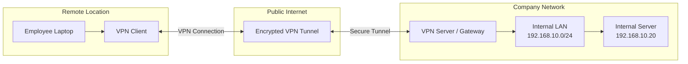

# Remote Access VPN

A **Remote Access VPN** allows an individual user or device to securely connect to a private network from a remote location over an untrusted network, such as the public internet.

Unlike a Site-to-Site VPN, which connects entire networks through VPN gateways, a Remote Access VPN typically connects an individual device to an organization's private network.

It enables remote employees, administrators, and authorized users to access internal resources such as:

* Internal web applications.
* File servers and shared folders.
* Database servers.
* Development environments.
* Remote desktop services.
* Internal network management systems.

# 🗁 How Remote Access VPN Works

A Remote Access VPN uses VPN client software or a built-in operating system VPN client to establish a secure connection with a VPN server or gateway.

The VPN server authenticates the user, establishes a secure tunnel, and applies access policies.

Once connected, the remote device can access permitted resources inside the private network.

The general communication process is:

* The user connects to the internet from a remote location.
* The VPN client initiates a connection to the organization's VPN server.
* The VPN server authenticates the user or device.
* The client and server negotiate the VPN connection and cryptographic parameters.
* A secure tunnel is established.
* The remote device receives VPN network configuration, such as an IP address and DNS settings.
* The user accesses authorized internal resources through the VPN tunnel.

# 🗁 Remote Access VPN Architecture

Consider an employee working from home who needs to access an internal company server.

Example network:

| Component | Address |
| --- | --- |
| Remote user | `192.168.1.100` |
| VPN server public IP | `198.51.100.10` |
| VPN client address | `10.8.0.10` |
| Internal company LAN | `192.168.10.0/24` |
| Internal server | `192.168.10.20` |

The addresses are documentation examples.



The VPN client connects to the public-facing VPN server. After successful authentication, the server provides access to authorized internal network resources.

# 🗁 Remote Access VPN vs Site-to-Site VPN

Both VPN types establish secure communication over untrusted networks, but they serve different purposes.

| Feature | Remote Access VPN | Site-to-Site VPN |
| --- | --- | --- |
| Connection | Individual device to private network | Network to network |
| VPN endpoint | Client device and VPN server | VPN gateways |
| Authentication | Usually user or device authentication | Usually gateway authentication |
| Client software | Commonly required | Usually not required on individual devices |
| Typical users | Remote employees and administrators | Organizations with multiple locations |
| Example | Employee accessing office resources from home | Head Office connected to Branch Office |

# 🗁 Types of Remote Access VPN

Remote Access VPN solutions can use different technologies and connection models.

**SSL/TLS VPN**

SSL/TLS VPN solutions use TLS to establish an encrypted connection between the client and VPN gateway.

Depending on the implementation, access can be provided through:

* A web browser.
* Dedicated VPN client software.
* A network-level VPN tunnel.

Common characteristics:

* Uses TLS-based security.
* Can support browser-based application access.
* Can provide full network access through a VPN client.
* Commonly uses TCP port `443`, although the exact transport and port depend on the implementation.

**IPsec Remote Access VPN**

IPsec can provide secure remote connectivity between individual client devices and a VPN gateway.

Common characteristics:

* Uses IPsec for traffic protection.
* Commonly uses IKE for authentication and key negotiation.
* Supports certificate-based or pre-shared-key authentication, depending on the implementation.
* Can use NAT Traversal when the client is behind NAT.

**WireGuard Remote Access VPN**

WireGuard is a modern VPN protocol that uses public-key cryptography and a lightweight design.

Common characteristics:

* Uses public and private keys for peer authentication.
* Uses a simple configuration model.
* Supports roaming between network connections.
* Uses UDP transport.
* Commonly used for secure remote access and site-to-site connectivity.

**OpenVPN Remote Access**

OpenVPN is a VPN solution that uses TLS-based authentication and encryption.

Common characteristics:

* Supports certificate-based authentication.
* Can use TCP or UDP transport.
* Supports flexible routing and access configurations.
* Works across multiple operating systems.

# 🗁 Full-Tunnel vs Split-Tunnel VPN

Remote Access VPNs commonly use two traffic-routing models.

**Full-Tunnel VPN**

A full-tunnel VPN routes all or most of the client's internet traffic through the VPN connection.

Example:

```text
Remote Client
     |
     v
VPN Tunnel
     |
     v
Company VPN Gateway
     |
     v
Internet
```

Characteristics:

* Internet traffic passes through the organization's VPN gateway.
* Centralized security inspection and filtering are possible.
* Organizations can apply centralized internet access policies.
* VPN gateway bandwidth requirements increase.
* Internet traffic may experience additional latency.

**Split-Tunnel VPN**

A split-tunnel VPN sends only selected traffic through the VPN connection. Other traffic continues to use the client's normal internet connection.

Example:

```text
Remote Client
     |
     +----------------------+
     |                      |
     v                      v
VPN Tunnel              Local Gateway
     |                      |
     v                      v
Company LAN              Internet
```

Example routing policy:

| Destination | Route |
| --- | --- |
| `192.168.10.0/24` | VPN tunnel |
| `10.0.0.0/8` | VPN tunnel |
| Public internet | Local gateway |

Characteristics:

* Only selected private network traffic uses the VPN.
* Reduces unnecessary traffic through the VPN gateway.
* Can improve performance for internet access.
* Requires careful routing and security policy configuration.
* Internet traffic outside the tunnel may not receive the organization's centralized security inspection.

# 🗁 VPN Client and VPN Server

A Remote Access VPN generally has two primary components.

**VPN Client**

The VPN client runs on the remote user's device.

Its responsibilities include:

* Initiating VPN connections.
* Authenticating the user or device.
* Negotiating cryptographic parameters.
* Establishing and maintaining the tunnel.
* Installing VPN routes and DNS settings.
* Encrypting outgoing traffic and decrypting incoming traffic.

Examples include:

* WireGuard client.
* OpenVPN Connect.
* StrongSwan.
* Operating system built-in VPN clients.

**VPN Server**

The VPN server runs on a server, router, firewall, or dedicated VPN appliance.

Its responsibilities include:

* Accepting incoming VPN connections.
* Authenticating users and devices.
* Assigning VPN client addresses.
* Establishing secure tunnels.
* Applying routing and access policies.
* Forwarding authorized traffic to internal networks.
* Monitoring connections and maintaining logs.

# 🗁 User Authentication and Authorization

Authentication verifies the identity of a user or device attempting to connect.

Authorization determines which resources the authenticated user is allowed to access.

Common authentication methods include:

**Username and Password**

Users authenticate with individual account credentials.

**Pre-Shared Key**

A shared secret is configured on the client and server. It is used by some VPN technologies and configurations.

**Digital Certificates**

Certificates establish identities using public-key cryptography and a trusted Certificate Authority (CA).

**Public-Key Authentication**

Some VPN protocols, such as WireGuard, use public and private keys to identify peers.

**Multi-Factor Authentication (MFA)**

MFA requires additional verification beyond a password, such as an authenticator application, hardware security key, or another supported factor.

For organizational deployments, authentication can be integrated with centralized identity services such as RADIUS or an identity provider.

# 🗁 VPN Address Assignment

Remote VPN clients commonly receive an IP address from a dedicated VPN address pool.

Example:

```text
VPN Address Pool: 10.8.0.0/24

VPN Server:       10.8.0.1
Client 1:         10.8.0.10
Client 2:         10.8.0.11
Client 3:         10.8.0.12
```

The VPN server assigns an available address to each connected client.

The assigned address allows the client to communicate through the VPN network.

VPN address pools should be planned carefully to avoid overlapping with:

* The organization's internal LAN subnets.
* Common remote-user home network subnets.
* Other connected VPN networks.
* Existing routed network prefixes.

# 🗁 Routing and DNS Configuration

After a VPN connection is established, the client needs appropriate routing and DNS configuration.

**VPN Routing**

The VPN server or client installs routes that direct the intended traffic through the VPN interface.

Example:

```text
Destination: 192.168.10.0/24
Interface:   VPN Interface
```

This route allows the client to access the company's internal network.

For a full-tunnel VPN, the VPN configuration may also install routes that direct general internet traffic through the VPN gateway.

**VPN DNS**

The VPN server may provide internal DNS server addresses to connected clients.

Example:

```text
DNS Server: 192.168.10.53
Domain:     company.internal
```

This allows remote users to resolve internal hostnames.

For example:

```text
fileserver.company.internal
```

Without correct DNS configuration, users may be able to reach internal servers by IP address but fail to access them by hostname.

# 🗁 Firewall and Access Control

A Remote Access VPN should not automatically grant every connected user unrestricted access to the internal network.

Access policies should define which users can reach which resources.

Example:

| User Group | Permitted Access |
| --- | --- |
| Employees | Internal web applications |
| Developers | Development servers and repositories |
| Network Administrators | Authorized network management systems |
| Database Administrators | Database servers |
| Contractors | Specifically approved resources |

Common security controls include:

* Restricting access to required internal subnets.
* Applying firewall rules to VPN client address pools.
* Separating administrative and employee access.
* Enforcing MFA where appropriate.
* Limiting management access to authorized users.
* Logging authentication and connection events.
* Revoking access when accounts or devices are no longer authorized.

# 🗁 Remote Access VPN Ports and Protocols

The required ports depend on the selected VPN technology.

| VPN Technology | Common Transport | Common Port |
| --- | --- | --- |
| WireGuard | UDP | `51820` by default |
| OpenVPN | UDP or TCP | `1194` by default |
| IKEv2/IPsec | UDP | `500` |
| IPsec NAT Traversal | UDP | `4500` |
| SSL/TLS VPN | Commonly TCP | `443` |

These are common defaults, not mandatory values. Administrators can configure different ports and transports depending on the VPN implementation.

For IPsec, ESP may also need to pass through the network when it is not encapsulated inside UDP through NAT Traversal.

ESP is IP protocol number `50`, not a TCP or UDP port.

# 🗁 Linux Remote Access VPN Example

WireGuard is one option for establishing a Remote Access VPN on Linux.

Consider the following example:

```text
VPN Server:
Public IP: 198.51.100.10
VPN IP:    10.8.0.1/24

VPN Client:
VPN IP:    10.8.0.10/32

Internal LAN:
192.168.10.0/24

WireGuard UDP Port:
51820
```

**Install WireGuard**

On Ubuntu:

```bash
sudo apt update
sudo apt install wireguard
```

**Generate Server Keys**

```bash
wg genkey | tee server_private.key | wg pubkey > server_public.key
```

**Generate Client Keys**

```bash
wg genkey | tee client_private.key | wg pubkey > client_public.key
```

Keep private keys secret. Only the corresponding public keys should be shared with the other peer.

**Example Server Configuration**

File:

```text
/etc/wireguard/wg0.conf
```

```ini
[Interface]
Address = 10.8.0.1/24
ListenPort = 51820
PrivateKey = SERVER_PRIVATE_KEY

[Peer]
PublicKey = CLIENT_PUBLIC_KEY
AllowedIPs = 10.8.0.10/32
```

**Example Client Configuration**

```ini
[Interface]
Address = 10.8.0.10/32
PrivateKey = CLIENT_PRIVATE_KEY
DNS = 192.168.10.53

[Peer]
PublicKey = SERVER_PUBLIC_KEY
Endpoint = 198.51.100.10:51820
AllowedIPs = 10.8.0.0/24, 192.168.10.0/24
PersistentKeepalive = 25
```

In this example, `AllowedIPs` on the client determines which destination networks are routed through the VPN.

The server must also be configured to forward traffic between the VPN interface and the internal LAN. Appropriate firewall rules and return routing are required.

**Enable IP Forwarding**

For IPv4 forwarding:

```bash
sudo sysctl -w net.ipv4.ip_forward=1
```

To make the setting persistent, configure it in an appropriate file under:

```text
/etc/sysctl.d/
```

Then apply the configuration:

```bash
sudo sysctl --system
```

**Start the WireGuard Interface**

```bash
sudo systemctl enable --now wg-quick@wg0
```

**Check VPN Status**

```bash
sudo wg show
```

**Check VPN Interface**

```bash
ip addr show wg0
```

**Check Routing Table**

```bash
ip route
```

This is an illustrative configuration. Production deployments also require appropriate firewall policies, forwarding rules, key management, and a suitable NAT or routing design.

# 🗁 Common Remote Access VPN Problems

| Problem | Possible Cause | Troubleshooting |
| --- | --- | --- |
| VPN connection fails | Incorrect server address or blocked port | Verify endpoint address and firewall rules |
| Authentication fails | Incorrect credentials, key, or certificate | Verify identity and authentication configuration |
| VPN connects but internal resources are unreachable | Missing routes or forwarding | Check client routes, server routes, and IP forwarding |
| Internal websites do not resolve | Incorrect DNS configuration | Verify VPN DNS settings and internal DNS reachability |
| Internet stops working after connecting | Incorrect full-tunnel routing or gateway configuration | Inspect default routes and gateway forwarding |
| Some internal resources are inaccessible | Firewall or access-control restrictions | Review user permissions and firewall policies |
| Connection drops frequently | Unstable internet or keepalive and timeout settings | Inspect connectivity and VPN logs |
| Large transfers fail | MTU or MSS issue | Check tunnel MTU and Path MTU Discovery |
| VPN connects from some networks but not others | NAT or network firewall restrictions | Check transport ports and NAT Traversal support |

# 🗁 Remote Access VPN Security Best Practices

A secure remote access deployment should follow these practices:

* Require strong authentication for every user.
* Enable MFA where supported.
* Prefer certificate or public-key authentication when appropriate.
* Use modern and supported cryptographic algorithms.
* Keep VPN server and client software updated.
* Assign unique VPN addresses to clients where practical.
* Restrict access based on user roles and business requirements.
* Avoid unrestricted access to internal networks.
* Monitor failed authentication attempts and unusual connection activity.
* Revoke compromised or unused credentials.
* Protect private keys and certificate files.
* Review VPN access permissions regularly.

# 🗁 Key Takeaways

* A Remote Access VPN connects an individual device to an organization's private network.
* VPN clients establish secure connections with VPN servers or gateways.
* Authentication verifies user or device identity.
* Authorization controls which internal resources users can access.
* VPN clients commonly receive addresses from a dedicated VPN address pool.
* Full-tunnel VPNs route general internet traffic through the VPN gateway.
* Split-tunnel VPNs route only selected traffic through the VPN.
* Correct routing, DNS, firewall, and forwarding configuration are essential.
* WireGuard, OpenVPN, IPsec, and SSL/TLS VPN solutions support remote access use cases.
* Strong authentication, access restrictions, and monitoring help protect organizational networks.
