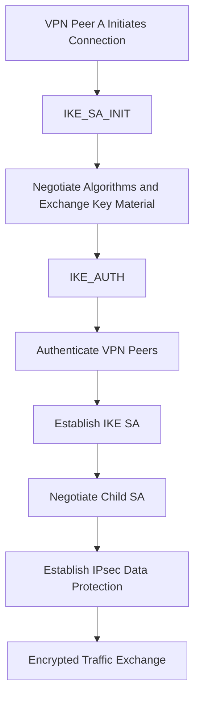
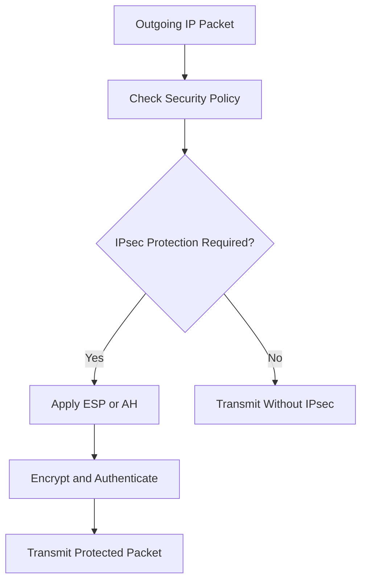

# IPsec

**IPsec (Internet Protocol Security)** is a suite of protocols that provides security for communication over IP networks.

It protects IP traffic by providing encryption, authentication, data integrity, and replay protection. IPsec is commonly used to establish Site-to-Site VPNs and Remote Access VPNs.

Unlike application-layer security protocols such as HTTPS, IPsec operates at the network layer and can protect traffic from different applications without requiring each application to implement its own encryption.

# 🗁 Why IPsec Is Used

IP networks do not inherently provide encryption or authentication for transmitted packets.

IPsec addresses these security requirements:

* **Confidentiality:** Encrypts data so unauthorized parties cannot read it.
* **Integrity:** Detects unauthorized modification of transmitted data.
* **Authentication:** Verifies the identity of communicating peers.
* **Anti-Replay Protection:** Detects and rejects replayed packets.
* **Secure Key Management:** Establishes and manages cryptographic keys used to protect communication.

Common use cases include:

* Connecting Head Office and Branch Office networks.
* Providing secure remote access to internal resources.
* Protecting communication between data centers.
* Securing communication between routers and firewalls.
* Building encrypted network tunnels over the public internet.

# 🗁 IPsec Architecture

IPsec uses multiple protocols and mechanisms to establish and protect secure communication.

Its main components include:

| Component | Purpose |
| --- | --- |
| ESP | Provides encryption, integrity, authentication, and anti-replay protection |
| AH | Provides authentication, integrity, and anti-replay protection without encryption |
| IKE | Negotiates security parameters and establishes security associations |
| Security Association (SA) | Defines the security parameters used to protect traffic |
| Security Policies | Determine which traffic requires IPsec protection |
| Security Keys | Provide cryptographic material for protecting communication |

# 🗁 IPsec Protocols

IPsec primarily uses two packet-protection protocols: ESP and AH.

**Encapsulating Security Payload (ESP)**

ESP provides security for IP packets through encryption and, when configured, integrity and authentication protection.

Its capabilities include:

* Data encryption.
* Data integrity verification.
* Data-origin authentication.
* Anti-replay protection.

ESP is widely used in modern IPsec deployments.

ESP uses IP protocol number `50`.

**Authentication Header (AH)**

AH provides authentication and integrity protection for IP packets.

Its capabilities include:

* Data integrity verification.
* Data-origin authentication.
* Anti-replay protection.

AH does not provide encryption, so the packet payload is not confidential.

AH uses IP protocol number `51`.

AH is rarely used in modern deployments, particularly where NAT is involved, because NAT modifies IP header fields that AH protects.

# 🗁 ESP vs AH

| Feature | ESP | AH |
| --- | --- | --- |
| Encryption | Supported | Not supported |
| Data integrity | Supported | Supported |
| Data-origin authentication | Supported | Supported |
| Anti-replay protection | Supported | Supported |
| NAT compatibility | Supported with NAT-T | Poor compatibility |
| IP protocol number | `50` | `51` |
| Modern usage | Widely used | Rarely used |

ESP is generally preferred because it provides encryption and can also provide integrity and authentication protection.

# 🗁 IPsec Modes

IPsec supports two primary operating modes:

* Transport Mode
* Tunnel Mode

**Transport Mode**

Transport Mode protects the IP packet payload while retaining the original IP header.

The original source and destination IP addresses remain visible in the outer IP header.

Example:

```text
Original IP Packet:

+-----------------------------+
| Original IP Header          |
+-----------------------------+
| Original Transport Header   |
+-----------------------------+
| Application Data            |
+-----------------------------+
```

With ESP Transport Mode:

```text
+-----------------------------+
| Original IP Header          |
+-----------------------------+
| ESP Header                  |
+-----------------------------+
| Encrypted Transport Header  |
+-----------------------------+
| Encrypted Application Data  |
+-----------------------------+
| ESP Trailer                 |
+-----------------------------+
| ESP Authentication Data     |
+-----------------------------+
```

Characteristics:

* Protects the original packet payload.
* Retains the original IP header.
* Commonly used for host-to-host communication.
* Adds less encapsulation overhead than Tunnel Mode.

**Tunnel Mode**

Tunnel Mode protects the entire original IP packet by encapsulating it inside a new IP packet.

A new outer IP header is added to identify the IPsec endpoints.

Example:

```text
Original IP Packet:

+-----------------------------+
| Original IP Header          |
+-----------------------------+
| Original Transport Header   |
+-----------------------------+
| Application Data            |
+-----------------------------+
```

With ESP Tunnel Mode:

```text
+-----------------------------+
| New Outer IP Header         |
+-----------------------------+
| ESP Header                  |
+-----------------------------+
| Encrypted Original IP Header|
+-----------------------------+
| Encrypted Transport Header  |
+-----------------------------+
| Encrypted Application Data  |
+-----------------------------+
| ESP Trailer                 |
+-----------------------------+
| ESP Authentication Data     |
+-----------------------------+
```

Characteristics:

* Protects the entire original IP packet.
* Adds a new outer IP header.
* Commonly used for Site-to-Site VPNs.
* Hides the original internal source and destination addresses from intermediate networks.
* Adds more overhead than Transport Mode.

# 🗁 Transport Mode vs Tunnel Mode

| Feature | Transport Mode | Tunnel Mode |
| --- | --- | --- |
| Original IP header | Retained as outer header | Encapsulated inside the protected packet |
| Protection | Original packet payload | Entire original IP packet |
| Additional IP header | No new outer IP header | New outer IP header |
| Common use | Host-to-host communication | Gateway-to-gateway VPN |
| Encapsulation overhead | Lower | Higher |

# 🗁 Internet Key Exchange (IKE)

**Internet Key Exchange (IKE)** is a protocol used by IPsec peers to negotiate security parameters, authenticate each other, and establish cryptographic keys.

IKE automates the process of establishing and maintaining IPsec security associations.

Without a key-management protocol, administrators would need to manually configure and manage cryptographic keys, which becomes difficult in larger deployments.

IKE performs tasks such as:

* Negotiating cryptographic algorithms.
* Authenticating VPN peers.
* Establishing shared secret key material.
* Negotiating IPsec security associations.
* Managing security association lifetimes.
* Rekeying before existing security associations expire.

# 🗁 IKEv1 vs IKEv2

IPsec has two major versions of IKE.

**IKEv1**

IKEv1 is the original version of the Internet Key Exchange protocol.

It supports two main negotiation phases:

* Phase 1 establishes a secure, authenticated communication channel between peers.
* Phase 2 negotiates IPsec security associations used to protect data traffic.

IKEv1 supports Main Mode and Aggressive Mode for Phase 1 negotiation.

**IKEv2**

IKEv2 is a newer version designed to simplify and improve the key-exchange process.

It uses two primary exchanges:

* IKE_SA_INIT establishes cryptographic parameters and exchanges key material.
* IKE_AUTH authenticates the peers and establishes the initial Child SA.

IKEv2 also supports features such as:

* More efficient negotiation.
* Improved reliability.
* NAT Traversal support.
* Mobility and Multihoming support through MOBIKE.
* Efficient rekeying and Child SA management.
* EAP-based authentication in supported configurations.

| Feature | IKEv1 | IKEv2 |
| --- | --- | --- |
| Version | Older | Newer |
| Negotiation | More complex | Simplified |
| Main negotiation stages | Phase 1 and Phase 2 | IKE_SA_INIT and IKE_AUTH |
| NAT Traversal | Supported | Supported |
| Mobility support | Limited | MOBIKE support |
| Current deployment preference | Legacy compatibility | Generally preferred |

IKEv2 is generally preferred for new deployments when supported by both peers.

# 🗁 Security Associations (SA)

A **Security Association (SA)** is a logical agreement between IPsec peers that defines how traffic will be protected.

An SA contains security parameters such as:

* Security protocol (ESP or AH).
* Encryption algorithm, when applicable.
* Integrity algorithm, when applicable.
* Cryptographic keys.
* Sequence number information.
* Anti-replay window.
* Security Parameter Index (SPI).
* Lifetime and rekeying information.

An SA is unidirectional, meaning it protects traffic in one direction.

For bidirectional communication, IPsec normally establishes separate SAs for each direction.

**Security Parameter Index (SPI)**

The SPI identifies a particular security association.

It is carried in the ESP or AH header so the receiving system can identify the security parameters associated with the incoming packet.

# 🗁 IKE SA vs Child SA

IKEv2 uses two important types of security associations.

**IKE SA**

The IKE SA protects the control-plane communication between IPsec peers.

It provides a secure channel for:

* Authentication.
* Negotiation.
* Key management.
* Security association management.

**Child SA**

A Child SA protects the actual data traffic between IPsec peers.

It defines the security parameters used for ESP or AH traffic, including traffic selectors and cryptographic algorithms.

| Feature | IKE SA | Child SA |
| --- | --- | --- |
| Purpose | Protects IKE communication | Protects user data traffic |
| Traffic | Control plane | Data plane |
| Negotiation | IKE negotiation | Negotiated through IKE |
| Protection | IKE encryption and integrity | ESP or AH protection |

An IKE SA can manage multiple Child SAs.

# 🗁 IPsec Negotiation Process

A typical IKEv2-based IPsec connection follows this sequence:



The process works as follows:

* Peer A initiates an IKE connection with Peer B.
* Both peers negotiate supported cryptographic algorithms.
* They exchange key material and establish shared secret key material.
* The peers authenticate each other.
* An IKE SA is established.
* They negotiate a Child SA for protecting data traffic.
* IPsec begins protecting packets using the negotiated security parameters.

# 🗁 IPsec Encryption and Authentication Algorithms

IPsec supports different cryptographic algorithms depending on the implementation and negotiated configuration.

**Encryption Algorithms**

Encryption provides confidentiality by making packet contents unreadable to unauthorized parties.

Examples include:

* AES-128.
* AES-256.
* ChaCha20-Poly1305 in supported IPsec implementations.

**Integrity and Authentication Algorithms**

Integrity protection detects unauthorized changes to transmitted data.

Examples include:

* HMAC-SHA-256.
* HMAC-SHA-384.
* HMAC-SHA-512.

Authenticated Encryption with Associated Data (AEAD) algorithms, such as AES-GCM, combine encryption and integrity protection.

**Diffie-Hellman Key Exchange**

Diffie-Hellman key exchange allows peers to establish shared secret material over an untrusted network.

Common supported groups include elliptic-curve groups and other approved Diffie-Hellman groups.

**Perfect Forward Secrecy (PFS)**

PFS helps ensure that compromise of long-term authentication credentials does not automatically expose previously established session keys.

A suitable ephemeral key exchange is used when establishing or rekeying the relevant security associations.

# 🗁 IPsec Ports and Protocol Numbers

IPsec uses specific transport ports and IP protocol numbers.

| Protocol | Port / Protocol Number | Purpose |
| --- | --- | --- |
| IKE | UDP `500` | Key exchange and peer negotiation |
| NAT-T | UDP `4500` | Encapsulates IPsec traffic through NAT |
| ESP | IP protocol `50` | Protects IP packet traffic |
| AH | IP protocol `51` | Provides packet authentication and integrity |

Important distinctions:

* UDP `500` is used for IKE negotiation.
* UDP `4500` is used for NAT Traversal.
* ESP is IP protocol `50`, not TCP or UDP port `50`.
* AH is IP protocol `51`, not TCP or UDP port `51`.

# 🗁 NAT Traversal (NAT-T)

Network Address Translation (NAT) modifies IP packet addresses and sometimes transport-layer ports.

Traditional ESP does not use TCP or UDP ports, which can make it difficult for some NAT devices to track and translate IPsec traffic.

**NAT Traversal (NAT-T)** solves this problem by encapsulating ESP packets inside UDP packets.

NAT-T commonly uses UDP port `4500`.

Example:

```text
Without NAT-T:

+-----------------------------+
| Outer IP Header             |
+-----------------------------+
| ESP Header                  |
+-----------------------------+
| Encrypted Data              |
+-----------------------------+

With NAT-T:

+-----------------------------+
| Outer IP Header             |
+-----------------------------+
| UDP Header - Port 4500      |
+-----------------------------+
| ESP Header                  |
+-----------------------------+
| Encrypted Data              |
+-----------------------------+
```

NAT-T allows IPsec communication to pass through many NAT devices and firewalls that support UDP encapsulation.

# 🗁 IPsec Security Policies

IPsec security policies determine how outgoing and incoming traffic should be handled.

Depending on the implementation, traffic can be:

* Protected using IPsec.
* Bypassed without IPsec protection.
* Discarded.

For example:

| Source Network | Destination Network | Policy |
| --- | --- | --- |
| `192.168.10.0/24` | `192.168.20.0/24` | Protect |
| `192.168.10.0/24` | Public Internet | Bypass |
| Unauthorized network | Internal network | Discard |

The exact policy configuration depends on whether the implementation uses policy-based or route-based IPsec.

# 🗁 IPsec Packet Processing

When an outgoing packet matches an IPsec protection policy, the system applies the negotiated security association.

A simplified processing sequence is:



For incoming packets, the receiving system:

* Identifies the security association using the SPI.
* Checks the sequence number and anti-replay window.
* Verifies integrity and authentication.
* Decrypts the packet when encryption is used.
* Removes the IPsec encapsulation.
* Applies inbound security policies.
* Delivers the original packet to the appropriate destination.

# 🗁 Linux IPsec with strongSwan

**strongSwan** is an open-source IPsec implementation commonly used on Linux systems.

It supports IKEv1 and IKEv2 and can establish Site-to-Site and Remote Access VPN connections.

**Install strongSwan**

On Ubuntu:

```bash
sudo apt update
sudo apt install strongswan
```

**Check the IPsec Service**

```bash
sudo systemctl status strongswan-starter
```

The service name can vary depending on the installed strongSwan package and deployment.

**Check IPsec Status**

```bash
sudo ipsec statusall
```

**Check Security Associations**

```bash
sudo ip xfrm state
```

**Check IPsec Policies**

```bash
sudo ip xfrm policy
```

**Inspect UDP Ports**

```bash
sudo ss -ulnp
```

**Monitor IKE and IPsec Logs**

```bash
sudo journalctl -u strongswan-starter -f
```

The exact service and logging configuration depend on the installed strongSwan version and Linux distribution.

# 🗁 IPsec Configuration Concepts

An IPsec deployment requires compatible configuration on both peers.

Important parameters include:

| Parameter | Description |
| --- | --- |
| Local address | Local VPN endpoint address |
| Remote address | Remote VPN endpoint address |
| IKE version | IKEv1 or IKEv2 |
| Authentication | PSK or certificate-based authentication |
| Encryption algorithm | Algorithm used to encrypt traffic |
| Integrity algorithm | Algorithm used for integrity protection |
| Diffie-Hellman group | Key exchange group |
| PFS | Additional key exchange protection for Child SAs |
| Local subnet | Network protected by the local VPN peer |
| Remote subnet | Network protected by the remote VPN peer |
| SA lifetime | Duration before rekeying or expiration |
| NAT-T | NAT Traversal configuration |

Both peers must have compatible proposals, authentication settings, and traffic selectors.

# 🗁 IPsec Troubleshooting

IPsec failures can occur during IKE negotiation, authentication, security association establishment, or data transmission.

| Problem | Possible Cause | Troubleshooting |
| --- | --- | --- |
| IKE connection fails | Incorrect peer address or blocked UDP `500` | Verify peer reachability and firewall rules |
| Authentication fails | Incorrect PSK or certificate configuration | Verify credentials, certificates, and identities |
| No compatible proposal | Encryption or key exchange mismatch | Compare IKE and ESP proposals |
| Child SA fails | Traffic selector mismatch | Verify local and remote subnets |
| Tunnel established but traffic fails | Missing routes or firewall rules | Check routing and forwarding |
| NAT-related connection failure | NAT-T not working | Verify UDP `4500` and NAT behavior |
| ESP packets are blocked | Firewall blocks IP protocol `50` | Permit ESP or use NAT-T where appropriate |
| Connection drops after some time | Rekey or lifetime mismatch | Inspect SA lifetimes and negotiation logs |
| Large packets fail | MTU or fragmentation issue | Check MTU, MSS, and Path MTU Discovery |
| One-way communication | Missing return route or asymmetric routing | Inspect both routing tables and firewall policies |

# 🗁 IPsec Security Best Practices

* Prefer IKEv2 for new deployments when supported.
* Use strong authentication through certificates or high-entropy pre-shared keys.
* Use modern encryption and integrity algorithms.
* Prefer authenticated encryption algorithms where supported.
* Use appropriate Diffie-Hellman groups.
* Enable PFS where appropriate.
* Configure anti-replay protection.
* Restrict traffic selectors to required networks.
* Protect private keys and authentication credentials.
* Keep VPN software and gateway firmware updated.
* Monitor IKE negotiation and IPsec security association status.
* Review cryptographic proposals and remove obsolete algorithms.

# 🗁 Key Takeaways

* IPsec is a network-layer security protocol suite.
* It provides confidentiality, integrity, authentication, and anti-replay protection.
* ESP provides encryption and can provide integrity and authentication.
* AH provides authentication and integrity without encryption.
* Transport Mode protects the original packet payload.
* Tunnel Mode encapsulates and protects the entire original IP packet.
* IKE negotiates security parameters and establishes security associations.
* IKEv2 uses IKE_SA_INIT and IKE_AUTH exchanges.
* IKE SA protects control-plane communication, while Child SA protects data traffic.
* NAT Traversal commonly uses UDP port `4500`.
* ESP uses IP protocol number `50`; AH uses IP protocol number `51`.
* strongSwan provides IPsec functionality on Linux.
* Correct authentication, routing, firewall, and cryptographic configuration are essential for a reliable IPsec deployment.
