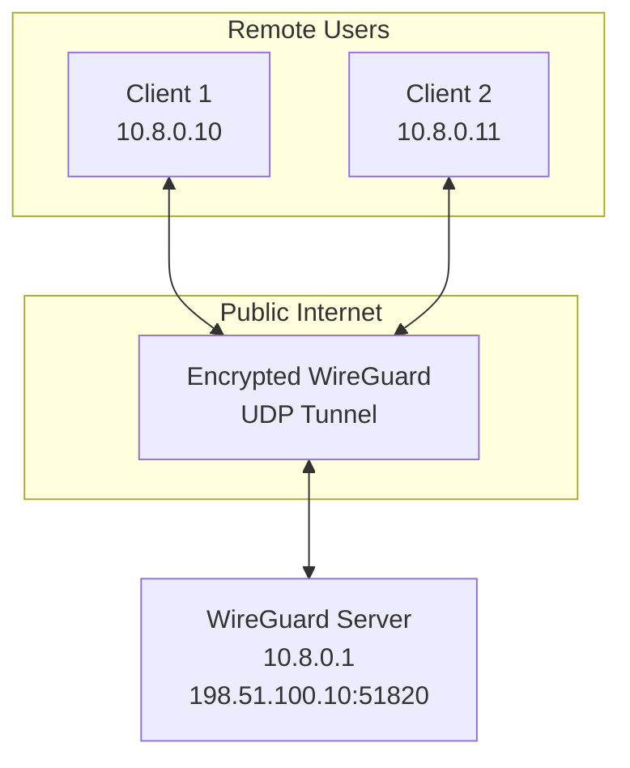
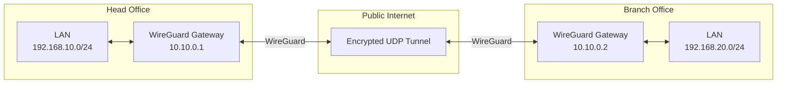

# WireGuard

**WireGuard** is a modern VPN protocol designed to provide secure, fast, and straightforward communication over IP networks.

It uses modern cryptographic algorithms, public-key authentication, and a lightweight implementation to establish encrypted tunnels between network devices.

WireGuard operates over UDP and supports both Site-to-Site VPN and Remote Access VPN configurations.

It is designed to be simpler to configure and maintain than many traditional VPN solutions.

# 🗁 Why WireGuard Is Used

WireGuard provides a secure way to connect devices and networks over untrusted networks such as the public internet.

Common use cases include:

* Connecting remote employees to private networks.
* Connecting Head Office and Branch Office networks.
* Establishing secure communication between cloud servers.
* Connecting Linux servers across different locations.
* Creating encrypted tunnels between routers and firewalls.
* Providing secure access to internal development environments.

# 🗁 WireGuard Architecture

WireGuard uses a peer-to-peer architecture.

Each device participating in a WireGuard VPN is called a **peer**.

A peer has:

* A private key.
* A public key.
* One or more assigned VPN addresses.
* A list of permitted IP addresses associated with other peers.
* An endpoint address when the peer needs to initiate communication with another peer.

Each peer uses its private key to prove its identity and its public key to identify itself to other peers.

Unlike traditional client-server VPN protocols, WireGuard does not require a permanently designated server role at the protocol level. However, deployments commonly use a publicly reachable server as a central connection point.

# 🗁 WireGuard Network Topology

Consider a remote access VPN with one central WireGuard server and two remote clients.

Example network:

| Component | VPN Address | Public Endpoint |
| --- | --- | --- |
| VPN Server | `10.8.0.1/24` | `198.51.100.10:51820` |
| Client 1 | `10.8.0.10/32` | Dynamic or private |
| Client 2 | `10.8.0.11/32` | Dynamic or private |



Both clients establish encrypted communication with the central WireGuard server.

The server can route traffic between connected peers and internal networks according to its routing and firewall configuration.

# 🗁 How WireGuard Works

WireGuard uses public-key cryptography to authenticate peers and establish encrypted communication.

The general process is:

* Each peer generates a private key and a corresponding public key.
* Peers exchange their public keys through a trusted configuration process.
* Each peer is configured with the public keys of authorized remote peers.
* A peer sends encrypted handshake messages to establish communication.
* WireGuard authenticates the peer using its configured public key.
* Cryptographic key material is established.
* Encrypted data packets are exchanged through UDP.
* WireGuard periodically performs new handshakes to maintain security.

WireGuard uses the Noise protocol framework for its handshake design.

It does not use a traditional username-and-password authentication system as its core peer authentication mechanism.

# 🗁 WireGuard Cryptography

WireGuard uses a carefully selected set of modern cryptographic primitives.

| Cryptographic Primitive | Purpose |
| --- | --- |
| Curve25519 | Elliptic-curve Diffie-Hellman key exchange |
| ChaCha20 | Symmetric encryption |
| Poly1305 | Message authentication |
| BLAKE2s | Cryptographic hashing |
| SipHash24 | Hashing for internal data structures |
| HKDF | Key derivation |

These primitives work together to establish shared key material and protect transmitted data.

WireGuard uses authenticated encryption, meaning encryption and integrity protection are provided together.

# 🗁 Public Key and Private Key

WireGuard uses asymmetric cryptography for peer authentication and key establishment.

Each peer generates two related keys.

**Private Key**

The private key must remain secret and should never be shared with other peers.

It is used as part of the cryptographic operations that establish secure communication.

**Public Key**

The public key is shared with other peers.

It allows a peer to identify and authenticate the corresponding WireGuard participant.

Example:

```text
Peer A:
Private Key: SECRET_PRIVATE_KEY_A
Public Key:  PUBLIC_KEY_A

Peer B:
Private Key: SECRET_PRIVATE_KEY_B
Public Key:  PUBLIC_KEY_B
```

Peer A stores Peer B's public key in its configuration, and Peer B stores Peer A's public key.

# 🗁 WireGuard Installation on Linux

WireGuard is supported by modern Linux kernels and is available through standard Linux package repositories.

On Ubuntu, install the required tools:

```bash
sudo apt update
sudo apt install wireguard
```

Check the installed WireGuard tools:

```bash
wg --version
```

Check whether the WireGuard kernel module is available:

```bash
sudo modprobe wireguard
```

Inspect the module:

```bash
lsmod | grep wireguard
```

The kernel module may already be built into the running kernel, depending on the distribution and kernel configuration.

# 🗁 Generate WireGuard Keys

WireGuard uses private and public key pairs for peer authentication.

Create a directory for the VPN configuration:

```bash
sudo mkdir -p /etc/wireguard
```

Set appropriate directory permissions:

```bash
sudo chmod 700 /etc/wireguard
```

Generate a private key:

```bash
wg genkey | sudo tee /etc/wireguard/server_private.key
```

Generate the corresponding public key:

```bash
sudo sh -c 'wg pubkey < /etc/wireguard/server_private.key > /etc/wireguard/server_public.key'
```

Display the public key:

```bash
sudo cat /etc/wireguard/server_public.key
```

Generate a client key pair using the same process:

```bash
wg genkey | tee client_private.key | wg pubkey > client_public.key
```

Protect private key files:

```bash
sudo chmod 600 /etc/wireguard/server_private.key
```

Private keys must remain confidential. Share only public keys with authorized peers.

# 🗁 WireGuard Configuration

WireGuard configurations are generally stored in:

```text
/etc/wireguard/
```

A configuration file named `wg0.conf` creates an interface called `wg0` when started through `wg-quick`.

A WireGuard configuration contains two primary sections.

**Interface Section**

The `[Interface]` section defines the local WireGuard interface.

Common settings include:

* `Address`: IP address assigned to the local VPN interface.
* `PrivateKey`: Local peer's private key.
* `ListenPort`: UDP port used to receive WireGuard packets.
* `DNS`: DNS servers configured by `wg-quick` on supported systems.
* `MTU`: Optional interface MTU.

**Peer Section**

The `[Peer]` section defines a remote WireGuard peer.

Common settings include:

* `PublicKey`: Remote peer's public key.
* `AllowedIPs`: IP addresses or network prefixes associated with that peer.
* `Endpoint`: Remote peer's IP address or hostname and UDP port.
* `PersistentKeepalive`: Optional interval for sending keepalive packets.

A configuration can contain multiple `[Peer]` sections.

# 🗁 Basic WireGuard Configuration Example

Consider the following remote access VPN:

```text
WireGuard Server:
Public IP: 198.51.100.10
VPN IP:    10.8.0.1/24
UDP Port:  51820

WireGuard Client:
VPN IP:    10.8.0.10/32

Internal LAN:
192.168.10.0/24
```

**Server Configuration**

File:

```text
/etc/wireguard/wg0.conf
```

```ini
[Interface]
Address = 10.8.0.1/24
ListenPort = 51820
PrivateKey = SERVER_PRIVATE_KEY

[Peer]
PublicKey = CLIENT_PUBLIC_KEY
AllowedIPs = 10.8.0.10/32
```

**Client Configuration**

```ini
[Interface]
Address = 10.8.0.10/32
PrivateKey = CLIENT_PRIVATE_KEY

[Peer]
PublicKey = SERVER_PUBLIC_KEY
Endpoint = 198.51.100.10:51820
AllowedIPs = 10.8.0.0/24, 192.168.10.0/24
PersistentKeepalive = 25
```

Replace the example keys and endpoint with the actual values generated for the deployment.

In this configuration:

* The server listens on UDP port `51820`.
* The client connects to the server's public endpoint.
* The client receives VPN address `10.8.0.10`.
* The client routes VPN subnet traffic through WireGuard.
* Traffic destined for `192.168.10.0/24` also uses the VPN.
* The server associates `10.8.0.10/32` with the authorized client peer.

# 🗁 Understanding AllowedIPs

`AllowedIPs` is one of the most important WireGuard configuration parameters.

It performs two related functions:

* It determines which destination IP addresses are routed through a peer.
* It identifies which source IP addresses are permitted from that peer when receiving authenticated traffic.

This behavior makes `AllowedIPs` both a routing-related setting and an important part of WireGuard's peer selection and source-address validation.

Example:

```ini
AllowedIPs = 10.8.0.10/32
```

This associates the VPN address `10.8.0.10` with a specific peer.

Another example:

```ini
AllowedIPs = 192.168.10.0/24
```

This associates the entire `192.168.10.0/24` network with that peer.

For a full-tunnel client configuration:

```ini
AllowedIPs = 0.0.0.0/0, ::/0
```

This selects all IPv4 and IPv6 destination addresses for that peer.

The resulting routing behavior depends on the client configuration and operating system.

# 🗁 Endpoint and PersistentKeepalive

**Endpoint**

The `Endpoint` setting specifies the remote peer's IP address or hostname and UDP port.

Example:

```ini
Endpoint = 198.51.100.10:51820
```

The endpoint identifies where the peer's WireGuard packets should be sent.

A peer behind NAT may have a changing public endpoint. WireGuard can learn a peer's current endpoint from correctly authenticated incoming packets and update its endpoint information.

**PersistentKeepalive**

The `PersistentKeepalive` setting sends periodic authenticated keepalive packets when needed to maintain NAT or firewall state.

Example:

```ini
PersistentKeepalive = 25
```

This sends a keepalive approximately every 25 seconds while the peer is otherwise idle.

It is particularly useful for remote clients behind NAT or stateful firewalls.

It is not required for every WireGuard connection.

# 🗁 Start and Manage WireGuard

After creating the configuration file, set appropriate permissions:

```bash
sudo chmod 600 /etc/wireguard/wg0.conf
```

Start the interface:

```bash
sudo wg-quick up wg0
```

Stop the interface:

```bash
sudo wg-quick down wg0
```

Enable WireGuard at system startup:

```bash
sudo systemctl enable wg-quick@wg0
```

Start the service:

```bash
sudo systemctl start wg-quick@wg0
```

Check service status:

```bash
sudo systemctl status wg-quick@wg0
```

Restart the service after changing its configuration:

```bash
sudo systemctl restart wg-quick@wg0
```

# 🗁 Verify WireGuard Connections

WireGuard provides commands for inspecting interfaces, peers, and connection activity.

**Display WireGuard Configuration and Peer Status**

```bash
sudo wg show
```

**Display All WireGuard Interfaces**

```bash
sudo wg show interfaces
```

**Display Interface Configuration**

```bash
ip addr show wg0
```

**Check Routing Table**

```bash
ip route
```

**Check the Route to a VPN Destination**

```bash
ip route get 192.168.10.20
```

**Check Listening UDP Ports**

```bash
sudo ss -ulnp
```

**Inspect WireGuard Traffic**

```bash
sudo tcpdump -ni any udp port 51820
```

A recent handshake indicates that peers have successfully completed a handshake, but it does not guarantee that application traffic can reach its destination.

# 🗁 Site-to-Site VPN with WireGuard

WireGuard can connect two private networks through gateways.

Consider this example:

| Component | Head Office | Branch Office |
| --- | --- | --- |
| LAN | `192.168.10.0/24` | `192.168.20.0/24` |
| VPN address | `10.10.0.1/30` | `10.10.0.2/30` |
| Public endpoint | `198.51.100.10:51820` | `203.0.113.20:51820` |



**Head Office Configuration**

```ini
[Interface]
Address = 10.10.0.1/30
ListenPort = 51820
PrivateKey = HQ_PRIVATE_KEY

[Peer]
PublicKey = BRANCH_PUBLIC_KEY
Endpoint = 203.0.113.20:51820
AllowedIPs = 10.10.0.2/32, 192.168.20.0/24
PersistentKeepalive = 25
```

**Branch Office Configuration**

```ini
[Interface]
Address = 10.10.0.2/30
ListenPort = 51820
PrivateKey = BRANCH_PRIVATE_KEY

[Peer]
PublicKey = HQ_PUBLIC_KEY
Endpoint = 198.51.100.10:51820
AllowedIPs = 10.10.0.1/32, 192.168.10.0/24
PersistentKeepalive = 25
```

For this configuration to carry LAN-to-LAN traffic, both gateways must also:

* Enable IP forwarding.
* Install routes to the remote LAN through the WireGuard interface.
* Permit forwarding between the LAN and VPN interfaces.
* Configure return routing.
* Ensure NAT does not unintentionally translate traffic between the private LANs.

The example uses a point-to-point VPN address subnet and separate LAN prefixes.

# 🗁 IP Forwarding and Firewall Configuration

A WireGuard tunnel can establish successfully while traffic between internal networks still fails.

This often happens because the VPN gateway does not forward packets between interfaces.

Enable IPv4 forwarding on a Linux gateway:

```bash
sudo sysctl -w net.ipv4.ip_forward=1
```

To make it persistent, create or edit a configuration file under:

```text
/etc/sysctl.d/
```

For example:

```text
/etc/sysctl.d/99-wireguard-forwarding.conf
```

Add:

```ini
net.ipv4.ip_forward=1
```

Apply the setting:

```bash
sudo sysctl --system
```

Firewall rules must also permit the intended traffic.

A suitable firewall policy should allow:

* Incoming WireGuard UDP traffic.
* Forwarding from the VPN interface to authorized internal networks.
* Return traffic from internal networks to authorized VPN clients.
* Any required management or monitoring traffic.

Use the firewall framework already managing the system, such as nftables or UFW, and avoid creating conflicting rule sets.

# 🗁 Full-Tunnel WireGuard VPN

A full-tunnel WireGuard configuration routes all IPv4 and IPv6 traffic through the VPN peer.

Example client configuration:

```ini
[Interface]
Address = 10.8.0.10/32
PrivateKey = CLIENT_PRIVATE_KEY

[Peer]
PublicKey = SERVER_PUBLIC_KEY
Endpoint = 198.51.100.10:51820
AllowedIPs = 0.0.0.0/0, ::/0
PersistentKeepalive = 25
```

In this configuration:

* `0.0.0.0/0` selects all IPv4 destinations.
* `::/0` selects all IPv6 destinations.
* Traffic is directed through the VPN according to the client's routing configuration.

The server must be configured to forward client traffic toward the internet.

Depending on the network design, the server may require source NAT or properly routed return paths.

# 🗁 Split-Tunnel WireGuard VPN

A split-tunnel configuration routes only selected networks through the VPN.

Example:

```ini
[Interface]
Address = 10.8.0.10/32
PrivateKey = CLIENT_PRIVATE_KEY

[Peer]
PublicKey = SERVER_PUBLIC_KEY
Endpoint = 198.51.100.10:51820
AllowedIPs = 10.8.0.0/24, 192.168.10.0/24
PersistentKeepalive = 25
```

In this example:

* VPN subnet traffic uses the tunnel.
* Company LAN traffic uses the tunnel.
* Other internet traffic follows the normal local gateway.

Split tunneling reduces unnecessary traffic through the VPN gateway but requires carefully designed access controls.

# 🗁 WireGuard and MikroTik RouterOS

MikroTik RouterOS v7 supports WireGuard interfaces and peer configuration.

WireGuard can be used for:

* Remote employee access.
* Router-to-router Site-to-Site VPNs.
* Connecting remote branches.
* Secure access to network management services.

Common RouterOS v7 configuration commands include:

**Create a WireGuard Interface**

```routeros
/interface wireguard add name=wg0 listen-port=51820
```

**Display the Generated Public Key**

```routeros
/interface wireguard print detail
```

**Assign an IP Address**

```routeros
/ip address add address=10.8.0.1/24 interface=wg0
```

**Add a WireGuard Peer**

```routeros
/interface wireguard peers add interface=wg0 public-key="CLIENT_PUBLIC_KEY" allowed-address=10.8.0.10/32
```

**Display WireGuard Peers**

```routeros
/interface wireguard peers print detail
```

**Display WireGuard Interface Status**

```routeros
/interface wireguard print detail
```

These commands illustrate basic RouterOS v7 interface and peer configuration. A complete deployment also requires appropriate firewall input and forwarding rules, routes, and access policies.

# 🗁 WireGuard vs IPsec vs OpenVPN

| Feature | WireGuard | IPsec | OpenVPN |
| --- | --- | --- | --- |
| Architecture | Peer-based | Security protocol suite | Client-server and other supported modes |
| Transport | UDP | IP protocols and UDP for NAT-T | UDP or TCP |
| Authentication | Public-key based | PSK or certificates, depending on configuration | Certificates and other supported methods |
| Cryptography | Fixed modern cryptographic suite | Negotiated algorithms | Configurable cryptographic options |
| Configuration | Relatively simple | More complex | Flexible |
| Network layer | Layer 3 VPN | Network-layer security | Tunneled IP traffic |
| Typical use | Remote access and Site-to-Site | Site-to-Site and Remote Access | Remote access and Site-to-Site |

The best choice depends on compatibility, network architecture, security requirements, and operational needs.

# 🗁 WireGuard Security Best Practices

* Keep private keys confidential.
* Exchange public keys through trusted channels.
* Assign unique key pairs to individual peers.
* Restrict `AllowedIPs` to required addresses and networks.
* Use firewall rules to limit access to internal resources.
* Keep WireGuard and the operating system updated.
* Remove revoked or unused peer configurations.
* Monitor handshake activity and traffic.
* Protect configuration files containing private keys.
* Avoid reusing the same private key across multiple devices.
* Plan VPN address pools to avoid subnet overlap.
* Configure IP forwarding and routing only where required.

# 🗁 Common WireGuard Problems

| Problem | Possible Cause | Troubleshooting |
| --- | --- | --- |
| No handshake | Incorrect public key or endpoint | Verify peer keys, endpoint address, and UDP port |
| UDP packets do not arrive | Firewall or NAT blocking traffic | Check UDP port and network reachability |
| Handshake succeeds but traffic fails | Incorrect `AllowedIPs` or routing | Verify peer prefixes and routing table |
| Only one direction works | Missing return route or forwarding rule | Inspect both gateways and firewall policies |
| Client cannot access LAN | IP forwarding disabled | Enable forwarding and check firewall rules |
| Connection fails behind NAT | NAT mapping expires | Configure `PersistentKeepalive` where needed |
| Internet stops working | Incorrect full-tunnel routing | Check default routes and server forwarding |
| DNS resolution fails | Incorrect DNS configuration | Verify assigned DNS servers and routing |
| Large transfers fail | MTU or fragmentation issue | Check tunnel MTU and packet sizes |
| Wrong peer receives traffic | Overlapping or incorrect `AllowedIPs` | Review peer address assignments |

# 🗁 Key Takeaways

* WireGuard is a modern VPN protocol designed for simplicity, performance, and security.
* It uses public-key cryptography to identify and authenticate peers.
* WireGuard operates over UDP.
* Each peer has a private key and a corresponding public key.
* `AllowedIPs` controls destination routing and permitted source addresses for a peer.
* `Endpoint` identifies the remote peer's network address and UDP port.
* `PersistentKeepalive` can help maintain NAT mappings.
* WireGuard supports both Remote Access and Site-to-Site VPN deployments.
* Full-tunnel and split-tunnel configurations provide different traffic-routing behaviors.
* Linux deployments commonly use `wg` and `wg-quick`.
* MikroTik RouterOS v7 supports WireGuard.
* Correct routing, forwarding, firewall, and key management are essential for a secure deployment.
