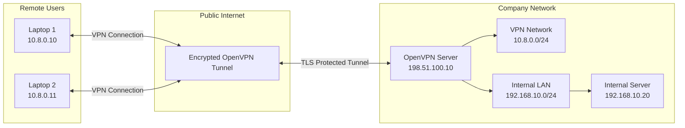

# OpenVPN

**OpenVPN** is an open-source VPN solution that creates secure, encrypted connections between devices and networks over untrusted networks such as the public internet.

It uses TLS-based security to authenticate VPN peers, negotiate cryptographic parameters, and establish encrypted communication tunnels.

OpenVPN supports both Remote Access VPN and Site-to-Site VPN deployments. It can operate over UDP or TCP and is available for Linux, Windows, macOS, Android, and iOS.

# 🗁 Why OpenVPN Is Used

OpenVPN provides secure connectivity for users and organizations that need to access private resources remotely or connect geographically separated networks.

Common use cases include:

* Providing remote access to employees.
* Connecting branch offices to a central network.
* Securing communication between cloud servers.
* Allowing administrators to manage remote infrastructure.
* Connecting users to internal applications and services.
* Protecting traffic over public Wi-Fi networks.

# 🗁 OpenVPN Architecture

OpenVPN commonly uses a client-server architecture.

**OpenVPN Server**

The server accepts incoming VPN connections and manages connected clients.

Its responsibilities include:

* Listening for incoming VPN connections.
* Authenticating clients.
* Negotiating TLS security parameters.
* Establishing encrypted VPN tunnels.
* Assigning VPN addresses.
* Providing routing and DNS configuration.
* Forwarding authorized traffic to internal networks.

**OpenVPN Client**

The client runs on the remote user's device.

Its responsibilities include:

* Connecting to the VPN server.
* Authenticating the server and, when configured, the client.
* Establishing the encrypted tunnel.
* Configuring VPN network interfaces.
* Installing VPN routes and DNS settings.
* Encrypting outgoing traffic and decrypting incoming traffic.

# 🗁 OpenVPN Network Topology

Consider an organization providing remote VPN access to employees.

Example network:

| Component | Address |
| --- | --- |
| OpenVPN Server Public IP | `198.51.100.10` |
| OpenVPN Server VPN IP | `10.8.0.1` |
| VPN Client 1 | `10.8.0.10` |
| VPN Client 2 | `10.8.0.11` |
| Internal LAN | `192.168.10.0/24` |
| Internal Server | `192.168.10.20` |

The addresses are documentation examples.



The VPN server authenticates remote clients and provides access to authorized internal resources.

# 🗁 How OpenVPN Works

OpenVPN establishes a secure connection using TLS-based authentication and cryptographic negotiation.

A simplified connection process:

* The client initiates a connection to the OpenVPN server.
* The client and server establish a TLS control channel.
* The server presents its certificate so the client can verify its identity.
* Depending on the configuration, the client also presents a certificate or uses another authentication method.
* The peers negotiate supported cryptographic parameters.
* Session keys are established for protecting VPN data.
* The VPN tunnel becomes available.
* The server provides the client with network configuration and permitted routes.
* Encrypted application traffic passes through the tunnel.

OpenVPN separates its control channel from its data channel. TLS protects the control channel, while negotiated data-channel keys protect VPN traffic.

# 🗁 TLS and Certificate-Based Authentication

OpenVPN commonly uses TLS and X.509 certificates to authenticate VPN peers.

A certificate contains identity information and a public key. It is signed by a Certificate Authority (CA) or another trusted issuer.

Common certificate components include:

| Component | Purpose |
| --- | --- |
| CA Certificate | Establishes the trusted certificate authority |
| Server Certificate | Identifies the OpenVPN server |
| Server Private Key | Provides the server's private cryptographic identity |
| Client Certificate | Identifies an authorized VPN client |
| Client Private Key | Provides the client's private cryptographic identity |

A typical certificate-based deployment follows this model:

* A CA issues certificates for the VPN server and clients.
* The server presents its certificate during connection establishment.
* The client validates the server certificate against the trusted CA.
* The client presents its certificate when mutual certificate authentication is configured.
* The server validates the client certificate.
* The VPN connection is established if authentication and authorization succeed.

Private keys must remain confidential. Certificates can be distributed to authorized systems, but private keys must be protected.

# 🗁 OpenVPN Authentication Methods

OpenVPN supports several authentication approaches.

**Certificate-Based Authentication**

Uses X.509 certificates to identify the server and clients.

This is commonly used in organizational VPN deployments.

**Username and Password Authentication**

Users authenticate with individual credentials through a configured authentication mechanism.

Username and password authentication can be combined with certificate authentication.

**Multi-Factor Authentication (MFA)**

An additional verification factor can be integrated through supported authentication plugins or external identity systems.

MFA improves account security by requiring more than a password.

**Certificate Revocation**

A Certificate Revocation List (CRL) identifies certificates that should no longer be trusted.

OpenVPN servers can use CRLs to reject revoked client certificates.

# 🗁 OpenVPN Transport Protocols

OpenVPN supports UDP and TCP transports.

**UDP Mode**

UDP is commonly preferred for OpenVPN deployments.

Characteristics:

* Lower transport overhead.
* Suitable for real-time communication.
* Avoids TCP-over-TCP performance problems.
* Commonly provides better performance for VPN data traffic.

**TCP Mode**

OpenVPN can also operate over TCP.

Characteristics:

* Uses TCP connection management.
* Can work in environments where UDP traffic is restricted.
* May be useful when network policies allow TCP but block UDP.
* Can introduce additional latency and retransmission overhead.

TCP-based OpenVPN should not automatically be considered more secure than UDP-based OpenVPN. Security depends on the cryptographic and authentication configuration.

# 🗁 OpenVPN Ports

OpenVPN can use configurable transport ports.

Common defaults include:

| Transport | Default Port | Description |
| --- | ---: | --- |
| UDP | `1194` | Common default OpenVPN transport |
| TCP | `1194` | Common TCP configuration |
| TCP | `443` | Sometimes used to operate through restrictive networks |

Port `1194` is the conventional default, but administrators can configure other ports.

Using TCP port `443` does not automatically make OpenVPN traffic indistinguishable from ordinary HTTPS traffic.

# 🗁 TUN vs TAP Interfaces

OpenVPN supports two primary virtual network interface types.

**TUN Interface**

TUN operates at Layer 3 and carries IP packets.

Characteristics:

* Routes IP traffic.
* Supports subnet-based VPN configurations.
* Generally uses less overhead than Layer 2 bridging.
* Commonly used for Remote Access and Site-to-Site VPN deployments.

Example:

```text
VPN Interface: tun0
VPN Address:   10.8.0.1/24
```

**TAP Interface**

TAP operates at Layer 2 and carries Ethernet frames.

Characteristics:

* Supports Ethernet-level communication.
* Can support bridging between network segments.
* Can carry broadcast traffic.
* Usually introduces more overhead than a routed TUN configuration.

Example:

```text
VPN Interface: tap0
Network:       Ethernet Layer 2
```

# 🗁 TUN vs TAP Comparison

| Feature | TUN | TAP |
| --- | --- | --- |
| OSI Layer | Layer 3 | Layer 2 |
| Traffic | IP packets | Ethernet frames |
| Interface type | Routed | Bridged |
| Broadcast traffic | Not carried as Ethernet broadcasts | Can carry Ethernet broadcasts |
| Overhead | Generally lower | Generally higher |
| Common use | Routed VPN | Layer 2 bridging |

TUN is generally preferred for modern routed VPN deployments. TAP is useful when Layer 2 bridging is specifically required.

# 🗁 OpenVPN Installation on Ubuntu

On Ubuntu, install the OpenVPN package:

```bash
sudo apt update
sudo apt install openvpn
```

Check the installed version:

```bash
openvpn --version
```

Check the service:

```bash
sudo systemctl status openvpn
```

OpenVPN can be managed through systemd using instance-specific services, depending on the package and configuration.

# 🗁 OpenVPN Configuration Files

OpenVPN configuration files commonly use the `.conf` extension on Linux servers and `.ovpn` extension for portable client profiles.

Common configuration locations include:

```text
/etc/openvpn/
```

A client configuration might be stored as:

```text
client.ovpn
```

A server configuration might be stored as:

```text
server.conf
```

Configuration options depend on whether the system uses a server or client role.

# 🗁 Basic OpenVPN Server Configuration

The following example illustrates common server settings. It assumes that the required certificates and keys have already been generated and installed.

Example:

```text
Server Public IP: 198.51.100.10
VPN Network:      10.8.0.0/24
VPN Server IP:    10.8.0.1
Transport:        UDP
Port:             1194
Internal LAN:     192.168.10.0/24
```

Example server configuration:

```conf
port 1194
proto udp
dev tun

topology subnet
server 10.8.0.0 255.255.255.0

ca ca.crt
cert server.crt
key server.key
dh none

tls-crypt ta.key

data-ciphers AES-256-GCM:AES-128-GCM

keepalive 10 120
persist-key
persist-tun

user nobody
group nogroup

verb 3
```

Important configuration options:

| Directive | Purpose |
| --- | --- |
| `port` | Defines the listening port |
| `proto` | Selects UDP or TCP transport |
| `dev tun` | Creates a Layer 3 tunnel interface |
| `topology subnet` | Uses subnet-style VPN addressing |
| `server` | Defines the VPN client address pool |
| `ca` | Specifies the trusted CA certificate |
| `cert` | Specifies the server certificate |
| `key` | Specifies the server private key |
| `dh none` | Disables a separate Diffie-Hellman parameter file where supported by the selected TLS configuration |
| `tls-crypt` | Protects and authenticates TLS control-channel packets |
| `data-ciphers` | Defines permitted data-channel encryption algorithms |
| `keepalive` | Configures connection keepalive behavior |
| `persist-key` | Avoids unnecessary key reinitialization during restart events |
| `persist-tun` | Attempts to keep the tunnel interface available during restart events |
| `verb` | Controls logging verbosity |

The example requires compatible certificates, keys, and a matching client configuration. Exact directives and supported cipher options depend on the OpenVPN version.

# 🗁 Basic OpenVPN Client Configuration

A client configuration specifies how a remote device connects to the VPN server.

Example:

```conf
client
dev tun
proto udp

remote 198.51.100.10 1194

resolv-retry infinite
nobind

persist-key
persist-tun

remote-cert-tls server

data-ciphers AES-256-GCM:AES-128-GCM

verb 3
```

Certificate and key material can be supplied through separate files or embedded in an `.ovpn` profile.

Common client directives:

| Directive | Purpose |
| --- | --- |
| `client` | Enables client mode |
| `dev tun` | Uses a Layer 3 tunnel |
| `proto` | Selects transport protocol |
| `remote` | Defines the server address and port |
| `resolv-retry` | Controls DNS resolution retry behavior |
| `nobind` | Avoids binding to a fixed local port |
| `persist-key` | Preserves key-related state where possible |
| `persist-tun` | Preserves the tunnel interface where possible |
| `remote-cert-tls server` | Checks that the remote certificate is appropriate for a server |

A complete client profile must also contain the required CA certificate and the configured client authentication material.

# 🗁 Start and Manage OpenVPN

OpenVPN can be started directly using a configuration file.

**Start a Client Connection**

```bash
sudo openvpn --config client.ovpn
```

**Start a Server Configuration**

```bash
sudo openvpn --config server.conf
```

The direct command runs OpenVPN in the foreground unless configured otherwise.

For systemd-managed deployments, service names depend on the installed package and configuration layout.

For example, some Ubuntu package installations use:

```bash
sudo systemctl start openvpn-server@server
```

Check service status:

```bash
sudo systemctl status openvpn-server@server
```

Enable automatic startup:

```bash
sudo systemctl enable openvpn-server@server
```

# 🗁 Routing Through OpenVPN

OpenVPN can provide routes to clients so they can access internal networks.

Example:

```text
VPN Network: 10.8.0.0/24
Internal LAN: 192.168.10.0/24
```

A server can push an internal network route to connected clients:

```conf
push "route 192.168.10.0 255.255.255.0"
```

This tells clients to route traffic destined for `192.168.10.0/24` through the VPN.

The server must also have a valid route to the internal LAN and be permitted to forward traffic between the VPN and LAN interfaces.

# 🗁 Full-Tunnel and Split-Tunnel OpenVPN

OpenVPN supports both full-tunnel and split-tunnel routing designs.

**Full-Tunnel VPN**

A full-tunnel configuration routes the client's internet traffic through the VPN server.

A commonly used server directive is:

```conf
push "redirect-gateway def1"
```

This instructs compatible clients to route IPv4 internet traffic through the VPN.

The server must provide appropriate internet forwarding, firewall rules, and source NAT or return routing.

**Split-Tunnel VPN**

A split-tunnel configuration sends only selected internal network traffic through the VPN.

Example:

```conf
push "route 192.168.10.0 255.255.255.0"
```

Only traffic destined for the specified internal network is directed through the VPN. Other traffic continues through the client's normal internet gateway.

# 🗁 OpenVPN Security Configuration

OpenVPN security depends on correct authentication, certificate validation, cryptographic configuration, and access control.

Important security practices include:

* Use trusted CA certificates.
* Validate the server certificate on clients.
* Use unique client certificates where certificate-based authentication is deployed.
* Protect private keys with restrictive file permissions.
* Use modern supported data-channel ciphers.
* Configure TLS protection for the control channel.
* Enable certificate revocation checking.
* Use MFA through an appropriate authentication integration.
* Restrict access to authorized internal networks.
* Keep OpenVPN software and cryptographic libraries updated.
* Monitor connection attempts and authentication failures.
* Remove compromised or unused client credentials.

# 🗁 OpenVPN Firewall Requirements

The firewall must permit the configured OpenVPN transport between clients and the server.

For example, a UDP deployment using port `1194` requires:

```text
Protocol: UDP
Port:     1194
Direction: Incoming to VPN Server
```

A TCP deployment using port `1194` requires:

```text
Protocol: TCP
Port:     1194
Direction: Incoming to VPN Server
```

The firewall must also allow the intended traffic between the VPN client address pool and internal network resources.

Avoid granting unrestricted access to the entire internal network unless the security requirements explicitly justify it.

# 🗁 Linux OpenVPN Verification

Linux provides several commands for checking OpenVPN interfaces, routes, services, and traffic.

**Check OpenVPN Version**

```bash
openvpn --version
```

**Check OpenVPN Service**

```bash
sudo systemctl status openvpn-server@server
```

**Display Network Interfaces**

```bash
ip addr
```

**Display Tunnel Interface**

```bash
ip addr show tun0
```

**Display Routing Table**

```bash
ip route
```

**Check Route to Internal Server**

```bash
ip route get 192.168.10.20
```

**Check Listening Ports**

```bash
sudo ss -tulpen
```

**Monitor OpenVPN Logs**

```bash
sudo journalctl -u openvpn-server@server -f
```

**Capture OpenVPN UDP Traffic**

```bash
sudo tcpdump -ni any udp port 1194
```

The service name and interface name can differ depending on the deployment.

# 🗁 OpenVPN vs WireGuard vs IPsec

| Feature | OpenVPN | WireGuard | IPsec |
| --- | --- | --- | --- |
| Security architecture | TLS-based VPN | Noise-based peer protocol | Network-layer security suite |
| Transport | UDP or TCP | UDP | ESP/AH, with UDP for NAT-T |
| Authentication | Certificates and supported authentication methods | Public-key based | PSK or certificates, depending on configuration |
| Configuration | Flexible | Relatively simple | More complex |
| Layer 2 support | TUN and TAP | Layer 3 | Network-layer protection |
| Remote access | Supported | Supported | Supported |
| Site-to-Site | Supported | Supported | Widely used |
| Typical use | Remote access and flexible VPN deployments | Lightweight remote access and network tunnels | Router-to-router and enterprise VPNs |

The appropriate technology depends on interoperability, deployment requirements, security policies, and network architecture.

# 🗁 Common OpenVPN Problems

| Problem | Possible Cause | Troubleshooting |
| --- | --- | --- |
| Client cannot connect | Incorrect server address or port | Verify endpoint and transport |
| TLS handshake fails | Certificate or TLS configuration mismatch | Check certificates, CA, and TLS settings |
| Certificate verification fails | Expired, revoked, or untrusted certificate | Verify certificate validity and trust chain |
| Authentication fails | Incorrect credentials or authentication backend | Check user credentials and authentication logs |
| VPN connects but LAN is unreachable | Missing routes or forwarding | Check pushed routes, IP forwarding, and firewall rules |
| DNS resolution fails | Incorrect DNS settings | Verify DNS configuration and server reachability |
| Internet stops working | Full-tunnel routing or NAT problem | Inspect default routes and server forwarding |
| Connection drops | Network instability or timeout settings | Review keepalive settings and logs |
| Slow VPN performance | TCP overhead, CPU limitations, or MTU problems | Check transport, encryption performance, and MTU |
| Some clients cannot connect | Client compatibility or cipher mismatch | Verify supported OpenVPN versions and cryptographic options |

# 🗁 Key Takeaways

* OpenVPN is an open-source VPN solution that uses TLS-based security.
* It supports Remote Access and Site-to-Site VPN deployments.
* OpenVPN commonly uses a client-server architecture.
* It supports UDP and TCP transport.
* UDP port `1194` is its conventional default.
* TUN operates at Layer 3, while TAP operates at Layer 2.
* Certificate-based authentication is commonly used for identifying VPN peers.
* OpenVPN separates its TLS control channel from its data channel.
* Full-tunnel and split-tunnel configurations control how client traffic is routed.
* OpenVPN can push internal network routes and DNS configuration to clients.
* Correct certificate validation, firewall rules, routing, and access control are essential for secure deployment.
