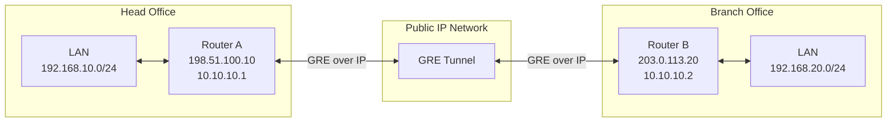

# GRE Tunnel

**GRE (Generic Routing Encapsulation)** is a tunneling protocol developed to encapsulate one network-layer protocol inside another network-layer protocol.

It allows network devices to transport different types of network traffic across an IP network by creating a virtual point-to-point tunnel.

GRE is commonly used to connect remote networks, carry routing protocol traffic, and build network overlays.

Unlike IPsec, GRE does not provide encryption, authentication, or data integrity protection. For secure communication over untrusted networks, GRE is often combined with IPsec.

# 🗁 Why GRE Is Used

GRE provides a mechanism for transporting network traffic between two endpoints through an IP network.

Common use cases include:

* Connecting geographically separated networks.
* Carrying private IP traffic across a public IP network.
* Transporting multicast traffic between remote networks.
* Carrying dynamic routing protocol traffic between routers.
* Creating logical point-to-point connections between network devices.
* Building network overlays.
* Carrying IPv6 traffic over an IPv4 network or IPv4 traffic over an IPv6 network, where supported.

# 🗁 GRE Architecture

A GRE tunnel is established between two endpoints, commonly routers.

Each endpoint encapsulates packets before sending them through the underlying IP network.

The receiving endpoint removes the GRE encapsulation and forwards the original packet toward its destination.

The two main components are:

**Tunnel Source**

The local IP address used as the source of the outer GRE packet.

**Tunnel Destination**

The remote IP address used as the destination of the outer GRE packet.

Example:

| Component | Router A | Router B |
| --- | --- | --- |
| Public IP | `198.51.100.10` | `203.0.113.20` |
| Tunnel IP | `10.10.10.1/30` | `10.10.10.2/30` |
| Local LAN | `192.168.10.0/24` | `192.168.20.0/24` |

The public addresses are documentation examples.

# 🗁 GRE Tunnel Topology

Consider two offices connected through a GRE tunnel over the internet.



The tunnel creates a logical connection between Router A and Router B.

The routers can use the tunnel interface to exchange traffic between their private networks.

# 🗁 How GRE Works

GRE encapsulates an original packet inside another packet.

A simplified communication process:

* Router A receives a packet destined for the remote network.
* Its routing table identifies the GRE tunnel as the path to the destination.
* Router A encapsulates the original packet inside a GRE header.
* An outer IP header is added with Router A's tunnel source and Router B's tunnel destination.
* The encapsulated packet travels through the underlying IP network.
* Router B receives the GRE packet.
* Router B removes the outer IP and GRE headers.
* The original packet is forwarded toward the destination network.

The original packet remains unchanged inside the GRE encapsulation.

# 🗁 GRE Packet Encapsulation

GRE adds an additional header around the original packet.

A basic GRE packet contains:

```text
+-----------------------------+
| Outer IP Header             |
+-----------------------------+
| GRE Header                  |
+-----------------------------+
| Original Encapsulated Packet|
+-----------------------------+
```

The outer IP header identifies the GRE tunnel endpoints.

The GRE header identifies the encapsulated protocol and may contain optional fields depending on the GRE configuration.

The original packet can contain IPv4, IPv6, or other supported network-layer protocols.

# 🗁 GRE Header Structure

The basic GRE header is 4 bytes long.

It contains the following fields:

| Field | Size | Purpose |
| --- | ---: | --- |
| Flags and Version | 2 bytes | Indicates optional GRE features and version |
| Protocol Type | 2 bytes | Identifies the encapsulated protocol |

Optional GRE fields can increase the header size.

These may include:

* Checksum and Reserved fields.
* Key field.
* Sequence Number field.

The GRE header allows the receiving device to identify and process the encapsulated packet.

# 🗁 GRE Protocol Number

GRE is identified by IP protocol number `47`.

This is an IP protocol number, not a TCP or UDP port.

| Protocol | IP Protocol Number | Description |
| --- | ---: | --- |
| ICMP | `1` | Internet Control Message Protocol |
| TCP | `6` | Transmission Control Protocol |
| UDP | `17` | User Datagram Protocol |
| GRE | `47` | Generic Routing Encapsulation |
| ESP | `50` | Encapsulating Security Payload |
| AH | `51` | Authentication Header |

Firewalls between GRE endpoints must permit IP protocol `47` when GRE traffic is used.

# 🗁 GRE vs IPsec

GRE and IPsec serve different purposes.

GRE provides encapsulation, while IPsec provides security.

| Feature | GRE | IPsec |
| --- | --- | --- |
| Primary purpose | Packet encapsulation | IP traffic protection |
| Encryption | Not provided | Supported |
| Authentication | Not provided | Supported |
| Data integrity | Not provided | Supported |
| Multicast support | Supported through GRE encapsulation | Depends on deployment and mode |
| Dynamic routing protocols | Can carry them | Depends on the IPsec design |
| IP protocol | `47` | ESP `50`, AH `51` |
| NAT compatibility | Depends on GRE and NAT implementation | NAT-T commonly uses UDP `4500` |

GRE should not be treated as an encrypted VPN protocol.

# 🗁 GRE over IPsec

GRE can be combined with IPsec to provide both tunneling flexibility and security.

In this architecture:

* GRE encapsulates the original network traffic.
* IPsec protects the GRE packets.
* The encrypted packets travel across the untrusted network.
* The receiving gateway decrypts the IPsec traffic.
* GRE decapsulation restores the original packet.


GRE over IPsec is useful when an organization needs to carry multicast traffic or dynamic routing protocols through an encrypted tunnel.

# 🗁 GRE Tunnel Routing

GRE creates a virtual tunnel interface that can be used by the routing table.

Routers can install routes that direct remote network traffic through the tunnel.

Example:

**Router A**

```text
Destination: 192.168.20.0/24
Next Hop:    10.10.10.2
Interface:   gre1
```

**Router B**

```text
Destination: 192.168.10.0/24
Next Hop:    10.10.10.1
Interface:   gre1
```

Static routing can be used for simple deployments.

Dynamic routing protocols such as OSPF and BGP can also operate through GRE tunnels.

This allows routers to exchange routing information across geographically separated networks.

# 🗁 GRE and Multicast Traffic

One useful feature of GRE is its ability to encapsulate multicast traffic.

This is important because some routing protocols and network services use multicast communication.

Examples include:

* OSPF routing protocol messages.
* Certain multicast applications.
* Network discovery and control traffic.

GRE can transport these packets through an IP network that would otherwise not directly support the required multicast forwarding between the tunnel endpoints.

The underlying network must still provide IP reachability between the GRE endpoints.

# 🗁 GRE Tunnel MTU

GRE adds encapsulation overhead to every packet.

For basic GRE over IPv4, the additional overhead is normally:

| Header | Size |
| --- | ---: |
| Outer IPv4 Header | 20 bytes |
| Basic GRE Header | 4 bytes |
| Total | 24 bytes |

If the underlying network has an MTU of `1500` bytes:

\[
1500 - 24 = 1476
\]

The resulting GRE tunnel MTU is typically `1476` bytes, assuming no optional GRE fields or additional encapsulation.

For GRE over IPv6, the outer IPv6 header is 40 bytes:

\[
1500 - 40 - 4 = 1456
\]

Additional encapsulation, such as IPsec, increases overhead further.

Possible symptoms of MTU problems include:

* Small packets work, but large packets fail.
* File transfers become slow or stop.
* Some websites load partially.
* Applications experience intermittent connectivity.
* Packets are fragmented or dropped.

Possible solutions include:

* Configure an appropriate tunnel MTU.
* Use TCP MSS clamping where necessary.
* Ensure Path MTU Discovery works correctly.
* Avoid blocking essential ICMP messages.
* Account for additional IPsec or other encapsulation overhead.

# 🗁 Linux GRE Tunnel Configuration

Linux supports GRE tunnel interfaces through the `iproute2` networking tools.

Consider this example:

| Component | Router A | Router B |
| --- | --- | --- |
| Public IP | `198.51.100.10` | `203.0.113.20` |
| Tunnel IP | `10.10.10.1/30` | `10.10.10.2/30` |
| Local LAN | `192.168.10.0/24` | `192.168.20.0/24` |

**Configure Router A**

Create the GRE interface:

```bash
sudo ip tunnel add gre1 mode gre \
    local 198.51.100.10 \
    remote 203.0.113.20 \
    ttl 255
```

Assign the tunnel IP address:

```bash
sudo ip addr add 10.10.10.1/30 dev gre1
```

Bring the interface up:

```bash
sudo ip link set gre1 up
```

Configure a route to the remote LAN:

```bash
sudo ip route add 192.168.20.0/24 \
    via 10.10.10.2 dev gre1
```

**Configure Router B**

Create the GRE interface:

```bash
sudo ip tunnel add gre1 mode gre \
    local 203.0.113.20 \
    remote 198.51.100.10 \
    ttl 255
```

Assign the tunnel IP address:

```bash
sudo ip addr add 10.10.10.2/30 dev gre1
```

Bring the interface up:

```bash
sudo ip link set gre1 up
```

Configure a route to the remote LAN:

```bash
sudo ip route add 192.168.10.0/24 \
    via 10.10.10.1 dev gre1
```

These commands configure the tunnel interface and routes. A complete deployment also requires appropriate IP forwarding, firewall rules, and return routing between the LANs.

The public endpoint addresses must be reachable through the underlying network.

# 🗁 Linux GRE Verification

Linux provides commands for inspecting GRE interfaces and tunnel connectivity.

**Display GRE Tunnel Interfaces**

```bash
ip tunnel show
```

**Display Network Interfaces**

```bash
ip addr
```

**Display GRE Interface**

```bash
ip addr show gre1
```

**Display Routing Table**

```bash
ip route
```

**Check the Route to the Remote Network**

```bash
ip route get 192.168.20.10
```

**Test Tunnel Connectivity**

From Router A:

```bash
ping 10.10.10.2
```

**Test Remote LAN Connectivity**

```bash
ping 192.168.20.10
```

**Capture GRE Traffic**

```bash
sudo tcpdump -ni any ip proto 47
```

# 🗁 MikroTik GRE Tunnel with RouterOS v7

MikroTik RouterOS v7 supports GRE tunnel interfaces.

Consider the following example:

**Router A**

```text
Public IP: 198.51.100.10
Tunnel IP: 10.10.10.1/30
LAN:       192.168.10.0/24
```

**Router B**

```text
Public IP: 203.0.113.20
Tunnel IP: 10.10.10.2/30
LAN:       192.168.20.0/24
```

**Configure Router A**

Create the GRE tunnel:

```routeros
/interface gre add \
    name=gre-to-branch \
    local-address=198.51.100.10 \
    remote-address=203.0.113.20 \
    keepalive=10s,10
```

Assign the tunnel IP:

```routeros
/ip address add \
    address=10.10.10.1/30 \
    interface=gre-to-branch
```

Add a route to the Branch Office LAN:

```routeros
/ip route add \
    dst-address=192.168.20.0/24 \
    gateway=gre-to-branch
```

**Configure Router B**

Create the GRE tunnel:

```routeros
/interface gre add \
    name=gre-to-hq \
    local-address=203.0.113.20 \
    remote-address=198.51.100.10 \
    keepalive=10s,10
```

Assign the tunnel IP:

```routeros
/ip address add \
    address=10.10.10.2/30 \
    interface=gre-to-hq
```

Add a route to the Head Office LAN:

```routeros
/ip route add \
    dst-address=192.168.10.0/24 \
    gateway=gre-to-hq
```

These commands demonstrate the basic GRE tunnel and routing configuration. Firewall rules must permit GRE traffic between the public endpoints and allow authorized forwarding between the LAN and tunnel interfaces.

# 🗁 GRE Firewall Requirements

GRE uses IP protocol number `47`, so it cannot be allowed using a TCP or UDP port rule.

The firewall must permit GRE packets between the tunnel endpoints.

Example:

```text
Protocol: GRE
IP Protocol Number: 47
Source: 198.51.100.10
Destination: 203.0.113.20
Action: Allow
```

Both endpoints must be reachable through the underlying network.

For GRE over IPsec, the firewall must also permit the required IPsec negotiation and protected traffic.

Common requirements include:

* UDP `500` for IKE.
* UDP `4500` for NAT Traversal when used.
* ESP IP protocol `50` when ESP is carried directly.
* GRE IP protocol `47` where required by the chosen encapsulation design.

# 🗁 GRE Security Considerations

GRE does not encrypt or authenticate the packets it carries.

Therefore, traffic transmitted through a GRE tunnel may be readable or modifiable if intercepted by an attacker.

Security best practices include:

* Combine GRE with IPsec when confidentiality and integrity are required.
* Restrict GRE traffic to authorized endpoint addresses.
* Apply firewall rules to control tunnel access.
* Use secure routing configurations.
* Monitor tunnel status and traffic.
* Avoid exposing unnecessary internal networks.
* Use anti-spoofing controls where appropriate.
* Keep router and operating system software updated.

# 🗁 Common GRE Tunnel Problems

| Problem | Possible Cause | Troubleshooting |
| --- | --- | --- |
| GRE interface is down | Incorrect endpoint configuration | Verify local and remote tunnel addresses |
| Tunnel endpoints cannot communicate | Underlying IP connectivity failure | Test public endpoint reachability |
| GRE packets are blocked | Firewall blocks IP protocol `47` | Permit GRE between authorized endpoints |
| Tunnel is up but LAN traffic fails | Missing routes or forwarding | Check routing tables and IP forwarding |
| One-way communication | Missing return route or firewall rule | Verify both directions |
| Dynamic routing fails | Multicast or routing protocol filtering | Check routing protocol traffic through GRE |
| Large packets fail | MTU or fragmentation issue | Check tunnel MTU and MSS |
| GRE over IPsec fails | IPsec or GRE configuration mismatch | Verify IPsec SAs, selectors, and GRE endpoints |
| Tunnel does not work through NAT | NAT device does not properly handle GRE | Check NAT support and consider GRE over IPsec with NAT-T |

# 🗁 GRE Advantages and Limitations

**Advantages**

* Simple tunneling mechanism.
* Supports multiple encapsulated network protocols.
* Can transport multicast traffic.
* Supports dynamic routing protocols through the tunnel.
* Works across IP networks.
* Can be combined with IPsec for security.

**Limitations**

* Does not provide encryption.
* Does not provide authentication.
* Does not provide built-in data integrity protection.
* Adds packet overhead.
* Can create MTU and fragmentation issues.
* Requires firewall support for IP protocol `47`.
* NAT compatibility depends on the network equipment and implementation.

# 🗁 Key Takeaways

* GRE stands for Generic Routing Encapsulation.
* GRE encapsulates one network-layer protocol inside another.
* GRE is commonly used to connect remote networks through IP networks.
* GRE uses IP protocol number `47`, not a TCP or UDP port.
* GRE creates a logical tunnel between two endpoints.
* GRE can carry multicast traffic and dynamic routing protocol packets.
* GRE does not provide encryption, authentication, or data integrity.
* GRE is commonly combined with IPsec for secure communication.
* Linux supports GRE configuration through `ip tunnel`.
* MikroTik RouterOS v7 supports GRE tunnel interfaces.
* Correct routing, firewall, forwarding, and MTU configuration are essential for reliable GRE connectivity.
