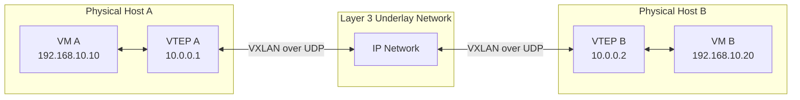
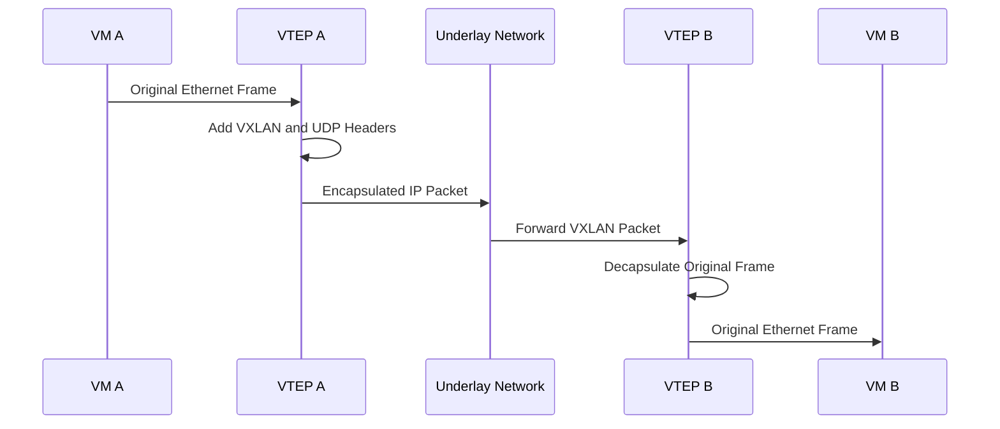

# VXLAN

**VXLAN (Virtual Extensible LAN)** is a network virtualization and tunneling technology that extends Layer 2 networks over a Layer 3 IP network.

It allows devices in different physical networks to communicate as if they were connected to the same Layer 2 network.

VXLAN is commonly used in data centers, cloud infrastructure, network virtualization, and large-scale enterprise networks.

Unlike traditional VLANs, which use a 12-bit VLAN ID, VXLAN uses a 24-bit Virtual Network Identifier (VNI). This provides approximately 16 million logical network segments.

# 🗁 Why VXLAN Is Used

Traditional VLANs have limitations when building large virtualized networks.

VXLAN addresses these limitations by creating Layer 2 overlays over Layer 3 infrastructure.

Common use cases include:

* Extending Layer 2 networks across Layer 3 networks.
* Connecting virtual machines across different physical hosts.
* Building scalable data center networks.
* Supporting multi-tenant cloud environments.
* Creating network overlays in virtualized infrastructure.
* Separating tenant networks without requiring separate physical networks.
* Connecting workloads across different data center locations.

# 🗁 VXLAN Architecture

VXLAN uses an overlay network built on top of an existing Layer 3 underlay network.

The architecture has two main components:

**Underlay Network**

The physical IP network responsible for transporting VXLAN packets between tunnel endpoints.

It provides IP connectivity between VXLAN tunnel endpoints.

**Overlay Network**

The logical network created by VXLAN.

It allows devices to communicate across the underlying IP infrastructure as if they were connected to the same Layer 2 network.

VXLAN uses Virtual Tunnel Endpoints (VTEPs) to encapsulate and decapsulate Ethernet frames.

# 🗁 VXLAN Topology

Consider two servers connected to different physical switches.

Both servers belong to the same logical VXLAN segment, even though they are connected through different Layer 3 networks.



The VTEPs encapsulate Ethernet frames into UDP packets and transport them across the underlay network.

The receiving VTEP decapsulates the packets and forwards the original Ethernet frames to the destination.

# 🗁 VXLAN Components

| Component | Description |
| --- | --- |
| VTEP | VXLAN Tunnel Endpoint responsible for encapsulation and decapsulation |
| VNI | 24-bit Virtual Network Identifier |
| Underlay | Physical Layer 3 network transporting VXLAN packets |
| Overlay | Logical network created over the underlay |
| VXLAN Header | Header containing the VNI and other control information |
| UDP | Transport protocol used to carry VXLAN packets |
| MAC Address | Identifies devices within the logical Layer 2 network |

# 🗁 Virtual Tunnel Endpoint (VTEP)

A VTEP is responsible for encapsulating and decapsulating VXLAN traffic.

Each VTEP has an IP address that is reachable through the underlay network.

When a VTEP receives an Ethernet frame that must travel to another VXLAN endpoint, it:

* Identifies the destination MAC address.
* Determines the destination VTEP.
* Adds a VXLAN header containing the appropriate VNI.
* Encapsulates the VXLAN packet inside UDP.
* Adds an outer IP header.
* Sends the packet through the underlay network.

The receiving VTEP removes the outer headers and forwards the original Ethernet frame.

# 🗁 Virtual Network Identifier (VNI)

The VNI identifies a specific VXLAN network segment.

VXLAN uses a 24-bit VNI.

\[
2^{24} = 16,777,216
\]

Therefore, VXLAN supports approximately 16 million logical network identifiers.

Example:

| Network | VLAN ID | VNI |
| --- | ---: | ---: |
| Development | 10 | 10010 |
| Production | 20 | 10020 |
| Management | 30 | 10030 |

A VLAN-to-VNI mapping can be used when extending existing VLAN-based networks into VXLAN environments.

A VNI is not the same as a VLAN ID. They are separate identifiers used by different networking mechanisms.

# 🗁 VXLAN Encapsulation

VXLAN encapsulates an original Ethernet frame inside a UDP packet.

The simplified packet structure is:

```text
+----------------------------------+
| Outer Ethernet Header            |
+----------------------------------+
| Outer IP Header                  |
+----------------------------------+
| UDP Header                       |
+----------------------------------+
| VXLAN Header                     |
+----------------------------------+
| Original Ethernet Frame          |
|                                  |
| Original Ethernet Header         |
| Original IP Header               |
| Original Transport Header        |
| Original Payload                 |
+----------------------------------+
```

The original Ethernet frame is preserved inside the VXLAN packet.

The outer headers provide the information required to transport the packet between VTEPs.

# 🗁 VXLAN Header Structure

The VXLAN header is 8 bytes long.

Its important fields include:

| Field | Size | Description |
| --- | ---: | --- |
| Flags | 8 bits | Indicates VXLAN header options |
| Reserved | 24 bits | Reserved for future use |
| VNI | 24 bits | Identifies the VXLAN network |
| Reserved | 8 bits | Reserved for future use |

The VNI identifies the logical network to which the encapsulated Ethernet frame belongs.

# 🗁 VXLAN UDP Port

VXLAN commonly uses UDP destination port `4789`.

| Protocol | Port | Purpose |
|---|---:|---|
| VXLAN | UDP `4789` | VXLAN encapsulated traffic |

Some older implementations used UDP destination port `8472`.

Modern VXLAN deployments generally use the standardized destination port `4789`.

The UDP source port is commonly selected using a hash of the inner packet to help provide ECMP load balancing across the underlay network.

# 🗁 VXLAN Packet Flow

Consider VM A communicating with VM B.

Both virtual machines belong to the same VXLAN segment.

The communication process works as follows:

* VM A sends an Ethernet frame toward VM B.
* VTEP A receives the frame.
* VTEP A identifies the destination VTEP using its forwarding information.
* VTEP A encapsulates the original Ethernet frame.
* The VXLAN packet travels through the Layer 3 underlay.
* VTEP B receives the VXLAN packet.
* VTEP B removes the outer IP, UDP, and VXLAN headers.
* VTEP B forwards the original Ethernet frame to VM B.



# 🗁 VXLAN Flooding and MAC Learning

VXLAN must determine where destination MAC addresses are located.

There are two common approaches.

**Flood and Learn**

A VTEP can flood certain unknown unicast, broadcast, and multicast traffic to other VTEPs participating in the same VXLAN segment.

Remote VTEPs learn MAC-to-VTEP associations from received traffic.

This approach can use multicast groups in the underlay or ingress replication, depending on the implementation.

**Control Plane Learning**

A control plane distributes MAC and IP reachability information between VTEPs.

BGP EVPN is commonly used for this purpose.

EVPN provides a scalable mechanism for distributing endpoint information without relying entirely on flooding.

# 🗁 VXLAN and BGP EVPN

BGP EVPN is commonly used as the control plane for VXLAN deployments.

VXLAN provides the data-plane encapsulation, while EVPN distributes information about endpoints and network reachability.

Their responsibilities are different:

| Technology | Responsibility |
| --- | --- |
| VXLAN | Encapsulates and transports Ethernet frames |
| VTEP | Encapsulates and decapsulates VXLAN traffic |
| VNI | Identifies a VXLAN network segment |
| BGP EVPN | Distributes MAC and IP reachability information |
| Underlay Routing | Provides IP connectivity between VTEPs |

This combination is widely used in modern data center fabrics.

# 🗁 VXLAN MTU Overhead

VXLAN adds headers to the original Ethernet frame.

For a typical VXLAN packet over IPv4:

| Header | Size |
| --- | ---: |
| Outer Ethernet Header | 14 bytes |
| Outer IPv4 Header | 20 bytes |
| UDP Header | 8 bytes |
| VXLAN Header | 8 bytes |
| Total Additional Overhead | 50 bytes |

The additional overhead is 50 bytes when counting the outer Ethernet header and assuming no VLAN tag or optional IP fields.

If the underlay IP MTU is `1500` bytes, the maximum inner IP packet size is typically:

\[
1500 - 20 - 8 - 8 - 14 = 1450
\]

This calculation assumes a 1500-byte underlay IP MTU, an untagged inner Ethernet frame, and standard IPv4 and VXLAN headers.

In practice, VXLAN deployments commonly configure a larger underlay MTU, such as `9000` bytes, to accommodate encapsulation overhead and preserve a 1500-byte inner IP MTU.

The exact required MTU depends on the encapsulation and network design.

# 🗁 VXLAN vs VLAN

| Feature | VLAN | VXLAN |
| --- | --- | --- |
| Networking layer | Layer 2 segmentation | Layer 2 overlay over Layer 3 |
| Identifier | 12-bit VLAN ID | 24-bit VNI |
| Segment capacity | 4094 commonly usable VLAN IDs | Approximately 16 million VNIs |
| Encapsulation | 802.1Q tagging | UDP-based encapsulation |
| Transport | Ethernet networks | IP networks |
| Scalability | Limited by VLAN ID space and topology | Designed for large overlay environments |
| Typical use | Campus and enterprise LANs | Data centers and cloud networks |

# 🗁 VXLAN vs GRE

| Feature | VXLAN | GRE |
| --- | --- | --- |
| Primary purpose | Layer 2 network overlay | General-purpose network encapsulation |
| Encapsulated traffic | Ethernet frames | Multiple network-layer protocols |
| Transport | UDP | IP protocol `47` |
| Standard UDP port | `4789` | Not applicable |
| Network identifier | 24-bit VNI | No standard VNI equivalent |
| Layer 2 extension | Native functionality | Depends on implementation and configuration |
| Multicast | Supported through VXLAN mechanisms | Can carry multicast packets |
| Encryption | Not built in | Not built in |

# 🗁 VXLAN vs Traditional VPN

VXLAN and VPN technologies solve different networking problems.

| Feature | VXLAN | IPsec VPN | WireGuard |
| --- | --- | --- | --- |
| Primary purpose | Network virtualization | Secure IP communication | Secure IP tunneling |
| Layer 2 extension | Yes | Depends on design | No native Layer 2 extension |
| Encryption | No | Yes | Yes |
| Authentication | Not provided by VXLAN itself | Supported | Public-key based |
| Network identifier | 24-bit VNI | Security associations and policies | Peer and interface configuration |
| Common use | Data centers and cloud networks | Site-to-site and remote access | Secure site-to-site and remote access |

VXLAN is not a replacement for encryption technologies.

It can be combined with IPsec or other security mechanisms when traffic protection is required.

# 🗁 Linux VXLAN Configuration

Linux supports VXLAN interfaces through the `iproute2` networking tools.

Consider two Linux hosts:

| Component | Host A | Host B |
| --- | --- | --- |
| Underlay IP | `10.0.0.1` | `10.0.0.2` |
| VXLAN VNI | `100` | `100` |
| VXLAN Interface | `vxlan100` | `vxlan100` |
| Bridge | `br0` | `br0` |

The following example uses static remote VTEP configuration and a Linux bridge.

**Configure Host A**

Create a VXLAN interface:

```bash
sudo ip link add vxlan100 type vxlan \
    id 100 \
    local 10.0.0.1 \
    remote 10.0.0.2 \
    dstport 4789
```

Create a bridge:

```bash
sudo ip link add br0 type bridge
```

Bring up the bridge and VXLAN interface:

```bash
sudo ip link set br0 up
sudo ip link set vxlan100 up
```

Attach the VXLAN interface to the bridge:

```bash
sudo ip link set vxlan100 master br0
```

**Configure Host B**

Create the VXLAN interface:

```bash
sudo ip link add vxlan100 type vxlan \
    id 100 \
    local 10.0.0.2 \
    remote 10.0.0.1 \
    dstport 4789
```

Create a bridge:

```bash
sudo ip link add br0 type bridge
```

Bring up the bridge and VXLAN interface:

```bash
sudo ip link set br0 up
sudo ip link set vxlan100 up
```

Attach the VXLAN interface to the bridge:

```bash
sudo ip link set vxlan100 master br0
```

The example establishes a basic VXLAN interface and bridge on each host. A complete deployment also requires appropriate Layer 2 endpoint attachment, IP connectivity, firewall permissions, and MTU configuration.

# 🗁 Linux VXLAN Verification

**Display VXLAN Interfaces**

```bash
ip -d link show type vxlan
```

**Display All Interfaces**

```bash
ip link show
```

**Display Bridge Information**

```bash
bridge link show
```

**Display Bridge Forwarding Database**

```bash
bridge fdb show
```

**Capture VXLAN Traffic**

```bash
sudo tcpdump -ni any udp port 4789
```

**Check Underlay Connectivity**

```bash
ping 10.0.0.2
```

# 🗁 VXLAN Security Considerations

VXLAN provides network encapsulation, not encryption or authentication.

Security best practices include:

* Restrict UDP destination port `4789` to authorized VTEP addresses.
* Use network segmentation between tenants.
* Apply firewall rules to control underlay traffic.
* Protect the control plane, including BGP EVPN sessions.
* Prevent unauthorized VTEPs from joining overlay networks.
* Use IPsec or another suitable security mechanism when encryption is required.
* Monitor VTEP activity and unexpected MAC address changes.
* Apply anti-spoofing and access-control policies.

# 🗁 Common VXLAN Problems

| Problem | Possible Cause | Troubleshooting |
| --- | --- | --- |
| VTEPs cannot communicate | Underlay connectivity failure | Verify IP reachability between VTEPs |
| VXLAN packets are blocked | Firewall blocks UDP `4789` | Permit VXLAN traffic between authorized VTEPs |
| Hosts cannot communicate | Incorrect VNI configuration | Verify matching VNI values |
| Remote MAC addresses are missing | MAC learning or control-plane issue | Inspect forwarding database and EVPN routes |
| Broadcast traffic fails | Flooding or replication issue | Verify multicast or ingress replication |
| Large packets fail | Insufficient MTU | Increase underlay MTU or adjust inner MTU |
| VXLAN interface is down | Incorrect interface configuration | Inspect interface details |
| Intermittent connectivity | Underlay packet loss or ECMP issue | Check routing, packet loss, and VTEP reachability |
| EVPN routes are missing | BGP configuration problem | Verify BGP sessions and EVPN address family |

# 🗁 VXLAN Advantages and Limitations

**Advantages**

* Supports approximately 16 million logical network segments.
* Extends Layer 2 networks across Layer 3 infrastructure.
* Supports large-scale data center networks.
* Enables multi-tenant network segmentation.
* Supports virtualized workloads across different physical hosts.
* Works with BGP EVPN for scalable control-plane learning.
* Can use existing IP routing infrastructure as its underlay.

**Limitations**

* Adds encapsulation overhead.
* Requires sufficient underlay MTU.
* Does not provide built-in encryption.
* Requires VTEP configuration and reachability.
* Flooding and multicast replication can increase network complexity.
* BGP EVPN introduces additional control-plane configuration.
* Troubleshooting can be more complex than traditional VLAN networking.

# 🗁 Key Takeaways

* VXLAN stands for Virtual Extensible LAN.
* VXLAN extends Layer 2 networks over Layer 3 IP infrastructure.
* VXLAN uses VTEPs to encapsulate and decapsulate Ethernet frames.
* VXLAN uses a 24-bit VNI to identify logical network segments.
* VXLAN supports approximately 16 million VNIs.
* VXLAN commonly uses UDP destination port `4789`.
* VXLAN is an overlay technology, while the underlay provides IP connectivity.
* BGP EVPN is commonly used as the VXLAN control plane.
* VXLAN adds packet overhead and requires appropriate MTU planning.
* VXLAN does not provide encryption or authentication by itself.
* VXLAN is widely used in modern data centers and cloud networking.
