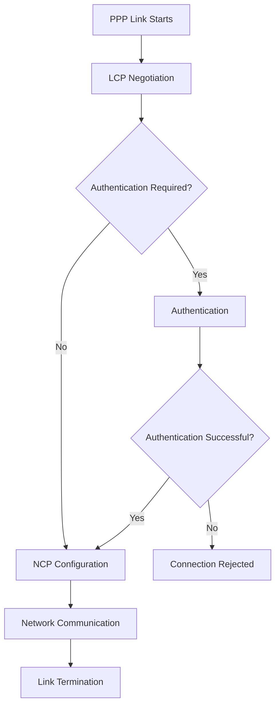
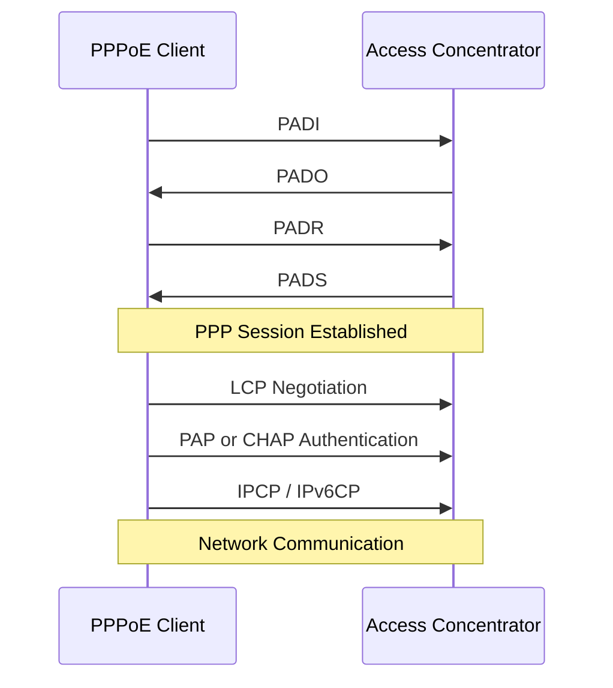

# PPP and Tunneling

**PPP (Point-to-Point Protocol)** is a data-link layer protocol used to establish direct communication between two network endpoints.

PPP provides a standard method for transporting network-layer protocols over point-to-point connections. It supports link configuration, authentication, and network-layer configuration.

PPP is widely used in technologies such as PPPoE, PPTP, L2TP, and serial WAN connections.

Tunneling technologies use encapsulation to transport network traffic through another network. PPP can operate inside tunnels to provide point-to-point connectivity between remote endpoints.

# 🗁 What Is PPP?

PPP stands for Point-to-Point Protocol.

It is defined in RFC 1661 and operates at the Data Link Layer (Layer 2) of the OSI model.

PPP establishes a logical connection between two directly connected endpoints.

Common PPP capabilities include:

* Encapsulation of network-layer packets.
* Link establishment and configuration.
* Authentication using supported authentication protocols.
* Network-layer configuration.
* Link monitoring and termination.
* Error detection using a Frame Check Sequence (FCS).

PPP can carry multiple network-layer protocols, including IPv4 and IPv6.

# 🗁 PPP Architecture

PPP uses several components to establish and manage a connection.

| Component | Purpose |
| --- | --- |
| HDLC-like framing | Encapsulates packets into PPP frames |
| LCP | Establishes, configures, and terminates the PPP link |
| Authentication | Authenticates the remote endpoint when configured |
| NCP | Configures network-layer protocols |
| FCS | Detects transmission errors |

PPP separates link establishment from network-layer configuration.

This makes it possible to establish a connection first and then configure the protocols that will use it.

# 🗁 PPP Frame Structure

PPP uses a frame format based on HDLC-like framing.

A simplified PPP frame contains:

```text
+-----------------------------+
| Flag                        |
+-----------------------------+
| Address                     |
+-----------------------------+
| Control                     |
+-----------------------------+
| Protocol                    |
+-----------------------------+
| Information                 |
+-----------------------------+
| FCS                         |
+-----------------------------+
| Flag                        |
+-----------------------------+
```

| Field | Purpose |
| --- | --- |
| Flag | Marks the beginning and end of a frame |
| Address | Identifies the address field |
| Control | Provides control information |
| Protocol | Identifies the encapsulated protocol |
| Information | Contains the payload |
| FCS | Detects frame transmission errors |

PPP commonly uses the flag value `0x7E` to delimit frames.

# 🗁 PPP Link Establishment

PPP uses the Link Control Protocol (LCP) to establish and manage a connection.

The general connection process is:

* Link establishment begins.
* LCP negotiates link parameters.
* Authentication takes place if configured.
* Network Control Protocols configure network-layer protocols.
* Network communication begins.
* LCP terminates the connection when required.



# 🗁 Link Control Protocol (LCP)

LCP is responsible for establishing, configuring, testing, and terminating PPP connections.

It negotiates parameters such as:

* Maximum Receive Unit (MRU).
* Authentication protocol.
* Link quality monitoring options.
* Compression options.
* Magic numbers used for loop detection.

LCP ensures that both endpoints agree on the parameters required to establish the PPP link.

# 🗁 Authentication Protocols

PPP supports authentication protocols to verify the identity of a remote endpoint.

Common authentication methods include:

**PAP (Password Authentication Protocol)**

PAP authenticates a peer using a username and password.

The credentials are transmitted without encryption at the PPP authentication layer.

**CHAP (Challenge Handshake Authentication Protocol)**

CHAP uses a challenge-response mechanism.

The authenticator sends a challenge, and the remote endpoint calculates a response using a shared secret.

CHAP avoids transmitting the shared password directly during the authentication exchange.

| Feature | PAP | CHAP |
| --- | --- | --- |
| Authentication method | Username and password | Challenge-response |
| Password transmitted directly | Yes | No |
| Encryption | No | No |
| Challenge mechanism | No | Yes |
| Security | Weaker | Stronger than PAP |
| Typical use | Legacy compatibility | PPP authentication |

CHAP is generally preferable to PAP when choosing between these two legacy PPP authentication methods. Neither should be treated as a replacement for modern encrypted transport.

# 🗁 Network Control Protocol (NCP)

NCP is responsible for configuring network-layer protocols over a PPP connection.

Different NCPs support different network-layer protocols.

| NCP | Purpose |
| --- | --- |
| IPCP | Configures IPv4 over PPP |
| IPv6CP | Configures IPv6 interface parameters over PPP |

For example, IPCP can negotiate IPv4 addressing information between PPP endpoints.

NCP operates after the LCP link establishment phase.

# 🗁 What Is Tunneling?

Tunneling is a networking technique that encapsulates one protocol inside another protocol to transport traffic through an intermediate network.

It allows packets to travel across networks that do not directly support the original communication mechanism.

A tunnel generally has:

* A tunnel source endpoint.
* A tunnel destination endpoint.
* An encapsulation protocol.
* An inner packet.
* An outer transport packet.

```text
+----------------------------------+
| Outer Network Header             |
+----------------------------------+
| Tunnel Header                    |
+----------------------------------+
| Original Encapsulated Packet     |
+----------------------------------+
```

Tunneling is commonly used for:

* Connecting remote networks.
* Remote access VPNs.
* Carrying private traffic over public networks.
* Extending Layer 2 networks.
* Transporting IPv6 over IPv4 networks.
* Building network overlays.

# 🗁 PPP-Based Tunneling Technologies

Several tunneling technologies use PPP to provide point-to-point network connectivity.

| Technology | Full Name | Description |
| --- | --- | --- |
| PPPoE | PPP over Ethernet | Carries PPP frames over Ethernet |
| PPTP | Point-to-Point Tunneling Protocol | Carries PPP through a GRE-based tunnel |
| L2TP | Layer 2 Tunneling Protocol | Tunnels PPP sessions over an IP network |
| SSTP | Secure Socket Tunneling Protocol | Carries PPP traffic over a TLS-protected connection |

These technologies have different encapsulation methods, security properties, and deployment requirements.

# 🗁 PPPoE (PPP over Ethernet)

PPPoE allows PPP sessions to operate over Ethernet networks.

It is commonly used by Internet Service Providers (ISPs) to authenticate subscribers and manage individual broadband connections.

PPPoE combines PPP functionality with Ethernet transport.

Common use cases include:

* ISP broadband access.
* Subscriber authentication.
* Dynamic IP address assignment.
* Per-subscriber session management.
* Integration with RADIUS authentication and accounting.

**PPPoE Discovery and Session Stages**

PPPoE establishes a session through two main stages.

**Discovery Stage**

The client discovers an available access concentrator and establishes a PPPoE session.

The discovery process uses four message types:

| Message | Purpose |
| --- | --- |
| PADI | PPPoE Active Discovery Initiation |
| PADO | PPPoE Active Discovery Offer |
| PADR | PPPoE Active Discovery Request |
| PADS | PPPoE Active Discovery Session-confirmation |

**Session Stage**

After discovery, PPP communication begins inside the PPPoE session.

PPP handles authentication, link configuration, and network-layer configuration.



**PPPoE EtherTypes**

| EtherType | Purpose |
| --- | --- |
| `0x8863` | PPPoE Discovery |
| `0x8864` | PPPoE Session |

**PPPoE MTU**

Standard Ethernet commonly supports an MTU of 1500 bytes.

PPPoE adds 8 bytes of overhead:

* PPPoE header: 6 bytes.
* PPP Protocol ID: 2 bytes.

Therefore:

\[
1500 - 8 = 1492
\]

The typical PPPoE IP MTU is `1492` bytes when using a standard 1500-byte Ethernet payload.

# 🗁 PPTP (Point-to-Point Tunneling Protocol)

PPTP is a legacy VPN tunneling protocol that carries PPP traffic through an IP network.

It was historically used for remote-access VPN connections.

PPTP uses:

* TCP port `1723` for control connections.
* GRE IP protocol `47` for tunneled data.

PPTP separates control communication from the GRE data channel.

**PPTP Architecture**

```text
+-----------------------------+
| Original Network Packet     |
+-----------------------------+
| PPP Header                  |
+-----------------------------+
| GRE Encapsulation           |
+-----------------------------+
| Outer IP Header             |
+-----------------------------+
```

PPTP is considered obsolete for modern secure VPN deployments because its historical authentication and encryption mechanisms have significant security weaknesses.

Modern alternatives include WireGuard, OpenVPN, and IPsec.

# 🗁 L2TP (Layer 2 Tunneling Protocol)

L2TP is a tunneling protocol used to transport Layer 2 sessions across an IP network.

It is commonly used to tunnel PPP sessions between two endpoints.

L2TP itself does not provide encryption or confidentiality.

L2TP over IP commonly uses UDP port `1701`.

**L2TP Architecture**

```text
+-----------------------------+
| Original Network Packet     |
+-----------------------------+
| PPP Frame                   |
+-----------------------------+
| L2TP Header                 |
+-----------------------------+
| UDP Header                  |
+-----------------------------+
| Outer IP Header             |
+-----------------------------+
```

L2TP is frequently combined with IPsec to provide encryption and authentication.

**L2TP/IPsec**

In an L2TP/IPsec deployment:

* L2TP transports the PPP session.
* IPsec protects the tunnel traffic.
* IKE negotiates IPsec security associations.
* NAT Traversal can use UDP port `4500`.

Common IPsec-related ports and protocols include:

| Protocol | Port or Number | Purpose |
| --- | --- | --- |
| IKE | UDP `500` | Security association negotiation |
| NAT-T | UDP `4500` | IPsec traffic through NAT |
| ESP | IP protocol `50` | Protected IPsec traffic |
| L2TP | UDP `1701` | L2TP tunnel traffic |

# 🗁 SSTP (Secure Socket Tunneling Protocol)

SSTP is a VPN tunneling protocol that carries PPP traffic over a TLS-protected connection.

It commonly uses TCP port `443`.

SSTP is designed to operate through networks that permit HTTPS traffic.

Its main characteristics include:

* PPP-based point-to-point connectivity.
* TLS-protected transport.
* Certificate-based server authentication.
* TCP-based communication.
* Compatibility with certain restrictive firewall environments.

SSTP is commonly associated with Microsoft Windows VPN environments.

Although SSTP uses TCP port `443`, it is not ordinary HTTPS application traffic.

# 🗁 PPP vs PPPoE vs PPTP vs L2TP

| Feature | PPP | PPPoE | PPTP | L2TP |
| --- | --- | --- | --- | --- |
| Main purpose | Point-to-point communication | PPP over Ethernet | PPP tunneling | Layer 2 tunneling |
| Encapsulation | PPP framing | Ethernet + PPP | GRE + PPP | UDP + L2TP + PPP |
| Transport | Point-to-point link | Ethernet | IP | Commonly IP/UDP |
| Authentication | PAP/CHAP and others | PPP authentication | PPP authentication | PPP authentication |
| Encryption | No built-in encryption | No built-in encryption | Legacy mechanisms | No built-in encryption |
| Typical use | WAN links | ISP broadband | Legacy VPN | VPN and Layer 2 tunneling |

# 🗁 PPP and Tunneling in MikroTik RouterOS v7

MikroTik RouterOS v7 supports several PPP-based services and tunneling technologies.

Common examples include:

* PPPoE client and server.
* PPTP client and server.
* L2TP client and server.
* SSTP client and server.
* PPP authentication using supported methods.
* RADIUS integration for centralized authentication.

**Configure a PPPoE Client**

Example:

```routeros
/interface pppoe-client add \
    name=pppoe-out1 \
    interface=ether1 \
    user=isp-username \
    password=isp-password \
    add-default-route=yes \
    use-peer-dns=yes \
    disabled=no
```

This creates a PPPoE client on `ether1`.

**Configure an L2TP Client**

Example:

```routeros
/interface l2tp-client add \
    name=l2tp-out1 \
    connect-to=203.0.113.20 \
    user=vpn-user \
    password=vpn-password \
    use-ipsec=yes \
    ipsec-secret=shared-secret \
    add-default-route=no \
    disabled=no
```

This example creates an L2TP client with IPsec protection enabled.

The remote endpoint must be configured to accept the corresponding L2TP/IPsec connection.

# 🗁 PPP and Tunneling Verification

Useful RouterOS v7 commands include:

**Display PPP Interfaces**

```routeros
/interface ppp print
```

**Display PPPoE Clients**

```routeros
/interface pppoe-client print detail
```

**Display L2TP Interfaces**

```routeros
/interface l2tp-client print detail
```

**Display Active PPP Sessions**

```routeros
/ppp active print detail
```

**Display PPP Secrets**

```routeros
/ppp secret print
```

**Display IP Addresses**

```routeros
/ip address print
```

**Display Routes**

```routeros
/ip route print
```

For Linux systems, useful inspection commands include:

```bash
ip addr
ip route
ip link
```

The exact commands depend on the PPP implementation and tunneling technology being used.

# 🗁 Common PPP and Tunneling Problems

| Problem | Possible Cause | Troubleshooting |
| --- | --- | --- |
| PPP session does not establish | Physical or logical link failure | Check the underlying interface and connectivity |
| Authentication fails | Incorrect username or password | Verify credentials and authentication methods |
| PPPoE discovery fails | Access concentrator unavailable | Check Ethernet connectivity and PPPoE discovery traffic |
| PPPoE session disconnects | ISP or access concentrator issue | Check session logs and link stability |
| L2TP connection fails | Incorrect endpoint or firewall configuration | Verify UDP `1701` and IPsec requirements |
| PPTP connection fails | TCP `1723` or GRE blocked | Check control and GRE data traffic |
| SSTP connection fails | TLS or certificate problem | Verify certificates, hostname, and TCP `443` |
| Tunnel connects but traffic fails | Missing routes or forwarding rules | Inspect routing and firewall configuration |
| IPv4 works but IPv6 fails | IPv6CP or IPv6 routing issue | Verify IPv6 configuration |
| Large packets fail | MTU or fragmentation problem | Check encapsulation overhead and MTU |

# 🗁 Security Considerations

Different PPP-based tunneling technologies provide different levels of security.

Important considerations include:

* Avoid PPTP for new VPN deployments.
* Do not assume PPP authentication encrypts network traffic.
* Use IPsec with L2TP when deploying L2TP VPNs.
* Use trusted certificates for TLS-based tunnels.
* Protect shared secrets and credentials.
* Restrict access to authorized users and endpoints.
* Apply firewall rules to tunnel interfaces.
* Monitor authentication failures and unusual session activity.
* Prefer modern VPN technologies for new deployments.

# 🗁 Key Takeaways

* PPP stands for Point-to-Point Protocol.
* PPP operates at the Data Link Layer.
* PPP supports link establishment, authentication, and network-layer configuration.
* LCP manages PPP link establishment and termination.
* NCP configures network-layer protocols such as IPv4 and IPv6.
* PAP and CHAP are PPP authentication protocols.
* Tunneling encapsulates traffic inside another protocol for transport across a network.
* PPPoE carries PPP sessions over Ethernet and is widely used by ISPs.
* PPTP is a legacy tunneling protocol that uses GRE for data transport.
* L2TP commonly carries PPP sessions over UDP.
* SSTP carries PPP traffic over TLS.
* L2TP does not provide encryption by itself and is commonly combined with IPsec.
* RouterOS v7 supports several PPP-based services and tunneling protocols.
