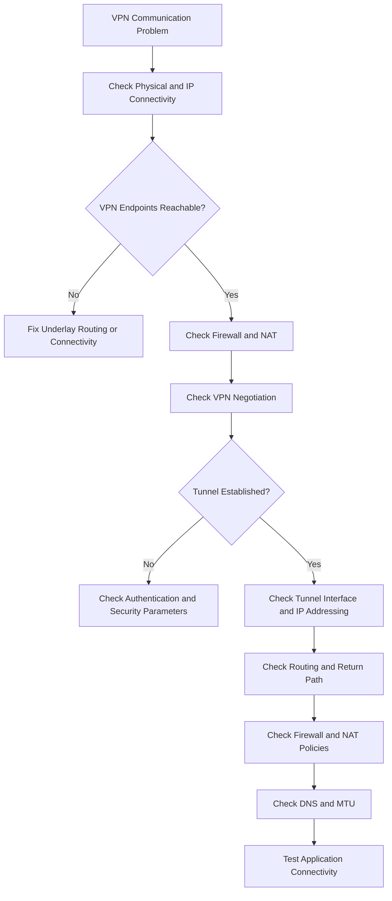

# VPN Troubleshooting

VPN troubleshooting is the process of identifying, diagnosing, and resolving problems that prevent secure tunnels from establishing or carrying network traffic correctly.

VPN connectivity depends on several components, including endpoint reachability, authentication, encryption, routing, firewall rules, and tunnel configuration.

A VPN may appear connected while application traffic still fails because of incorrect routes, DNS configuration, MTU problems, or firewall policies.

A systematic troubleshooting process helps isolate the actual cause instead of changing multiple configurations without understanding the problem.

# 🗁 Common VPN Problems

VPN problems can occur at different stages of tunnel establishment and operation.

Common symptoms include:

* VPN connection cannot be established.
* Authentication fails.
* Tunnel connects but no traffic passes.
* Only one direction of communication works.
* Remote networks are unreachable.
* DNS resolution fails through the VPN.
* Connection disconnects intermittently.
* Large packets fail while small packets work.
* VPN performance is slow.
* Dynamic routing does not exchange routes.
* IPsec security associations fail to establish.

# 🗁 VPN Troubleshooting Layers

VPN troubleshooting should follow the communication path from the underlying network to the application.

| Layer or Component | What to Check |
| --- | --- |
| Physical connectivity | Interface status, cable, and link state |
| Underlay network | IP reachability between VPN endpoints |
| Firewall and NAT | Required protocols, ports, and NAT behavior |
| VPN negotiation | IKE, TLS, or protocol negotiation |
| Authentication | Credentials, certificates, and keys |
| Encryption | Algorithms, proposals, and security parameters |
| Tunnel interface | Interface state and tunnel addressing |
| Routing | Routes to remote networks and return paths |
| Firewall forwarding | Traffic policies between LAN and VPN |
| DNS | DNS server reachability and resolution |
| MTU | Encapsulation overhead and packet fragmentation |
| Applications | Service availability and application-level filtering |

# 🗁 General VPN Troubleshooting Workflow

Use a consistent troubleshooting sequence.



The objective is to identify the first stage where communication fails.

# 🗁 Check VPN Endpoint Connectivity

Before troubleshooting the VPN protocol itself, verify that both endpoints can communicate through the underlying network.

Example:

```text
VPN Gateway A: 198.51.100.10
VPN Gateway B: 203.0.113.20
```

Check the local interface:

```bash
ip addr
```

Check the routing table:

```bash
ip route
```

Check the route toward the remote endpoint:

```bash
ip route get 203.0.113.20
```

Test reachability:

```bash
ping 203.0.113.20
```

A failed ping does not necessarily mean the VPN endpoint is unreachable because ICMP may be blocked.

Check the actual required VPN protocols and ports using packet captures and firewall counters.

# 🗁 Check Firewall and NAT

Firewalls may block the protocols required to establish a VPN connection.

The required rules depend on the VPN technology.

| VPN Technology | Protocol or Port | Purpose |
| --- | --- | --- |
| IPsec IKE | UDP `500` | IKE negotiation |
| IPsec NAT-T | UDP `4500` | IPsec through NAT |
| IPsec ESP | IP protocol `50` | Encrypted IPsec traffic |
| IPsec AH | IP protocol `51` | Authentication Header traffic |
| WireGuard | Configured UDP port | Encrypted WireGuard traffic |
| OpenVPN | Configured UDP or TCP port | OpenVPN communication |
| GRE | IP protocol `47` | GRE encapsulation |
| L2TP | UDP `1701` | L2TP communication |
| PPTP | TCP `1723` and GRE `47` | Control and data traffic |
| SSTP | TCP `443` | TLS-based tunnel |
| VXLAN | UDP `4789` | VXLAN encapsulation |

Important distinctions:

* ESP and AH are IP protocol numbers, not TCP or UDP ports.
* GRE is IP protocol number `47`, not TCP or UDP port `47`.
* WireGuard and OpenVPN ports depend on their configuration.
* L2TP commonly requires IPsec-related traffic when deployed as L2TP/IPsec.
* PPTP requires both its TCP control connection and GRE data traffic.

NAT devices may also interfere with VPN traffic.

For IPsec, NAT Traversal commonly encapsulates ESP traffic inside UDP `4500`.

# 🗁 IPsec Troubleshooting

IPsec VPNs use IKE to negotiate security associations and establish protected communication.

Troubleshooting should distinguish between IKE negotiation problems and IPsec data-plane problems.

**Check IKE Negotiation**

Verify:

* Local and remote peer addresses.
* IKE version.
* Pre-shared keys or certificates.
* Encryption algorithms.
* Integrity algorithms.
* Diffie-Hellman groups.
* Authentication methods.
* IKE lifetime and proposal compatibility.

**Check IPsec Security Associations**

Verify:

* Phase 1 or IKE security association.
* Phase 2 or Child SA.
* Traffic selectors.
* ESP encryption and integrity parameters.
* Security association lifetime.
* Packet counters.

**Common IPsec Problems**

| Problem | Possible Cause |
| --- | --- |
| IKE negotiation fails | Incorrect peer address or proposal |
| Authentication fails | Incorrect pre-shared key or certificate |
| Phase 1 succeeds but Phase 2 fails | Traffic selector or IPsec proposal mismatch |
| Tunnel establishes but traffic fails | Routing or firewall issue |
| NAT-T does not work | UDP `4500` blocked or NAT configuration problem |
| Only one direction works | Asymmetric routing or policy mismatch |
| Rekeying fails | Lifetime or proposal incompatibility |

**Linux IPsec Inspection**

For systems using strongSwan:

```bash
sudo ipsec statusall
```

Check service status:

```bash
sudo systemctl status strongswan
```

Depending on the installed strongSwan version and distribution, the service may be named `strongswan-starter` or use another unit name.

Inspect kernel XFRM state:

```bash
ip xfrm state
```

Inspect IPsec policies:

```bash
ip xfrm policy
```

# 🗁 WireGuard Troubleshooting

WireGuard uses public-key cryptography and UDP transport.

A WireGuard tunnel can fail because of incorrect peer configuration, unreachable endpoints, or missing routes.

**Check Interface Status**

```bash
sudo wg show
```

**Check Interface Addresses**

```bash
ip addr show wg0
```

**Check Routing Table**

```bash
ip route
```

**Check WireGuard Configuration**

```bash
sudo wg showconf wg0
```

**Common WireGuard Problems**

| Problem | Possible Cause | Troubleshooting |
| --- | --- | --- |
| No handshake | Incorrect keys or unreachable endpoint | Verify public keys and endpoint reachability |
| Handshake works but traffic fails | Incorrect AllowedIPs or routes | Verify peer prefixes and routing |
| One-way communication | Firewall or return-route issue | Check both directions |
| Connection stops after NAT timeout | NAT mapping expires | Configure persistent keepalive where appropriate |
| Remote LAN unreachable | Missing forwarding or route | Check IP forwarding and LAN routes |
| DNS fails | Incorrect DNS configuration | Verify DNS server reachability |
| Packets disappear | MTU or firewall issue | Inspect packet captures and MTU |

**Check the Latest Handshake**

```bash
sudo wg show
```

Look for:

* Peer public key.
* Endpoint address.
* Allowed IP addresses.
* Latest handshake.
* Transfer received.
* Transfer sent.

A recent handshake confirms that the peers have successfully exchanged WireGuard handshake messages. It does not guarantee that application traffic is routed correctly.

# 🗁 OpenVPN Troubleshooting

OpenVPN uses TLS-based authentication and configurable UDP or TCP transport.

Problems may occur during certificate verification, TLS negotiation, authentication, or routing.

**Check OpenVPN Service**

```bash
sudo systemctl status openvpn-server@server
```

The exact service name depends on the installation and configuration.

**Inspect Logs**

```bash
sudo journalctl -u openvpn-server@server
```

**Check OpenVPN Interfaces**

```bash
ip addr
```

**Check Routing Table**

```bash
ip route
```

**Common OpenVPN Problems**

| Problem | Possible Cause | Troubleshooting |
| --- | --- | --- |
| TLS handshake fails | Certificate or connectivity problem | Verify certificates, time, and endpoint |
| Authentication fails | Incorrect credentials | Check username and password |
| Certificate verification fails | Expired or untrusted certificate | Verify certificate chain and validity |
| Client connects but cannot access LAN | Missing route or forwarding | Check pushed routes and server forwarding |
| Full tunnel breaks internet access | Missing NAT or default route | Check server routing and NAT |
| DNS resolution fails | Incorrect DNS push configuration | Verify DNS server and client settings |
| Connection repeatedly disconnects | Network instability or timeout | Inspect logs and transport connectivity |

Certificate validity and system clock synchronization are particularly important for TLS-based VPNs.

# 🗁 GRE Troubleshooting

GRE provides encapsulation using IP protocol number `47`.

It does not use TCP or UDP ports.

**Check Tunnel Interface**

```bash
ip -d link show
```

**Check GRE Configuration**

```bash
ip tunnel show
```

**Capture GRE Traffic**

```bash
sudo tcpdump -ni any ip proto 47
```

**Common GRE Problems**

| Problem | Possible Cause | Troubleshooting |
| --- | --- | --- |
| Tunnel does not establish | Incorrect tunnel endpoints | Verify local and remote addresses |
| GRE packets do not arrive | Firewall blocks protocol `47` | Allow GRE traffic |
| Tunnel works but LAN traffic fails | Missing routes | Verify routes in both directions |
| Dynamic routing does not work | Multicast or routing configuration issue | Check routing protocol support and filtering |
| Large packets fail | GRE encapsulation overhead | Adjust MTU and MSS |
| GRE over IPsec fails | Incorrect IPsec protection or selectors | Inspect IPsec security associations and policies |

# 🗁 PPPoE and L2TP Troubleshooting

PPP-based tunnels may fail during link establishment, authentication, or network-layer configuration.

**Common PPPoE Problems**

| Problem | Possible Cause | Troubleshooting |
| --- | --- | --- |
| No PADO response | Access concentrator unavailable | Check Ethernet connectivity and discovery traffic |
| Authentication failure | Incorrect credentials | Verify username and password |
| Session disconnects | ISP or link instability | Check logs and session stability |
| No IP address | IPCP negotiation failure | Inspect PPP negotiation |
| Slow or broken large transfers | MTU issue | Verify PPPoE MTU and MSS |

**Common L2TP Problems**

| Problem | Possible Cause | Troubleshooting |
| --- | --- | --- |
| L2TP session fails | UDP `1701` blocked | Check firewall rules |
| IPsec negotiation fails | Incorrect shared secret or proposals | Verify IKE and IPsec configuration |
| Tunnel connects but no traffic passes | Routing or forwarding issue | Check routes and firewall policies |
| NAT traversal fails | UDP `4500` blocked | Verify NAT-T connectivity |
| Authentication fails | Incorrect PPP credentials | Verify user authentication settings |

# 🗁 Routing and Forwarding Troubleshooting

A successfully established VPN does not automatically guarantee that remote network traffic will reach its destination.

Both VPN endpoints must have appropriate routes.

Example topology:

| Network | Address |
| --- | --- |
| Head Office LAN | `192.168.10.0/24` |
| Branch Office LAN | `192.168.20.0/24` |
| VPN Tunnel | `10.10.10.0/30` |

Router A must have a route to the Branch Office LAN.

```text
192.168.20.0/24 via VPN tunnel
```

Router B must have a route to the Head Office LAN.

```text
192.168.10.0/24 via VPN tunnel
```

Check routes:

```bash
ip route
```

Check the selected route:

```bash
ip route get 192.168.20.10
```

Check forwarding:

```bash
sysctl net.ipv4.ip_forward
```

Enable IPv4 forwarding temporarily:

```bash
sudo sysctl -w net.ipv4.ip_forward=1
```

For persistent configuration, configure the appropriate system networking settings.

Important routing considerations:

* Verify routes in both directions.
* Check for overlapping private IP address ranges.
* Avoid recursive routes that send tunnel endpoint traffic through the tunnel itself.
* Verify the default route and policy-based routing rules.
* Check for asymmetric routing.
* Ensure firewall policies permit forwarded traffic.

# 🗁 Firewall Forwarding Troubleshooting

VPN traffic may reach the gateway successfully but still be blocked when forwarded between network interfaces.

Inspect firewall rules on Linux:

```bash
sudo nft list ruleset
```

For systems using iptables:

```bash
sudo iptables -L -n -v
```

Check:

* Input rules for VPN negotiation traffic.
* Forward rules between LAN and VPN interfaces.
* Output rules for locally generated traffic.
* Connection tracking behavior.
* NAT rules.
* Firewall counters and dropped packets.

A firewall policy must allow the intended traffic without unnecessarily exposing internal networks.

# 🗁 DNS Troubleshooting

DNS problems often appear after a VPN tunnel is established.

A client may successfully reach remote IP addresses but fail to access services using hostnames.

Common causes include:

* Incorrect DNS server configuration.
* Missing DNS routes.
* DNS traffic blocked by firewall rules.
* Split DNS configuration problems.
* Incorrect search domains.
* DNS server not reachable through the tunnel.

Test DNS resolution:

```bash
dig example.com
```

Test a specific DNS server:

```bash
dig @192.168.20.53 example.com
```

Check the resolver configuration:

```bash
resolvectl status
```

Test basic connectivity to the DNS server:

```bash
ping 192.168.20.53
```

The DNS server must be reachable through the appropriate VPN route and firewall policy.

# 🗁 MTU and Fragmentation Troubleshooting

VPN encapsulation increases packet size by adding additional headers.

Different VPN technologies introduce different amounts of overhead.

If the resulting packet exceeds the path MTU, packets may be fragmented or dropped.

Typical symptoms include:

* Small packets succeed while large packets fail.
* SSH connects but large transfers stall.
* Websites partially load.
* File uploads fail.
* Applications experience intermittent timeouts.

**Check Interface MTU**

```bash
ip link show
```

**Test Path MTU**

On Linux:

```bash
tracepath 192.168.20.10
```

For IPv4, test a packet with the Don't Fragment flag:

```bash
ping -M do -s 1400 192.168.20.10
```

The `-s` value represents the ICMP payload size, not the complete IP packet size.

For IPv4, the total packet size also includes the IP and ICMP headers.

**Possible Solutions**

* Configure a suitable tunnel MTU.
* Use TCP MSS clamping where necessary.
* Ensure Path MTU Discovery works.
* Avoid blocking required ICMP messages.
* Account for all encapsulation layers.
* Verify the MTU across the complete path.

# 🗁 VPN Packet Capture

Packet capture helps identify whether traffic is reaching the VPN endpoint and where communication stops.

**Capture IPsec IKE Traffic**

```bash
sudo tcpdump -ni any 'udp port 500 or udp port 4500'
```

**Capture GRE Traffic**

```bash
sudo tcpdump -ni any 'ip proto 47'
```

**Capture WireGuard Traffic**

Replace `51820` with the configured WireGuard UDP port:

```bash
sudo tcpdump -ni any 'udp port 51820'
```

**Capture OpenVPN Traffic**

Replace `1194` with the configured OpenVPN port:

```bash
sudo tcpdump -ni any 'udp port 1194'
```

**Capture L2TP Traffic**

```bash
sudo tcpdump -ni any 'udp port 1701'
```

**Capture All Traffic Between VPN Endpoints**

```bash
sudo tcpdump -ni any 'host 203.0.113.20'
```

Packet captures can help determine whether packets are transmitted, received, or dropped.

Encrypted VPN payloads generally cannot be interpreted as ordinary application traffic without the appropriate decryption information.

# 🗁 MikroTik RouterOS v7 VPN Troubleshooting

MikroTik RouterOS v7 provides several tools for diagnosing VPN problems.

**Check Active Interfaces**

```routeros
/interface print
```

**Check IP Addresses**

```routeros
/ip address print
```

**Check Routing Table**

```routeros
/ip route print detail
```

**Check Active PPP Sessions**

```routeros
/ppp active print detail
```

**Check IPsec Active Peers**

```routeros
/ip ipsec active-peers print detail
```

**Check IPsec Installed Security Associations**

```routeros
/ip ipsec installed-sa print detail
```

**Check IPsec Policies**

```routeros
/ip ipsec policy print detail
```

**Check WireGuard Interfaces**

```routeros
/interface wireguard print detail
```

**Check WireGuard Peers**

```routeros
/interface wireguard peers print detail
```

**Check GRE Interfaces**

```routeros
/interface gre print detail
```

**Check L2TP Client Interfaces**

```routeros
/interface l2tp-client print detail
```

**Check Firewall Rules**

```routeros
/ip firewall filter print stats
```

**Check NAT Rules**

```routeros
/ip firewall nat print stats
```

**Monitor Traffic**

```routeros
/tool torch interface=ether1
```

**Inspect Logs**

```routeros
/log print
```

RouterOS log topics can also be configured to capture relevant VPN events for more detailed troubleshooting.

# 🗁 VPN Troubleshooting Checklist

Use this checklist when diagnosing a VPN connection.

* [ ] Verify physical and interface connectivity.
* [ ] Confirm endpoint IP addresses.
* [ ] Check routing to the remote VPN endpoint.
* [ ] Verify required firewall protocols and ports.
* [ ] Check NAT behavior.
* [ ] Verify VPN protocol and version compatibility.
* [ ] Check authentication credentials, keys, and certificates.
* [ ] Verify encryption and security proposals.
* [ ] Confirm that the tunnel is established.
* [ ] Check tunnel interface status and addressing.
* [ ] Verify routes to remote networks.
* [ ] Confirm return routes.
* [ ] Check IP forwarding.
* [ ] Inspect firewall forwarding policies.
* [ ] Verify DNS configuration.
* [ ] Check tunnel MTU and packet fragmentation.
* [ ] Capture packets when necessary.
* [ ] Test access to remote applications.
* [ ] Review logs and connection counters.

# 🗁 Troubleshooting Best Practices

A reliable troubleshooting process should be evidence-based.

Recommended practices:

* Change one configuration element at a time.
* Record the original configuration before making changes.
* Compare both VPN endpoints.
* Check logs before restarting services.
* Verify the underlay before investigating the overlay.
* Use packet captures to confirm actual traffic behavior.
* Check both incoming and outgoing firewall rules.
* Test connectivity at multiple levels, from tunnel IPs to application services.
* Monitor packet counters and security associations.
* Document the root cause and the final resolution.

# 🗁 Key Takeaways

* VPN troubleshooting should follow a structured diagnostic process.
* Endpoint reachability must be verified before investigating tunnel negotiation.
* Firewall and NAT rules must support the selected VPN protocol.
* Authentication and encryption parameters must match between endpoints.
* A connected tunnel does not guarantee correct routing or application connectivity.
* Return routes and forwarding rules are essential for two-way communication.
* DNS problems can occur even when IP connectivity works.
* MTU and fragmentation issues can cause intermittent application failures.
* Packet captures help identify where communication stops.
* Linux and MikroTik RouterOS provide useful tools for VPN diagnostics.
* Proper logs, monitoring, and documentation make recurring VPN problems easier to resolve.
