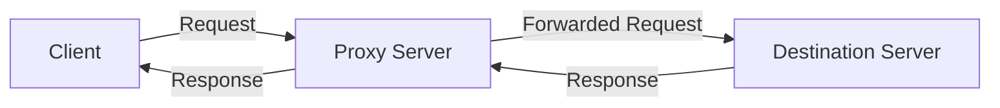
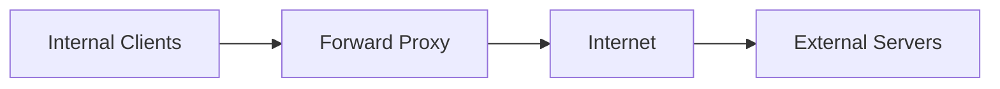
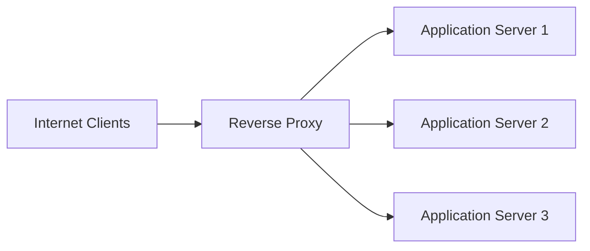
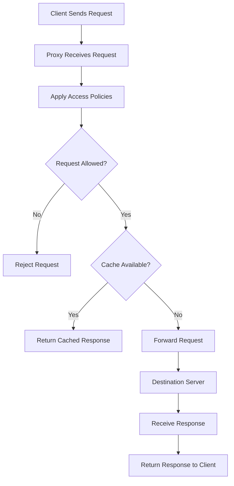
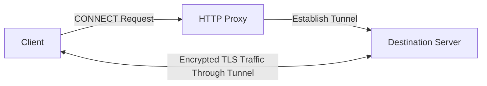
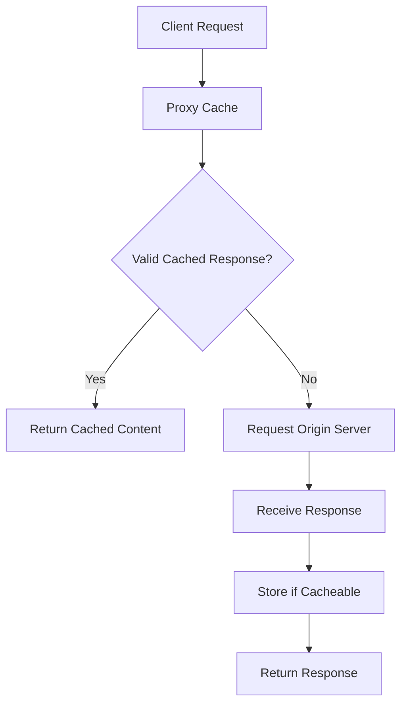
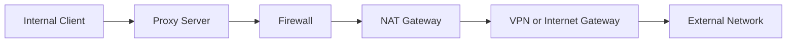

# Proxy Fundamentals

A **proxy server** is an intermediary system that receives requests from a client and forwards them to another server on the client's behalf.

Instead of communicating directly with the destination server, the client communicates through the proxy. The proxy processes the request according to its configuration and policies, then forwards it to the appropriate destination.

Proxy servers are commonly used for access control, traffic filtering, caching, privacy, monitoring, security, and application delivery.

# 🗁 How a Proxy Server Works

A proxy server sits between two communication endpoints:

* **Client:** The device or application that initiates a request.
* **Proxy server:** The intermediary that receives and processes the request.
* **Destination server:** The server that provides the requested resource.

The general communication flow is:



The proxy receives the client's request, applies configured policies, communicates with the destination server, and returns the response to the client.

Depending on the proxy type and configuration, the destination server may see the proxy's IP address rather than the original client's IP address.

# 🗁 Why Proxy Servers Are Used

Proxy servers provide several capabilities in network environments.

| Purpose | Description |
| --- | --- |
| Access control | Restricts access to specific websites, services, or resources. |
| Content filtering | Blocks requests based on domains, URLs, categories, or policies. |
| Privacy | Can hide a client's original IP address from the destination server. |
| Caching | Stores reusable responses to reduce repeated requests and bandwidth usage. |
| Logging | Records client requests, destinations, response codes, and traffic information. |
| Security | Provides an inspection and policy-enforcement point for network traffic. |
| Egress control | Centralizes and controls outbound connections from an internal network. |
| Load balancing | Distributes incoming application requests across multiple backend servers when operating as a reverse proxy. |

Not every proxy provides all these capabilities. Its behavior depends on the proxy software, deployment architecture, and configuration.

# 🗁 Proxy Architecture Types

Proxy servers can operate in different positions within a network.

**Forward Proxy**

A forward proxy acts on behalf of clients. It receives outgoing requests from internal clients and forwards them to external servers.



Common use cases include:

* Controlling employee internet access.
* Filtering outbound web traffic.
* Centralizing internet access policies.
* Caching frequently requested content.

**Reverse Proxy**

A reverse proxy acts on behalf of backend servers. It receives incoming client requests and forwards them to one or more internal application servers.



Common use cases include:

* TLS termination.
* Application load balancing.
* Backend server protection.
* Request routing.
* Web application caching.

Forward and reverse proxies are examined in detail in the next topic.

# 🗁 Proxy Protocols

Proxy servers can operate at different protocol layers and support different communication methods.

**HTTP Proxy**

An HTTP proxy handles HTTP requests and can support HTTPS tunneling through the HTTP `CONNECT` method.

Common use cases:

* Web traffic forwarding.
* URL-based access policies.
* HTTP request inspection.
* Web content caching.

**HTTPS Proxy**

The term HTTPS proxy can describe a proxy connection protected by TLS between the client and proxy.

It does not necessarily mean the proxy decrypts the HTTPS traffic sent to the destination.

**SOCKS Proxy**

SOCKS is a protocol that forwards network connections through an intermediary proxy.

Common versions include:

| Version | Description |
| --- | --- |
| SOCKS4 | Supports TCP connections and basic destination addressing. |
| SOCKS5 | Supports TCP, optional UDP association, and authentication methods. |

SOCKS generally operates at a lower level than HTTP-specific proxy handling and can support different application protocols.

# 🗁 Explicit and Transparent Proxying

Proxy deployment can also be classified by how client traffic reaches the proxy.

**Explicit Proxy**

An explicit proxy requires the client or application to be configured with the proxy's address and port.

Example:

```text
Proxy Address: 192.168.10.10
Proxy Port: 3128
```

The client intentionally sends requests to the configured proxy.

**Transparent Proxy**

A transparent or intercepting proxy receives redirected traffic without requiring the client to explicitly configure a proxy.

Network devices such as routers or firewalls can redirect selected traffic to the proxy.

Transparent proxying does not automatically allow the proxy to decrypt HTTPS traffic.

# 🗁 Basic Proxy Request Processing

A typical proxy request follows this sequence:



The exact processing sequence depends on the proxy implementation.

Typical processing stages include:

* Request reception.
* Client identification and authentication.
* Access-control evaluation.
* Cache lookup, if caching is enabled.
* Forwarding the request to the destination.
* Receiving the destination response.
* Returning the response to the client.
* Recording relevant activity in logs.

# 🗁 HTTP CONNECT and HTTPS Tunneling

HTTPS traffic normally uses TLS to protect communication between the client and destination server.

When an HTTP proxy handles HTTPS traffic, the client can request a tunnel using the HTTP `CONNECT` method.

Example:

```http
CONNECT example.com:443 HTTP/1.1
Host: example.com:443
```

If the proxy allows the request, it establishes a tunnel between the client and destination server.



The proxy forwards the encrypted TLS traffic without necessarily decrypting it.

**HTTPS Tunneling vs. TLS Inspection**

| Feature | HTTPS Tunneling | TLS Inspection |
| --- | --- | --- |
| TLS connection | End-to-end between client and destination | Separate TLS connections are established |
| Proxy visibility | Usually sees connection metadata, not encrypted content | Can inspect decrypted application traffic |
| Certificate handling | Destination certificate is validated by the client | Proxy presents a certificate trusted by the client |
| Configuration | Requires proxy support for CONNECT | Requires interception configuration and trusted CA deployment |
| Privacy | Preserves end-to-end TLS encryption | Allows the proxy to inspect protected content |

TLS inspection requires appropriate client trust configuration, certificate management, and security policies.

# 🗁 Proxy Caching Fundamentals

Caching allows a proxy to store reusable responses and serve them without contacting the original destination server for every request.

Two important caching outcomes are:

**Cache Hit**

The requested content is available in the cache and can be returned directly.

**Cache Miss**

The requested content is not available or cannot be reused, so the proxy forwards the request to the destination server.



HTTP caching behavior is influenced by response headers such as:

| Header | Purpose |
| --- | --- |
| `Cache-Control` | Defines caching directives and freshness rules. |
| `ETag` | Provides a validator for determining whether a resource has changed. |
| `Last-Modified` | Indicates when a resource was last modified. |
| `Expires` | Specifies when a cached response becomes stale. |

Not all content can be cached safely. Personalized responses, authenticated content, and dynamic application data require appropriate caching policies.

# 🗁 Proxy vs. NAT vs. Firewall vs. VPN

These technologies can be used together, but they perform different functions.

| Technology | Primary Function | Typical Operation |
| --- | --- | --- |
| Proxy | Intermediary application or connection forwarding | Receives and forwards client requests |
| NAT | Address translation | Modifies source or destination IP addresses and sometimes ports |
| Firewall | Traffic filtering and access control | Allows or blocks traffic based on configured rules |
| VPN | Protected network connectivity | Creates an encrypted tunnel between endpoints or networks |

**Example Network Architecture**

A network can use all four technologies:



The actual order and placement depend on the network architecture.

# 🗁 Common Proxy Deployment Scenarios

**Corporate Network**

Organizations deploy forward proxies to manage employee internet access, apply browsing policies, and centralize outbound web traffic.

**Web Application Infrastructure**

Web applications use reverse proxies to terminate TLS, route requests, and distribute traffic across backend servers.

**ISP and Service Provider Networks**

Service providers may use proxies for caching, traffic management, or controlled access to specific services.

**Development and Testing Environments**

Developers use proxies to inspect HTTP requests, test application behavior, and route traffic through different network environments.

# 🗁 Proxy Performance and Availability

A proxy introduces an additional processing and communication step. Its performance depends on several factors:

* CPU and memory resources.
* Network bandwidth.
* Connection limits.
* DNS resolution performance.
* Cache efficiency.
* Upstream server response time.
* Proxy configuration and software.
* Number of concurrent clients.

A proxy can become a bottleneck or a single point of failure if it is not designed for the expected traffic volume.

High-availability deployments can use multiple proxy servers, health checks, and load balancing to improve service reliability.

# 🗁 Proxy Security Considerations

A proxy is an important network control point, but deploying one does not automatically make a network secure.

Important considerations include:

* Restricting access to authorized clients.
* Preventing unauthorized open-proxy access.
* Using authentication where appropriate.
* Applying domain and destination access policies.
* Protecting proxy management interfaces.
* Securing communication between clients, proxies, and upstream servers.
* Protecting logs because they may contain sensitive browsing information.
* Monitoring unusual connection patterns.
* Keeping proxy software updated.

An improperly configured proxy can expose internal systems or allow unauthorized users to route traffic through the network.

# 🗁 Basic Proxy Testing with curl

The `curl` command-line utility can send requests through an HTTP proxy.

**HTTP Request Through a Proxy**

```bash
curl -x http://192.168.10.10:3128 http://example.com
```

**HTTPS Request Through a Proxy**

```bash
curl -x http://192.168.10.10:3128 https://example.com
```

For HTTPS, curl normally uses the HTTP `CONNECT` method to establish a tunnel through the proxy.

**Using a SOCKS5 Proxy**

```bash
curl --proxy socks5h://192.168.10.10:1080 https://example.com
```

The `socks5h` scheme tells curl to resolve the destination hostname through the SOCKS5 proxy.

# 🗁 Key Takeaways

* A proxy server acts as an intermediary between clients and destination servers.
* Forward proxies handle requests on behalf of clients.
* Reverse proxies handle incoming requests on behalf of backend servers.
* HTTP proxies can forward web requests and establish HTTPS tunnels using `CONNECT`.
* SOCKS proxies can forward different types of network connections.
* Transparent proxies can intercept redirected traffic without explicit client configuration.
* Caching can reduce repeated requests and bandwidth consumption.
* TLS inspection is different from ordinary HTTPS tunneling.
* Proxies, NAT, firewalls, and VPNs perform different networking functions.
* Proper access control, monitoring, and capacity planning are essential for reliable proxy deployments.
