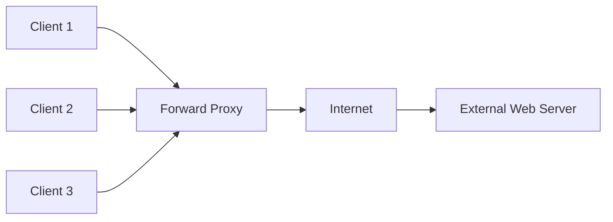
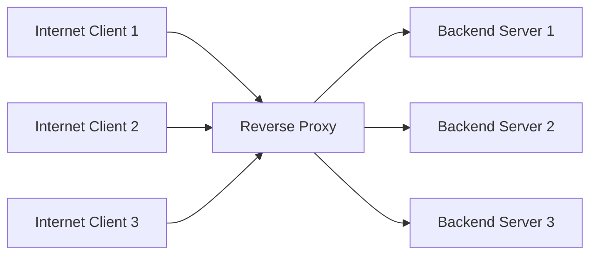
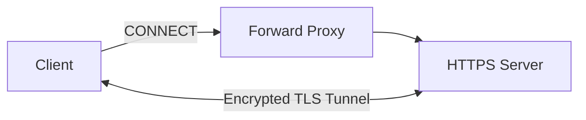
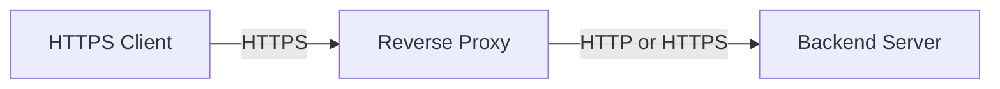
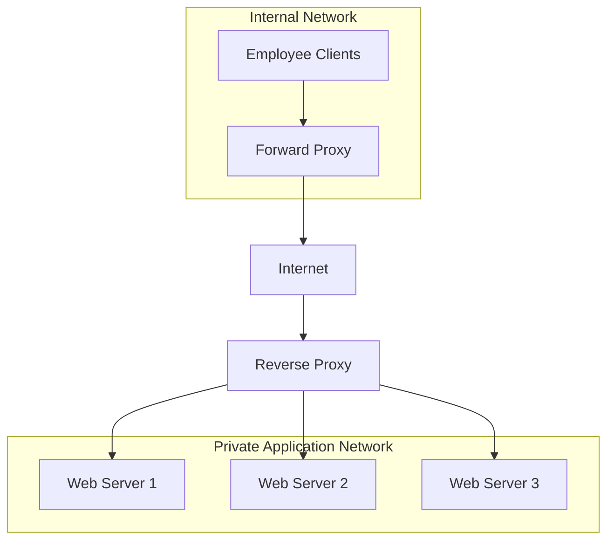

# Forward Proxy vs. Reverse Proxy

A **proxy server** acts as an intermediary between two communication endpoints. Depending on its deployment architecture, it can operate as a forward proxy or a reverse proxy.

Both proxy types receive requests and forward them to other systems, but they serve different purposes and operate from different network perspectives.

* **Forward proxy:** Acts on behalf of clients.
* **Reverse proxy:** Acts on behalf of backend servers.

Understanding this distinction is essential when designing enterprise networks, web application infrastructure, and ISP environments.

# 🗁 Forward Proxy

A **forward proxy** is a proxy server positioned between internal clients and external destination servers.

Clients send their requests to the forward proxy instead of connecting directly to the internet.

The proxy processes each request according to configured policies and forwards permitted requests to their destinations.

**Architecture**



**Request Flow**

* A client requests an external resource.
* The request reaches the configured forward proxy.
* The proxy identifies the client and evaluates access policies.
* If permitted, the proxy forwards the request to the destination server.
* The destination server sends its response to the proxy.
* The proxy returns the response to the original client.

**Example**

An organization has an internal network using the `192.168.10.0/24` subnet.

The organization deploys a forward proxy at `192.168.10.10` with listening port `3128`.

Clients are configured to use this proxy for internet access.

```text
Client IP:       192.168.10.20
Forward Proxy:   192.168.10.10:3128
Destination:     example.com
```

The client sends its web request to the proxy, which forwards it to `example.com`.

The destination server generally sees the proxy's public source IP address rather than the client's private IP address.

# 🗁 Forward Proxy Use Cases

Forward proxies are commonly used in enterprise and service-provider networks.

| Use Case | Description |
| --- | --- |
| Internet access control | Controls which external websites clients can access. |
| Content filtering | Blocks domains, URLs, or categories according to organizational policies. |
| User authentication | Requires users to authenticate before accessing external resources. |
| Web caching | Stores reusable responses to reduce repeated external requests. |
| Traffic logging | Records outbound web requests for auditing and monitoring. |
| Privacy | Hides clients' original IP addresses from destination servers in typical proxy configurations. |
| Bandwidth management | Helps optimize and control outbound web traffic. |
| Egress security | Provides a centralized point for outbound traffic policies. |

# 🗁 Reverse Proxy

A **reverse proxy** is a proxy server positioned between external clients and internal backend servers.

Instead of clients connecting directly to application servers, they connect to the reverse proxy.

The reverse proxy receives incoming requests and forwards them to the appropriate backend server.

**Architecture**



**Request Flow**

* A client requests a resource from a public application domain.
* DNS resolves the domain to the reverse proxy's public IP address.
* The client establishes a connection to the reverse proxy.
* The reverse proxy evaluates the request and selects an appropriate backend server.
* The selected backend processes the request.
* The backend returns its response to the reverse proxy.
* The reverse proxy returns the response to the client.

**Example**

A company hosts a web application using three internal servers.

The reverse proxy receives all incoming HTTPS requests.

```text
Public Domain:    app.example.com
Public IP:        203.0.113.10
Reverse Proxy:    192.168.10.10
Backend Server 1: 192.168.10.20
Backend Server 2: 192.168.10.21
Backend Server 3: 192.168.10.22
```

External clients connect to `app.example.com`.

The reverse proxy forwards requests to the internal application servers based on configured routing rules.

Backend servers do not need to be directly exposed to the internet.

# 🗁 Reverse Proxy Use Cases

Reverse proxies are widely used in web hosting, cloud infrastructure, and distributed application environments.

| Use Case | Description |
| --- | --- |
| TLS termination | Handles incoming HTTPS connections and decrypts traffic before forwarding it to backend servers. |
| Load balancing | Distributes incoming requests across multiple backend servers. |
| Request routing | Routes requests to different applications based on hostname, path, or other rules. |
| Backend protection | Prevents direct public access to internal application servers. |
| Web caching | Stores eligible responses to reduce backend processing. |
| Compression | Compresses responses before sending them to clients. |
| Rate limiting | Restricts excessive requests from clients. |
| Security filtering | Applies request filtering and security policies. |

# 🗁 Forward Proxy vs. Reverse Proxy Architecture

The main difference is which side of the communication the proxy represents.

<box gap={3}>
  <box border radius="lg" padding={3} gap={2}>
    **Forward Proxy**

    <badge color="info">Represents clients</badge>
    <AsyncImage query="forward proxy network architecture diagram client forward proxy internet server" aspectRatio="16:9" width="100%" fit="contain"/>
    The proxy controls and forwards requests from internal clients to external destinations.
  </box>
  <box border radius="lg" padding={3} gap={2}>
    **Reverse Proxy**

    <badge color="success">Represents servers</badge>
    <AsyncImage query="reverse proxy architecture diagram internet clients reverse proxy multiple backend servers" aspectRatio="16:9" width="100%" fit="contain"/>
    The proxy receives external requests and forwards them to internal backend servers.
  </box>
</box>

# 🗁 Technical Comparison

| Feature | Forward Proxy | Reverse Proxy |
| --- | --- | --- |
| Represents | Clients | Backend servers |
| Primary direction | Outbound requests | Inbound requests |
| Position | Between clients and external servers | Between external clients and backend servers |
| Main purpose | Client access control | Application delivery and backend protection |
| Typical users | Internal network clients | External application users |
| Client configuration | Often requires proxy configuration | Usually requires no special proxy configuration |
| DNS configuration | Usually not required for each destination | Public application domains resolve to the reverse proxy |
| Authentication | Can authenticate internal clients | Can authenticate users accessing applications |
| Caching | Can cache eligible external responses | Can cache eligible application responses |
| Load balancing | Not its primary role | Commonly supported |
| TLS termination | May support client-to-proxy TLS | Commonly terminates incoming HTTPS connections |

# 🗁 TLS Handling

Both proxy types can handle encrypted traffic, but their TLS configurations depend on their roles.

**Forward Proxy with HTTPS CONNECT**

A forward proxy can establish a tunnel between a client and an external HTTPS server.



In ordinary CONNECT tunneling, TLS encryption remains between the client and destination server. The proxy forwards the encrypted traffic without inspecting its contents.

**Reverse Proxy with TLS Termination**

A reverse proxy can terminate the client's HTTPS connection and forward requests to backend servers.



The connection between the reverse proxy and backend can use HTTP or HTTPS, depending on the security requirements and configuration.

# 🗁 Practical Example: Enterprise Network

Consider an organization with an internal network and a public web application.

It uses:

* A forward proxy for employee internet access.
* A reverse proxy for hosting its public web application.



In this architecture:

* Employees use the forward proxy to access external websites.
* External users connect to the public application through the reverse proxy.
* The reverse proxy distributes incoming application requests to backend servers.
* Both proxies enforce policies appropriate to their roles.

# 🗁 Common Proxy Software

The following software can be used to implement proxy services.

| Software | Proxy Role | Common Use |
| --- | --- | --- |
| <Entity value="Squid" category="software" disambig="Caching proxy server"/> | Forward proxy | HTTP caching and access control |
| <Entity value="Nginx" category="software" disambig="Web server and reverse proxy"/> | Reverse proxy | TLS termination, request routing, and load balancing |
| <Entity value="HAProxy" category="software" disambig="TCP and HTTP load balancer"/> | Reverse proxy | High-performance traffic distribution |
| <Entity value="Apache HTTP Server" category="software" disambig="Web server software"/> | Forward and reverse proxy | Proxying through its `mod_proxy` modules |
| <Entity value="Envoy Proxy" category="software" disambig="Cloud-native proxy"/> | Primarily service and reverse proxy | Service-to-service traffic management |

# 🗁 Key Takeaways

* A forward proxy represents clients and manages their outbound requests.
* A reverse proxy represents backend servers and manages incoming requests.
* Forward proxies are commonly used for internet access control, filtering, caching, and logging.
* Reverse proxies are commonly used for TLS termination, load balancing, routing, and backend protection.
* A forward proxy usually requires client-side proxy configuration or network-level interception.
* A reverse proxy is generally transparent to clients at the application level.
* Both proxy types can support caching, authentication, and security policies.
* Forward and reverse proxies can coexist in the same network architecture.
