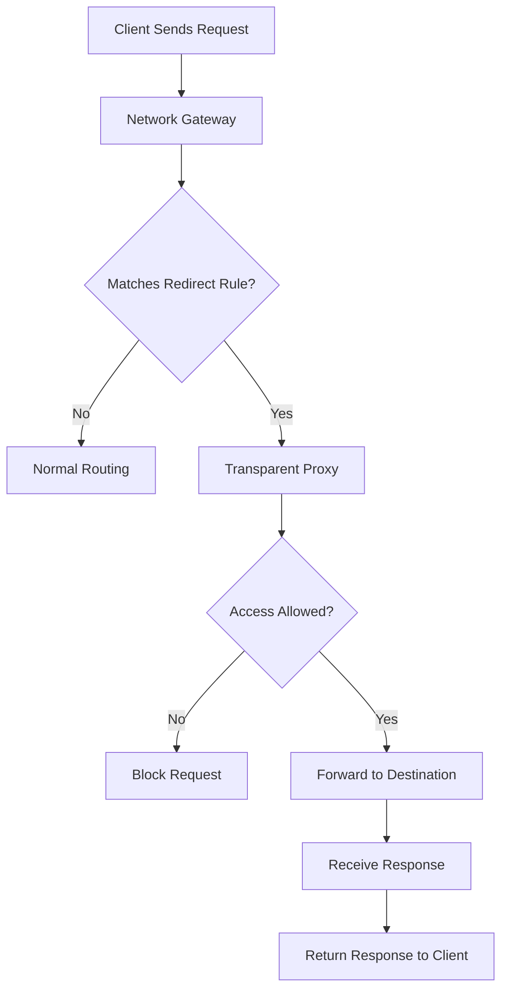
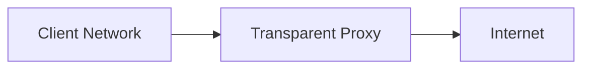
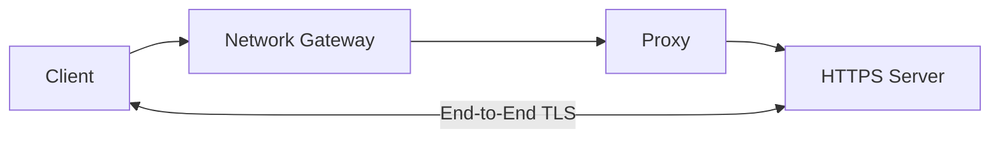

# Transparent Proxy

A **transparent proxy** is an intermediary proxy that handles client traffic without requiring users or applications to explicitly configure the proxy's IP address and port.

Network devices such as routers and firewalls redirect selected traffic to the proxy automatically.

The client generally continues using its normal destination address, while the network infrastructure directs the connection through the proxy.

Transparent proxies are commonly used for:

* Network traffic filtering.
* Internet access control.
* Web content monitoring.
* HTTP caching.
* Centralized traffic management.
* ISP and enterprise network policies.

# 🗁 How a Transparent Proxy Works

In a traditional explicit proxy deployment, clients must be configured to use a proxy server.

In a transparent proxy deployment, the network infrastructure redirects selected traffic to the proxy.

**Explicit Proxy Architecture**


**Transparent Proxy Architecture**


The client does not need to know the proxy's address.

The router or firewall intercepts or redirects matching traffic according to configured rules.

# 🗁 Transparent Proxy Request Flow

A typical transparent proxy request follows these steps:

* A client sends a request to an external destination.
* The client's traffic reaches the network gateway.
* The gateway checks its traffic-redirection rules.
* Matching traffic is redirected to the transparent proxy.
* The proxy processes the request according to its access policies.
* If permitted, the proxy forwards the request to the destination.
* The response returns through the proxy and network gateway.
* The client receives the response.



The actual packet-processing and response path depend on the network design and proxy implementation.

# 🗁 Transparent Proxy vs. Explicit Proxy

Both proxy types can provide access control, filtering, and logging. Their primary difference is how traffic reaches the proxy.

| Feature | Transparent Proxy | Explicit Proxy |
| --- | --- | --- |
| Client configuration | Usually not required | Required |
| Traffic handling | Intercepted or redirected by network devices | Sent directly to configured proxy |
| Client awareness | Proxy configuration is not normally required | Client knows the proxy endpoint |
| Deployment | Requires network-level traffic redirection | Requires application or operating-system configuration |
| Traffic control | Gateway and proxy policies | Proxy policies and client configuration |
| Common use | Enterprise networks and ISP environments | Managed corporate networks |
| HTTPS handling | Depends on interception method and TLS configuration | Can use CONNECT tunneling or configured TLS inspection |

# 🗁 Transparent Proxy Deployment Modes

Transparent proxying can be implemented through different network techniques.

**Traffic Redirection**

A router or firewall redirects matching traffic to a proxy server.

For example:

```text
Client Network:    192.168.10.0/24
Gateway:           192.168.10.1
Proxy Server:      192.168.10.10
Proxy Port:        3128
```

The gateway redirects selected traffic from the client network to the proxy.

**Inline Proxy**

An inline proxy is positioned directly in the traffic path.



Traffic passes through the proxy before reaching its destination.

**Policy-Based Redirection**

A router or firewall can redirect traffic according to selected conditions, such as:

* Source IP address or subnet.
* Destination IP address.
* Destination port.
* Protocol.
* Interface.
* Network address or VLAN.

This allows administrators to apply proxy policies to selected traffic rather than the entire network.

# 🗁 HTTP Transparent Proxying

HTTP normally uses TCP destination port `80`.

A network gateway can redirect HTTP traffic to a transparent proxy listening on a different local port.

Example:

```text
Original Destination Port: 80
Proxy Listening Port:      3128
```

The client sends an ordinary HTTP request:

```http
GET http://example.com/ HTTP/1.1
Host: example.com
```

The network redirects the connection to the proxy.

The proxy processes the request and forwards it to the destination server.

A transparent HTTP proxy can therefore apply URL-based filtering, logging, and caching when the proxy implementation supports these features.

# 🗁 HTTPS and Transparent Proxying

HTTPS normally uses TCP port `443` and protects application data with TLS encryption.

Redirecting HTTPS traffic to a proxy does not automatically make the encrypted content readable.

There are two important approaches.

**HTTPS Tunneling**

The proxy establishes or forwards an encrypted connection to the destination server.

The TLS session remains between the client and destination server.



Depending on the implementation, the proxy may be unable to transparently handle the original HTTPS connection as an ordinary HTTP request. It may require explicit proxy configuration or a suitable interception mechanism.

**TLS Inspection**

TLS inspection allows the proxy to decrypt and inspect HTTPS traffic by terminating the client's TLS connection and establishing a separate TLS connection to the destination.


TLS inspection requires:

* A configured inspection proxy.
* A trusted certificate authority (CA) installed on managed clients.
* Appropriate certificate validation.
* Security and privacy policies.
* Correct handling of applications that use certificate pinning or other TLS restrictions.

Without the required client trust configuration, intercepted TLS connections generally produce certificate validation errors.

# 🗁 Transparent Proxy with Squid

Squid is a widely used proxy server that supports HTTP proxying, caching, and access-control policies.

On Ubuntu, Squid can be installed with:

```bash
sudo apt update
sudo apt install squid -y
```

The default Squid configuration file is:

```text
/etc/squid/squid.conf
```

A basic HTTP interception listener can be configured using:

```conf
http_port 3128 intercept
```

The `intercept` option configures Squid to accept intercepted HTTP connections.

For a transparent proxy deployment, the network gateway must also redirect matching traffic to the proxy.

After changing the configuration, validate it:

```bash
sudo squid -k parse
```

Restart Squid:

```bash
sudo systemctl restart squid
```

Check its service status:

```bash
sudo systemctl status squid
```

This configures the proxy listener, but does not by itself redirect client traffic. Gateway redirection and appropriate network routing must also be configured.

# 🗁 Linux Traffic Redirection Example

On a Linux-based gateway, `iptables` can redirect HTTP traffic from an internal network to a local proxy listener.

Example environment:

```text
Internal Network: 192.168.10.0/24
Gateway Interface: eth1
Proxy Port: 3128
```

Enable IPv4 forwarding:

```bash
sudo sysctl -w net.ipv4.ip_forward=1
```

Redirect HTTP traffic from the internal network to the local proxy:

```bash
sudo iptables -t nat -A PREROUTING \
  -i eth1 \
  -s 192.168.10.0/24 \
  -p tcp --dport 80 \
  -j REDIRECT --to-ports 3128
```

Display the NAT rules:

```bash
sudo iptables -t nat -L PREROUTING -n -v
```

This example assumes the proxy listener is running on the same Linux gateway.

If the proxy is on another machine, traffic redirection requires a different forwarding and return-path design.

This rule only redirects HTTP traffic. It does not configure HTTPS inspection.

# 🗁 MikroTik RouterOS v7 Traffic Redirection

MikroTik RouterOS can redirect selected HTTP traffic to a proxy service running on the router.

Example environment:

```text
LAN Network: 192.168.10.0/24
Router LAN Interface: bridge
Proxy Port: 3128
```

Enable the RouterOS web proxy:

```routeros
/ip proxy
set enabled=yes port=3128
```

Allow access from the internal network:

```routeros
/ip proxy access
add src-address=192.168.10.0/24 action=allow
```

Redirect HTTP traffic from the LAN:

```routeros
/ip firewall nat
add chain=dstnat \
    in-interface=bridge \
    src-address=192.168.10.0/24 \
    protocol=tcp \
    dst-port=80 \
    action=redirect \
    to-ports=3128 \
    comment="Redirect LAN HTTP to Web Proxy"
```

Inspect the configuration:

```routeros
/ip proxy print
/ip proxy access print
/ip firewall nat print
```

This example demonstrates HTTP redirection to the router's built-in proxy.

It does not provide HTTPS content inspection. Firewall rule ordering, existing NAT rules, and proxy access policies must be considered in a production configuration.

# 🗁 Advantages of Transparent Proxy

| Advantage | Explanation |
| --- | --- |
| No client configuration | Clients do not need to specify a proxy manually. |
| Centralized control | Network administrators manage traffic through a central policy point. |
| Simplified deployment | Suitable for networks with many unmanaged or shared devices. |
| Traffic filtering | Can filter selected HTTP requests. |
| Monitoring | Provides centralized logging of supported traffic. |
| Caching | Can reduce repeated HTTP requests when caching is enabled. |

# 🗁 Limitations of Transparent Proxy

| Limitation | Explanation |
| --- | --- |
| HTTPS visibility | Encrypted HTTPS content cannot be inspected without TLS inspection. |
| Application compatibility | Some applications may not work correctly with interception. |
| Network dependency | Traffic redirection depends on gateway and routing configuration. |
| Troubleshooting complexity | Redirected traffic can make connection problems harder to diagnose. |
| Performance overhead | Proxy processing adds latency and consumes system resources. |
| Availability | Proxy failure can interrupt traffic if the network depends on it. |
| Protocol limitations | Not every application protocol can be handled by an HTTP proxy. |

# 🗁 Transparent Proxy Troubleshooting

Common problems include:

| Problem | Possible Cause | Troubleshooting |
| --- | --- | --- |
| Websites do not load | Incorrect redirection or proxy configuration | Check gateway NAT rules and proxy listener |
| HTTP requests are blocked | Proxy access-control rules | Review proxy ACL configuration |
| HTTPS certificate errors | TLS interception without trusted CA | Check client certificate trust and TLS configuration |
| Proxy receives no traffic | Incorrect interface or matching conditions | Inspect firewall counters and packet captures |
| Slow browsing | Proxy resource limitations or upstream latency | Monitor CPU, memory, bandwidth, and response time |
| Traffic bypasses proxy | Incorrect routing or NAT rule order | Review routing and firewall processing order |

Useful Linux commands:

```bash
sudo systemctl status squid
```

```bash
sudo journalctl -u squid -f
```

```bash
sudo tail -f /var/log/squid/access.log
```

```bash
sudo tcpdump -i eth1 -nn 'tcp port 80'
```

For MikroTik RouterOS:

```routeros
/ip proxy print
/ip proxy access print
/ip firewall nat print stats
/tool torch interface=bridge
```

# 🗁 Key Takeaways

* A transparent proxy handles client traffic without requiring explicit proxy configuration on clients.
* Routers and firewalls can redirect selected traffic to a proxy server.
* HTTP traffic can be intercepted and processed by a suitable HTTP proxy.
* HTTPS encryption prevents ordinary transparent proxies from reading application content.
* HTTPS tunneling and TLS inspection are different mechanisms.
* TLS inspection requires appropriate certificate trust and client configuration.
* Squid supports HTTP interception, while MikroTik RouterOS provides a built-in web proxy.
* Proper routing, firewall rules, access controls, and monitoring are essential for reliable deployment.
