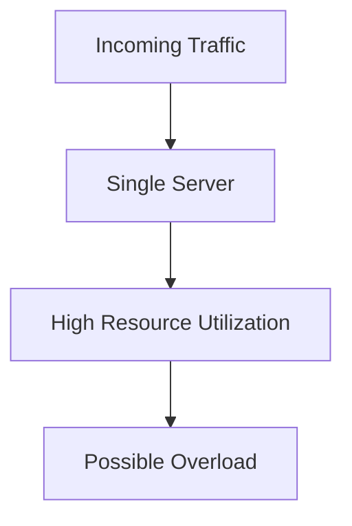
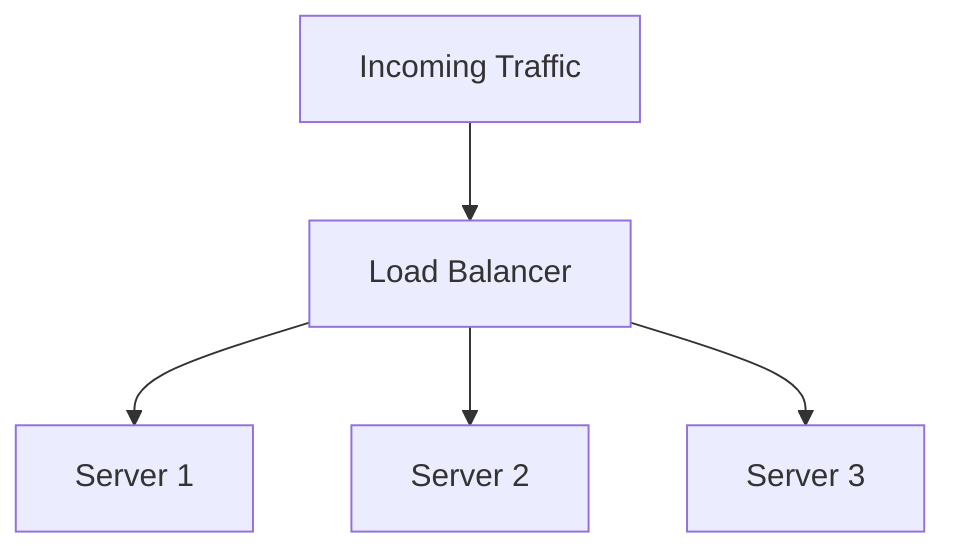
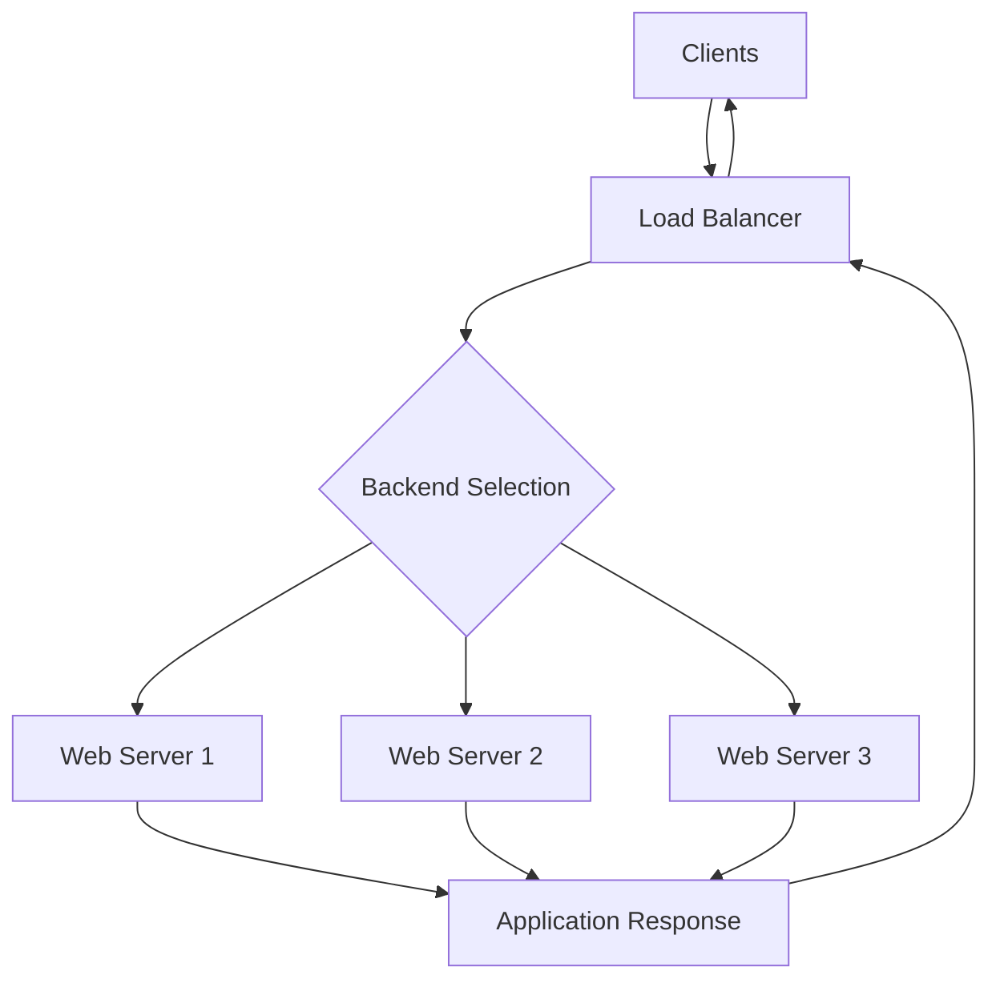
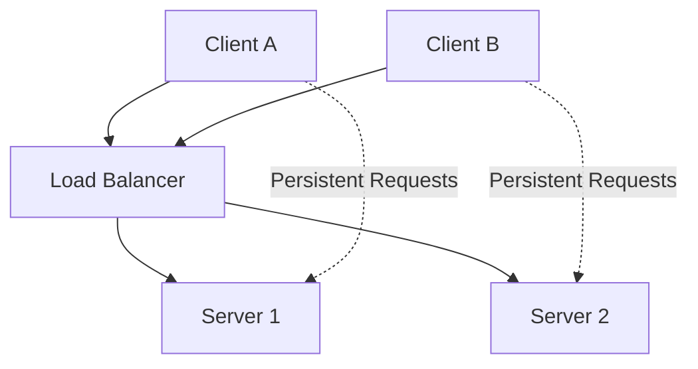
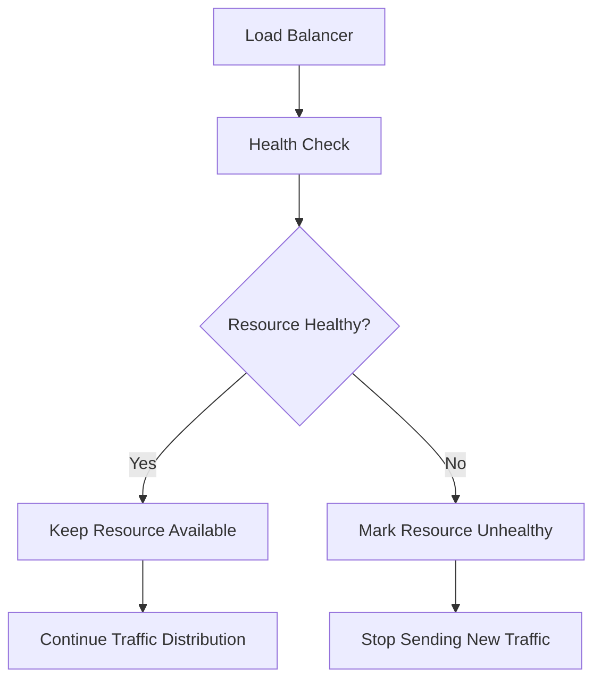
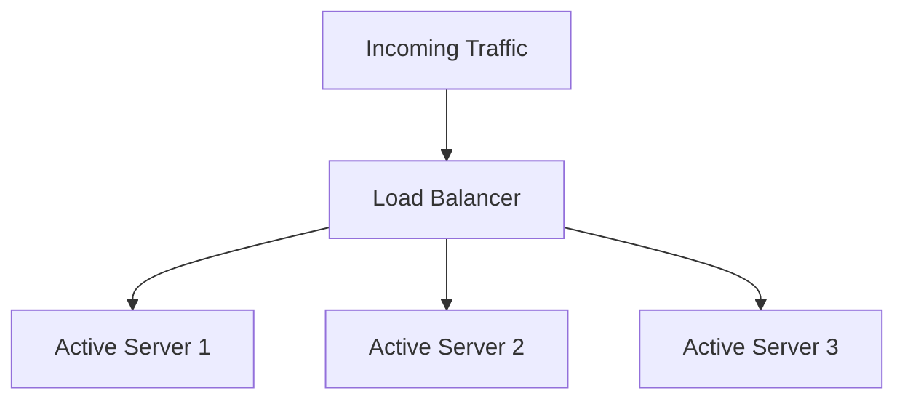
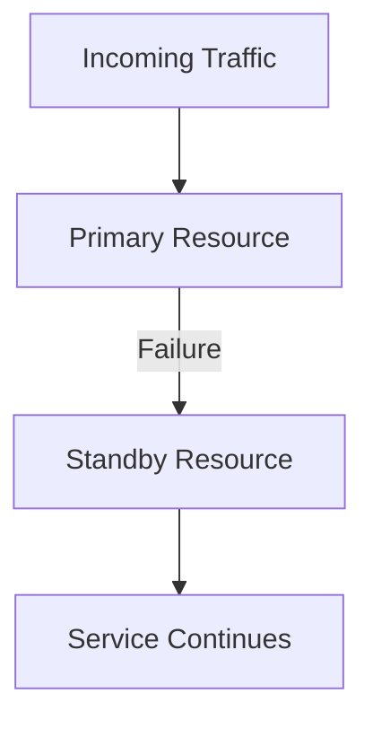

# Load Balancing Fundamentals

**Load balancing** is the process of distributing incoming network traffic or application requests across multiple servers, network links, or resources.

The primary purpose of load balancing is to prevent a single resource from becoming overloaded while other available resources remain underutilized.

A load balancer receives incoming traffic, selects an appropriate destination according to a configured algorithm, and forwards the traffic to that destination.

Load balancing is widely used in:

* Web hosting and application infrastructure.
* Data centers and cloud environments.
* ISP networks and multi-WAN connectivity.
* Enterprise networks.
* High-availability systems.
* Distributed applications.

# 🗁 Why Load Balancing Is Important

Consider a web application running on a single server.

If thousands of users access the application simultaneously, the server may become overloaded. This can cause slow response times, connection failures, and service interruptions.

Load balancing addresses this problem by distributing requests across multiple servers.

**Without Load Balancing**



**With Load Balancing**



Instead of sending all requests to one server, the load balancer distributes them across available servers.

# 🗁 Main Objectives of Load Balancing

| Objective | Description |
| --- | --- |
| Traffic distribution | Distributes incoming traffic across multiple resources. |
| Performance improvement | Reduces the workload on individual servers or links. |
| High availability | Allows traffic to use healthy resources when others fail. |
| Scalability | Supports increasing traffic by adding more resources. |
| Resource utilization | Helps use available server or network capacity efficiently. |
| Fault tolerance | Reduces dependence on a single server or connection. |
| Network optimization | Can select paths according to configured routing or policy rules. |

Load balancing improves availability only when the overall architecture includes suitable redundancy and health monitoring.

# 🗁 Load Balancing Architecture

A typical application load-balancing architecture contains several components.

| Component | Responsibility |
| --- | --- |
| Clients | Generate requests or network traffic. |
| Load balancer | Receives traffic and selects a destination. |
| Backend servers | Process application requests. |
| Health checks | Determine whether backend resources are available. |
| Distribution algorithm | Determines how traffic is assigned. |
| Monitoring | Tracks traffic, performance, and resource health. |

**Example Architecture**



The load balancer selects a backend server, forwards the request, and returns the response to the client.

# 🗁 Types of Load Balancing

Load balancing can be classified according to the traffic being distributed and the network layer where decisions are made.

**Server Load Balancing**

Distributes application requests across multiple backend servers.

Example:

```text
Client Requests
       |
       v
Load Balancer
   |   |   |
   v   v   v
  S1  S2  S3
```

Commonly used for:

* Websites.
* REST APIs.
* Application servers.
* Database read replicas.
* Cloud applications.

**Network Load Balancing**

Distributes network traffic across multiple network paths or internet connections.

Example:

```text
              LAN
               |
               v
         Load Balancer
          /         \
         v           v
       WAN 1       WAN 2
         |           |
         v           v
      ISP 1        ISP 2
```

Commonly used for:

* Multi-WAN environments.
* ISP networks.
* Enterprise internet gateways.
* Network traffic distribution.
* Redundant internet connectivity.

**DNS-Based Load Balancing**

Uses DNS responses to direct clients toward different server IP addresses.

For example, a DNS server may return different backend IP addresses for the same domain.

DNS-based distribution does not necessarily provide immediate failure detection or guarantee equal traffic distribution. Client and resolver caching can affect the results.

# 🗁 Layer 4 vs. Layer 7 Load Balancing

Load balancers can operate at different layers of the OSI model.

**Layer 4 Load Balancing**

Layer 4 load balancing operates at the transport layer and makes forwarding decisions using information such as:

* Source IP address.
* Destination IP address.
* Source port.
* Destination port.
* Transport protocol (TCP or UDP).

It generally does not need to inspect HTTP application content.

Example:

```text
Client
  |
  v
Layer 4 Load Balancer
  |
  +---- TCP Traffic ----> Server 1
  |
  +---- TCP Traffic ----> Server 2
  |
  +---- TCP Traffic ----> Server 3
```

**Layer 7 Load Balancing**

Layer 7 load balancing operates at the application layer.

It can make decisions using application-level information such as:

* HTTP hostname.
* URL path.
* HTTP headers.
* Cookies.
* Application-specific routing rules.

Example:

```text
Client Request
      |
      v
Layer 7 Load Balancer
      |
      +---- /api/ ----> API Server
      |
      +---- /admin/ --> Admin Server
      |
      +---- /shop/ ---> Shop Server
```

**Comparison**

| Feature | Layer 4 | Layer 7 |
| --- | --- | --- |
| OSI layer | Transport | Application |
| Common protocols | TCP, UDP | HTTP, HTTPS, and other supported application protocols |
| Decision information | IP addresses, ports, and protocol | Hostnames, URLs, headers, and application data |
| Application awareness | Limited | Higher |
| Processing overhead | Generally lower | Generally higher |
| Routing flexibility | Transport-level | Application-level |
| Common use | TCP and UDP traffic distribution | Web and API request routing |

Layer 7 HTTPS routing usually requires TLS termination or another mechanism that makes the relevant application information available to the load balancer.

# 🗁 Load Balancing Algorithms

A load-balancing algorithm determines which backend server or network path receives traffic.

Different algorithms are suitable for different workloads.

**Round Robin**

Distributes requests sequentially across available resources.

Example:

```text
Request 1  -> Server 1
Request 2  -> Server 2
Request 3  -> Server 3
Request 4  -> Server 1
Request 5  -> Server 2
Request 6  -> Server 3
```

Useful when backend servers have similar capacity and requests have relatively similar processing costs.

**Weighted Round Robin**

Distributes traffic according to assigned weights.

Example:

| Server | Weight | Relative Share |
| --- | ---: | ---: |
| Server 1 | 5 | 50% |
| Server 2 | 3 | 30% |
| Server 3 | 2 | 20% |

A server with a higher weight receives a larger share of traffic.

**Least Connections**

Sends new connections to the server with the fewest active connections.

Example:

| Server | Active Connections |
| --- | ---: |
| Server 1 | 120 |
| Server 2 | 45 |
| Server 3 | 80 |

Server 2 is selected because it has the fewest active connections.

This algorithm is useful when connections have different lifetimes or workloads.

**Weighted Least Connections**

Combines server weights with active connection counts.

Servers with greater capacity can receive more connections than smaller servers.

**IP Hash**

Uses a hash of the client's IP address to select a backend server.

The same client IP will generally map to the same backend while the backend pool and hashing configuration remain unchanged.

This can help maintain client affinity, although it does not guarantee perfect load distribution.

**Random Selection**

Selects a backend server randomly from the available resources.

It is simple to implement, but individual selections do not guarantee equal distribution over short periods.

# 🗁 Session Persistence

Session persistence, also called **session affinity** or **sticky sessions**, attempts to direct requests from the same client or session to the same backend server.

This is useful when an application stores session information locally on a backend server.

Example:



Common persistence methods include:

* Source IP affinity.
* Cookie-based persistence.
* Application session identifiers.
* Consistent hashing.

Session persistence can simplify some application architectures, but it may create uneven traffic distribution.

A more scalable approach is often to store session data in a shared external system, allowing requests to reach any healthy backend server.

# 🗁 Health Checks

A load balancer should not send traffic to unavailable or unhealthy resources.

**Health checks** periodically verify whether backend servers or network paths are functioning correctly.

Common health-check methods include:

| Method | Description |
| --- | --- |
| ICMP check | Tests whether a destination responds to ICMP requests. |
| TCP check | Checks whether a TCP connection can be established. |
| HTTP check | Sends an HTTP request and evaluates the response. |
| HTTPS check | Checks an application endpoint over TLS. |
| Application check | Verifies application-specific health conditions. |

**Health Check Flow**



Health checks should verify meaningful service availability rather than relying only on whether a server responds to ping.

# 🗁 Active-Active vs. Active-Passive

These are two common availability architectures.

**Active-Active**

Multiple servers or network connections actively handle traffic at the same time.



Advantages:

* Uses multiple resources simultaneously.
* Distributes workload.
* Can improve overall capacity.
* Provides redundancy when designed correctly.

**Active-Passive**

One resource handles normal traffic while another remains available as a standby.



Advantages:

* Provides a backup resource.
* Can simplify some network architectures.
* Reduces simultaneous workload on standby resources.

The standby resource must be monitored and capable of taking over when the primary resource fails.

# 🗁 Load Balancing vs. Failover

Load balancing and failover are related but different concepts.

| Feature | Load Balancing | Failover |
| --- | --- | --- |
| Primary objective | Distribute traffic | Maintain service when a resource fails |
| Normal operation | Multiple resources may handle traffic | Primary resource normally handles traffic |
| Resource usage | Multiple resources actively used in active-active designs | Backup may remain idle in active-passive designs |
| Failure handling | Removes unhealthy resources from distribution | Switches traffic to an available backup |
| Common example | Distributing web requests across three servers | Switching from ISP 1 to ISP 2 |

A system can combine load balancing and failover to distribute traffic during normal operation and maintain connectivity when a resource becomes unavailable.

# 🗁 Common Load Balancing Software and Technologies

| Technology | Typical Use |
| --- | --- |
| Nginx | HTTP reverse proxy and application load balancing |
| HAProxy | Layer 4 and Layer 7 load balancing |
| Envoy Proxy | Service proxying and application traffic management |
| Linux IPVS | Kernel-based IP virtual server load balancing |
| Keepalived | High availability using VRRP and health checks |
| MikroTik RouterOS | Multi-WAN traffic distribution and routing policies |
| Cloud load balancers | Managed application and network traffic distribution |

# 🗁 Important Load Balancing Considerations

Before implementing load balancing, consider the following:

* **Capacity:** Each backend must have sufficient CPU, memory, and network resources.
* **Health monitoring:** Unhealthy resources must be detected and excluded.
* **Session management:** Applications must support session persistence or shared session storage when necessary.
* **Network symmetry:** Return traffic must follow a path compatible with the connection-tracking and NAT design.
* **DNS:** Domain resolution must point clients toward the intended load-balancing infrastructure.
* **Security:** Access controls, TLS configuration, and backend protection must be considered.
* **Monitoring:** Track active connections, response times, errors, bandwidth, and resource utilization.
* **Redundancy:** The load balancer itself should not become a single point of failure.
* **Testing:** Simulate server and link failures to verify that traffic distribution and recovery work as expected.

# 🗁 Key Takeaways

* Load balancing distributes traffic across multiple servers, links, or resources.
* Its main objectives are performance, scalability, resource utilization, and availability.
* Server load balancing distributes application requests across backend servers.
* Network load balancing distributes traffic across multiple network paths or internet connections.
* Layer 4 load balancing uses transport-level information such as IP addresses and ports.
* Layer 7 load balancing can use application-level information such as HTTP paths and headers.
* Common algorithms include Round Robin, Weighted Round Robin, Least Connections, and IP Hash.
* Health checks prevent new traffic from being sent to unhealthy resources.
* Active-active and active-passive architectures provide different approaches to redundancy.
* Load balancing and failover can work together to improve service reliability.
