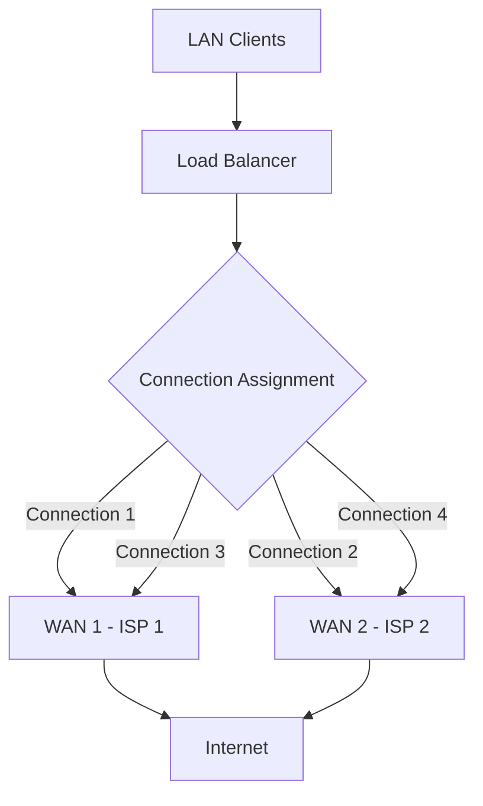
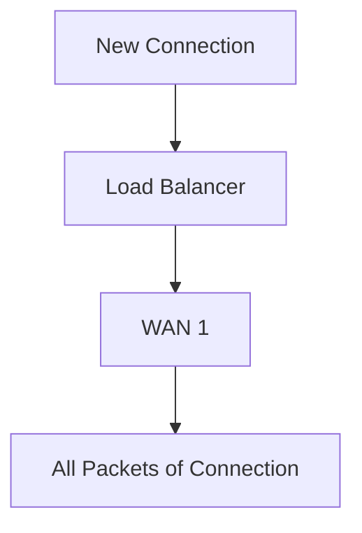
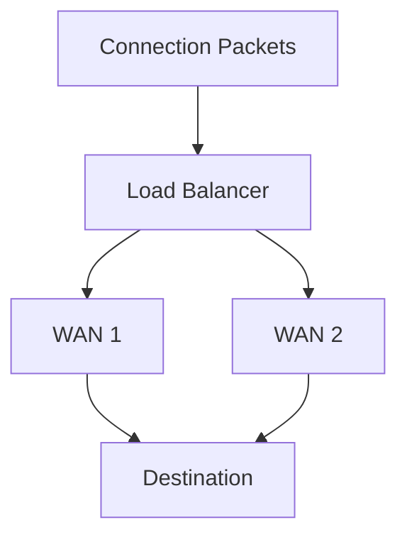

# Per-Connection Load Balancing

**Per-connection load balancing** is a traffic distribution method that assigns each new network connection to one of multiple available WAN links or network paths.

Once a connection is assigned to a particular link, all packets belonging to that connection continue using the same link.

This approach maintains connection consistency and helps prevent problems caused by sending packets from a single connection through different WAN paths.

Per-connection load balancing is commonly used in:

* Multi-WAN networks.
* Enterprise internet gateways.
* ISP networks.
* MikroTik RouterOS environments.
* Networks with multiple internet service providers.

# 🗁 Understanding Network Connections

Before understanding per-connection load balancing, it is important to distinguish between a connection and an individual packet.

A **packet** is an individual unit of network communication.

A **connection** represents a communication session between endpoints, commonly identified by source and destination addresses, ports, and transport protocol.

For example, when a client opens a website, it may establish a TCP connection:

```text
Source IP:       192.168.10.20
Source Port:     52000
Destination IP: 93.184.216.34
Destination Port: 443
Protocol:        TCP
```

That connection consists of multiple packets exchanged between the client and destination server.

Per-connection load balancing assigns the entire connection to one WAN link rather than distributing its individual packets across multiple links.

# 🗁 How Per-Connection Load Balancing Works

Consider a network with two internet connections:

* WAN 1: ISP 1
* WAN 2: ISP 2

A load balancer distributes new connections across these links.



For example:

| Connection | Assigned WAN |
| --- | --- |
| Connection 1 | WAN 1 |
| Connection 2 | WAN 2 |
| Connection 3 | WAN 1 |
| Connection 4 | WAN 2 |
| Connection 5 | WAN 1 |
| Connection 6 | WAN 2 |

The assignment is performed when a new connection is identified.

All subsequent packets belonging to that connection use its assigned WAN link.

# 🗁 Why Per-Connection Load Balancing Is Used

Sending packets from the same connection through different WAN links can cause several networking problems.

For example, consider a TCP connection:

* The outgoing packets leave through ISP 1.
* The response packets return through ISP 2.
* The two ISPs use different public IP addresses.
* NAT and connection tracking may no longer match the expected connection state.

This can cause connection failures, dropped packets, or application timeouts.

Per-connection load balancing avoids this problem by maintaining a consistent WAN assignment for each connection.

# 🗁 Per-Connection vs. Per-Packet Load Balancing

These methods distribute traffic differently.

**Per-Connection Load Balancing**

Assigns an entire connection to one WAN link.



**Per-Packet Load Balancing**

Distributes individual packets across multiple WAN links.



| Feature | Per-Connection | Per-Packet |
| --- | --- | --- |
| Distribution unit | Connection | Individual packet |
| Connection consistency | Maintained | Not necessarily maintained |
| Packet ordering | Usually preserved along a single path | Can be disrupted by different path delays |
| NAT compatibility | Generally suitable | Requires careful handling |
| TCP reliability | Generally better for ordinary internet connections | Can cause out-of-order delivery |
| Common use | Multi-WAN internet access | Specialized network designs |

For ordinary multi-WAN internet connectivity, per-connection load balancing is generally preferred.

# 🗁 Connection Distribution Algorithms

A load balancer needs a method to decide which WAN link should receive a new connection.

Common approaches include:

**Round Robin**

Assigns new connections sequentially across available WAN links.

```text
Connection 1 -> WAN 1
Connection 2 -> WAN 2
Connection 3 -> WAN 1
Connection 4 -> WAN 2
```

**Weighted Distribution**

Assigns connections according to the relative capacity or configured weight of each WAN link.

Example:

| WAN | Weight | Relative Distribution |
| --- | ---: | ---: |
| WAN 1 | 70 | 70% |
| WAN 2 | 30 | 30% |

**Hash-Based Distribution**

Uses connection information to calculate a hash and determine the WAN assignment.

Common hash inputs include:

* Source IP address.
* Destination IP address.
* Source port.
* Destination port.
* Transport protocol.

Hash-based distribution helps maintain consistent connection assignments.

# 🗁 Connection Tracking

Connection tracking is an important part of per-connection load balancing.

A router maintains information about active connections so that packets belonging to an existing connection can be handled consistently.

For example:

```text
Connection ID: 1001
Source:        192.168.10.20:52000
Destination:   93.184.216.34:443
Protocol:      TCP
Assigned WAN:  WAN 1
Connection Mark: wan1_conn
```

When another packet belonging to this connection arrives, the router identifies the existing connection and applies the same WAN assignment.

Connection tracking is especially important when NAT is involved because the router must maintain consistent translation and routing state.

# 🗁 Per-Connection Load Balancing in MikroTik RouterOS v7

MikroTik RouterOS supports per-connection load balancing through firewall connection marking and policy-based routing.

A commonly used technique is **PCC (Per Connection Classifier)**.

PCC classifies connections using selected address and port information, then assigns connection marks.

The connection marks are subsequently used to apply routing marks and select the appropriate WAN routing table.

PCC is covered in detail in the next topic.

# 🗁 Example Network Topology

Consider a MikroTik router connected to two ISPs.

<box border radius="lg" padding={3} gap={2}>
  **Dual-WAN Network**
  ```text
  LAN:   192.168.10.0/24

  WAN 1: ISP 1
  WAN 2: ISP 2

  Router: MikroTik RouterOS v7

  ```
  <AsyncImage query="MikroTik dual WAN load balancing network topology diagram two ISP connections LAN clients router" aspectRatio="16:9" width="100%" fit="contain"/>
</box>

The router receives traffic from the LAN and distributes new connections across the two WAN links.

# 🗁 RouterOS v7 Configuration Example

The following example demonstrates a basic two-WAN per-connection distribution using PCC.

**Network Information**

| Component | Interface | IP Address |
|---|---|---|
| LAN | `bridge` | `192.168.10.1/24` |
| WAN 1 | `ether1` | `192.0.2.2/24` |
| WAN 2 | `ether2` | `198.51.100.2/24` |
| ISP 1 Gateway | — | `192.0.2.1` |
| ISP 2 Gateway | — | `198.51.100.1` |

The example assumes both WAN interfaces already have their respective IP addresses configured.

**Create Routing Tables**

RouterOS v7 uses named routing tables for policy-based routing.

```routeros
/routing table
add name=to_WAN1 fib
add name=to_WAN2 fib
```

**Configure WAN Routing**

Add a default route for each policy routing table:

```routeros
/ip route
add dst-address=0.0.0.0/0 gateway=192.0.2.1 routing-table=to_WAN1
add dst-address=0.0.0.0/0 gateway=198.51.100.1 routing-table=to_WAN2
```

The main routing table should also have an appropriate default route for router-originated traffic.

**Configure Connection Marking**

First, classify new LAN connections into two groups using PCC.

```routeros
/ip firewall mangle
add chain=prerouting \
    in-interface=bridge \
    dst-address-type=!local \
    connection-state=new \
    connection-mark=no-mark \
    per-connection-classifier=both-addresses-and-ports:2/0 \
    action=mark-connection \
    new-connection-mark=WAN1_conn \
    passthrough=yes

add chain=prerouting \
    in-interface=bridge \
    dst-address-type=!local \
    connection-state=new \
    connection-mark=no-mark \
    per-connection-classifier=both-addresses-and-ports:2/1 \
    action=mark-connection \
    new-connection-mark=WAN2_conn \
    passthrough=yes
```

The PCC configuration uses:

```text
both-addresses-and-ports:2/0
both-addresses-and-ports:2/1
```

The values mean:

* `both-addresses-and-ports`: Uses both source and destination IP addresses and ports as classifier inputs.
* `2`: Divides the classifier space into two groups.
* `0`: Selects the first group.
* `1`: Selects the second group.

**Apply Routing Marks**

After connections receive their connection marks, assign routing marks to their packets.

```routeros
/ip firewall mangle
add chain=prerouting \
    in-interface=bridge \
    connection-mark=WAN1_conn \
    action=mark-routing \
    new-routing-mark=to_WAN1 \
    passthrough=no

add chain=prerouting \
    in-interface=bridge \
    connection-mark=WAN2_conn \
    action=mark-routing \
    new-routing-mark=to_WAN2 \
    passthrough=no
```

These rules direct packets belonging to WAN 1 connections through the `to_WAN1` table and WAN 2 connections through the `to_WAN2` table.

**Configure NAT**

Each WAN connection needs appropriate source NAT for internet access.

```routeros
/ip firewall nat
add chain=srcnat \
    out-interface=ether1 \
    action=masquerade \
    comment="NAT through WAN 1"

add chain=srcnat \
    out-interface=ether2 \
    action=masquerade \
    comment="NAT through WAN 2"
```

**Verify the Configuration**

Inspect the routing tables:

```routeros
/routing table print
```

Inspect the routes:

```routeros
/ip route print detail
```

Inspect connection-marking rules:

```routeros
/ip firewall mangle print stats
```

Inspect NAT rules:

```routeros
/ip firewall nat print stats
```

Inspect tracked connections:

```routeros
/ip firewall connection print
```

<badge color="warning">Important configuration considerations</badge>

This is a basic LAN-originated traffic example, not a complete production-ready dual-WAN configuration.

* Ensure the WAN gateway addresses are reachable.
* Configure appropriate main-table routing for router-originated traffic.
* Exclude traffic destined for internal networks and other special destinations from WAN classification where necessary.
* Add appropriate handling for connections initiated from the WAN interfaces so reply traffic uses the correct WAN.
* Ensure firewall filter rules permit the intended forwarding traffic.
* Existing FastTrack rules may bypass mangle processing for established connections. Exclude policy-routed traffic from FastTrack or configure FastTrack carefully.
* If using DHCP or PPPoE WAN interfaces, adapt gateway and interface configuration accordingly.
* Existing connections may retain their previous assignments when rules change. Test with new connections.

# 🗁 Advantages of Per-Connection Load Balancing

| Advantage | Description |
| --- | --- |
| Connection consistency | Keeps packets from a connection on the assigned WAN path. |
| Better compatibility | Works well with ordinary TCP and HTTPS connections. |
| Multi-WAN utilization | Allows multiple internet connections to carry traffic simultaneously. |
| NAT compatibility | Supports independent source NAT through each WAN. |
| Flexible distribution | Supports different classification and weighting strategies. |
| Scalability | Additional WAN links can be included in the distribution design. |

# 🗁 Limitations of Per-Connection Load Balancing

| Limitation | Description |
| --- | --- |
| No single-connection aggregation | One connection normally uses one WAN link at a time. |
| Uneven distribution | A small number of connections may not distribute evenly. |
| Different ISP speeds | Equal connection distribution does not guarantee equal bandwidth distribution. |
| Connection tracking dependency | Incorrect connection marking can cause inconsistent routing. |
| NAT dependency | Public IP changes between WAN links can affect existing sessions. |
| Configuration complexity | Multiple routing tables, firewall rules, and NAT policies require careful planning. |
| Failover requirements | Load distribution alone does not provide complete WAN failure detection and recovery. |

# 🗁 Common Troubleshooting

| Problem | Possible Cause | What to Check |
| --- | --- | --- |
| Only one WAN is being used | PCC or routing marks are incorrect | Mangle rule counters and routing tables |
| Some connections fail | Incorrect routing or NAT configuration | Connection tracking and NAT rules |
| Websites load inconsistently | Asymmetric routing or incorrect connection marking | WAN assignment and return paths |
| One WAN receives more traffic | Hash distribution or connection patterns | PCC classifier and connection counts |
| Router traffic uses the wrong WAN | Router-originated traffic is not separately handled | Main routing table and output-chain policies |
| Existing connections stop working | WAN failure or changed connection assignment | Connection tracking and failover behavior |
| Performance is unexpectedly low | One WAN is slower or overloaded | Per-WAN bandwidth and utilization |

# 🗁 Key Takeaways

* Per-connection load balancing assigns each new connection to a selected WAN link or network path.
* All packets belonging to a connection normally follow the same assigned path.
* Connection tracking helps maintain consistent routing and NAT behavior.
* Hash-based classification can distribute connections across multiple WAN links.
* Per-connection load balancing is generally more suitable than per-packet balancing for ordinary internet traffic.
* MikroTik RouterOS v7 supports this approach using connection marks, routing marks, and policy routing.
* PCC is a common MikroTik technique for classifying and distributing connections.
* Load balancing and WAN failover are separate functions and should be designed together when high availability is required.
