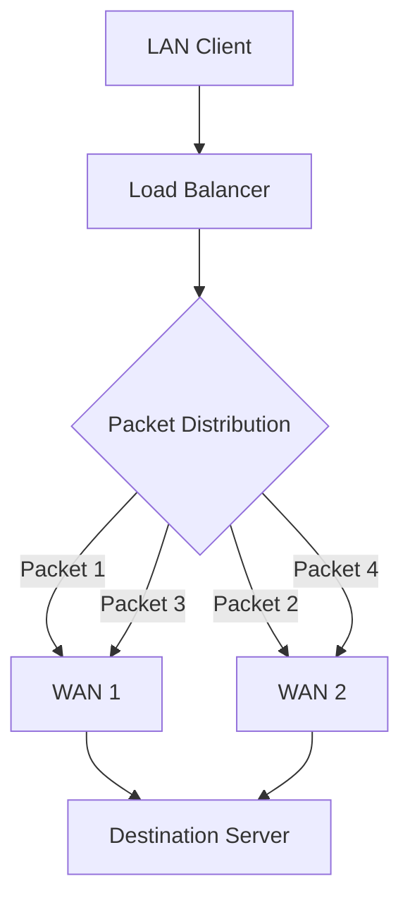
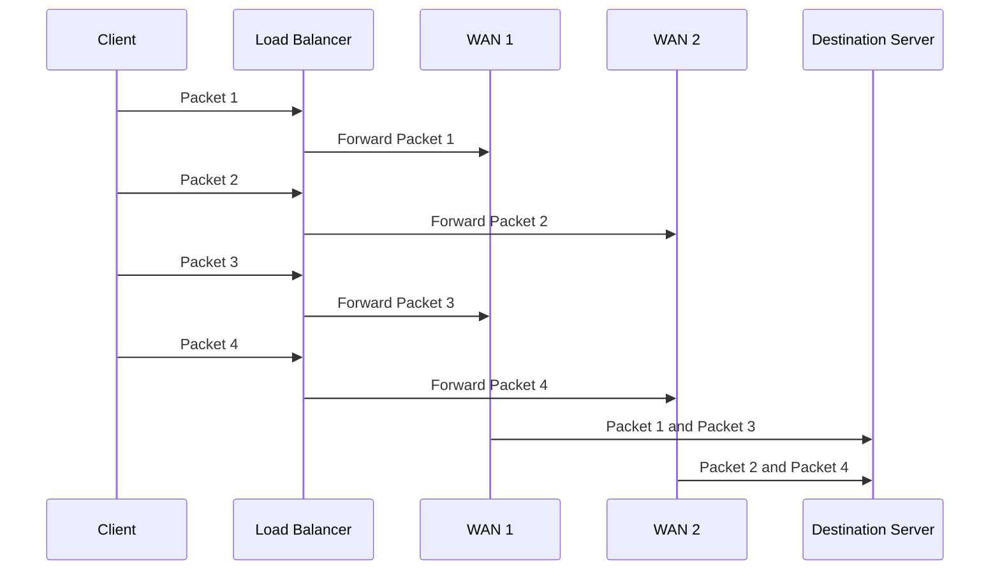
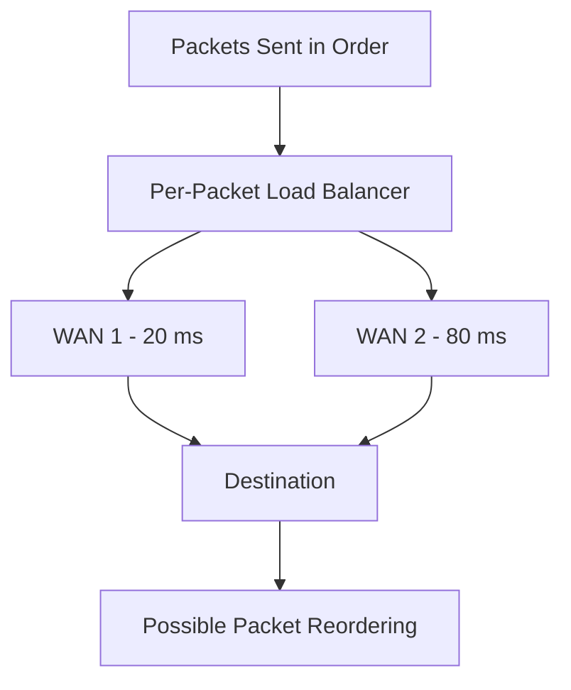

# Per-Packet Load Balancing

**Per-packet load balancing** is a traffic distribution method that distributes individual network packets across multiple available network paths or WAN links.

Unlike per-connection load balancing, which assigns an entire connection to one WAN link, per-packet load balancing can send consecutive packets from the same connection through different WAN links.

This method can distribute packet traffic across multiple links, but it requires careful network design because different paths can have different latency, bandwidth, and packet-loss characteristics.

Per-packet load balancing is primarily relevant to specialized network environments where packet-level distribution is appropriate.

# 🗁 How Per-Packet Load Balancing Works

Consider a network with two internet connections:

* WAN 1: ISP 1
* WAN 2: ISP 2

The load balancer distributes individual packets across both WAN links.



Example distribution:

| Packet | Selected WAN |
| --- | --- |
| Packet 1 | WAN 1 |
| Packet 2 | WAN 2 |
| Packet 3 | WAN 1 |
| Packet 4 | WAN 2 |
| Packet 5 | WAN 1 |
| Packet 6 | WAN 2 |

Each packet is forwarded independently according to the configured distribution method.

# 🗁 Per-Packet Request Flow

The following diagram illustrates packet-level distribution:



The destination receives packets through multiple network paths.

However, the packets may not arrive in their original transmission order.

# 🗁 Packet Ordering and Latency

One of the major challenges of per-packet load balancing is packet reordering.

Different WAN links may have different latency characteristics.

Consider two connections:

| WAN | Latency |
|---|---:|
| WAN 1 | 20 ms |
| WAN 2 | 80 ms |

Suppose four consecutive packets are distributed alternately:

| Packet | WAN | Approximate Path Latency |
| --- | --- | ---: |
| Packet 1 | WAN 1 | 20 ms |
| Packet 2 | WAN 2 | 80 ms |
| Packet 3 | WAN 1 | 20 ms |
| Packet 4 | WAN 2 | 80 ms |

Packets 1 and 3 may arrive before packets 2 and 4.



Packet reordering can cause additional processing at the receiving endpoint.

For TCP connections, out-of-order segments may require buffering and can sometimes trigger duplicate acknowledgments or retransmissions.

This can reduce performance rather than improve it.

# 🗁 Per-Packet vs. Per-Connection Load Balancing

Both methods distribute network traffic across multiple paths, but their distribution units are different.

| Feature | Per-Packet | Per-Connection |
| --- | --- | --- |
| Distribution unit | Individual packet | Entire connection |
| WAN assignment | Can change for each packet | Normally remains consistent |
| Packet ordering | May be disrupted | Generally preserved along one path |
| Connection consistency | Not guaranteed by packet distribution | Maintained |
| NAT compatibility | More complicated | Generally suitable |
| TCP compatibility | Can introduce reordering issues | Generally better |
| Bandwidth distribution | Can distribute packets across links | Distributes separate connections |
| Typical use | Specialized packet-level forwarding | Multi-WAN internet access |

For ordinary internet connectivity, per-connection load balancing is generally preferred.

# 🗁 Common Per-Packet Distribution Methods

Several methods can be used to distribute packets across network paths.

**Round Robin**

Packets are assigned sequentially across available links.

```text
Packet 1 -> WAN 1
Packet 2 -> WAN 2
Packet 3 -> WAN 1
Packet 4 -> WAN 2
Packet 5 -> WAN 1
Packet 6 -> WAN 2
```

This is simple but does not account for differences in link latency or capacity.

**Weighted Distribution**

Packets are distributed according to configured link weights.

Example:

| WAN | Weight | Relative Distribution |
| --- | ---: | ---: |
| WAN 1 | 70 | 70% |
| WAN 2 | 30 | 30% |

This can account for different link capacities, although the configured ratio does not guarantee equal utilization or optimal performance.

**Hash-Based Distribution**

A hash function uses selected packet or connection information to determine the outgoing path.

Unlike ordinary per-connection hashing, packet-level hashing may use fields that allow individual packets to receive different assignments.

The exact behavior depends on the implementation.

# 🗁 Potential Advantages

| Advantage | Description |
| --- | --- |
| Packet-level distribution | Individual packets can use different network paths. |
| Link utilization | Can distribute packet traffic across multiple links. |
| Flexible forwarding | Allows fine-grained packet distribution policies. |
| Specialized aggregation | Can be useful in controlled network designs that support multipath packet handling. |
| Weighted distribution | Can account for different link capacities through configured ratios. |

# 🗁 Limitations and Challenges

| Limitation | Description |
| --- | --- |
| Packet reordering | Different path delays can change packet arrival order. |
| TCP performance | Reordering can trigger duplicate acknowledgments and retransmissions. |
| NAT complications | Different WAN public IP addresses can break ordinary connection-based NAT behavior. |
| Asymmetric routing | Return traffic may follow a different path. |
| Latency differences | Unequal path delays can negatively affect real-time applications. |
| Troubleshooting | Packet-level forwarding makes traffic analysis more complex. |
| Application compatibility | Some applications and protocols are sensitive to path changes. |

# 🗁 Where Per-Packet Load Balancing Can Be Used

Per-packet load balancing is not the default choice for ordinary multi-WAN internet access, but packet-level multipath forwarding can be useful in specialized environments.

Examples include:

* Controlled private WAN infrastructures.
* Specialized packet-forwarding systems.
* Multipath network designs with suitable endpoint or transport support.
* Environments where path characteristics are coordinated.
* Certain aggregation and traffic-engineering architectures.

For TCP-based internet traffic, multipath technologies designed to coordinate multiple paths can be more appropriate than independently distributing packets across unrelated ISPs.

# 🗁 MikroTik RouterOS Considerations

MikroTik RouterOS supports multiple routing and traffic-distribution techniques.

However, configuring multiple default routes with equal routing distance is not equivalent to guaranteed per-packet load balancing.

RouterOS can use ECMP (Equal-Cost Multi-Path) routing to select among equal-cost routes. The forwarding behavior depends on the RouterOS version, route configuration, and applicable hashing settings.

For typical multi-WAN internet access, PCC is commonly used to classify connections and maintain consistent WAN assignments.

Per-packet forwarding should not be confused with PCC:

| Feature | PCC | ECMP |
| --- | --- | --- |
| Main purpose | Connection classification | Multiple equal-cost route selection |
| Distribution basis | Selected connection fields | Route and implementation-specific path selection |
| Connection consistency | Maintained through connection tracking and marks | Depends on ECMP hashing and configuration |
| Typical RouterOS use | Multi-WAN connection distribution | Multiple equal-cost routes |

ECMP behavior must be verified against the actual RouterOS configuration. Do not assume that every ECMP setup distributes each individual packet independently.

# 🗁 Troubleshooting Per-Packet Load Balancing

| Problem | Possible Cause | What to Check |
| --- | --- | --- |
| TCP connections perform poorly | Packet reordering | Compare packet sequence and arrival order |
| Connections fail through multiple WANs | NAT or return-path inconsistency | Check source NAT and routing symmetry |
| Uneven link utilization | Distribution algorithm or traffic patterns | Inspect packet counters and link utilization |
| High retransmission rates | Packet loss or reordering | Capture packets and inspect TCP retransmissions |
| Real-time traffic experiences jitter | Different path latency | Compare WAN latency and jitter |
| Traffic follows unexpected paths | Incorrect routing or forwarding rules | Inspect routing tables and firewall rules |

Useful Linux commands:

**Inspect Network Interfaces**

```bash
ip -s link
```

**Monitor Traffic**

```bash
sudo iftop
```

**Capture Packets**

```bash
sudo tcpdump -i eth0 -nn
```

**Inspect TCP Connections**

```bash
ss -ti
```

For MikroTik RouterOS:

```routeros
/ip route print detail
/ip firewall connection print
/tool torch interface=ether1
/tool torch interface=ether2
```

# 🗁 Key Takeaways

* Per-packet load balancing distributes individual packets across multiple network paths.
* Packets from the same connection can travel through different WAN links.
* Different path latencies can cause packet reordering.
* TCP performance can suffer from excessive packet reordering and retransmissions.
* Different WAN public IP addresses introduce additional NAT and return-path complications.
* Per-packet distribution is more suitable for specialized, controlled network designs.
* Per-connection load balancing is generally preferred for ordinary multi-WAN internet connectivity.
* PCC and ECMP are different techniques and should not be treated as interchangeable.
