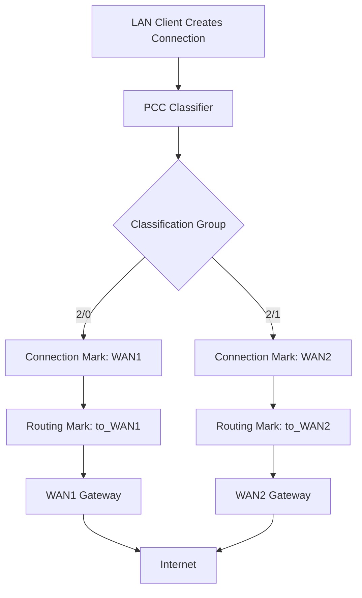
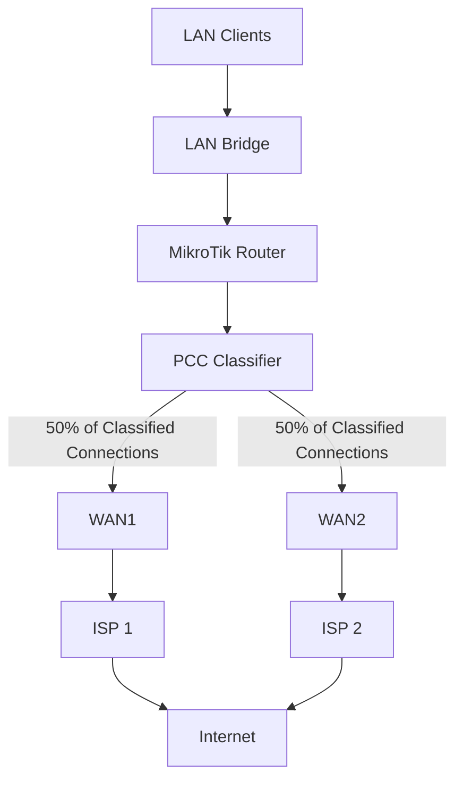

# PCC Load Balancing

**PCC (Per Connection Classifier)** is a MikroTik RouterOS feature used to distribute network connections across multiple WAN connections.

PCC classifies connections using selected combinations of source and destination IP addresses and ports. Each connection is assigned to a classification group based on a hash of the selected connection fields.

The router can then use connection marks and routing marks to send different connections through different WAN gateways.

PCC is commonly used in multi-WAN environments where an organization or ISP has two or more internet connections and wants to distribute outgoing traffic across them.

# 🗁 Why Use PCC?

Consider a network with two internet connections:

* WAN1: 100 Mbps
* WAN2: 100 Mbps

Without load balancing, LAN clients may use only one WAN connection for internet access.

With PCC, the router can distribute different connections across both WAN links.

Benefits include:

* Distributing outgoing connections across multiple WAN links.
* Improving aggregate network utilization.
* Sharing traffic among multiple internet providers.
* Maintaining connection consistency by keeping each connection assigned to a WAN.
* Supporting multi-WAN network architectures.

PCC does not combine multiple WAN links into one faster connection for an individual session. A single connection normally uses one WAN link.

# 🗁 How PCC Works

PCC calculates a hash using selected connection information, such as source and destination addresses or ports.

It then divides connections into a specified number of classification groups.

The classification syntax uses a denominator and a remainder:

```text
denominator/remainder
```

For example:

```text
2/0
2/1
```

This divides connections into two groups:

* `2/0`: First classification group.
* `2/1`: Second classification group.

The router can assign each group to a different WAN connection.

# 🗁 PCC Processing Flow



# 🗁 Connection-Based Distribution

PCC is connection-based rather than packet-based.

Once a connection is assigned to WAN1, its subsequent packets normally continue using WAN1. Another connection may be assigned to WAN2.

For example:

| Connection | Assigned WAN |
| --- | --- |
| Client A → Website A | WAN1 |
| Client B → Website B | WAN2 |
| Client A → Website C | WAN2 |
| Client C → Website A | WAN1 |

The actual assignment depends on the PCC hash calculation.

This connection consistency is important for applications that expect packets from a session to use the same public IP address.

# 🗁 PCC Classifier Options

RouterOS supports several PCC classifier combinations.

| Classifier | Description |
| --- | --- |
| `src-address` | Uses the source IP address. |
| `dst-address` | Uses the destination IP address. |
| `src-port` | Uses the source port. |
| `dst-port` | Uses the destination port. |
| `both-addresses` | Uses source and destination IP addresses. |
| `both-addresses-and-ports` | Uses source and destination IP addresses and ports. |

# 🗁 Choosing a Classifier

**`both-addresses`**

Classifies connections using both source and destination IP addresses.

```routeros
per-connection-classifier=both-addresses:2/0
```

Connections between the same source and destination IP addresses tend to receive the same classification.

**`both-addresses-and-ports`**

Classifies connections using source and destination IP addresses and ports.

```routeros
per-connection-classifier=both-addresses-and-ports:2/0
```

This can distribute connections more granularly, including multiple connections between the same pair of IP addresses.

**`src-address`**

Uses only the source IP address.

```routeros
per-connection-classifier=src-address:2/0
```

Connections from the same client tend to use the same classification group.

**`dst-address`**

Uses only the destination IP address.

```routeros
per-connection-classifier=dst-address:2/0
```

Connections to the same destination tend to use the same classification group.

The best classifier depends on the network design and desired distribution behavior.

# 🗁 PCC Denominator and Remainder

The denominator specifies the total number of classification groups. The remainder identifies an individual group.

For two WAN connections:

```routeros
per-connection-classifier=both-addresses-and-ports:2/0
per-connection-classifier=both-addresses-and-ports:2/1
```

For three WAN connections:

```routeros
per-connection-classifier=both-addresses-and-ports:3/0
per-connection-classifier=both-addresses-and-ports:3/1
per-connection-classifier=both-addresses-and-ports:3/2
```

For four WAN connections:

```routeros
per-connection-classifier=both-addresses-and-ports:4/0
per-connection-classifier=both-addresses-and-ports:4/1
per-connection-classifier=both-addresses-and-ports:4/2
per-connection-classifier=both-addresses-and-ports:4/3
```

Each denominator creates that number of classification groups.

# 🗁 Distribution Ratios

With two equally weighted WAN connections:

| Classifier | WAN Assignment | Expected Share |
| --- | --- | ---: |
| `2/0` | WAN1 | 50% |
| `2/1` | WAN2 | 50% |

With three equally weighted WAN connections:

| Classifier | WAN Assignment | Expected Share |
| --- | --- | ---: |
| `3/0` | WAN1 | 33.33% |
| `3/1` | WAN2 | 33.33% |
| `3/2` | WAN3 | 33.33% |

These percentages describe the expected distribution of classified connections, not guaranteed bandwidth utilization.

Actual traffic volume can differ significantly because individual connections may transfer different amounts of data.

# 🗁 Network Architecture Example

Consider a network with two internet connections.

| Component | Configuration |
| --- | --- |
| LAN Interface | `bridge-LAN` |
| LAN Network | `192.168.10.0/24` |
| WAN1 Interface | `ether1-WAN1` |
| WAN1 Address | `203.0.113.2/30` |
| WAN1 Gateway | `203.0.113.1` |
| WAN2 Interface | `ether2-WAN2` |
| WAN2 Address | `198.51.100.2/30` |
| WAN2 Gateway | `198.51.100.1` |

The IP addresses above are documentation addresses reserved for examples. Replace them with the actual addresses assigned by your providers.

# 🗁 Network Diagram



# 🗁 RouterOS v7 Configuration

The following example configures two-WAN PCC load balancing.

It uses:

* Connection marking to classify new connections.
* Routing marks to select the appropriate routing table.
* Separate routing tables for each WAN.
* Source NAT for each WAN connection.

The configuration assumes that the WAN interfaces have already been configured and that the LAN bridge is operational.

# 🗁 Configure Routing Tables

Create separate routing tables for each WAN:

```routeros
/routing table
add name=to_WAN1 fib
add name=to_WAN2 fib
```

These tables allow the router to select different gateways for traffic assigned to each WAN.

# 🗁 Configure Routing Rules with Mangle

First, mark new LAN connections using PCC.

```routeros
/ip firewall mangle
add chain=prerouting \
    in-interface=bridge-LAN \
    dst-address-type=!local \
    connection-state=new \
    connection-mark=no-mark \
    per-connection-classifier=both-addresses-and-ports:2/0 \
    action=mark-connection \
    new-connection-mark=WAN1_conn \
    passthrough=yes \
    comment="PCC: Assign connections to WAN1"

add chain=prerouting \
    in-interface=bridge-LAN \
    dst-address-type=!local \
    connection-state=new \
    connection-mark=no-mark \
    per-connection-classifier=both-addresses-and-ports:2/1 \
    action=mark-connection \
    new-connection-mark=WAN2_conn \
    passthrough=yes \
    comment="PCC: Assign connections to WAN2"
```

Explanation:

* `chain=prerouting`: Processes packets before the routing decision.
* `in-interface=bridge-LAN`: Applies classification to traffic entering from the LAN.
* `dst-address-type=!local`: Excludes destinations belonging to the router itself.
* `connection-state=new`: Classifies newly created connections.
* `connection-mark=no-mark`: Prevents an already marked connection from being classified again.
* `per-connection-classifier`: Determines the classification group.
* `action=mark-connection`: Assigns a connection mark.
* `passthrough=yes`: Allows the packet to continue through subsequent mangle rules.

Next, apply routing marks according to the connection marks.

```routeros
/ip firewall mangle
add chain=prerouting \
    in-interface=bridge-LAN \
    connection-mark=WAN1_conn \
    action=mark-routing \
    new-routing-mark=to_WAN1 \
    passthrough=no \
    comment="Route WAN1 connections"

add chain=prerouting \
    in-interface=bridge-LAN \
    connection-mark=WAN2_conn \
    action=mark-routing \
    new-routing-mark=to_WAN2 \
    passthrough=no \
    comment="Route WAN2 connections"
```

The routing marks select the routing tables created earlier.

# 🗁 Configure Default Routes

Add a default route for each WAN in its corresponding routing table.

```routeros
/ip route
add dst-address=0.0.0.0/0 \
    gateway=203.0.113.1 \
    routing-table=to_WAN1 \
    comment="Default route through WAN1"

add dst-address=0.0.0.0/0 \
    gateway=198.51.100.1 \
    routing-table=to_WAN2 \
    comment="Default route through WAN2"
```

The routing tables now direct marked traffic through their respective gateways.

For this example, the gateways are static. DHCP and PPPoE connections may require dynamic gateway handling or interface-based gateway definitions.

# 🗁 Configure Source NAT

Configure masquerade rules for both WAN interfaces.

```routeros
/ip firewall nat
add chain=srcnat \
    out-interface=ether1-WAN1 \
    action=masquerade \
    comment="NAT through WAN1"

add chain=srcnat \
    out-interface=ether2-WAN2 \
    action=masquerade \
    comment="NAT through WAN2"
```

Masquerade translates private LAN source addresses into the appropriate outgoing WAN address.

Each connection must use the correct WAN for its outgoing and return traffic.

# 🗁 Main Routing Table

A separate main-table default route may be needed for router-originated traffic and other traffic that does not use the PCC routing marks.

For example:

```routeros
/ip route
add dst-address=0.0.0.0/0 \
    gateway=203.0.113.1 \
    distance=1 \
    comment="Main default route through WAN1"
```

This example uses WAN1 as the preferred main-table route. It does not configure router-originated traffic to be balanced across both WANs.

Router-originated traffic, such as DNS queries generated by the router, NTP requests, and monitoring traffic, requires separate policy-routing treatment if it must use a specific WAN or participate in load balancing.

# 🗁 Three-WAN PCC Configuration

PCC can also distribute connections across three WAN interfaces.

Assume the following classification:

| WAN | Classifier |
| --- | --- |
| WAN1 | `3/0` |
| WAN2 | `3/1` |
| WAN3 | `3/2` |

Create routing tables:

```routeros
/routing table
add name=to_WAN1 fib
add name=to_WAN2 fib
add name=to_WAN3 fib
```

Create connection-marking rules:

```routeros
/ip firewall mangle
add chain=prerouting \
    in-interface=bridge-LAN \
    dst-address-type=!local \
    connection-state=new \
    connection-mark=no-mark \
    per-connection-classifier=both-addresses-and-ports:3/0 \
    action=mark-connection \
    new-connection-mark=WAN1_conn \
    passthrough=yes

add chain=prerouting \
    in-interface=bridge-LAN \
    dst-address-type=!local \
    connection-state=new \
    connection-mark=no-mark \
    per-connection-classifier=both-addresses-and-ports:3/1 \
    action=mark-connection \
    new-connection-mark=WAN2_conn \
    passthrough=yes

add chain=prerouting \
    in-interface=bridge-LAN \
    dst-address-type=!local \
    connection-state=new \
    connection-mark=no-mark \
    per-connection-classifier=both-addresses-and-ports:3/2 \
    action=mark-connection \
    new-connection-mark=WAN3_conn \
    passthrough=yes
```

Apply routing marks:

```routeros
/ip firewall mangle
add chain=prerouting \
    in-interface=bridge-LAN \
    connection-mark=WAN1_conn \
    action=mark-routing \
    new-routing-mark=to_WAN1 \
    passthrough=no

add chain=prerouting \
    in-interface=bridge-LAN \
    connection-mark=WAN2_conn \
    action=mark-routing \
    new-routing-mark=to_WAN2 \
    passthrough=no

add chain=prerouting \
    in-interface=bridge-LAN \
    connection-mark=WAN3_conn \
    action=mark-routing \
    new-routing-mark=to_WAN3 \
    passthrough=no
```

Add a default route to each table:

```routeros
/ip route
add dst-address=0.0.0.0/0 gateway=203.0.113.1 routing-table=to_WAN1
add dst-address=0.0.0.0/0 gateway=198.51.100.1 routing-table=to_WAN2
add dst-address=0.0.0.0/0 gateway=192.0.2.1 routing-table=to_WAN3
```

Configure NAT:

```routeros
/ip firewall nat
add chain=srcnat out-interface=ether1-WAN1 action=masquerade
add chain=srcnat out-interface=ether2-WAN2 action=masquerade
add chain=srcnat out-interface=ether3-WAN3 action=masquerade
```

This produces an approximately equal distribution of classified connections across the three WAN links.

# 🗁 Weighted PCC Load Balancing

Not all WAN connections have the same bandwidth.

For example:

| WAN | Available Bandwidth |
| --- | ---: |
| WAN1 | 100 Mbps |
| WAN2 | 50 Mbps |
| WAN3 | 50 Mbps |
| Total | 200 Mbps |

An equal three-way distribution would not reflect the relative capacity of these links.

A weighted PCC design can use four classification groups:

* WAN1 receives two groups.
* WAN2 receives one group.
* WAN3 receives one group.

The intended distribution is:

| Classifier | WAN | Expected Share |
| --- | --- | ---: |
| `4/0` | WAN1 | 25% |
| `4/1` | WAN1 | 25% |
| `4/2` | WAN2 | 25% |
| `4/3` | WAN3 | 25% |

This produces an approximate connection-count ratio of:

```text
WAN1 : WAN2 : WAN3 = 2 : 1 : 1
```

In practice, create two PCC rules for WAN1 using the same connection mark, and one rule each for WAN2 and WAN3.

```routeros
/ip firewall mangle
add chain=prerouting \
    in-interface=bridge-LAN \
    dst-address-type=!local \
    connection-state=new \
    connection-mark=no-mark \
    per-connection-classifier=both-addresses-and-ports:4/0 \
    action=mark-connection \
    new-connection-mark=WAN1_conn \
    passthrough=yes

add chain=prerouting \
    in-interface=bridge-LAN \
    dst-address-type=!local \
    connection-state=new \
    connection-mark=no-mark \
    per-connection-classifier=both-addresses-and-ports:4/1 \
    action=mark-connection \
    new-connection-mark=WAN1_conn \
    passthrough=yes

add chain=prerouting \
    in-interface=bridge-LAN \
    dst-address-type=!local \
    connection-state=new \
    connection-mark=no-mark \
    per-connection-classifier=both-addresses-and-ports:4/2 \
    action=mark-connection \
    new-connection-mark=WAN2_conn \
    passthrough=yes

add chain=prerouting \
    in-interface=bridge-LAN \
    dst-address-type=!local \
    connection-state=new \
    connection-mark=no-mark \
    per-connection-classifier=both-addresses-and-ports:4/3 \
    action=mark-connection \
    new-connection-mark=WAN3_conn \
    passthrough=yes
```

The routing-marking rules then map `WAN1_conn`, `WAN2_conn`, and `WAN3_conn` to their corresponding routing tables.

Weighted PCC distributes connections according to the configured bucket ratio. It does not guarantee that bandwidth usage will follow the same ratio.

# 🗁 Important PCC Design Considerations

# 🗁 Exclude Internal Networks

Traffic between LANs, VLANs, VPN networks, and other internal destinations should not accidentally be classified as internet traffic.

For example, a router with multiple internal networks may need additional exclusions before the PCC rules.

```routeros
/ip firewall address-list
add list=LOCAL_NETWORKS address=192.168.10.0/24
add list=LOCAL_NETWORKS address=192.168.20.0/24
add list=LOCAL_NETWORKS address=10.10.0.0/16
```

Place an appropriate accept or bypass rule before PCC classification:

```routeros
/ip firewall mangle
add chain=prerouting \
    in-interface=bridge-LAN \
    dst-address-list=LOCAL_NETWORKS \
    action=accept \
    comment="Bypass PCC for internal destinations"
```

Add all relevant internal, management, VPN, and provider-specific destinations to the appropriate exclusions.

# 🗁 Router-Originated Traffic

The basic PCC example handles connections entering through the LAN interface.

It does not automatically balance traffic generated by the router itself.

Router-originated packets use the `output` chain rather than the LAN-side `prerouting` path.

If router-originated connections need policy routing, configure appropriate output-chain connection and routing marks, or use explicit routing rules for the required services.

# 🗁 Inbound Connections and Symmetric Routing

Connections arriving from a WAN interface may need to return through that same WAN.

For example:

1. A client on the internet connects to a server behind the router through WAN1.
2. The router receives the connection through WAN1.
3. The server replies.
4. The router must send the reply through WAN1.

If the reply leaves through WAN2, the remote client may reject the response or the connection may fail.

A production multi-WAN configuration should mark inbound connections according to their ingress WAN and apply the corresponding routing policy to reply traffic.

This is especially important for port forwarding, hosted services, VPN servers, and other inbound connections.

# 🗁 FastTrack Considerations

FastTrack can bypass parts of the firewall processing path, including mangle processing for FastTracked traffic.

If policy-routed connections are FastTracked, their routing behavior may not work as expected.

Review existing FastTrack rules and ensure that PCC-marked connections are excluded or that FastTrack is configured appropriately for the routing design.

# 🗁 Connection Tracking

PCC depends on connection tracking.

Connection marks are associated with tracked connections, allowing subsequent packets to use the classification assigned to the connection.

Changes to PCC rules do not automatically reclassify existing connections. Test changes using new connections or clear selected connection-tracking entries when appropriate.

# 🗁 WAN Gateway Monitoring

A configured default route does not necessarily mean that the internet connection is healthy.

For reliable multi-WAN operation, use appropriate gateway monitoring and route health checks.

Recursive routing or other monitoring mechanisms may be required to detect failures beyond the provider's directly connected gateway.

WAN failover and health monitoring are covered separately in the WAN failover topic.

# 🗁 PCC Troubleshooting

| Problem | Possible Cause | Solution |
| --- | --- | --- |
| Only one WAN is used | Incorrect PCC rules or routing marks | Check mangle rules and classification counters. |
| Some clients cannot access the internet | Incorrect routing table or gateway | Verify default routes in each routing table. |
| Connections frequently disconnect | Return traffic uses a different WAN | Check connection marking and symmetric routing. |
| Internal traffic uses a WAN | Missing internal-network exclusions | Add bypass rules before PCC. |
| PCC rules show no traffic | Incorrect interface or rule order | Verify the LAN interface and mangle chain. |
| FastTracked traffic behaves incorrectly | FastTrack bypasses mangle processing | Exclude policy-routed connections from FastTrack. |
| Router services use the wrong WAN | Router-originated traffic is not covered | Configure output-chain policy routing or explicit routes. |
| Distribution appears uneven | Connections have different traffic volumes | Evaluate connection counts and bandwidth separately. |

# 🗁 Verification Commands

Check mangle rules and packet counters:

```routeros
/ip firewall mangle print stats
```

Check tracked connections and their marks:

```routeros
/ip firewall connection print
```

Inspect routing tables:

```routeros
/routing table print
```

Inspect routes and routing details:

```routeros
/ip route print detail
```

Check NAT rule counters:

```routeros
/ip firewall nat print stats
```

Monitor traffic on WAN interfaces:

```routeros
/tool torch interface=ether1-WAN1
```

```routeros
/tool torch interface=ether2-WAN2
```

These commands help determine whether connections are being classified correctly and whether traffic is leaving through the intended WAN interfaces.

# 🗁 Advantages of PCC

* Supports multiple WAN connections.
* Distributes connections across available internet links.
* Maintains connection-level consistency.
* Supports equal and weighted connection distribution.
* Works with RouterOS firewall mangle and policy routing.
* Provides flexible classification options.
* Can improve aggregate utilization across multiple providers.

# 🗁 Limitations of PCC

* Does not combine WAN bandwidth into a single faster connection.
* Does not guarantee equal bandwidth consumption.
* Requires correct routing and NAT configuration.
* Requires careful handling of inbound connections.
* Depends on connection tracking.
* Can be affected by incorrect FastTrack configuration.
* Existing connections may retain their original WAN assignment after configuration changes.
* A failed WAN requires additional failover and health-check configuration.

# 🗁 Best Practices

* Use `both-addresses-and-ports` when granular connection distribution is required.
* Use connection marks to keep each connection associated with its selected WAN.
* Use routing marks to select the appropriate routing table.
* Exclude internal destinations before applying PCC.
* Configure source NAT separately for each WAN.
* Handle inbound connections to preserve symmetric routing.
* Review FastTrack rules before enabling PCC.
* Verify each WAN independently before enabling load balancing.
* Monitor connection counts and bandwidth utilization separately.
* Configure WAN health checks and failover for production networks.

# 🗁 Key Takeaways

* PCC stands for **Per Connection Classifier**.
* PCC distributes connections across multiple WAN links.
* It uses selected source and destination addresses and ports to classify connections.
* The denominator specifies the number of classification groups.
* The remainder identifies an individual group.
* Connection marks identify the WAN assignment.
* Routing marks select the corresponding routing table.
* Separate routing tables and source NAT rules are required for a typical multi-WAN design.
* PCC can distribute connections equally or using weighted ratios.
* PCC does not guarantee equal bandwidth distribution or combine WAN links into one faster connection.
* Correct routing, NAT, connection tracking, and return-path handling are essential for reliable operation.
