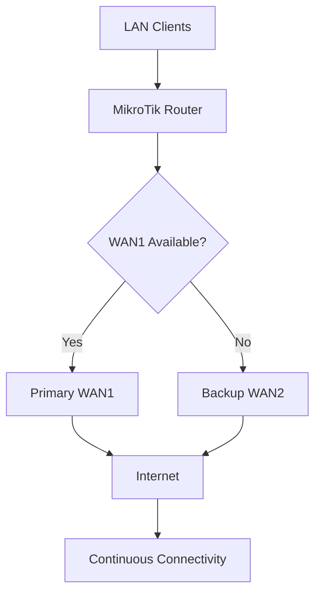
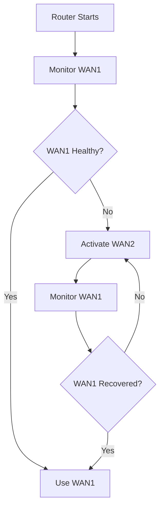

# 🗁 WAN Failover

**WAN Failover** is a network redundancy mechanism that automatically switches internet traffic from a failed primary WAN connection to an available backup WAN connection.

It helps maintain internet connectivity when an ISP connection becomes unavailable or experiences a failure.

In a multi-WAN environment, a router monitors the availability of its WAN connections and selects an alternative route when the preferred connection becomes unavailable.

WAN failover is commonly used in:

* Enterprise networks.
* ISP infrastructure.
* Data centers.
* Branch offices.
* Business networks.
* Networks requiring continuous internet connectivity.

### 🖆 Why WAN Failover Is Important

Consider a network with two internet connections:

| Connection | Role | Bandwidth |
| --- | --- | ---: |
| WAN1 | Primary | 100 Mbps |
| WAN2 | Backup | 50 Mbps |

Under normal conditions, all internet traffic uses WAN1.

If WAN1 fails, the router automatically switches traffic to WAN2.

When WAN1 becomes available again, the router can restore it as the preferred connection.

This reduces service interruption and improves network availability.

# 🗁 How WAN Failover Works

WAN failover generally uses routing preferences and health monitoring.

The router maintains multiple default routes with different administrative distances.

A lower distance indicates a more preferred route.

For example:

| WAN | Gateway | Distance | Priority |
| --- | --- | ---: | --- |
| WAN1 | `203.0.113.1` | 1 | Primary |
| WAN2 | `198.51.100.1` | 2 | Backup |

When both connections are available, the router prefers WAN1.

If WAN1 becomes unavailable and its route is removed or marked inactive, WAN2 becomes the preferred available route.

### 🖆 Failover Architecture



### 🖆 Failover Processing Flow



# 🗁 Types of WAN Failover

### 🖆 Primary and Backup Failover

This is the simplest failover design.

* WAN1 handles normal internet traffic.
* WAN2 remains available as a backup.
* WAN2 becomes active when WAN1 fails.

Example:

```text
Primary WAN: WAN1
Backup WAN:  WAN2
```

### 🖆 Multi-Level Failover

A router can use more than two WAN connections with different route priorities.

Example:

| WAN | Distance | Role |
| --- | ---: | --- |
| WAN1 | 1 | Primary |
| WAN2 | 2 | Secondary |
| WAN3 | 3 | Tertiary |

If WAN1 fails, WAN2 becomes active.

If WAN2 also fails, WAN3 becomes active.

### 🖆 Load Balancing with Failover

A network can distribute traffic across multiple WAN connections while retaining another WAN as a backup.

Example:

| WAN | Role |
| --- | --- |
| WAN1 | Load balancing |
| WAN2 | Load balancing |
| WAN3 | Backup |

If WAN1 or WAN2 fails, the remaining operational connection can continue carrying traffic. WAN3 can be used as an additional backup according to the routing design.

This architecture combines load balancing and redundancy.

# 🗁 Gateway Monitoring

Gateway monitoring is essential for reliable WAN failover.

A router must determine whether an internet connection is actually operational.

There are several ways to monitor a WAN connection.

### 🖆 Direct Gateway Monitoring

The router checks whether its directly connected ISP gateway is reachable.

For example:

```text
WAN1 Gateway: 203.0.113.1
```

If the gateway becomes unreachable, the router can consider the route unavailable.

Advantages:

* Simple configuration.
* Low monitoring overhead.
* Suitable for detecting local link or gateway failures.

Limitation:

A reachable ISP gateway does not guarantee internet connectivity.

The ISP gateway may respond while its upstream network or internet connectivity is unavailable.

### 🖆 Remote Host Monitoring

The router checks the reachability of an external IP address beyond the ISP gateway.

Examples of monitoring destinations include:

```text
1.1.1.1
8.8.8.8
```

If the monitoring destination becomes unreachable through the primary WAN, the router can switch to another connection.

Advantages:

* Detects failures beyond the directly connected gateway.
* Provides a better indication of end-to-end connectivity.

Limitations:

* The monitoring destination may be unavailable independently of the ISP.
* ICMP traffic may be filtered.
* Monitoring traffic must use the WAN being tested.
* A single monitoring target can produce misleading failure detection.

For production environments, use suitable monitoring targets and multiple independent checks.

# 🗁 WAN Failover in MikroTik RouterOS v7

RouterOS supports failover through routing preferences, route monitoring, recursive routing, and scripting.

The following examples demonstrate common approaches.

# 🗁 Network Example

Assume the following network configuration:

| Component | Configuration |
| --- | --- |
| LAN Interface | `bridge-LAN` |
| LAN Network | `192.168.10.0/24` |
| WAN1 Interface | `ether1-WAN1` |
| WAN1 Address | `203.0.113.2/30` |
| WAN1 Gateway | `203.0.113.1` |
| WAN2 Interface | `ether2-WAN2` |
| WAN2 Address | `198.51.100.2/30` |
| WAN2 Gateway | `198.51.100.1` |

The IP addresses are documentation addresses for examples. Replace them with the actual addresses assigned by your ISP.

### 🖆 Basic Failover Using Route Distance

The simplest failover configuration uses two default routes with different distances.

```routeros
/ip route
add dst-address=0.0.0.0/0 \
    gateway=203.0.113.1 \
    distance=1 \
    comment="Primary WAN1"

add dst-address=0.0.0.0/0 \
    gateway=198.51.100.1 \
    distance=2 \
    comment="Backup WAN2"
```

Explanation:

* WAN1 has distance `1`.
* WAN2 has distance `2`.
* RouterOS prefers WAN1 because it has the lower distance.
* WAN2 becomes the preferred route if WAN1's route becomes inactive.

This configuration is useful when gateway reachability is an adequate health indicator.

However, direct gateway monitoring cannot detect every upstream internet failure.

### 🖆 Enable Gateway Monitoring

RouterOS can monitor a gateway using the `check-gateway` property.

For example:

```routeros
/ip route
add dst-address=0.0.0.0/0 \
    gateway=203.0.113.1 \
    distance=1 \
    check-gateway=ping \
    comment="Primary WAN1"

add dst-address=0.0.0.0/0 \
    gateway=198.51.100.1 \
    distance=2 \
    check-gateway=ping \
    comment="Backup WAN2"
```

With `check-gateway=ping`, RouterOS periodically checks gateway reachability.

If the primary gateway becomes unreachable, its route can become inactive and the backup route can take over.

**Important:** This checks the directly configured gateway, not an arbitrary internet destination.

# 🗁 Recursive Routing for Internet Monitoring

Recursive routing allows RouterOS to monitor a remote destination while forwarding traffic through a specific ISP gateway.

Instead of monitoring only the directly connected ISP gateway, the router monitors a remote IP address beyond it.

For example:

| WAN | Monitoring Address | ISP Gateway |
| --- | --- | --- |
| WAN1 | `1.1.1.1` | `203.0.113.1` |
| WAN2 | `8.8.8.8` | `198.51.100.1` |

The router uses the monitoring addresses to determine whether each WAN path is operational.

### 🖆 Configure Monitoring Routes

First, create host routes that associate each monitoring destination with its respective ISP gateway.

```routeros
/ip route
add dst-address=1.1.1.1/32 \
    gateway=203.0.113.1 \
    scope=10 \
    comment="WAN1 monitoring route"

add dst-address=8.8.8.8/32 \
    gateway=198.51.100.1 \
    scope=10 \
    comment="WAN2 monitoring route"
```

These routes ensure that each monitoring destination is reached through its intended ISP gateway.

### 🖆 Configure Recursive Default Routes

Now create the default routes using the remote monitoring addresses as gateways.

```routeros
/ip route
add dst-address=0.0.0.0/0 \
    gateway=1.1.1.1 \
    distance=1 \
    target-scope=11 \
    check-gateway=ping \
    comment="Primary WAN1 recursive route"

add dst-address=0.0.0.0/0 \
    gateway=8.8.8.8 \
    distance=2 \
    target-scope=11 \
    check-gateway=ping \
    comment="Backup WAN2 recursive route"
```

Explanation:

* The `/32` routes direct monitoring traffic through the correct ISP gateway.
* The default routes use the monitoring destinations as recursive next hops.
* `check-gateway=ping` monitors the recursive gateway.
* `distance=1` makes WAN1 the preferred connection.
* `distance=2` makes WAN2 the backup connection.
* `target-scope` controls which routes can resolve the recursive next hop.

When WAN1 loses reachability to its monitoring destination, its recursive default route can become inactive. WAN2 then becomes the preferred route.

The monitoring destinations and routing configuration must be designed so that each target is checked through its intended WAN. Otherwise, the backup connection could accidentally make a failed primary path appear healthy.

# 🗁 Failover with PCC Load Balancing

PCC and failover can work together.

Consider this design:

| WAN | Role |
| --- | --- |
| WAN1 | Primary load-balanced connection |
| WAN2 | Secondary load-balanced connection |
| WAN3 | Backup connection |

The router distributes new connections across WAN1 and WAN2 using PCC.

If WAN1 fails, its routing path must become unavailable and new connections assigned to WAN1 must be redirected or reclassified according to the failover policy.

If WAN2 fails, the same principle applies.

A backup WAN can also be configured with a lower priority so that it becomes active when the preferred WAN paths fail.

**Important:** Adding a backup default route alone does not automatically repair every PCC connection. PCC connection marks and policy-routing tables must also account for WAN failures.

A production design should include:

* WAN-specific health monitoring.
* Route availability in each policy-routing table.
* A strategy for handling connections assigned to failed WANs.
* Appropriate connection-mark handling.
* Correct NAT for each WAN.
* Symmetric routing for inbound connections.

# 🗁 WAN Failback

**WAN Failback** is the process of returning traffic to the preferred WAN after it becomes operational again.

For example:

```text
Normal Operation:
WAN1 = Active
WAN2 = Backup

WAN1 Failure:
WAN1 = Unavailable
WAN2 = Active

WAN1 Recovery:
WAN1 = Active
WAN2 = Backup
```

When the preferred route becomes active again, its lower distance normally makes it the selected route.

Existing connections may not survive the transition because their public source address or connection path can change.

New connections can use the recovered primary WAN.

### 🖆 Failback Stability

A monitoring target that frequently becomes reachable and unreachable can cause repeated route changes.

This is known as route flapping.

To improve stability:

* Use reliable monitoring destinations.
* Avoid relying on a single unstable monitoring target.
* Configure appropriate monitoring intervals and failure detection.
* Consider recovery delays or hysteresis in more advanced monitoring designs.
* Test failover and failback behavior before deployment.

# 🗁 Important Production Considerations

### 🖆 Existing Connections

When a WAN fails, existing connections may be interrupted.

For example, a TCP connection established through WAN1 may use WAN1's public IP address.

If the connection moves to WAN2, the source IP address may change.

The remote server may treat the traffic as a different connection and reject it.

Applications may need to reconnect.

### 🖆 NAT Configuration

Each WAN should have an appropriate source NAT rule.

```routeros
/ip firewall nat
add chain=srcnat \
    out-interface=ether1-WAN1 \
    action=masquerade \
    comment="NAT through WAN1"

add chain=srcnat \
    out-interface=ether2-WAN2 \
    action=masquerade \
    comment="NAT through WAN2"
```

Masquerade uses the address of the outgoing interface.

For static WAN addresses, explicit `src-nat` rules may also be appropriate.

### 🖆 Routing Tables and Policy Routing

If the network uses multiple routing tables, verify that each table has an appropriate default route and failover policy.

A backup route in the `main` table does not automatically provide failover for traffic marked to use another routing table.

Each policy-routing table must be designed to handle the failure of its preferred WAN.

### 🖆 Monitoring Traffic

Monitoring packets must follow the path they are intended to test.

If a monitoring destination is reachable through another WAN, the router might incorrectly conclude that the failed WAN is still operational.

Use explicit routing paths for each monitoring target.

### 🖆 DNS Availability

WAN failover can restore network routing without guaranteeing that every DNS configuration will work.

Verify that DNS resolvers remain reachable through the active WAN.

For networks using ISP-provided DNS servers, consider how DNS requests behave when the preferred ISP becomes unavailable.

# 🗁 Troubleshooting WAN Failover

| Problem | Possible Cause | Solution |
| --- | --- | --- |
| Backup WAN never activates | Primary route remains active | Check gateway monitoring and route status. |
| Failover works only when the cable is disconnected | Upstream failure is not detected | Use remote monitoring with recursive routing. |
| Internet remains unavailable after failover | Incorrect backup gateway or NAT | Verify the backup route and source NAT. |
| Traffic uses the wrong ISP | Incorrect routing distance or table | Inspect active routes and routing marks. |
| Failover repeatedly switches WANs | Unstable monitoring target | Use more reliable health checks. |
| PCC traffic stops working | Policy-routing tables lack backup paths | Configure failover in each relevant table. |
| Existing sessions disconnect | Public source address changes | Allow applications to reconnect. |
| Router monitoring gives false results | Monitoring packets use another WAN | Verify target-specific routing. |

### 🖆 Verification Commands

Display the routing table:

```routeros
/ip route print
```

Display detailed route information:

```routeros
/ip route print detail
```

Inspect active routes:

```routeros
/ip route print where active
```

Check IP addresses:

```routeros
/ip address print
```

Test the primary gateway:

```routeros
/ping 203.0.113.1
```

Test the secondary gateway:

```routeros
/ping 198.51.100.1
```

Test a remote monitoring destination:

```routeros
/ping 1.1.1.1
```

Inspect WAN traffic:

```routeros
/tool torch interface=ether1-WAN1
```

```routeros
/tool torch interface=ether2-WAN2
```

# 🗁 Practical Failover Testing

A failover configuration should be tested under different failure conditions.

| Test | Action | Expected Result |
| --- | --- | --- |
| Normal operation | Keep both WANs connected | WAN1 is preferred. |
| Primary link failure | Disconnect WAN1 | WAN2 becomes active. |
| Primary gateway failure | Make WAN1 gateway unreachable | WAN2 becomes active if gateway monitoring detects the failure. |
| Upstream failure | Simulate loss beyond the ISP gateway | Recursive monitoring detects the failure. |
| Primary recovery | Restore WAN1 | WAN1 becomes preferred again. |
| Backup failure | Disconnect WAN2 while WAN1 is active | WAN1 continues carrying traffic. |

Use controlled tests and monitor route status throughout the process.

# 🗁 Advantages of WAN Failover

* Improves internet availability.
* Reduces dependency on a single ISP.
* Automatically switches to an available WAN.
* Supports primary, secondary, and tertiary connections.
* Can be combined with PCC load balancing.
* Helps maintain business and network services during ISP outages.

# 🗁 Limitations of WAN Failover

* Existing connections may disconnect during a WAN transition.
* Failover detection is not instantaneous.
* Incorrect monitoring can cause false failure detection.
* Backup bandwidth may be lower than primary bandwidth.
* Each policy-routing table requires appropriate failover handling.
* WAN failover does not guarantee uninterrupted sessions.
* DNS, VPN, and inbound services may require additional configuration.

# 🗁 Best Practices

* Use separate ISPs when possible to reduce common failure risks.
* Configure route distances according to WAN priorities.
* Use remote health monitoring when gateway-only checks are insufficient.
* Ensure monitoring traffic uses the intended WAN.
* Configure NAT for every WAN connection.
* Implement failover in policy-routing tables when using PCC.
* Monitor route state and WAN utilization.
* Test both failover and failback behavior.
* Document ISP gateways, monitoring targets, and route priorities.
* Keep backup WAN capacity appropriate for critical network traffic.

# 🗁 Key Takeaways

* WAN failover automatically switches traffic to another internet connection when the preferred WAN becomes unavailable.
* Route distance determines route preference.
* Gateway monitoring detects failures at the directly connected gateway.
* Recursive routing can monitor remote internet destinations.
* WAN failback restores the preferred connection after recovery.
* Existing connections may disconnect when their WAN path changes.
* NAT and policy-routing configurations must support every active WAN.
* PCC and WAN failover can be combined, but require coordinated connection marking and routing policies.
* Reliable monitoring and practical testing are essential for production deployments.
