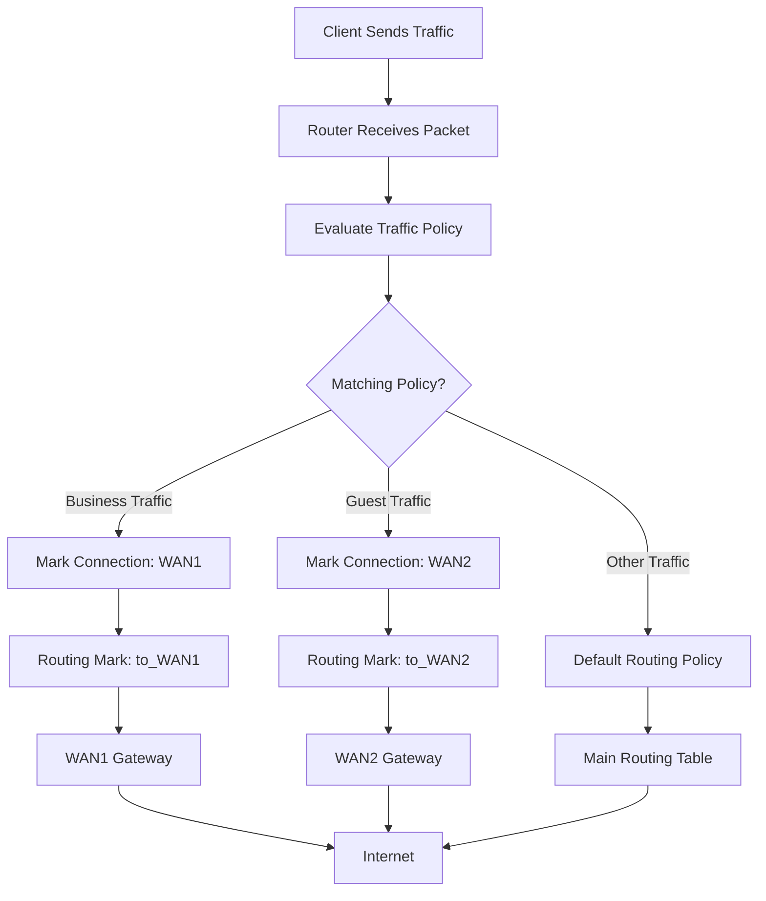
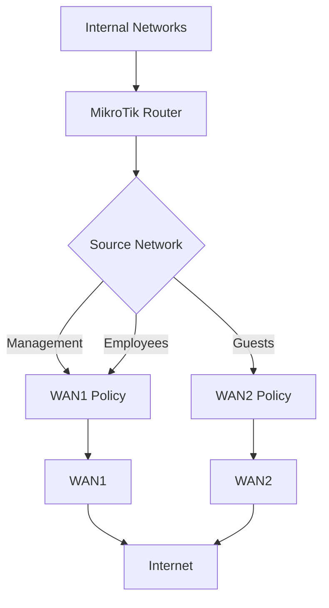

# 🗁 Policy-Based Load Balancing

**Policy-Based Load Balancing (PBL)** is a network traffic distribution technique that selects an outgoing WAN connection based on predefined routing policies.

Instead of distributing every connection equally, the router makes forwarding decisions according to specific conditions, such as:

* Source IP address.
* Destination IP address.
* Source network or subnet.
* Destination network or subnet.
* Protocol type.
* TCP or UDP port.
* Firewall connection marks.
* Routing marks.
* Application or service requirements.

Policy-based load balancing is useful when different users, departments, applications, or destinations need to use different internet connections.

For example:

* Office employees use WAN1.
* Guest Wi-Fi clients use WAN2.
* VoIP traffic uses a low-latency WAN.
* Video streaming uses a high-bandwidth WAN.
* Specific destinations use a designated ISP.

### 🖆 Why Policy-Based Load Balancing?

Consider an organization with two internet connections:

| WAN | Bandwidth | Purpose |
| --- | ---: | --- |
| WAN1 | 100 Mbps | Business applications |
| WAN2 | 200 Mbps | General internet traffic |

The network administrator may want business applications to use WAN1 while general browsing uses WAN2.

Policy-based load balancing provides this control.

It allows the administrator to define which traffic uses which WAN instead of relying only on automatic connection distribution.

# 🗁 How Policy-Based Load Balancing Works

Policy-based load balancing generally uses packet classification, connection marking, routing marking, and multiple routing tables.

The router identifies traffic that matches a policy and assigns it to the appropriate WAN.

### 🖆 Processing Flow



### 🖆 Policy-Based Routing Components

| Component | Purpose |
| --- | --- |
| Traffic classification | Identifies packets that match a policy. |
| Connection marking | Associates a connection with a selected WAN. |
| Routing marking | Selects the routing table for packets. |
| Routing table | Contains routes for a specific WAN. |
| NAT | Translates private source addresses for internet access. |

# 🗁 Policy-Based Load Balancing vs PCC

Both techniques can distribute traffic across multiple WAN connections, but their decision-making methods differ.

| Feature | PCC | Policy-Based Load Balancing |
| --- | --- | --- |
| Classification | Hash-based connection classification | Administrator-defined traffic conditions |
| Distribution | Uses classifier groups | Uses explicit routing policies |
| User-based routing | Possible with additional rules | Directly supported through policies |
| Destination-based routing | Possible with classifiers | Directly supported through policies |
| Application-based routing | Requires additional classification | Can use protocol and port conditions |
| Connection consistency | Connection-based | Can be connection-based using connection marks |
| Configuration | Classifier and routing rules | Custom classification and routing rules |

PCC is itself a classification mechanism that can be used as part of a broader policy-based routing design.

The two approaches are not mutually exclusive. A network can use policy rules for specific traffic and PCC for traffic that does not match those rules.

# 🗁 Common Policy-Based Load Balancing Scenarios

### 🖆 Source-Based Load Balancing

Different LAN networks or clients use different WAN connections.

Example:

| Source Network | Selected WAN |
| --- | --- |
| `192.168.10.0/24` | WAN1 |
| `192.168.20.0/24` | WAN2 |
| `192.168.30.0/24` | WAN1 |

This is useful when separating employee, guest, and management networks.

### 🖆 Destination-Based Load Balancing

Traffic to specific destination networks uses a designated WAN.

Example:

| Destination | Selected WAN |
| --- | --- |
| Corporate VPN network | WAN1 |
| Cloud services | WAN2 |
| General internet | Main routing table |

This approach is useful when certain external destinations must use a particular ISP.

### 🖆 Application-Based Load Balancing

Traffic can be classified using protocol and port information.

Example:

| Traffic | Selected WAN |
| --- | --- |
| VoIP SIP signaling | WAN1 |
| Business HTTPS applications | WAN1 |
| General web browsing | WAN2 |
| Bulk downloads | WAN2 |

Port-based classification does not reliably identify every application because many applications use dynamic ports, encrypted protocols, or shared services.

### 🖆 User-Based Load Balancing

Individual users or groups can be assigned to different WAN connections.

Example:

| User or Group | Selected WAN |
| --- | --- |
| Management | WAN1 |
| Employees | WAN1 |
| Guest users | WAN2 |
| Laboratory users | WAN2 |

This can be implemented using source IP addresses, address lists, VLANs, or other identity-based network controls.

# 🗁 Network Architecture Example

Consider a network with two internet connections and three internal networks.

| Component | Configuration |
| --- | --- |
| LAN Interface | `bridge-LAN` |
| Management Network | `192.168.10.0/24` |
| Employee Network | `192.168.20.0/24` |
| Guest Network | `192.168.30.0/24` |
| WAN1 Interface | `ether1-WAN1` |
| WAN1 Gateway | `203.0.113.1` |
| WAN2 Interface | `ether2-WAN2` |
| WAN2 Gateway | `198.51.100.1` |

The routing policy is:

* Management traffic uses WAN1.
* Employee traffic uses WAN1.
* Guest traffic uses WAN2.
* Other traffic uses the main routing table.

The IP addresses are documentation addresses for examples. Replace them with actual network and ISP addresses.

### 🖆 Network Diagram



# 🗁 Policy-Based Load Balancing in MikroTik RouterOS v7

The following example configures source-based WAN selection.

### 🖆 Configure Routing Tables

Create separate routing tables for both WAN connections.

```routeros
/routing table
add name=to_WAN1 fib
add name=to_WAN2 fib
```

These tables will contain the default routes for their respective WAN gateways.

### 🖆 Configure Default Routes

Add a default route to each routing table.

```routeros
/ip route
add dst-address=0.0.0.0/0 \
    gateway=203.0.113.1 \
    routing-table=to_WAN1 \
    comment="WAN1 policy route"

add dst-address=0.0.0.0/0 \
    gateway=198.51.100.1 \
    routing-table=to_WAN2 \
    comment="WAN2 policy route"
```

Add a main-table default route for traffic that does not match the source-based policies.

```routeros
/ip route
add dst-address=0.0.0.0/0 \
    gateway=203.0.113.1 \
    distance=1 \
    comment="Main default route"
```

### 🖆 Configure Connection Marking

Create connection marks for management and employee traffic.

```routeros
/ip firewall mangle
add chain=prerouting \
    in-interface=bridge-LAN \
    src-address=192.168.10.0/24 \
    dst-address-type=!local \
    connection-state=new \
    connection-mark=no-mark \
    action=mark-connection \
    new-connection-mark=WAN1_conn \
    passthrough=yes \
    comment="Management traffic through WAN1"

add chain=prerouting \
    in-interface=bridge-LAN \
    src-address=192.168.20.0/24 \
    dst-address-type=!local \
    connection-state=new \
    connection-mark=no-mark \
    action=mark-connection \
    new-connection-mark=WAN1_conn \
    passthrough=yes \
    comment="Employee traffic through WAN1"
```

Create a connection mark for guest traffic.

```routeros
/ip firewall mangle
add chain=prerouting \
    in-interface=bridge-LAN \
    src-address=192.168.30.0/24 \
    dst-address-type=!local \
    connection-state=new \
    connection-mark=no-mark \
    action=mark-connection \
    new-connection-mark=WAN2_conn \
    passthrough=yes \
    comment="Guest traffic through WAN2"
```

Explanation:

* `chain=prerouting` processes packets before the routing decision.
* `in-interface=bridge-LAN` limits the policy to LAN traffic.
* `src-address` identifies the source network.
* `dst-address-type=!local` excludes destinations belonging to the router itself.
* `connection-state=new` matches new connections.
* `connection-mark=no-mark` prevents already classified connections from being marked again.
* `action=mark-connection` assigns a connection mark.

### 🖆 Configure Routing Marks

Apply routing marks based on the connection marks.

```routeros
/ip firewall mangle
add chain=prerouting \
    in-interface=bridge-LAN \
    connection-mark=WAN1_conn \
    action=mark-routing \
    new-routing-mark=to_WAN1 \
    passthrough=no \
    comment="Route management and employee traffic through WAN1"

add chain=prerouting \
    in-interface=bridge-LAN \
    connection-mark=WAN2_conn \
    action=mark-routing \
    new-routing-mark=to_WAN2 \
    passthrough=no \
    comment="Route guest traffic through WAN2"
```

These rules direct the marked connections to their corresponding routing tables.

### 🖆 Configure Source NAT

Configure masquerade for both WAN interfaces.

```routeros
/ip firewall nat
add chain=srcnat \
    out-interface=ether1-WAN1 \
    action=masquerade \
    comment="NAT through WAN1"

add chain=srcnat \
    out-interface=ether2-WAN2 \
    action=masquerade \
    comment="NAT through WAN2"
```

The router selects the appropriate NAT rule based on the outgoing WAN interface.

# 🗁 Destination-Based Policy Routing

Policy-based routing can also select a WAN based on the destination network.

For example, assume traffic to a specific external network must use WAN2.

Destination network:

```text
198.18.0.0/15
```

Create an address list:

```routeros
/ip firewall address-list
add list=WAN2_DESTINATIONS address=198.18.0.0/15
```

Create a connection-marking rule:

```routeros
/ip firewall mangle
add chain=prerouting \
    in-interface=bridge-LAN \
    dst-address-list=WAN2_DESTINATIONS \
    dst-address-type=!local \
    connection-state=new \
    connection-mark=no-mark \
    action=mark-connection \
    new-connection-mark=WAN2_conn \
    passthrough=yes \
    comment="Selected destinations through WAN2"
```

The existing WAN2 routing-marking rule can then route these connections through the WAN2 routing table.

The example network is reserved for benchmarking and documentation. Replace it with the actual destination networks required by the policy.

**Rule order matters:** More specific destination and application policies should be evaluated before broader source-based rules. A connection should receive its intended mark only once.

# 🗁 Application-Based Policy Routing

Traffic can also be classified using IP protocols and ports.

For example, TCP traffic destined for port `443` can be assigned to WAN1.

```routeros
/ip firewall mangle
add chain=prerouting \
    in-interface=bridge-LAN \
    protocol=tcp \
    dst-port=443 \
    dst-address-type=!local \
    connection-state=new \
    connection-mark=no-mark \
    action=mark-connection \
    new-connection-mark=WAN1_conn \
    passthrough=yes \
    comment="HTTPS traffic through WAN1"
```

The WAN1 routing-marking rule then sends these connections through WAN1.

This is a basic port-based example, not a complete application-identification system.

HTTPS uses TCP port 443 in traditional deployments, but modern applications can also use QUIC over UDP port 443. If both are intended to follow the same policy, account for both protocols.

# 🗁 Combining PCC with Policy-Based Routing

PCC and policy-based routing can be combined to create flexible multi-WAN architectures.

For example:

| Traffic | Routing Method | WAN |
| --- | --- | --- |
| Management network | Source-based policy | WAN1 |
| Corporate VPN destinations | Destination-based policy | WAN1 |
| Guest network | Source-based policy | WAN2 |
| General internet traffic | PCC | WAN1 and WAN2 |

A common processing strategy is:

* Exclude internal destinations.
* Apply specific destination-based policies.
* Apply source-based policies.
* Apply application-specific policies where required.
* Use PCC for remaining eligible connections.
* Apply routing marks according to the assigned connection marks.

The exact order depends on which policy should take priority.

Avoid allowing a broad PCC rule to classify traffic before a more specific policy has been evaluated.

# 🗁 Important Routing Considerations

### 🖆 Exclude Internal Destinations

Traffic between internal networks should not be routed through an internet gateway.

Use address lists and bypass rules before applying WAN policies.

```routeros
/ip firewall address-list
add list=LOCAL_NETWORKS address=192.168.10.0/24
add list=LOCAL_NETWORKS address=192.168.20.0/24
add list=LOCAL_NETWORKS address=192.168.30.0/24
add list=LOCAL_NETWORKS address=10.10.0.0/16
```

Add a bypass rule before the policy-marking rules:

```routeros
/ip firewall mangle
add chain=prerouting \
    in-interface=bridge-LAN \
    dst-address-list=LOCAL_NETWORKS \
    action=accept \
    comment="Bypass policy routing for internal traffic"
```

Include all relevant internal, VPN, management, and provider-specific destinations.

### 🖆 Router-Originated Traffic

The examples primarily handle traffic entering from LAN interfaces.

Traffic generated by the router itself follows the `output` chain rather than the LAN-side `prerouting` chain.

If router-originated traffic needs a particular WAN, configure appropriate output-chain connection and routing marks or explicit routing rules.

### 🖆 Return Traffic and Symmetric Routing

A connection should normally use the same WAN for outgoing and return traffic.

For example, if an inbound connection arrives through WAN1, its reply should leave through WAN1.

This is especially important for:

* Port forwarding.
* Public web servers.
* VPN servers.
* Remote administration.
* Other services accessible from the internet.

Mark inbound connections according to their ingress WAN and configure the corresponding routing policy for their reply traffic.

### 🖆 FastTrack

FastTrack can bypass mangle processing for FastTracked connections.

If policy-routed traffic is FastTracked, routing behavior may become inconsistent.

Review existing FastTrack rules and exclude connections that require policy routing, unless the complete configuration has been designed and tested to support them.

### 🖆 WAN Failover

Policy-based routing tables need their own appropriate failover behavior.

A backup default route in the main routing table does not automatically guarantee that traffic marked for `to_WAN1` or `to_WAN2` will use the backup connection.

Configure route monitoring and backup routes in the relevant routing tables.

### 🖆 DHCP and PPPoE Gateways

The examples use static ISP gateway addresses.

If a WAN obtains its address through DHCP or PPPoE, adapt the gateway configuration to the actual interface and dynamic routing behavior.

Ensure that gateway changes do not leave policy-routing tables with invalid next hops.

# 🗁 Troubleshooting Policy-Based Load Balancing

| Problem | Possible Cause | Solution |
| --- | --- | --- |
| Traffic uses the wrong WAN | Incorrect policy or rule order | Review mangle rules and connection marks. |
| Some networks cannot access the internet | Missing default route in a policy table | Verify each routing table. |
| Internal traffic uses an ISP | Missing internal-network exclusions | Add bypass rules before policy classification. |
| HTTPS traffic follows the wrong WAN | Broader rule executes first | Review classification priority. |
| Connections disconnect | Return traffic uses another WAN | Implement symmetric routing. |
| Router services use the wrong WAN | Router-originated traffic is not covered | Configure output-chain routing or explicit routes. |
| Policy rules appear inactive | Incorrect interface or source network | Verify addresses and rule counters. |
| PCC and policy rules conflict | Overlapping connection-marking rules | Define explicit policy priority. |
| Failover does not work | Backup routes are missing from policy tables | Configure WAN-specific failover. |

### 🖆 Verification Commands

Inspect mangle rules and counters:

```routeros
/ip firewall mangle print stats
```

Inspect connection tracking:

```routeros
/ip firewall connection print
```

Inspect routing tables:

```routeros
/routing table print
```

Inspect all routes:

```routeros
/ip route print detail
```

Inspect active routes:

```routeros
/ip route print where active
```

Inspect NAT rules and counters:

```routeros
/ip firewall nat print stats
```

Monitor WAN1 traffic:

```routeros
/tool torch interface=ether1-WAN1
```

Monitor WAN2 traffic:

```routeros
/tool torch interface=ether2-WAN2
```

# 🗁 Advantages of Policy-Based Load Balancing

* Provides granular traffic control.
* Supports source-based routing.
* Supports destination-based routing.
* Can direct selected protocols and ports through specific WANs.
* Allows different users and departments to use different internet connections.
* Can be combined with PCC.
* Supports complex enterprise and ISP network requirements.

# 🗁 Limitations of Policy-Based Load Balancing

* Requires careful rule design.
* Incorrect rule order can produce unexpected routing decisions.
* Return traffic may require additional connection marking.
* Each policy-routing table needs appropriate routes.
* Application identification based only on ports is limited.
* FastTrack can interfere with mangle-based policy routing.
* WAN failures require additional monitoring and failover configuration.
* More policies increase configuration and troubleshooting complexity.

# 🗁 Best Practices

* Define clear routing policies before configuring mangle rules.
* Use meaningful connection-mark and routing-table names.
* Apply specific policies before general policies.
* Exclude internal and VPN destinations from internet routing policies.
* Use connection marks to maintain connection consistency.
* Configure a default route in every required policy-routing table.
* Configure source NAT for every WAN.
* Handle inbound connections and return traffic carefully.
* Review FastTrack configuration.
* Integrate WAN failover into policy-routing tables.
* Monitor rule counters and actual WAN utilization.
* Document the purpose and priority of every routing policy.

# 🗁 Key Takeaways

* Policy-based load balancing selects WAN connections according to predefined traffic policies.
* Policies can use source addresses, destination addresses, protocols, ports, and connection marks.
* Connection marks associate connections with a selected WAN.
* Routing marks select the appropriate routing table.
* Separate routing tables provide independent WAN forwarding paths.
* PCC can be combined with policy-based routing for traffic that does not match specific policies.
* Internal destinations, return traffic, NAT, and FastTrack require careful consideration.
* Reliable policy-based routing depends on correct rule ordering and routing-table configuration.
