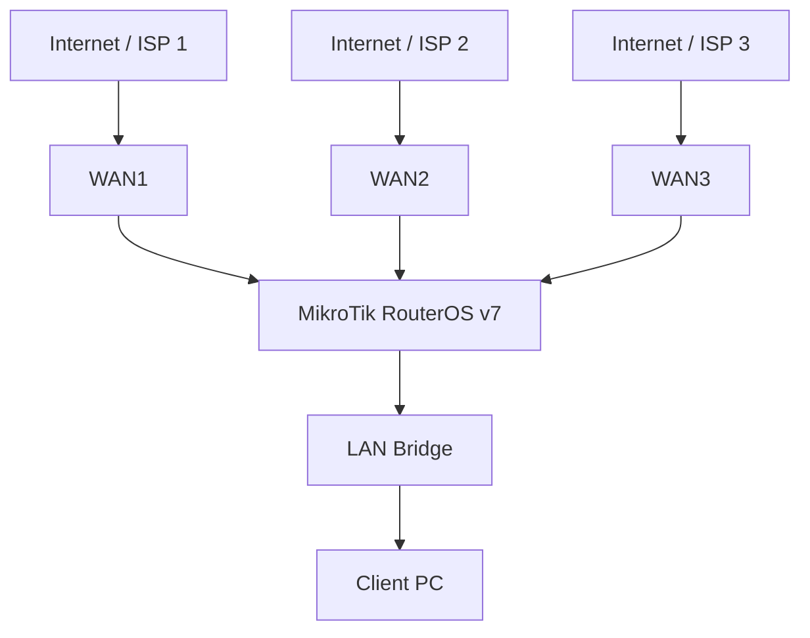

# 🗁 Load Balancing Labs

This section contains practical networking labs for implementing, testing, and troubleshooting multi-WAN load balancing using MikroTik RouterOS v7.

The labs cover different load balancing techniques, including:

* Equal-cost multi-path (ECMP) routing.
* Per-connection load balancing.
* Per-packet load balancing.
* PCC load balancing.
* WAN failover.
* Policy-based load balancing.
* Weighted load balancing.
* Multi-WAN monitoring and troubleshooting.

The objective is to understand how multiple internet connections can be configured, managed, and monitored in a real-world network environment.

# 🗁 Lab Environment

You can perform these labs using:

* MikroTik RouterOS v7.
* MikroTik CHR (Cloud Hosted Router).
* VirtualBox.
* VMware Workstation.
* GNS3.
* EVE-NG.
* Physical MikroTik routers.

### 🖆 Required Network Components

| Component | Purpose |
| --- | --- |
| MikroTik RouterOS v7 | Main router |
| WAN1 | First internet connection |
| WAN2 | Second internet connection |
| WAN3 | Optional third internet connection |
| LAN | Internal client network |
| Client PC | Testing connectivity |
| Internet test destinations | Connectivity verification |

### 🖆 Example IP Addressing

Use the following addressing plan throughout the labs unless a particular lab specifies otherwise.

| Interface | IP Address | Network / Gateway |
| --- | --- | --- |
| `ether1-WAN1` | `203.0.113.2/30` | Gateway: `203.0.113.1` |
| `ether2-WAN2` | `198.51.100.2/30` | Gateway: `198.51.100.1` |
| `ether3-WAN3` | `192.0.2.2/30` | Gateway: `192.0.2.1` |
| `bridge-LAN` | `192.168.10.1/24` | LAN network |

These are documentation addresses reserved for examples. Replace them with addresses appropriate for your lab environment.

### 🖆 Basic Network Topology



# 🗁 Lab: Configure Basic Multi-WAN Connectivity

### 🖆 Objective

Configure two WAN interfaces and one LAN interface.

Verify that the router can reach both ISP gateways and that LAN clients can access the internet.

### 🖆 Configuration

Create a LAN bridge:

```routeros
/interface bridge
add name=bridge-LAN
```

Add the LAN interface to the bridge:

```routeros
/interface bridge port
add bridge=bridge-LAN interface=ether4
```

Configure interface addresses:

```routeros
/ip address
add address=203.0.113.2/30 interface=ether1-WAN1
add address=198.51.100.2/30 interface=ether2-WAN2
add address=192.168.10.1/24 interface=bridge-LAN
```

Configure a default route through WAN1:

```routeros
/ip route
add dst-address=0.0.0.0/0 gateway=203.0.113.1
```

Configure source NAT:

```routeros
/ip firewall nat
add chain=srcnat out-interface=ether1-WAN1 action=masquerade
```

### 🖆 Testing

From the MikroTik router, test both ISP gateways:

```routeros
/ping 203.0.113.1
```

```routeros
/ping 198.51.100.1
```

From a LAN client, test internet connectivity:

```bash
ping -c 4 1.1.1.1
```

Test DNS resolution:

```bash
nslookup example.com
```

### 🖆 Expected Result

* Both ISP gateways should be reachable.
* The router should use WAN1 as its default internet connection.
* LAN clients should access the internet through WAN1.
* WAN2 should remain available for subsequent labs.

# 🗁 Lab: Configure ECMP Load Balancing

### 🖆 Objective

Configure two equal-cost default routes and observe how RouterOS distributes traffic across available WAN paths.

### 🖆 Configuration

Remove the previous default route if it exists:

```routeros
/ip route
remove [find where dst-address=0.0.0.0/0]
```

Add two default routes with the same distance:

```routeros
/ip route
add dst-address=0.0.0.0/0 \
    gateway=203.0.113.1 \
    distance=1 \
    comment="ECMP WAN1"

add dst-address=0.0.0.0/0 \
    gateway=198.51.100.1 \
    distance=1 \
    comment="ECMP WAN2"
```

Configure NAT for both WANs:

```routeros
/ip firewall nat
add chain=srcnat out-interface=ether1-WAN1 action=masquerade
add chain=srcnat out-interface=ether2-WAN2 action=masquerade
```

### 🖆 Testing

Inspect the active default routes:

```routeros
/ip route print where dst-address=0.0.0.0/0
```

Generate multiple connections from LAN clients.

Monitor both WAN interfaces:

```routeros
/tool torch interface=ether1-WAN1
```

```routeros
/tool torch interface=ether2-WAN2
```

### 🖆 Expected Result

* Both equal-cost routes should be available.
* Traffic distribution should follow the configured ECMP behavior.
* Multiple connections may use different WAN paths.
* Individual connection behavior depends on the RouterOS routing and hashing configuration.

**Observation:** ECMP is not necessarily per-packet load balancing. Do not assume that two equal-cost routes will split every connection or every packet equally.

# 🗁 Lab: Configure Per-Connection Load Balancing

### 🖆 Objective

Understand connection-based distribution across two WAN connections.

### 🖆 Configuration

For this lab, use the two WAN interfaces and the LAN bridge configured previously.

Create two routing tables:

```routeros
/routing table
add name=to_WAN1 fib
add name=to_WAN2 fib
```

Add default routes:

```routeros
/ip route
add dst-address=0.0.0.0/0 gateway=203.0.113.1 routing-table=to_WAN1
add dst-address=0.0.0.0/0 gateway=198.51.100.1 routing-table=to_WAN2
```

Create connection marks using the source address.

```routeros
/ip firewall mangle
add chain=prerouting \
    in-interface=bridge-LAN \
    dst-address-type=!local \
    connection-state=new \
    connection-mark=no-mark \
    per-connection-classifier=src-address:2/0 \
    action=mark-connection \
    new-connection-mark=WAN1_conn \
    passthrough=yes

add chain=prerouting \
    in-interface=bridge-LAN \
    dst-address-type=!local \
    connection-state=new \
    connection-mark=no-mark \
    per-connection-classifier=src-address:2/1 \
    action=mark-connection \
    new-connection-mark=WAN2_conn \
    passthrough=yes
```

Apply routing marks:

```routeros
/ip firewall mangle
add chain=prerouting \
    in-interface=bridge-LAN \
    connection-mark=WAN1_conn \
    action=mark-routing \
    new-routing-mark=to_WAN1 \
    passthrough=no

add chain=prerouting \
    in-interface=bridge-LAN \
    connection-mark=WAN2_conn \
    action=mark-routing \
    new-routing-mark=to_WAN2 \
    passthrough=no
```

Configure NAT:

```routeros
/ip firewall nat
add chain=srcnat out-interface=ether1-WAN1 action=masquerade
add chain=srcnat out-interface=ether2-WAN2 action=masquerade
```

### 🖆 Testing

Generate connections from multiple LAN clients.

Check connection marks:

```routeros
/ip firewall connection print
```

Inspect mangle counters:

```routeros
/ip firewall mangle print stats
```

Monitor both WAN interfaces.

### 🖆 Expected Result

* Connections from different source IP addresses should be assigned to different classification groups.
* Each client tends to use the same WAN for connections to different destinations when `src-address` is used.
* Connections from one source address may concentrate on one WAN.

**Observation:** Source-address classification does not guarantee an even distribution when there are only a few clients.

# 🗁 Lab: Configure PCC Load Balancing

### 🖆 Objective

Configure PCC to distribute new LAN connections across two WAN connections.

### 🖆 Configuration

Create routing tables:

```routeros
/routing table
add name=to_WAN1 fib
add name=to_WAN2 fib
```

Configure default routes:

```routeros
/ip route
add dst-address=0.0.0.0/0 gateway=203.0.113.1 routing-table=to_WAN1
add dst-address=0.0.0.0/0 gateway=198.51.100.1 routing-table=to_WAN2
```

Configure PCC connection marking:

```routeros
/ip firewall mangle
add chain=prerouting \
    in-interface=bridge-LAN \
    dst-address-type=!local \
    connection-state=new \
    connection-mark=no-mark \
    per-connection-classifier=both-addresses-and-ports:2/0 \
    action=mark-connection \
    new-connection-mark=WAN1_conn \
    passthrough=yes

add chain=prerouting \
    in-interface=bridge-LAN \
    dst-address-type=!local \
    connection-state=new \
    connection-mark=no-mark \
    per-connection-classifier=both-addresses-and-ports:2/1 \
    action=mark-connection \
    new-connection-mark=WAN2_conn \
    passthrough=yes
```

Configure routing marks:

```routeros
/ip firewall mangle
add chain=prerouting \
    in-interface=bridge-LAN \
    connection-mark=WAN1_conn \
    action=mark-routing \
    new-routing-mark=to_WAN1 \
    passthrough=no

add chain=prerouting \
    in-interface=bridge-LAN \
    connection-mark=WAN2_conn \
    action=mark-routing \
    new-routing-mark=to_WAN2 \
    passthrough=no
```

Configure NAT:

```routeros
/ip firewall nat
add chain=srcnat out-interface=ether1-WAN1 action=masquerade
add chain=srcnat out-interface=ether2-WAN2 action=masquerade
```

### 🖆 Testing

Inspect connection marks:

```routeros
/ip firewall connection print
```

Inspect PCC rule counters:

```routeros
/ip firewall mangle print stats
```

Monitor traffic on both WANs:

```routeros
/tool torch interface=ether1-WAN1
```

```routeros
/tool torch interface=ether2-WAN2
```

### 🖆 Expected Result

* New connections should be classified into two groups.
* WAN1 should receive connections assigned to group `2/0`.
* WAN2 should receive connections assigned to group `2/1`.
* Both WANs should carry traffic when sufficient connections are generated.

**Observation:** PCC distributes connections, not guaranteed bandwidth percentages. A small number of connections may produce an uneven traffic distribution.

# 🗁 Lab: Configure Weighted PCC

### 🖆 Objective

Distribute connections according to different WAN capacities.

Assume:

| WAN | Bandwidth |
| --- | ---: |
| WAN1 | 100 Mbps |
| WAN2 | 50 Mbps |

The desired connection distribution ratio is approximately:

```text
WAN1 : WAN2 = 2 : 1
```

### 🖆 Configuration

Use three PCC classification groups:

* `3/0` → WAN1.
* `3/1` → WAN1.
* `3/2` → WAN2.

```routeros
/ip firewall mangle
add chain=prerouting \
    in-interface=bridge-LAN \
    dst-address-type=!local \
    connection-state=new \
    connection-mark=no-mark \
    per-connection-classifier=both-addresses-and-ports:3/0 \
    action=mark-connection \
    new-connection-mark=WAN1_conn \
    passthrough=yes

add chain=prerouting \
    in-interface=bridge-LAN \
    dst-address-type=!local \
    connection-state=new \
    connection-mark=no-mark \
    per-connection-classifier=both-addresses-and-ports:3/1 \
    action=mark-connection \
    new-connection-mark=WAN1_conn \
    passthrough=yes

add chain=prerouting \
    in-interface=bridge-LAN \
    dst-address-type=!local \
    connection-state=new \
    connection-mark=no-mark \
    per-connection-classifier=both-addresses-and-ports:3/2 \
    action=mark-connection \
    new-connection-mark=WAN2_conn \
    passthrough=yes
```

Use the routing-marking rules from the PCC lab to direct each connection mark to its corresponding routing table.

### 🖆 Testing

Generate many new connections.

Inspect PCC counters:

```routeros
/ip firewall mangle print stats
```

Monitor both WAN interfaces:

```routeros
/tool torch interface=ether1-WAN1
```

```routeros
/tool torch interface=ether2-WAN2
```

### 🖆 Expected Result

* WAN1 receives two classification groups.
* WAN2 receives one classification group.
* The expected connection-count ratio is approximately 2:1.

**Observation:** Connection count and bandwidth consumption are different measurements. A 2:1 connection ratio does not guarantee a 2:1 bandwidth ratio.

# 🗁 Lab: Configure WAN Failover

### 🖆 Objective

Configure WAN1 as the primary connection and WAN2 as the backup connection.

### 🖆 Configuration

Remove previous default routes if necessary:

```routeros
/ip route
remove [find where dst-address=0.0.0.0/0]
```

Configure primary and backup routes:

```routeros
/ip route
add dst-address=0.0.0.0/0 \
    gateway=203.0.113.1 \
    distance=1 \
    check-gateway=ping \
    comment="Primary WAN1"

add dst-address=0.0.0.0/0 \
    gateway=198.51.100.1 \
    distance=2 \
    check-gateway=ping \
    comment="Backup WAN2"
```

Configure NAT:

```routeros
/ip firewall nat
add chain=srcnat out-interface=ether1-WAN1 action=masquerade
add chain=srcnat out-interface=ether2-WAN2 action=masquerade
```

### 🖆 Testing

Inspect the active default route:

```routeros
/ip route print where active
```

Disconnect WAN1 or make its gateway unreachable.

Inspect the routing table again:

```routeros
/ip route print detail
```

Restore WAN1 and observe route selection.

### 🖆 Expected Result

* WAN1 is preferred during normal operation.
* WAN2 becomes preferred when WAN1's monitored gateway becomes unreachable.
* WAN1 becomes preferred again after recovery.

**Observation:** `check-gateway=ping` checks the directly configured gateway. For detecting failures beyond the ISP gateway, use a properly designed recursive-routing health check.

# 🗁 Lab: Configure Source-Based Policy Routing

### 🖆 Objective

Send different LAN networks through different WAN connections.

Assume:

| Source Network | WAN |
| --- | --- |
| `192.168.10.0/24` | WAN1 |
| `192.168.20.0/24` | WAN2 |

### 🖆 Configuration

Create routing tables:

```routeros
/routing table
add name=to_WAN1 fib
add name=to_WAN2 fib
```

Configure default routes:

```routeros
/ip route
add dst-address=0.0.0.0/0 gateway=203.0.113.1 routing-table=to_WAN1
add dst-address=0.0.0.0/0 gateway=198.51.100.1 routing-table=to_WAN2
```

Create connection marks:

```routeros
/ip firewall mangle
add chain=prerouting \
    in-interface=bridge-LAN \
    src-address=192.168.10.0/24 \
    dst-address-type=!local \
    connection-state=new \
    connection-mark=no-mark \
    action=mark-connection \
    new-connection-mark=WAN1_conn \
    passthrough=yes

add chain=prerouting \
    in-interface=bridge-LAN \
    src-address=192.168.20.0/24 \
    dst-address-type=!local \
    connection-state=new \
    connection-mark=no-mark \
    action=mark-connection \
    new-connection-mark=WAN2_conn \
    passthrough=yes
```

Apply routing marks:

```routeros
/ip firewall mangle
add chain=prerouting \
    in-interface=bridge-LAN \
    connection-mark=WAN1_conn \
    action=mark-routing \
    new-routing-mark=to_WAN1 \
    passthrough=no

add chain=prerouting \
    in-interface=bridge-LAN \
    connection-mark=WAN2_conn \
    action=mark-routing \
    new-routing-mark=to_WAN2 \
    passthrough=no
```

Configure NAT for both WANs:

```routeros
/ip firewall nat
add chain=srcnat out-interface=ether1-WAN1 action=masquerade
add chain=srcnat out-interface=ether2-WAN2 action=masquerade
```

### 🖆 Testing

Generate traffic from clients in both networks.

Inspect connection marks:

```routeros
/ip firewall connection print
```

Monitor WAN interfaces using Torch.

### 🖆 Expected Result

* Traffic from `192.168.10.0/24` uses WAN1.
* Traffic from `192.168.20.0/24` uses WAN2.
* Both networks can access the internet through their assigned connections.

# 🗁 Lab: Configure Three-WAN PCC

### 🖆 Objective

Distribute new LAN connections across three WAN connections.

Assume:

| WAN | Gateway | PCC Group |
| --- | --- | --- |
| WAN1 | `203.0.113.1` | `3/0` |
| WAN2 | `198.51.100.1` | `3/1` |
| WAN3 | `192.0.2.1` | `3/2` |

### 🖆 Configuration

Create routing tables:

```routeros
/routing table
add name=to_WAN1 fib
add name=to_WAN2 fib
add name=to_WAN3 fib
```

Add default routes:

```routeros
/ip route
add dst-address=0.0.0.0/0 gateway=203.0.113.1 routing-table=to_WAN1
add dst-address=0.0.0.0/0 gateway=198.51.100.1 routing-table=to_WAN2
add dst-address=0.0.0.0/0 gateway=192.0.2.1 routing-table=to_WAN3
```

Create PCC connection-marking rules:

```routeros
/ip firewall mangle
add chain=prerouting \
    in-interface=bridge-LAN \
    dst-address-type=!local \
    connection-state=new \
    connection-mark=no-mark \
    per-connection-classifier=both-addresses-and-ports:3/0 \
    action=mark-connection \
    new-connection-mark=WAN1_conn \
    passthrough=yes

add chain=prerouting \
    in-interface=bridge-LAN \
    dst-address-type=!local \
    connection-state=new \
    connection-mark=no-mark \
    per-connection-classifier=both-addresses-and-ports:3/1 \
    action=mark-connection \
    new-connection-mark=WAN2_conn \
    passthrough=yes

add chain=prerouting \
    in-interface=bridge-LAN \
    dst-address-type=!local \
    connection-state=new \
    connection-mark=no-mark \
    per-connection-classifier=both-addresses-and-ports:3/2 \
    action=mark-connection \
    new-connection-mark=WAN3_conn \
    passthrough=yes
```

Create routing-marking rules for all three connection marks:

```routeros
/ip firewall mangle
add chain=prerouting \
    in-interface=bridge-LAN \
    connection-mark=WAN1_conn \
    action=mark-routing \
    new-routing-mark=to_WAN1 \
    passthrough=no

add chain=prerouting \
    in-interface=bridge-LAN \
    connection-mark=WAN2_conn \
    action=mark-routing \
    new-routing-mark=to_WAN2 \
    passthrough=no

add chain=prerouting \
    in-interface=bridge-LAN \
    connection-mark=WAN3_conn \
    action=mark-routing \
    new-routing-mark=to_WAN3 \
    passthrough=no
```

Configure NAT:

```routeros
/ip firewall nat
add chain=srcnat out-interface=ether1-WAN1 action=masquerade
add chain=srcnat out-interface=ether2-WAN2 action=masquerade
add chain=srcnat out-interface=ether3-WAN3 action=masquerade
```

### 🖆 Testing

Inspect connection marks:

```routeros
/ip firewall connection print
```

Check rule counters:

```routeros
/ip firewall mangle print stats
```

Monitor all three WAN interfaces.

### 🖆 Expected Result

* PCC classifies new connections into three groups.
* Each group uses its assigned routing table.
* All three WAN connections carry traffic when enough connections are generated.

# 🗁 Lab: Verify and Troubleshoot Load Balancing

### 🖆 Objective

Learn how to identify common multi-WAN configuration problems using RouterOS monitoring and diagnostic commands.

### 🖆 Useful Commands

Inspect routing tables:

```routeros
/routing table print
```

Inspect active routes:

```routeros
/ip route print where active
```

Inspect detailed routes:

```routeros
/ip route print detail
```

Inspect firewall mangle rules:

```routeros
/ip firewall mangle print stats
```

Inspect connection tracking:

```routeros
/ip firewall connection print
```

Inspect NAT counters:

```routeros
/ip firewall nat print stats
```

Check interface status:

```routeros
/interface print
```

Monitor WAN1:

```routeros
/tool torch interface=ether1-WAN1
```

Monitor WAN2:

```routeros
/tool torch interface=ether2-WAN2
```

Test connectivity:

```routeros
/ping 1.1.1.1
```

Test DNS resolution from a Linux client:

```bash
nslookup example.com
```

### 🖆 Troubleshooting Scenarios

| Scenario | Possible Cause | Investigation |
| --- | --- | --- |
| WAN1 carries all traffic | Incorrect PCC rules or insufficient new connections | Inspect PCC counters and connection marks. |
| WAN2 receives no traffic | Missing routing table or inactive route | Inspect `to_WAN2` and its default route. |
| LAN clients cannot access the internet | NAT or route configuration issue | Inspect routes, NAT counters, and firewall rules. |
| Failover does not activate | Gateway monitoring is not detecting failure | Inspect route status and gateway reachability. |
| Internal traffic uses a WAN | Missing internal destination exclusions | Review mangle rule order. |
| Connections disconnect frequently | Asymmetric routing or WAN instability | Inspect connection marks and return paths. |
| PCC rules do not match traffic | Incorrect ingress interface or source network | Check interface and address configuration. |

# 🗁 Important Lab Considerations

### 🖆 Rule Order

RouterOS firewall rules are processed in order.

Place internal-network exclusions and specific routing policies before general PCC rules.

A poorly ordered rule set may classify traffic incorrectly.

### 🖆 Connection Tracking

PCC and policy-based routing depend on connection tracking.

Existing connections may retain their previous connection marks after rule changes.

Use new test connections when evaluating modified configurations.

### 🖆 FastTrack

FastTrack can bypass mangle processing for FastTracked connections.

Exclude policy-routed traffic from FastTrack or configure FastTrack carefully for the complete routing design.

### 🖆 Router-Originated Traffic

The labs primarily cover LAN-originated traffic.

Router-generated traffic requires separate policy-routing treatment through the `output` chain or appropriate routing configuration.

### 🖆 Return Traffic

Inbound connections and their replies may require WAN-specific connection marking to maintain symmetric routing.

This is especially important when testing port forwarding, VPN services, and publicly accessible servers.

### 🖆 Lab Isolation

When working in VirtualBox, GNS3, or EVE-NG, isolate your lab network from production networks.

Use documentation IP ranges or private addressing for simulated ISP networks, and ensure that no test routing configuration accidentally affects your real network.

# 🗁 Practical Challenges

Complete these challenges after finishing the labs.

| Challenge | Requirement |
| --- | --- |
| Two-WAN ECMP | Configure two equal-cost default routes. |
| Two-WAN PCC | Distribute connections across two ISPs. |
| Three-WAN PCC | Distribute connections across three ISPs. |
| Weighted PCC | Configure a 2:1 distribution ratio. |
| WAN Failover | Configure a primary and backup WAN. |
| Recursive Monitoring | Monitor remote destinations through individual WANs. |
| Source-Based Routing | Assign different LAN networks to different WANs. |
| Destination-Based Routing | Send selected destination networks through a specific ISP. |
| PCC with Failover | Combine connection distribution with WAN health monitoring. |
| Multi-WAN Troubleshooting | Diagnose routing, NAT, connection-marking, and failover problems. |

# 🗁 Expected Learning Outcomes

After completing these labs, you should be able to:

* Configure multiple WAN interfaces.
* Understand and configure ECMP routing.
* Implement connection-based load balancing.
* Configure PCC for two or more WAN connections.
* Create weighted connection-distribution policies.
* Configure primary and backup WAN connections.
* Understand recursive routing and gateway monitoring.
* Implement source-based and destination-based policy routing.
* Combine PCC with WAN failover.
* Verify traffic distribution using RouterOS diagnostic tools.
* Troubleshoot common multi-WAN routing problems.

# 🗁 Key Takeaways

* Multi-WAN networking uses multiple internet connections to improve connectivity and network utilization.
* ECMP provides multiple equal-cost routing paths.
* PCC classifies connections into groups for WAN distribution.
* Weighted PCC allows different connection-distribution ratios.
* WAN failover provides an alternative route when a preferred connection becomes unavailable.
* Policy-based routing selects WAN connections according to predefined traffic conditions.
* Correct routing tables, connection marks, NAT, and return-path handling are essential.
* Monitoring and troubleshooting are important parts of a reliable multi-WAN deployment.
