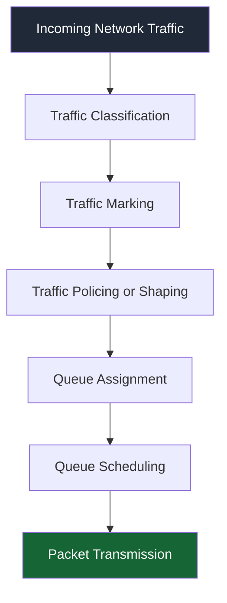

# 🗁  QoS Fundamentals

Quality of Service (QoS) is a collection of networking mechanisms used to manage, control, and prioritize network traffic.

Its primary purpose is to ensure that important network traffic receives appropriate treatment when network resources are limited or congestion occurs.

Without QoS, network devices generally forward packets according to their normal forwarding behavior, without considering whether the traffic belongs to a voice call, video conference, file transfer, or ordinary web browsing session.

QoS allows network administrators to apply different policies to different traffic types based on application requirements, business priorities, and network conditions.

# 🗁 Why QoS Is Important

Network bandwidth is a limited resource. When multiple devices and applications compete for available bandwidth, congestion can occur.

For example, consider an office network with a 100 Mbps internet connection:

| Application | Bandwidth Requirement | Priority |
| --- | ---: | --- |
| VoIP calls | 1 Mbps | High |
| Video conferencing | 10 Mbps | High |
| Business applications | 15 Mbps | High |
| Web browsing | 20 Mbps | Medium |
| File downloads | 50 Mbps | Low |

If file downloads consume most of the available bandwidth, voice calls and video conferences may experience poor performance.

QoS helps manage this situation by prioritizing latency-sensitive traffic and controlling how available bandwidth is distributed.

# 🗁 Main Objectives of QoS

QoS is designed to achieve several important objectives:

* **Traffic Prioritization:** Give important traffic preferential treatment.
* **Bandwidth Management:** Control how bandwidth is distributed among users and applications.
* **Congestion Management:** Manage packet queues when traffic exceeds available capacity.
* **Latency Control:** Reduce excessive delays for time-sensitive applications.
* **Jitter Reduction:** Minimize variations in packet delivery time.
* **Packet Loss Reduction:** Reduce packet drops caused by congestion.
* **Fair Resource Allocation:** Distribute available bandwidth according to defined policies.

QoS cannot create additional bandwidth. It manages how existing network resources are used.

# 🗁 QoS Quality Parameters

Network quality is commonly evaluated using several performance parameters.

| Parameter | Description | Impact |
| --- | --- | --- |
| Bandwidth | Maximum theoretical or configured data-transfer capacity | Determines available capacity |
| Throughput | Actual amount of data transferred over time | Indicates achieved performance |
| Latency | Time required for data to travel from source to destination | Affects responsiveness |
| Jitter | Variation in packet delay | Affects real-time communication |
| Packet Loss | Percentage of packets that fail to reach their destination | Affects reliability |

These parameters are closely related, but they represent different aspects of network performance.

For detailed explanations, see [Bandwidth vs Throughput](02-bandwidth-vs-throughput.md) and [Latency, Jitter, and Packet Loss](03-latency-jitter-and-packet-loss.md).

# 🗁 How QoS Works

QoS generally works through a sequence of traffic-management operations.

A network device can identify traffic, classify packets, assign priorities, place packets into queues, and schedule their transmission.

A simplified QoS processing sequence looks like this:

The exact processing order and available mechanisms depend on the network device, operating system, and QoS architecture.

# 🗁 Traffic Classification

Traffic classification is the process of identifying network packets and grouping them according to specific characteristics.

A network device can classify traffic using:

* Source IP address.
* Destination IP address.
* Source and destination port numbers.
* Transport protocol, such as TCP or UDP.
* Network interface.
* VLAN information.
* DSCP values.
* Application-specific identification, where supported.

For example:

| Traffic Type | Identification Example |
| --- | --- |
| DNS | UDP/TCP port 53 |
| HTTP | TCP port 80 |
| HTTPS | TCP port 443 |
| SSH | TCP port 22 |
| VoIP | Application-specific ports and protocols |
| Video conferencing | Application-specific traffic characteristics |

Classification rules should be designed carefully because applications may use dynamic ports, encrypted traffic, or shared transport protocols.

# 🗁 Traffic Marking

Traffic marking assigns identifiers to packets so that network devices can recognize their intended forwarding treatment.

One common mechanism is Differentiated Services Code Point (DSCP).

DSCP is a 6-bit field in the IP header used to identify traffic classes.

It provides 64 possible codepoint values, ranging from 0 to 63.

Common DSCP values include:

| DSCP Name | Decimal Value | Typical Purpose |
| --- | ---: | --- |
| Default Forwarding (DF) | 0 | Best-effort traffic |
| Class Selector 1 (CS1) | 8 | Low-priority traffic |
| Assured Forwarding 41 (AF41) | 34 | Higher-priority assured forwarding |
| Expedited Forwarding (EF) | 46 | Low-latency traffic, commonly voice |

DSCP markings communicate traffic-handling requirements, but they do not automatically guarantee bandwidth or priority.

Network devices must be configured to honor and process these markings.

# 🗁 Traffic Queuing

Queuing is the process of temporarily storing packets before transmitting them through an interface.

When incoming traffic exceeds the interface's transmission capacity, packets may wait in queues.

For example, if a router receives 150 Mbps of traffic but its outgoing interface can transmit only 100 Mbps, the router must manage the excess traffic.

QoS queueing mechanisms determine how packets are stored and selected for transmission.

Common queueing approaches include:

* First-In, First-Out (FIFO).
* Priority Queuing (PQ).
* Weighted Fair Queuing (WFQ).
* Class-Based Weighted Fair Queuing (CBWFQ).
* Hierarchical Token Bucket (HTB).

Different network platforms implement these mechanisms differently.

# 🗁 QoS Scheduling

Queue scheduling determines which queued packets are transmitted and when.

Common scheduling approaches include:

| Scheduling Method | Description |
| --- | --- |
| FIFO | Transmits packets in arrival order |
| Strict Priority | Serves higher-priority queues before lower-priority queues |
| Round Robin | Takes turns serving queues |
| Weighted Round Robin | Allocates service according to configured weights |
| Fair Queuing | Attempts to distribute transmission opportunities fairly |
| Weighted Fair Queuing | Uses weights to control bandwidth distribution among traffic classes |

Strict priority scheduling can reduce delays for critical traffic, but lower-priority queues may experience starvation if high-priority traffic continuously consumes available capacity.

# 🗁 Best-Effort vs QoS-Based Traffic

Best-effort forwarding treats network packets without providing differentiated service guarantees.

QoS-based forwarding applies policies to provide different treatment to different traffic classes.

| Feature | Best-Effort | QoS-Based |
| --- | --- | --- |
| Traffic classification | Not required | Commonly used |
| Traffic prioritization | No differentiated priority | Supported |
| Bandwidth allocation | No explicit QoS allocation | Can be configured |
| Congestion management | Default device behavior | Policy-based management |
| Traffic scheduling | Default scheduling | Configurable scheduling |
| Application awareness | Not required | Can be implemented |

Best-effort networking is sufficient for many ordinary environments. QoS becomes particularly valuable when multiple applications compete for limited bandwidth and have different performance requirements.

# 🗁 QoS Implementation Locations

QoS can be implemented at different points in a network.

**Access Layer**

* Control bandwidth for individual users.
* Prioritize voice and business applications.
* Apply traffic policies to access ports.

**Distribution Layer**

* Aggregate traffic from multiple access networks.
* Apply traffic classification and scheduling policies.
* Manage congestion between network segments.

**Core Layer**

* Handle large volumes of network traffic.
* Preserve traffic markings.
* Apply policies where required by network architecture.

**WAN Edge**

* Manage limited internet or WAN bandwidth.
* Prioritize voice, video, and business-critical applications.
* Shape traffic to match the actual upstream capacity.

QoS policies should be designed consistently across network boundaries. A packet marking applied by one device may be ignored or rewritten by another device.

# 🗁 QoS in MikroTik RouterOS

MikroTik RouterOS provides several mechanisms for implementing QoS and bandwidth management.

Important features include:

| Feature | Purpose |
| --- | --- |
| Simple Queues | Apply bandwidth limits and priorities to selected targets |
| Queue Trees | Build hierarchical queue structures |
| PCQ | Distribute bandwidth among multiple users or connections |
| Queue Types | Define packet scheduling and buffering behavior |
| Mangle | Classify and mark packets or connections |
| DSCP | Identify differentiated traffic classes |
| Burst | Temporarily allow traffic above the configured average rate under defined conditions |

In RouterOS, queue configuration and packet classification must work together when implementing advanced QoS policies.

FastTrack can bypass parts of normal packet processing, including queue and mangle processing for FastTracked traffic. Therefore, FastTrack rules must be considered when designing QoS configurations.

# 🗁 QoS Limitations

QoS improves resource management, but it does not solve every network performance problem.

Important limitations include:

* QoS cannot increase the physical bandwidth of a connection.
* QoS cannot eliminate propagation delay caused by physical distance.
* QoS cannot guarantee end-to-end priority when intermediate networks ignore traffic markings.
* Incorrect queue configuration can reduce overall network performance.
* Excessive strict-priority traffic can starve lower-priority traffic.
* QoS cannot compensate for an undersized or unreliable network infrastructure.

Effective QoS requires accurate traffic classification, suitable bandwidth policies, and continuous monitoring.

# 🗁 Summary

Quality of Service is an essential networking technique for managing traffic and allocating limited network resources.

Its main operations include traffic classification, marking, policing, shaping, queueing, and scheduling.

Understanding these fundamentals provides the foundation for configuring bandwidth management and prioritization in enterprise networks, ISP environments, and MikroTik RouterOS.
