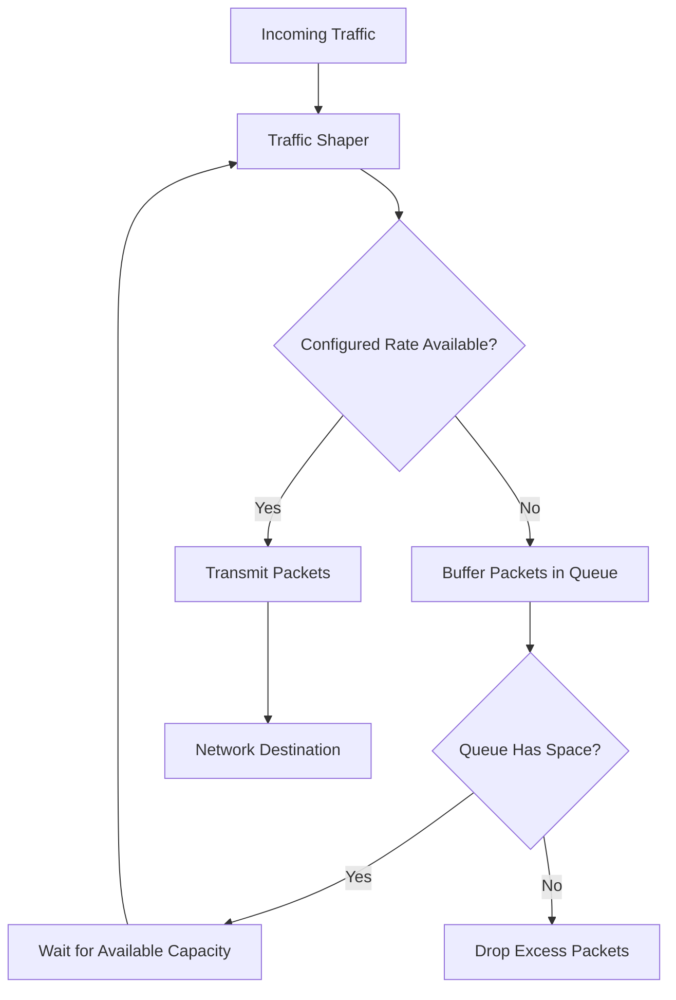

# Traffic Shaping

Traffic shaping is a Quality of Service (QoS) technique used to control the rate at which network traffic is transmitted.

It regulates outgoing traffic by buffering packets and releasing them at a controlled rate. This helps smooth traffic bursts, prevent congestion, and keep bandwidth usage within a configured limit.

Traffic shaping is commonly used by ISPs, enterprise networks, and network administrators to manage bandwidth and improve network performance.

# 🗁 How Traffic Shaping Works

Traffic shaping controls the transmission rate rather than immediately forwarding every packet as fast as possible.

When traffic arrives faster than the configured transmission rate:

* Packets are temporarily stored in a queue.
* The queue releases packets according to the configured rate.
* Short traffic bursts can be absorbed by the queue.
* If the queue becomes full, additional packets may be dropped.

For example, assume a network interface can transmit at 100 Mbps, but the administrator configures traffic shaping at 50 Mbps.

The shaper controls transmission so that the traffic does not exceed the configured rate over the relevant measurement interval.

# 🗁 Traffic Shaping Diagram



# 🗁 Why Traffic Shaping Is Used

Traffic shaping helps administrators control network congestion and allocate bandwidth more predictably.

Common objectives include:

* **Bandwidth Control:** Limit traffic to a configured transmission rate.
* **Congestion Management:** Reduce sudden traffic bursts that overload network links.
* **Buffer Management:** Temporarily hold packets until transmission capacity becomes available.
* **Service Quality:** Help maintain acceptable performance for important applications.
* **Subscriber Management:** Control the bandwidth assigned to individual customers.
* **WAN Optimization:** Prevent an upstream connection from becoming congested.

# 🗁 Traffic Shaping and Bursty Traffic

Network applications do not always generate traffic at a constant rate.

For example, a user downloading a file may generate short periods of high traffic followed by lower activity.

Without traffic shaping, these bursts can contribute to congestion when multiple users share a limited-capacity link.

Traffic shaping regulates these bursts by temporarily buffering packets and transmitting them at a controlled rate.

However, buffering introduces queueing delay. If the queue becomes excessively large, latency can increase significantly.

This condition is commonly associated with **bufferbloat**.

# 🗁 Token Bucket Algorithm

The Token Bucket algorithm is a commonly used mechanism for controlling traffic rates while allowing short bursts.

It uses a bucket containing tokens.

* Tokens are added to the bucket at a configured rate.
* Each packet consumes tokens according to its size.
* Packets can be transmitted when sufficient tokens are available.
* If tokens are unavailable, traffic shaping can hold packets until tokens become available.

Two important parameters are:

| Parameter | Description |
| --- | --- |
| Rate | The rate at which tokens are generated |
| Bucket Size | The maximum number of tokens that can accumulate |

For example:

* Configured rate: 10 Mbps
* Bucket capacity: 5 MB
* Traffic burst: 3 MB

If sufficient tokens have accumulated, the 3 MB burst can be transmitted without waiting for the bucket to refill.

The bucket size controls the permitted burst volume, while the token generation rate controls the long-term average rate.

# 🗁 Traffic Shaping vs Traffic Policing

Traffic shaping and traffic policing both enforce traffic-rate policies, but they handle excess traffic differently.

| Feature | Traffic Shaping | Traffic Policing |
| --- | --- | --- |
| Primary purpose | Smooth traffic transmission | Enforce a traffic-rate limit |
| Excess traffic | Usually buffered | Usually dropped or remarked |
| Queueing | Uses buffering | Generally does not buffer to smooth traffic |
| Delay | Can introduce queueing delay | Does not normally introduce shaping delay |
| Burst handling | Can absorb bursts within queue capacity | Depends on the policing policy and burst allowance |
| Typical deployment | Egress traffic | Ingress or egress traffic |

**Example:**

Suppose a customer has a 20 Mbps bandwidth policy.

* Traffic shaping temporarily queues excess packets and transmits them when capacity becomes available.
* Traffic policing can drop or remark packets that exceed the permitted rate.

# 🗁 Where Traffic Shaping Is Applied

Traffic shaping is commonly applied to outgoing traffic on an interface.

For example, consider an organization connected to the internet through a 100 Mbps ISP connection.

The organization wants to control its outgoing traffic to 95 Mbps.

The router can shape outgoing traffic to approximately 95 Mbps to reduce the likelihood of saturating the 100 Mbps upstream connection.

The exact shaping rate should account for the actual service capacity, encapsulation overhead, and how the provider measures bandwidth.

# 🗁 Traffic Shaping in ISP Networks

ISPs commonly use traffic shaping to manage customer bandwidth.

For example:

| Customer | Configured Bandwidth |
| --- | ---: |
| Customer A | 10 Mbps |
| Customer B | 20 Mbps |
| Customer C | 50 Mbps |
| Customer D | 100 Mbps |

Each customer can have an individual bandwidth policy.

The ISP can also apply aggregate shaping to control the total traffic transmitted through an upstream connection.

Individual subscriber limits and aggregate link limits serve different purposes and may be used together.

# 🗁 Traffic Shaping in MikroTik RouterOS

MikroTik RouterOS provides queueing mechanisms for bandwidth management.

Common queue types include:

* Simple Queues
* Queue Trees
* PCQ

These mechanisms use queueing and scheduling concepts to manage traffic.

### 🖆 Simple Queue Example

The following example limits a customer's upload and download bandwidth.

```routeros
/queue simple
add name="Customer-A" target=192.168.10.10/32 max-limit=10M/20M
```

In this example:

| Parameter | Description |
| --- | --- |
| `name` | Queue name |
| `target` | Customer IP address |
| `max-limit` | Maximum upload/download rates |

For a Simple Queue, the `max-limit` values are specified in upload/download order.

This example configures:

* Upload: 10 Mbps
* Download: 20 Mbps

### 🖆 Queue Tree Example

Queue Trees provide more flexible hierarchical queue management.

They are commonly used with packet marking to classify traffic.

```routeros
/queue tree
add name="Upload-Limit" parent=ether1 max-limit=50M
```

This creates a queue tree entry with a maximum rate of 50 Mbps under `ether1`.

The actual traffic controlled depends on the selected parent, packet direction, and classification configuration.

Queue Trees commonly use firewall mangle rules to mark packets before they enter the relevant queues.

### 🖆 RouterOS FastTrack Consideration

FastTrack can bypass parts of the normal firewall and queue-processing path for FastTracked connections.

As a result, traffic that needs to be classified or controlled by certain queue configurations may not be processed as expected.

When designing QoS policies, verify whether FastTrack is active and whether the relevant traffic passes through the intended queue-processing path.

# 🗁 Best Practices

* Configure shaping rates slightly below the actual bottleneck capacity when controlling congestion on an upstream link.
* Use appropriate queue sizes to avoid excessive buffering.
* Monitor latency, packet loss, and throughput after applying shaping.
* Separate subscriber-level limits from aggregate interface limits.
* Select suitable queue types based on the traffic-management requirements.
* Consider upload and download directions independently.
* Verify packet classification and queue placement.
* Account for FastTrack when implementing QoS in RouterOS.
* Test shaping policies under realistic network load.

# 🗁 Practical Example

Consider a small ISP with a 100 Mbps upstream internet connection.

The ISP wants to avoid saturating the upstream link and provide predictable bandwidth to its customers.

A possible design is:

| Component | Configuration |
| --- | ---: |
| ISP upstream capacity | 100 Mbps |
| Aggregate shaping rate | 95 Mbps |
| Customer A | 10 Mbps |
| Customer B | 20 Mbps |
| Customer C | 30 Mbps |
| Customer D | 50 Mbps |

The customer limits represent individual maximum rates. They do not guarantee that all customers can simultaneously receive their maximum rates.

The aggregate shaping policy controls the total traffic transmitted through the upstream bottleneck.

When several customers transmit simultaneously, the queueing and scheduling policies determine how available capacity is shared.

# 🗁 Summary

Traffic shaping is a QoS technique that regulates the rate of network traffic by buffering packets and transmitting them at a controlled rate.

It helps reduce congestion, smooth traffic bursts, and manage bandwidth across shared network connections.

The key distinction is that traffic shaping generally delays excess packets through buffering, whereas traffic policing generally drops or remarks traffic that exceeds a configured policy.

In MikroTik RouterOS, Simple Queues, Queue Trees, and PCQ provide mechanisms for implementing bandwidth-management policies.
